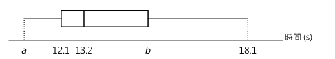
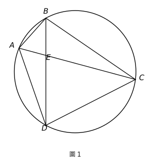
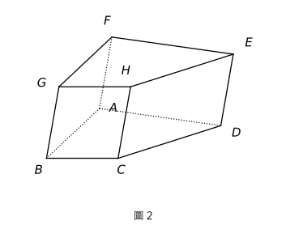
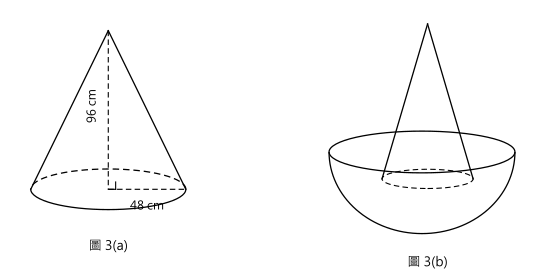
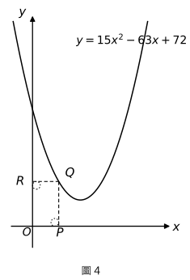
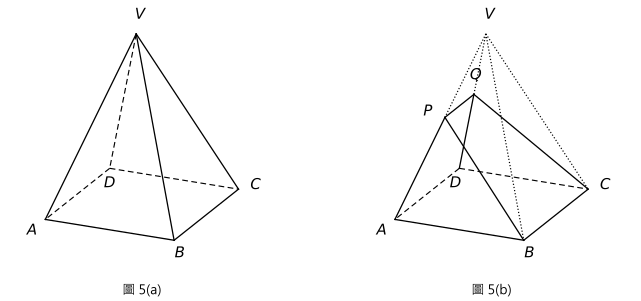

# 2012 DSE 數學必修部分　試卷一（中文版）— 題目清洗版

> 來源：2012-DSE-MATH-CP 1（卷一，2 小時 15 分鐘，共 105 分）
> 說明：已移除頁碼、試卷標頭、答題簿橫線等雜訊；公式重排為 LaTeX。
> 含圖題目已嵌入**電子重繪向量圖**（存於 `2012_P1_figs_svg/`，與本檔案同層；由 `make_2012P1_figs.py` 生成，可改參數重出）。原 PDF 截圖備份在 `2012_P1_figs/`。

---
---

## 第 1 題

【建議標籤】

- 卷別/部分：Paper 1　甲部(1)
- 課題：#指數定律 #代數化簡

【題目內容】

化簡

$$\frac{m^{-12}n^8}{n^3}$$

並以正指數表示答案。（3 分）

---

## 第 2 題

【建議標籤】

- 卷別/部分：Paper 1　甲部(1)
- 課題：#公式變換 #主項變換

【題目內容】

令 $a$ 成為公式

$$\frac{3a+b}{8} = b-1$$

的主項。（3 分）

---

## 第 3 題

【建議標籤】

- 卷別/部分：Paper 1　甲部(1)
- 課題：#因式分解 #恆等式

【題目內容】

因式分解

(a)　$x^2-6xy+9y^2$，

(b)　$x^2-6xy+9y^2+7x-21y$。（3 分）

---

## 第 4 題

【建議標籤】

- 卷別/部分：Paper 1　甲部(1)
- 課題：#百分比 #百分變化

【題目內容】

佩玲的日薪較志偉高 20%，而志偉的日薪較潔儀低 20%。已知志偉的日薪為 \$480。

(a)　求佩玲的日薪。

(b)　誰的日薪最高？試解釋你的答案。（4 分）

---

## 第 5 題

【建議標籤】

- 卷別/部分：Paper 1　甲部(1)
- 課題：#一元方程 #文字應用題

【題目內容】

在設有 6 個展區的展覽中心內有 132 名保安員。各個展區均有相同人數的保安員。在每個展區內，女保安員均較男保安員多 4 名。求在該展覽中心內男保安員的人數。（4 分）

---

## 第 6 題

【建議標籤】

- 卷別/部分：Paper 1　甲部(1)
- 課題：#一元一次不等式 #不等式組

【題目內容】

(a)　求同時滿足

$$\frac{4x+6}{7} > 2(x-3) \quad\text{及}\quad 2x-10 \le 0$$

的 $x$ 值的範圍。

(b)　有多少個正整數同時滿足 (a) 的不等式？（4 分）

---

## 第 7 題

【建議標籤】

- 卷別/部分：Paper 1　甲部(1)
- 課題：#統計 #框線圖 #四分位數間距 #分佈域

【題目內容】

下面的框線圖顯示某田徑學會的一大群學生完成 100 m 賽跑的所需時間的分佈：

該分佈的四分位數間距及分佈域分別為 3.2 s 及 6.8 s。

(a)　求 $a$ 及 $b$。

(b)　該些學生參與某訓練課程。現知在訓練後，該些學生完成 100 m 賽跑的最長所需時間較訓練前少 2.9 s。教練宣稱在訓練後，至少 25% 的學生完成 100 m 賽跑的所需時間有改善。你是否同意？試解釋你的答案。（4 分）

---

## 第 8 題

【建議標籤】

- 卷別/部分：Paper 1　甲部(1)
- 課題：#圓的幾何 #相似三角形 #相交弦

【題目內容】

圖 1 中，$AB$、$BC$、$CD$ 及 $AD$ 均為圓的弦。$AC$ 與 $BD$ 相交於 $E$。已知 $BE=8$ cm、$CE=20$ cm 及 $DE=15$ cm。

(a)　寫出在圖 1 中的一對相似三角形，並求 $AE$。

(b)　假定 $AB=10$ cm。$AC$ 與 $BD$ 是否互相垂直？試解釋你的答案。（5 分）

---

## 第 9 題

【建議標籤】

- 卷別/部分：Paper 1　甲部(1)
- 課題：#求積法 #直立角柱體 #梯形面積 #總表面積

【題目內容】

圖 2 中，實心直立角柱體 $ABCDEFGH$ 的體積為 1020 cm³。該角柱體的底 $ABCD$ 為一梯形，其中 $AD$ 平行於 $BC$。已知 $\angle BAD = 90^\circ$、$AB=12$ cm、$BC=6$ cm 及 $DE=10$ cm。

求

(a)　$AD$ 的長度，

(b)　角柱體 $ABCDEFGH$ 的總表面積。（5 分）

---
---

## 第 10 題

【建議標籤】

- 卷別/部分：Paper 1　甲部(2)
- 課題：#統計 #幹葉圖 #平均值 #中位數

【題目內容】

志誠進行一項中學生在某星期內用於做家課的時數的調查。在發出的問卷中，有二十份回覆。下面的幹葉圖顯示該二十份問卷記錄得的時數：

| 幹（十位） | 葉（個位） |
|:---:|:---|
| 1 | 0　0　1　1　2　3　4　5　5　6　6　7　7 |
| 2 | 0　0　0　5　8 |
| 3 | 4　6 |

(a)　求該二十份問卷記錄得的時數的平均值及中位數。（2 分）

(b)　志誠再收到四份問卷。他知道這四份問卷記錄得的時數的平均值為 18。現知道四份問卷其中兩份記錄得的時數為 19 及 20。

　　(i)　寫出該二十四份問卷記錄得的時數的平均值。

　　(ii)　該二十四份問卷記錄得的時數的中位數與 (a) 所求得的中位數有沒有可能相同？試解釋你的答案。（4 分）

---

## 第 11 題

【建議標籤】

- 卷別/部分：Paper 1　甲部(2)
- 課題：#變分 #部分正變 #相似立體 #面比體積比

【題目內容】

設 \$C 為一表面面積是 $A\text{ m}^2$ 的罐的緊漆成本。已知 \$C 為兩部分之和，一部分為常數，而另一部分隨 $A$ 正變。當 $A=2$ 時，\$C $= 62$；當 $A=6$ 時，\$C $= 74$。

(a)　求一表面面積是 $13\text{ m}^2$ 的罐的緊漆成本。（4 分）

(b)　有一較大的罐與 (a) 所描述的罐相似。若該較大的罐的體積為 (a) 所描述的罐的 8 倍，求該較大的罐的緊漆成本。（2 分）

---

## 第 12 題

【建議標籤】

- 卷別/部分：Paper 1　甲部(2)
- 課題：#求積法 #圓錐體 #半球體

【題目內容】

圖 3(a) 顯示底半徑為 48 cm 及高為 96 cm 的實心金屬直立圓錐體。

(a)　求該圓錐體的體積，答案以 $\pi$ 表示。（2 分）

(b)　把半徑為 60 cm 的半球形容器鉛垂置於一水平面上。該容器載滿牛奶。

　　(i)　求該容器內牛奶的體積，答案以 $\pi$ 表示。

　　(ii)　現把該圓錐體鉛垂置於該容器內，如圖 3(b) 所示。某工匠宣稱剩下在該容器內的牛奶的體積大於 0.3 m³。你是否同意？試解釋你的答案。（5 分）

---

## 第 13 題

【建議標籤】

- 卷別/部分：Paper 1　甲部(2)
- 課題：#因式定理 #三次多項式 #二次函數圖像 #二次方程 #長方形面積

【題目內容】

(a)　求 $k$ 的值使得 $x-2$ 為 $kx^3-21x^2+24x-4$ 的因式。（2 分）

(b)　圖 4 顯示 $y=15x^2-63x+72$ 的圖像。$Q$ 為第一象限內圖像上的可變點。$P$ 及 $R$ 分別為由 $Q$ 至 $x$ 軸及 $y$ 軸的垂足。

　　(i)　設 $(m,0)$ 為 $P$ 的坐標。以 $m$ 表長方形 $OPQR$ 的面積。

　　(ii)　$Q$ 是否有三個不同的位置使長方形 $OPQR$ 的面積為 12？試解釋你的答案。（5 分）

---

## 第 14 題

【建議標籤】

- 卷別/部分：Paper 1　甲部(2)
- 課題：#軌跡 #直線方程 #平行線距離 #圓的方程 #直線與圓相交 #三角形面積

【題目內容】

兩平行線 $L$ 及 $\ell$ 的 $y$ 截距分別為 $-1$ 及 $-3$，且 $L$ 的 $x$ 截距為 3。$P$ 為直角坐標平面上的一動點使得由 $P$ 至 $L$ 的垂直距離等於由 $P$ 至 $\ell$ 的垂直距離。將 $P$ 的軌跡記為 $\Gamma$。

(a)

　　(i)　描述 $\Gamma$ 與 $L$ 之間的幾何關係。

　　(ii)　求 $\Gamma$ 的方程。（5 分）

(b)　圓 $C$ 的方程為 $(x-6)^2+y^2=4$。將 $C$ 的圓心記為 $Q$。

　　(i)　$\Gamma$ 是否通過 $Q$？試解釋你的答案。

　　(ii)　若 $L$ 與 $C$ 相交於 $A$ 及 $B$ 而 $\Gamma$ 與 $C$ 相交於 $H$ 及 $K$，求 $\triangle AQH$ 的面積與 $\triangle BQK$ 的面積之比。（4 分）

---
---

## 第 15 題

【建議標籤】

- 卷別/部分：Paper 1　乙部
- 課題：#統計 #標準差 #標準分 #數據變換

【題目內容】

一班學生在某數學測驗得分的標準差為 10 分。全部學生在該測驗均不及格，故此將每名學生的測驗得分調整，使每個得分均增加 20% 然後額外加 5 分。

(a)　求得分調整後，測驗得分的標準差。（1 分）

(b)　每名學生的標準分有否因得分調整而改變？試解釋你的答案。（2 分）

---

## 第 16 題

【建議標籤】

- 卷別/部分：Paper 1　乙部
- 課題：#排列與組合 #概率

【題目內容】

某公司有 8 個部門。每個部門各提名 2 位代表以成立一個有 16 位成員的工作小組。從該工作小組中隨機選出 4 位成員。

(a)　求所選出的 4 位成員由 4 個不同部門提名的概率。（2 分）

(b)　求所選出的 4 位成員至多由 3 個不同部門提名的概率。（2 分）

---

## 第 17 題

【建議標籤】

- 卷別/部分：Paper 1　乙部
- 課題：#圓的方程 #切線 #直線與圓相交 #中點坐標 #韋達定理

【題目內容】

圓 $C$ 的圓心的坐標為 $(6,10)$。已知 $x$ 軸為 $C$ 的切線。

(a)　求 $C$ 的方程。（2 分）

(b)　直線 $L$ 的斜率及 $y$ 截距分別為 $-1$ 及 $k$。若 $L$ 與 $C$ 相交於 $A$ 及 $B$，以 $k$ 表 $AB$ 的中點的坐標。（5 分）

---

## 第 18 題

【建議標籤】

- 卷別/部分：Paper 1　乙部
- 課題：#立體幾何 #直立角錐體 #平面交角 #直線與平面交角 #三角學

【題目內容】

圖 5(a) 顯示以正方形為底的直立角錐體 $VABCD$，其中 $\angle VAB = 72^\circ$。該底的邊長為 20 cm。設 $P$ 及 $Q$ 分別為 $VA$ 及 $VD$ 上的點使得 $PQ$ 平行於 $BC$ 且 $\angle PBA = 60^\circ$。從 $VABCD$ 切去角錐體 $VPBCQ$ 造成一幾何模型，如圖 5(b) 所示。

(a)　求 $AP$ 的長度。（2 分）

(b)　設 $\alpha$ 為平面 $PBCQ$ 與底 $ABCD$ 之間的交角。

　　(i)　求 $\alpha$。

　　(ii)　設 $\beta$ 為 $PB$ 與底 $ABCD$ 之間的交角。$\alpha$ 與 $\beta$ 哪一個較大？試解釋你的答案。（6 分）

---

## 第 19 題

【建議標籤】

- 卷別/部分：Paper 1　乙部
- 課題：#指數函數 #等比數列 #數列求和 #對數方程 #實際應用

【題目內容】

在某城市，一機場的空運貨站 $X$ 自它開始運作起計的第 $n$ 年所處理的貨物的重量為 $A(n)$ 公噸，其中 $n$ 為一正整數。已知 $A(n)=ab^{2n}$，其中 $a$ 及 $b$ 均為正常數。現知 $X$ 自它開始運作起計的第 1 年及第 2 年所處理的貨物的重量分別為 254100 公噸及 307461 公噸。

(a)

　　(i)　求 $a$ 及 $b$。由此求 $X$ 自它開始運作起計的第 4 年所處理的貨物的重量。

　　(ii)　以 $n$ 表 $X$ 自它開始運作起計的首 $n$ 年所處理的貨物的總重量。（6 分）

(b)　自 $X$ 運作了 4 年，空運貨站 $Y$ 開始運作。設 B$(m)$ 公噸為 $Y$ 自它開始運作起計的第 $m$ 年所處理的貨物的重量，其中 $m$ 為一正整數。已知 B$(m) = 2ab^m$。

　　(i)　該機場的經理宣稱 $Y$ 運作後，每一年 $Y$ 所處理的貨物的重量均較 $X$ 所處理的少。你是否同意？試解釋你的答案。

　　(ii)　該機場的監督認為當 $X$ 和 $Y$ 所處理的貨物自 $X$ 開始運作起計的總重量超出 20 000 000 公噸時，應安裝新設施以維持空運貨站的工作效能。根據該監督的想法，自 $X$ 開始運作起計的哪一年應安裝新設施？（7 分）

---

*— 試卷完 —*
