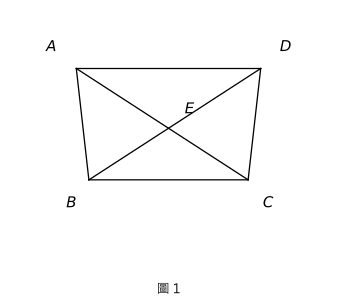
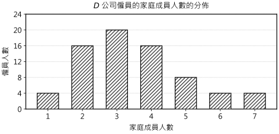
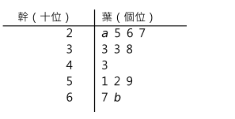
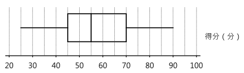
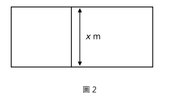
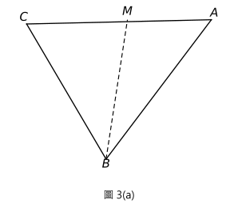
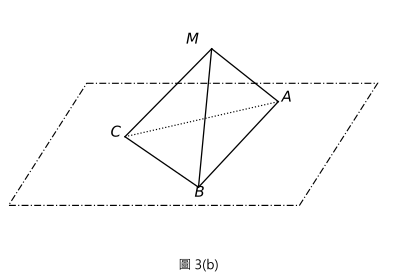

# 2013 DSE 數學 必修部分 試卷一（中文卷）— 題目庫

> 來源：2013-DSE-MATH-CP　｜　時限 2 小時 15 分　｜　全卷必答
> 除特別指明外，數值答案須用真確值，或準確至三位有效數字；試卷附圖不一定依比例繪成。
> 本檔為**題目庫（零答案）**，只含題目清洗 + 建議標籤。

---

## 甲部(1)（35 分）

## 第 1 題

【建議標籤】

- 卷別/部分：Paper 1　甲部(1)
- 課題：#指數定律 #代數化簡

【題目內容】

化簡 $\dfrac{x^{20}y^{13}}{(x^5y)^6}$，並以正指數表示答案。（3 分）

## 第 2 題

【建議標籤】

- 卷別/部分：Paper 1　甲部(1)
- 課題：#主項變換 #分式方程

【題目內容】

令 $k$ 成為公式 $\dfrac{3}{h}-\dfrac{1}{k}=2$ 的主項。（3 分）

## 第 3 題

【建議標籤】

- 卷別/部分：Paper 1　甲部(1)
- 課題：#因式分解 #恆等式

【題目內容】

因式分解

(a) $4m^2-25n^2$，

(b) $4m^2-25n^2+6m-15n$。（3 分）

## 第 4 題

【建議標籤】

- 卷別/部分：Paper 1　甲部(1)
- 課題：#一元方程 #聯立方程

【題目內容】

7 個梨和 3 個橙的價錢為 \$47，而 5 個梨和 6 個橙的價錢為 \$49。求一個梨的價錢。（4 分）

## 第 5 題

【建議標籤】

- 卷別/部分：Paper 1　甲部(1)
- 課題：#一元一次不等式 #整數解

【題目內容】

(a) 解不等式 $\dfrac{19-7x}{3}>23-5x$。

(b) 求所有能同時滿足不等式 $\dfrac{19-7x}{3}>23-5x$ 及不等式 $18-2x\ge 0$ 的整數。（4 分）

## 第 6 題

【建議標籤】

- 卷別/部分：Paper 1　甲部(1)
- 課題：#極坐標 #三角學 #等腰三角形

【題目內容】

在某極坐標系中，$O$ 為極點。點 $A$ 及點 $B$ 的極坐標分別為 $(26,10°)$ 及 $(26,130°)$。設 $L$ 為 $\triangle OAB$ 的反射對稱軸。

(a) 描述 $L$ 與 $\angle AOB$ 之間的幾何關係。

(b) 求 $L$ 與 $AB$ 的交點的極坐標。（4 分）

## 第 7 題

【建議標籤】

- 卷別/部分：Paper 1　甲部(1)
- 課題：#全等三角形 #相似三角形 #圓的幾何 #證明題

【題目內容】

圖 1 中，$ABCD$ 為四邊形。對角線 $AC$ 與對角線 $BD$ 相交於 $E$。已知 $BE=CE$ 及 $\angle BAC=\angle BDC$。

(a) 證明 $\triangle ABC\cong\triangle DCB$。

(b) 考慮在圖 1 中的三角形。

　(i) 有多少對全等三角形？

　(ii) 有多少對相似三角形？（4 分）

## 第 8 題

【建議標籤】

- 卷別/部分：Paper 1　甲部(1)
- 課題：#百分之一 #誤差上下限 #有效數字

【題目內容】

若一包海鹽的重量量得 100 g 準確至最接近的 g，則稱它為普通裝。

(a) 求一包普通裝海鹽的最小可取重量。

(b) 32 包普通裝海鹽之總重量有沒有可能量得 3.1 kg 準確至最接近的 0.1 kg？試解釋你的答案。（5 分）

## 第 9 題

【建議標籤】

- 卷別/部分：Paper 1　甲部(1)
- 課題：#統計 #平均值 #標準差 #四分位數間距 #棒形圖

【題目內容】

下面的棒形圖顯示 $D$ 公司僱員的家庭成員人數的分佈。

(a) 求上述分佈的平均值、四分位數間距及標準差。

(b) $D$ 公司某僱員離職。這僱員的家庭成員人數為 7。求這僱員離職而引致 $D$ 公司僱員的家庭成員人數的標準差的改變。（5 分）

## 甲部(2)（35 分）

## 第 10 題

【建議標籤】

- 卷別/部分：Paper 1　甲部(2)
- 課題：#統計 #中位數 #眾數 #幹葉圖 #分佈域 #概率 #排列與組合

【題目內容】

$A$ 委員會的委員年歲如下：

| | | | | | | | | | |
|---|---|---|---|---|---|---|---|---|---|
| 17 | 18 | 21 | 21 | 22 | 22 | 23 | 23 | 23 | 31 |
| 31 | 34 | 35 | 36 | 47 | 47 | 58 | 68 | 69 | 69 |

(a) 寫出 $A$ 委員會的委員年歲的中位數及眾數。（2 分）

(b) 下面的幹葉圖顯示 $B$ 委員會的委員年歲的分佈。已知這分佈的分佈域為 47。

　(i) 求 $a$ 及 $b$。

　(ii) 現從每個委員會中，各隨機選出一名委員作該委員會的代表。當該兩名代表的年歲之差超過 40 時，他們便可參加某比賽。求這兩名代表可參加該比賽的概率。（4 分）

## 第 11 題

【建議標籤】

- 卷別/部分：Paper 1　甲部(2)
- 課題：#變分 #聯立方程 #求積法

【題目內容】

一周界為 $\ell$ 米的托盤的重量為 $W$ 克。已知 $W$ 為兩部分之和，一部分隨 $\ell$ 正變，另一部分隨 $\ell^2$ 正變。當 $\ell=1$ 時，$W=181$；且當 $\ell=2$ 時，$W=402$。

(a) 求一周界為 1.2 米的托盤的重量。（4 分）

(b) 若一托盤的重量為 594 克，求該托盤的周界。（2 分）

## 第 12 題

【建議標籤】

- 卷別/部分：Paper 1　甲部(2)
- 課題：#因式定理 #多項式 #二次函數 #判別式

【題目內容】

設 $\text{f}(x)=3x^3-7x^2+kx-8$，其中 $k$ 為一常數。已知 $\text{f}(x)\equiv(x-2)(ax^2+bx+c)$，其中 $a$、$b$ 及 $c$ 均為常數。

(a) 求 $a$、$b$ 及 $c$。（4 分）

(b) 某人宣稱方程 $\text{f}(x)=0$ 所有的根均為實數。你是否同意？試解釋你的答案。（3 分）

## 第 13 題

【建議標籤】

- 卷別/部分：Paper 1　甲部(2)
- 課題：#求積法 #立體幾何 #圓柱體 #相似圖形 #比與比例

【題目內容】

在某工場內，把 2 個底半徑均為 $R$ cm 的完全相同的實心金屬直立圓柱體熔化，並重鑄成 27 個底半徑均為 $r$ cm 及高均為 10 cm 的完全相同的較小的實心直立圓柱體。已知較大的圓柱體的底面積為較小的 9 倍。

(a) 求

　(i) $r:R$，

　(ii) 較大的圓柱體的高。（5 分）

(b) 某工匠宣稱較小的圓柱體與較大的圓柱體相似。你是否同意？試解釋你的答案。（2 分）

## 第 14 題

【建議標籤】

- 卷別/部分：Paper 1　甲部(2)
- 課題：#圓的方程 #直線方程 #點到直線距離 #圓的幾何 #三角形面積

【題目內容】

圓 $C$ 的方程為 $x^2+y^2-12x-34y+225=0$。將 $C$ 的圓心記為 $R$。

(a) 寫出 $R$ 的坐標。（1 分）

(b) 直線 $L$ 的方程為 $4x+3y+50=0$。現知 $C$ 與 $L$ 沒有相交。設 $P$ 為 $L$ 上的一點使得 $P$ 最接近 $R$。

　(i) 求 $P$ 與 $R$ 間的距離。

　(ii) 設 $Q$ 為 $C$ 上的一動點。當 $Q$ 最接近 $P$ 時，

　　(1) 描述 $P$、$Q$ 與 $R$ 之間的幾何關係；

　　(2) 求 $\triangle OPQ$ 的面積與 $\triangle OQR$ 的面積之比，其中 $O$ 為原點。（8 分）

## 乙部（35 分）

## 第 15 題

【建議標籤】

- 卷別/部分：Paper 1　乙部
- 課題：#標準分 #框線圖 #統計 #平均值

【題目內容】

下面的框線圖顯示某班學生在一測驗中得分（以分為單位）的分佈。在該測驗中，素珊獲最高得分，而志諺獲得 65 分。素珊及志諺在該測驗中的標準分分別為 3 及 0.5。

(a) 求該分佈的平均值。（2 分）

(b) 素珊宣稱在該測驗中至少一半學生的標準分均為負值。你是否同意？試解釋你的答案。（2 分）

## 第 16 題

【建議標籤】

- 卷別/部分：Paper 1　乙部
- 課題：#概率 #排列與組合

【題目內容】

某盒子內有 5 個白色杯及 11 個藍色杯。若從該盒子中隨機同時抽出 6 個杯，

(a) 求抽出至少 4 個白色杯的概率；（2 分）

(b) 求抽出至少 3 個藍色杯的概率。（2 分）

## 第 17 題

【建議標籤】

- 卷別/部分：Paper 1　乙部
- 課題：#二次函數 #配方法 #主項變換 #極值 #一元二次方程

【題目內容】

(a) 設 $\text{f}(x)=36x-x^2$。利用配方法，求 $y=\text{f}(x)$ 的圖像的頂點的坐標。（2 分）

(b) 一條繩子的長度為 108 m。某保安員將該繩子分割為兩條。一條用作圍成一面積為 $A\text{ m}^2$ 的長方形禁區；另一條長度為 $x$ m，且用作將這禁區分成兩長方形區域，如圖 2 所示。

　(i) 以 $x$ 表 $A$。

　(ii) 該保安員宣稱這禁區的面積可大於 $500\text{ m}^2$。你是否同意？試解釋你的答案。（4 分）

## 第 18 題

【建議標籤】

- 卷別/部分：Paper 1　乙部
- 課題：#三角學 #正弦定理 #餘弦定理 #立體幾何 #兩面角 #摺紙問題

【題目內容】

(a) 圖 3(a) 顯示一張三角形紙卡 $ABC$，其中 $AB=28$ cm、$BC=21$ cm 及 $AC=35$ cm。設 $M$ 為 $AC$ 上的一點使得 $\angle BMC=75°$。

求

　(i) $\angle BCM$，

　(ii) $CM$。（3 分）

(b) 文俊將 (a) 所描述的三角形紙卡沿 $BM$ 摺起，使得 $AB$ 及 $BC$ 均位於水平地面上，如圖 3(b) 所示。已知 $\angle AMC=107°$。

　(i) 求在水平地面上 $A$ 與 $C$ 間的距離。

　(ii) 設 $N$ 為 $BC$ 上的一點使得 $MN$ 垂直於 $BC$。文俊宣稱面 $BCM$ 與水平地面間的交角為 $\angle ANM$。你是否同意？試解釋你的答案。（5 分）

## 第 19 題

【建議標籤】

- 卷別/部分：Paper 1　乙部
- 課題：#等比數列 #百分之一增長 #指數方程 #對數 #數列應用

【題目內容】

現對某城市公共房屋的發展進行研究。已知第 1 年年終時所有公屋單位的總樓面面積為 $9\times10^6\text{ m}^2$，並且在隨後各年裏，每年所落成的公屋單位的總樓面面積均為前一年年終時全部公屋單位的總樓面面積之 $r\%$，其中 $r$ 為一常數，而每年所拆除的公屋單位的總樓面面積均為 $3\times10^5\text{ m}^2$。現知第 3 年年終時所有公屋單位的總樓面面積為 $1.026\times10^7\text{ m}^2$。

(a) (i) 以 $r$ 表第 2 年年終時所有公屋單位的總樓面面積。

　　(ii) 求 $r$。（4 分）

(b) (i) 以 $n$ 表第 $n$ 年年終時所有公屋單位的總樓面面積。

　　(ii) 哪一年年終時所有公屋單位的總樓面面積會首次超過 $4\times10^7\text{ m}^2$？（5 分）

(c) 現假設第 $n$ 年年終時所需公屋單位的總樓面面積為 $(a(1.21)^n+b)\text{ m}^2$，其中 $a$ 及 $b$ 均為常數。某些研究結果顯示下列資料：

| $n$ | 第 $n$ 年年終時所需公屋單位的總樓面面積（m²） |
|---|---|
| 1 | $1\times10^7$ |
| 2 | $1.063\times10^7$ |

一研究助理宣稱基於上述假設，某年年終時所有公屋單位的總樓面面積會大於所需公屋單位的總樓面面積。該宣稱是否正確？試解釋你的答案。（4 分）

---

*試卷完 —*

> 本題目庫由 PDF 原卷清洗制作（SOP §2），插圖按 SOP §3 以 matplotlib 1:1 向量重繪，幾何座標經數學反算。
> 備份原卷裁圖在 `2013P1_figs\`（對照用，非交付品）；頁面影像在 `2013P1_pages\`。
