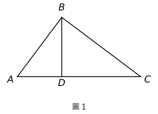
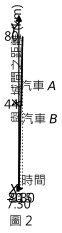
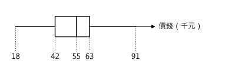
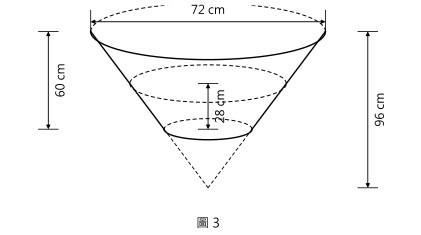
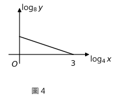
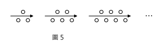
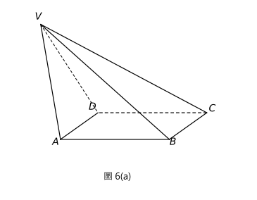
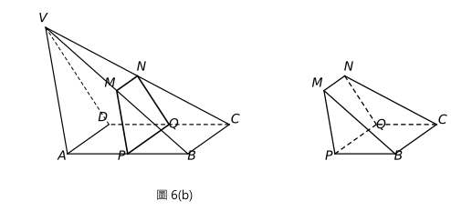
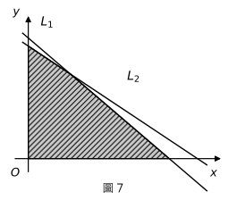
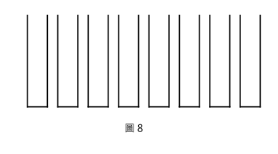

# 2014 DSE 數學 必修部分 試卷一（中文卷）— 題目庫

> 來源：2014-DSE-MATH-CP 1（卷一，兩小時十五分鐘完卷，全卷 105 分）
> 說明：已移除頁碼、試卷標頭、答題簿橫線等雜訊；公式重排為 LaTeX。**本檔為題目庫（零答案）**，只含題目清洗 + 建議標籤。
> 含圖題目已嵌入**電子重繪向量圖**（存於 `2014P1_figs_svg/`，由 `make_2014P1_figs.py` 生成，可改參數重出）。原卷頁面影像在 `2014p1_pages/`（對照用，不上網）。

---

## 甲部(1)（35 分）

## 第 1 題

【建議標籤】

- 卷別/部分：Paper 1　甲部(1)
- 課題：#指數定律 #代數化簡

【題目內容】

化簡

$$\frac{(xy^{-2})^3}{y^4}$$

並以正指數表示答案。（3 分）

---

## 第 2 題

【建議標籤】

- 卷別/部分：Paper 1　甲部(1)
- 課題：#因式分解 #分組分解

【題目內容】

因式分解

(a)　$a^2-2a-3$，

(b)　$ab^2+b^2+a^2-2a-3$。（3 分）

---

## 第 3 題

【建議標籤】

- 卷別/部分：Paper 1　甲部(1)
- 課題：#近似值 #有效數字

【題目內容】

(a)　將 $123.45$ 上捨入至一位有效數字。

(b)　將 $123.45$ 捨入至最接近的整數。

(c)　將 $123.45$ 下捨入至一位小數。（3 分）

---

## 第 4 題

【建議標籤】

- 卷別/部分：Paper 1　甲部(1)
- 課題：#中位數 #眾數 #標準差

【題目內容】

下表顯示一些學生擁有計算機的數目的分佈。

| 計算機的數目 | 0 | 1 | 2 | 3 |
|---|---|---|---|---|
| 學生人數 | 7 | 14 | 15 | 4 |

求上述分佈的中位數、眾數及標準差。（3 分）

---

## 第 5 題

【建議標籤】

- 卷別/部分：Paper 1　甲部(1)
- 課題：#主項變換 #公式變換

【題目內容】

考慮公式 $2(3m+n)=m+7$。

(a)　令 $n$ 成為上述公式的主項。

(b)　若 $m$ 的值增加 $2$，寫出 $n$ 的值的改變。（4 分）

---

## 第 6 題

【建議標籤】

- 卷別/部分：Paper 1　甲部(1)
- 課題：#百分比 #盈利虧損

【題目內容】

某玩具的標價為 $\$255$。該玩具現以其標價六折售出。

(a)　求該玩具的售價。

(b)　若盈利百分率為 $2\%$，求該玩具的成本。（4 分）

---

## 第 7 題

【建議標籤】

- 卷別/部分：Paper 1　甲部(1)
- 課題：#因式定理 #餘數定理 #有理根

【題目內容】

設 $f(x)=4x^3-5x^2-18x+c$，其中 $c$ 為一常數。當 $f(x)$ 除以 $x-2$ 時，餘數為 $-33$。

(a)　$x+1$ 是否 $f(x)$ 的因式？試解釋你的答案。

(b)　某人宣稱方程 $f(x)=0$ 所有的根均為有理數。你是否同意？試解釋你的答案。（5 分）

---

## 第 8 題

【建議標籤】

- 卷別/部分：Paper 1　甲部(1)
- 課題：#平面坐標 #旋轉 #平移 #斜率

【題目內容】

點 $P$ 及點 $Q$ 的坐標分別為 $(-3,5)$ 及 $(2,-7)$。$P$ 繞原點 $O$ 逆時針方向旋轉 $270^\circ$ 至 $P'$。$Q$ 向左平移 $21$ 單位至 $Q'$。

(a)　寫出 $P'$ 及 $Q'$ 的坐標。

(b)　證明 $PQ$ 垂直於 $P'Q'$。（5 分）

---

## 第 9 題

【建議標籤】

- 卷別/部分：Paper 1　甲部(1)
- 課題：#相似三角形 #角度證明

【題目內容】

圖 1 中，$D$ 為 $AC$ 上的一點使得 $\angle BAC=\angle CBD$。

(a)　證明 $\triangle ABC\sim\triangle BDC$。

(b)　假定 $AC=25\ \mathrm{cm}$、$BC=20\ \mathrm{cm}$ 及 $BD=12\ \mathrm{cm}$。$\triangle BCD$ 是否一直角三角形？試解釋你的答案。（5 分）

---

## 甲部(2)（35 分）

## 第 10 題

【建議標籤】

- 卷別/部分：Paper 1　甲部(2)
- 課題：#時間速度距離圖 #平均速率

【題目內容】

$X$ 城與 $Y$ 城相距 $80\ \mathrm{km}$。圖 2 顯示在某上午 7:30 至 9:30 期間，在 $X$ 城與 $Y$ 城之間的同一路上汽車 $A$ 及汽車 $B$ 行駛的圖像。汽車 $A$ 在該期間以恆速率行駛。汽車 $B$ 於該上午 8:15 停下。

(a)　求於該上午 8:15 汽車 $A$ 與 $X$ 城間之距離。（2 分）

(b)　在該上午 7:30 之後，汽車 $A$ 與汽車 $B$ 於甚麼時間首次相遇？（2 分）

(c)　汽車 $B$ 的司機宣稱在該上午 8:15 至 9:30 期間，汽車 $B$ 的平均速率較汽車 $A$ 高。你是否同意？試解釋你的答案。（2 分）

---

## 第 11 題

【建議標籤】

- 卷別/部分：Paper 1　甲部(2)
- 課題：#框線圖 #四分位數 #平均數 #中位數

【題目內容】

某畫廊內有 $33$ 幅油畫。下面的框線圖顯示該畫廊內的油畫的價錢（以千元為單位）的分佈。已知這分佈的平均值為 $53$ 千元。

(a)　求上述分佈的分佈域及四分位數間距。（3 分）

(b)　現將價錢（以千元為單位）分別為 $32$、$34$、$58$ 及 $59$ 的四幅油畫捐贈給一博物館。求該畫廊內餘下的油畫的價錢的平均值及中位數。（3 分）

---

## 第 12 題

【建議標籤】

- 卷別/部分：Paper 1　甲部(2)
- 課題：#圓的方程 #軌跡 #垂直平分線

【題目內容】

圓 $C$ 通過點 $A(6,11)$ 且 $C$ 的圓心為點 $G(0,3)$。

(a)　求 $C$ 的方程。（2 分）

(b)　$P$ 為直角坐標平面上的一動點使得 $AP=GP$。將 $P$ 的軌跡記為 $\Gamma$。

　　(i)　求 $\Gamma$ 的方程。

　　(ii)　描述 $\Gamma$ 與線段 $AG$ 之間的幾何關係。

　　(iii)　若 $\Gamma$ 與 $C$ 相交於 $Q$ 及 $R$，求四邊形 $AQGR$ 的周界。（5 分）

---

## 第 13 題

【建議標籤】

- 卷別/部分：Paper 1　甲部(2)
- 課題：#正變 #二次函數 #坐標幾何

【題目內容】

已知 $f(x)$ 為兩部分之和，一部分隨 $x^2$ 正變，而另一部分為常數。假定 $f(2)=59$ 及 $f(7)=-121$。

(a)　求 $f(6)$。（4 分）

(b)　$A(6,a)$ 及 $B(-6,b)$ 均為 $y=f(x)$ 的圖像上的點。求 $\triangle ABC$ 的面積，其中 $C$ 為 $x$ 軸上的一點。（4 分）

---

## 第 14 題

【建議標籤】

- 卷別/部分：Paper 1　甲部(2)
- 課題：#圓錐 #平截頭體 #曲面面積 #體積

【題目內容】

圖 3 顯示一容器，其形狀為一平截頭體。該平截頭體是從一底半徑為 $72\ \mathrm{cm}$ 及高為 $96\ \mathrm{cm}$ 的倒置直立圓錐體切去其下部分造成。該容器的高度為 $60\ \mathrm{cm}$。將該容器放在一水平桌上。現將一些水注入該容器內。偉明得知該容器內的水深為 $28\ \mathrm{cm}$。

(a)　求該容器被浸濕的曲面面積，答案以 $\pi$ 表示。（4 分）

(b)　偉明宣稱該容器內的水的體積大於 $0.1\ \mathrm{m}^3$。你是否同意？試解釋你的答案。（4 分）

---

## 乙部（35 分）

## 第 15 題

【建議標籤】

- 卷別/部分：Paper 1　乙部
- 課題：#對數 #線性關係 #圖像

【題目內容】

圖 4 中的圖像顯示 $\log_4 x$ 與 $\log_8 y$ 之間的線性關係。該圖像的斜率及在水平軸上的截距分別為 $-\dfrac{1}{3}$ 及 $3$。將 $x$ 與 $y$ 之間的關係表為 $y=Ax^k$ 的形式，其中 $A$ 及 $k$ 均為常數。（3 分）

---

## 第 16 題

【建議標籤】

- 卷別/部分：Paper 1　乙部
- 課題：#數列 #等差數列 #總和

【題目內容】

圖 5 中，第 1 個圖案包含 3 粒點子。對任意正整數 $n$，第 $(n+1)$ 個圖案是由第 $n$ 個圖案加上 2 粒點子所組成。求 $m$ 的最小值使得首 $m$ 個圖案的點子總數超過 $6888$。（4 分）

---

## 第 17 題

【建議標籤】

- 卷別/部分：Paper 1　乙部
- 課題：#立體圖形 #餘弦定理 #梯形面積

【題目內容】

圖 6(a) 顯示以長方形為底的實心角錐體 $VABCD$，其中 $AB=18\ \mathrm{cm}$、$BC=10\ \mathrm{cm}$、$VB=VC=30\ \mathrm{cm}$ 及 $\angle VAB=\angle VDC=110^\circ$。

(a)　求 $\angle VBA$。（2 分）

(b)　$P$、$Q$、$M$ 及 $N$ 分別為 $AB$、$CD$、$VB$ 及 $VC$ 的中點。從 $VABCD$ 切去 $PBCQNM$ 造成一幾何模型，如圖 6(b) 所示。某工匠宣稱梯形 $PQNM$ 的面積小於 $70\ \mathrm{cm}^2$。你是否同意？試解釋你的答案。（5 分）

---

## 第 18 題

【建議標籤】

- 卷別/部分：Paper 1　乙部
- 課題：#線性規劃 #不等式組 #圖解

【題目內容】

(a)　圖 7 中，直線 $L_1$ 的方程為 $6x+7y=900$ 及直線 $L_2$ 的 $x$ 截距為 $180$。$L_1$ 與 $L_2$ 相交於點 $(45,90)$。陰影區域（包括邊界在內）表示某不等式組的解。求該不等式組。（4 分）

(b)　某工廠生產 $X$ 及 $Y$ 兩款衣櫃。每個 $X$ 衣櫃需 $6$ 工時裝嵌及 $2$ 工時包裝，而每個 $Y$ 衣櫃需 $7$ 工時裝嵌及 $3$ 工時包裝。在某月，該工廠有 $900$ 工時可作裝嵌及 $360$ 工時可作包裝。生產一個 $X$ 衣櫃及一個 $Y$ 衣櫃的利潤分別為 $\$440$ 及 $\$665$。某工人宣稱該月的總利潤可超過 $\$80\,000$。你是否同意？試解釋你的答案。（4 分）

---

## 第 19 題

【建議標籤】

- 卷別/部分：Paper 1　乙部
- 課題：#概率 #期望值 #幾何概率

【題目內容】

佩玲及志偉參與一含兩回合的遊戲。在第一回合，佩玲及志偉輪流投擲一枚勻稱骰子。首位擲得點數「3」的參與者勝出第一回合。佩玲及志偉參與第一回合，直至其中一人勝出為止。佩玲首先投擲骰子。

(a)　求佩玲勝出該遊戲第一回合的概率。（3 分）

(b)　在該遊戲的第二回合，球被逐一投入某部由八個管子並列所組成的裝置內（見圖 8）。當球被投入該裝置時，它會隨機跌進其中一管子內。每個管子最多可容納三個球。

這回合的參與者採納下列兩個選項中的一個。

選項 1：將兩個球逐一投入該裝置內。若該兩個球跌進同一管子內，則該參與者獲 10 個代幣；若該兩個球跌進兩個相鄰的管子內，則該參與者獲 5 個代幣；否則，該參與者不獲代幣。

選項 2：將三個球逐一投入該裝置內。若該三個球跌進同一管子內，則該參與者獲 50 個代幣；若該三個球跌進三個相鄰的管子內，則該參與者獲 10 個代幣；若該三個球跌進兩個相鄰的管子內，則該參與者獲 5 個代幣；否則，該參與者不獲代幣。

　　(i)　若第二回合的參與者採納選項 1，求所獲得幣的數目的期望值。

　　(ii)　第二回合的參與者應採納哪一選項才使所獲代幣的數目的期望值達至最大？試解釋你的答案。

　　(iii)　只有第一回合的勝方參與第二回合。已知第二回合的參與者採納能使所獲代幣的數目的期望值達至最大的選項。志偉宣稱佩玲在該遊戲中不獲代幣的概率超過 $0.9$。該宣稱是否正確？試解釋你的答案。（10 分）

---

*試卷完 —*

> 本題目庫由掃描原卷逐頁影像轉寫清洗；插圖以 matplotlib 1:1 向量重繪（`make_2014P1_figs.py`）。
