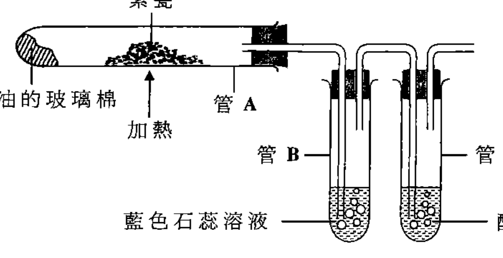
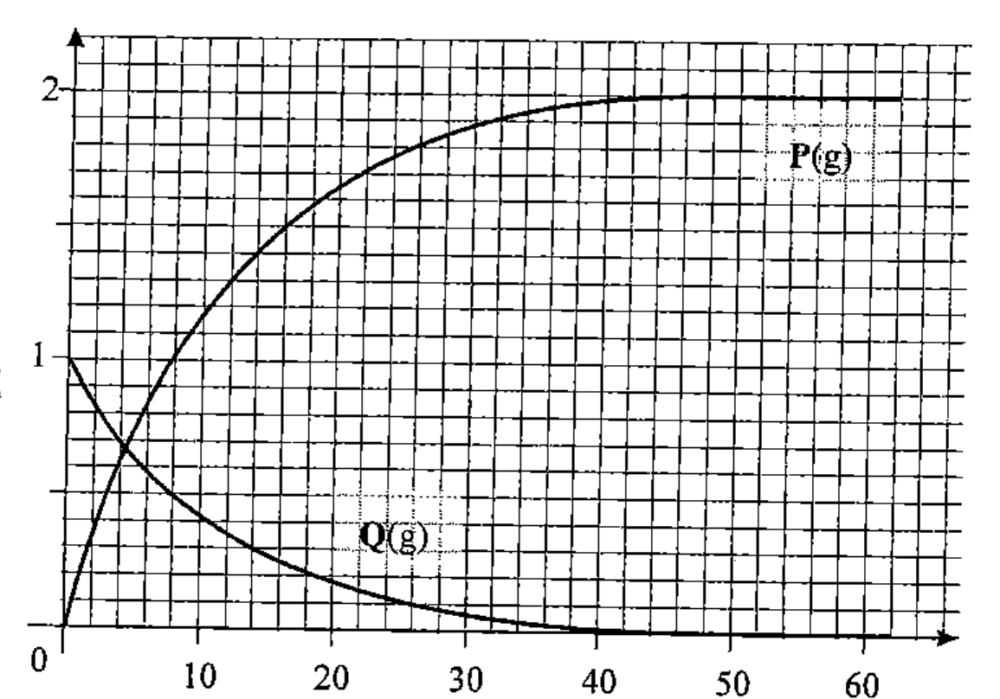
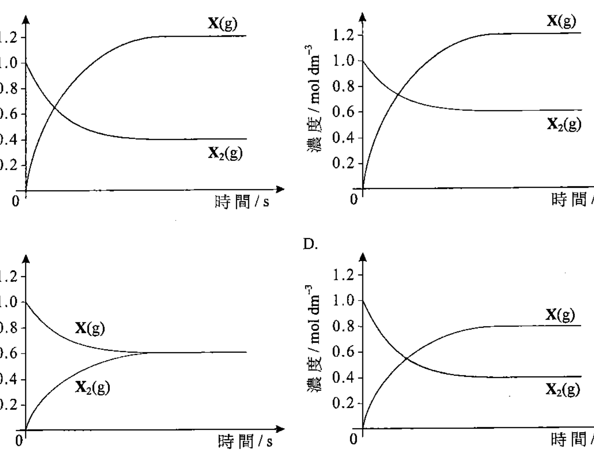
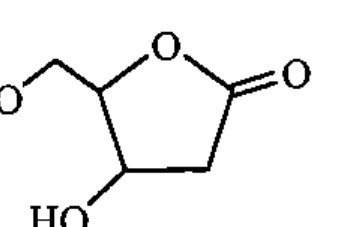
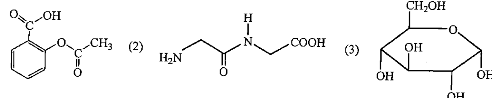

# 2012 DSE 化學 卷一甲（中文卷）— 題目庫

> 來源：文憑試 DSE 化學 Chemistry 2012 歷屆試題 Past Paper 卷一.pdf　｜　多項選擇題 36 題（第一部分 24 題、第二部分 12 題）
> 本部包括兩部分：第一部分設 24 題，第二部分設 12 題。選出每題最佳的答案。考生可參考印於試題答題簿 B 第 20 頁的周期表。
> 說明：已移除頁碼、試卷標頭等雜訊；化學式以 Unicode 下標／上標表示，反應式以 → 或 ⇌ 表示。**本檔為題目庫（零答案）**，只含題目清洗 + 建議標籤。
> 本檔為第 2 層文字交貨（圖用原卷截圖；精修重繪另開第 3 層）。

---

## 第一部分（第 1–24 題）

## 第 1 題

【建議標籤】

- 卷別/部分：卷一甲　第一部分
- 課題：#導電性 #物質分類

【題目內容】

下列哪物質不可導電？

- A. Pt(s)
- B. PbBr₂(l)
- C. 石墨
- D. CH₃CH₂OH(l)

---

## 第 2 題

【建議標籤】

- 卷別/部分：卷一甲　第一部分
- 課題：#沉澱 #定性分析 #水溶性

【題目內容】

小量的一粉末可溶於水生成一清澈溶液。當這溶液與 K₂CO₃(aq) 混合時獲得一白色沉澱。這粉末可能是什麼？

- A. 硫酸鈉
- B. 硫酸鈣
- C. 氫氧化鈉
- D. 氫氧化鈣

---

## 第 3 題

【建議標籤】

- 卷別/部分：卷一甲　第一部分
- 課題：#實驗式 #氧化物 #質量百分率

【題目內容】

在金屬 M 的一個氧化物中，M 的質量百分率是 55.0%。這氧化物的化學式是什麼？

（相對原子質量：O = 16.0，M = 39.1）

- A. MO₂
- B. M₂O
- C. M₂O₂
- D. M₂O₃

---

## 第 4 題

【建議標籤】

- 卷別/部分：卷一甲　第一部分
- 課題：#酸 #pH #酸鹼

【題目內容】

下列哪個有關 CH₃COOH 和 HCl 的陳述正確？

- A. 與 HCl 相比，CH₃COOH 是較強的酸。
- B. 0.1 M CH₃COOH(aq) 的 pH 較 1 M HCl(aq) 的為低。
- C. CH₃COOH(aq) 和 HCl(aq) 兩者均與 NH₃(aq) 反應，各得一鹽。
- D. CH₃COOH(aq) 和 HCl(aq) 兩者均與 Ag(s) 反應，各得一無色氣體。

---

## 第 5 題

【建議標籤】

- 卷別/部分：卷一甲　第一部分
- 課題：#分子極性 #分子形狀

【題目內容】

下列哪分子具極性？

- A. BF₃
- B. C₆H₆
- C. I₂
- D. SF₆

---

## 第 6 題

【建議標籤】

- 卷別/部分：卷一甲　第一部分
- 課題：#氧化數 #銅 #化合物

【題目內容】

在 [?] 中 Cu 的氧化數是多少？

- A. 0
- B. +1
- C. +2
- D. +6

---

## 第 7 題

【建議標籤】

- 卷別/部分：卷一甲　第一部分
- 課題：#生成焓 #燃燒焓 #赫斯定律

【題目內容】

一些物質的標準燃燒焓變如下所示：

| 物質 | 在 298 K 的標準燃燒焓變 / kJ mol⁻¹ |
|---|---|
| H₂(g) | −286 |
| C(石墨) | −394 |
| CH₃CH₂OH(l) | −1371 |

在 298 K，CH₃CH₂OH(l) 的標準生成焓變是

- A. −275 kJ
- B. +275 kJ
- C. +691 kJ
- D. −3017 kJ

---

## 第 8 題

【建議標籤】

- 卷別/部分：卷一甲　第一部分
- 課題：#碳化硅 #結構 #共價鍵

【題目內容】

硅和碳反應生成碳化硅，碳化硅的晶體結構與金剛石的相似。碳化硅非常硬，是由於

- A. 它具有高的熔點。
- B. 硅原子與碳原子形成三鍵。
- C. 它有一個具強共價鍵的巨型網絡結構。
- D. 硅和碳原子兩者均有四粒最外層電子。

---

## 第 9 題

【建議標籤】

- 卷別/部分：卷一甲　第一部分
- 課題：#鋁 #提取 #氧化鋁 #電解

【題目內容】

下列哪個有關一個主要由 Al₂O₃ 組成的鋁礦石的陳述正確？

（相對原子質量：O = 16.0，Al = 27.0）

- A. 可使用碳從這礦石提取鋁。
- B. 這礦石在地殼的豐度非常低。
- C. 以質量計，這礦石含多於 55% 的鋁。
- D. 鋁能從這礦石提取出來是由於應用電解的技術的進步。

---

## 第 10 題

【建議標籤】

- 卷別/部分：卷一甲　第一部分
- 課題：#摩爾濃度 #溶液製備

【題目內容】

把一個 1.02 g 的苯二甲酸氫鉀 (C₈H₅KO₄) 樣本完全溶入蒸餾水，然後稀釋至 250.0 cm³。所得溶液的濃度是多少？

（相對原子質量：H = 1.0，C = 12.0，O = 16.0，K = 39.1）

- A. 0.004 M
- B. 0.010 M
- C. 0.020 M
- D. 0.080 M

---

## 第 11 題

【建議標籤】

- 卷別/部分：卷一甲　第一部分
- 課題：#系統命名 #醇 #烯

【題目內容】

化合物 X 有以下的結構：

CH₂=CHCH₂OH

X 的系統名稱是

- A. 丙-1-烯-3-醇
- B. 丙-2-烯-1-醇
- C. 3-羥基丙烯
- D. 1-羥基丙-3-烯

---

## 第 12 題

【建議標籤】

- 卷別/部分：卷一甲　第一部分
- 課題：#分子形狀 #平面

【題目內容】

下列哪分子是平面的？

- A. BF₃
- B. NH₃
- C. CH₄
- D. PCl₅

---

## 第 13 題

【建議標籤】

- 卷別/部分：卷一甲　第一部分
- 課題：#還原能力 #電化序 #氧化還原

【題目內容】

六個離子物種被還原的趨勢如下所示的次序遞增：

Ba²⁺(aq) < Ca²⁺(aq) < Mg²⁺(aq) < H⁺(aq) < Cu²⁺(aq) < Hg²⁺(aq)

下列哪個陳述正確？

- A. Ba(s) 不與 H⁺(aq) 反應
- B. 與 Hg(l) 相比，Mg(s) 有較強的還原能力
- C. Hg²⁺(aq) 是六個物種中最弱的氧化劑
- D. 當 Cu(s) 浸入 MgSO₄(aq) 時發生置換反應

---

## 第 14 題

【建議標籤】

- 卷別/部分：卷一甲　第一部分
- 課題：#中和 #反應熱

【題目內容】

下列哪對反應物在水中反應時會放出最大量的熱？

- A. 1 mol 的 HCl 和 1 mol 的 KOH
- B. ½ mol 的 H₂SO₄ 和 2 mol 的 KOH
- C. 1 mol 的 (COOH)₂ 和 2 mol 的 KOH
- D. 1 mol 的 CH₃COOH 和 1 mol 的 KOH

---

## 第 15 題

【建議標籤】

- 卷別/部分：卷一甲　第一部分
- 課題：#同位素 #氯 #原子結構

【題目內容】

下列有關一個 ³⁵Cl 原子和一個 ³⁷Cl 原子的陳述，何者正確？

(1) 它們有相同數目的質子。

(2) 它們有不同數目的中子。

(3) 它們有不同數目的最外層電子。

- A. 只有 (1)
- B. 只有 (2)
- C. 只有 (1) 和 (3)
- D. 只有 (2) 和 (3)

---

## 第 16 題

【建議標籤】

- 卷別/部分：卷一甲　第一部分
- 課題：#防銹 #金屬保護

【題目內容】

下列的組合，何者正確？

| 金屬 | 對應的防止銹蝕方法 | 原理 |
|---|---|---|
| (1) 鋁窗框 | 陰極保護 |  |
| (2) 鍍鋅鐵桶 | 犧牲性保護 |  |
| (3) 鍍錫鐵罐 | 合金法 |  |

- A. 只有 (1)
- B. 只有 (2)
- C. 只有 (1) 和 (3)
- D. 只有 (2) 和 (3)

---

## 第 17 題

【建議標籤】

- 卷別/部分：卷一甲　第一部分
- 課題：#裂化 #烷 #實驗裝置

【題目內容】

下圖顯示一實驗的裝置：

把在管 A 的素瓷強熱和把玻璃棉偶爾加熱。下列的陳述，何者正確？

(1) 在玻璃棉發生一化學反應。

(2) 在管 B 的溶液沒有顏色的改變。

(3) 在管 C 的溶液沒有顏色的改變。

- A. 只有 (1)
- B. 只有 (2)
- C. 只有 (1) 和 (3)
- D. 只有 (2) 和 (3)

---

## 第 18 題

【建議標籤】

- 卷別/部分：卷一甲　第一部分
- 課題：#燃料電池 #氫氧

【題目內容】

下列有關一個氫-氧燃料電池的陳述，何者正確？

(1) 它產生非污染的產物。

(2) 它裡面的膜選擇性地容許氫氧離子經過。

(3) 只要在操作條件下持續向它供應氫和氧，它便可不斷供電。

- A. 只有 (1)
- B. 只有 (2)
- C. 只有 (1) 和 (3)
- D. 只有 (2) 和 (3)

---

## 第 19 題

【建議標籤】

- 卷別/部分：卷一甲　第一部分
- 課題：#氣體 #化學反應

【題目內容】

在下列的過程中，哪些曾放出一無色氣體？

(1) 把鎂加進稀硫酸

(2) 把氯化銨與氫氧化鈣共熱

(3) 把水加進檸檬酸和碳酸氫鈉的固體混合物

- A. 只有 (1) 和 (2)
- B. 只有 (1) 和 (3)
- C. 只有 (2) 和 (3)
- D. (1)、(2) 和 (3)

---

## 第 20 題

【建議標籤】

- 卷別/部分：卷一甲　第一部分
- 課題：#辨別 #焰色試驗 #氯化鋅 #溴化鈣

【題目內容】

下列哪些方法可用來辨別 ZnCl₂(aq) 和 CaBr₂(aq)？

(1) 加入 NH₃(aq)

(2) 進行焰色試驗

(3) 蒸發至乾

- A. 只有 (1) 和 (2)
- B. 只有 (1) 和 (3)
- C. 只有 (2) 和 (3)
- D. (1)、(2) 和 (3)

---

## 第 21 題

【建議標籤】

- 卷別/部分：卷一甲　第一部分
- 課題：#加成聚合 #單體

【題目內容】

下列哪些化合物可用作單體來製造加成聚合物？

(1) CH₂=CH₂

(2) CF₂=CF₂

(3) CH₂=C(CH₃)CN

- A. 只有 (1) 和 (2)
- B. 只有 (1) 和 (3)
- C. 只有 (2) 和 (3)
- D. (1)、(2) 和 (3)

---

## 第 22 題

【建議標籤】

- 卷別/部分：卷一甲　第一部分
- 課題：#氧化還原 #反應

【題目內容】

下列哪些過程涉及氧化還原反應？

(1) 把甲醇和乙二醇混合

(2) 把氯和甲烷在陽光下混合

(3) 把乙烯和酸化 KMnO₄(aq) 混合

- A. 只有 (1) 和 (2)
- B. 只有 (1) 和 (3)
- C. 只有 (2) 和 (3)
- D. (1)、(2) 和 (3)

---

## 第 23 題

【建議標籤】

- 卷別/部分：卷一甲　第一部分
- 課題：#鏽蝕 #氧化

【題目內容】

指示：題 23 和題 24 均由兩敘述句組成。考生須先判斷該兩敘述句是否正確；若兩敘述句均屬正確，再判斷第二敘述句是否第一敘述句的合理解釋。然後根據下表，從 A 至 D 四項中選出一個適用的答案：

A. 兩敘述句均屬正確，而第二敘述句為第一敘述句的合理解釋。
B. 兩敘述句均屬正確，但第二敘述句並非第一敘述句的合理解釋。
C. 第一敘述句錯誤，但第二敘述句正確。
D. 兩敘述句均屬錯誤。

| | 第一敘述句 | 第二敘述句 |
|---|---|---|
| 23. | 鐵較銅容易被氧化 | 當鐵和銅各自完全浸在己烷時，鐵比銅腐蝕得更快 |

---

## 第 24 題

【建議標籤】

- 卷別/部分：卷一甲　第一部分
- 課題：#酸雨 #化石燃料

【題目內容】

指示：題 23 和題 24 均由兩敘述句組成。考生須先判斷該兩敘述句是否正確；若兩敘述句均屬正確，再判斷第二敘述句是否第一敘述句的合理解釋。然後根據下表，從 A 至 D 四項中選出一個適用的答案：

A. 兩敘述句均屬正確，而第二敘述句為第一敘述句的合理解釋。
B. 兩敘述句均屬正確，但第二敘述句並非第一敘述句的合理解釋。
C. 第一敘述句錯誤，但第二敘述句正確。
D. 兩敘述句均屬錯誤。

| | 第一敘述句 | 第二敘述句 |
|---|---|---|
| 24. | 燃燒化石燃料可導致酸雨 | 燃燒化石燃料產生二氧化碳 |

---

## 第二部分（第 25–36 題）

## 第 25 題

【建議標籤】

- 卷別/部分：卷一甲　第二部分
- 課題：#摩爾 #氣體體積 #碳酸鈉

【題目內容】

當 1.2 g 的 Na₂CO₃(s) 與 50 cm³ 的 1.0 M HCl 反應，在常溫常壓下，所得二氧化碳的理論體積是多少？

（在常溫常壓下，氣體的摩爾體積 = 24 dm³；相對原子質量：H = 1.0，C = 12.0，N = 14.0，O = 16.0，Na = 23.0）

- A. 272 cm³
- B. 544 cm³
- C. 600 cm³
- D. 1200 cm³

---

## 第 26 題

【建議標籤】

- 卷別/部分：卷一甲　第二部分
- 課題：#濃度時間 #化學方程式 #反應速率

【題目內容】

某個在固定體積的密閉容器內的化學反應，其濃度-時間坐標圖如下所示：

下列哪化學方程式正確代表這反應？

- A. P(g) → Q(g)
- B. Q(g) → P(g)
- C. P(g) → 2Q(g)
- D. Q(g) → 2P(g)

---

## 第 27 題

【建議標籤】

- 卷別/部分：卷一甲　第二部分
- 課題：#平衡 #分解 #濃度時間

【題目內容】

在一個 1 dm³ 的密閉容器內，1 摩爾的 X₂(g) 進行分解生成 X(g) 直到達致平衡。有關的化學方程式如下所示：

X₂(g) ⇌ 2X(g)

下列哪坐標圖正確顯示 X₂(g) 和 X(g) 隨時間的濃度變化？

- A. [?]
- B. [?]
- C. [?]
- D. [?]

---

## 第 28 題

【建議標籤】

- 卷別/部分：卷一甲　第二部分
- 課題：#有機結構 #官能基 #對映異構

【題目內容】

某有機化合物的結構如下所示：

下列哪個陳述正確？

- A. 這化合物不展現對映異構。
- B. 這化合物的分子式是 C₅H₁₀O₄。
- C. 這化合物含有一個酮基團。
- D. 這化合物可被酸化 K₂Cr₂O₇(aq) 氧化。

---

## 第 29 題

【建議標籤】

- 卷別/部分：卷一甲　第二部分
- 課題：#烯 #醇 #加成

【題目內容】

下列哪個有關化合物 U (CH₃CH₂CH=CHCH₂CH₂OH) 的陳述正確？

- A. U 的實驗式是 CH₂O。
- B. U 的系統名稱是己-4-烯-1-醇。
- C. U 與 HCl 反應得出單一產物。
- D. U 可分別把 Br₂(aq) 和酸化 KMnO₄(aq) 變成無色。

---

## 第 30 題

【建議標籤】

- 卷別/部分：卷一甲　第二部分
- 課題：#氧化劑 #還原劑 #離子

【題目內容】

下列哪離子既可作為氧化劑，又可作為還原劑？

- A. Fe²⁺(aq)
- B. Cu²⁺(aq)
- C. Cr₂O₇²⁻(aq)
- D. MnO₄⁻(aq)

---

## 第 31 題

【建議標籤】

- 卷別/部分：卷一甲　第二部分
- 課題：#氧化物 #酸鹼 #水

【題目內容】

下列哪氧化物當加進水時，會生成一酸性溶液？

- A. 二氧化碳
- B. 二氧化硅
- C. 氧化鋁
- D. 氧化鋰

---

## 第 32 題

【建議標籤】

- 卷別/部分：卷一甲　第二部分
- 課題：#阿士匹靈 #結構

【題目內容】

下列結構中，何者代表阿士匹靈藥片的有效成分？

- A. 只有 (1)
- B. 只有 (2)
- C. 只有 (1) 和 (3)
- D. 只有 (2) 和 (3)

---

## 第 33 題

【建議標籤】

- 卷別/部分：卷一甲　第二部分
- 課題：#脫水 #烯 #醇

【題目內容】

當 (CH₃)₂COHCH₂CH₃ 脫水時可生成下列哪些化合物？

(1) (CH₃)₂C=CHCH₃

(2) (CH₃)₂CHCH=CH₂

(3) CH₂=C(CH₃)CH₂CH₃

- A. 只有 (1) 和 (2)
- B. 只有 (1) 和 (3)
- C. 只有 (2) 和 (3)
- D. (1)、(2) 和 (3)

---

## 第 34 題

【建議標籤】

- 卷別/部分：卷一甲　第二部分
- 課題：#羧酸 #酯化 #還原

【題目內容】

某化合物的結構如下所示：

【圖待補：原卷第 34 題／第 10 頁】

下列哪些有關這化合物的陳述正確？

(1) 它可與氨水生成一鹽。

(2) 利用 LiAlH₄ 可把它還原成一烷醇。

(3) 它可與甲醇在適當條件下生成一酯。

- A. 只有 (1) 和 (2)
- B. 只有 (1) 和 (3)
- C. 只有 (2) 和 (3)
- D. (1)、(2) 和 (3)

---

## 第 35 題

【建議標籤】

- 卷別/部分：卷一甲　第二部分
- 課題：#溫度 #平衡 #產率

【題目內容】

指示：題 35 和題 36 均由兩敘述句組成。考生須先判斷該兩敘述句是否正確；若兩敘述句均屬正確，再判斷第二敘述句是否第一敘述句的合理解釋。然後根據下表，從 A 至 D 四項中選出一個適用的答案：

A. 兩敘述句均屬正確，而第二敘述句為第一敘述句的合理解釋。
B. 兩敘述句均屬正確，但第二敘述句並非第一敘述句的合理解釋。
C. 第一敘述句錯誤，但第二敘述句正確。
D. 兩敘述句均屬錯誤。

| | 第一敘述句 | 第二敘述句 |
|---|---|---|
| 35. | 增加反應溫度可增加所有可逆化學反應的產率 | 增加反應溫度可縮短所有可逆化學反應達致平衡所需的時間 |

---

## 第 36 題

【建議標籤】

- 卷別/部分：卷一甲　第二部分
- 課題：#幾何異構 #烯

【題目內容】

指示：題 35 和題 36 均由兩敘述句組成。考生須先判斷該兩敘述句是否正確；若兩敘述句均屬正確，再判斷第二敘述句是否第一敘述句的合理解釋。然後根據下表，從 A 至 D 四項中選出一個適用的答案：

A. 兩敘述句均屬正確，而第二敘述句為第一敘述句的合理解釋。
B. 兩敘述句均屬正確，但第二敘述句並非第一敘述句的合理解釋。
C. 第一敘述句錯誤，但第二敘述句正確。
D. 兩敘述句均屬錯誤。

| | 第一敘述句 | 第二敘述句 |
|---|---|---|
| 36. | 2-氯丁-1-烯展現幾何異構 | 2-氯丁-1-烯有一雙鍵 |

---

## 待人工核對

- 第 1 題：D 選項化學式 OCR 唔清（讀作「CI,CH OHC」），按上下文作 CH₃CH₂OH(l)，待對頁核實。
- 第 3 題：A–D 各選項氧化物化學式（MO₂／M₂O／M₂O₂／M₂O₃）下標位置 OCR 唔清，待對頁核實。
- 第 6 題：化合物化學式 OCR 唔清（讀作「CulHsCl_」），未能可靠還原，標 [?]，待對頁核實。
- 第 9 題：D 選項「應用電解的技術」中「解」字 OCR 缺（讀作「應用電的技術」），待對頁核實。
- 第 10 題：化合物名稱及化學式（讀作「猷酸氫鉀 (CHsOl)」，按摩爾質量推斷為苯二甲酸氫鉀 C₈H₅KO₄），待對頁核實。
- 第 14 題：B 選項 H₂SO₄ 前係數 OCR 缺（讀作「 mol 的 HSO₄」），按上下文件 ½ mol，待對頁核實。
- 第 15 題：同位素上標（³⁵Cl／³⁷Cl）OCR 唔清，待對頁核實。
- 第 16 題：表格「原理」一欄原卷或為空／併列（OCR 未能分辨各欄內容），待對頁核實。
- 第 17 題：裝置圖 crop（q17）邊界及圖內標註（素瓷／管 A／管 B／管 C／藍色石蕊／酸化 KMnO₄）待對頁核實。
- 第 25 題：C／D 選項數值（OCR 讀作「oot」／「120t」，作 600 cm³／1200 cm³）待對頁核實。
- 第 26、27 題：坐標圖 crop（q26／q27）刻度標註待對頁核實。
- 第 28 題：結構圖 crop（q28）及 B 選項分子式（C₅H₁₀O₄）待對頁核實。
- 第 32 題：阿士匹靈結構選項 crop（q32）邊界待對頁核實。
- 第 34 題：化合物結構圖未能可靠截圖，標圖待補。
