# 2012 DSE 化學 卷一乙（中文卷）— 題目庫

> 來源：文憑試 DSE 化學 Chemistry 2012 歷屆試題 Past Paper 卷一.pdf　｜　乙部 結構式問題 16 題（第一部分 10 題、第二部分 6 題）
> 本部包括兩部分：第一和第二部分各題均須作答。有 * 號標記的試題，將有一分給予達致有效傳意的答案。
> 說明：已移除頁碼、試卷標頭、答題簿橫線等雜訊；化學式以 Unicode 下標／上標表示，反應式以 → 或 ⇌ 表示。**本檔為題目庫（零答案）**，只含題目清洗 + 建議標籤。
> 本檔為第 2 層文字交貨（圖用原卷截圖；精修重繪另開第 3 層）。

---

## 第一部分（第 1–10 題）

## 第 1 題

【建議標籤】

- 卷別/部分：卷一乙　第一部分
- 課題：#同位素 #氖 #相對原子質量

【題目內容】

氖在自然界中以三個同位素存在，每個同位素的豐度如下表所示：

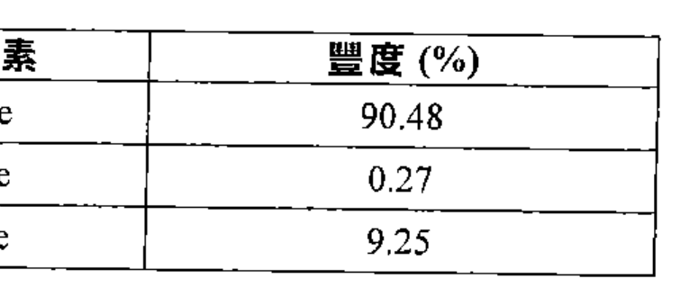

(a)　「同位素」一詞是什麼意思？（1 分）

(b)　計算氖的相對原子質量。（2 分）

(c)　寫出氖的一項日常應用。（1 分）

(d)　解釋為什麼氖的沸點較氧的為低。（2 分）

---

## 第 2 題

【建議標籤】

- 卷別/部分：卷一乙　第一部分
- 課題：#聚合物 #乙酸乙烯酯 #裂解 #酯

【題目內容】

聚(乙酸乙烯酯)是一個聚合物，它的單體是乙酸乙烯酯，其結構如下所示：

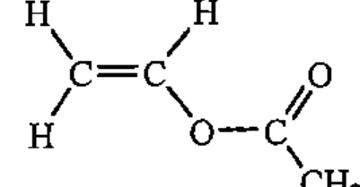

(a)　乙烯是用來製造乙酸乙烯酯的原料。乙烯可從較高分子質量的碳氫化合物經一個重要的工業過程產得。

　　(i)　寫出這工業過程的名稱。

　　(ii)　解釋為什麼這過程是重要的。

(b)　繪畫聚(乙酸乙烯酯)的結構。（2 分）

(c)　乙酸乙酯是一個有機溶劑。

　　(i)　繪畫乙酸乙酯的結構。

　　(ii)　建議一個化學測試，顯示如何分辨乙酸乙烯酯和乙酸乙酯。（3 分）

---

## 第 3 題

【建議標籤】

- 卷別/部分：卷一乙　第一部分
- 課題：#電化電池 #檸檬電池 #還原能力

【題目內容】

參照下面各圖所示有關檸檬電池的資料：

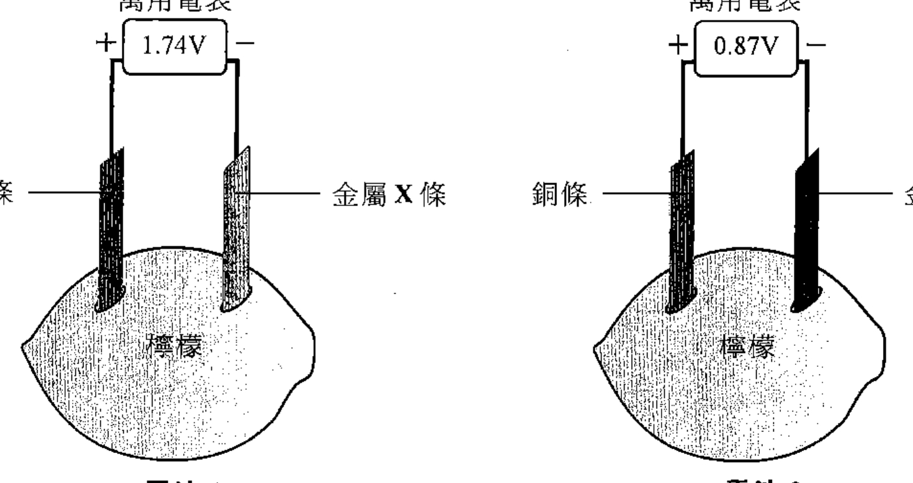

(a)　電池中的檸檬有什麼功用？（1 分）

(b)　完成下表，把金屬 X、金屬 Y 和銅按還原能力遞增的次序排列。

| | 還原能力遞增 |
|---|---|

（1 分）

(c)　參照電池 1，寫出在以下地方發生變化的半反應式：

　　(i)　金屬 X 條（X 是一個第 II 族金屬）

　　(ii)　銅條

（2 分）

(d)　參照電池 2，如果以銀條取代銅條，那金屬 Y 條會否是正電極？解釋你的答案。（? 分）

---

## 第 4 題

【建議標籤】

- 卷別/部分：卷一乙　第一部分
- 課題：#氫鍵 #氟化氫

【題目內容】

輔以一圖，解釋在氟化氫中氫鍵的形成。（3 分）

---

## 第 5 題

【建議標籤】

- 卷別/部分：卷一乙　第一部分
- 課題：#電鍍 #電解 #硫酸銅

【題目內容】

為製備 50 dm³ 的 0.1 M CuSO₄(aq)，一位經驗不足的電鍍工人把所需準確量的 CuSO₄·5H₂O(s) 加進在塑膠容器的水中，接著他用一根鐵棒攪拌該混合物直至 CuSO₄·5H₂O(s) 完全溶解。最後他把一個該溶液的樣本送交質量控制實驗室進行分析，但發現 CuSO₄(aq) 的濃度低於 0.1 M。

(a)　輔以一化學方程式，解釋為什麼所製得 CuSO₄(aq) 的濃度低於 0.1 M。（2 分）

(b)　該工人用所製備的 CuSO₄(aq) 藉電解把一層銅蓋於一金屬物件上，他使用了一個不合理的電壓，並發現有些氣泡在該物件上生成，而且銅層容易剝落。

　　(i)　解釋為什麼可藉電解把銅蓋於金屬物件上。

　　(ii)　提出那些氣泡是什麼，並解釋為什麼銅層容易剝落。（3 分）

(c)　繪畫在實驗室藉電解把一層銅蓋於金屬物件上所用的實驗裝置標示圖。（3 分）

---

## 第 6 題

【建議標籤】

- 卷別/部分：卷一乙　第一部分
- 課題：#製備 #硝酸鉛 #硫酸鉛 #沉澱

【題目內容】

概述由固體硝酸鉛(II) 製備固體硫酸鉛(II) 的各步驟。你要寫出所需的各額外化學試劑，但毋須說明所涉及的儀器。（4 分）

---

## 第 7 題

【建議標籤】

- 卷別/部分：卷一乙　第一部分
- 課題：#肥料 #硝酸銨 #滴定 #質量百分率

【題目內容】

肥料只含有硝酸銨 (NH₄NO₃) 和氯化鉀 (KCl)。進行一實驗以測定在這肥料中 NH₄NO₃ 的質量百分率。所用的裝置如下所示：

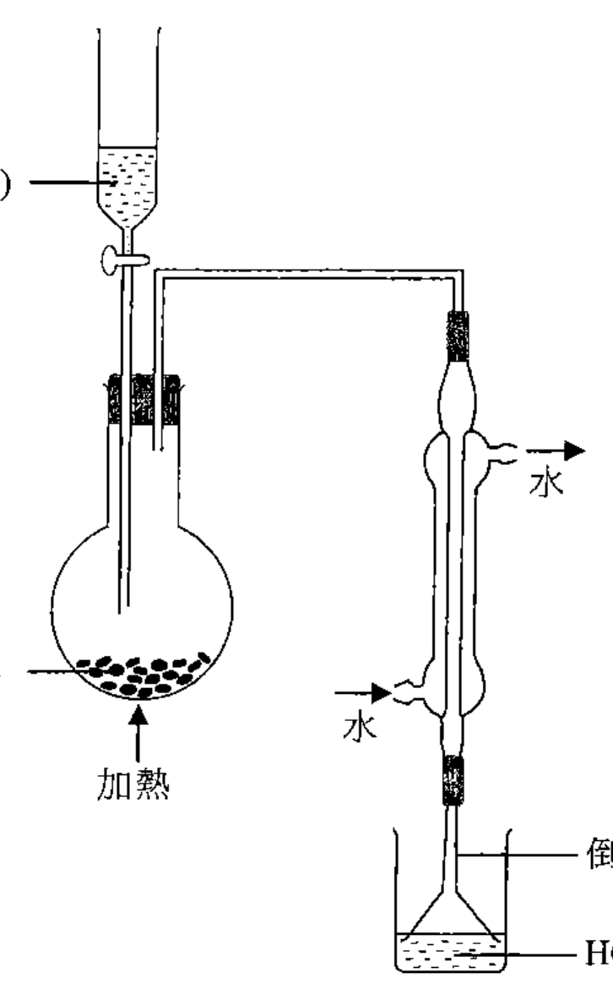

把 KOH(aq) 慢慢加進肥料並把所生成的混合物溫和地加熱。所生成的氨首先在冷凝器冷卻，然後經過一倒立的漏斗通入含 0.0485 mol 的 HCl 的溶液內。最後，把這溶液配成 100.00 cm³ 並標示為 S。

(a)　寫出 NH₄NO₃ 與 KOH 反應的離子方程式。（1 分）

(b)　提出其中一個所用的化合物的潛在危險。（1 分）

(c)　已知氨非常溶於水，寫出使用一個倒立的漏斗的好處。（1 分）

(d)　把 25.00 cm³ 的 S 轉移到一錐形瓶，然後以 0.100 M NaOH(aq) 進行滴定，用甲基橙為指示劑。需用 41.00 cm³ 的該 NaOH(aq) 來達到終點。

　　(i)　寫出應用來轉移 25.00 cm³ 的 S 的儀器名稱。

　　(ii)　寫出在滴定終點的顏色變化。

　　(iii)　計算在這肥料中 NH₄NO₃ 的質量百分率。（NH₄NO₃ 的摩爾質量 = 80.0 g）（5 分）

(e)　建議一測試以顯示該肥料中存有一個含鉀的化合物。（1 分）

---

## 第 8 題

【建議標籤】

- 卷別/部分：卷一乙　第一部分
- 課題：#碳酸氫鉀 #分解焓 #赫斯定律 #烘焙

【題目內容】

碳酸氫鉀 (KHCO₃) 可用於烘焙麵包。KHCO₃ 受熱分解成 K₂CO₃、H₂O 和 CO₂。

(a)　解釋在烘焙麵包使用 KHCO₃ 的目的。（1 分）

(b)　寫出 KHCO₃ 受熱分解的化學方程式。（1 分）

(c)　KHCO₃(s) 的分解焓變可由以下兩個反應的焓變間接測得：

　　KHCO₃(s) + HCl(aq) → KCl(aq) + H₂O(l) + CO₂(g)　反應(1)

　　K₂CO₃(s) + 2HCl(aq) → 2KCl(aq) + H₂O(l) + CO₂(g)　反應(2)

　　(i)　在一個測定反應(1)的焓變的實驗中，把 3.39 g 的 KHCO₃(s) 加進在發泡聚苯乙烯杯子的過量 HCl(aq) 中。所得的實驗數據如下所示：

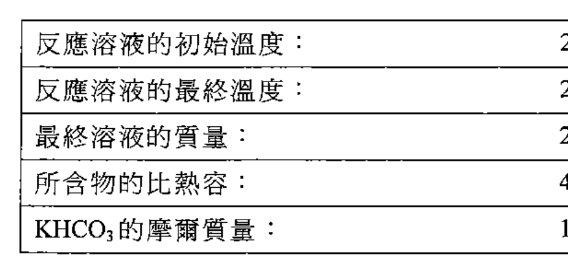

　　假設可忽略該杯子的熱容。利用以上的數據計算反應(1)的焓變。

　　(ii)　在另一個於相同條件下進行的實驗中，得出反應(2)的焓變為 −49.1 kJ mol⁻¹。計算在實驗條件下 KHCO₃(s) 的分解焓變。（4 分）

(d)　根據文獻，K₂CO₃(s)、KHCO₃(s)、CO₂(g) 和 H₂O(l) 的標準生成焓變如下：

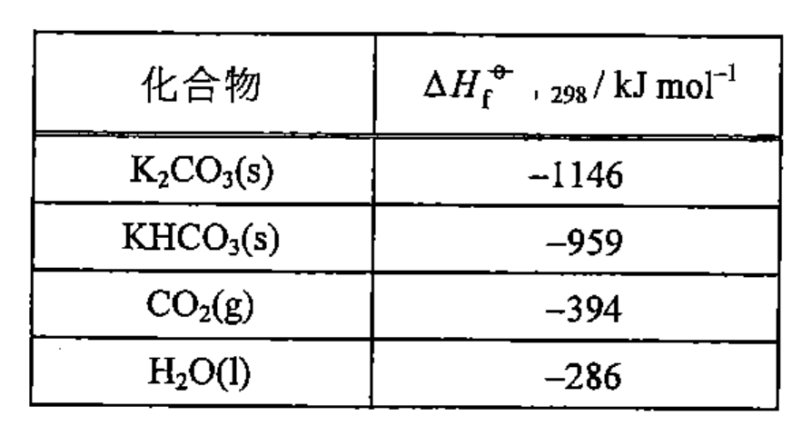

　　(i)　使用所給資料，計算 KHCO₃(s) 的標準分解焓變。

　　(ii)　提出為什麼 (c)(ii) 和 (d)(i) 所得的答案有所不同。（2 分）

---

## 第 9 題

【建議標籤】

- 卷別/部分：卷一乙　第一部分
- 課題：#鐵生鏽 #防銹 #空氣污染

【題目內容】

下圖顯示一個探究影響鐵生鏽的因素的實驗裝置：

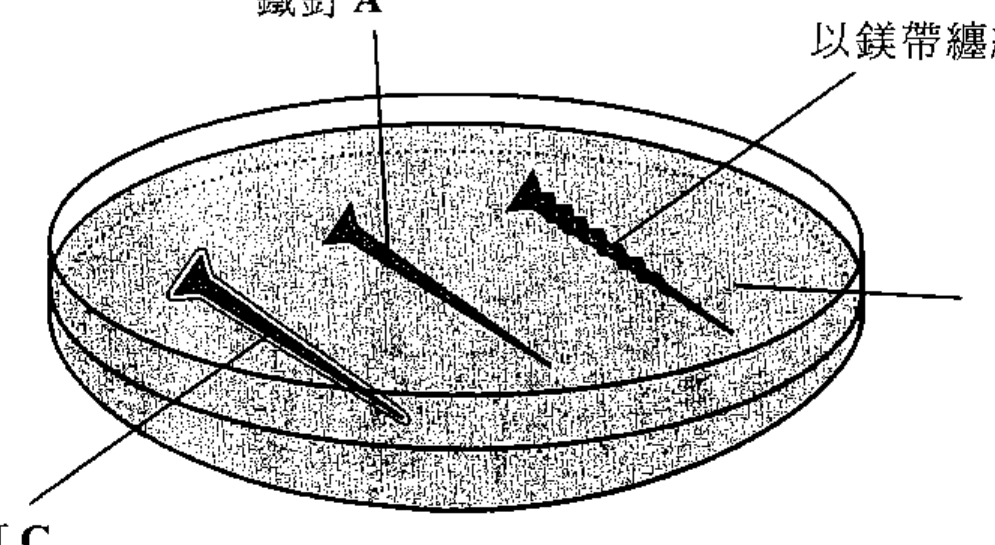

(a)　如果上面裝置中的某鐵釘生鏽，會有什麼觀察？（1 分）

(b)　提出在上面裝置的鐵釘中，何者在實驗中不生鏽。解釋你的答案。（3 分）

---

## 第 10 題

【建議標籤】

- 卷別/部分：卷一乙　第一部分
- 課題：#化石燃料 #空氣污染

【題目內容】

建議三個措施，以減少因使用化石燃料所排放的空氣污染物。（3 分）

---

## 第二部分（第 11–16 題）

## 第 11 題

【建議標籤】

- 卷別/部分：卷一乙　第二部分
- 課題：#反應速率 #初速 #氫氣 #鋅

【題目內容】

在一實驗中，把 50 cm³ 的 2.0 M HCl(aq) 加進一個盛有 2.0 g 的鋅粉的錐形瓶中。下圖的曲線顯示實驗首幾分鐘所釋出氫氣的體積（在常溫常壓下量度），而圖中虛線是該曲線在反應開始時的切線：

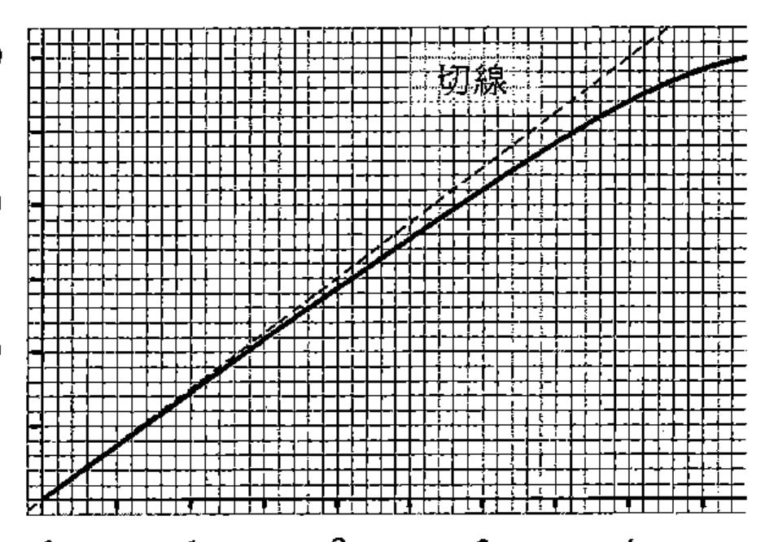

(a)　一個反應的「初速」是指該反應開始時的瞬間速率。參考上圖，計算這反應對應於所釋出氫氣的體積的初速。（1 分）

(b)　解釋以 2.0 M H₂SO₄(aq) 取代 2.0 M HCl(aq) 對這反應的初速的定性影響。（? 分）

(c)　當反應完成時，所有鋅粉耗盡。計算所釋出氫氣的理論體積（在常溫常壓下量度）。（在常溫常壓下，氣體的摩爾體積 = 24 dm³；相對原子質量：Zn = 65.4）（3 分）

---

## 第 12 題

【建議標籤】

- 卷別/部分：卷一乙　第二部分
- 課題：#肉桂醛 #醛 #蒸餾 #合成路線

【題目內容】

肉桂（可用作香料）含有肉桂醛 (C₉H₈O)。肉桂醛的結構如下所示：

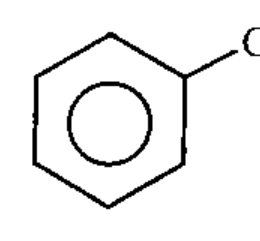

(a)　繪畫以上結構的反-異構體。（? 分）

(b)　解釋為什麼乙酸乙酯是較水為好的溶劑以溶解肉桂醛。

(c)　一學生從肉桂萃取肉桂醛的精油，經過一連串步驟後得出一個只含乙酸乙酯和肉桂醛的溶液。為把這兩個化合物分開需對這溶液進行簡單蒸餾。繪畫所涉及的裝置圖，並標示所集得餾液的名稱。

（沸點：肉桂醛 = 248 °C；乙酸乙酯 = 77 °C）（2 分）

(d)　概述一條不多於三個步驟的合成路線來完成以下的轉化。寫出每一步驟的試劑（一個或多個）、反應條件（如適用）及有機生成物的結構。

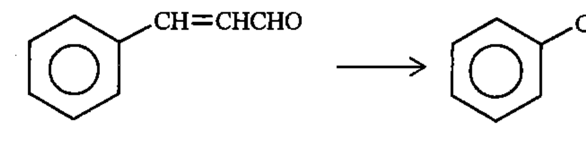

（2 分）

---

## 第 13 題

【建議標籤】

- 卷別/部分：卷一乙　第二部分
- 課題：#平衡常數 #硫氰酸鐵 #勒沙特列

【題目內容】

參照以下方程式所代表的反應：

Fe³⁺(aq) + SCN⁻(aq) ⇌ Fe(SCN)²⁺(aq)

在一實驗中，25.0 cm³ 的 0.010 M Fe₂(SO₄)₃(aq) 和 25.0 cm³ 的 0.010 M KSCN(aq) 於室溫下在一個錐形瓶中混合，並達致平衡。

(a)　當達致平衡時，混合物中的 Fe(SCN)²⁺(aq) 的濃度是 0.0043 M。計算在室溫下以上反應的平衡常數 Kc。（3 分）

(b)　已知 FePO₄(s) 不溶於水。提出如果把 H₃PO₄(aq) 加進這平衡混合物中對平衡位置會有什麼影響。（1 分）

---

## 第 14 題

【建議標籤】

- 卷別/部分：卷一乙　第二部分
- 課題：#油 #脂肪 #氫化 #旋光性 #皂化

【題目內容】

下圖顯示一個油分子 X 轉化成一脂肪分子 T：

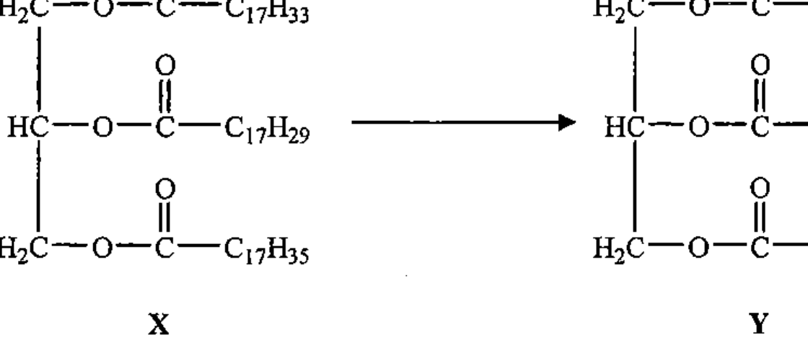

(a)　(i)　已知在 X 和 T 兩者中的所有烷基均為直鏈。在上圖使用「*」來標示手性碳（一個或多個）。

　　(ii)　根據 (i)，解釋在上面的轉化中是否涉及旋光性的變化。（2 分）

(b)　T 的加鹼水解的其中一個產物具清潔性質。解釋這產物的清潔性質。（4 分）

---

## 第 15 題

【建議標籤】

- 卷別/部分：卷一乙　第二部分
- 課題：#自由基取代 #甲烷 #溴 #電子圖

【題目內容】

利用電子圖，逐步闡明 CH₄ 如何與 Br₂ 在陽光下反應以生成 CH₃Br（只需顯示最外層的電子）。（3 分）

---

## 第 16 題

【建議標籤】

- 卷別/部分：卷一乙　第二部分
- 課題：#氧化物 #導電性 #熔點 #氧化鋁

【題目內容】

參考以下氧化物：

Na₂O　MgO　Al₂O₃　SiO₂　P₄O₁₀　SO₂　Cl₂O

(a)　上面所列的氧化物中，何者在熔融狀態下可導電？（1 分）

(b)　解釋為什麼在上面所列的共價氧化物中 SiO₂ 具最高熔點。（2 分）

(c)　為 Al₂O₃(s) 與 NaOH(aq) 的反應寫出一化學方程式。（1 分）

---

## 待人工核對

- 第 1 題：「氖」用字（OCR 讀作「氛」）及同位素豐度表 crop（q01）中同位素符號／豐度值（OCR 讀 90.48／0.21／9.25，中間值或為 0.27）待對頁核實。
- 第 2 題：「乙酸乙烯酯／乙烯／乙酸乙酯」等名稱 OCR 多處誤讀為「二酸二烯酯／二烯／二酸乙酯」（已按上下文更正），單體結構 crop（q02）待對頁核實。
- 第 3 題：金屬 X「第 II 族」OCR 讀作「第 I 族」；(d) 題分數 OCR 唔清（讀作「牙」）；檸檬電池圖 crop（q03）電表讀數（1.74／0.87）待對頁核實。
- 第 5 題：溶液體積 OCR 讀作「50 dm³」（或為 500 cm³），待對頁核實。
- 第 7 題：裝置圖 crop（q07）內標註（50.0 cm³ 8 M KOH(aq)／3.150 g 肥料／加熱／倒立漏斗）待對頁核實。
- 第 8 題：實驗數據表 crop（q08a）內最終溫度等數值 OCR 唔清；標準生成焓表 crop（q08b）內 H₂O(l) 一列數值待對頁核實。
- 第 9 題：鐵生鏽裝置 crop（q09）內鐵釘 A／B／C 標註待對頁核實。
- 第 11 題：氫氣體積曲線 crop（q11）軸刻度待對頁核實；(b) 題分數 OCR 唔清。
- 第 12 題：「精油」一詞 OCR 讀作「琉申」；(d) 轉化結構 crop（q12b）中苯環部分待對頁核實。
- 第 13 題：Fe₂(SO₄)₃／KSCN 濃度（0.010 M）及平衡濃度（0.0043 M）下標 OCR 唔清，待對頁核實。
- 第 14 題：油分子 X／脂肪分子 T 結構 crop（q14）內脂肪酸鏈（C₁₇H₃₃／C₁₇H₃₅／C₁₇H₂₉ 等）標註待對頁核實。
