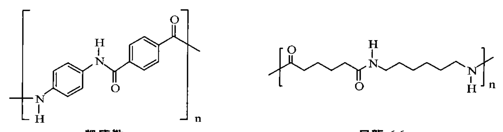
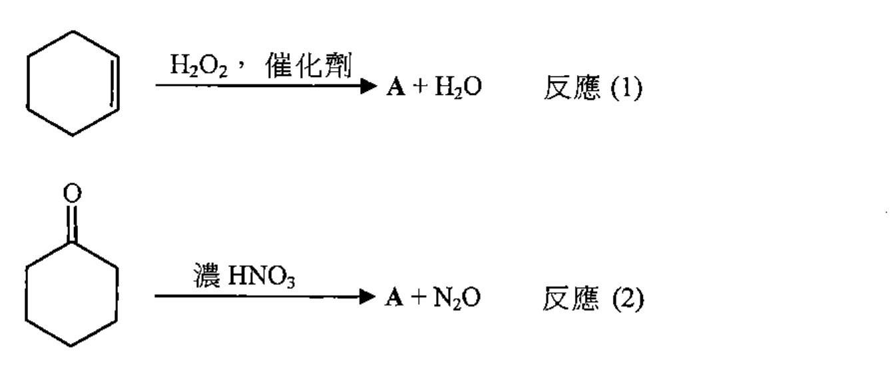
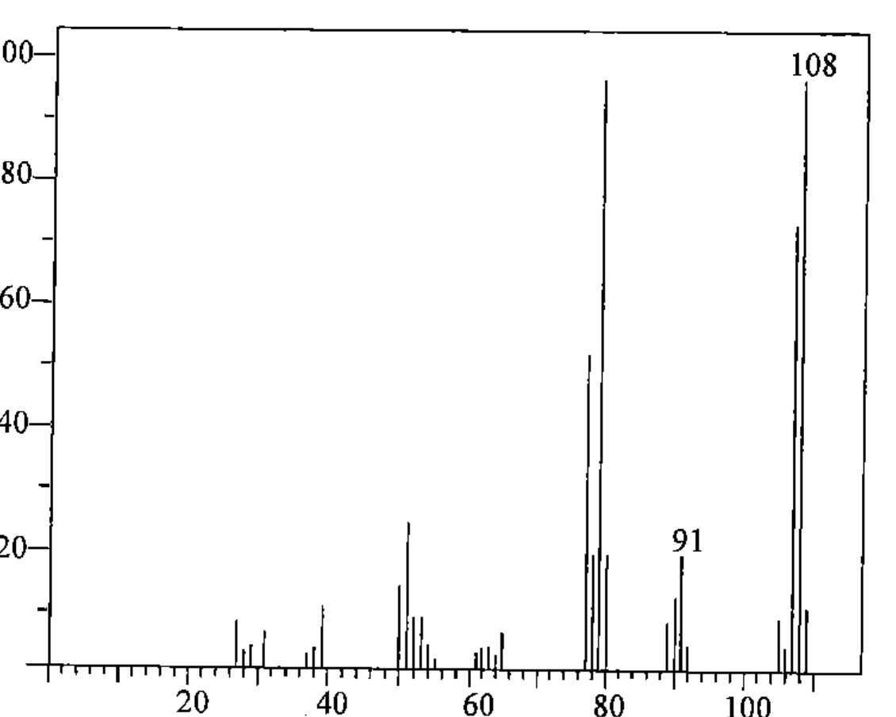

# 2012 DSE 化學 卷二（中文卷）— 題目庫

> 來源：文憑試 DSE 化學 Chemistry 2012 歷屆試題 Past Paper 卷二.pdf　｜　三部分：甲部 工業化學、乙部 物料化學、丙部 分析化學（每部分一題）
> 本試卷共有甲、乙和丙三部。考生須選答任何兩部中的全部試題。
> 說明：已移除頁碼、試卷標頭等雜訊；化學式以 Unicode 下標／上標表示，反應式以 → 或 ⇌ 表示。**本檔為題目庫（零答案）**，只含題目清洗 + 建議標籤。
> 本檔為第 2 層文字交貨（圖用原卷截圖；精修重繪另開第 3 層）。

---

## 甲部　工業化學（第 1 題）

## 第 1 題

【建議標籤】

- 卷別/部分：卷二　甲部
- 課題：#哈柏法 #催化劑 #平衡 #甲醇 #反應動力學 #速率方程式

【題目內容】

回答試題的所有部分。

(a)　以哈柏法於大約 500 °C 和 200 atm，並在一催化劑存在下，經氮和氫的反應可生產氨。該反應的化學方程式如下所示：

　　N₂(g) + 3H₂(g) ⇌ 2NH₃(g)　ΔH < 0

　　(i)　在哈柏法中所用的催化劑是什麼？

　　(ii)　解釋催化劑對一個化學反應的影響。（3 分）

　　(iii)　提出如何獲取氫以進行哈柏法，並寫出所涉及的一條化學方程式。（2 分）

　　(iv)　已知於 300 °C 和 1000 atm 下從 N₂(g) 和 H₂(g) 生成 NH₃(g)，在平衡時 NH₃(g) 的產率約為 98%。然而，在工業上哈柏法的操作條件卻定於約 500 °C 和 200 atm，在平衡時 NH₃ 的產率約為 20%。參照所給資料，解釋為什麼在工業上選擇了這樣的操作條件。（2 分）

　　(v)　在哈柏法中，於產率達到約 20% 前便從反應室移除產物混合物。解釋為何如此。（2 分）

(b)　甲醇是化學工業中的一個重要化合物。從甲烷製成的合成氣可生產甲醇。

　　(i)　為什麼甲醇是化學工業中的一個重要化合物？（? 分）

　　(ii)　寫出從合成氣生產甲醇的反應的化學方程式，並寫出所需的各條件。（3 分）

　　(iii)　寫出在生產甲醇科技上的一個改進，解釋為什麼它被視為一個改進。（2 分）

(c)　為研究以下反應的動力學，在相同的溫度下進行了三次實驗：

　　2NO(g) + 2H₂(g) → N₂(g) + 2H₂O(g)

下表顯示所得的數據：

| 實驗次數 | NO(g) 的初始濃度 / mol dm⁻³ | H₂(g) 的初始濃度 / mol dm⁻³ | 對應 N₂(g) 的初速 / mol dm⁻³ s⁻¹ |
|---|---|---|---|
| 1 | 2.50 × 10⁻³ | 5.00 × 10⁻³ | 1.20 × 10⁻⁶ |
| 2 | 2.50 × 10⁻³ | 1.00 × 10⁻² | 2.40 × 10⁻⁶ |
| 3 | 1.25 × 10⁻³ | 1.00 × 10⁻² | 6.00 × 10⁻⁷ |

　　(i)　解釋為什麼通常使用「初速」來研習一個反應的動力學。（? 分）

　　(ii)　推定分別對應 NO(g) 和 H₂(g) 的反應級數。（2 分）

　　(iii)　寫出這反應的速率方程式，並計算它在實驗溫度下的速率常數。（2 分）

---

## 乙部　物料化學（第 2 題）

## 第 2 題

【建議標籤】

- 卷別/部分：卷二　乙部
- 課題：#凱夫拉 #尼龍-6,6 #縮合聚合 #天然橡膠 #硫化 #不鏽鋼

【題目內容】

回答試題的所有部分。

(a)　凱夫拉和尼龍-6,6的結構顯示如下：

　　(i)　繪畫製造凱夫拉的各單體的結構。

　　(ii)　寫出由各單體生成凱夫拉的反應類別的名稱。（3 分）

　　(iii)　化合物 A 是在工業上製造尼龍-6,6 的其中一個單體。以下方程式顯示可生產 A 的兩個反應：

　　(1)　繪畫 A 的結構。

　　(2)　反應(1)被視為比反應(2)較綠色。提出三個原因。

　　(3)　兩個反應在哪一方面均被視為不綠色？（5 分）

　　(iv)　參照凱夫拉和尼龍-6,6的結構，解釋它們於機械強度的差異。（2 分）

(b)　天然橡膠的部分結構顯示如下：

【圖待補：原卷乙部第 2(b) 題／第 4 頁（天然橡膠部分結構）】

　　(i)　天然橡膠須先以硫處理，才可用來製造輪胎。寫出這處理過程的名稱，註明其目的，以及解釋其背後的原理。（3 分）

　　(ii)　某技術員穿上一對天然橡膠製的手套並進行一個涉及溴的實驗。溴濺在手套上，然後手套變脆。解釋這現象。（2 分）

(c)　(i)　考慮固體鐵的體心立方結構。

　　(1)　繪畫鐵的一個晶胞。

　　(2)　推定在該晶胞的鐵原子數目。（2 分）

　　(ii)　參照加入鐵內以生成不鏽鋼的各元素，解釋為什麼不鏽鋼適合於製造刀。（3 分）

---

## 丙部　分析化學（第 3 題）

## 第 3 題

【建議標籤】

- 卷別/部分：卷二　丙部
- 課題：#官能基 #質譜 #2,4-二硝基苯肼 #二噁英 #重量分析

【題目內容】

回答試題的所有部分。

(a)　化合物 X（摩爾質量 < 118 g）含有一個 [?] 基團。對 X 進行了兩個化學測試，其結果如下：

　　測試(1)：X 使酸化重鉻酸鉀溶液變成綠色。

　　測試(2)：以 2,4-二硝基苯肼測試，X 得出陰性結果。

　　(i)　只參照測試(1)的結果，提出 X 可能有的兩個官能基。（2 分）

　　(ii)　(1)　在測試(2)使用 2,4-二硝基苯肼的目的是什麼？

　　(2)　寫出在測試(2)中，如果 X 得出陽性結果的預期觀察。（2 分）

　　(iii)　參照測試(1)和測試(2)兩者的結果，提出一個可能存在於 X 的官能基。（1 分）

　　(iv)　X 的質譜如下所示：

　　為在 m/z = 91 和 108 的每個訊號，提出一個對應的化學物種。（2 分）

　　(v)　繪畫 X 的一個可能結構。（1 分）

(b)　空氣中的二噁英水平一般是以儀器分析量度所得，而非使用重量分析或容量分析。

　　(i)　提出空氣中的二噁英的一個來源。（? 分）

　　(ii)　解釋為什麼需要量度空氣中的二噁英水平。（? 分）

　　(iii)　建議一個量度空氣中的二噁英水平的儀器分析方法，並寫出為什麼使用這方法而不使用基於重量分析或容量分析的方法。（2 分）

(c)　某水溶液只含 HCl(aq) 和 HI(aq)。基於 AgCl(s) 可溶於過量的 NH₃(aq) 而 AgI(s) 卻不然的事實，計劃一重量分析以測定在該溶液中 Cl⁻(aq) 對 I⁻(aq) 的摩爾比率。

　　(i)　建議在這分析中應使用的兩個試劑（去離子水除外）。（2 分）

　　(ii)　概述在這分析中所涉及的實驗步驟。（4 分）

　　(iii)　利用上面從 (ii) 所得的數據，概述計算該溶液中 Cl⁻(aq) 對 I⁻(aq) 的摩爾比率的各步驟。（2 分）

---

## 待人工核對

- 第 1 題：哈柏法方程式（N₂ + 3H₂ ⇌ 2NH₃）及「ΔH < 0」待對頁核實；資料表各濃度／初速指數（10⁻³／10⁻²／10⁻⁶／10⁻⁷）待對頁核實。
- 第 1 題 (b)(i)／(c)(i)：分數 OCR 缺（讀作「(分」），標 (? 分)。
- 第 2 題：「凱夫拉」用字 OCR 讀作「凱庫勒」；凱夫拉+尼龍結構 crop（q02）及化合物 A 生產反應式 crop（q02b）內結構／試劑標註待對頁核實。
- 第 2 題 (b)：天然橡膠部分結構未能可靠截圖，標圖待補。
- 第 3 題 (a)：化合物 X 的基團描述 OCR 唔清（讀作「CCH₃」），標 [?]，待對頁核實。
- 第 3 題 (a)(iv)：質譜圖 crop（q03）軸刻度及 m/z 訊號待對頁核實。
- 第 3 題 (b)(i)／(b)(ii)：分數 OCR 缺，標 (? 分)。
