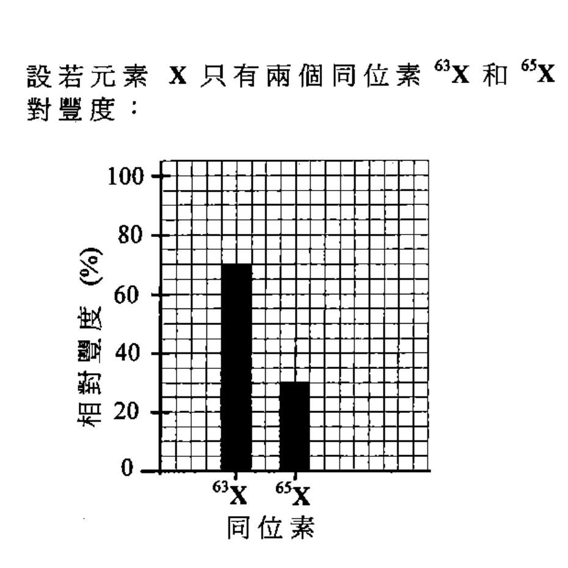
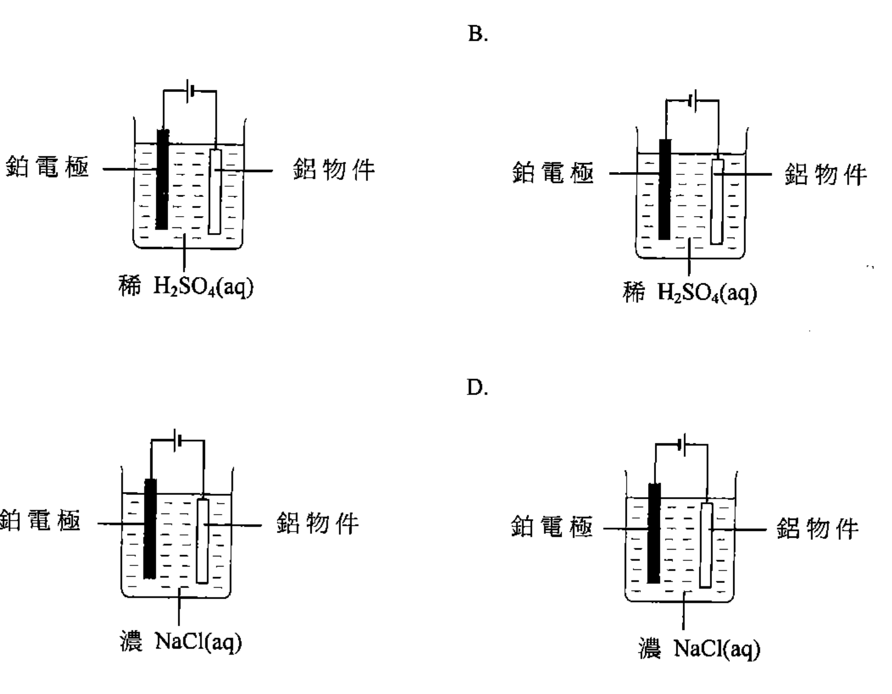
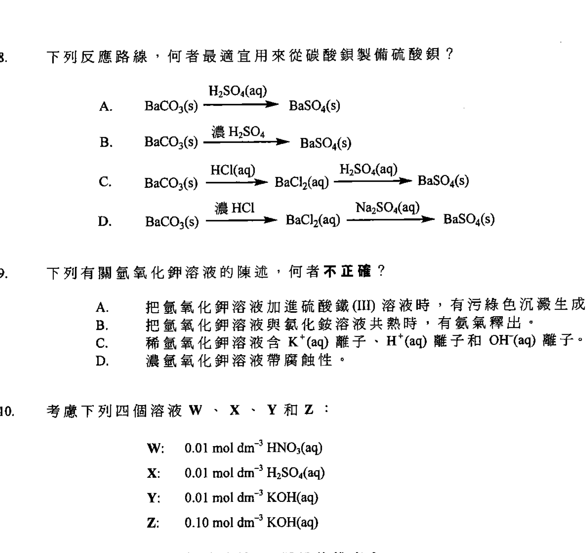
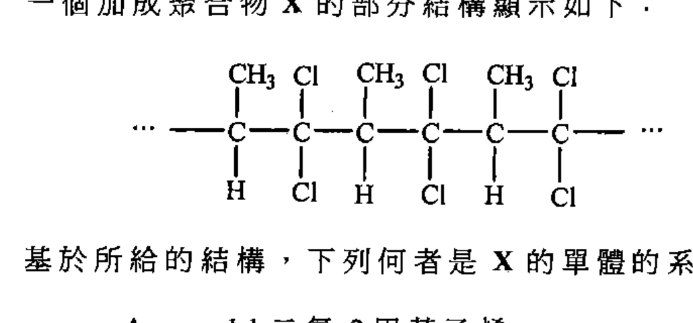
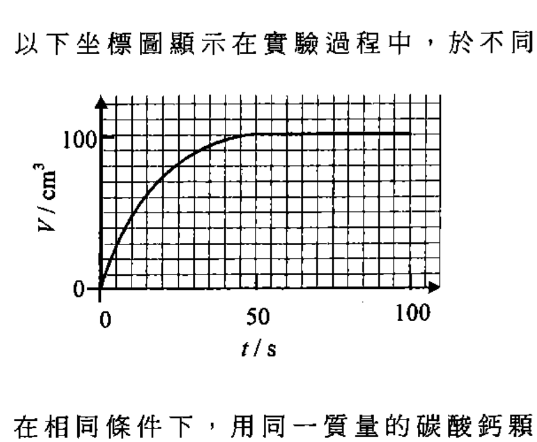
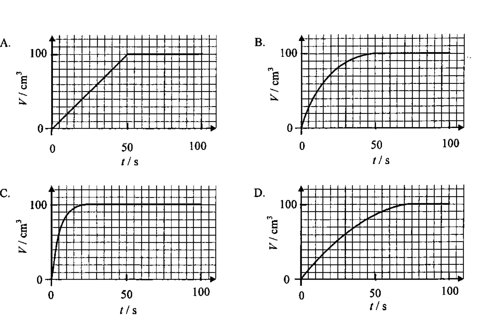

# 2013 DSE 化學 卷一甲（中文卷）— 題目庫

> 來源：文憑試 DSE 化學 Chemistry 2013 歷屆試題 Past Paper 卷一.pdf　｜　多項選擇題 36 題（第一部分 24 題、第二部分 12 題）
> 本部包括兩部分：第一部分設 24 題，第二部分設 12 題。選出每題最佳的答案。考生可參考印於試題答題簿 B 第 20 頁的周期表。
> 說明：已移除頁碼、試卷標頭等雜訊；化學式以 Unicode 下標／上標表示，反應式以 → 或 ⇌ 表示。**本檔為題目庫（零答案）**，只含題目清洗 + 建議標籤。
> 本檔為第 2 層文字交貨（圖用原卷截圖；精修重繪另開第 3 層）。

---

## 第一部分（第 1–24 題）

## 第 1 題

【建議標籤】

- 卷別/部分：卷一甲　第一部分
- 課題：#硅 #氧化物 #結構 #性質

【題目內容】

硅是周期表中的第 IV 族元素。硅的氧化物的化學式是 SiO₂。下列有關硅及其氧化物的陳述，何者正確？

- A. 硅是良好導熱體。
- B. 硅以簡單分子存在。
- C. 在室溫下，SiO₂ 是硬物料。
- D. SiO₂ 溶於水中，形成一酸性溶液。

---

## 第 2 題

【建議標籤】

- 卷別/部分：卷一甲　第一部分
- 課題：#同位素 #相對原子質量

【題目內容】

設若元素 X 只有兩個同位素 ⁶³X 和 ⁶⁵X。以下坐標圖顯示該兩個同位素的相對豐度：

下列何者是 X 的相對原子質量？

- A. 63.3
- B. 63.5
- C. 63.6
- D. 64.0

---

## 第 3 題

【建議標籤】

- 卷別/部分：卷一甲　第一部分
- 課題：#離子 #沉澱 #定性分析

【題目內容】

固體 Y 可溶於冷水。當把 Y 的水溶液分別加進氫氧化鈉溶液和酸化硝酸銀溶液時，都有白色沉澱生成。下列化合物，何者可能是 Y？

- A. 碳酸銨
- B. 碳酸鋅
- C. 氯化鉛(II)
- D. 氯化鎂

---

## 第 4 題

【建議標籤】

- 卷別/部分：卷一甲　第一部分
- 課題：#氧化數 #化學式 #離子化合物

【題目內容】

鈧 (Sc) 是一金屬。鈧在其化合物中，只展示一個氧化數。硝酸鈧的化學式是 Sc(NO₃)₃。下列何者，最可能是磷酸鈧的化學式？

- A. Sc₃PO₄
- B. ScPO₄
- C. Sc₂(PO₄)₃
- D. Sc(PO₄)₃

---

## 第 5 題

【建議標籤】

- 卷別/部分：卷一甲　第一部分
- 課題：#鎂 #提取 #電解 #還原

【題目內容】

下列方法，何者可用來從鎂化合物獲取鎂？

- A. 電解一個熔融的鎂化合物
- B. 電解一個鎂化合物的水溶液
- C. 把氧化鎂與碳共熱
- D. 把氧化鎂強熱

---

## 第 6 題

【建議標籤】

- 卷別/部分：卷一甲　第一部分
- 課題：#電解 #陽極電鍍 #鋁

【題目內容】

下列所示裝置，何者最適宜用來把鋁物件陽極電鍍？

- A. [?]
- B. [?]
- C. [?]
- D. [?]

---

## 第 7 題

【建議標籤】

- 卷別/部分：卷一甲　第一部分
- 課題：#鏽蝕 #防護 #金屬

【題目內容】

一輛單車的車架和齒輪系統都是鋼造的。下列組合，何者可用來防止那單車的這些部分被鏽蝕？

| | 車架 | 齒輪系統 |
|---|---|---|
| A. | 塗漆 | 塗上油脂 |
| B. | 塗漆 | 鍍鋅 |
| C. | 鍍錫 | 塗上油脂 |
| D. | 鍍錫 | 鍍鋅 |

---

## 第 8 題

【建議標籤】

- 卷別/部分：卷一甲　第一部分
- 課題：#鋇 #製備 #沉澱 #反應路線

【題目內容】

下列反應路線，何者最適宜用來從碳酸鋇製備硫酸鋇？

- A. [?]
- B. [?]
- C. [?]
- D. [?]

---

## 第 9 題

【建議標籤】

- 卷別/部分：卷一甲　第一部分
- 課題：#氫氧化鉀 #沉澱 #酸鹼

【題目內容】

下列有關氫氧化鉀溶液的陳述，何者不正確？

- A. 把氫氧化鉀溶液加進硫酸鐵(III)溶液時，有污綠色沉澱生成。
- B. 把氫氧化鉀溶液與氯化銨溶液共熱時，有氨氣釋出。
- C. 稀氫氧化鉀溶液含 K⁺(aq) 離子、H⁺(aq) 離子和 OH⁻(aq) 離子。
- D. 濃氫氧化鉀溶液帶腐蝕性。

---

## 第 10 題

【建議標籤】

- 卷別/部分：卷一甲　第一部分
- 課題：#pH #酸鹼 #排序

【題目內容】

考慮下列四個溶液 W、X、Y 和 Z：

W：0.01 mol dm⁻³ HCl(aq)
X：0.01 mol dm⁻³ H₂SO₄(aq)
Y：0.01 mol dm⁻³ KOH(aq)
Z：0.10 mol dm⁻³ KOH(aq)

下列何者代表這四個溶液按 pH 遞增的排序？

- A. W、X、Y、Z
- B. W、X、Z、Y
- C. X、W、Y、Z
- D. X、W、Z、Y

---

## 第 11 題

【建議標籤】

- 卷別/部分：卷一甲　第一部分
- 課題：#沉澱 #離子 #水溶液

【題目內容】

下列哪對水溶液於混合時，會有沉澱生成？

- A. 硝酸鉛(II)與氨
- B. 硫酸銅(II)與硝酸鈉
- C. 氯化鈣與硝酸鈉
- D. 硫酸鐵(II)與酸化重鉻酸鉀

---

## 第 12 題

【建議標籤】

- 卷別/部分：卷一甲　第一部分
- 課題：#周期表 #第 II 族 #反應活性

【題目內容】

在周期表中，鐳 (Ra) 和鈣 (Ca) 都處於同一族中。下列陳述，何者不正確？

- A. 鐳在固態時是良好導電體。
- B. 鐳原子容易供應電子，以生成 Ra²⁺ 離子。
- C. 鐳和鈣暴露於空氣一段時間後，都變得沒有光澤。
- D. 鐳的反應活性較鈣的低

---

## 第 13 題

【建議標籤】

- 卷別/部分：卷一甲　第一部分
- 課題：#鈦 #實驗式 #氧化

【題目內容】

鈦 (Ti) 是一金屬。把 2.66 g 的一個鈦粉樣本與過量氧共熱，直至該金屬完全被氧化。所生成氧化物的質量為 4.44 g。下列何者是所生成氧化物的實驗式？

（相對原子質量：O = 16.0，Ti = 47.9）

- A. TiO
- B. Ti₂O₃
- C. Ti₃O₄
- D. TiO₂

---

## 第 14 題

【建議標籤】

- 卷別/部分：卷一甲　第一部分
- 課題：#加成聚合物 #單體 #系統名稱

【題目內容】

一個加成聚合物 X 的部分結構顯示如下：

基於所給的結構，下列何者是 X 的單體的系統名稱？

- A. 1,1-二氯-2-甲基乙烯
- B. 1,1-二氯丙烯
- C. 1,2-二氯丙烯
- D. 3,3-二氯丙烯

---

## 第 15 題

【建議標籤】

- 卷別/部分：卷一甲　第一部分
- 課題：#焓變 #生成焓 #赫斯定律

【題目內容】

下列反應，何者的焓變必須用間接方法來測定？

- A. Zn(s) + CuSO₄(aq) → ZnSO₄(aq) + Cu(s)
- B. 2C(s) + O₂(g) → 2CO(g)
- C. CH₃CH₂OH(l) + 3O₂(g) → 2CO₂(g) + 3H₂O(l)
- D. MgO(s) + 2HCl(aq) → MgCl₂(aq) + H₂O(l)

---

## 第 16 題

【建議標籤】

- 卷別/部分：卷一甲　第一部分
- 課題：#化學方程式 #係數 #氧化還原

【題目內容】

考慮下列化學方程式：

2IO₃⁻(aq) + wH₂O₂(aq) + xH⁺(aq) → I₂(aq) + yO₂(g) + zH₂O(l)

下列何者是反應係數 y 和 x 的正確組合？

- A. [?]
- B. [?]
- C. [?]
- D. [?]

---

## 第 17 題

【建議標籤】

- 卷別/部分：卷一甲　第一部分
- 課題：#氧化數 #電解 #硫酸鹽

【題目內容】

過氧二硫酸鉀 K₂S₂O₈ 可藉電解飽和硫酸氫鉀 KHSO₄ 溶液而得到。下列何者正確描述在 KHSO₄ 中硫的氧化數，以及在電解時於哪電極產生 K₂S₂O₈？

| | 硫的氧化數 | K₂S₂O₈ 於哪電極產生 |
|---|---|---|
| A. | +6 | 陽極 |
| B. | +6 | 陰極 |
| C. | +7 | 陽極 |
| D. | +7 | 陰極 |

---

## 第 18 題

【建議標籤】

- 卷別/部分：卷一甲　第一部分
- 課題：#生成焓 #燃燒 #丙烷

【題目內容】

在標準條件下，完全燃燒 0.050 mol 的丙烷 (C₃H₈) 釋出 111 kJ 的熱。下列何者是丙烷的標準生成焓變？

（H₂O(l) 的標準生成焓變 = −286 kJ mol⁻¹；CO₂(g) 的標準生成焓變 = −394 kJ mol⁻¹）

- A. −106 kJ mol⁻¹
- B. +106 kJ mol⁻¹
- C. −569 kJ mol⁻¹
- D. +569 kJ mol⁻¹

---

## 第 19 題

【建議標籤】

- 卷別/部分：卷一甲　第一部分
- 課題：#石灰石 #熱分解 #焰色

【題目內容】

下列有關石灰石的陳述，何者正確？

(1) 牠於焰色試驗中，得出金黃色火焰。

(2) 牠於強熱時，釋出一無色氣體。

(3) 牠溶於稀硫酸得到一澄清的溶液。

- A. 只有 (1)
- B. 只有 (2)
- C. 只有 (1) 和 (3)
- D. 只有 (2) 和 (3)

---

## 第 20 題

【建議標籤】

- 卷別/部分：卷一甲　第一部分
- 課題：#醇 #有機化合物 #性質

【題目內容】

一個有機化合物的結構如下：

【圖待補：原卷第 20 題／第 6 頁】

下列有關這化合物的陳述，何者正確？

(1) 它與水互溶。

(2) 它在石蕊溶液中呈中性。

(3) 它燃燒時給出無光焰。

- A. 只有 (1)
- B. 只有 (2)
- C. 只有 (1) 和 (3)
- D. 只有 (2) 和 (3)

---

## 第 21 題

【建議標籤】

- 卷別/部分：卷一甲　第一部分
- 課題：#電池 #二次電池

【題目內容】

下列何者是二次電池？

(1) 鹼性錳電池

(2) 鋰離子電池

(3) 鎳金屬氫化物電池

- A. 只有 (1)
- B. 只有 (2)
- C. 只有 (1) 和 (3)
- D. 只有 (2) 和 (3)

---

## 第 22 題

【建議標籤】

- 卷別/部分：卷一甲　第一部分
- 課題：#辨別 #亞硫酸鹽 #硫酸鹽

【題目內容】

下列試劑，何者可用來辨別亞硫酸鈉和硫酸鈉？

(1) 氯化鐵(III)溶液

(2) 酸化高錳酸鉀溶液

(3) 濃硝酸

- A. 只有 (1)
- B. 只有 (2)
- C. 只有 (1) 和 (3)
- D. 只有 (2) 和 (3)

---

## 第 23 題

【建議標籤】

- 卷別/部分：卷一甲　第一部分
- 課題：#八隅體規則 #分子結構

【題目內容】

「八隅體規則」不適用於下列哪個或哪些分子中？

(1) OF₂

(2) NO₂

(3) CS₂

- A. 只有 (1)
- B. 只有 (2)
- C. 只有 (1) 和 (3)
- D. 只有 (2) 和 (3)

---

## 第 24 題

【建議標籤】

- 卷別/部分：卷一甲　第一部分
- 課題：#沸點 #分子間引力 #氯化氫

【題目內容】

指示：題 24 由兩敘述句組成。考生須先判斷該兩敘述句是否正確；若兩敘述句均屬正確，再判斷第二敘述句是否第一敘述句的合理解釋。然後根據下表，從 A 至 D 四項中選出一個適用的答案：

A. 兩敘述句均屬正確，而第二敘述句為第一敘述句的合理解釋。
B. 兩敘述句均屬正確，但第二敘述句並非第一敘述句的合理解釋。
C. 第一敘述句錯誤，但第二敘述句正確。
D. 兩敘述句均屬錯誤。

| | 第一敘述句 | 第二敘述句 |
|---|---|---|
| 24. | 氯化氫的沸點高於氟化氫的沸點 | 氯化氫分子的大小較氟化氫的為大 |

---

## 第二部分（第 25–36 題）

## 第 25 題

【建議標籤】

- 卷別/部分：卷一甲　第二部分
- 課題：#反應速率 #顆粒大小 #碳酸鈣

【題目內容】

在一個研習下列反應的速率的實驗裏，把小量粉狀碳酸鈣加進過量氫氯酸中，並記錄所釋出氣體的體積。

CaCO₃(s) + 2HCl(aq) → CaCl₂(aq) + H₂O(l) + CO₂(g)

以下坐標圖顯示在實驗過程中，於不同時間 (t) 所釋出氣體的體積 (V)：

在相同條件下，用同一質量的碳酸鈣顆粒代替粉狀碳酸鈣來重做這實驗。下列坐標圖，何者最能代表在重做實驗時所得到的結果？

- A. [?]
- B. [?]
- C. [?]
- D. [?]

---

## 第 26 題

【建議標籤】

- 卷別/部分：卷一甲　第二部分
- 課題：#過渡金屬 #特徵性質

【題目內容】

下列何者不是過渡金屬的特徵性質？

- A. 它們生成帶顏色的化合物
- B. 它們在其化合物中，展示可變氧化數。
- C. 牠們與稀氫氯酸反應釋出氫氣
- D. 它們在元素狀態或在其化合物中，展示催化性質

---

## 第 27 題

【建議標籤】

- 卷別/部分：卷一甲　第二部分
- 課題：#平衡常數 #可逆反應

【題目內容】

指示：題 27 和題 28 參照下列可逆反應：

X₂(g) + 3Y₂(g) ⇌ 2XY₃(g)

把 X₂(g) 和 Y₂(g) 的一個混合物，注入一個維持在固定溫度的 2.0 dm³ 密閉容器內。當這體系達致平衡時，容器內有 0.4 mol 的 X₂(g)、0.3 mol 的 Y₂(g) 和 0.4 mol 的 XY₃(g)。

下列何者是上述反應在這溫度下 K꜀ 的數值？

- A. 3.3
- B. 6.7
- C. 14.8
- D. 59.3

---

## 第 28 題

【建議標籤】

- 卷別/部分：卷一甲　第二部分
- 課題：#催化劑 #平衡 #反應速率

【題目內容】

下列組合，何者顯示催化劑對正向反應速率、逆向反應速率、以及 XY₃(g) 的產率的效應？

| | 正向反應速率 | 逆向反應速率 | XY₃(g) 的產率 |
|---|---|---|---|
| A. | 增加 | 增加 | 不變 |
| B. | 不變 | 增加 | 不變 |
| C. | 增加 | 不變 | 增加 |
| D. | 減少 | 減少 | 不變 |

---

## 第 29 題

【建議標籤】

- 卷別/部分：卷一甲　第二部分
- 課題：#果糖 #官能基 #性質

【題目內容】

果糖的結構顯示如下：

【圖待補：原卷第 29 題／第 9 頁】

下列有關果糖的陳述，何者正確？

- A. 它的實驗式是 C₆H₁₂O₆
- B. 它能令酸化重鉻酸鉀溶液由橙色變為綠色。
- C. 它不溶於水。
- D. 它的分子擁有五個手性碳中心。

---

## 第 30 題

【建議標籤】

- 卷別/部分：卷一甲　第二部分
- 課題：#立體化學 #結構異構體 #手性

【題目內容】

化合物 X 的分子和化合物 Y 的分子的三維結構顯示如下：

【圖待補：原卷第 30 題／第 10 頁】

下列有關 X 和 Y 的陳述，何者正確？

- A. X 和 Y 完全相同
- B. X 和 Y 是一對結構異構體。
- C. 利用分餾法可把 X 和 Y 的混合物分開。
- D. X 和 Y 有相同的標準燃燒焓變

---

## 第 31 題

【建議標籤】

- 卷別/部分：卷一甲　第二部分
- 課題：#幾何異構體 #烯 #加成

【題目內容】

考慮如下所示的化合物 X 和 Y：

【圖待補：原卷第 31 題／第 10 頁】

下列有關 X 和 Y 的陳述，何者正確？

- A. X 和 Y 是一對幾何異構體。
- B. 在有 Ni(s) 的條件下，X 和 Y 都與 H₂(g) 反應。
- C. X 和 Y 分別與溶於 CHCl₃ 的 Br₂ 反應，生成相同的有機產物。
- D. X 的聚合反應和 Y 的聚合反應，都生成相同的加成聚合物

---

## 第 32 題

【建議標籤】

- 卷別/部分：卷一甲　第二部分
- 課題：#二醯胺 #水解 #氫氧化鈉

【題目內容】

下列有關氫氧化鈉溶液對二醯胺的作用的陳述，何者正確？

(1) 這反應生成乙酸鈉。

(2) 在這反應中，氫氧化鈉作為催化劑。

(3) 若把反應混合物回流加熱，該反應便達致平衡。

- A. 只有 (1)
- B. 只有 (2)
- C. 只有 (1) 和 (3)
- D. 只有 (2) 和 (3)

---

## 第 33 題

【建議標籤】

- 卷別/部分：卷一甲　第二部分
- 課題：#比色法 #氧化還原 #反應速率

【題目內容】

下列何者的反應進程可藉比色法來跟隨？

(1) 2MnO₄⁻(aq) + 5C₂O₄²⁻(aq) + 16H⁺(aq) → 2Mn²⁺(aq) + 10CO₂(g) + 8H₂O(l)

(2) SO₃²⁻(aq) + 2H⁺(aq) → SO₂(g) + H₂O(l)

(3) Br₂(aq) + HCOOH(aq) → 2Br⁻(aq) + CO₂(g) + 2H⁺(aq)

- A. 只有 (1)
- B. 只有 (1) 和 (2)
- C. 只有 (2) 和 (3)
- D. (1)、(2) 和 (3)

---

## 第 34 題

【建議標籤】

- 卷別/部分：卷一甲　第二部分
- 課題：#有機轉化 #鹵化 #水解

【題目內容】

考慮下列有機化合物的轉化：

【圖待補：原卷第 34 題／第 11 頁】

下列有關上述轉化的陳述，何者正確？

(1) 在步驟 1，應使用過量 Br₂(l)。

(2) 在步驟 1，需要有光。

(3) 用於步驟 2 的試劑可以是 KOH(aq)。

- A. 只有 (1) 和 (2)
- B. 只有 (1) 和 (3)
- C. 只有 (2) 和 (3)
- D. (1)、(2) 和 (3)

---

## 第 35 題

【建議標籤】

- 卷別/部分：卷一甲　第二部分
- 課題：#鹵烷 #製備 #2-氯-2-甲基丙烷

【題目內容】

為要製備 2-氯-2-甲基丙烷，把 2-甲基丙-2-醇與濃氫氯酸的混合物猛烈地搖勻。

(CH₃)₃COH + 濃 HCl → (CH₃)₃CCl

下列有關這製備的陳述，何者正確？

(1) 反應混合物經搖勻後，呈現兩層液體。

(2) 應使用碳酸鈉溶液來洗滌粗產物。

(3) 利用簡單蒸餾法，可清除未反應的 2-甲基丙-2-醇。

- A. 只有 (1) 和 (2)
- B. 只有 (1) 和 (3)
- C. 只有 (2) 和 (3)
- D. (1)、(2) 和 (3)

---

## 第 36 題

【建議標籤】

- 卷別/部分：卷一甲　第二部分
- 課題：#酸鹼性 #氧化物 #離子氧化物

【題目內容】

指示：題 36 由兩敘述句組成。考生須先判斷該兩敘述句是否正確；若兩敘述句均屬正確，再判斷第二敘述句是否第一敘述句的合理解釋，然後根據下表，從 A 至 D 四項中選出一個適用的答案：

A. 兩敘述句均屬正確，而第二敘述句為第一敘述句的合理解釋。
B. 兩敘述句均屬正確，但第二敘述句並非第一敘述句的合理解釋。
C. 第一敘述句錯誤，但第二敘述句正確。
D. 兩敘述句均屬錯誤。

| | 第一敘述句 | 第二敘述句 |
|---|---|---|
| 36. | 氧化鋁與氧化鎂展示相似的酸鹼性質 | 氧化鋁與氧化鎂都是離子氧化物 |

---

## 待人工核對

- 第 1、2 題：「硅／矽」用字（OCR 讀作「硅」，傳統中文或作「矽」）待對頁核實。
- 第 4 題：磷酸鈧各選項（A/C/D）的下標數字待對頁核實。
- 第 6 題：四項裝置圖 crop（q06）邊界待對頁核實。
- 第 8 題：反應路線選項圖 crop（q08）邊界及試劑標注待對頁核實。
- 第 10 題：pH 排序各選項的字母順序待對頁核實。
- 第 16 題：選項 y／x 組合為圖表形式，待補（見下）。
- 第 17 題：選項 C／D 的硫氧化數（OCR 讀作「+7／+4」）待對頁核實。
- 第 20、29、30、31、34 題：分子結構圖待補（未能可靠截圖）。
- 第 25 題：坐標圖（q25a／q25b）刻度標注待對頁核實。
