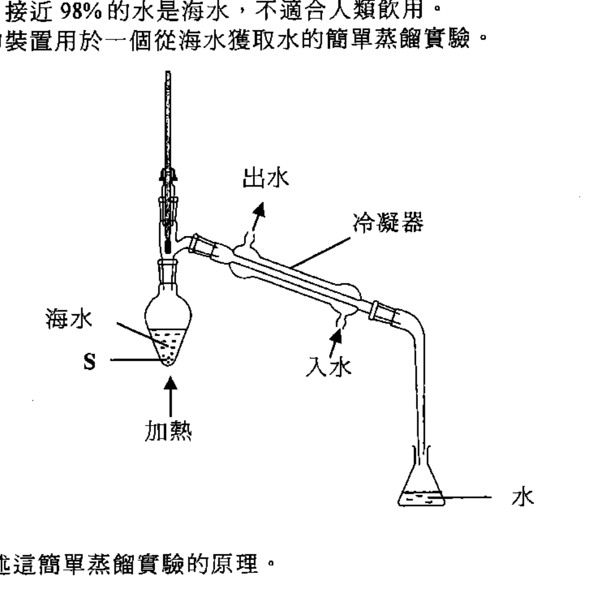
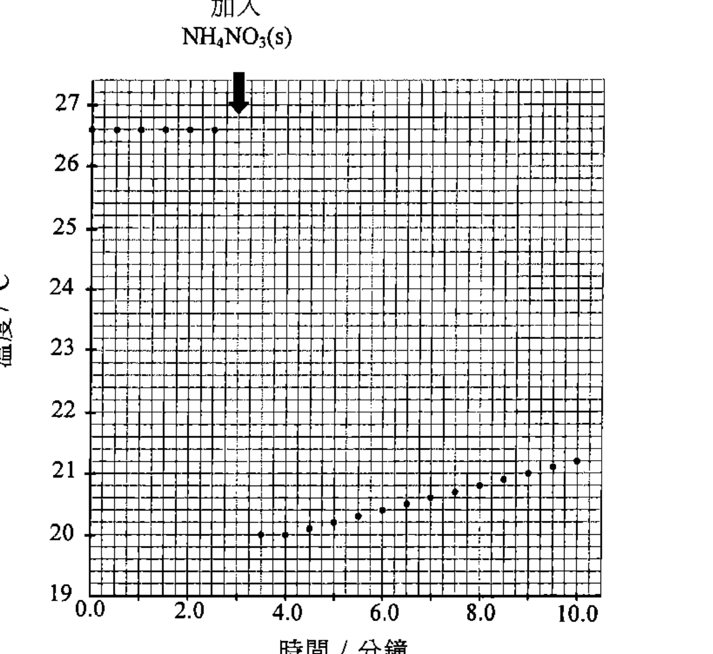
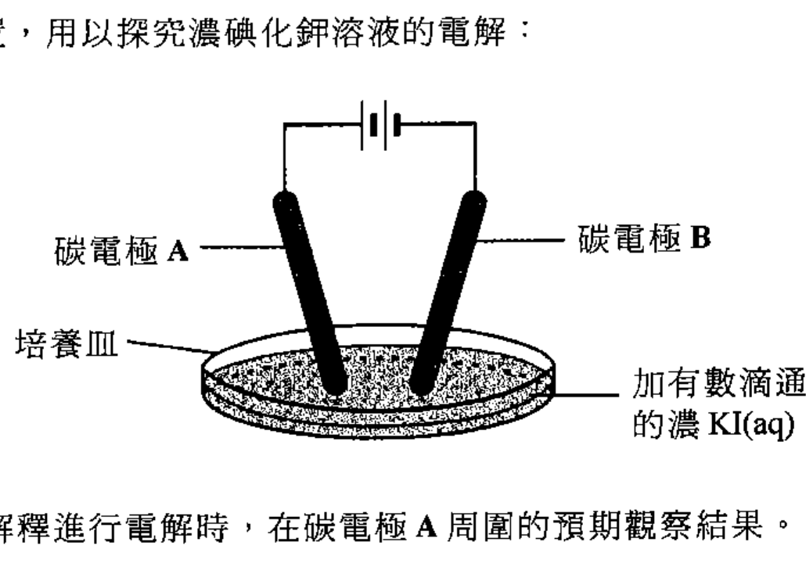
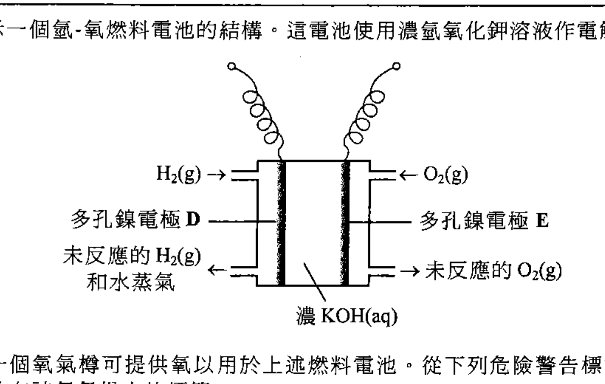
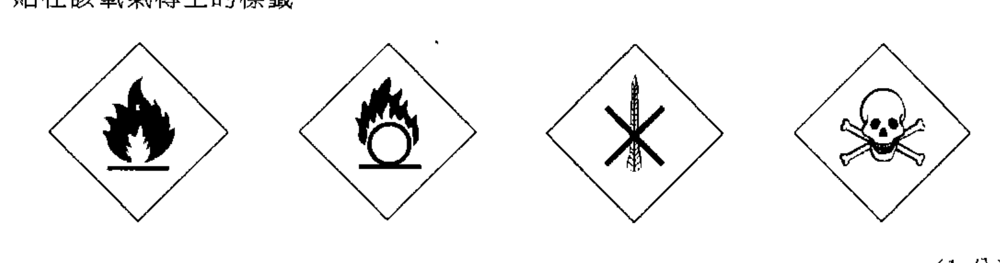
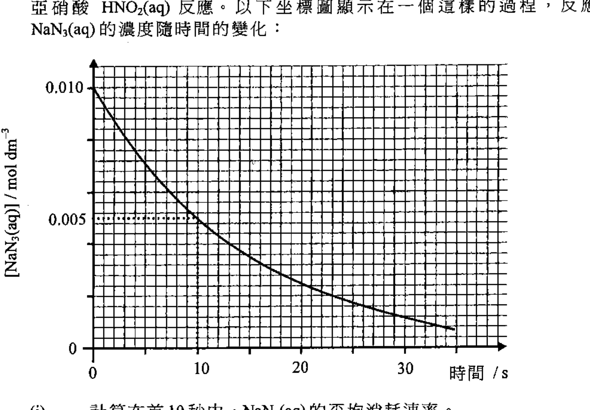
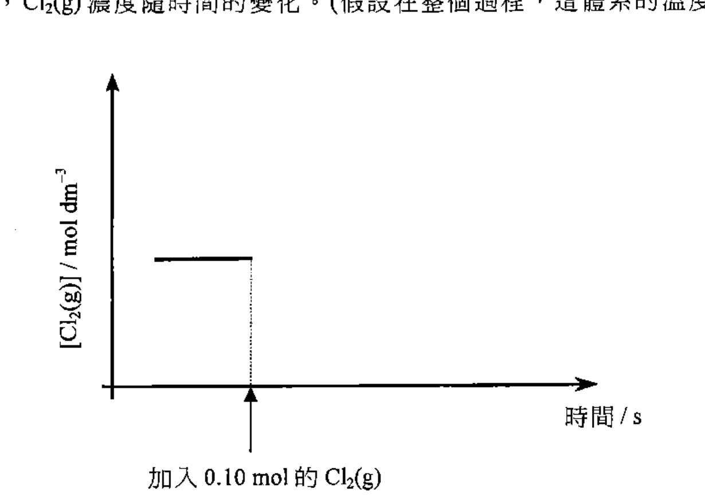

# 2013 DSE 化學 卷一乙（中文卷）— 題目庫

> 來源：文憑試 DSE 化學 Chemistry 2013 歷屆試題 Past Paper 卷一.pdf　｜　乙部 結構式問題 15 題（第一部分 10 題、第二部分 5 題）
> 本部包括兩部分：第一和第二部分各題均須作答。有 * 號標記的試題，將有一分給予達致有效傳意的答案。
> 說明：已移除頁碼、試卷標頭、答題簿橫線等雜訊；化學式以 Unicode 下標／上標表示，反應式以 → 或 ⇌ 表示。**本檔為題目庫（零答案）**，只含題目清洗 + 建議標籤。
> 本檔為第 2 層文字交貨（圖用原卷截圖；精修重繪另開第 3 層）。

---

## 第一部分（第 1–10 題）

## 第 1 題

【建議標籤】

- 卷別/部分：卷一乙　第一部分
- 課題：#水 #蒸餾 #冰 #氫鍵

【題目內容】

水是地球表面豐度最高的化合物，它對地球上的生物非常重要。

(a)　繪出一個水分子的電子圖（只須顯示最外層的電子）。（1 分）

(b)　在地球上，接近 98% 的水是海水，不適合人類飲用。下圖所示的裝置用於一個從海水獲取水的簡單蒸餾實驗。

　　(i)　概述這簡單蒸餾實驗的原理。

　　(ii)　加熱前，須將不溶的固體 [?] 放入瓶中。為什麼？（3 分）

(c)　從分子層面，解釋為什麼冰的密度較水的低。（3 分）

---

## 第 2 題

【建議標籤】

- 卷別/部分：卷一乙　第一部分
- 課題：#分子結構 #極性 #配位鍵

【題目內容】

BF₃ 和 NH₃ 都以簡單分子存在。

(a)　為下列每一分子，繪出牠的三維結構。

　　BF₃　　NH₃

（2 分）

(b)　分別解釋這些分子是否帶極性。（2 分）

(c)　BF₃ 與 NH₃ 反應生成 F₃BNH₃。描述在 BF₃ 與 NH₃ 間鍵的生成。（2 分）

---

## 第 3 題

【建議標籤】

- 卷別/部分：卷一乙　第一部分
- 課題：#實驗式 #分子式 #官能基

【題目內容】

化合物 W 只含碳、氫和氧。W 的相對分子質量是 88.0。完全燃燒 1.32 g 的 W 生成 2.64 g 的二氧化碳和 1.08 g 的水。

(a)　推定 W 的分子式。

（相對原子質量：H = 1.0，C = 12.0，O = 16.0）

（3 分）

(b)　已知 W 只含一個官能基。繪出 W 的兩個可能結構。（2 分）

---

## 第 4 題

【建議標籤】

- 卷別/部分：卷一乙　第一部分
- 課題：#二元酸 #乙二酸 #滴定 #酚酞

【題目內容】

一個化學式為 H₂C₂O₄ 的二元酸的結構如下：

　　COOH

　　COOH

(a)　寫出這二元酸的系統名稱。（1 分）

(b)　一位學生預期 0.0500 mol dm⁻³ 標準 H₂C₂O₄(aq) 的 pH 為 1.0。但當使用一個經校準的 pH 計來量度這溶液的 pH 時，量得的值卻大於 1。以一反應式為輔助，解釋這觀察結果。（2 分）

(c)　在學校實驗室，可找到固體氫氧化鈉。然而配製標準 NaOH(aq) 是不能藉稱取 NaOH(s) 然後把牠溶於水而直接得到的。解釋為什麼。（1 分）

(d)　在一個滴定實驗，把 25.00 cm³ 的標準 0.0500 mol dm⁻³ H₂C₂O₄(aq) 和數滴酚酞指示劑放入一錐形瓶，然後從滴定管把一個未知濃度的 NaOH(aq) 加進瓶中。要到達滴定終點，需用 17.20 cm³ 的 NaOH(aq)。

　　(i)　寫出在滴定終點時的顏色變化。

　　(ii)　從滴定結果，計算該 NaOH(aq) 的濃度（以 mol dm⁻³ 為單位）。（3 分）

(e)　進行 (d) 的實驗時，下列各項被視為不恰當的做法。就每一項，解釋為什麼它會導致不準確的滴定結果：

　　(i)　[?] 沖洗錐形瓶 [?] 把 [?] 移入瓶中。

　　(ii)　利用漏斗把 NaOH(aq) 注入滴定管後，於進行滴定時仍讓漏斗留在滴定管的頂部。（2 分）

---

## 第 5 題

【建議標籤】

- 卷別/部分：卷一乙　第一部分
- 課題：#溶解焓 #量熱法 #硝酸銨

【題目內容】

進行以下實驗來測定硝酸銨的溶解焓變：

NH₄NO₃(s) → NH₄NO₃(aq)

把某體積的水置於一個發泡聚苯乙烯杯子中。每隔半分鐘，用溫度計量度杯中水的溫度。於剛好第三分鐘時，把 2.0 g 的 NH₄NO₃(s) 加進杯子中，然後徹底地攪拌杯中溶液，並繼續量度其溫度多 7 分鐘。

以下坐標圖顯示溫度的記錄：

(a)　(i)　從這坐標圖，估算溫度下降的最大值。

　　(ii)　所得到 NH₄NO₃(aq) 的質量為 21.8 g。計算在實驗條件下，硝酸銨的溶解焓變（以 kJ mol⁻¹ 為單位）。

（假設該發泡聚苯乙烯杯子的熱容可被略去，所得到 NH₄NO₃(aq) 的比熱容為 4.3 J g⁻¹ K⁻¹。）

（4 分）

(b)　提出儲存 NH₄NO₃(s) 時，令它保持乾燥的一個方法。（1 分）

---

## 第 6 題

【建議標籤】

- 卷別/部分：卷一乙　第一部分
- 課題：#聚合物 #聚丙烯 #石腦油 #裂解

【題目內容】

\* 簡略描述如何可從石腦油製造聚丙烯。（4 分）

---

## 第 7 題

【建議標籤】

- 卷別/部分：卷一乙　第一部分
- 課題：#鋁熱反應 #氧化還原 #還原劑

【題目內容】

鋁熱反應泛指一個金屬粉末與一個金屬氧化物的放熱氧化還原反應。其中一個例子是幼細的氧化鐵(III)與鋁粉的反應。這反應導致非常高的溫度，常用來焊接火車路軌。在這非常高的溫度下，所生成熔融的鐵便把路軌接起來。

(a)　(i)　完成並平衡以下鋁熱反應的化學方程式：

　　Fe₂O₃(s) + Al(s) →

　　(ii)　草繪這反應的焓級圖，並附上標籤。（2 分）

(b)　銅粉不能用來替代鋁粉，以進行與氧化鐵(III)的鋁熱反應。解釋為什麼。（1 分）

(c)　從鐵的礦物提取鐵亦涉及鐵氧化物的還原。

　　(i)　提出為什麼提取鐵時，不使用鋁作還原劑。

　　(ii)　提出一個常用於提取鐵的還原劑。（2 分）

---

## 第 8 題

【建議標籤】

- 卷別/部分：卷一乙　第一部分
- 課題：#氯化銫 #巨型離子結構 #反應活性

【題目內容】

銫 (Cs) 和鈉 (Na) 都是周期表中的第 1 族元素。銫跟氯反應，生成氯化銫。

(a)　寫出銫跟氯反應的化學方程式。（1 分）

(b)　氯化銫固體擁有巨型離子結構。

　　(i)　繪一圖以顯示氯化銫的結構。

　　(ii)　解釋為什麼氯化銫固體易碎。（3 分）

(c)　推測鈉或銫跟氯反應時，何者較活潑，並舉出一項理由。（1 分）

---

## 第 9 題

【建議標籤】

- 卷別/部分：卷一乙　第一部分
- 課題：#電解 #碘化鉀 #電極

【題目內容】

下圖所示的裝置，用以探究濃碘化鉀溶液的電解。

（裝置含碳電極 A、碳電極 B、培養皿，以及加有數滴通用指示劑的濃 KI(aq)。）

(a)　寫出並解釋進行電解時，在碳電極 A 周圍的預期觀察結果。（2 分）

(b)　(i)　碳電極 B 附近的溶液變為藍色。解釋這觀察結果。

　　(ii)　如果用銅電極替代碳電極 B 來做這探究，觀察結果會否改變？請解釋。（3 分）

---

## 第 10 題

【建議標籤】

- 卷別/部分：卷一乙　第一部分
- 課題：#燃料電池 #氫氧 #半反應式 #綠色化學

【題目內容】

下圖顯示一個氫-氧燃料電池的結構。這電池使用濃氫氧化鉀溶液作電解質。

（電極 D、電極 E 為多孔鎳電極；入口為 H₂(g) 與 O₂(g)，出口為未反應的 H₂(g)、未反應的 O₂(g) 和水蒸氣；電解質為濃 KOH(aq)。）

(a)　一個氧氣樽可提供氧以用於上述燃料電池。從下列危險警告標籤，圈出一個應張貼在該氧氣樽上的標籤。

（1 分）

(b)　寫出當這燃料電池輸出電流時，在以下電極發生的變化的半反應式。

　　電極 D：

　　電極 E：

（2 分）

(c)　有些人認為使用氫-氧燃料電池驅動的車輛相對於使用汽油驅動的車輛，前者對環境較為友善。就以下每一方面，評論這觀點：

　　(i)　燃料的來源

　　(ii)　車輛的排放

（2 分）

---

## 第二部分（第 11–15 題）

## 第 11 題

【建議標籤】

- 卷別/部分：卷一乙　第二部分
- 課題：#安全氣囊 #疊氮化鈉 #氣體摩爾體積 #反應速率

【題目內容】

安全氣囊是裝置於汽車的重要設備。在汽車嚴重碰撞時，氣囊中的化學品立刻反應以釋出大量氣體，氣囊便即時膨脹以保護乘客。安全氣囊中的主要化學品是疊氮化鈉 NaN₃(s) 和硝酸鉀 KNO₃(s)。

以下方程式顯示當氣囊膨脹時所涉及的反應：

2NaN₃(s) → 2Na(s) + 3N₂(g)

10Na(s) + 2KNO₃(s) → K₂O(s) + 5Na₂O(s) + N₂(g)

(a)　解釋為什麼用於氣囊中的 NaN₃(s) 和 KNO₃(s) 是非常幼細的粉末。（1 分）

(b)　一氣囊含 100.0 g 的 NaN₃(s) 和 200.0 g 的 KNO₃(s)。計算當這氣囊膨脹時所產生氣體在常溫常壓下的理論體積。

（式量：NaN₃ = 65.0，KNO₃ = 101.1；在常溫常壓下，氣體的摩爾體積 = 24 dm³ mol⁻¹）

（3 分）

(c)　NaN₃(s) 的主要功用是產生 N₂(g) 以令氣囊膨脹。提出為什麼在氣囊中必須有 KNO₃(s)。（1 分）

(d)　疊氮化鈉是有毒的化學品。因此生產安全氣囊時餘下的 NaN₃ 廢物，須經特別處理，然後棄置。這處理涉及先把 NaN₃ 溶於水，繼而讓所得到的溶液與過量亞硝酸 HNO₂(aq) 反應。

以下坐標圖顯示在一個這樣的過程，反應混合物中 NaN₃(aq) 的濃度隨時間的變化：

　　(i)　計算在首 10 秒中 NaN₃(aq) 的平均消耗速率。

　　(ii)　建議如何可利用這坐標圖來測定在第 10 秒時 NaN₃(aq) 的瞬間消耗速率。（2 分）

---

## 第 12 題

【建議標籤】

- 卷別/部分：卷一乙　第二部分
- 課題：#平衡常數 #反應商數 #平衡

【題目內容】

在 250 °C 時，以下反應的平衡常數 K꜀ 是 25 dm³ mol⁻¹：

PCl₃(g) + Cl₂(g) ⇌ PCl₅(g)

一個維持於 250 °C 的 10.0 dm³ 密封容器，起始時含 0.50 mol 的 PCl₅(g)、0.20 mol 的 Cl₂(g) 和 0.40 mol 的 PCl₃(g)。

(a)　計算在起始條件下，這體系的反應商數。預測並解釋在起始條件下，正向反應速率抑或逆向反應速率會較大。（2 分）

(b)　計算當這體系在 250 °C 達致平衡時 Cl₂(g) 的濃度。（2 分）

(c)　把 0.10 mol 的 Cl₂(g) 加入 (b) 的平衡混合物中。在下圖，草繪直至到達新的平衡時，Cl₂(g) 濃度隨時間的變化。

（假設在整個過程，這體系的溫度維持於 250 °C。）（1 分）

---

## 第 13 題

【建議標籤】

- 卷別/部分：卷一乙　第二部分
- 課題：#熔點 #結構 #鍵合 #第二周期

【題目內容】

\* 根據結構和鍵合，解釋周期表中第二周期的元素，把它們按熔點遞增的次序排列。（2 分）

---

## 第 14 題

【建議標籤】

- 卷別/部分：卷一乙　第二部分
- 課題：#脂肪 #肥皂 #皂化 #生物柴油

【題目內容】

不飽和脂肪 F 是某植物油的成分。F 的結構顯示如下：

【圖待補：原卷第 14 題／第 29 頁】

(a)　寫出把 F 轉化為一飽和脂肪所需的各試劑。（1 分）

(b)　植物油可用來製造肥皂。

　　(i)　寫出從 F 生成肥皂所涉及的化學方程式。

　　(ii)　[?] 生成的肥皂可與甲醇反應得出化合物 G，G 可用作 [?]。（2 分）

(c)　參照 F 和 G 的相對分子質量及物理性質，解釋為什麼 G 可用作汽車燃料，而 F 則不可。（2 分）

---

## 第 15 題

【建議標籤】

- 卷別/部分：卷一乙　第二部分
- 課題：#醇 #脫水 #烯烴 #旋光性

【題目內容】

參考以下有機化合物的轉化：

【圖待補：原卷第 15 題／第 30 頁】

（X：CH₃CH₂CH(OH)CH₂CH₃；Y：CH₃CH₂COCH₂CH₃；X 經脫水劑 R 生成烯烴的混合物。）

(a)　建議一個化學測試來辨別 X 和 Y。（2 分）

(b)　提出試劑 R 會是什麼。（1 分）

(c)　[?] 兩個具相同結構式的烯烴。繪出這兩個烯烴各自的結構，並寫出牠們的名稱。（2 分）

(d)　在 (c) 的各烯烴可與 HCl 反應生成一帶旋光性的氯烷。寫出這氯烷的結構式。（1 分）

---

## 待人工核對

- 第 1 題 (b)(ii)：「不溶的固體 [?]」一詞（OCR 讀作「$」）待對頁核實。
- 第 4 題 (e)(i)：此行 OCR 嚴重不清（「沖洗錐形瓶…移入瓶中」），待對頁逐字核實。
- 第 5 題 (b)：部分編號（OCR 讀作「d」，依上下文作「b」）待對頁核實。
- 第 13 題：題幹前段（OCR 讀作「鋰」）待對頁核實。
- 第 14 題 (b)(ii)：此行 OCR 不清，待對頁核實。
- 第 15 題 (c)：題幹首句（OCR 不清）待對頁核實。
- 第 2、7、8 題：要求考生繪圖／畫結構，原卷無供圖，故無圖嵌入。
- 第 14、15 題：分子結構圖待補（未能可靠截圖）。
