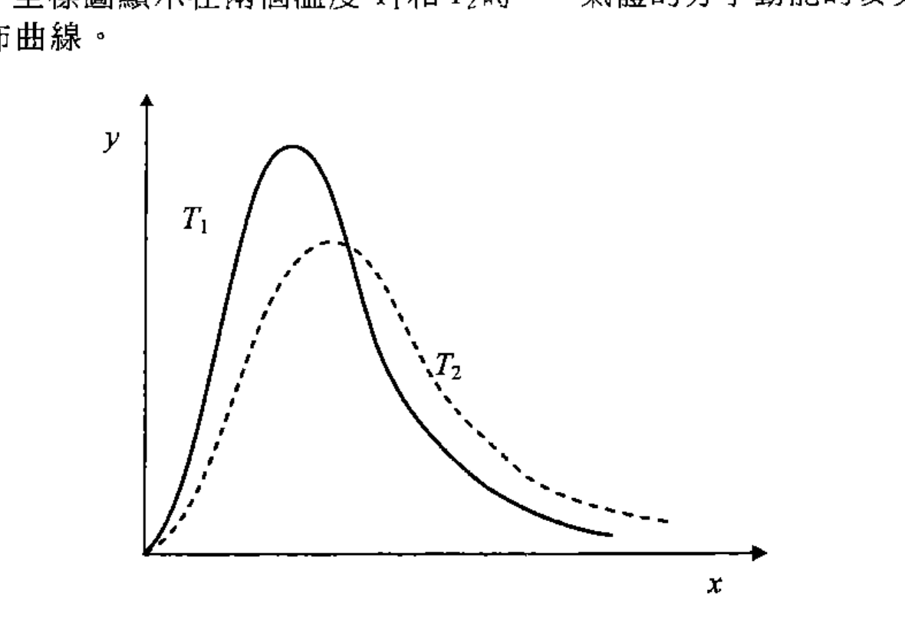
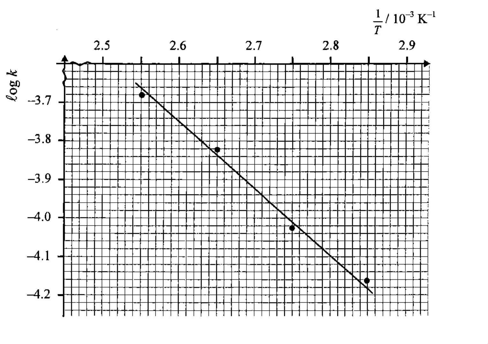
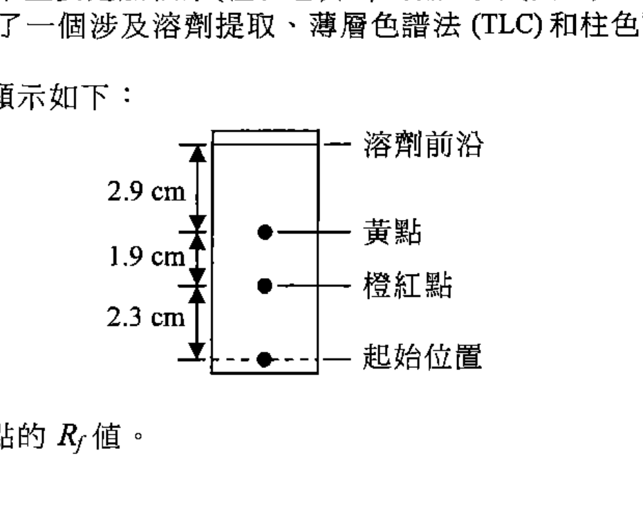
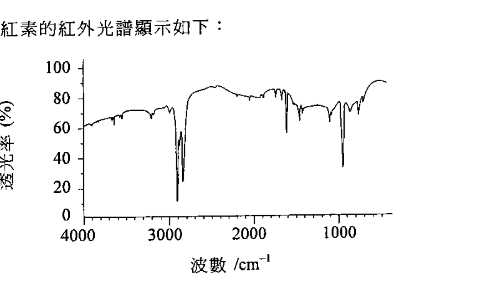

# 2013 DSE 化學 卷二（中文卷）— 題目庫

> 來源：文憑試 DSE 化學 Chemistry 2013 歷屆試題 Past Paper 卷二.pdf　｜　三部分：甲部 工業化學、乙部 物料化學、丙部 分析化學（每部分一題）
> 本試卷共有甲、乙和丙三部。考生須選答任何兩部中的全部試題。
> 說明：已移除頁碼、試卷標頭等雜訊；化學式以 Unicode 下標／上標表示，反應式以 → 或 ⇌ 表示。**本檔為題目庫（零答案）**，只含題目清洗 + 建議標籤。
> 本檔為第 2 層文字交貨（圖用原卷截圖；精修重繪另開第 3 層）。

---

## 甲部　工業化學（第 1 題）

## 第 1 題

【建議標籤】

- 卷別/部分：卷二　甲部
- 課題：#反應速率 #催化劑 #活化能 #麥克斯韋-波爾茲曼 #原子經濟 #綠色化學 #氯鹼工業

【題目內容】

回答試題的所有部分。

(a)　對於氣體反應，溫度上升導致反應速率增加。

以下坐標圖顯示在兩個溫度 T₁ 和 T₂ 時，一氣體的分子動能的麥克斯韋-波爾茲曼分佈曲線：

　　(i)　以上坐標圖中的 x 和 y 軸分別代表什麼？

　　(ii)　參照以上坐標圖，提出為什麼溫度上升可導致氣體反應的速率增加。（5 分）

　　(iii)　在一個化學動力學的實驗裏，於不同溫度 (T) 測定一個反應的速率常數 (k)。以下坐標圖顯示 log k 對 1/T 的圖像：

　　計算這反應的活化能。（氣體常數 R = 8.31 J K⁻¹ mol⁻¹）（3 分）

(b)　苯甲酸丁香酚酯是一個常用的食物香味劑。在硫酸作為均相催化劑的條件下，丁香酚與苯甲酸的反應可合成苯甲酸丁香酚酯。

【圖待補：原卷甲部第 1(b) 題／第 3 頁（苯甲酸 + 丁香酚 → 苯甲酸丁香酚酯的反應式）】

　　(i)　提出為什麼催化劑能令反應加速。（1 分）

　　(ii)　在上述反應中，使用濃硫酸還是使用稀硫酸會給出較佳的苯甲酸丁香酚酯產率？解釋你的答案。（1 分）

　　(iii)　在固體酸作為非均相催化劑的條件下，丁香酚與苯甲酸的反應也可合成苯甲酸丁香酚酯。參照苯甲酸丁香酚酯的合成，寫出一項使用均相催化劑的優點和一項使用非均相催化劑的優點。（2 分）

(c)　氧化丙烯是一個常用於塑膠工業的化學品。下面顯示兩個生產氧化丙烯的方法：

【圖待補：原卷甲部第 1(c) 題／第 3 頁（方法 1、方法 2 生產氧化丙烯的反應式）】

（方法 1：CH₃CH=CH₂ 經 Cl₂、H₂O 和 NaOH 生成氧化丙烯；方法 2：CH₃CH=CH₂ 經 H₂O₂ 生成氧化丙烯和 H₂O。）

　　(i)　方法 1 所用的 Cl₂ 和 NaOH 是氯鹼工業產品。簡略描述這兩個化學品是怎樣生產的。（3 分）

　　(ii)　方法 1 的原子經濟是 29.7%。計算方法 2 的原子經濟。（1 分）

　　(iii)　從兩個不同角度，討論方法 1 抑或方法 2 較為綠色。（2 分）

　　(iv)　評論以下陳述，並解釋你的答案：「一個具高原子經濟的反應，亦應該有高產率。」（2 分）

---

## 乙部　物料化學（第 2 題）

## 第 2 題

【建議標籤】

- 卷別/部分：卷二　乙部
- 課題：#聚合物 #纖維素 #甲基纖維素 #液晶 #OLED

【題目內容】

回答試題的所有部分。

(a)　纖維素的部分結構顯示如下：

【圖待補：原卷乙部第 2(a) 題／第 4 頁（纖維素部分結構）】

纖維素是葡萄糖的縮合聚合物。

　　(i)　「縮合聚合物」一詞是什麼意思？

　　(ii)　繪出一個葡萄糖分子的結構。（2 分）

　　(iii)　纖維素的相對分子質量一般介乎 2.5 × 10⁴ 至 1.0 × 10⁶ 之間。提出為什麼纖維素的相對分子質量範圍是這麼廣。（1 分）

　　(iv)　解釋為什麼葡萄糖和纖維素在水中的溶解度有明顯差異。（3 分）

(b)　(i)　甲基纖維素是從纖維素合成出來的聚合物。它常用作牆紙膠漿的有效成分。甲基纖維素的部分結構顯示如下：

【圖待補：原卷乙部第 2(b)(i) 題／第 4 頁（甲基纖維素部分結構，R 可以是 H 或 CH₃）】

　　乾了的甲基纖維素膠漿是白色固體。寫出並解釋當把這白色固體徐徐加熱直至非常高的溫度時，它所呈現的習性。（3 分）

　　(ii)　聚 2-氰基丙烯酸甲酯常用作超能膠的有效成分。聚 2-氰基丙烯酸甲酯的結構顯示如下：

【圖待補：原卷乙部第 2(b)(ii) 題／第 4 頁（聚 2-氰基丙烯酸甲酯結構）】

　　(1)　繪出聚 2-氰基丙烯酸甲酯的單體的結構。（2 分）

　　(2)　丙酮 (CH₃COCH₃) 是一個常用來去除硬化了的超能膠的溶劑。解釋為什麼丙酮能溶解聚 2-氰基丙烯酸甲酯。（3 分）

　　(iii)　甲基纖維素抑或聚 2-氰基丙烯酸甲酯較容易在環境中降解？解釋你的答案。（2 分）

(c)　液晶廣泛用於製造視像顯示。在各液晶的結構中可有不同的相。

　　(i)　比較液晶的向列相和近晶相。（2 分）

　　(ii)　解釋以下化合物 A 和 B 哪一個會形成螺旋相液晶。

【圖待補：原卷乙部第 2(c)(ii) 題／第 5 頁（化合物 A、B 結構）】

（1 分）

　　(iii)　提出為什麼液晶在非常低溫時會失去其液晶特性。（1 分）

　　(iv)　有機發光二極管 (OLED) 在有電流通過時會發光。OLED 亦可用來製造視像顯示。解釋為什麼液晶顯示的功率被視為比 OLED 顯示的較低。（2 分）

---

## 丙部　分析化學（第 3 題）

## 第 3 題

【建議標籤】

- 卷別/部分：卷二　丙部
- 課題：#分析化學 #滴定 #薄層色譜法 #紅外光譜 #茄紅素

【題目內容】

回答試題的所有部分。

(a)　概述如何可利用物理方法，從一個己-1-烯、辛烷和水的混合物獲取己-1-烯。

（沸點：己-1-烯 = 63 °C；辛烷 = 125 °C；水 = 100 °C）

（4 分）

(b)　白餐酒和紅餐酒均含 SO₂ 防腐劑，而 SO₂ 被固定於不同形式中。進行了一個容量分析實驗來測定在一個白餐酒樣本中 SO₂ 的總濃度。在實驗中，把 25.00 cm³ 的這餐酒樣本轉移至一錐形瓶。按某些指定程序，把 NaOH(aq) 和 H₂SO₄(aq) 依次加入這瓶中，以釋出餐酒內全部的 SO₂。立刻以 0.00412 mol dm⁻³ I₂(aq) 滴定所得到的溶液，並用剛配製的澱粉溶液為指示劑。重複這實驗數次，到達終點所需用 I₂(aq) 的平均體積是 10.50 cm³。

　　(i)　一個反應須滿足某些條件才可用作容量分析。寫出其中一項。（1 分）

　　(ii)　解釋為什麼須立刻滴定所得到的溶液。（1 分）

　　(iii)　寫出在滴定終點的預期顏色變化。（1 分）

　　(iv)　這滴定所涉及反應的化學方程式如下：

　　SO₂(aq) + I₂(aq) + 2H₂O(l) → 2HI(aq) + H₂SO₄(aq)

　　計算在這白餐酒樣本中 SO₂ 的總濃度（以 mg dm⁻³ 為單位）。（4 分）

　　(v)　解釋一個這樣的實驗是否可測定在紅餐酒樣本中的 SO₂ 總濃度。（1 分）

(c)　某牌子蕃茄醬的色素主要是茄紅素（橙紅色）和 β-胡蘿蔔素（黃色）。為把茄紅素從這蕃茄醬分離出來，進行了一個涉及溶劑提取、薄層色譜法 (TLC) 和柱色譜法的實驗。TLC 的結果顯示如下：

（溶劑前沿 2.9 cm；黃點 1.9 cm；橙紅點 2.3 cm；起始位置。）

　　(i)　計算茄紅素點的 Rf 值。（1 分）

　　(ii)　參照 TLC 的結果，解釋若以相同的固定相和流動相進行柱色譜法，首先收集得的有色層是茄紅素還是 β-胡蘿蔔素。（1 分）

　　(iii)　提出一個儀器方法，可用來測定在所收集到茄紅素色層中茄紅素的濃度。寫出所需要量度的茄紅素色層的物理性質。（2 分）

　　(iv)　茄紅素的紅外光譜顯示如下：

　　參照下表所列的特徵紅外吸收波數域（伸展式），提出以下哪一個結構 W、X、Y 或 Z 會是茄紅素的結構，解釋你的答案。

【圖待補：原卷丙部第 3(c)(iv) 題／第 7 頁（化合物 W、X、Y、Z 結構）】

| 鍵合 | 化合物類別 | 波數域 / cm⁻¹ |
|---|---|---|
| C=C | 烯 | 1610 至 1680 |
| C=O | 醛、酮、羧酸及其衍生物 | 1680 至 1800 |
| C≡C | 炔 | 2070 至 2250 |
| C≡N | 腈 | 2200 至 2280 |
| O–H | 羧酸 | 2500 至 3300 |
| C–H | 烷、烯及芳烴 | 2840 至 3095 |
| O–H | 帶氫鍵的醇及酚 | 3230 至 3670 |
| N–H | 胺 | 3350 至 3500 |

（4 分）

---

## 待人工核對

- 甲部第 1(b) 題、第 1(c) 題：反應式結構圖待補（未能可靠截圖）。
- 乙部第 2 題各分子結構圖（纖維素、甲基纖維素、聚 2-氰基丙烯酸甲酯、化合物 A/B）待補。
- 丙部第 3(c)(iv) 題：化合物 W、X、Y、Z 結構圖待補。
- 丙部第 3(c)(iv) 題：特徵紅外吸收波數域表格各列（尤 C≡C／C≡N／羧酸 O–H 之化合物類別）待對頁核實。
