# 2014 DSE 化學 卷一甲（中文卷）— 題目庫

> 來源：文憑試 DSE 化學 Chemistry 2014 歷屆試題 Past Paper 卷一.pdf　｜　多項選擇題 36 題（第一部分 24 題、第二部分 12 題）
> 本部包括兩部分：第一部分設 24 題，第二部分設 12 題。選出每題最佳的答案。考生可參考印於試題答題簿 B 第 20 頁的周期表。
> 說明：已移除頁碼、試卷標頭等雜訊；化學式以 Unicode 下標／上標表示，反應式以 → 或 ⇌ 表示。**本檔為題目庫（零答案）**，只含題目清洗 + 建議標籤。
> 本檔為第 2 層文字交貨（圖用原卷截圖；精修重繪另開第 3 層）。

---

## 第一部分（第 1–24 題）

## 第 1 題

【建議標籤】

- 卷別/部分：卷一甲　第一部分
- 課題：#原子結構 #同位素 #中子

【題目內容】

下列哪原子具有最小數目的中子？

- A. ⁶³Cu
- B. [?]
- C. [?]
- D. [?]

---

## 第 2 題

【建議標籤】

- 卷別/部分：卷一甲　第一部分
- 課題：#離子化合物 #結構 #巨型離子

【題目內容】

下列哪化合物具有巨型離子結構？

- A. [?]
- B. [?]
- C. [?]
- D. [?]

---

## 第 3 題

【建議標籤】

- 卷別/部分：卷一甲　第一部分
- 課題：#腐蝕 #氧化還原 #反應性

【題目內容】

下圖顯示三根大小和形狀相同的鐵釘，各自浸於一液體中：

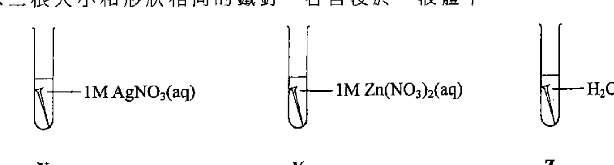

下列哪個排列表示鐵釘腐蝕的速率的遞增順序？

- A. [?]
- B. [?]
- C. [?]
- D. [?]

---

## 第 4 題

【建議標籤】

- 卷別/部分：卷一甲　第一部分
- 課題：#摩爾計算 #氧化還原 #限量反應物

【題目內容】

參考以下化學方程式：

Fe₂O₃(s) + 3CO(g) → 2Fe(s) + 3CO₂(g)

讓 N 摩爾的 Fe₂O₃ 和 2N 摩爾的 CO 在適當的條件下反應直至該反應停止，生成多少摩爾的 Fe？

- A. [?]
- B. [?]
- C. 2N/3
- D. [?]

---

## 第 5 題

【建議標籤】

- 卷別/部分：卷一甲　第一部分
- 課題：#摩爾計算 #水合鹽 #結晶水

【題目內容】

按質量計算，水合鹽 X·nH₂O 含 51.16% 的水。已知 X 的摩爾質量是 120.3 g，n 是什麼？

（相對原子質量：H = 1.0，O = 16.0）

- A. 2
- B. 5
- C. 7
- D. 10

---

## 第 6 題

【建議標籤】

- 卷別/部分：卷一甲　第一部分
- 課題：#摩爾濃度 #離子 #混合

【題目內容】

把 50.0 cm³ 的 0.6 M FeSO₄(aq) 和 150.0 cm³ 的 0.2 M Fe₂(SO₄)₃(aq) 混合，所得混合物中 SO₄²⁻(aq) 離子的濃度是多少？

- A. 0.3 M
- B. 0.4 M
- C. 0.6 M
- D. 0.8 M

---

## 第 7 題

【建議標籤】

- 卷別/部分：卷一甲　第一部分
- 課題：#導電性 #水溶液 #酸鹼

【題目內容】

下列哪對水溶液在混合後會具有最低的導電性？

- A. 20.0 cm³ 的 0.1 M HCl 和 20.0 cm³ 的 0.1 M KOH
- B. 20.0 cm³ 的 0.1 M H₂SO₄ 和 20.0 cm³ 的 0.1 M Ba(OH)₂
- C. 20.0 cm³ 的 0.1 M CH₃COOH 和 20.0 cm³ 的 0.1 M NH₃
- D. 20.0 cm³ 的 0.1 M HCl 和 20.0 cm³ 的 0.1 M CH₃COOH（葡萄糖）

---

## 第 8 題

【建議標籤】

- 卷別/部分：卷一甲　第一部分
- 課題：#烯 #加成反應 #鹵化

【題目內容】

當溴乙烯與在適當有機溶劑的氯反應時，會生成下列哪化合物？

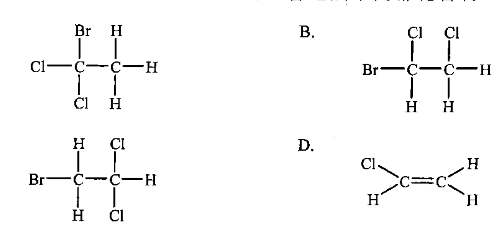

- A. [?]
- B. [?]
- C. [?]
- D. [?]

---

## 第 9 題

【建議標籤】

- 卷別/部分：卷一甲　第一部分
- 課題：#焓變 #生成焓 #赫斯定律

【題目內容】

在某些條件下，三個反應的焓變如下所示：

| 反應 | 焓變 |
|---|---|
| B₂H₆(g) + 3O₂(g) → B₂O₃(s) + 3H₂O(l) | −2170 kJ |
| 2B(s) + ³⁄₂O₂(g) → B₂O₃(s) | −635 kJ |
| H₂(g) + ½O₂(g) → H₂O(l) | −286 kJ |

下列哪項是 B₂H₆(g) 在相同條件下的生成焓變？

- A. +42 kJ mol⁻¹
- B. +614 kJ mol⁻¹
- C. +677 kJ mol⁻¹
- D. +1249 kJ mol⁻¹

---

## 第 10 題

【建議標籤】

- 卷別/部分：卷一甲　第一部分
- 課題：#取代反應 #鹵化 #自由基

【題目內容】

讓一摩爾的甲烷與二摩爾的氯在有光的存在下反應。下列哪項是將曾生成的有機產物（一個或多個）的最佳描述？

- A. 一摩爾的 CCl₄
- B. 一摩爾的 CH₃Cl
- C. 一個只含 CCl₄ 和 CHCl₃ 的混合物
- D. 一個含 CH₃Cl、CH₂Cl₂、CHCl₃ 和 CCl₄ 的混合物

---

## 第 11 題

【建議標籤】

- 卷別/部分：卷一甲　第一部分
- 課題：#電解 #電鍍 #銀

【題目內容】

下圖顯示一個正在把銀鍍於一匙子上的裝置：

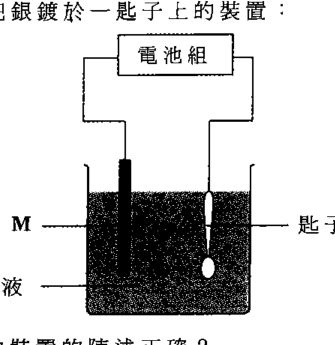

下列哪個有關以上的裝置的陳述正確？

- A. M 必須是銀。
- B. Q 可以是氯化銀。
- C. 該匙子連接至電池組的負極。
- D. 電子從金屬 M 經該溶液流向該匙子。

---

## 第 12 題

【建議標籤】

- 卷別/部分：卷一甲　第一部分
- 課題：#滴定 #中和 #溫度變化

【題目內容】

在一實驗中，把標準 HCl(aq) 從滴定管加進置於一個發泡膠杯內已知體積的 NaOH(aq)。以下坐標圖顯示過程中杯中混合物的溫度：

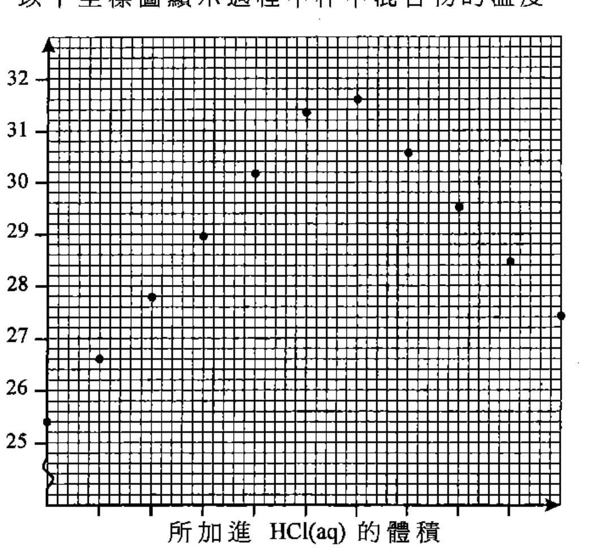

根據以上坐標圖估算，杯中混合物的最大溫度升幅是多少？

- A. 2.0 °C
- B. 4.6 °C
- C. 6.2 °C
- D. 6.6 °C

---

## 第 13 題

【建議標籤】

- 卷別/部分：卷一甲　第一部分
- 課題：#酸鹼 #pH #氣體

【題目內容】

下列哪氣體溶於 1 dm³ 的水後，會生成 pH 最高的溶液？

- A. 0.002 mol 的 CO₂
- B. 0.002 mol 的 SO₂
- C. 0.002 mol 的 NH₃
- D. 0.002 mol 的 HCl

---

## 第 14 題

【建議標籤】

- 卷別/部分：卷一甲　第一部分
- 課題：#氧 #分解 #金屬氧化物

【題目內容】

如下圖所示，當把固體乙加熱時，該有餘燼的木條重燃：

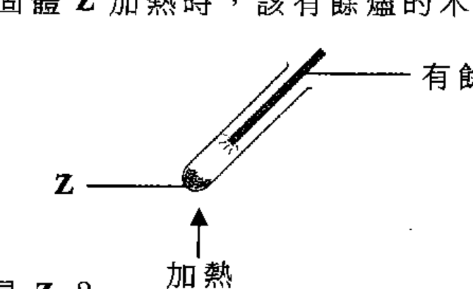

下列哪化學品可能是 Z？

- A. HgO
- B. Al₂O₃
- C. CaCO₃
- D. MgCO₃

---

## 第 15 題

【建議標籤】

- 卷別/部分：卷一甲　第一部分
- 課題：#實驗安全 #危險標籤 #酸

【題目內容】

下列危險警告標籤，何者都應張貼在盛載濃硫酸的試劑瓶和盛載濃氫氯酸的試劑瓶上？

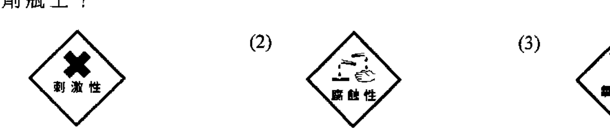

- A. 只有 (1)
- B. 只有 (2)
- C. 只有 (1) 和 (3)
- D. 只有 (2) 和 (3)

---

## 第 16 題

【建議標籤】

- 卷別/部分：卷一甲　第一部分
- 課題：#電池 #鋅碳電池 #電化

【題目內容】

下列有關鋅碳電池的陳述，何者正確？

(1) 當使用時，鋅殼會變得更薄。

(2) 當使用時，它的電壓維持不變。

(3) 使用後，它可被再次充電。

- A. 只有 (1)
- B. 只有 (2)
- C. 只有 (1) 和 (3)
- D. 只有 (2) 和 (3)

---

## 第 17 題

【建議標籤】

- 卷別/部分：卷一甲　第一部分
- 課題：#燃料 #天然氣 #能源

【題目內容】

與使用煤相比，在發電廠使用天然氣作為燃料有什麼優勝之處？

(1) 與煤相比，天然氣燃燒得較完全。

(2) 與煤相比，天然氣有較少含硫物質。

(3) 天然氣是一可再生能源，但煤不是。

- A. 只有 (1) 和 (2)
- B. 只有 (1) 和 (3)
- C. 只有 (2) 和 (3)
- D. (1)、(2) 和 (3)

---

## 第 18 題

【建議標籤】

- 卷別/部分：卷一甲　第一部分
- 課題：#鹼金屬 #鉀 #反應性

【題目內容】

在一實驗中，把一小塊的鉀加進含酚酞的一槽水中。下列有關這實驗的陳述，何者正確？

(1) 發生一放熱反應。

(2) 生成一無色溶液。

(3) 該金屬以淡紫色火焰燃燒。

- A. 只有 (1) 和 (2)
- B. 只有 (1) 和 (3)
- C. 只有 (2) 和 (3)
- D. (1)、(2) 和 (3)

---

## 第 19 題

【建議標籤】

- 卷別/部分：卷一甲　第一部分
- 課題：#氣體 #氧化 #銅粉

【題目內容】

一實驗的裝置如下所示。在室溫時，該體系起始含有 40 cm³ 的 N₂(g)、25 cm³ 的 O₂(g) 和 10 cm³ 的 H₂(g)。

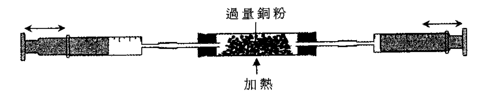

把各氣筒的柱塞前後移動，直至該體系內沒有進一步變化，然後讓該體系冷卻至室溫。下列哪些有關這實驗的陳述正確？

(1) 一些銅粉會變成黑色物質。

(2) 該體系內的氣體總體積會減少 25 cm³。

(3) 如以過量鐵粉代替過量銅粉，會觀察得相同的氣體總體積的變化。

- A. 只有 (1) 和 (2)
- B. 只有 (1) 和 (3)
- C. 只有 (2) 和 (3)
- D. (1)、(2) 和 (3)

---

## 第 20 題

【建議標籤】

- 卷別/部分：卷一甲　第一部分
- 課題：#電解 #導電性 #溴化鈉

【題目內容】

下圖顯示一實驗的裝置：

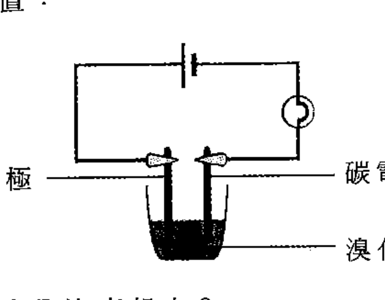

下列的方法，何者可令燈泡亮起來？

(1) 把該溴化鈉粉末加熱至熔融。

(2) 把去離子水加進該溴化鈉粉末。

(3) 以液體溴代替該溴化鈉粉末。

- A. 只有 (1) 和 (2)
- B. 只有 (1) 和 (3)
- C. 只有 (2) 和 (3)
- D. (1)、(2) 和 (3)

---

## 第 21 題

【建議標籤】

- 卷別/部分：卷一甲　第一部分
- 課題：#指示劑 #藍色 #石蕊

【題目內容】

下列的過程，何者會呈現藍色？

(1) 把石蕊加進 NaOH(aq)。

(2) 把 CuSO₄(aq) 和 NH₃(aq) 混合。

(3) 把 K₃Fe(CN)₆(aq) 和 FeCl₃(aq) 混合。

- A. 只有 (1) 和 (2)
- B. 只有 (1) 和 (3)
- C. 只有 (2) 和 (3)
- D. (1)、(2) 和 (3)

---

## 第 22 題

【建議標籤】

- 卷別/部分：卷一甲　第一部分
- 課題：#八隅體 #路易斯結構 #分子

【題目內容】

下列哪些分子具有非八隅體結構？

(1) [?]

(2) [?]

(3) BCl₃

- A. 只有 (1) 和 (2)
- B. 只有 (1) 和 (3)
- C. 只有 (2) 和 (3)
- D. (1)、(2) 和 (3)

---

## 第 23 題

【建議標籤】

- 卷別/部分：卷一甲　第一部分
- 課題：#極性 #分子間引力 #液體

【題目內容】

當把帶負電荷的棒子放近從滴定管流出的液體柱，液體柱向棒子偏移。下列何者可能是該液體？

(1) 水

(2) 己烷

(3) 三氯甲烷

- A. 只有 (1) 和 (2)
- B. 只有 (1) 和 (3)
- C. 只有 (2) 和 (3)
- D. (1)、(2) 和 (3)

---

## 第 24 題

【建議標籤】

- 卷別/部分：卷一甲　第一部分
- 課題：#酸鹼 #氧化鈣 #敘述句

【題目內容】

指示：題 24 由兩敘述句組成。考生須先判斷該兩敘述句是否正確；若兩敘述句均屬正確，再判斷第二敘述句是否第一敘述句的合理解釋，然後根據下表，從 A 至 D 四項中選出一個適用的答案：

- A. 兩敘述句均屬正確，而第二敘述句為第一敘述句的合理解釋。
- B. 兩敘述句均屬正確，但第二敘述句並非第一敘述句的合理解釋。
- C. 第一敘述句錯誤，但第二敘述句正確。
- D. 兩敘述句均屬錯誤。

第一敘述句：所有酸性氣體能與 CaO(s) 反應只生成鹽和水。

第二敘述句：所有酸性氣體含有氫作為其中一個組成原子。

---

## 第二部分（第 25–36 題）

## 第 25 題

【建議標籤】

- 卷別/部分：卷一甲　第二部分
- 課題：#催化 #分解 #反應速率

【題目內容】

在有 MnO₂(s) 存在下，H₂O₂(aq) 分解成 H₂O(l) 和 O₂(g)。在相同條件下進行兩個實驗來研習這分解，惟於實驗 (1) 中使用 50 cm³ 的 2 M H₂O₂(aq)，而於實驗 (2) 中使用 100 cm³ 的 1 M H₂O₂(aq)。

下列哪組合正確？

| | 開始時生成 O₂(g) 的速率 | 生成 O₂(g) 的總體積 |
|---|---|---|
| A. | 實驗 (1) > 實驗 (2) | 實驗 (1) = 實驗 (2) |
| B. | 實驗 (1) > 實驗 (2) | 實驗 (1) > 實驗 (2) |
| C. | 實驗 (1) = 實驗 (2) | 實驗 (1) = 實驗 (2) |
| D. | 實驗 (1) = 實驗 (2) | 實驗 (1) > 實驗 (2) |

---

## 第 26 題

【建議標籤】

- 卷別/部分：卷一甲　第二部分
- 課題：#平衡 #平衡常數

【題目內容】

考慮下面的資料：

| 反應 | 在 25 °C 時的平衡常數 |
|---|---|
| A(aq) + B(aq) ⇌ C(aq) + D(aq) | K₁ |
| C(aq) + D(aq) ⇌ E(aq) + F(aq) + G(aq) | K₂ |
| E(aq) + F(aq) + G(aq) ⇌ A(aq) + B(aq) | K₃ |

下列哪組合正確？

| | K₁ 和 K₃ 的關係 | K₃ 的單位 |
|---|---|---|
| A. | [?] | mol dm⁻³ |
| B. | [?] | dm³ |
| C. | K₃ = K₁ × K₂ | mol dm⁻³ |
| D. | K₃ = K₁ × K₂ | dm³ |

---

## 第 27 題

【建議標籤】

- 卷別/部分：卷一甲　第二部分
- 課題：#立體異構 #幾何異構 #對映異構

【題目內容】

下列哪個有關 CH₃CH=CHCH(CH₃)₂ 的組合正確？

| | 幾何異構體的數目 | 對映異構體的數目 |
|---|---|---|
| A. | 2 | 4 |
| B. | [?] | [?] |
| C. | [?] | [?] |
| D. | [?] | [?] |

---

## 第 28 題

【建議標籤】

- 卷別/部分：卷一甲　第二部分
- 課題：#有機轉化 #試劑 #反應

【題目內容】

考慮下列各有機反應，其中 P、Q 和 R 是所生成的主要有機產物：

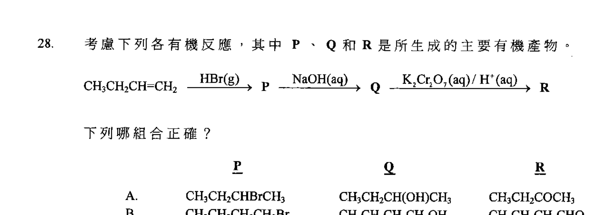

下列哪組合正確？

| | P | Q | R |
|---|---|---|---|
| A. | CH₃CH₂CHBrCH₃ | CH₃CH₂CH(OH)CH₃ | CH₃CH₂COCH₃ |
| B. | CH₃CH₂CH₂CH₂Br | CH₃CH₂CH₂CH₂OH | CH₃CH₂CH₂CHO |
| C. | CH₃CH₂CH₂CH₂Br | CH₃CH₂CH=CH₂ | CH₃CH₂CH(OH)CH₂OH |
| D. | CH₃CH₂CHBrCH₃ | CH₃CH₂CH(OH)CH₃ | CH₃CH₂CO₂H |

---

## 第 29 題

【建議標籤】

- 卷別/部分：卷一甲　第二部分
- 課題：#立體異構 #分子 #對映

【題目內容】

下列哪個選項中的分子 1 和分子 2 完全相同？

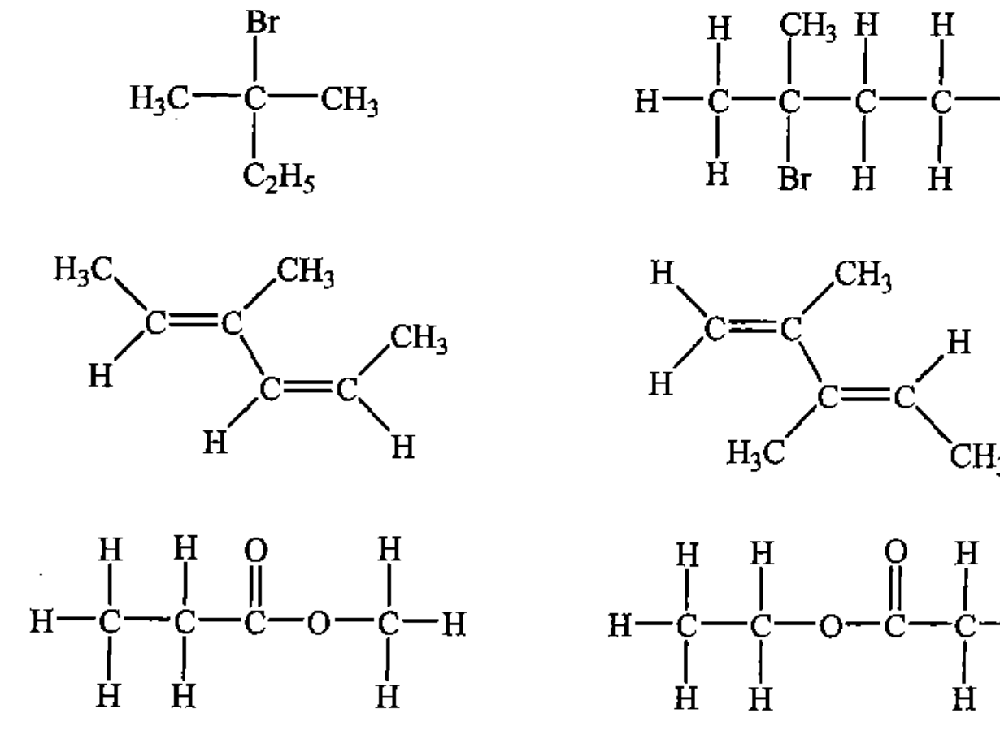

- A. [?]
- B. [?]
- C. [?]
- D. [?]

---

## 第 30 題

【建議標籤】

- 卷別/部分：卷一甲　第二部分
- 課題：#周期表 #導電性 #趨勢

【題目內容】

下列哪坐標圖（不按比例繪畫）正確顯示在室溫時，周期表內第三周期各元素的導電性的變化？

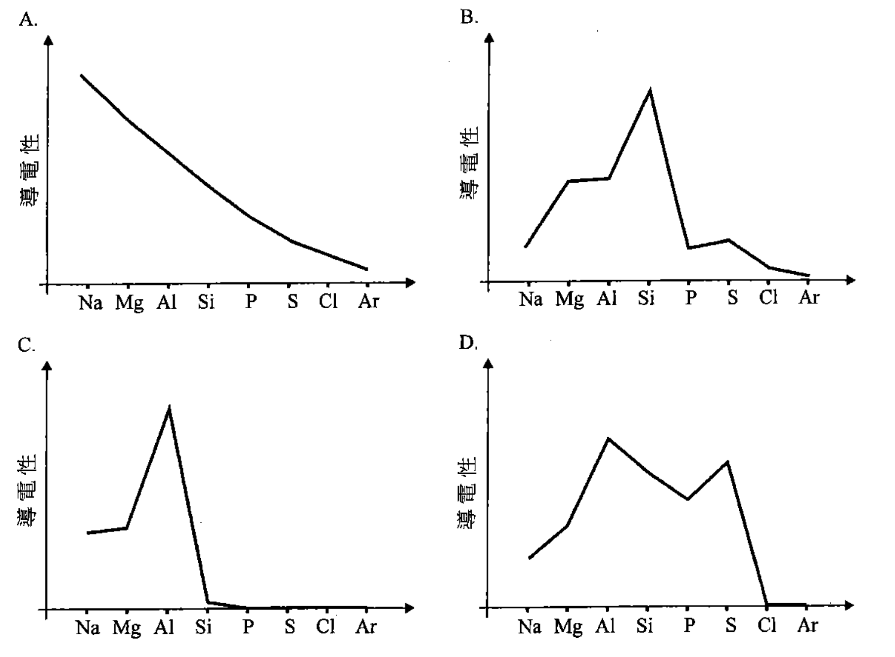

- A. [?]
- B. [?]
- C. [?]
- D. [?]

---

## 第 31 題

【建議標籤】

- 卷別/部分：卷一甲　第二部分
- 課題：#平衡 #勒沙特列 #氣體

【題目內容】

下列體系於某溫度達致平衡：

2SO₂(g) + O₂(g) ⇌ 2SO₃(g)

當這體系的體積減少而溫度保持不變時，下列的陳述，何者正確？

(1) K 的值增加。

(2) 平衡位置向右移。

(3) SO₃(g) 的分解速率增加。

- A. 只有 (1)
- B. 只有 (2)
- C. 只有 (1) 和 (3)
- D. 只有 (2) 和 (3)

---

## 第 32 題

【建議標籤】

- 卷別/部分：卷一甲　第二部分
- 課題：#阿士匹靈 #有機 #官能基

【題目內容】

下列有關阿士匹靈的陳述，何者正確？

(1) 它於酸催化劑的存在下與二醇進行酯化作用。

(2) 它與碳酸鈉溶液反應生成一無色氣體。

(3) 它能被用來消炎。

- A. 只有 (1)
- B. 只有 (2)
- C. 只有 (1) 和 (3)
- D. 只有 (2) 和 (3)

---

## 第 33 題

【建議標籤】

- 卷別/部分：卷一甲　第二部分
- 課題：#有機 #官能基 #反應

【題目內容】

防曬霜含有下面的化合物作為有效成分：

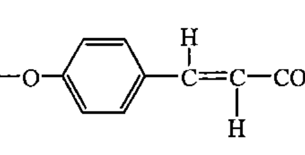

下列試劑，何者能與這化合物反應？

(1) NaOH(aq)

(2) PCl₅(l)

(3) 酸化 KMnO₄(aq)

- A. 只有 (1)
- B. 只有 (2)
- C. 只有 (1) 和 (3)
- D. 只有 (2) 和 (3)

---

## 第 34 題

【建議標籤】

- 卷別/部分：卷一甲　第二部分
- 課題：#清潔劑 #表面活性劑 #結構

【題目內容】

清潔劑的結構如下所示：

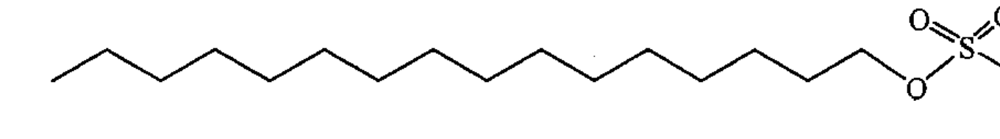

下列哪些有關這清潔劑的陳述正確？

(1) 它在硬水中具有清潔功能。

(2) 把它與油和水猛烈搖動能生成一穩定乳狀物。

(3) 它能從某植物油和 NaOH(aq) 反應而生成。

- A. 只有 (1) 和 (2)
- B. 只有 (1) 和 (3)
- C. 只有 (2) 和 (3)
- D. (1)、(2) 和 (3)

---

## 第 35 題

【建議標籤】

- 卷別/部分：卷一甲　第二部分
- 課題：#平衡 #反應速率 #敘述句

【題目內容】

指示：以下兩題（題 35 和題 36）均由兩敘述句組成。考生須先判斷該兩敘述句是否正確；若兩敘述句均屬正確，再判斷第二敘述句是否第一敘述句的合理解釋，然後根據下表，從 A 至 D 四項中選出一個適用的答案：

- A. 兩敘述句均屬正確，而第二敘述句為第一敘述句的合理解釋。
- B. 兩敘述句均屬正確，但第二敘述句並非第一敘述句的合理解釋。
- C. 第一敘述句錯誤，但第二敘述句正確。
- D. 兩敘述句均屬錯誤。

第一敘述句：在化學平衡狀態，正向反應速率等於零。

第二敘述句：在化學平衡狀態，反應物不曾反應以得出生成物。

---

## 第 36 題

【建議標籤】

- 卷別/部分：卷一甲　第二部分
- 課題：#氧化鋁 #兩性 #敘述句

【題目內容】

第一敘述句：氧化鋁可溶於水。

第二敘述句：氧化鋁是一個兩性氧化物。

- A. 兩敘述句均屬正確，而第二敘述句為第一敘述句的合理解釋。
- B. 兩敘述句均屬正確，但第二敘述句並非第一敘述句的合理解釋。
- C. 第一敘述句錯誤，但第二敘述句正確。
- D. 兩敘述句均屬錯誤。

---

*甲部完 —*

## 待人工核對

本卷為第 2 層文字交貨，由 easyocr（ch_tra+en，GPU）掃描底稿清洗而成；現模型無影像輸入，未能對頁影像覆核。以下題號建議第 3 層精修時對頁覆核：

- 第 1 題：選項 B／C／D 為同位素符號，OCR 未讀出（僅 A「⁶³Cu」清晰），標 [?]。
- 第 2 題：選項 A–D 為化合物化學式，OCR 亂碼（「11_04」「TIOs」「NCl,」「MHl0s」），未能可靠還原，標 [?]。
- 第 3 題：鐵釘浸液體裝置圖（三試管：AgNO₃(aq)、Zn(NO₃)₂(aq)、H₂O(l)）為 300dpi 截圖；選項 A–D 為排列順序（OCR 讀作「1<1<Ⅲ」亂碼），標 [?]；圖位置／範圍待 spot-check。
- 第 4 題：選項 A／B／D 為分數（OCR 亂碼），僅 C「2N/3」可辨，其餘標 [?]。
- 第 6 題：選項數值依題型還原為 0.3/0.4/0.6/0.8 M，待對頁核實。
- 第 7 題：選項 A–D 為兩溶液組合，OCR 部分亂碼（如 D「CH₃COOH（葡萄糖）」），依題型重建，待對頁核實。
- 第 8 題：溴乙烯＋氯 選項為結構式（A–D），OCR 僅讀出片段，標 [?]＋300dpi 截圖。
- 第 9 題：反應焓變表之方程式與數值依題型還原（B₂H₆ 生成焓），係數／ΔH 待對頁核實。
- 第 13 題：選項氣體「CO₂／SO₂／NH₃／HCl」依題型還原，待對頁核實。
- 第 14 題：固體乙加熱裝置為 300dpi 截圖；選項 A–D（HgO/Al₂O₃/CaCO₃/MgCO₃）依題型還原，待對頁核實。
- 第 15 題：危險警告標籤（3 個）為 300dpi 截圖；標籤內容（腐蝕性／刺鼻性／氧化性等）待對頁核實。
- 第 19 題：銅粉加熱裝置為 300dpi 截圖；氣體初始體積（N₂ 40、O₂ 25、H₂ 10 cm³）依題型還原，待對頁核實。
- 第 22 題：選項 (1)(2) 分子式 OCR 未讀出（「l0_」等），標 [?]；僅 (3) BCl₃ 可辨。
- 第 23 題：選項 (2)「二烷」依題型還原為「己烷」、液體（水／己烷／三氯甲烷）待對頁核實。
- 第 25 題：表格兩欄（生成 O₂ 速率／總體積）之 A–D 組合依題型還原，待對頁核實。
- 第 26 題：平衡常數表 K₁/K₂/K₃ 及單位欄依題型還原，A/B 選項關係式 OCR 亂碼標 [?]，待對頁核實。
- 第 27 題：幾何異構體／對映異構體數目表，僅 A「2／4」可辨，B–D 標 [?]。
- 第 28 題：有機反應路徑圖（P/Q/R）為 300dpi 截圖；選項結構式依題型還原，待對頁核實。
- 第 29 題：分子 1／分子 2 結構式選項（A–D）為 300dpi 截圖，選項內容標 [?]。
- 第 30 題：第三周期導電性坐標圖（A–D 四圖）為 300dpi 截圖，選項內容標 [?]。
- 第 32 題：選項 (1)「與二酸進行酯化作用」OCR 讀作「二酸」，依題型（阿士匹靈含 COOH 與 OH 成酯）待對頁核實用字。
- 第 33 題：防曬霜化合物結構為 300dpi 截圖；試劑選項依題型還原，待對頁核實。
- 第 34 題：清潔劑結構為 300dpi 截圖；選項依題型還原，待對頁核實。
- 第 3、8、11、12、14、15、19、20、28、29、30、33、34 題：圖為 300dpi 原卷截圖（程式定位＋墨跡覆蓋率校驗；位置／範圍待 spot-check）；第 3 層再換成向量重繪。
