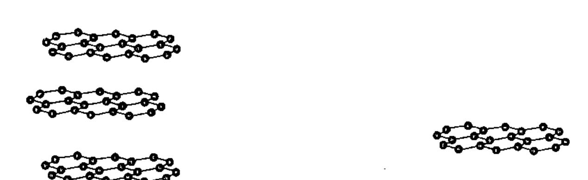
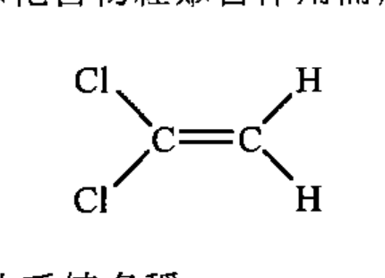
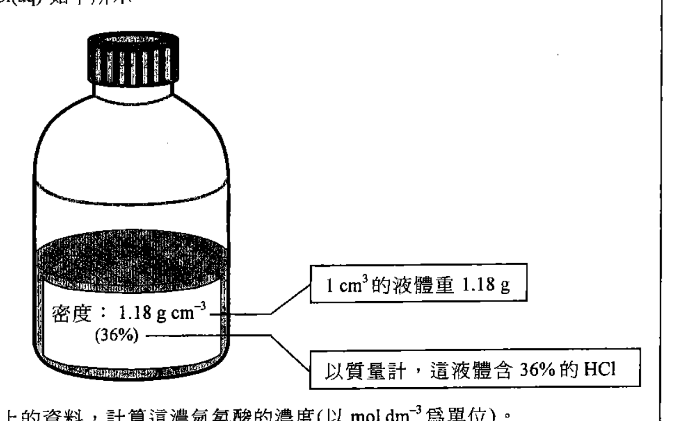
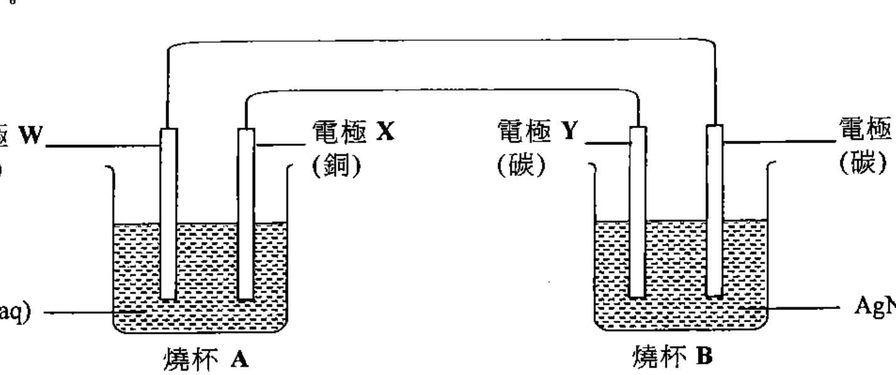
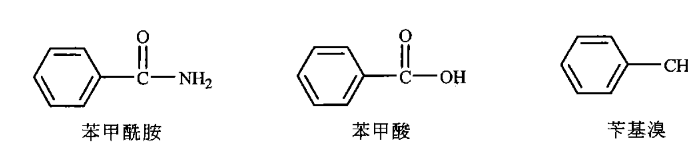
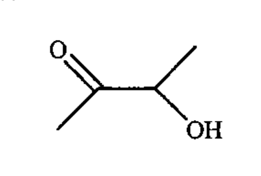

# 2014 DSE 化學 卷一乙（中文卷）— 題目庫

> 來源：文憑試 DSE 化學 Chemistry 2014 歷屆試題 Past Paper 卷一.pdf　｜　乙部 結構式問題 14 題（第一部分 9 題、第二部分 5 題）
> 本部包括兩部分：第一和第二部分各題均須作答。有 * 號標記的試題，將有一分給予達致有效傳意的答案。
> 說明：已移除頁碼、試卷標頭、答題簿橫線等雜訊；化學式以 Unicode 下標／上標表示，反應式以 → 或 ⇌ 表示。**本檔為題目庫（零答案）**，只含題目清洗 + 建議標籤。
> 本檔為第 2 層文字交貨（圖用原卷截圖；精修重繪另開第 3 層）。

---

## 第一部分（第 1–9 題）

## 第 1 題

【建議標籤】

- 卷別/部分：卷一乙　第一部分
- 課題：#碳 #石墨 #石墨烯 #富勒烯

【題目內容】

石墨是碳的一種形式，並具有層狀結構。石墨烯是石墨的個別單層。它們的結構如下所示：

(a)　使用黏貼膠紙可輕易把石墨烯薄片從石墨剝離。解釋為什麼可輕易把石墨烯剝離。

　　(ii)　解釋石墨烯能否導電。

　　(iii)　繪出由石墨烯完全燃燒所生成的化合物的分子的電子圖（只需顯示最外層電子）。（3 分）

(b)　基於可輕易把石墨烯從石墨剝離的事實，某學生總結出石墨因其具有層狀結構而應有一低的熔點。解釋你是否贊同這個結論。（1 分）

(c)　富勒烯（如 C₆₀）是碳的另一種形式。簡述 C₆₀ 的結構，並提出為什麼牠可溶於一些有機溶劑。（3 分）

---

## 第 2 題

【建議標籤】

- 卷別/部分：卷一乙　第一部分
- 課題：#醇 #二醇 #溶解度

【題目內容】

繪出乙-1,2-二醇的結構，並提出牠是否可溶於水。（3 分）

---

## 第 3 題

【建議標籤】

- 卷別/部分：卷一乙　第一部分
- 課題：#聚乙烯 #尼龍 #聚合 #分子間引力

【題目內容】

聚乙烯（PE）及尼龍均可用來製造食物保鮮紙，但尼龍較 PE 更適宜用來製造在微波爐使用的食物保鮮紙。

(a)　PE 的單體是乙烯。建議一個化學測試，以顯示乙烯是一不飽和化合物。（2 分）

(b)　尼龍可由以下所示化合物經聚合作用而形成：

　　(i)　寫出這化合物的系統名稱。

　　(ii)　寫出形成尼龍所涉及聚合作用的類別名稱。

　　(iii)　繪出尼龍的結構（顯示最少三個重複單位。）（3 分）

(c)　根據分子間作用力，解釋為什麼尼龍較 PE 更適宜用來製造在微波爐使用的食物保鮮紙。（2 分）

(d)　[?]　尼龍製造的食物保鮮紙將較以 PE 製造的食物保鮮紙引致 [?]。（1 分）

---

## 第 4 題

【建議標籤】

- 卷別/部分：卷一乙　第一部分
- 課題：#金屬 #活性序 #氧化物

【題目內容】

*參考從各自的氧化物獲得銅、鎂及銀的方法，推斷這三種金屬的活性次序。（5 分）

---

## 第 5 題

【建議標籤】

- 卷別/部分：卷一乙　第一部分
- 課題：#濃酸 #強酸 #銅 #安全

【題目內容】

濃酸是實驗室中常見的試劑。

(a)　寫出在實驗室內處理濃酸時的一項安全措施。（1 分）

(b)　評論以下敘述句：「所有濃酸均是強酸。」（1 分）

(c)　解釋怎樣以銅粒分辨濃硫酸、濃硝酸和濃乙酸。（3 分）

---

## 第 6 題

【建議標籤】

- 卷別/部分：卷一乙　第一部分
- 課題：#汽油 #分餾 #燃燒 #催化轉化器 #焓變

【題目內容】

汽油是一種常用的汽車燃料。牠可經分餾石油而得到。

(a)　(i)　從分子層面，解釋為什麼汽油可經分餾石油而得到。

　　(ii)　除了從分餾石油直接取得汽油外，建議一生產額外汽油的方法。

　　(iii)　[?] 辛烷燃燒焓 [?] 汽油 [?]；以辛烷為例，輔以一化學方程式，寫出 [?]。（5 分）

(b)　以汽油驅動的汽車排出一氧化氮和一氧化碳等空氣污染物。在汽車安裝某裝置能把這兩個氧化物轉化成害處較少的物質。

　　(i)　寫出這裝置的名稱。

　　(ii)　這轉化所涉及反應的方程式如下所示：

　　2CO(g) + 2NO(g) → 2CO₂(g) + N₂(g)

　　NO(g)、CO(g) 和 CO₂(g) 的標準生成焓變如下：

| 化合物 | ΔH_f（kJ mol⁻¹） |
|---|---|
| NO(g) | +90.3 |
| CO(g) | −110.5 |
| CO₂(g) | −394.0 |

　　計算以上反應的標準焓變。（4 分）

---

## 第 7 題

【建議標籤】

- 卷別/部分：卷一乙　第一部分
- 課題：#濃氫氯酸 #濃度 #滴定 #碳酸鈉

【題目內容】

一瓶子濃氫氯酸 HCl(aq) 如下所示：

（標籤：密度 1.18 g cm⁻³；以質量計，這液體含 36% 的 HCl）

(a)　根據該標籤上的資料，計算這濃氫氯酸的濃度（以 mol dm⁻³ 為單位）。（2 分）

(b)　把濃酸稀釋，然後以這經稀釋的酸樣本來滴定 10.00 cm³ 的 1.00 mol dm⁻³ 標準碳酸鈉溶液（以甲基橙為指示劑）。10.00 cm³ 的濃酸樣本 [?] 需 20.30 cm³ 的該經稀釋的酸樣本來達到終點。

　　(i)　簡述製備一個標準碳酸鈉溶液的步驟。

　　(ii)　利用滴定結果，計算瓶子中的濃氫氯酸的濃度（以 mol dm⁻³ 為單位）。（5 分）

(c)　提出一個可能原因，說明為什麼從上面 (b)(ii) 所得的瓶子中的濃氫氯酸的濃度會小於從 (a) 中所得者。（1 分）

---

## 第 8 題

【建議標籤】

- 卷別/部分：卷一乙　第一部分
- 課題：#電化電池 #電極 #半反應式

【題目內容】

下圖顯示一裝置，其中有電子正在通過各電線。此外，燒杯 A 內的其中一電極正在生成離子。

（電極 W：鎂；電極 X：銅；燒杯 A：MgSO₄(aq)；電極 Y：碳；電極 Z：碳；燒杯 B：AgNO₃(aq)）

(a)　寫出在以下每電極的一項預期觀察：

　　(i)　電極 W

　　(ii)　電極 X

（2 分）

(b)　寫出在以下每電極的預期變化的半反應式：

　　(i)　電極 Y

　　(ii)　電極 Z

（2 分）

(c)　完成下表，在表中填上「陽極」或「陰極」來描述各電極：

| | 電極 W | 電極 Z |
|---|---|---|
| 陽極／陰極 | | |

(d)　預測（附以理由）如果以二醇取代燒杯 A 中的 MgSO₄(aq) 會有什麼發生。

---

## 第 9 題

【建議標籤】

- 卷別/部分：卷一乙　第一部分
- 課題：#氫氧化鈉 #硫酸銅 #高錳酸鉀 #氧化還原

【題目內容】

參考以下各實驗，並回答隨後的問題。

(a)　把稀氫氧化鈉溶液加進硫酸銅(II)溶液。

　　(i)　寫出預期的觀察。

　　(ii)　寫出所發生反應的化學方程式。（2 分）

(b)　把酸化高錳酸鉀溶液加進 [?] 溶液。

　　(i)　寫出預期的顏色變化。

　　(ii)　為導致該顏色變化的反應：

　　　(1)　寫出該反應的類別名稱；及

　　　(2)　寫出該反應的離子方程式。（3 分）

---

## 第二部分（第 10–14 題）

## 第 10 題

【建議標籤】

- 卷別/部分：卷一乙　第二部分
- 課題：#反應速率 #碳酸鈣 #鹽酸 #公平比較

【題目內容】

*你獲提供常用的實驗室儀器、碳酸鈣和 1 M 氫氯酸。概述如何進行一公平比較，以研習酸的不同濃度對從下列反應生成二氧化碳的速率的影響：

CaCO₃(s) + 2HCl(aq) → CaCl₂(aq) + H₂O(l) + CO₂(g)　（5 分）

---

## 第 11 題

【建議標籤】

- 卷別/部分：卷一乙　第二部分
- 課題：#過渡金屬 #釩 #氧化還原 #顏色

【題目內容】

釩是一種過渡性金屬，其化學符號是 V。三個水溶含釩離子的化學式和顏色如下所示：

| 化學式 | VO₂⁺(aq) [?] | V³⁺(aq) [?] | V²⁺(aq) [?] |
|---|---|---|---|
| 顏色 | 藍 | 綠 | 紫 |

(a)　根據所提供的資料，提出釩的其中一個性質，以表明牠是一過渡性金屬。

(b)　釩亦生成 VO₂⁺(aq) 這離子。在酸的存在下，1.0 mol 的 VO₂⁺(aq) 離子與 1.0 mol 的 SO₂(g) 完全反應，生成 SO₄²⁻(aq) 離子和以上的其中一個水溶含釩離子。

　　(i)　藉考慮電子轉移的數量，推定該所得溶液的最終顏色。

　　(ii)　寫出在 (i) 中的反應的一條化學方程式。（3 分）

---

## 第 12 題

【建議標籤】

- 卷別/部分：卷一乙　第二部分
- 課題：#苯甲醯胺 #苯甲酸 #苄基溴 #有機轉化

【題目內容】

苯甲醯胺、苯甲酸和苄基溴是常用的有機化合物。牠們的結構如下所示：

（苯甲醯胺：C₆H₅CONH₂；苯甲酸：C₆H₅COOH；苄基溴：C₆H₅CH₂Br）

(a)　在一實驗中，從苯甲醯胺經兩個步驟製備苯甲酸：

　　步驟 1：把苯甲醯胺加入過量的 1 M NaOH(aq)，並將混合物微熱，生成一有機化合物 X。

　　步驟 2：繼而把所得混合物以試劑 Y 處理，直至沒有更多固體苯甲酸釋出。

　　(i)　寫出步驟 1 中所涉及反應的類別名稱。

　　(ii)　繪出 X 的結構。

　　(iii)　提出 Y 會是什麼。

　　(iv)　提出為什麼 X 比苯甲酸較溶於水。簡述在步驟 2 後，如何可獲取一個乾燥的苯甲酸樣本。（5 分）

(b)　概述一條不多於三個步驟的合成路線來完成苯甲酸至苄基溴的轉化。寫出每一步驟的試劑（一個或多個）、反應條件（如適用）及有機生成物的結構。（3 分）

---

## 第 13 題

【建議標籤】

- 卷別/部分：卷一乙　第二部分
- 課題：#平衡 #平衡常數 #溫度 #勒沙特列

【題目內容】

參考以下方程式所代表的反應：

2NO(g) + O₂(g) ⇌ 2NO₂(g)

(a)　(i)　在一實驗中，1.02 mol 的 NO(g) 和 1.29 mol 的 O₂(g) 在一個維持於 980 K 的 50.0 dm³ 密封容器內混合。當達致平衡時，消耗了 61.0% 的 NO(g)。計算在實驗條件下以上反應的平衡常數 Kc。

　　(ii)　如果在以上平衡混合物內加入額外的 NO(g)，討論 Kc 會否有所轉變。（4 分）

(b)　這反應在不同溫度時 K 的值（適當單位）如下所示：

| 溫度/K | 600 | 700 | 800 | 900 |
|---|---|---|---|---|
| K | 6.88 × 10⁶ | 2.97 × 10[?] | 2.89 × 10[?] | 4.68 × 10² |

基於以上數據，推定正向反應是放熱的，還是吸熱的。（1 分）

---

## 第 14 題

【建議標籤】

- 卷別/部分：卷一乙　第二部分
- 課題：#丁酸 #甘油三酯 #同分異構 #手性 #人造牛油

【題目內容】

牛油含有小量丁酸的甘油三酯。

(a)　繪出丁酸的甘油三酯的結構。

(b)　某有機酸 Q 是丁酸的一個同分異構體。寫出 Q 的系統名稱。（1 分）

(c)　(i)　丁酸的另一個同分異構體乙的結構如下所示：

　　在以上乙的結構，用「*」標示所在手性中心（一個或多個）。

　　(ii)　建議一個化學測試，以顯示如何辨別 Q 和乙。（3 分）

(d)　人造牛油（牛油的一種代替品）可從植物油製成。從植物油生產人造牛油涉及什麼化學反應？（1 分）

---

## 待人工核對

本卷為第 2 層文字交貨，由 easyocr（ch_tra+en，GPU）掃描底稿清洗而成；現模型無影像輸入，未能對頁影像覆核。以下題號建議第 3 層精修時對頁覆核：

- 第 1 題：石墨／石墨烯結構為 300dpi 截圖；(a)(iii) 電子圖要求 OCR 亂碼（「p 的電爭…分予的電予圖」），依題型重建為「繪出…化合物的分子的電子圖（只需顯示最外層電子）」，待對頁核實。
- 第 3 題：(b) 尼龍單體結構為 300dpi 截圖；(d) 題幹 OCR 嚴重亂碼（「奠俄重杏蒡柴時題」），無法還原，標 [?]。
- 第 6 題：(a)(iii) 題幹 OCR 亂碼（「辛擦準燃燒焙旻汽油齣酌召義」），無法可靠還原，標 [?]；(b)(ii) 生成焓變表數值依題型還原，待對頁核實。
- 第 7 題：濃氫氯酸瓶子標籤為 300dpi 截圖；(b) 稀釋倍數及滴定程序 OCR 亂碼，僅還原「10.00 cm³ 濃酸樣本／1.00 mol dm⁻³ 碳酸鈉溶液／需 20.30 cm³ 稀釋酸樣本」，中間步驟標 [?]，待對頁核實。
- 第 8 題：電極裝置圖為 300dpi 截圖；電極材質（W 鎂／X 銅／Y 碳／Z 碳）與燒杯溶液（MgSO₄(aq)／AgNO₃(aq)）依題型還原，待對頁核實。
- 第 9 題：(b) 題幹「酸化高錳酸鉀溶液加進 [?] 溶液」OCR 亂碼（「犯駿化高盆發鉚密薇遵邳」），被氧化之溶液名稱無法還原，標 [?]。
- 第 11 題：釩離子化學式／顏色表（VO₂⁺／V³⁺／V²⁺；藍／綠／紫）依題型還原，離子式與顏色對應待對頁核實。
- 第 12 題：苯甲醯胺／苯甲酸／苄基溴結構為 300dpi 截圖。
- 第 13 題：(b) 溫度/K 值表，中間兩項 K 的冪次（10[?]）OCR 未讀清，標 [?]。
- 第 14 題：丁酸同分異構體乙結構為 300dpi 截圖。
- 第 1、3、7、8、12、14 題：圖為 300dpi 原卷截圖（程式定位＋墨跡覆蓋率校驗；位置／範圍待 spot-check）；第 3 層再換成向量重繪。
