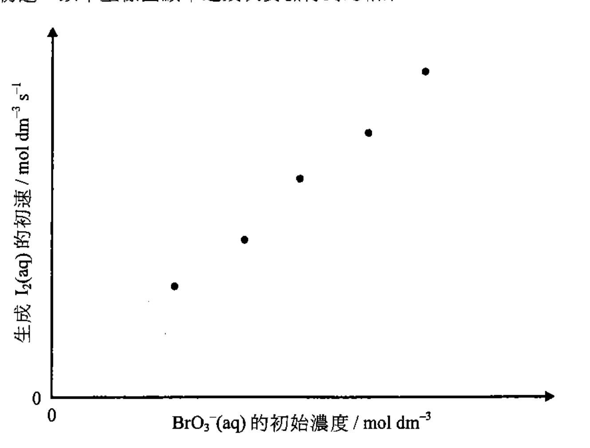
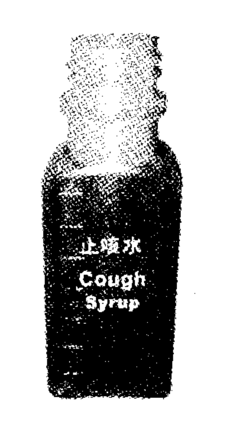
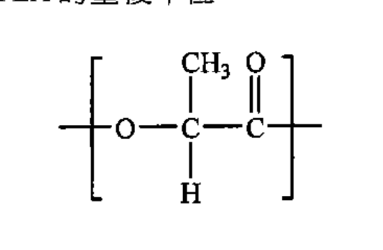
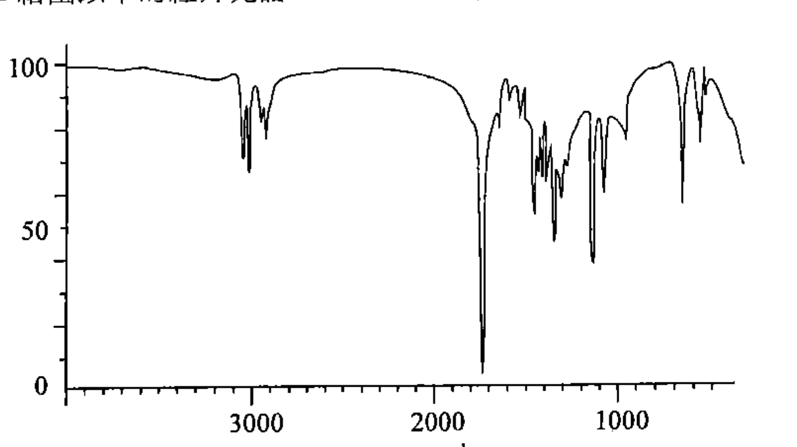

# 2014 DSE 化學 卷二（中文卷）— 題目庫

> 來源：文憑試 DSE 化學 Chemistry 2014 歷屆試題 Past Paper 卷二.pdf　｜　三部分：甲部 工業化學、乙部 物料化學、丙部 分析化學（每部分一題）
> 本試卷共有甲、乙和丙三部。考生須選答任何兩部中的全部試題。
> 說明：已移除頁碼、試卷標頭等雜訊；化學式以 Unicode 下標／上標表示，反應式以 → 或 ⇌ 表示。**本檔為題目庫（零答案）**，只含題目清洗 + 建議標籤。
> 本檔為第 2 層文字交貨（圖用原卷截圖；精修重繪另開第 3 層）。

---

## 甲部　工業化學（第 1 題）

## 第 1 題

【建議標籤】

- 卷別/部分：卷二　甲部
- 課題：#反應級數 #動力學 #活化能 #哈柏法 #氯鹼工業

【題目內容】

回答試題的所有部分。

(a)　回答以下短問題：

　　(i)　「活化能」一詞是什麼意思？（1 分）

　　(ii)　在室溫下，糖可在有酵母的情況下藉發酵生成乙醇。寫出酵母的功用，並解釋為什麼在高溫時這功用會失效。（2 分）

　　(iii)　丙種維生素可從水果中獲得。解釋為什麼仍有需要在工業上合成丙種維生素。（1 分）

　　(iv)　寫出從氯鹼工業生產的兩個重要化學品。（1 分）

(b)　在某溫度下研習以下反應的動力學：

　　BrO₃⁻(aq) + [?]I⁻(aq) + [?]H⁺(aq) → 3I₂(aq) + Br⁻(aq) + 3H₂O(l)

　　在只改變 BrO₃⁻(aq) 的初始濃度而其他實驗條件相同下，進行了幾次實驗以量度生成 I₂(aq) 的初速。以下坐標圖顯示這幾次實驗得到的結果：

　　(i)　「初速」一詞是什麼意思？（1 分）

　　(ii)　建議一方法（附以理據）來跟隨生成 I₂(aq) 的進度。（2 分）

　　(iii)　參考以上坐標圖，推定對應 BrO₃⁻(aq) 的反應級數。（2 分）

　　(iv)　下表列出在相同溫度下，為同一反應進行了兩次實驗的資料：

<table>
<thead>
<tr><th></th><th colspan="3">初始濃度 / mol dm⁻³</th><th>生成 I₂(aq) 的初速 / mol dm⁻³ s⁻¹</th></tr>
<tr><th></th><th>BrO₃⁻(aq)</th><th>I⁻(aq)</th><th>H⁺(aq)</th><th></th></tr>
</thead>
<tbody>
<tr><td>第 1 次</td><td>0.17</td><td>0.15</td><td>0.10</td><td>2.30 × 10⁻⁷</td></tr>
<tr><td>第 2 次</td><td>0.17</td><td>0.30</td><td>0.20</td><td>1.84 × 10[?]</td></tr>
</tbody>
</table>

　　(1)　已知對應 I⁻(aq) 的反應級數是 1，推定對應 H⁺(aq) 的反應級數。

　　(2)　基於第 1 次實驗，推定在實驗條件下對應 BrO₃⁻(aq) 的反應級數。（3 分）

(c)　閱讀以下有關哈柏法的短文，並回答隨後的問題：

　　哈柏法是一個重要的工業過程。牠需要天然氣和空氣作為原料；為加快哈柏法所涉及的反應，使用了多孔式的鐵催化劑以提升催化劑的效率；哈柏法也需要適當的反應溫度及壓強；此外，在製定最佳反應條件為約 500 °C 和 200 atm 前，考慮了兩個與化學有關的因素；於這些條件下，在平衡時的反應產率約為 20%；在沒有改變最佳反應條件下，通過一些設計，可令過程中氮的整體轉化百分率顯著增加。

　　(i)　解釋為什麼哈柏法是一個重要的工業過程。（1 分）

　　(ii)　為什麼哈柏法需要天然氣作為原料？（1 分）

　　(iii)　解釋為什麼把催化劑製成多孔式可提升催化劑的效率。（1 分）

　　(iv)　寫出在制定最佳反應溫度與壓強前所考慮了的兩個與化學有關的因素。（2 分）

　　(v)　提出一個設計，在沒有改變最佳反應條件下，可令過程中氮的整體轉化百分率顯著增加。（1 分）

　　(vi)　南美洲國家智利有很多天然硝酸鹽礦。歷史告訴我們，哈柏法的成功曾引致對智利社會的一些衝擊。舉出其中一個衝擊。（1 分）

---

## 乙部　物料化學（第 2 題）

## 第 2 題

【建議標籤】

- 卷別/部分：卷二　乙部
- 課題：#晶胞 #液晶 #塑料 #硅酸鹽 #陶瓷 #聚合物

【題目內容】

回答試題的所有部分。

(a)　回答以下短問題。

　　(i)　為以下各金屬晶體結構略繪一個晶胞：

　　　(1)　立方緊密裝填結構

　　　(2)　體心立方結構

（2 分）

　　(ii)　寫出呈液晶特性的物質的分子的兩個結構特徵。（2 分）

　　(iii)　把下列塑料分類為熱塑性塑膠和熱固性塑膠：聚氯乙烯、聚苯乙烯、脲甲醛。（1 分）

(b)　硅酸鹽和陶瓷均是用途廣泛的重要物料。

　　(i)　(1)　寫出硅酸鹽和陶瓷的一個共同結構特徵。

　　　(2)　寫出獲取硅酸鹽和陶瓷的途徑的不同之處。（2 分）

　　(ii)　滑石是常用的硅酸鹽物料，其化學式為 Mg₃(Si₄O₁₀)(OH)₂。

　　　(1)　寫出滑石的硅酸鹽重複單位的化學式。

　　　(2)　石英也是硅酸鹽物料。解釋為什麼滑石與石英的硬度差異甚大。（4 分）

　　(iii)　提出為什麼陶瓷適合製造切割工具。（1 分）

(c)　下圖顯示一個以聚乙烯（PE）製造的止咳水膠樽：

　　(i)　建議一個製造這膠樽的成型方法。（1 分）

　　(ii)　寫出兩種常見的 PE。從分子層面，解釋哪一種 PE 較適合用來製造這膠樽。（2 分）

　　(iii)　從分子層面，解釋為什麼以聚對苯二甲酸乙二酯（PET）製造的膠樽，一般會比以 PE 製造的膠樽較硬。（2 分）

　　(iv)　有些人從環保的角度建議，由使用 PE 和 PET 轉向使用聚乳酸（PLA）來製造這類膠樽。下面顯示 PLA 的重複單位：

　　　(1)　已知 PLA 可由乳酸經酯化作用聚合製得。寫出乳酸的結構。

　　　(2)　解釋為什麼這轉向可能對環境友善。

　　　(3)　舉出以 PLA 廣泛取代 PE 和 PET 的一個潛在問題。（3 分）

---

## 丙部　分析化學（第 3 題）

## 第 3 題

【建議標籤】

- 卷別/部分：卷二　丙部
- 課題：#測試 #乾燥劑 #石灰石 #紅外光譜 #質譜 #官能基

【題目內容】

回答試題的所有部分。

(a)　回答以下短問題。

　　(i)　為下列各項建議一化學測試以顯示它們的存在：

　　　(1)　HCl(g)

　　　(2)　C=O 官能基

（4 分）

　　(ii)　下列哪一化學品最適合用來乾燥乙酸乙酯？無水硫酸鎂、濃硫酸、固態氫氧化鈉。（1 分）

(b)　一粉狀石灰石樣本主要含有 CaCO₃，並有小量 MgCO₃ 和 FeCl₃。在一實驗中進行了下列各步驟以測定在該樣本中 CaCO₃ 的質量百分率：

　　步驟 1：把 2.025 g 的該石灰石樣本加進過量的 6 M HCl(aq) 中。

　　步驟 2：把所得混合物微熱直至沒有進一步反應的跡象，繼而讓牠冷卻至室溫。

　　步驟 3：把冷卻了的混合物以蒸餾水稀釋，加入 NH₃(aq) 把牠製至微鹼性以沉澱存在的 Fe³⁺(aq) 離子。

　　步驟 4：把所得混合物過濾以收集濾液。

　　步驟 5：把過量的草酸銨溶液 (NH₄)₂C₂O₄(aq) 加入該濾液，並繼而把所得混合物用 NH₃(aq) 製至微鹼性，以選擇性地沉澱出所生成的草酸鈣。

　　步驟 6：把該混合物過濾。在清洗及乾燥後，收集得 2.374 g 的草酸鈣固體。

　　(i)　為什麼在步驟 2 中需把混合物加熱？（1 分）

　　(ii)　(1)　怎樣知道在步驟 2 中所涉及的反應在什麼時候已經完成？

　　　(2)　寫出在步驟 3 中的觀察。（2 分）

　　(iii)　已知草酸鎂可溶於鹼性溶液，但草酸鈣不可。計算在該石灰石樣本中 CaCO₃ 的質量百分率。（3 分）

　　(iv)　寫出在這實驗中所用的定量分析方法。（1 分）

(c)　在室溫下 T 是 [?] 的一無色油狀液體，且不與水混和。再者，T 不與 NaHCO₃(aq) 反應。

　　(i)　一個 T 的樣本含某有機酸雜質。概述藉使用 NaHCO₃(aq) 和戊烷把這樣本提純的各實驗步驟。（2 分）

　　(ii)　參考以下資料，推定 T 可能具有的官能基（一個或多個）：

　　　(1)　T 不是酯，並且牠與托倫斯試劑得出陰性結果。

　　　(2)　T 給出以下的紅外光譜：

　　　(3)　特徵紅外吸收波數域（伸展式）：

| 鍵合 | 化合物類別 | 波數域 / cm⁻¹ |
|---|---|---|
| C=C | 烯 | 1610 至 1680 |
| C=O | 醛、酮、羧酸及其衍生物 | 1680 至 1800 |
| C≡C | [?] | 2070 至 2250 |
| [?] | 帶氫鍵的酸 | 2500 至 3300 |
| C–H | 烷、烯及芳烴 | 2840 至 3095 |
| [?] | 帶氫鍵的醇及酚 | 3230 至 3670 |
| N–H | 胺 | 3350 至 3500 |

（3 分）

　　(iii)　T 的質譜在 m/z = 134 處呈現一個母峰，並在 m/z = 43 和 91 處各呈現一個強峰。為在 m/z = 43 和 134 的訊號，分別提出一個對應的化學物種。（2 分）

　　(iv)　繪畫 T 的一個可能結構。（1 分）

---

## 待人工核對

本卷為第 2 層文字交貨，由 easyocr（ch_tra+en，GPU）掃描底稿清洗而成；現模型無影像輸入，未能對頁影像覆核。以下題號建議第 3 層精修時對頁覆核：

- 第 1 題：(b) 反應式 BrO₃⁻ + I⁻ + H⁺ → I₂ + Br⁻ + H₂O 之係數 OCR 亂碼（「GTiaq」「GHfaq」），標 [?]；(b)(iv) 表格第 2 次初速之冪次（10[?]）OCR 未讀清，標 [?]；(b) 坐標圖為 300dpi 截圖。
- 第 2 題：(c) PE 膠樽及 PLA 重複單位為 300dpi 截圖；膠樽圖上文字（「止咳水」等）依題型還原。
- 第 3 題：(c) T 的分子式 OCR 亂碼（「TGCH,Oa」），未能可靠還原，標 [?]；紅外光譜為 300dpi 截圖；紅外吸收波數表之「C≡C／O–H（酸）／O–H（醇酚）」鍵合欄依題型還原，標 [?] 之鍵合待對頁核實。
- 第 1、2、3 題：圖為 300dpi 原卷截圖（程式定位＋墨跡覆蓋率校驗；位置／範圍待 spot-check）；第 3 層再換成向量重繪。
