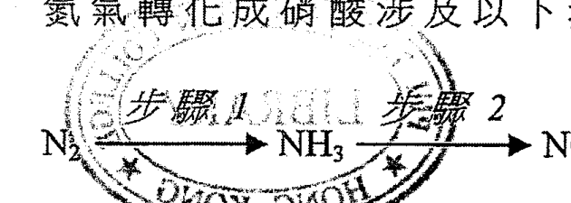
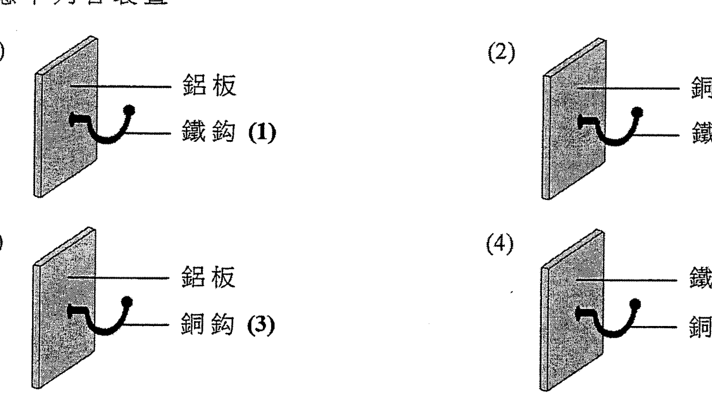
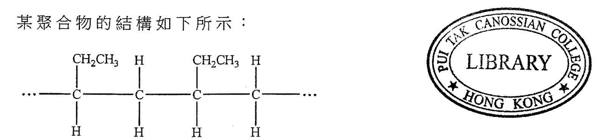
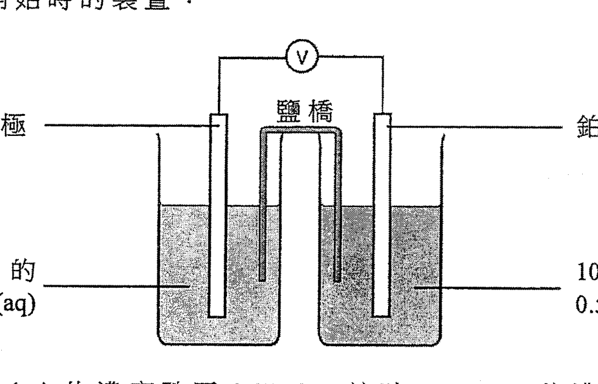
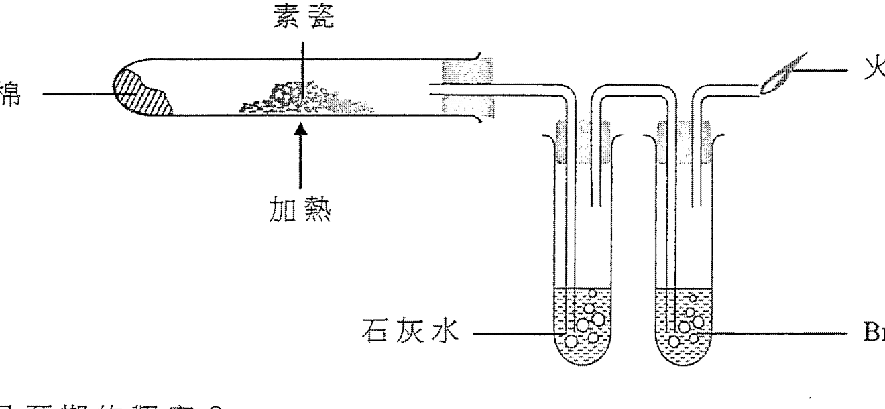
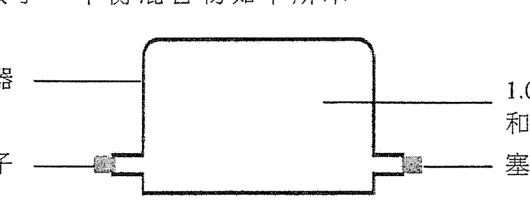
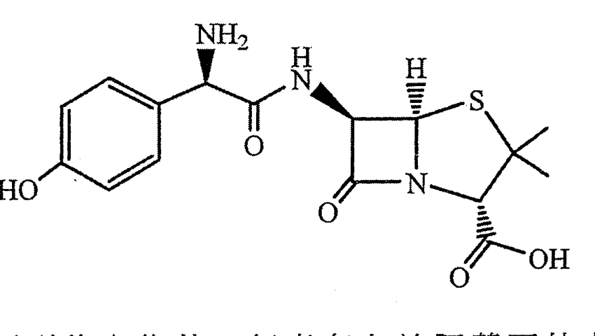

# 2015 DSE 化學 卷一甲（中文卷）— 題目庫

> 來源：文憑試 DSE 化學 Chemistry 2015 歷屆試題 Past Paper 卷一.pdf　｜　多項選擇題 36 題（第一部分 24 題、第二部分 12 題）
> 本部包括兩部分：第一部分設 24 題，第二部分設 12 題。選出每題最佳的答案。考生可參考印於試題答題簿 B 第 20 頁的周期表。
> 說明：已移除頁碼、試卷標頭等雜訊；化學式以 Unicode 下標／上標表示，反應式以 → 或 ⇌ 表示。**本檔為題目庫（零答案）**，只含題目清洗 + 建議標籤。
> 本檔為第 2 層文字交貨（圖用原卷截圖；精修重繪另開第 3 層）。

---

## 第一部分（第 1–24 題）

## 第 1 題

【建議標籤】

- 卷別/部分：卷一甲　第一部分
- 課題：#酸鹼 #pH #水溶液

【題目內容】

下列的陳述，何者正確？

- A. 所有水溶液均含 H⁺(aq) 離子。
- B. 所有酸溶液的 pH 均大於零。
- C. 所有酸性化合物均含氫為其組成元素。
- D. 在所有含酸溶液的試劑瓶上均須張貼「腐蝕性」危險警告標籤。

---

## 第 2 題

【建議標籤】

- 卷別/部分：卷一甲　第一部分
- 課題：#氧 #氧化還原 #製取

【題目內容】

下列哪過程不會得出氧？

- A. 把氧化汞強熱
- B. 把稀硫酸電解
- C. 把液態空氣分餾
- D. 把蒸汽流過經加熱的鎂

---

## 第 3 題

【建議標籤】

- 卷別/部分：卷一甲　第一部分
- 課題：#離子化合物 #周期表 #族

【題目內容】

元素 Q 屬於周期表的第 II 族，牠與元素 R 結合生成具化學式為 Q₃R₂ 的離子化合物。R 屬於周期表的哪一族？

- A. 第 III 族
- B. 第 V 族
- C. 第 VI 族
- D. 第 VII 族

---

## 第 4 題

【建議標籤】

- 卷別/部分：卷一甲　第一部分
- 課題：#鹽 #金屬 #稀酸

【題目內容】

下列哪鹽不能由金屬與稀酸的反應製備而得？

- A. 硫酸鋅
- B. 氯化鐵(II)
- C. 氯化鈣
- D. 硫酸銅(II)

---

## 第 5 題

【建議標籤】

- 卷別/部分：卷一甲　第一部分
- 課題：#腐蝕 #凝膠 #指示劑

【題目內容】

含有 NaCl(aq)、K₃Fe(CN)₆(aq) 和酚酞的凝膠是黃色的。把一鐵釘放進這凝膠內；一段時間後鐵釘腐蝕了。鐵釘腐蝕後，凝膠內不會觀察到以下哪顏色？

- A. 藍
- B. 粉紅
- C. 綠
- D. 黃

---

## 第 6 題

【建議標籤】

- 卷別/部分：卷一甲　第一部分
- 課題：#硝酸 #氧化還原 #氮

【題目內容】

氮氣轉化成硝酸涉及以下步驟：

哪步驟（氮）被還原了？

- A. 步驟 1
- B. 步驟 2
- C. 步驟 3
- D. 步驟 4

---

## 第 7 題

【建議標籤】

- 卷別/部分：卷一甲　第一部分
- 課題：#腐蝕 #電化系列 #犧牲性保護

【題目內容】

考慮下列各裝置：

哪釘會首先腐蝕？

- A. 鐵釘 (1)
- B. 鐵釘 (2)
- C. 銅釘 (3)
- D. 銅釘 (4)

---

## 第 8 題

【建議標籤】

- 卷別/部分：卷一甲　第一部分
- 課題：#滴定 #儀器

【題目內容】

在一實驗中，用儀器 X 量度 25.0 cm³ 的 HCl(aq) 並把其置於儀器 Y 內，繼而以一標準 NaOH(aq) 對 Y 內的 HCl(aq) 進行滴定。下列哪組合正確？

| | 儀器 X | 儀器 Y |
|---|---|---|
| A. | 量筒 | 燒杯 |
| B. | 量筒 | 錐形瓶 |
| C. | 移液管 | 燒杯 |
| D. | 移液管 | 錐形瓶 |

---

## 第 9 題

【建議標籤】

- 卷別/部分：卷一甲　第一部分
- 課題：#摩爾計算 #硫酸鈣

【題目內容】

在製備硫酸鈣的實驗中，把過量稀硫酸加進 10.0 cm³ 的 1.0 mol dm⁻³ 硝酸鈣溶液裡。下列何者是所得硫酸鈣的理論質量？

（相對原子質量：O=16.0，S=32.1，Ca=40.1）

- A. 0.68 g
- B. 1.36 g
- C. 2.72 g
- D. 4.08 g

---

## 第 10 題

【建議標籤】

- 卷別/部分：卷一甲　第一部分
- 課題：#聚合物 #單體 #系統命名

【題目內容】

某聚合物的結構如下所示：

下列何者是這聚合物的單體的系統名稱？

- A. 丙烯
- B. 丁-1-烯
- C. 丁-2-烯
- D. 甲基丙烯

---

## 第 11 題

【建議標籤】

- 卷別/部分：卷一甲　第一部分
- 課題：#八隅體 #路易斯結構

【題目內容】

下列的物種畫有底線的原子為中央原子，並且所有非中央原子均具八隅體電子排佈。在牠們中哪個中央原子不具八隅體電子排佈？

- A. SF₆
- B. CF₄
- C. CCl₄
- D. PCl₃

---

## 第 12 題

【建議標籤】

- 卷別/部分：卷一甲　第一部分
- 課題：#焓變 #中和

【題目內容】

考慮下列的反應：

(1) CO₂(g) + CaO(s) → CaCO₃(s)　ΔH₁

(2) NH₃(g) + HBr(g) → NH₄Br(s)　ΔH₂

(3) HF(aq) + NaOH(aq) → NaF(aq) + H₂O(l)　ΔH₃

(4) NaHCO₃(aq) + HCl(aq) → NaCl(aq) + CO₂(g) + H₂O(l)　ΔH₄

下列哪個代表中和焓變？

- A. ΔH₁
- B. ΔH₂
- C. ΔH₃
- D. ΔH₄

---

## 第 13 題

【建議標籤】

- 卷別/部分：卷一甲　第一部分
- 課題：#電解 #石蕊指示劑

【題目內容】

進行一電解實驗使用的裝置如下所示：

【圖待補：原卷第 13 題電解裝置（第 4 頁）】

在實驗進行一段時間後，圍繞 X 和 Y 的預期顏色是什麼？

- A. [?]
- B. [?]
- C. [?]
- D. [?]

---

## 第 14 題

【建議標籤】

- 卷別/部分：卷一甲　第一部分
- 課題：#金屬反應性 #活性序

【題目內容】

考慮下列有關金屬 W、X、Y 和 Z 的資料：

(1) 把 W 的氧化物加熱得出金屬 W。

(2) 把金屬 X 置於蒸汽中加熱得出一無色氣體。

(3) 把金屬 Y 放在 CH₃COOH(aq) 中得出一無色氣體。

(4) 把金屬 Z 放在 CuSO₄(aq) 中得出一紅棕色固體。

這些金屬中，何者具最低的反應性？

- A. W
- B. X
- C. Y
- D. Z

---

## 第 15 題

【建議標籤】

- 卷別/部分：卷一甲　第一部分
- 課題：#原子結構

【題目內容】

下列哪個有關「原子」的陳述正確？

- A. 所有原子都不帶淨電荷。
- B. 原子內的質量是均勻分佈的。
- C. 所有原子都包含質子、中子和電子。
- D. 對所有元素而言，同一元素的原子均具相同的質量數。

---

## 第 16 題

【建議標籤】

- 卷別/部分：卷一甲　第一部分
- 課題：#電化電池 #濃度

【題目內容】

考慮下列一個實驗開始時的裝置：

一段時間後，K₂Cr₂O₇(aq) 的濃度跌至 0.47 M。這時 FeSO₄(aq) 的濃度是多少？

- A. 0.53 M
- B. 0.47 M
- C. 0.41 M
- D. 0.32 M

---

## 第 17 題

【建議標籤】

- 卷別/部分：卷一甲　第一部分
- 課題：#氧化還原 #碘化鉀

【題目內容】

碘化鉀水溶液因以下反應隨時間變黃：

4I⁻(aq) + 2CO₂(g) + O₂(g) → 2I₂(s) + 2K₂CO₃(aq) [?]

下列有關以上反應的陳述，何者正確？

(1) I⁻(aq) 被 O₂(g) 氧化。

(2) KI(aq) 被 CO₂(g) 氧化。

(3) 該黃色是由於所生成的 K₂CO₃(aq)。

- A. 只有 (1)
- B. 只有 (2)
- C. 只有 (1) 和 (3)
- D. 只有 (2) 和 (3)

---

## 第 18 題

【建議標籤】

- 卷別/部分：卷一甲　第一部分
- 課題：#焓變 #反應熱

【題目內容】

下列的組合，何者正確？

| 化學反應 | 反應焓變 |
|---|---|
| (1) 2H₂O(l) → 2H₂(g) + O₂(g) | [?] |
| (2) 2CO(g) + O₂(g) → 2CO₂(g) | [?] |
| (3) 2Na(s) + 2H₂O(l) → 2NaOH(aq) + H₂(g) | [?] |

- A. 只有 (1)
- B. 只有 (2)
- C. 只有 (1) 和 (3)
- D. 只有 (2) 和 (3)

---

## 第 19 題

【建議標籤】

- 卷別/部分：卷一甲　第一部分
- 課題：#烯 #官能基測試 #酸化高錳酸鉀

【題目內容】

下列各對物質中，何者可用酸化 KMnO₄(aq) 分辨？

(1) 戊-1-烯和戊-2-烯

(2) 環己烷和環己烯

(3) 聚乙烯和聚氯乙烯

- A. 只有 (1)
- B. 只有 (2)
- C. 只有 (1) 和 (3)
- D. 只有 (2) 和 (3)

---

## 第 20 題

【建議標籤】

- 卷別/部分：卷一甲　第一部分
- 課題：#裂解 #烷烴 #火焰

【題目內容】

下面顯示一實驗的裝置：

下列何者會是預期的觀察？

(1) 石灰水變成乳濁。

(2) Br₂(aq) 由棕色變成無色。

(3) 該火焰是磚紅色的。

- A. 只有 (1)
- B. 只有 (2)
- C. 只有 (1) 和 (3)
- D. 只有 (2) 和 (3)

---

## 第 21 題

【建議標籤】

- 卷別/部分：卷一甲　第一部分
- 課題：#鈣 #水 #反應

【題目內容】

當把一些鈣顆粒放入盛於試管的冷水中，會有下列哪些預期的觀察？

(1) 生成混濁的混合物。

(2) 該試管變暖。

(3) 生成無色氣泡。

- A. 只有 (1) 和 (2)
- B. 只有 (1) 和 (3)
- C. 只有 (2) 和 (3)
- D. (1)、(2) 和 (3)

---

## 第 22 題

【建議標籤】

- 卷別/部分：卷一甲　第一部分
- 課題：#可再生能源

【題目內容】

下列何者是可再生能源？

(1) 核能

(2) 潮汐能

(3) 生物量

- A. 只有 (1) 和 (2)
- B. 只有 (1) 和 (3)
- C. 只有 (2) 和 (3)
- D. (1)、(2) 和 (3)

---

## 第 23 題

【建議標籤】

- 卷別/部分：卷一甲　第一部分
- 課題：#石灰石 #餐桌鹽 #鑑別

【題目內容】

下列何者可以分辨石灰石粉末樣本和餐桌鹽樣本？

(1) 加水

(2) 進行焰色試驗

(3) 加稀氫氯酸

- A. 只有 (1) 和 (2)
- B. 只有 (1) 和 (3)
- C. 只有 (2) 和 (3)
- D. (1)、(2) 和 (3)

---

## 第 24 題

【建議標籤】

- 卷別/部分：卷一甲　第一部分
- 課題：#沸點 #電負性 #敘述句

【題目內容】

指示：題 24 由兩敘述句組成。考生須先判斷該兩敘述句是否正確；若兩敘述句均屬正確，再判斷第二敘述句是否第一敘述句的合理解釋，然後根據下表，從 A 至 D 四項中選出一個適用的答案：

- A. 兩敘述句均屬正確，而第二敘述句為第一敘述句的合理解釋
- B. 兩敘述句均屬正確，但第二敘述句並非第一敘述句的合理解釋
- C. 第一敘述句錯誤，但第二敘述句正確
- D. 兩敘述句均屬錯誤

第一敘述句：H₂O 的沸點較 HF 的為低。

第二敘述句：氧的電負性較氟的為低。

---

## 第二部分（第 25–36 題）

## 第 25 題

【建議標籤】

- 卷別/部分：卷一甲　第二部分
- 課題：#周期表 #趨勢

【題目內容】

下列有關周期表的陳述，何者正確？

- A. 第 1 族元素的熔點隨族向下而遞增。
- B. 第 VII 族元素的沸點隨族向下而遞增。
- C. 元素依相對原子質量遞增的次序排列。
- D. 第三周期元素的導電性由左至右而遞增。

---

## 第 26 題

【建議標籤】

- 卷別/部分：卷一甲　第二部分
- 課題：#幾何異構 #烯

【題目內容】

【圖待補：原卷第 26 題結構式（第 8 頁）】

H₃C-CH=CH-CH=CH-CH₃ 有多少個幾何異構體？

- A. 0
- B. 2
- C. 3
- D. 1

---

## 第 27 題

【建議標籤】

- 卷別/部分：卷一甲　第二部分
- 課題：#平衡 #平衡常數 #濃度

【題目內容】

考慮在某溫度時以下的反應：

2XY(g) ⇌ X₂(g) + 2Y₂(g)　K = 0.60 mol dm⁻³

在這溫度下獲取了一平衡混合物如下所示：

n 是多少？

- A. 1.5
- B. 3.0
- C. 0.15
- D. 0.30

---

## 第 28 題

【建議標籤】

- 卷別/部分：卷一甲　第二部分
- 課題：#反應速率 #氣體 #鋅

【題目內容】

下列哪對化學品在相同的溫度下混合時，氣體生成的速率最高？

- A. 0.10 g 的 Zn 粉末和 100 cm³ 的 1.0 M HCl(aq)
- B. 0.10 g 的 Zn 顆粒和 200 cm³ 的 1.0 M HCl(aq)
- C. 0.10 g 的 Zn 顆粒和 200 cm³ 的 1.0 M H₂SO₄(aq)
- D. 0.10 g 的 Zn 粉末和 100 cm³ 的 1.0 M H₂SO₄(aq)

---

## 第 29 題

【建議標籤】

- 卷別/部分：卷一甲　第二部分
- 課題：#有機轉化 #試劑

【題目內容】

考慮下列的轉化：

【圖待補：原卷第 29 題結構式（第 9 頁）】

以下哪試劑的組合可達致上面的轉化？

- A. [?]
- B. [?]
- C. [?]
- D. [?]

---

## 第 30 題

【建議標籤】

- 卷別/部分：卷一甲　第二部分
- 課題：#官能基 #阿莫西林

【題目內容】

抗生素「阿莫西林」的結構如下所示：

下列的官能基，何者存在於阿莫西林中？

(1) 酯

(2) 醯胺

(3) 羥基

- A. 只有 (1)
- B. 只有 (2)
- C. 只有 (1) 和 (3)
- D. 只有 (2) 和 (3)

---

## 第 31 題

【建議標籤】

- 卷別/部分：卷一甲　第二部分
- 課題：#平衡 #分解

【題目內容】

於某溫度下，在一密閉容器內達致了以下的平衡：

COCl₂(g) ⇌ CO(g) + Cl₂(g)

下列的陳述，何者正確？

(1) CO(g) 和 Cl₂(g) 的濃度必定相同。

(2) COCl₂(g) 的分解速率等於 CO(g) 的生成速率。

(3) 當容器的體積增加時，該反應的平衡常數 K 增加。

- A. 只有 (1)
- B. 只有 (2)
- C. 只有 (1) 和 (3)
- D. 只有 (2) 和 (3)

---

## 第 32 題

【建議標籤】

- 卷別/部分：卷一甲　第二部分
- 課題：#酮 #氧化 #醇

【題目內容】

【圖待補：原卷第 32 題三個化合物結構式（第 10 頁）】

下列的化合物中，何者可與酸化重鉻酸鉀溶液反應生成酮？

(1) [?]

(2) [?]

(3) [?]

- A. 只有 (1)
- B. 只有 (2)
- C. 只有 (1) 和 (3)
- D. 只有 (2) 和 (3)

---

## 第 33 題

【建議標籤】

- 卷別/部分：卷一甲　第二部分
- 課題：#平衡 #勒沙特列 #催化劑

【題目內容】

考慮下列在固定體積的密閉容器中的平衡反應體系：

CO(g) + H₂O(g) ⇌ CO₂(g) + H₂(g)　ΔH < 0

下列何者當施於該體系時，會導致生成 H₂(g) 的速率上升？

(1) 加入 CO(g)

(2) 升高溫度

(3) 加入適當的催化劑

- A. 只有 (1)
- B. 只有 (2)
- C. 只有 (1) 和 (3)
- D. 只有 (2) 和 (3)

---

## 第 34 題

【建議標籤】

- 卷別/部分：卷一甲　第二部分
- 課題：#聚合物 #水解 #氫鍵

【題目內容】

【圖待補：原卷第 34 題聚合物結構式（第 10 頁）】

某聚合物具下面所示的結構：

下列有關這聚合物的陳述，何者正確？

(1) 牠的分子間引力主要是氫鍵。

(2) 在有稀氫氯酸的存在下，聚合物鏈可斷裂。

(3) 在有稀氫氧化鈉溶液的存在下，聚合物鏈可斷裂。

- A. 只有 (1) 和 (2)
- B. 只有 (1) 和 (3)
- C. 只有 (2) 和 (3)
- D. (1)、(2) 和 (3)

---

## 第 35 題

【建議標籤】

- 卷別/部分：卷一甲　第二部分
- 課題：#熔點 #電子 #敘述句

【題目內容】

指示：以下兩題（題 35 和題 36）均由兩敘述句組成。考生須先判斷該兩敘述句是否正確；若兩敘述句均屬正確，再判斷第二敘述句是否第一敘述句的合理解釋，然後根據下表，從 A 至 D 四項中選出一個適用的答案：

- A. 兩敘述句均屬正確，而第二敘述句為第一敘述句的合理解釋
- B. 兩敘述句均屬正確，但第二敘述句並非第一敘述句的合理解釋
- C. 第一敘述句錯誤，但第二敘述句正確
- D. 兩敘述句均屬錯誤

第一敘述句：硅的熔點較鋁的為高。

第二敘述句：硅原子的電子數目較鋁原子的為大。

---

## 第 36 題

【建議標籤】

- 卷別/部分：卷一甲　第二部分
- 課題：#摩爾體積 #原子數 #敘述句

【題目內容】

第一敘述句：在室內條件下，1 mol 的 SO₂(g) 的體積較 1 mol 的 N₂(g) 的為大。

第二敘述句：組成 1 mol 的 SO₂(g) 的原子數目較組成 1 mol 的 N₂(g) 的為大。

- A. 兩敘述句均屬正確，而第二敘述句為第一敘述句的合理解釋
- B. 兩敘述句均屬正確，但第二敘述句並非第一敘述句的合理解釋
- C. 第一敘述句錯誤，但第二敘述句正確
- D. 兩敘述句均屬錯誤

---

*甲部完 —*

## 待人工核對

本卷為第 2 層文字交貨，由 easyocr（ch_tra+en，GPU）掃描底稿清洗而成；現模型無影像輸入，未能對頁影像覆核。以下題號建議第 3 層精修時對頁覆核：

- 第 3 題：「第 II 族」OCR 讀作「第 I 族」；依「生成 Q₃R₂」推斷 Q 為 +2 價（第 II 族），待對頁核實。
- 第 4 題：「氯化鐵(II)」OCR 讀作「氯化鐵(I)」，依金屬＋稀酸得 +2 價鐵推斷，待對頁核實。
- 第 6 題：「（氮）被還原」OCR 讀作「變潑還原」，依題型推斷，待對頁核實；步驟圖（N₂→NH₃→NO→NO₂→HNO₃）為 300dpi 截圖。
- 第 7 題：「釘」OCR 讀作「釣」，已校正；四裝置截圖，位置／範圍待 spot-check。
- 第 8 題：選項表頭「儀器 X／儀器 Y」為推斷（OCR 僅讀出選項內容），待對頁核實。
- 第 11 題：選項 C「CCl₄」、D「PCl₃」OCR 亂碼（「C$_」「LCl,」），依八隅體題型推斷，待對頁核實。
- 第 13 題：電解裝置圖截唔到，標【圖待補】；選項為 X/Y 顏色表，OCR 未讀出，標 [?]。
- 第 14 題：選項 A–D 為金屬 W／X／Y／Z（OCR 僅讀出「&」「D」），依題型推斷，待對頁核實。
- 第 17 題：反應式「4I⁻ + 2CO₂ + O₂ → 2I₂ + 2K₂CO₃」OCR 亂碼，部分係數／生成物待對頁核實。
- 第 18 題：表格「反應焓變」欄內容 OCR 未讀出，標 [?]；表頭待對頁核實。
- 第 21、22 題：選項排列依「只有(1)和(2)／(1)和(3)／(2)和(3)／全部」推斷，待對頁核實。
- 第 26 題：結構式截唔到，標【圖待補】（H₃C-CH=CH-CH=CH-CH₃ 為 OCR 重建）。
- 第 29 題：結構式及選項（試劑組合）OCR 亂碼，標【圖待補】＋[?]。
- 第 32 題：三個化合物結構式截唔到，標【圖待補】＋選項標 [?]。
- 第 33 題：「速率」OCR 清晰，但選項搭配似「產率」題型，待對頁核實「速率／產率」用字。
- 第 34 題：聚合物結構式截唔到，標【圖待補】。
- 第 6、7、10、16、20、27、30 題：圖為 300dpi 原卷截圖（程式定位＋墨跡覆蓋率校驗；位置／範圍待 spot-check）；第 3 層再換成向量重繪。
