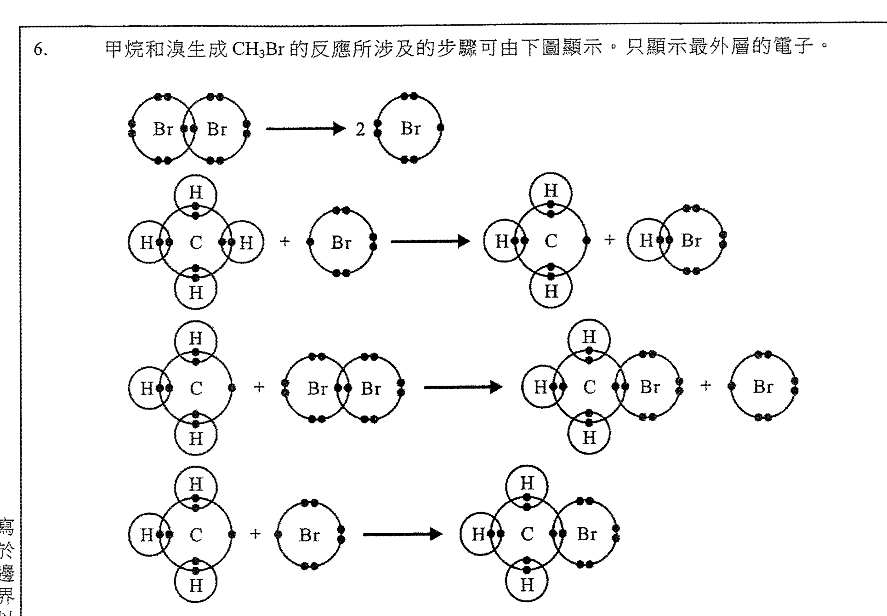
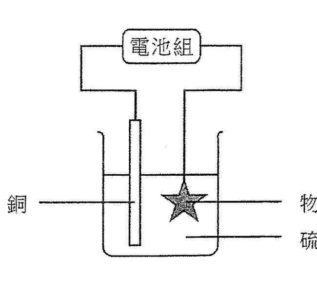
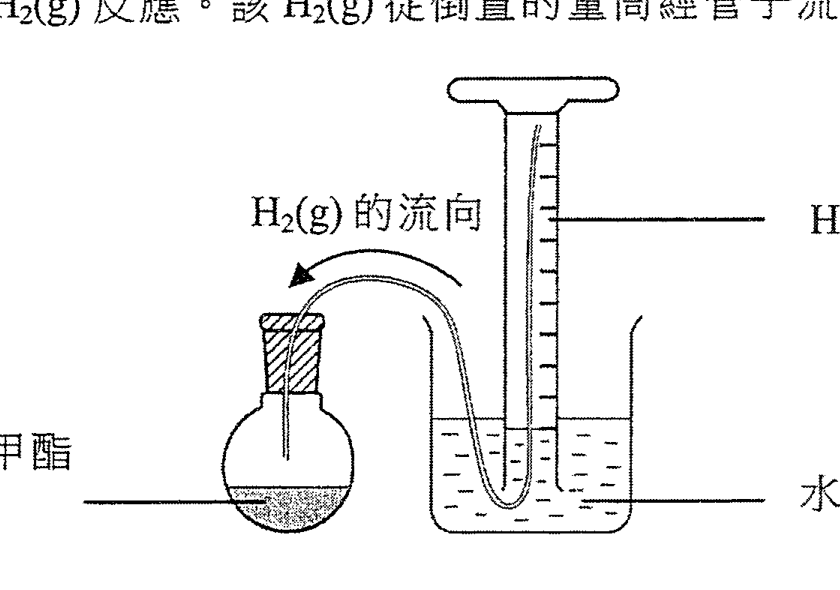
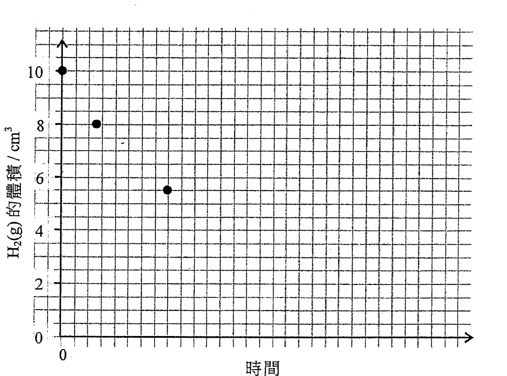

# 2015 DSE 化學 卷一乙（中文卷）— 題目庫

> 來源：文憑試 DSE 化學 Chemistry 2015 歷屆試題 Past Paper 卷一.pdf　｜　乙部 結構式問題 13 題（第一部分 8 題、第二部分 5 題）
> 本部包括兩部分：第一和第二部分各題均須作答。有 * 號標記的試題，將有一分給予達致有效傳意的答案。
> 說明：已移除頁碼、試卷標頭、答題簿橫線等雜訊；化學式以 Unicode 下標／上標表示，反應式以 → 或 ⇌ 表示。**本檔為題目庫（零答案）**，只含題目清洗 + 建議標籤。
> 本檔為第 2 層文字交貨（圖用原卷截圖；精修重繪另開第 3 層）。

---

## 第一部分（第 1–8 題）

## 第 1 題

【建議標籤】

- 卷別/部分：卷一乙　第一部分
- 課題：#電子排佈 #分子間引力 #提取

【題目內容】

氬和氯是周期表中相同周期的元素。

(a)　繪出一個氬的分子的電子圖（須顯示所有層的電子）。（1 分）

(b)　在氯氣中分子間引力的類別是什麼？（1 分）

(c)　完成下表。為各元素寫出在自然界的來源以及從這來源把它提取的方法。

| 元素 | 自然界的來源 | 提取的方法 |
|---|---|---|
| 氬 | | |
| 氯 | | |

（4 分）

---

## 第 2 題

【建議標籤】

- 卷別/部分：卷一乙　第一部分
- 課題：#觀察 #化學方程式 #氧化還原

【題目內容】

就以下每個實驗，寫出預期的觀察，以及寫出所涉及反應（一個或多個）的化學方程式（一條或多條）。

(a)　把二氧化碳氣體通入石灰水直至過量。（3 分）

(b)　把亞硫酸鈉溶液加進酸化重鉻酸鉀溶液直至過量。（2 分）

---

## 第 3 題

【建議標籤】

- 卷別/部分：卷一乙　第一部分
- 課題：#鋁 #鐵 #實驗式 #鍍鋅 #陽極電鍍

【題目內容】

鋁和鐵是常用的建築材料。

(a)　提出為什麼在歷史中鐵比鋁更早被使用。（1 分）

(b)　某化合物只含鐵和氧。在一個測定這化合物的實驗式的實驗中，把 2.31 g 的該化合物與一氧化碳共熱。在完全反應後，生成二氧化碳和 1.67 g 的鐵。

　　(i)　計算這化合物的實驗式。

　　*(ii)　寫出在這實驗中所涉及的反應的化學方程式。

　　*(iii)　基於一氧化碳有毒，提出在進行這實驗時所需的一項安全措施。（4 分）

(c)　解釋為什麼即使鋅層破裂時，鍍鋅鐵製物品仍不易生鏽。（2 分）

(d)　解釋為什麼陽極電鍍可防止鋁製物品腐蝕。（2 分）

---

## 第 4 題

【建議標籤】

- 卷別/部分：卷一乙　第一部分
- 課題：#鉛酸蓄電池 #二級電池 #稀釋 #摩爾濃度

【題目內容】

鉛酸蓄電池是含硫酸的二級電池。牠常用於啟動汽車引擎。

(a)　「二級電池」一詞是什麼意思？（1 分）

(b)　提出為什麼鉛酸蓄電池適用於啟動汽車引擎。（1 分）

(c)　寫出棄置鉛酸蓄電池對環境的一個影響。（1 分）

(d)　某學生把一濃硫酸樣本稀釋以便製造一個鉛酸蓄電池。

　　(i)　提出在實驗室中怎樣把濃硫酸稀釋，並寫出在這稀釋過程中所需的一項安全措施。

　　(ii)　在所製造的鉛酸蓄電池中，5.00 cm³ 的溶液含 2.48 g 的硫酸。計算在這溶液中硫酸的摩爾濃度。（硫酸的摩爾質量 = 98.1 g）（5 分）

---

## 第 5 題

【建議標籤】

- 卷別/部分：卷一乙　第一部分
- 課題：#弱鹼 #氨 #酸鹼

【題目內容】

*輔以一化學方程式，解釋為什麼 NH₃(aq) 被視為弱鹼。提出你會怎樣通過實驗以顯示 NH₃(aq) 是一個較 NaOH(aq) 弱的鹼。（6 分）

---

## 第 6 題

【建議標籤】

- 卷別/部分：卷一乙　第一部分
- 課題：#甲烷 #溴 #取代反應 #自由基

【題目內容】

甲烷和溴生成 CH₃Br 的反應所涉及的步驟可由下圖顯示（只顯示最外層的電子）。

(a)　寫出從甲烷和溴生成 CH₃Br 的反應的類別名稱。（1 分）

*(b)　寫出要發生這反應所需的條件。（1 分）

(c)　寫出這反應的預期觀察。（1 分）

(d)　參考其電子結構，解釋為什麼 Br• 這物種具高的反應性。（1 分）

(e)　甲烷和溴的反應也可生成其他含單碳的有機化合物。

　　(i)　提出一個這樣的化合物。

　　(ii)　提出一個條件，以致甲烷和溴的反應可生成較多 CH₃Br 而較少其他有機化合物。（2 分）

---

## 第 7 題

【建議標籤】

- 卷別/部分：卷一乙　第一部分
- 課題：#電鍍 #電解 #硫酸銅

【題目內容】

參考下圖所示把一物件電鍍的裝置。

(a)　解釋為什麼於電鍍前需把物件上的油垢清除。（1 分）

(b)　硫酸銅(II) 是一電解質。「電解質」一詞是什麼意思？（1 分）

*(c)　列出所有存在於該溶液的離子。（1 分）

(d)　解釋為什麼在電鍍過程中銅(II) 離子優先放電。（1 分）

(e)　寫出在陽極所發生的變化的半反應式。（1 分）

(f)　寫出在電鍍過程中於該溶液可觀察得的變化（如有）。（1 分）

(g)　已知在電鍍過程中已有 2.28 × 10²³ 粒電子流經外電路。計算理論上會鍍於該物件上的銅的質量。（相對原子質量：Cu = 63.5；亞佛加德羅常數 = 6.02 × 10²³ mol⁻¹）（2 分）

---

## 第 8 題

【建議標籤】

- 卷別/部分：卷一乙　第一部分
- 課題：#甲烷 #燃燒 #焓變 #鍵焓

【題目內容】

天然氣是發電的一個重要能源。牠主要含有甲烷 CH₄。

(a)　寫出甲烷所屬的同系列的分子的通式。（1 分）

(b)　甲烷的燃燒是一放熱反應。牠的化學方程式如下所示：

CH₄(g) + 2O₂(g) → CO₂(g) + 2H₂O(l)

　　(i)　完成下表。寫出在甲烷的燃燒中所有斷裂和形成的共價鍵（一個或多個）。

| 斷裂的共價鍵（一個或多個） | 形成的共價鍵（一個或多個） |
|---|---|

　　(ii)　根據共價鍵的斷裂和形成，提出為什麼這燃燒是放熱的。

　　(iii)　計算甲烷的標準燃燒焓變。（標準生成焓變：CH₄(g) = −74.8 kJ mol⁻¹；CO₂(g) = −393.5 kJ mol⁻¹；H₂O(l) = −285.9 kJ mol⁻¹）（5 分）

(c)　某些地區傾向較多以天然氣而較少以煤來發電。從環保考慮，提出兩個原因。（2 分）

---

## 第二部分（第 9–13 題）

## 第 9 題

【建議標籤】

- 卷別/部分：卷一乙　第二部分
- 課題：#油酸甲酯 #氫化 #微型實驗 #坐標圖

【題目內容】

考慮以下反應：

催化劑

CH₃(CH₂)₇CH=CH(CH₂)₇CO₂CH₃(l) + H₂(g) → CH₃(CH₂)₁₆CO₂CH₃(l)

　油酸甲酯

在常溫常壓下，使用如下所示的裝置進行了一個微型實驗，其中讓在有機溶劑的 0.080 g 的油酸甲酯與過量的 H₂(g) 反應。該 H₂(g) 從倒置的量筒經管子流到該反應瓶。

(a)　寫出以微型實驗來進行這反應的一個優點。（1 分）

(b)　解釋為什麼管子右末端被置於該倒置的量筒的最高位置。（1 分）

(c)　寫出反應進行時倒置的量筒中的一個預期觀察。（1 分）

(d)　計算在常溫常壓下這反應達致完成所需 H₂(g) 的理論體積。（在常溫常壓下，氣體的摩爾體積 = 24 dm³；相對分子質量：油酸甲酯 = 296.0）

(e)　(i)　在以下坐標圖，草繪從開始直至該反應完成時，量筒中 H₂(g) 的體積隨時間的變化。須標示這草繪。（該量筒起初含 10.0 cm³ 的 H₂(g)；為方便草繪，坐標圖中已提供了首幾點。）

　　(ii)　在上面的同一個坐標圖，提供如 (i) 所要求的另一個草繪，惟該反應只用 0.040 g 的油酸甲酯而其他條件保持不變。須標示這草繪。（2 分）

---

## 第 10 題

【建議標籤】

- 卷別/部分：卷一乙　第二部分
- 課題：#氧化物 #電子圖 #過渡性金屬

【題目內容】

(a)　就以下每個氧化物，繪出牠的電子圖（只須顯示最外層的電子），並寫出牠在水中的習性。

　　(i)　Na₂O

　　(ii)　Cl₂O

（4 分）

(b)　以鐵為例，說明過渡性金屬的兩個特性。（2 分）

---

## 第 11 題

【建議標籤】

- 卷別/部分：卷一乙　第二部分
- 課題：#水 #pH #離子積 #平衡

【題目內容】

參考以下化學方程式：

H₂O(l) ⇌ H⁺(aq) + OH⁻(aq)　ΔH > 0

在固定條件下，[H₂O(l)] 被視為一個常數。考慮 Kc 的定義，[H⁺(aq)][OH⁻(aq)] 也會是一個常數。

(a)　一個水溶液的 pH 定義為 −log[H⁺(aq)]。在 298 K，水的 pH 等於 7.0。找出在這溫度下的

　　(i)　[H⁺(aq)]

　　(ii)　[H⁺(aq)][OH⁻(aq)]

（3 分）

(b)　在 298 K，[H₂O(l)] 等於 55.6 mol dm⁻³。參照 [H⁺(aq)] 和 [OH⁻(aq)] 的值，提出為什麼 [H₂O(l)] 被視為一個常數。（1 分）

(c)　解釋在 328 K，水的 pH 會是小於 7.0、等於 7.0，還是大於 7.0。（2 分）

---

## 第 12 題

【建議標籤】

- 卷別/部分：卷一乙　第二部分
- 課題：#合成路線 #芳烴 #試劑

【題目內容】

你獲提供【圖待補：原卷第 12 題起始物結構（第 33 頁）】、無機試劑和有機溶劑。概述一條不多於三個步驟的合成路線來獲取以下的化合物：【圖待補：生成物結構】。寫出每一步驟的試劑（一個或多個）、反應條件（如適用）及有機生成物的結構。（3 分）

---

## 第 13 題

【建議標籤】

- 卷別/部分：卷一乙　第二部分
- 課題：#對映異構 #立體化學

【題目內容】

*以 CH₃CHOHCH₃ [?] 為例，撰寫一段落以說明「對映異構」。答案須包括適當的附圖（一個或多個）。（5 分）

---

*乙部完 —*

## 待人工核對

本卷為第 2 層文字交貨，由 easyocr（ch_tra+en，GPU）掃描底稿清洗而成；現模型無影像輸入，未能對頁影像覆核。以下題號建議第 3 層精修時對頁覆核：

- 第 1 題：「氬」依「與氯同周期」推斷（OCR 表格行讀作「氫／氯」），待對頁核實；表格列名「自然界的來源／提取的方法」待核實。
- 第 3 題：(b)(ii)/(iii) 之 * 號依 OCR 標記，待核實；(b)(i) 實驗式題目數字（2.31 g／1.67 g）待對頁核實。
- 第 4 題：(d)(i) 句首「提出」依 OCR「措施」推斷，待核實。
- 第 6 題：「Br•」OCR 讀作「Br」，依自由基題型補自由基符號；電子圖（pp19）為 300dpi 截圖，位置／範圍待 spot-check。
- 第 7 題：裝置圖（pp21）為 300dpi 截圖；(g) 之 * 號待核實。
- 第 8 題：(c) 之 * 號依 OCR 標記；(b)(iii) 標準生成焓變數值（−74.8／−393.5／−285.9 kJ mol⁻¹）待對頁核實。
- 第 9 題：反應式分子式（CH₃(CH₂)₇CH=CH(CH₂)₇CO₂CH₃ → CH₃(CH₂)₁₆CO₂CH₃）由 OCR 重建，下標待對頁核實；「催化劑」置於箭號上方；裝置圖、坐標圖為 300dpi 截圖。
- 第 10 題：Na₂O／Cl₂O 依 OCR 校正（「la_0」「Cl.0」），待核實。
- 第 12 題：起始物／生成物結構式截唔到，標【圖待補】。
- 第 13 題：「CH₃CHOHCH₃」OCR 清晰，但此分子非手性，疑為他分子（如丁-2-醇）或結構式誤讀，標 [?] 待對頁核實。
- 第 6、7、9 題：圖為 300dpi 原卷截圖（程式定位＋墨跡覆蓋率校驗；位置／範圍待 spot-check）；第 3 層再換成向量重繪。
