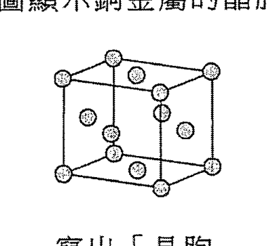
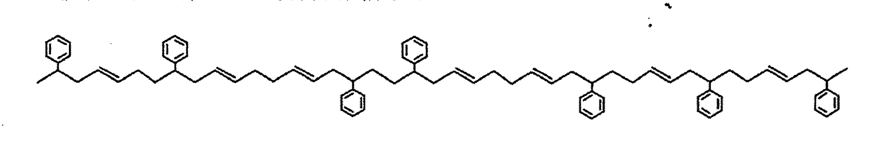
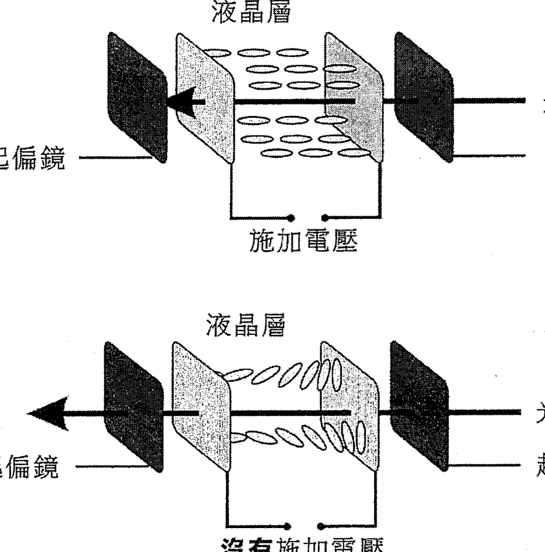
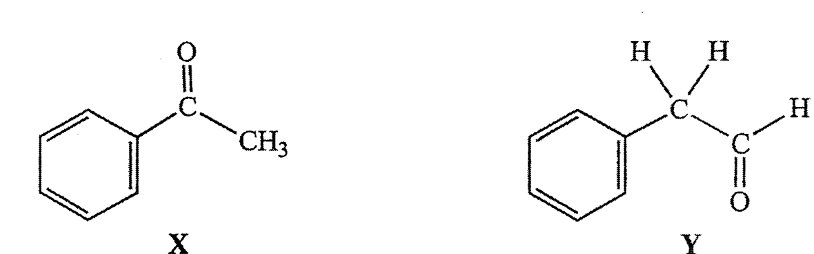

# 2015 DSE 化學 卷二（中文卷）— 題目庫

> 來源：文憑試 DSE 化學 Chemistry 2015 歷屆試題 Past Paper 卷二.pdf　｜　三部分：甲部 工業化學、乙部 物料化學、丙部 分析化學（每部分一題）
> 本試卷共有甲、乙和丙三部。考生須選答任何兩部中的全部試題。
> 說明：已移除頁碼、試卷標頭等雜訊；化學式以 Unicode 下標／上標表示，反應式以 → 或 ⇌ 表示。**本檔為題目庫（零答案）**，只含題目清洗 + 建議標籤。
> 本檔為第 2 層文字交貨（圖用原卷截圖；精修重繪另開第 3 層）。

---

## 甲部　工業化學（第 1 題）

## 第 1 題

【建議標籤】

- 卷別/部分：卷二　甲部
- 課題：#反應級數 #哈柏法 #活化能 #乙酸 #氯鹼工業

【題目內容】

回答試題的所有部分。

(a)　回答以下短問題：

　　(i)　某反應對 I⁻(aq) 的級數為零，而對 CH₃COCH₃(aq) 和 H⁺(aq) 的級數都是一。

　　　(1)　寫出在反應混合物中，I⁻(aq) 濃度的改變對這反應速率的影響（如有）。

　　　(2)　寫出這反應的速率方程。（2 分）

　　(ii)　寫出在哈柏法中生成氨的反應的化學方程式。（1 分）

　　(iii)　當溫度由 298 K 上升至 308 K 時，某反應的速率常數增加一倍。計算這反應的活化能。（氣體常數 R = 8.31 J K⁻¹ mol⁻¹；阿列紐斯方程：log k = 常數 − Eₐ/2.3RT）（2 分）

(b)　乙酸可從下列兩個途徑生產而得：

【圖待補：原卷第 1(b) 乙酸兩途徑生產流程（第 37 頁）】

　　途徑 (1)：糖溶液 → 酵母 → CH₃CH₂OH(aq) → O₂ → CH₃COOH(aq)

　　途徑 (2)：CH₃OH(l) + CO(g) → 催化劑 → CH₃COOH(l)（180°C；30 atm）

　　途徑 (1) 和 (2) 的反應均需要使用催化劑。

　　(i)　(1)　在同一草圖上，繪畫一反應的兩個附標示的能線圖（一個有催化劑而另一個沒有催化劑）。

　　　(2)　理論上，催化劑在反應中沒有被消耗。提出為什麼在工業過程中仍需要不時把使用過的催化劑更新。（4 分）

　　(ii)　舉出兩個原因，說明為什麼途徑 (1) 被視為一個綠色的過程。（2 分）

　　(iii)　舉出兩個原因，說明為什麼在塑膠工業用的乙酸是經途徑 (2)，而非經途徑 (1) 生產而得。（2 分）

(c)　氯是氯鹼工業所製造的其中一個產物。在氯鹼工業所涉及的電解可以在汞電解池、隔膜電解池或膜電解池中進行。

　　(i)　寫出氯鹼工業中所用的原料。（1 分）

　　(ii)　建議一個為氯鹼工業興建化學工廠的選址準則。（1 分）

　　(iii)　寫出在氯鹼工業中所涉及的電解的總反應式。（1 分）

　　(iv)　解釋為什麼汞電解池不被視為對環境友好。（1 分）

　　(v)　膜電解池比較隔膜電解池有什麼優勝之處？（1 分）

　　(vi)　氯鹼工業也可製造氯漂白劑和氫氯酸。輔以一化學方程式，解釋為什麼不應把氯漂白劑和氫氯酸儲存在一起。（2 分）

---

## 乙部　物料化學（第 2 題）

## 第 2 題

【建議標籤】

- 卷別/部分：卷二　乙部
- 課題：#晶胞 #甲醛 #尼龍 #聚苯乙烯 #液晶 #納米物料

【題目內容】

回答試題的所有部分。

(a)　回答以下短問題。

　　(i)　下圖顯示銅金屬的晶胞。

　　　(1)　寫出「晶胞」一詞的意思。

　　　(2)　推定在這晶胞的銅原子數目。（2 分）

　　(ii)　以下哪一項可由甲醛製成？氣球、電插座、釣魚絲、塑膠水管。（1 分）

　　(iii)　製造尼龍-6,6 的其中一個單體是 HOOC(CH₂)₄COOH。傳統上，牠可從以下反應路徑製備而得：

【圖待補：原卷第 2(a)(iii) 反應路徑結構式（第 39 頁）】

　　舉出兩個原因，解釋為什麼以上反應路徑不被視為綠色。（2 分）

(b)　以下方程式顯示從苯乙烯生成聚苯乙烯 (PS)：

　　苯乙烯 → 有機過氧化物 → PS

　　(i)　繪畫苯乙烯的結構。（1 分）

　　(ii)　寫出生成 PS 所涉及聚合作用的類別名稱。（1 分）

　　(iii)　發泡 PS 常用來製造盛載熱飲品的即棄杯子。

　　　(1)　解釋為什麼發泡 PS 具有良好的隔熱性質。

　　　(2)　建議一個製造發泡 PS 杯子的成型方法。

　　　(3)　寫出兩個把由發泡 PS 製成的物品再循環的困難。（4 分）

　　(iv)　苯乙烯可與丁-1,3-二烯聚合以得出耐衝擊聚苯乙烯 (HIPS)，而其中的單體隨機地連接在一起。某 HIPS 的部分結構顯示如下：

　　提出為什麼 HIPS 的硬度比 PS 的較低。（2 分）

(c)　液晶可用來製造流動電話的顯示屏。

　　(i)　液晶的近晶相中的分子如何排列？（1 分）

　　(ii)　下圖說明液晶顯示屏中一像素的基本運作原理。

　　解釋為什麼於液晶層施加電壓時該像素呈黑色。（4 分）

　　(iii)　有些科學家提出使用納米物料可增加顯示屏的解像度。

　　　(1)　寫出「納米物料」一詞的意思。

　　　(2)　提出為什麼使用納米物料可增加顯示屏的解像度。（2 分）

---

## 丙部　分析化學（第 3 題）

## 第 3 題

【建議標籤】

- 卷別/部分：卷二　丙部
- 課題：#定性分析 #儀器分析 #同分異構 #紅外光譜 #凱氏定氮

【題目內容】

回答試題的所有部分。

(a)　回答以下短問題。

　　(i)　建議一化學測試以顯示 Br⁻(aq) 的存在。（2 分）

　　(ii)　提出一個儀器方法以測定一汽油樣本中辛烷的含量。（1 分）

　　(iii)　提出怎樣可用化學方法從銅粉和氧化鐵(III) 的混合物中獲取銅粉。（2 分）

(b)　下面所示的化合物 X 和 Y 是同分異構體，其相對分子質量為 120。

　　(i)　X 和 Y 各自可與 2,4-二硝基苯肼溶液反應得出一個相似的觀察。寫出該觀察。（1 分）

　　(ii)　建議一個化學測試來辨別 X 和 Y。（2 分）

　　(iii)　說明怎樣可從各自的質譜來辨別 X 和 Y。（2 分）

　　(iv)　參考下表所提供的資料，提出是否可以用紅外光譜法來辨別 X 和 Y。

特徵紅外吸收波數域（伸展式）

| 鍵合 | 化合物類別 | 波數域 cm⁻¹ |
|---|---|---|
| C=C | 烯 | 1610 至 1680 |
| C=O | 醛、酮、羧酸及其衍生物 | 1680 至 1800 |
| C≡C | 炔 [?] | 2070 至 2250 |
| C≡N | 腈 | 2200 至 2280 |
| O-H | 帶「氫鍵」的酸 | 2500 至 3300 |
| C-H | 烷、烯及芳烴 | 2840 至 3095 |
| O-H | 帶「氫鍵」的醇及酚 | 3230 至 3670 |
| N-H | 胺 | 3350 至 3500 |

（2 分）

(c)　進行了一個包含以下四個步驟的實驗以測定一奶粉樣本中氮的含量：

　　步驟 (1)：把 3.00 g 的該奶粉樣本與過量濃硫酸共熱，讓其中所有的氮變成 (NH₄)₂SO₄(aq)。

　　步驟 (2)：把所得反應混合物與過量 NaOH(aq) 共熱以釋出 NH₃(g)，然後用 50.00 cm³ 的 1.00 M HCl(aq) 吸收所有釋出的 NH₃(g)。

　　步驟 (3)：把所生成的溶液用去離子水稀釋至 250.0 cm³。

　　步驟 (4)：把 25.00 cm³ 等分的該已稀釋溶液與 0.100 M KOH(aq) 進行滴定，用甲基橙為指示劑。平均需用 13.55 cm³ 的該 KOH(aq) 來達到終點。

　　(i)　寫出步驟 (2) 中以下各反應的化學方程式：

　　　(1)　(NH₄)₂SO₄(aq) 與 NaOH(aq) 的反應

　　　(2)　NH₃(g) 與 HCl(aq) 的反應（2 分）

　　(ii)　寫出步驟 (4) 中於滴定終點的顏色變化。（1 分）

　　(iii)　計算在這奶粉樣本中氮的質量百分率。（相對原子質量：N = 14.0）（4 分）

　　(iv)　在找出奶粉樣本中的蛋白質含量時，一常用方法是測定該樣本中的氮含量，而非直接測定蛋白質含量。提出這常用方法的一個限制。（1 分）

---

*卷二完 —*

## 待人工核對

本卷為第 2 層文字交貨，由 easyocr（ch_tra+en，GPU）掃描底稿清洗而成；現模型無影像輸入，未能對頁影像覆核。以下題號建議第 3 層精修時對頁覆核：

- 第 1(a)(iii) 題：阿列紐斯方程「log k = 常數 − Eₐ/2.3RT」由 OCR 重建（OCR 讀作「logk=常數-2.3RT」），Eₐ 項待對頁核實。
- 第 1(b) 題：乙酸兩途徑流程圖截唔到，標【圖待補】；「180°C；30 atm」依 OCR 校正（「30 am」）。
- 第 2(a)(iii) 題：反應路徑結構式截唔到，標【圖待補】；單體「HOOC(CH₂)₄COOH」由 OCR 重建（「HOOC(CHaACOOH」）。
- 第 2(b) 題：「有機過氧化物」依 OCR 校正；HIPS 部分結構為 300dpi 截圖。
- 第 2(c)(ii) 題：液晶像素圖為 300dpi 截圖（兩幅：施加電壓／沒有施加電壓）。
- 第 3(b) 題：化合物 X 和 Y（OCR 讀作「1」）結構為 300dpi 截圖；「2,4-二硝基苯肼」依 OCR 校正（「2,4-二硝基苯腓」）。
- 第 3(b)(iv) 題：紅外吸收表「C≡C」行化合物類別 OCR 未讀出，標 [?]（推斷為「炔」）；各波數域依 OCR 校正，待對頁核實。
- 第 3(c) 題：步驟 (2)「(NH₄)₂SO₄(aq)」「NaOH(aq)」、50.00 cm³／1.00 M HCl、0.100 M KOH、13.55 cm³ 等依 OCR 校正，待對頁核實。
- 第 2(a)(i)、2(b)(iv)、2(c)(ii)、3(b) 題：圖為 300dpi 原卷截圖（程式定位＋墨跡覆蓋率校驗；位置／範圍待 spot-check）；第 3 層再換成向量重繪。
