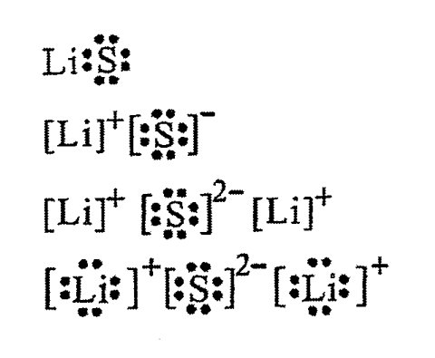
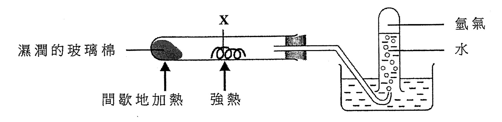
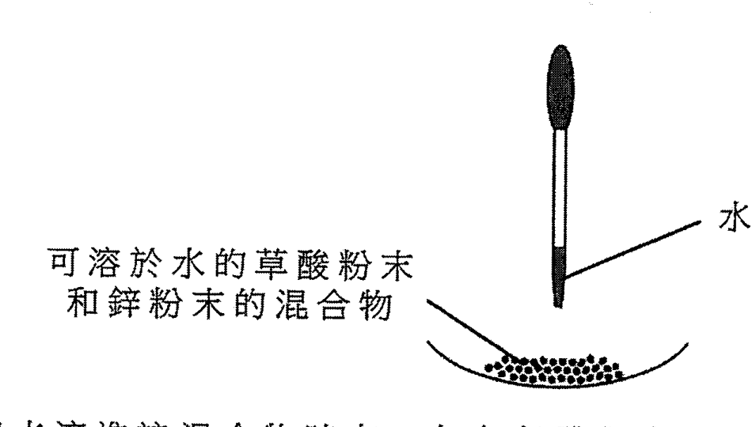
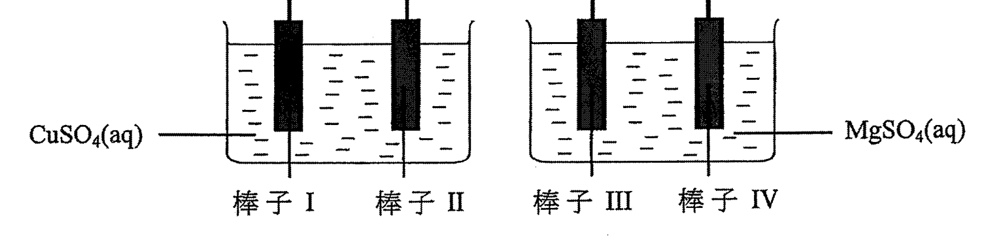
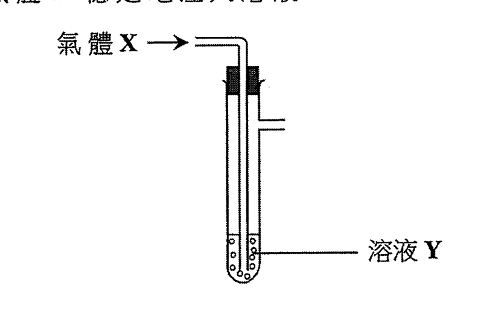
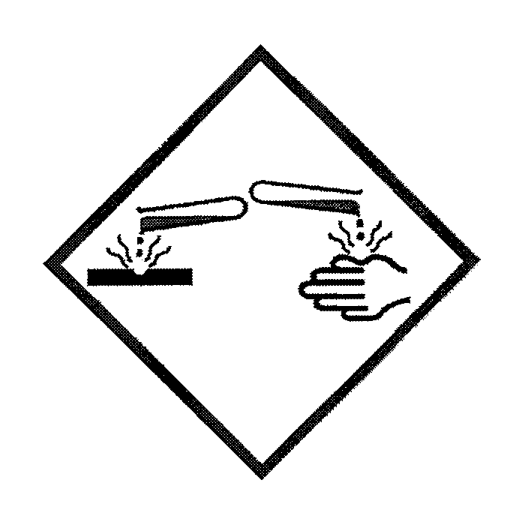
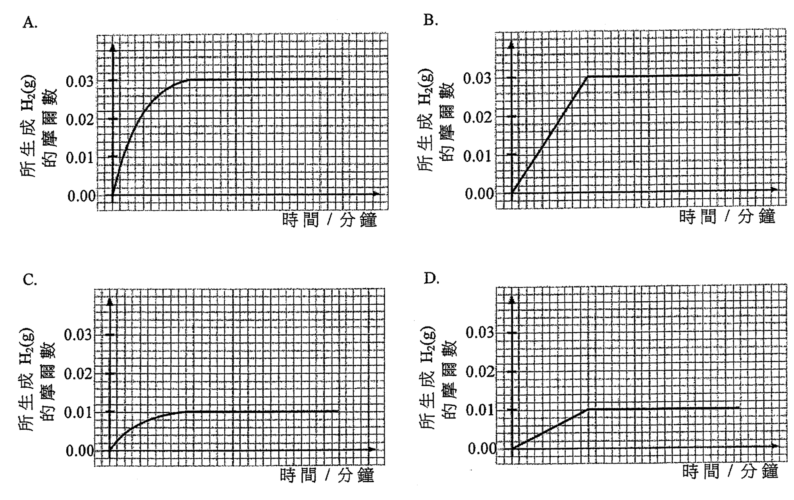
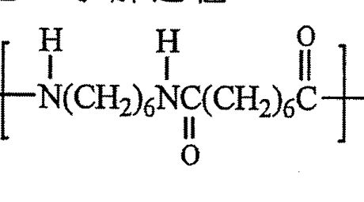
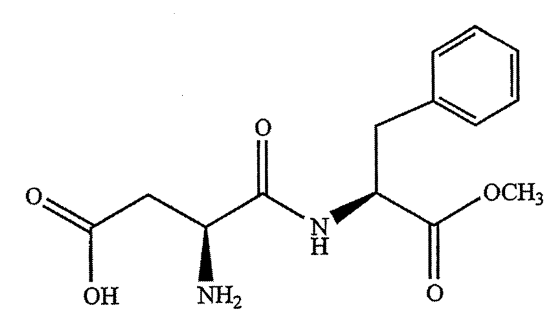

# 2016 DSE 化學 卷一甲（中文卷）— 題目庫

> 來源：文憑試 DSE 化學 Chemistry 2016 歷屆試題 Past Paper 卷一.pdf　｜　多項選擇題 36 題（第一部分 24 題、第二部分 12 題）
> 本部包括兩部分：第一部分設 24 題，第二部分設 12 題。選出每題最佳的答案。考生可參考印於試題答題簿 B 第 20 頁的周期表。
> 說明：已移除頁碼、試卷標頭等雜訊；化學式以 Unicode 下標／上標表示，反應式以 → 或 ⇌ 表示。**本檔為題目庫（零答案）**，只含題目清洗 + 建議標籤。
> 本檔為第 2 層文字交貨（圖用原卷截圖；精修重繪另開第 3 層）。

---

## 第一部分（第 1–24 題）

## 第 1 題

【建議標籤】

- 卷別/部分：卷一甲　第一部分
- 課題：#焰色試驗 #金屬離子 #定性分析

【題目內容】

為某樣本進行焰色試驗得出一磚紅色火焰。這樣本可能含有

- A. 白堊
- B. 石英
- C. 石墨
- D. 岩鹽

---

## 第 2 題

【建議標籤】

- 卷別/部分：卷一甲　第一部分
- 課題：#電子圖 #離子化合物 #路易斯結構

【題目內容】

以下哪個是硫化鋰的電子圖（只顯示了最外層的電子）？

- A.
- B.
- C.
- D.

---

## 第 3 題

【建議標籤】

- 卷別/部分：卷一甲　第一部分
- 課題：#金屬 #電子排佈 #周期表

【題目內容】

考慮下列有關金屬 T 的資料：

(1) T 與水劇烈反應。

(2) T 生成化學式為 T₂O 的氧化物。

(3) 一個 T 原子有五個已佔電子層。

T 可能是

- A. 銀 (Ag)
- B. 銫 (Cs)
- C. 鍶 (Sr)
- D. 銣 (Rb)

---

## 第 4 題

【建議標籤】

- 卷別/部分：卷一甲　第一部分
- 課題：#氫氣 #還原 #金屬氧化物

【題目內容】

考慮以下的實驗裝置：

下列何者不會是 X？

【圖待補：選項 A–D 為圖（原卷第 1 頁）】

- A.
- B.
- C.
- D.

---

## 第 5 題

【建議標籤】

- 卷別/部分：卷一甲　第一部分
- 課題：#鍍錫 #防鏽 #犧牲性保護

【題目內容】

用鍍錫來防止鐵罐生鏽是因為

- A. 錫向鐵提供犧牲性保護。
- B. 錫層防止鐵暴露於空氣中。
- C. 錫在金屬活性序較鐵高。
- D. 錫和鐵生成一不會腐蝕的合金。

---

## 第 6 題

【建議標籤】

- 卷別/部分：卷一甲　第一部分
- 課題：#pH #稀釋 #酸

【題目內容】

某硫酸樣本的 pH 是 2.6。把 100 cm³ 的這樣本與 100 cm³ 的水混合，所得混合物的 pH 是多少？

- A. 5.8
- B. 2.9
- C. 2.6
- D. 1.3

---

## 第 7 題

【建議標籤】

- 卷別/部分：卷一甲　第一部分
- 課題：#草酸 #鋅 #氣體 #氧化還原

【題目內容】

考慮以下的實驗裝置：

當把水滴進該混合物時有一無色氣體釋出。下列哪陳述正確？

- A. 草酸在水中電離得出氫離子
- B. 鋅在水中電離得出鋅離子
- C. 水與草酸反應得出該無色氣體
- D. 水與鋅反應得出該無色氣體

---

## 第 8 題

【建議標籤】

- 卷別/部分：卷一甲　第一部分
- 課題：#硫酸銅 #製備 #中和

【題目內容】

下列哪對物質當混合一起時，可用來製備硫酸銅(II)晶體？

- A. CuO(s) 和 H₂SO₄(aq)
- B. CuO(s) 和 MgSO₄(aq)
- C. Cu(s) 和 H₂SO₄(aq)
- D. Cu(s) 和 MgSO₄(aq)

---

## 第 9 題

【建議標籤】

- 卷別/部分：卷一甲　第一部分
- 課題：#烴 #燃燒 #摩爾計算

【題目內容】

[?] mol 的某烴需要 9 mol 的氧才完全燃燒。下列何者可能是這烴？

- A. CH₄ [?]
- B. C₂H₆ [?]
- C. C₃H₈ [?]
- D. C₄H₁₀ [?]

---

## 第 10 題

【建議標籤】

- 卷別/部分：卷一甲　第一部分
- 課題：#催化轉化器 #汽車尾氣 #空氣污染

【題目內容】

下列何者在通過催化轉化器時不能被轉化成危害性較低的物質？

- A. 氮氧化物
- B. 二氧化硫
- C. 一氧化碳
- D. 未經燃燒的烴

---

## 第 11 題

【建議標籤】

- 卷別/部分：卷一甲　第一部分
- 課題：#氧化數 #氮化合物

【題目內容】

在下列化合物中，何者的氮具有最高氧化數？

- A. NF₃ [?]
- B. NO [?]
- C. NH₄⁺ [?]
- D. HNO₃ [?]

---

## 第 12 題

【建議標籤】

- 卷別/部分：卷一甲　第一部分
- 課題：#電鍍 #電解 #鐵

【題目內容】

下圖顯示涉及四根鐵棒子的電鍍實驗所用的裝置：

在下列哪根鐵棒子上會鍍上金屬？

- A. 棒子 I
- B. 棒子 II
- C. 棒子 III
- D. 棒子 IV

---

## 第 13 題

【建議標籤】

- 卷別/部分：卷一甲　第一部分
- 課題：#氣體 #氧化還原 #溶液

【題目內容】

如下圖所示，把氣體 X 穩定地注入溶液 1：

在下列的組合中，何者不會在溶液 1 有可見的改變？

| | 氣體 X | 溶液 1 |
|---|---|---|
| A. | Cl₂(g) | HI(aq) |
| B. | O₂(g) | FeSO₄(aq) |
| C. | CO₂(g) | 酸化 KMnO₄(aq) |
| D. | SO₂(g) | 酸化 Na₂Cr₂O₇(aq) |

---

## 第 14 題

【建議標籤】

- 卷別/部分：卷一甲　第一部分
- 課題：#氧化還原反應 #判別

【題目內容】

下列何者不是氧化還原反應？

- A. 2AgBr(s) → 2Ag(s) + Br₂(g)
- B. SO₂(g) + 2H₂S(g) → 3S(s) + 2H₂O(l)
- C. 2KClO₃(s) → 2KCl(s) + 3O₂(g)
- D. Ca(HCO₃)₂(aq) → CaCO₃(s) + H₂O(l) + CO₂(g)

---

## 第 15 題

【建議標籤】

- 卷別/部分：卷一甲　第一部分
- 課題：#二級電池 #充電 #半方程式

【題目內容】

以下方程式顯示某二級電池放電時的反應：

2NiO(OH)(s) + Cd(s) + 2H₂O(l) → 2Ni(OH)₂(s) + Cd(OH)₂(s)

下列哪半方程式顯示當該電池被充電時在負極的改變？

- A. Cd(s) + 2OH⁻(aq) → Cd(OH)₂(s) + 2e⁻
- B. Cd(OH)₂(s) + 2e⁻ → Cd(s) + 2OH⁻(aq)
- C. Ni(OH)₂(s) + OH⁻(aq) → NiO(OH)(s) + H₂O(l) + e⁻
- D. NiO(OH)(s) + H₂O(l) + e⁻ → Ni(OH)₂(s) + OH⁻(aq)

---

## 第 16 題

【建議標籤】

- 卷別/部分：卷一甲　第一部分
- 課題：#沸點 #分子間力 #氫鍵

【題目內容】

下列哪化合物具有最高沸點？

- A. H₂O [?]
- B. HCl
- C. PH₃
- D. H₂Se

---

## 第 17 題

【建議標籤】

- 卷別/部分：卷一甲　第一部分
- 課題：#石油 #分餾 #化石燃料

【題目內容】

下列有關石油的陳述，何者正確？

(1) 它是脂肪烴的來源。

(2) 它可藉分液漏斗分離成不同黏度的各液體。

(3) 它是由古代海洋生物衍生的化石燃料。

- A. 只有 (1)
- B. 只有 (2)
- C. 只有 (1) 和 (3)
- D. 只有 (2) 和 (3)

---

## 第 18 題

【建議標籤】

- 卷別/部分：卷一甲　第一部分
- 課題：#醋 #乙酸 #電離

【題目內容】

下列有關醋的陳述，何者正確？

(1) 在醋中生成氫離子的過程是可逆的。

(2) 當糖加入醋時發生中和作用。

(3) 廚房所用的醋的 pH 大概是 1。

- A. 只有 (1)
- B. 只有 (2)
- C. 只有 (1) 和 (3)
- D. 只有 (2) 和 (3)

---

## 第 19 題

【建議標籤】

- 卷別/部分：卷一甲　第一部分
- 課題：#危險標籤 #化學品安全

【題目內容】

在盛載化學品 Z 的瓶子上張貼了以下的危險警告標籤：

下列的化學品，何者可能是 Z？

(1) 鈉

(2) 三氯甲烷

(3) 濃氨水

- A. 只有 (1)
- B. 只有 (2)
- C. 只有 (1) 和 (3)
- D. 只有 (2) 和 (3)

---

## 第 20 題

【建議標籤】

- 卷別/部分：卷一甲　第一部分
- 課題：#鉛 #離子 #還原 #電子層

【題目內容】

Pb 是周期表的第 IV 族元素並可生成 Pb²⁺ 離子。下列哪些陳述正確？

(1) 由 Pb²⁺ 離子至 Pb 原子的變化是一還原作用。

(2) Pb 原子和 Pb²⁺ 離子均具相同數目的質子。

(3) Pb 原子和 Pb²⁺ 離子均具相同數目的已佔電子層。

- A. 只有 (1) 和 (2)
- B. 只有 (1) 和 (3)
- C. 只有 (2) 和 (3)
- D. (1)、(2) 和 (3)

---

## 第 21 題

【建議標籤】

- 卷別/部分：卷一甲　第一部分
- 課題：#分子形狀 #VSEPR

【題目內容】

下列哪些分子具有相似形狀？

(1) BCl₃

(2) NH₃

(3) PF₃ [?]

- A. 只有 (1) 和 (2)
- B. 只有 (1) 和 (3)
- C. 只有 (2) 和 (3)
- D. (1)、(2) 和 (3)

---

## 第 22 題

【建議標籤】

- 卷別/部分：卷一甲　第一部分
- 課題：#放熱過程 #反應熱

【題目內容】

下列哪些過程是放熱的？

(1) 把氧化鈣置於水中

(2) 把鋅條置於一個硫酸銅(II)溶液中

(3) 把氯化氫氣體通入一個氫氧化鈉溶液

- A. 只有 (1) 和 (2)
- B. 只有 (1) 和 (3)
- C. 只有 (2) 和 (3)
- D. (1)、(2) 和 (3)

---

## 第 23 題

【建議標籤】

- 卷別/部分：卷一甲　第一部分
- 課題：#陽極電鍍 #鋁 #氧化鋁

【題目內容】

指示：以下兩題（題 23 和題 24）均由兩敘述句組成：考生須先判斷該兩敘述句是否正確；若兩敘述句均屬正確，再判斷第二敘述句是否第一敘述句的合理解釋，然後根據下表，從 A 至 D 四項中選出一個適用的答案：

- A. 兩敘述句均屬正確，而第二敘述句為第一敘述句的合理解釋
- B. 兩敘述句均屬正確，但第二敘述句並非第一敘述句的合理解釋
- C. 第一敘述句錯誤，但第二敘述句正確
- D. 兩敘述句均屬錯誤

第一敘述句：在陽極電鍍中，鋁表面的氧化鋁被還原成金屬。

第二敘述句：鋁的抗腐蝕性可藉陽極電鍍增強。

---

## 第 24 題

【建議標籤】

- 卷別/部分：卷一甲　第一部分
- 課題：#生成焓變 #穩定性

【題目內容】

第一敘述句：化合物的標準生成焓變必定是負值。

第二敘述句：在標準條件下，化合物必然在能量上較它的組成元素穩定。

- A. 兩敘述句均屬正確，而第二敘述句為第一敘述句的合理解釋
- B. 兩敘述句均屬正確，但第二敘述句並非第一敘述句的合理解釋
- C. 第一敘述句錯誤，但第二敘述句正確
- D. 兩敘述句均屬錯誤

---

## 第二部分（第 25–36 題）

## 第 25 題

【建議標籤】

- 卷別/部分：卷一甲　第二部分
- 課題：#反應速率 #坐標圖 #鎂 #鹽酸

【題目內容】

在一實驗中，讓 0.03 mol 的 Mg(s) 與 20.0 cm³ 的 1.0 M HCl(aq) 反應。以下哪坐標圖最能代表實驗的結果？

- A.
- B.
- C.
- D.

---

## 第 26 題

【建議標籤】

- 卷別/部分：卷一甲　第二部分
- 課題：#平衡 #勒沙特列 #溫度

【題目內容】

以下反應在一固定體積容器中已達致平衡：

CO(g) + H₂O(g) ⇌ CO₂(g) + H₂(g)　ΔH = −41.1 kJ

如提升了這體系的溫度，下列何者正確？

- A. 這體系的壓強保持不變。
- B. 正向和逆向反應的速率均增加。
- C. 這反應的平衡常數保持不變。
- D. CO₂(g) 和 H₂(g) 各自的產率以相同幅度增加。

---

## 第 27 題

【建議標籤】

- 卷別/部分：卷一甲　第二部分
- 課題：#平衡 #勒沙特列 #顏色

【題目內容】

考慮以下平衡體系：

Br₂(aq) + H₂O(l) ⇌ HOBr(aq) + H⁺(aq) + Br⁻(aq)

下列何者可使這體系的顏色變淡？

- A. 把 HCl(g) 通入該體系
- B. 把 HBr(g) 通入該體系
- C. 把 NaBr(s) 加進該體系
- D. 把 NaOH(s) 加進該體系

---

## 第 28 題

【建議標籤】

- 卷別/部分：卷一甲　第二部分
- 課題：#烯 #醇 #有機反應

【題目內容】

下列有關丁-1-烯和丁-1-醇的陳述，何者不正確？

- A. 它們均可把酸化 KMnO₄(aq) 脫色
- B. 丁-1-醇可與 PBr₃(l) 反應而丁-1-烯不可
- C. 它們均可在有鉑的存在下與 H₂(g) 反應
- D. 丁-1-烯可從丁-1-醇和 Al₂O₃(s) 共熱而獲得

---

## 第 29 題

【建議標籤】

- 卷別/部分：卷一甲　第二部分
- 課題：#同分異構 #羧酸 #二酸

【題目內容】

化合物 X 的分子式是 C₄H₆O₄，它有兩個 −COOH 基團。X 可有多少個同分異構體？

- A. [?]
- B. [?]
- C. [?]
- D. [?]

---

## 第 30 題

【建議標籤】

- 卷別/部分：卷一甲　第二部分
- 課題：#趨勢 #熔點 #電負性 #反應性

【題目內容】

下列涉及 Na、Mg 和 Al 的趨勢，何者不正確？

- A. 金屬的熔點：Al > Mg > Na
- B. 金屬的電負性：Al > Mg > Na
- C. 金屬與水的反應性：Na > Mg > Al
- D. 金屬氧化物的鹼強度：Al₂O₃ > MgO > Na₂O

---

## 第 31 題

【建議標籤】

- 卷別/部分：卷一甲　第二部分
- 課題：#尼龍 #聚醯胺 #重複單位

【題目內容】

下列有關尼龍-6,6 的陳述，何者正確？

(1) 它可用來製造繩子。

(2) 生成它的聚合作用是一水解過程。

(3) 它的重複單位是

- A. 只有 (1)
- B. 只有 (2)
- C. 只有 (1) 和 (3)
- D. 只有 (2) 和 (3)

---

## 第 32 題

【建議標籤】

- 卷別/部分：卷一甲　第二部分
- 課題：#阿司巴甜 #官能基 #酯 #醯胺

【題目內容】

阿司巴甜是一人工增甜劑，它的結構如下所示：

下列有關一個阿司巴甜分子的陳述，何者正確？

(1) 它有兩個酯基團。

(2) 它有兩個手性中心。

(3) 它有兩個醯胺基團。

- A. 只有 (1)
- B. 只有 (2)
- C. 只有 (1) 和 (3)
- D. 只有 (2) 和 (3)

---

## 第 33 題

【建議標籤】

- 卷別/部分：卷一甲　第二部分
- 課題：#反應速率 #表面積 #催化劑

【題目內容】

下列哪些陳述正確？

(1) 氧化鎂溶於 1 M HCl(aq) 較於 1 M CH₃COOH(aq) 為快。

(2) 與粒狀大理石相比，粉狀大理石較快溶於 1 M HCl(aq)。

(3) H₂O₂(aq) 在有 MnO₂(s) 的存在下分解得較沒有 MnO₂(s) 為快。

- A. 只有 (1) 和 (2)
- B. 只有 (1) 和 (3)
- C. 只有 (2) 和 (3)
- D. (1)、(2) 和 (3)

---

## 第 34 題

【建議標籤】

- 卷別/部分：卷一甲　第二部分
- 課題：#反應速率 #量度 #溴 #甲酸

【題目內容】

考慮以下反應：

Br₂(aq) + HCOOH(aq) → CO₂(g) + 2HBr(aq)

量度下列何者可跟隨這反應的進程？

(1) 所生成氣體的體積

(2) 該反應混合物的混濁度

(3) 該反應混合物的顏色強度

- A. 只有 (1) 和 (2)
- B. 只有 (1) 和 (3)
- C. 只有 (2) 和 (3)
- D. (1)、(2) 和 (3)

---

## 第 35 題

【建議標籤】

- 卷別/部分：卷一甲　第二部分
- 課題：#肥皂 #乳化 #表面張力

【題目內容】

肥皂可

(1) 從脂肪製得。

(2) 乳化油性粒子。

(3) 增加水的表面張力。

以下的組合，何者正確？

- A. 只有 (1) 和 (2)
- B. 只有 (1) 和 (3)
- C. 只有 (2) 和 (3)
- D. (1)、(2) 和 (3)

---

## 第 36 題

【建議標籤】

- 卷別/部分：卷一甲　第二部分
- 課題：#五氧化二磷 #酸性氧化物

【題目內容】

指示：題 36 由兩敘述句組成。考生須先判斷該兩敘述句是否正確；若兩敘述句均屬正確，再判斷第二敘述句是否第一敘述句的合理解釋，然後根據下表，從 A 至 D 四項中選出一個適用的答案：

- A. 兩敘述句均屬正確，而第二敘述句為第一敘述句的合理解釋
- B. 兩敘述句均屬正確，但第二敘述句並非第一敘述句的合理解釋
- C. 第一敘述句錯誤，但第二敘述句正確
- D. 兩敘述句均屬錯誤

第一敘述句：P₄O₁₀(s) 可與 NaOH(aq) 反應。

第二敘述句：P₄O₁₀(s) 是一酸性氧化物。

---

*甲部完 —*

## 待人工核對

本卷為第 2 層文字交貨，由 easyocr（ch_tra+en，GPU）掃描底稿清洗而成；現模型無影像輸入，未能對頁影像覆核。以下題號建議第 3 層精修時對頁覆核：

- 第 2 題：選項為硫化鋰電子圖（A–D），已 crop；電子圖位置／對應 A–D 次序待對頁核實。
- 第 3 題：化合物式「T₂O」（OCR 讀作「Io」）依「T 與水劇烈反應＋五個已佔電子層」推斷；金屬中文名（銀／銫／鍶／銣）依 OCR 校正，待對頁核實。
- 第 4 題：選項 A–D 為圖（OCR 僅讀出雜訊），標【圖待補】；裝置圖已 crop，待 spot-check。
- 第 9 題：題幹係數（[?] mol）及選項分子式下標 OCR 不清（CH／CH₂／CH₃／CH₄ 系列），待對頁核實。
- 第 11 題：選項氮化合物（NF₃／NO／NH₄⁺／HNO₃）OCR 亂碼，依氧化數題型推斷，待對頁核實。
- 第 16 題：選項 A 僅 OCR 讀出「H」，依題型（最高沸點，其餘為 HCl／PH₃／H₂Se）推斷為 H₂O，待對頁核實。
- 第 21 題：選項 (3)「PF₃」（OCR「PF,」，下標可能為 3 或 5）待對頁核實。
- 第 29 題：選項為數字（同分異構體數目），OCR 未讀出，標 [?]，待對頁核實。
- 第 12 題：棒子羅馬數字（I／II／III／IV）OCR 部分誤讀，依四棒裝置推斷，待對頁核實。
- 第 2、4、7、12、13、19、25、31、32 題：圖為 300dpi 原卷截圖（程式定位＋墨跡覆蓋率校驗；位置／範圍待 spot-check）；第 3 層再換成向量重繪。
