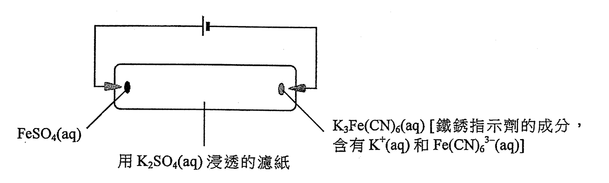
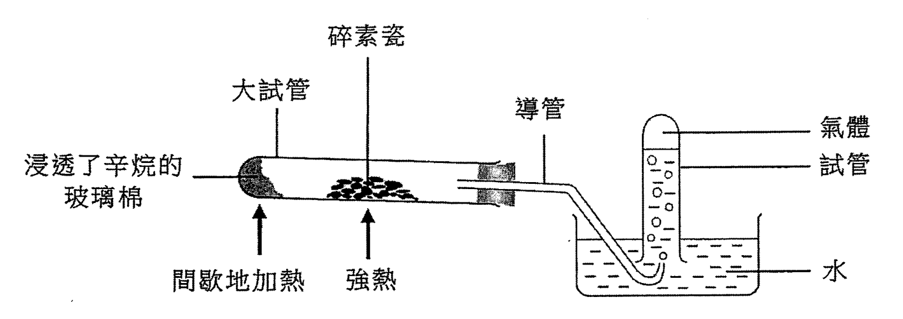
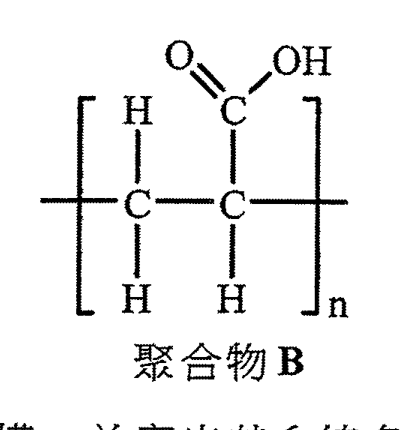
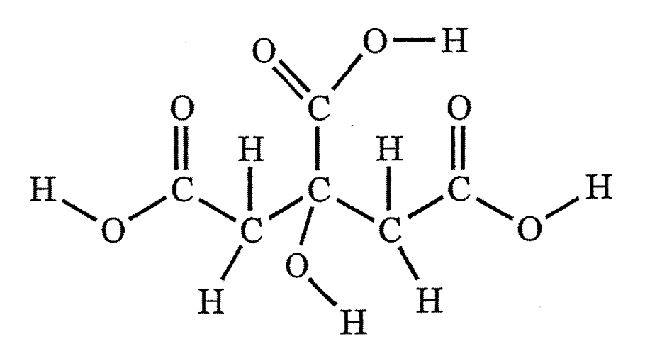
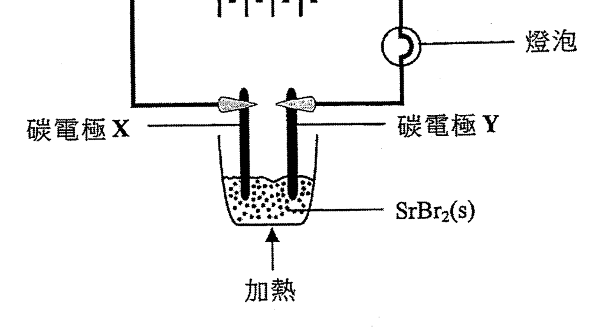
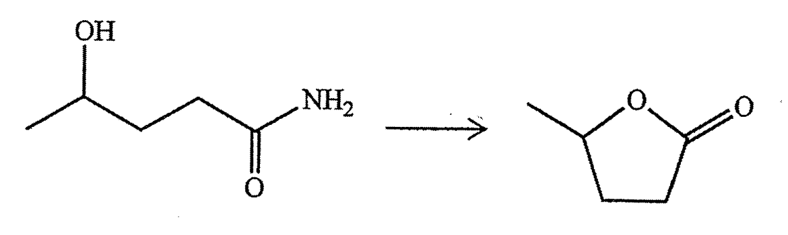
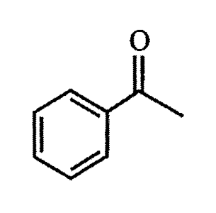

# 2016 DSE 化學 卷一乙（中文卷）— 題目庫

> 來源：文憑試 DSE 化學 Chemistry 2016 歷屆試題 Past Paper 卷一.pdf　｜　乙部 結構式問題 14 題（第一部分 9 題、第二部分 5 題）
> 本部包括兩部分：第一和第二部分各題均須作答。有 * 號標記的試題，將有一分給予達致有效傳意的答案。
> 說明：已移除頁碼、試卷標頭、答題簿橫線等雜訊；化學式以 Unicode 下標／上標表示，反應式以 → 或 ⇌ 表示。**本檔為題目庫（零答案）**，只含題目清洗 + 建議標籤。
> 本檔為第 2 層文字交貨（圖用原卷截圖；精修重繪另開第 3 層）。

---

## 第一部分（第 1–9 題）

## 第 1 題

【建議標籤】

- 卷別/部分：卷一乙　第一部分
- 課題：#電子排佈 #同位素 #分子式 #電子圖

【題目內容】

參照下列磷 (P) 和氯 (Cl) 的資料：

| | P | Cl |
|---|---|---|
| 原子序 | 15 | 17 |
| 相對原子質量 | 31.0 | 35.5 |

(a)　寫出一個磷原子的電子排佈。（1 分）

(b)　所有氯原子均具相同的原子序。解釋為什麼有些氯原子有不同的質量數。（1 分）

(c)　磷和氯的一個化合物的相對分子質量小於 250。按質量計，它含 22.6% 的磷。

　　(i)　推算這化合物的分子式。

　　(ii)　繪出這化合物的電子圖（只需顯示最外層的電子）。（3 分）

---

## 第 2 題

【建議標籤】

- 卷別/部分：卷一乙　第一部分
- 課題：#離子移動 #電解質 #電泳

【題目內容】

下圖顯示一個研習離子移動的實驗裝置：

（FeSO₄(aq)；K₃Fe(CN)₆(aq)〔鐵鏽指示劑的成分：含有 H⁺(aq) 和 Fe(CN)₆³⁻(aq)〕；用 K₂SO₄(aq) 浸透的濾紙）

(a)　解釋為什麼用 K₂SO₄(aq) 而不用水把濾紙浸透。（1 分）

(b)　寫出 FeSO₄(aq) 的顏色。（1 分）

*(c)　解釋當電路閉合一段時間後，在濾紙中央附近會觀察到什麼。（2 分）

(d)　重複這實驗，但一開始便把電池的兩極對調。解釋當電路閉合一段時間後，在濾紙中央附近會觀察到什麼。（2 分）

---

## 第 3 題

【建議標籤】

- 卷別/部分：卷一乙　第一部分
- 課題：#裂解 #催化 #烯烴 #安全

【題目內容】

下圖顯示某實驗的裝置，其中間歇地把浸透了辛烷的玻璃棉加熱，並將碎素瓷強熱。在試管藉排水法收集了一些氣體：

(a)　寫出在大試管內所發生反應的類別名稱。提出這類反應在工業上的一項重要性。（2 分）

(b)　解釋為什麼在這實驗用碎素瓷而不用大塊素瓷。（1 分）

(c)　假設在實驗中辛烷只變為乙烷氣體和丙烯氣體，它們可被收集於試管中。

　　(i)　寫出辛烷變為乙烷和丙烯的反應的平衡方程式。

　　(ii)　在試管所收集的氣體與數滴 Br₂（在 CH₂Cl₂ 溶液）搖勻。

　　　(1)　寫出預期的觀察。

　　　(2)　繪出丙烯與 Br₂ 反應所生成的產物的結構。（3 分）

*(d)　當再收集不到氣體時，就安全考慮，應該做什麼以結束這實驗？解釋你的答案。（2 分）

---

## 第 4 題

【建議標籤】

- 卷別/部分：卷一乙　第一部分
- 課題：#分子形狀 #極性 #分子間力

【題目內容】

考慮 CO₂、CS₂ 和 CH₂Br₂ 各分子。

(a)　為下列每一分子，繪出它的三維結構。

　　(i)　CS₂

　　(ii)　CH₂Br₂

（2 分）

(b)　指出 CH₂Br₂ 內的極性鍵（一個或多個），並加以解釋。（2 分）

(c)　提出為什麼在室溫室壓下，CO₂ 是氣體但 CS₂ 是液體。（2 分）

---

## 第 5 題

【建議標籤】

- 卷別/部分：卷一乙　第一部分
- 課題：#聚合物 #加成聚合 #吸水物料

【題目內容】

下圖所示聚合物 B 可用作尿片內的吸水物料。它可由化合物 A 經聚合作用而生成：

(a)　繪出化合物 A 的結構，並寫出其系統名稱。（2 分）

(b)　寫出由 A 生成 B 的聚合作用類別。（1 分）

*(c)　提出為什麼 B 的相對分子質量是用一個數值範圍來表示，而非一個單一固定值。（1 分）

(d)　已知聚合物 B 與 NaOH(aq) 反應生成吸水更佳的聚合物 C。繪出 C 的結構。（1 分）

---

## 第 6 題

【建議標籤】

- 卷別/部分：卷一乙　第一部分
- 課題：#檸檬酸 #三元酸 #滴定 #電離

【題目內容】

檸檬酸是一個在檸檬中找到的三元酸。它是白色固體並可溶於水。

(a)　在以下所示檸檬酸的結構中，圈出使之為三元酸的所有可電離氫原子（一個或多個）：

（1 分）

(b)　某固體樣本含檸檬酸及其他可溶惰性物質。把 1.65 g 的該樣本溶於去離子水中，並在儀器 X 內稀釋至 250.0 cm³。然後抽取 25.00 cm³ 的該已稀釋溶液，以酚酞作指示劑，用 0.123 M NaOH(aq) 來滴定，需用 18.45 cm³ 的該 NaOH(aq) 達到終點。

（檸檬酸的摩爾質量 = 192.0 g）

　　(i)　儀器 X 是什麼？

　　(ii)　計算在該固體樣本中檸檬酸的質量百分率。（4 分）

*(c)　把數滴檸檬汁加進碳酸氫鈉粉末。

　　(i)　寫出預期的觀察。

　　(ii)　寫出所涉及反應的離子方程式。（2 分）

---

## 第 7 題

【建議標籤】

- 卷別/部分：卷一乙　第一部分
- 課題：#生成焓變 #間接方法 #赫斯定律

【題目內容】

利用間接方法可求 MgCO₃(s) 的生成焓變。首先透過實驗，分別測定 MgCO₃(s) 與 H₂SO₄(aq)，以及 Mg(s) 與 H₂SO₄(aq) 各反應的焓變。接著再從已知的 CO₂(g) 及 H₂O(l) 的生成焓變，經運算後便可求 MgCO₃(s) 的生成焓變。

(a)　根據定義，在哪條件下，反應的熱變可被視為焓變？（1 分）

(b)　解釋為什麼用間接方法而非直接方法來求 MgCO₃(s) 的生成焓變。（1 分）

(c)　為於實驗上測定 MgCO₃(s) 與 H₂SO₄(aq) 的反應焓變，先讓準確質量的 MgCO₃(s) 與過量 H₂SO₄(aq) 在發泡聚苯乙烯杯子內起反應，然後找出混合物的升溫最大值。經運算後。

　　(i)　提出一項可能誤差。

　　(ii)　解釋是否可用相若的實驗步驟來求 CaCO₃(s) 與 H₂SO₄(aq) 的反應焓變。（2 分）

(d)　利用下列所給的資料，計算 MgCO₃(s) 的標準生成焓變：

MgCO₃(s) 與 H₂SO₄(aq) 的標準反應焓變 = −50 kJ mol⁻¹

Mg(s) 與 H₂SO₄(aq) 的標準反應焓變 = −467 kJ mol⁻¹

CO₂(g) 的標準生成焓變 = −394 kJ mol⁻¹

H₂O(l) 的標準生成焓變 = −286 kJ mol⁻¹

（3 分）

---

## 第 8 題

【建議標籤】

- 卷別/部分：卷一乙　第一部分
- 課題：#電解 #熔融鹽 #鋅碳電池

【題目內容】

考慮下圖所示的實驗裝置：

（燈泡、碳電極 X、碳電極 Y、SrBr₂(s)、加熱）

(a)　在以上實驗，當 SrBr₂(s) 變為熔融時，燈泡亮著。（Sr 的原子序 = 38）

　　(i)　寫出在碳電極 X 的觀察。

　　(ii)　寫出在碳電極 Y 上所起變化的半方程式。（2 分）

*(b)　解釋為什麼該實驗須在煙櫥內進行。（1 分）

(c)　上述實驗使用了鋅碳電池。以下方程式表示當燈泡亮著時，在鋅碳電池內所發生的反應：

2MnO₂(s) + 2NH₄Cl(aq) + Zn(s) → Mn₂O₃(s) + 2NH₃(aq) + H₂O(l) + ZnCl₂(aq)

　　(i)　從氧化數的改變，推定鋅碳電池內的氧化劑。

　　(ii)　寫出在鋅碳電池陰極上所起變化的半方程式。（3 分）

---

## 第 9 題

【建議標籤】

- 卷別/部分：卷一乙　第一部分
- 課題：#定性分析 #水合鹽 #辨別測試

【題目內容】

*三個沒有標籤的試劑瓶，分別盛載下列的其中一種白色固體：

ZnSO₄、MgSO₄、MgSO₄·7H₂O

概述怎樣進行測試來辨別這三種固體。（6 分）

---

## 第二部分（第 10–14 題）

## 第 10 題

【建議標籤】

- 卷別/部分：卷一乙　第二部分
- 課題：#化學平衡 #平衡常數 #勒沙特列

【題目內容】

在一實驗中，讓 2.0 mol 的 SO₂(g) 及 2.0 mol 的 O₂(g) 於一個維持在 950 K 的密閉容器中反應。該反應的化學方程式如下所示：

2SO₂(g) + O₂(g) ⇌ 2SO₃(g)　ΔH = −198 kJ mol⁻¹

當這反應達致動態平衡時，得到 1.8 mol 的 SO₃(g)。

(a)　「動態平衡」一詞是什麼意思？（1 分）

(b)　在 950 K 時，上述反應的平衡常數 K 是 878 dm³ mol⁻¹。計算該容器的體積。（3 分）

(c)　若上述平衡混合物受到下列各項變化，所得 SO₃(g) 的摩爾數會是增加、減少還是維持不變？逐一解釋你的答案。

　　(i)　升高溫度

　　(ii)　加進適當的催化劑（2 分）

---

## 第 11 題

【建議標籤】

- 卷別/部分：卷一乙　第二部分
- 課題：#反應速率 #反應級數 #pH

【題目內容】

在某些條件下，一粉紅色化合物 X 與 NaOH(aq) 反應得到一無色產物。為研習該反應動力學，進行了三次實驗。首先在 25°C 時，把不同體積的 2.0 M NaOH(aq) 和 H₂O(l) 混合，配成三個 NaOH(aq) 溶液。接著向它們各自加一滴 X，並記錄粉紅色消失所需時間。有關數據如下所示：

| | 所用 2.0 M NaOH(aq) 的體積 cm³ | 所用 H₂O(l) 的體積 cm³ | 粉紅色消失所需時間 s |
|---|---|---|---|
| 第 1 次 | 5.0 | 0.0 | 61 |
| 第 2 次 | 4.0 | 1.0 | 76 |
| 第 3 次 | 3.0 | 2.0 | 101 |

(a)　為什麼需要使各次實驗的反應混合物總體積相同？（1 分）

(b)　已知在 25°C 時，[H⁺(aq)][OH⁻(aq)] = 1.0 × 10⁻¹⁴ mol² dm⁻⁶。計算在第 2 次實驗所配成的 NaOH(aq) 溶液的 pH。（3 分）

(c)　根據所給資料，推定影響這反應速率的一個因素。（2 分）

(d)　憑肉眼檢測顏色變化並不夠準確。提出一個能更準確檢測顏色變化的儀器方法。（1 分）

---

## 第 12 題

【建議標籤】

- 卷別/部分：卷一乙　第二部分
- 課題：#合成路線 #有機轉化 #官能基

【題目內容】

*概述一條不多於三個步驟的合成路線來完成以下的轉化。寫出每一步驟的試劑（一個或多個）、反應條件（如適用）及有機生成物的結構：

（3 分）

---

## 第 13 題

【建議標籤】

- 卷別/部分：卷一乙　第二部分
- 課題：#苯乙酮 #還原 #同分異構 #對映異構

【題目內容】

苯乙酮的結構如下所示：

把在甲醇溶劑的苯乙酮和 NaBH₄ 混合物回流加熱可得到兩個同分異構化合物 P 和 Q。P 和 Q 具相同熔點及在甲醇中有相同的溶解度。

(a)　繪畫一個把該混合物回流加熱的裝置的標示圖。（2 分）

(b)　提出另一個試劑，於適當溶劑中也可與苯乙酮反應得到 P 和 Q。（1 分）

*(c)　P 和 Q 是哪一類同分異構體？（1 分）

(d)　寫出 P 和 Q 的一個不同物理性質。（1 分）

(e)　提出一項化學測試以顯示如何分辨苯乙酮和 P。（2 分）

---

## 第 14 題

【建議標籤】

- 卷別/部分：卷一乙　第二部分
- 課題：#電導性 #鍵合 #結構

【題目內容】

*把鈉、鋁、硅和硫按其在室內條件下電導性遞減的次序排列，並根據鍵合和結構解釋你的答案。（5 分）

---

*乙部完 —*

## 待人工核對

本卷為第 2 層文字交貨，由 easyocr（ch_tra+en，GPU）掃描底稿清洗而成；現模型無影像輸入，未能對頁影像覆核。以下題號建議第 3 層精修時對頁覆核：

- 第 2 題：裝置圖（FeSO₄／K₃Fe(CN)₆／濾紙）為 300dpi crop，位置／範圍待 spot-check；括號內的裝置標註文字依 OCR 校正，待核實。
- 第 3 題：裝置圖為 crop；「碎素瓷」及 (d) 安全處理文字待對頁核實。
- 第 5 題：聚合物 B 結構 crop；「化合物 A 系統名稱」待對頁核實。
- 第 6 題：檸檬酸結構 crop；滴定數據（1.65 g／250.0 cm³／0.123 M／18.45 cm³／192.0 g）依 OCR 校正，待核實。
- 第 7 題：(a)「熱變／焓變」字眼 OCR 混淆，(c)(i)「提出一項可能誤差」OCR 嚴重亂碼，均待對頁核實。
- 第 8 題：裝置圖 crop；碳電極 X／Y（OCR 讀作「碳電極 1」）及鋅碳電池方程式係數待對頁核實。
- 第 11 題：數據表（第 1 次 H₂O 體積 OCR 空白，依總體積 5.0 cm³ 推斷為 0.0）；離子積常數 1.0 × 10⁻¹⁴ mol² dm⁻⁶ 待核實。
- 第 12 題：OH→NH₂ 轉化結構 crop，起／訖官能基與苯環待對頁核實。
- 第 13 題：苯乙酮結構 crop；NaBH₄ 及 P／Q（OCR 讀作「0」）待對頁核實。
- 第 14 題：「硅／矽」字眼（OCR 讀作「硅」）待對頁核實。
- 各題 * 號標記（有效傳意）依 OCR 定位，需對頁覆核。
- 第 2、3、5、6、8、12、13 題：圖為 300dpi 原卷截圖（程式定位＋墨跡覆蓋率校驗；位置／範圍待 spot-check）；第 3 層再換成向量重繪。
