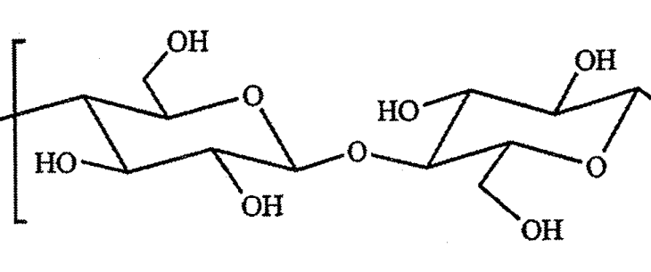
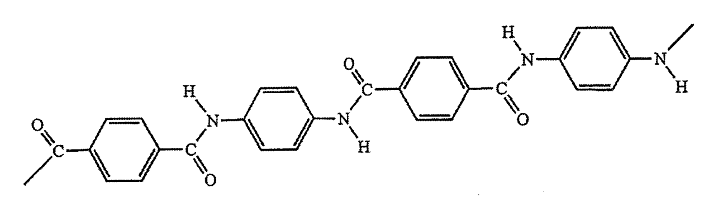
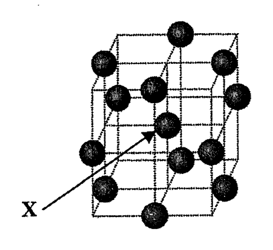
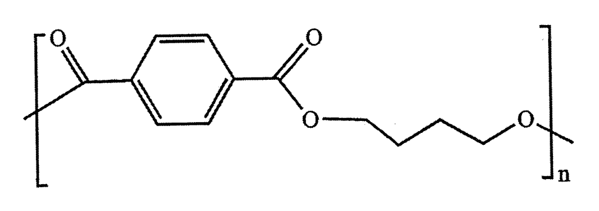
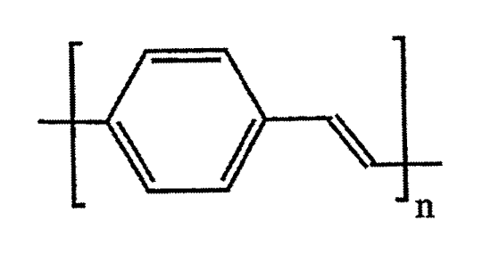
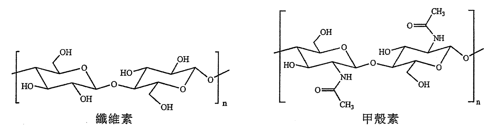
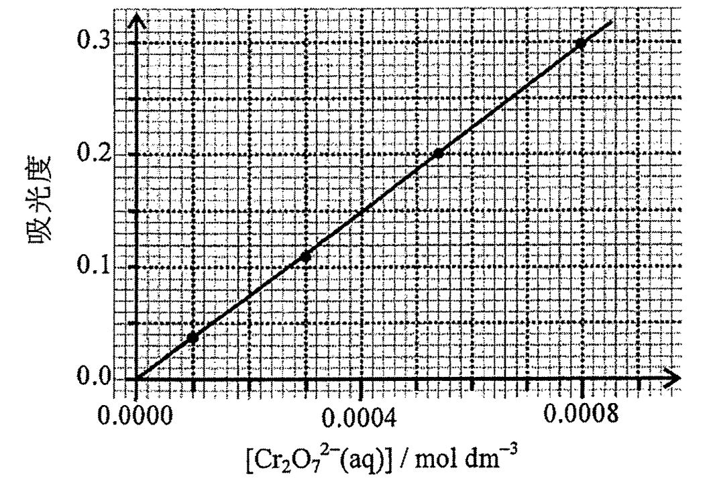
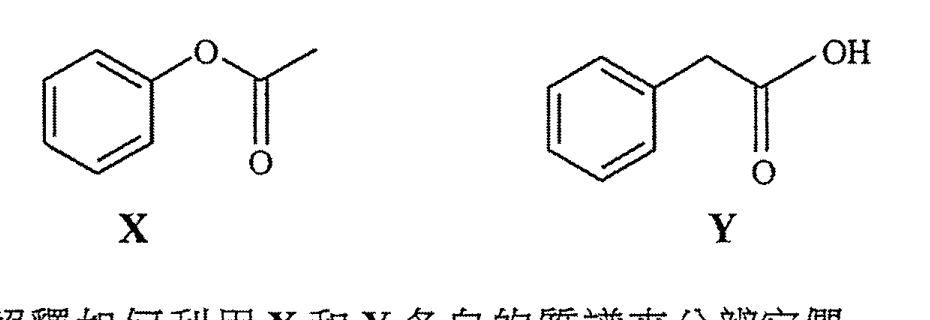

# 2016 DSE 化學 卷二（中文卷）— 題目庫

> 來源：文憑試 DSE 化學 Chemistry 2016 歷屆試題 Past Paper 卷二.pdf　｜　三部分：甲部 工業化學、乙部 物料化學、丙部 分析化學（每部分一題）
> 本試卷共有甲、乙和丙三部。考生須選答任何兩部中的全部試題。
> 說明：已移除頁碼、試卷標頭等雜訊；化學式以 Unicode 下標／上標表示，反應式以 → 或 ⇌ 表示。**本檔為題目庫（零答案）**，只含題目清洗 + 建議標籤。
> 本檔為第 2 層文字交貨（圖用原卷截圖；精修重繪另開第 3 層）。

---

## 甲部　工業化學（第 1 題）

## 第 1 題

【建議標籤】

- 卷別/部分：卷二　甲部
- 課題：#乙醇 #合成氣 #哈柏法 #硝酸 #蔗糖水解 #動力學

【題目內容】

回答試題的所有部分。

(a)　回答以下短問題：

　　(i)　參考以下在工業上使用某催化劑生產乙醇的反應：

CH₂=CH₂(g) + H₂O(g) → CH₃CH₂OH(g)　ΔH = −45 kJ mol⁻¹

根據平衡位置及反應速率，論證為什麼在 65 atm 壓強下，把操作溫度設定在 300°C。（2 分）

　　(ii)　麥克斯韋—波爾茲曼分佈曲線下的面積代表什麼？（1 分）

　　(iii)　在很多工業過程中，合成氣是一個重要的起始物料。

　　　(1)　寫出合成氣的兩種主要成分氣體。

　　　(2)　提出一個可從合成氣經催化過程直接製成的重要化學品。（2 分）

(b)　考慮在一所化工廠藉哈柏法生產氨。

　　(i)　提出在工業上如何能獲取氮氣。（1 分）

　　(ii)　解釋為什麼有需要在這所化工廠內安裝熱交換器。（2 分）

　　(iii)　若把 420 kg 的氮及 96 kg 的氫注入反應室，而氨的產率為 15%，計算所生產氨的質量。（3 分）

　　(iv)　這所化工廠也可生產硝酸。首先，氨被氧化以得出一氧化氮，而一氧化氮被進一步氧化為二氧化氮。最後，把二氧化氮氧化得出硝酸。為以下各反應寫出一條化學方程式：

　　　(1)　把氨氧化以得出一氧化氮

　　　(2)　把二氧化氮氧化以得出硝酸（2 分）

(c)　以下反應式可代表蔗糖的水解：

C₁₂H₂₂O₁₁(aq) + H₂O(l) →[HCl(aq)] C₆H₁₂O₆(aq) + C₆H₁₂O₆(aq)

　　蔗糖　　　　　　　　　　葡萄糖　　　果糖

在相同實驗條件下，進行了三次實驗來研習該水解的動力學。下表列出所得的數據：

| | C₁₂H₂₂O₁₁(aq) 的初始濃度 mol dm⁻³ | HCl(aq) 的初始濃度 mol dm⁻³ | C₁₂H₂₂O₁₁(aq) 消失的初速 mol dm⁻³ s⁻¹ |
|---|---|---|---|
| 第 1 次 | 0.010 | 0.10 | 6.0 × 10⁻⁷ |
| 第 2 次 | 0.020 | 0.20 | 2.4 × 10⁻⁶ |
| 第 3 次 | 0.010 | 0.30 | 1.8 × 10⁻⁶ |

　　(i)　已知對應 H₂O(l) 的反應級數是零。

　　　(1)　推定對應 C₁₂H₂₂O₁₁(aq) 及對應 HCl(aq) 的反應級數。

　　　(2)　寫出該反應的速率方程。

　　　(3)　基於第 1 次實驗的結果，計算在實驗條件下的速率常數。（4 分）

　　(ii)　蔗糖也可藉某一種酶的作用而進行水解。寫出該酶在這水解的功用。（1 分）

　　(iii)　澱粉經酶水解後最終的唯一生成物是葡萄糖。根據綠色化學原理，提出兩項理由，說明為什麼澱粉被視為較蔗糖更適合於作為葡萄糖的來源。（2 分）

---

## 乙部　物料化學（第 2 題）

## 第 2 題

【建議標籤】

- 卷別/部分：卷二　乙部
- 課題：#纖維素 #液晶 #凱庫勒 #金晶體 #納米粒子 #聚合物 #PBT #PTFE #PPV

【題目內容】

回答試題的所有部分。

(a)　回答以下短問題：

　　(i)　纖維素是一種天然聚合物。它的結構顯示如下：

解釋為什麼纖維素被視為對環境友善。（1 分）

　　(ii)　寫出液晶的兩個結構特徵。（2 分）

　　(iii)　凱庫勒的部分結構顯示如下：

從以上結構，給出兩項理由說明為什麼凱庫勒是剛性的。（2 分）

(b)　金是一種貴重金屬。下圖顯示金晶體的晶胞：

　　(i)　寫出這類晶體結構的名稱。（1 分）

　　(ii)　計算這晶胞中金原子的數目。（2 分）

　　(iii)　標示為「X」的金原子的配位數是什麼？（1 分）

　　(iv)　某 18-克拉金樣本由 75% 金、15% 銀和 10% 銅組成。從科學的觀點，解釋用這 18-克拉金樣本較用純金來製造以鑽石鑲嵌的首飾的優勝之處。（2 分）

　　(v)　不同大小的金納米粒子呈不同顏色。提出在建築上使用金納米粒子的一個例子。（1 分）

(c)　考慮以下聚合物：聚對苯二甲酸丁二酯 (PBT)、聚四氟乙烯 (PTFE)、聚（對亞苯基亞乙烯基）(PPV)

　　(i)　某電腦鍵盤的鍵蓋是以 PBT 製造。PBT 的結構顯示如下：

　　　(1)　繪出 PBT 不同單體的結構。

　　　(2)　寫出形成 PBT 所涉及聚合作用的類別名稱。

　　　(3)　建議一個製造電腦鍵盤的鍵蓋的成型方法。（4 分）

　　(ii)　某滴定管活栓是以 PTFE 製造。提出 PTFE 的兩項性質讓它適合製造滴定管活栓。（2 分）

　　(iii)　某 OLED 顯示屏的導電層是以 PPV 製造。PPV 的結構顯示如下：

　　　(1)　繪出 PPV 含三個重複單位的部分結構。

　　　(2)　你會預期 PPV 展示旋光性嗎？解釋你的答案。（2 分）

---

## 丙部　分析化學（第 3 題）

## 第 3 題

【建議標籤】

- 卷別/部分：卷二　丙部
- 課題：#標準溶液 #紅外光譜 #容量分析 #比色法 #質譜 #溶劑提取

【題目內容】

回答試題的所有部分。

(a)　回答以下短問題：

　　(i)　寫出氫氧化鈉固體的一項性質，使牠不適合藉稱重來配製標準溶液。（1 分）

　　(ii)　建議一個化學測試以顯示次氯酸根離子存在於一個水溶液中。（2 分）

　　(iii)　纖維素及甲殼素均是天然聚合物。它們的結構顯示如下：

參照下表所給的數據，提出在纖維素及甲殼素的紅外光譜中一項相似之處及一項相異之處：

| 鍵合 | 化合物類別 | 波數域 cm⁻¹（伸展式） |
|---|---|---|
| C=C | 烯 | 1610 至 1680 |
| C=O | 醛、酮、羧酸及其衍生物 | 1680 至 1800 |
| C≡C | 炔 | 2070 至 2250 |
| C≡N | 腈 | 2200 至 2280 |
| O–H | 帶「氫鍵」的酸 | 2500 至 3300 |
| O–H | 帶「氫鍵」的醇及酚 | 3230 至 3670 |

（2 分）

(b)　利用容量分析測定一個 Na₂Cr₂O₇(aq) 樣本 A 的濃度；並利用比色法測定另一個 Na₂Cr₂O₇(aq) 樣本 B 的濃度。

把 25.00 cm³ 的樣本 A 轉移到一錐形瓶，並用稀 H₂SO₄(aq) 酸化。然後在適當的指示劑下以 0.0642 mol dm⁻³ Fe²⁺(aq) 溶液滴定該混合物，需用 26.88 cm³ 的該 Fe²⁺(aq) 溶液來達到終點。

　　(i)　寫出所涉及反應的平衡方程式。

　　(ii)　計算在 A 中 Na₂Cr₂O₇(aq) 的濃度。（3 分）

　　(iii)　在比色法中，先配製不同的標準 Cr₂O₇²⁻(aq) 溶液，然後用裝了藍色濾片的比色計來量度這些溶液的吸光度。以下的校準曲線顯示吸光度隨 Cr₂O₇²⁻(aq) 離子濃度的變化：

　　　(1)　提出為什麼要用藍色濾片。

　　　(2)　參考以上的校準曲線，寫出吸光度與 [Cr₂O₇²⁻(aq)] 的關係。

　　　(3)　把樣本 B 稀釋 100 倍。用該比色計量度得這稀釋溶液的吸光度為 0.26。根據上述校準曲線所給的資料，計算在 B 中 Na₂Cr₂O₇(aq) 的濃度。（4 分）

　　(iv)　解釋在測定一個非常稀（如大概 10⁻⁷ mol dm⁻³ 的 Na₂Cr₂O₇(aq)）的濃度時，使用容量分析抑或比色法較為恰當。（1 分）

(c)　X 和 Y 是同分異構化合物。它們的結構顯示如下：

　　(i)　提出並解釋如何利用 X 和 Y 各自的質譜來分辨它們。（2 分）

　　(ii)　X 的熔點是 50°C 而 Y 的是 77°C。它們均不溶於水但溶於二氯甲烷。當以稀 Na₂CO₃(aq) 處理時，Y 不發生反應但 X 發生反應以生成一可溶的鹽。

　　　(1)　你獲提供稀 Na₂CO₃(aq) 和稀 H₂SO₄(aq)。根據溶劑提取，概述把固體 Y 從 X 和 Y 在二氯甲烷的溶液中分離出來的實驗步驟。

　　　(2)　提出如何能鑑定在 (1) 中所得的固體是純化合物 Y。（5 分）

---

*試卷完 —*

## 待人工核對

本卷為第 2 層文字交貨，由 easyocr（ch_tra+en，GPU）掃描底稿清洗而成；現模型無影像輸入，未能對頁影像覆核。以下題號建議第 3 層精修時對頁覆核：

- 第 1 題：乙醇生產方程式（CH₂=CH₂ + H₂O → CH₃CH₂OH）依 OCR 校正；蔗糖水解動力學數據表（初速 6.0×10⁻⁷／2.4×10⁻⁶／1.8×10⁻⁶）依 OCR 校正，待核實。
- 第 2 題：纖維素／凱庫勒／金晶胞／PBT／PPV 結構均為 300dpi crop，位置／範圍待 spot-check；「凱庫勒剛性」及金納米粒子文字待對頁核實。
- 第 3 題：纖維素＋甲殼素結構、校準曲線、X／Y 結構均為 crop；紅外吸收數據表（C≡C／C≡N 行 OCR 讀作 C=C／C=l）依標準 IR 數據校正，待核實。
- 第 3 題 (c)(ii)：X／Y（OCR 讀作「X 和工／1」）及熔點（50°C／77°C）、稀 Na₂CO₃ 處理文字待對頁核實。
- 卷二源 PDF 第 3–4 頁與第 1–2 頁內容重複（掃描版別差異），本檔只採甲／乙／丙各一題一次，未重複。
- 各題圖為 300dpi 原卷截圖（程式定位＋墨跡覆蓋率校驗；位置／範圍待 spot-check）；第 3 層再換成向量重繪。
