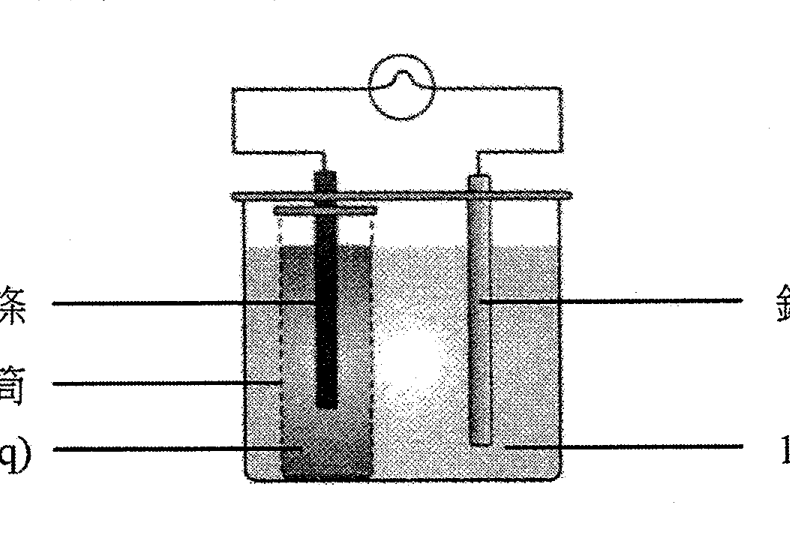
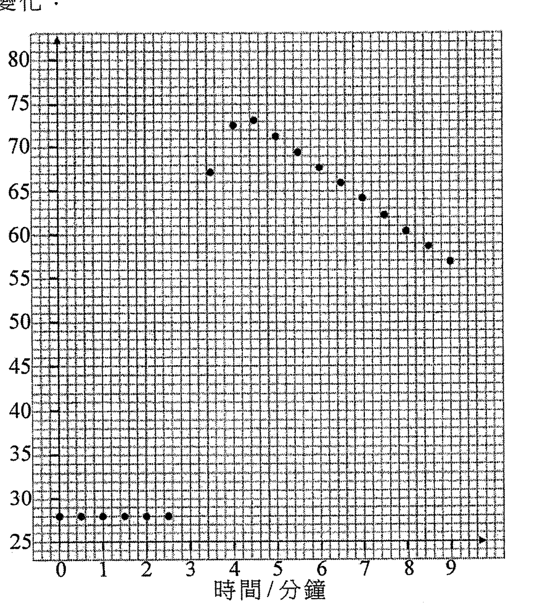
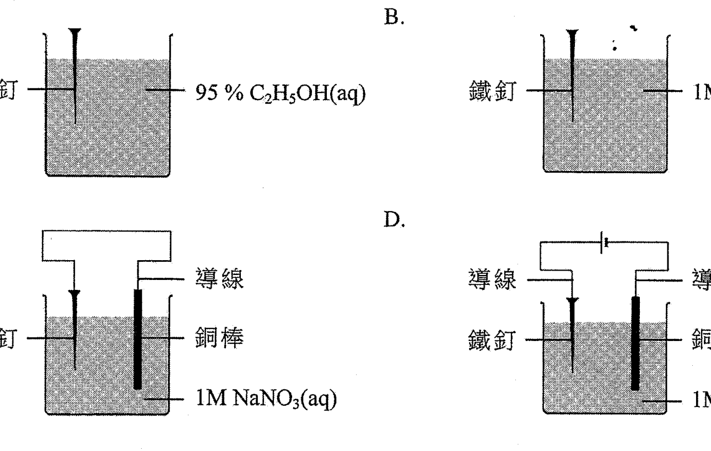
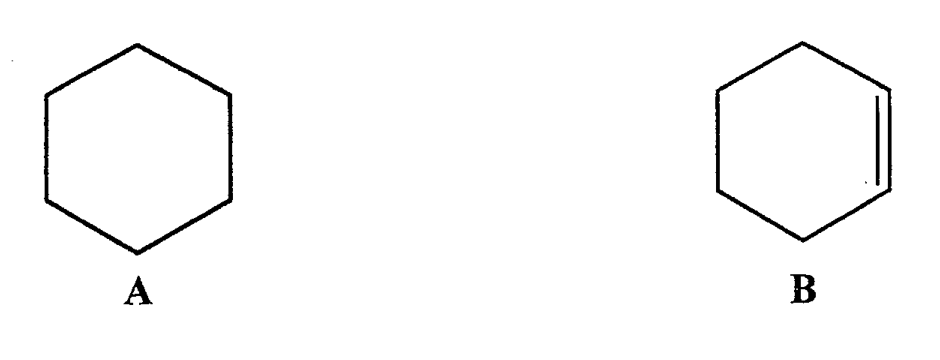
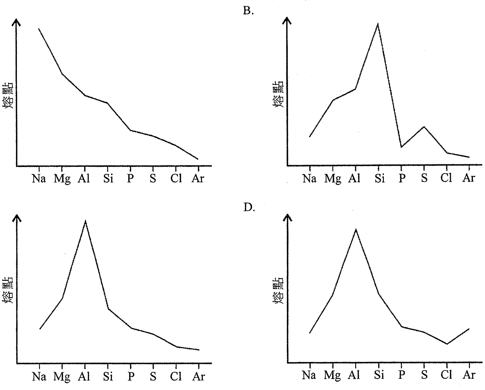
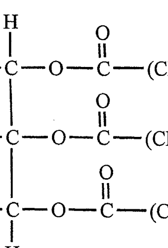
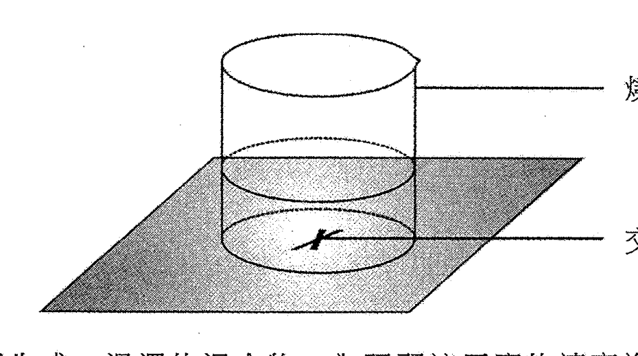
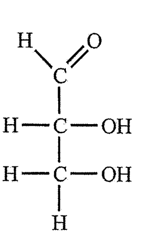
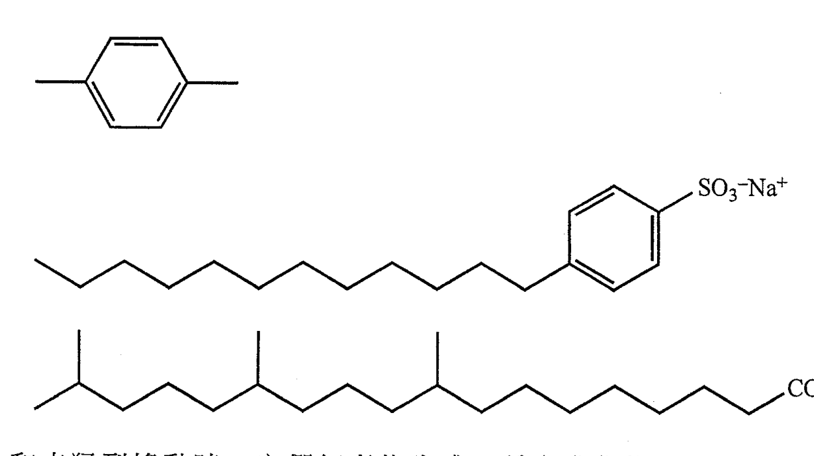

# 2017 DSE 化學 卷一甲（中文卷）— 題目庫

> 來源：文憑試 DSE 化學 Chemistry 2017 歷屆試題 Past Paper 卷一.pdf　｜　多項選擇題 36 題（第一部分 24 題、第二部分 12 題）
> 本部包括兩部分：第一部分設 24 題，第二部分設 12 題。選出每題最佳的答案。考生可參考印於試題答題簿 B 第 20 頁的周期表。
> 說明：已移除頁碼、試卷標頭等雜訊；化學式以 Unicode 下標／上標表示，反應式以 → 或 ⇌ 表示。**本檔為題目庫（零答案）**，只含題目清洗 + 建議標籤。
> 本檔為第 2 層文字交貨（圖用原卷截圖；精修重繪另開第 3 層）。

---

## 第一部分（第 1–24 題）

## 第 1 題

【建議標籤】

- 卷別/部分：卷一甲　第一部分
- 課題：#離子化合物 #電子排佈 #化學式

【題目內容】

元素 X 和 Y 生成一具化學式為 X₂Y 的離子化合物。如果 X 的離子和 Y 的離子具相同的電子排佈，下列何者可能是這化合物？

- A. 氧化鋰
- B. 氧化鋁
- C. 硫化鉀
- D. 氯化鎂

---

## 第 2 題

【建議標籤】

- 卷別/部分：卷一甲　第一部分
- 課題：#氫氯酸 #電離 #酸

【題目內容】

下列有關氫氯酸的陳述，何者不正確？

- A. 它是一礦物酸
- B. 它在水中完全電離
- C. 它含有水溶氫離子
- D. 它不含水溶氫氧離子

---

## 第 3 題

【建議標籤】

- 卷別/部分：卷一甲　第一部分
- 課題：#實驗式 #燃燒 #摩爾計算

【題目內容】

某碳氫化合物在氧中完全燃燒得出 17.6 g 的二氧化碳和 3.6 g 的水。下列何者是這碳氫化合物的實驗式？

（相對原子質量：H = 1.0，C = 12.0，O = 16.0）

- A. CH
- B. CH₂
- C. CH₃
- D. CH₄

---

## 第 4 題

【建議標籤】

- 卷別/部分：卷一甲　第一部分
- 課題：#化學電池 #電解質 #氧化還原

【題目內容】

下圖顯示一個裝置，其中燈泡發亮：

下列有關這裝置的陳述，何者正確？

- A. 銀離子移向多孔瓷筒
- B. 鎂條的質量減少
- C. 熱能轉化成電能
- D. 氫離子在銀條上放電

---

## 第 5 題

【建議標籤】

- 卷別/部分：卷一甲　第一部分
- 課題：#有機命名 #二烯 #系統命名

【題目內容】

Cl₂CH–CH=CH–CH=CH₂ 的系統名稱是什麼？

- A. 1,1-二氯戊-2,4-二烯
- B. 5,5-二氯戊-1,3-二烯
- C. 1,1-二氯戊-2,4-二烯 [?]
- D. 5,5-二氯戊-1,3-二烯 [?]

---

## 第 6 題

【建議標籤】

- 卷別/部分：卷一甲　第一部分
- 課題：#硫酸鎂 #製備 #中和

【題目內容】

下列何者不是一個適當的物質，以把它與稀硫酸直接混合來製備硫酸鎂？

- A. 鎂金屬
- B. 氧化鎂
- C. 硝酸鎂
- D. 碳酸鎂

---

## 第 7 題

【建議標籤】

- 卷別/部分：卷一甲　第一部分
- 課題：#焓變 #量熱法 #坐標圖

【題目內容】

在一個為研習某個反應的焓變的實驗中，以下的坐標圖繪畫了反應容器中內含物的溫度隨時間的變化：

該反應在第三分鐘開始。下列的組合，何者正確？

| | 由含物的最大上升溫度 | 該反應的焓變 |
|---|---|---|
| A. | 51°C | [?] |
| B. | 45°C | [?] |
| C. | 51°C | [?] |
| D. | 45°C | [?] |

---

## 第 8 題

【建議標籤】

- 卷別/部分：卷一甲　第一部分
- 課題：#氫氧燃料電池 #催化劑 #還原劑

【題目內容】

下列有關氫氧燃料電池的陳述，何者不正確？

(1) 它含有催化劑

(2) 在放電時有水生成

(3) 氧氣通進陽極

- A. 只有 (1)
- B. 只有 (2)
- C. 只有 (1) 和 (3)
- D. 只有 (2) 和 (3)

---

## 第 9 題

【建議標籤】

- 卷別/部分：卷一甲　第一部分
- 課題：#金屬提取 #還原 #電解

【題目內容】

下列的過程，何者不會得出金屬？

- A. 把氧化鋅加熱
- B. 把氧化銅(II)與碳共熱
- C. 把熔融氯化鋰電解
- D. 把氧化鐵(III)與一氧化碳共熱

---

## 第 10 題

【建議標籤】

- 卷別/部分：卷一甲　第一部分
- 課題：#磷酸鈣 #溶解度 #摩爾計算

【題目內容】

磷酸鈣是不溶於水的。當 100.0 cm³ 的 0.30 mol dm⁻³ CaCl₂(aq) 與 300.0 cm³ 的 0.10 mol dm⁻³ Na₃PO₄(aq) 混合時，所得磷酸鈣的理論摩爾數是多少？

（相對原子質量：O = 16.0，Na = 23.0，P = 31.0，Cl = 35.5，Ca = 40.1）

- A. 0.010
- B. 0.015
- C. 0.020
- D. 0.030

---

## 第 11 題

【建議標籤】

- 卷別/部分：卷一甲　第一部分
- 課題：#鋅 #金屬反應 #氧化還原

【題目內容】

下列有關鋅的陳述，何者正確？

- A. 當置於 HNO₃(aq) 時它生成一可溶氧化物 [?]
- B. 當置於 HCl(aq) 時它作為還原劑
- C. 當置於 MgCl₂(aq) 時它進行氧化
- D. 當置於熱 H₂O(l) 時它生成一酸性溶液

---

## 第 12 題

【建議標籤】

- 卷別/部分：卷一甲　第一部分
- 課題：#分子極性 #VSEPR

【題目內容】

下列的分子中，何者是極性的？

- A. CO₂
- B. PCl₃
- C. SiF₄
- D. SF₆

---

## 第 13 題

【建議標籤】

- 卷別/部分：卷一甲　第一部分
- 課題：#鐵 #腐蝕 #電化學

【題目內容】

下列各情況中，何者的鐵釘腐蝕得最快？

- A.
- B.
- C.
- D.

---

## 第 14 題

【建議標籤】

- 卷別/部分：卷一甲　第一部分
- 課題：#氧氣 #氣體測試

【題目內容】

下列有關氧氣的陳述，何者正確？

- A. 氧氣使有餘燼的木條重燃
- B. 氧氣使濕潤的 pH 試紙變紅
- C. 氧氣使濕潤的 pH 試紙變藍
- D. 氧氣藉燃著的木條測試時產生「卜」聲

---

## 第 15 題

【建議標籤】

- 卷別/部分：卷一甲　第一部分
- 課題：#化學方程式 #平衡 #氧化還原

【題目內容】

考慮以下的化學方程式：

3Mg(OH)₂(s) + xHCl(aq) + yAuCl₃(aq) → 3MgCl₂(aq) + yAu(s) + [?]Cl₂(aq) + 6H₂O(l)

下列的組合，何者正確？

| | x | y |
|---|---|---|
| A. | [?] | 2 |
| B. | [?] | 3 |
| C. | 3 | 3 |
| D. | 3 | [?] |

---

## 第 16 題

【建議標籤】

- 卷別/部分：卷一甲　第一部分
- 課題：#氦 #惰性氣體 #電子排佈

【題目內容】

下列有關氦的陳述，何者正確？

(1) 氦是化學惰性的

(2) 氦以雙原子分子存在

(3) 氦原子的最外電子層具八隅體結構

- A. 只有 (1)
- B. 只有 (2)
- C. 只有 (1) 和 (3)
- D. 只有 (2) 和 (3)

---

## 第 17 題

【建議標籤】

- 卷別/部分：卷一甲　第一部分
- 課題：#酸鹼 #NaOH #NH₃ #反應

【題目內容】

下列有關 NaOH(aq) 和 NH₃(aq) 的陳述，何者正確？

(1) 它們均能與 MgCl₂(aq) 反應

(2) 它們均能與 Cu(OH)₂(s) 生成一深藍色溶液

(3) NaOH(aq) 能與 CH₃COOH(aq) 反應，但 NH₃(aq) 不能

- A. 只有 (1)
- B. 只有 (2)
- C. 只有 (1) 和 (3)
- D. 只有 (2) 和 (3)

---

## 第 18 題

【建議標籤】

- 卷別/部分：卷一甲　第一部分
- 課題：#有機化合物 #同系物 #結構

【題目內容】

有機化合物 A 和 B 的結構顯示如下：

下列有關這兩個化合物的陳述，何者正確？

(1) A 和 B 屬於相同的同系物

(2) A 和 B 能藉酸化 KMnO₄(aq) 分辨

(3) 完全燃燒 1.0 g 的 A 和完全燃燒 1.0 g 的 B 會生成相同質量的 CO₂(g)

- A. 只有 (1)
- B. 只有 (2)
- C. 只有 (1) 和 (3)
- D. 只有 (2) 和 (3)

---

## 第 19 題

【建議標籤】

- 卷別/部分：卷一甲　第一部分
- 課題：#硫酸銅 #水合 #加熱

【題目內容】

下列有關無水硫酸銅(II)粉末的陳述，何者正確？

(1) 它是白色的

(2) 它溶於水得出一藍色溶液

(3) 它可藉把水合硫酸銅(II)晶體加熱而得到

- A. 只有 (1) 和 (2)
- B. 只有 (1) 和 (3)
- C. 只有 (2) 和 (3)
- D. (1)、(2) 和 (3)

---

## 第 20 題

【建議標籤】

- 卷別/部分：卷一甲　第一部分
- 課題：#同系物 #特徵 #通式

【題目內容】

下列哪些是同系物各成員所展示的特徵？

(1) 它們具相似的化學性質

(2) 它們展示漸變的物理性質

(3) 它們可用相同的通式表示

- A. 只有 (1) 和 (2)
- B. 只有 (1) 和 (3)
- C. 只有 (2) 和 (3)
- D. (1)、(2) 和 (3)

---

## 第 21 題

【建議標籤】

- 卷別/部分：卷一甲　第一部分
- 課題：#離子辨識 #AgNO₃ #NaNO₃

【題目內容】

下列何者可分辨 AgNO₃(aq) 樣本和 NaNO₃(aq) 樣本？

(1) 把 Cu(NO₃)₂(aq) 加進各樣本

(2) 把 HCl(aq) 加進各樣本

(3) 把 KOH(aq) 加進各樣本

- A. 只有 (1) 和 (2)
- B. 只有 (1) 和 (3)
- C. 只有 (2) 和 (3)
- D. (1)、(2) 和 (3)

---

## 第 22 題

【建議標籤】

- 卷別/部分：卷一甲　第一部分
- 課題：#煤 #燃燒 #產物

【題目內容】

下列有關在室內條件下燃燒煤的陳述，何者正確？

(1) 燃燒煤均生成酸性和非酸性物質

(2) 燃燒煤均生成氣態和非氣態物質

(3) 燃燒煤均生成有毒和無毒的物質

- A. 只有 (1) 和 (2)
- B. 只有 (1) 和 (3)
- C. 只有 (2) 和 (3)
- D. (1)、(2) 和 (3)

---

## 第 23 題

【建議標籤】

- 卷別/部分：卷一甲　第一部分
- 課題：#硝酸 #KI #氧化還原

【題目內容】

當把數滴濃硝酸加進 KI(aq) 時會觀察到什麼？

(1) 生成一棕色溶液

(2) 生成一棕色沉澱

(3) 釋出一紅棕色氣體

- A. 只有 (1) 和 (2)
- B. 只有 (1) 和 (3)
- C. 只有 (2) 和 (3)
- D. (1)、(2) 和 (3)

---

## 第 24 題

【建議標籤】

- 卷別/部分：卷一甲　第一部分
- 課題：#布克碳 #石墨 #電導體

【題目內容】

考慮下列各述句並選出最佳的答案：

第一述句：布克碳（C₆₀）和石墨均是良好的電導體

第二述句：布克碳（C₆₀）和石墨是不同形式的碳

- A. 兩述句均正確，而第二述句為第一述句的合理解釋
- B. 兩述句均正確，但第二述句並非第一述句的合理解釋
- C. 第一述句錯誤，但第二述句正確
- D. 兩述句均錯誤

---

## 第二部分（第 25–36 題）

## 第 25 題

【建議標籤】

- 卷別/部分：卷一甲　第二部分
- 課題：#第三周期 #熔點 #周期趨勢

【題目內容】

下列哪坐標圖（不按比例繪畫）顯示周期表內第三周期各元素的熔點的變化？

- A.
- B.
- C.
- D.

---

## 第 26 題

【建議標籤】

- 卷別/部分：卷一甲　第二部分
- 課題：#順反異構 #有機化合物

【題目內容】

某化合物的結構顯示如下：

這化合物有多少個順-反異構體？

- A. 6
- B. [?]
- C. [?]
- D. [?]

---

## 第 27 題

【建議標籤】

- 卷別/部分：卷一甲　第二部分
- 課題：#反應速率 #裝置

【題目內容】

指示：回答題 27 和題 28 時，請參考以下裝置：

A(aq) 和 B(aq) 反應生成一混濁的混合物。為研習這反應的速率進行了三次實驗。在每一次：把 A(aq) 和 H₂O(l) 於燒杯中混合，接著，把 B(aq) 加進該混合物，並隨即開始量度俯視時見不到該交叉所需的時間。下表顯示相關的數據：

| 次數 | 所用體積 / cm³ |  |  | 時間 / s |
|---|---|---|---|---|
| | A(aq) | H₂O(l) | B(aq) | |
| 1 | 10.0 | 20.0 | 10.0 | 82 |
| 2 | 10.0 | 10.0 | 20.0 | 41 |
| 3 | 20.0 | 10.0 | 10.0 | 82 |

下列有關這反應的速率的陳述，何者正確？

- A. 它取決於 [A(aq)]，也取決於 [B(aq)]
- B. 它隨 [A(aq)] 增加，但不隨 [B(aq)] 增加
- C. 它隨 [B(aq)] 增加，但不隨 [A(aq)] 增加
- D. 它不取決於 [A(aq)]，也不取決於 [B(aq)]

---

## 第 28 題

【建議標籤】

- 卷別/部分：卷一甲　第二部分
- 課題：#反應速率 #裝置

【題目內容】

（參考題 27 的裝置。）

下列反應中，何者能藉上面的裝置來研習其速率？

- A. CaCl₂(aq) + H₂SO₄(aq) → CaSO₄(s) + 2HCl(aq)
- B. Na₂CO₃(aq) + 2HCl(aq) → 2NaCl(aq) + H₂O(l) + CO₂(g)
- C. 2FeSO₄(aq) + 2H₂SO₄(l) → Fe₂(SO₄)₃(aq) + 2H₂O(l) + SO₂(g)
- D. Na₂S₂O₃(aq) + 2HCl(aq) → S(s) + SO₂(aq) + H₂O(l) + 2NaCl(aq)

---

## 第 29 題

【建議標籤】

- 卷別/部分：卷一甲　第二部分
- 課題：#化合物結構 #官能基 #旋光性

【題目內容】

某化合物具以下的結構：

下列有關這化合物的陳述，何者正確？

- A. 它能與 PCl₃ 反應
- B. 它是不溶於水的
- C. 它不具旋光性
- D. 它具有一個酮官能基

---

## 第 30 題

【建議標籤】

- 卷別/部分：卷一甲　第二部分
- 課題：#二氧化硅 #結構 #性質

【題目內容】

下列有關二氧化硅固體的陳述，何者正確？

- A. 在各硅原子和各氧原子之間有共價單鍵
- B. 它不溶於氫氧化鈉溶液
- C. 它有簡單分子結構
- D. 它在室溫下導電

---

## 第 31 題

【建議標籤】

- 卷別/部分：卷一甲　第二部分
- 課題：#平衡常數 #計算

【題目內容】

指示：回答題 31 和題 32 時，請參考以下反應，其中涉及四個互溶的液體：

W(l) + X(l) ⇌ Y(l) + Z(l)　ΔH = +45 kJ

在 25°C，該反應的平衡常數 Kc 是 2.5。在一個實驗中，把 1.0 mol 的 W(l) 和 1.0 mol 的 X(l) 放入一個維持在 25°C 的密封容器內。當達致平衡時，該反應混合物的總體積為 0.20 dm³。

當達致平衡時，容器內會有多少摩爾的 Y(l) 存在？

- A. 0.44
- B. 0.61
- C. 0.71
- D. 0.83

---

## 第 32 題

【建議標籤】

- 卷別/部分：卷一甲　第二部分
- 課題：#勒沙特列 #平衡移動

【題目內容】

（參考題 31 的反應。）

當達致平衡時，下列何者會增加 Y(l) 的摩爾數？

(1) 從該反應混合物移去 Z(l)

(2) 增加該容器的體積

(3) 增加該反應混合物的溫度

- A. 只有 (1)
- B. 只有 (2)
- C. 只有 (1) 和 (3)
- D. 只有 (2) 和 (3)

---

## 第 33 題

【建議標籤】

- 卷別/部分：卷一甲　第二部分
- 課題：#化合物結構 #乳化 #表面活性

【題目內容】

三個化合物的結構顯示如下：

當與油和水猛烈搖動時，它們何者能生成一穩定乳化物？

- A. 只有 (1) 和 (2)
- B. 只有 (1) 和 (3)
- C. 只有 (2) 和 (3)
- D. (1)、(2) 和 (3)

---

## 第 34 題

【建議標籤】

- 卷別/部分：卷一甲　第二部分
- 課題：#鉻酸鹽平衡 #氧化還原

【題目內容】

考慮以下的平衡體系：

2CrO₄²⁻(aq) + 2H⁺(aq) ⇌ Cr₂O₇²⁻(aq) + H₂O(l)

下列的陳述，何者不正確？

(1) [CrO₄²⁻(aq)] 必定等於 [Cr₂O₇²⁻(aq)]

(2) 正向反應和逆向反應均已停止

(3) CrO₄²⁻(aq) 的摩爾數必定是 Cr₂O₇²⁻(aq) 的摩爾數的兩倍

- A. 只有 (1) 和 (2)
- B. 只有 (1) 和 (3)
- C. 只有 (2) 和 (3)
- D. (1)、(2) 和 (3)

---

## 第 35 題

【建議標籤】

- 卷別/部分：卷一甲　第二部分
- 課題：#二醇 #製備 #有機反應

【題目內容】

下列過程中，何者能生成二醇？

(1) 把二酸與 NaBH₄ 共熱

(2) 把溴乙烷與 KOH(aq) 共熱

(3) 把丁酸乙酯與 NaOH(aq) 回流加熱

- A. 只有 (1) 和 (2)
- B. 只有 (1) 和 (3)
- C. 只有 (2) 和 (3)
- D. (1)、(2) 和 (3)

---

## 第 36 題

【建議標籤】

- 卷別/部分：卷一甲　第二部分
- 課題：#醇 #醛 #氧化 #官能基

【題目內容】

考慮下列各述句並選出最佳的答案：

第一述句：CH₃CH₂OH 和 CH₃CH₂CHO 均能與酸化 K₂Cr₂O₇(aq) 反應

第二述句：CH₃CH₂OH 和 CH₃CH₂CHO 均有相同的官能基

- A. 兩述句均正確，而第二述句為第一述句的合理解釋
- B. 兩述句均正確，但第二述句並非第一述句的合理解釋
- C. 第一述句錯誤，但第二述句正確
- D. 兩述句均錯誤

---

*試卷完 —*

## 待人工核對

本卷為第 2 層文字交貨，由 easyocr（ch_tra+en，GPU）掃描底稿清洗而成；現模型無影像輸入，未能對頁影像覆核。以下題號建議第 3 層精修時對頁覆核：

- 第 1 題：化合物式「X₂Y」（OCR 讀作「XT」）及選項待對頁核實。
- 第 3 題：選項分子式下標（CH／CH₂／CH₃／CH₄，OCR 下標不清）待對頁核實。
- 第 5 題：IUPAC 命名選項 A/C 與 B/D OCR 讀作相同，原卷應有細微差異（如 1,1-／1,5- 或 -2,4-／-1,3- 編號），待對頁核實。
- 第 7 題：表格「該反應的焓變」欄（放熱／吸熱）OCR 未讀出，標 [?]；坐標圖為截圖。
- 第 8 題：選項 (3)「氧氣通進陽極」待對頁核實。
- 第 11 題：選項 A「HNO₃(aq)」（OCR「MHst(aq)」）及「可溶氧化物」待對頁核實。
- 第 15 題：方程式末項「[?]Cl₂(aq)」係數及 x/y 組合表（OCR 亂碼）待對頁核實。
- 第 17 題：「NH₃(aq)」（OCR「MHst(aq)」，依 Cu(OH)₂ 深藍色溶液推斷）待對頁核實。
- 第 26 題：選項 B/C/D 數值（OCR「?」）待對頁核實；結構為截圖。
- 第 27/28 題：數據表列對齊及「燒杯＋交叉」裝置為截圖。
- 第 4、7、13、18、25、26、27、29、33 題：圖為 300dpi 原卷截圖（程式定位＋墨跡覆蓋率校驗；位置／範圍待 spot-check）；第 3 層再換成向量重繪。

(End of file - total 810 lines)
