# 2017 DSE 化學 卷一乙（中文卷）— 題目庫

> 來源：文憑試 DSE 化學 Chemistry 2017 歷屆試題 Past Paper 卷一.pdf　｜　乙部 結構式問題 14 題（第一部分 9 題、第二部分 5 題）
> 本部包括兩部分：第一和第二部分各題均須作答。有 * 號標記的試題，將有一分給予達致有效傳意的答案。
> 說明：已移除頁碼、試卷標頭、答題簿橫線等雜訊；化學式以 Unicode 下標／上標表示，反應式以 → 或 ⇌ 表示。**本檔為題目庫（零答案）**，只含題目清洗 + 建議標籤。
> 本檔為第 2 層文字交貨（圖用原卷截圖；精修重繪另開第 3 層）。

---

## 第一部分（第 1–9 題）

## 第 1 題

【建議標籤】

- 卷別/部分：卷一乙　第一部分
- 課題：#鋇 #鍵合 #氨氣 #電導性滴定

【題目內容】

鋇 (Ba) 是周期表中的第 II 族元素。它的化學性質與鈣的相似。

(a)　描述鋇的鍵合。（2 分）

(b)　當 Ba(OH)₂(s) 與 NH₄Cl(s) 共熱時生成一帶有辛辣氣味的氣體。寫出為什麼不能藉以下各方法收集該氣體的原因：

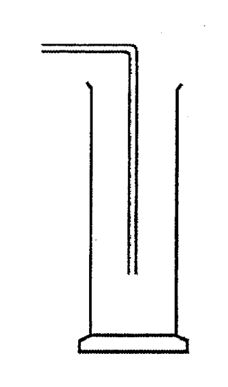

　　(i)　原因：

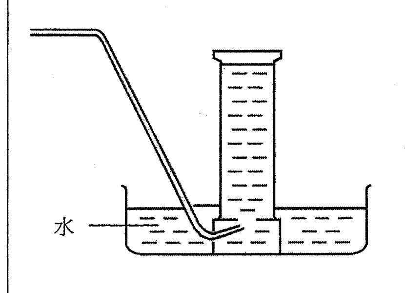

　　(ii)　原因：（2 分）

(c)　進行了一個實驗以研習當把稀 H₂SO₄(aq) 徐徐加進一固定體積的稀 Ba(OH)₂(aq) 時所生成混合物的電導性的變化。以下坐標圖顯示這實驗的結果：

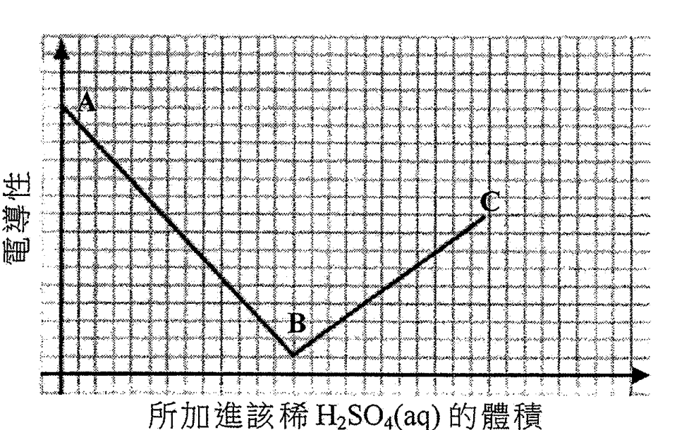

　　(i)　寫出當稀 H₂SO₄(aq) 加進稀 Ba(OH)₂(aq) 時的預期觀察。

　　(ii)　解釋以下各階段電導性的變化：

　　(1)　由 A 至 B

　　(2)　由 B 至 C（3 分）

---

## 第 2 題

【建議標籤】

- 卷別/部分：卷一乙　第一部分
- 課題：#銅 #鉛 #水管 #濃度換算

【題目內容】

用來輸送食水的水管通常是以銅而非鐵製造，雖然含鉛焊料可用來接合這些水管，但卻被禁止使用。

(a)　提出銅的一個化學性質使它比鐵更適合於製造水管，解釋你的答案。（2 分）

(b)　(i)　提出把鉛加進焊接物料的一項原因。

　　(ii)　解釋為什麼禁止以含鉛焊料接合這些水管。（2 分）

(c)　某城市規定食水中鉛離子的濃度不應超過 1.0 × 10⁻⁸ g cm⁻³。以 mol dm⁻³ 表示這濃度。（相對原子質量：Pb = 207.2）（2 分）

---

## 第 3 題

【建議標籤】

- 卷別/部分：卷一乙　第一部分
- 課題：#聚合 #官能基 #配位共價鍵

【題目內容】

回答以下各問題：

(a)　解釋為什麼丙烯能生成一聚合物，但丙烷不能。（1 分）

(b)　解釋為什麼 HO₂CCH₂CH₂CO₂H 能與 H₂N(CH₂)₆NH₂ 生成一聚合物，但 CH₃CH₂CO₂H 不能。（2 分）

(c)　以 H₃O⁺ 為例，描述配位共價鍵的形成。（3 分）

---

## 第 4 題

【建議標籤】

- 卷別/部分：卷一乙　第一部分
- 課題：#電解 #K₂SO₄ #酚酞 #電極

【題目內容】

下圖顯示一個裝置，以電解含酚酞指示劑的 1 M K₂SO₄(aq) 的無色溶液：

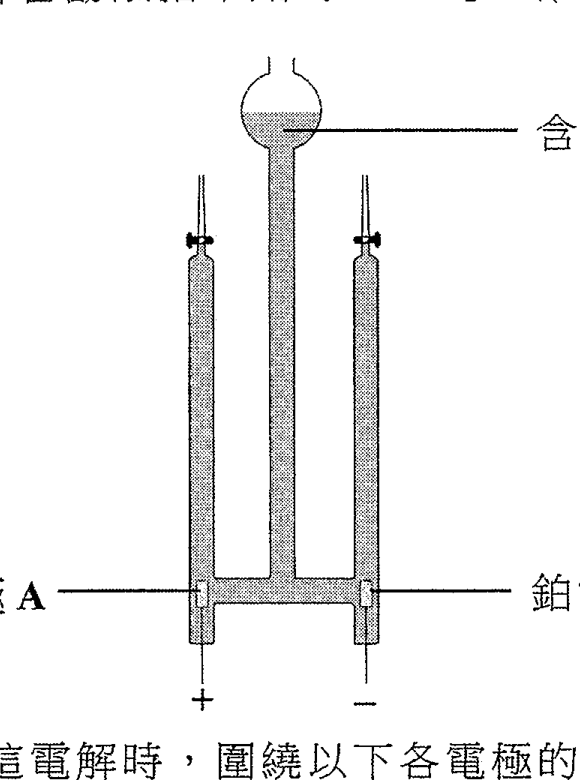

(a)　寫出並解釋在進行這電解時，圍繞以下各電極的預期觀察：

　　(i)　電極 A

　　(ii)　電極 B（3 分）

(b)　寫出這電解的總反應的方程式。（1 分）

(c)　如以 1 M H₂SO₄(aq) 取代該 1 M K₂SO₄(aq)，解釋在進行這電解時，圍繞以下各電極的預期觀察會否改變：

　　(i)　電極 A

　　(ii)　電極 B（3 分）

---

## 第 5 題

【建議標籤】

- 卷別/部分：卷一乙　第一部分
- 課題：#沸點 #分子間引力 #氫鍵

【題目內容】

解釋以下三個物質的沸點的遞增順序：

H₂ < F₂ < HF（3 分）

---

## 第 6 題

【建議標籤】

- 卷別/部分：卷一乙　第一部分
- 課題：#濃硫酸 #危險標籤 #滴定

【題目內容】

濃硫酸是實驗室中常見的試劑。

(a)　圈出兩個應張貼在濃硫酸瓶子上的危險警告標籤：

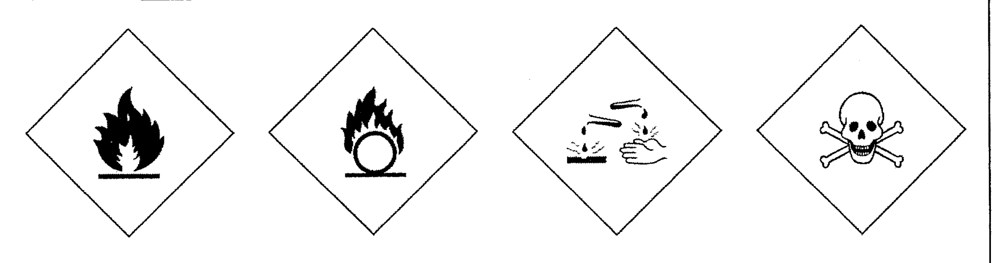

（1 分）

(b)　為測定一個濃硫酸樣本的濃度，把 5.00 cm³ 的該樣本以去離子水稀釋至 1000.0 cm³。用甲基橙為指示劑，把幾個 25.00 cm³ 等分的該稀釋樣本與 0.189 mol dm⁻³ NaOH(aq) 進行滴定，平均用 22.20 cm³ 的 NaOH(aq) 來達到終點。

　　(i)　解釋為什麼不應以 NaOH(aq) 直接滴定濃硫酸。

　　(ii)　寫出在滴定終點的顏色變化。

　　(iii)　計算該濃硫酸樣本的濃度（以 mol dm⁻³ 為單位）。（5 分）

(c)　輔以一化學方程式，寫出當熱濃硫酸與銅反應時的觀察。（2 分）

---

## 第 7 題

【建議標籤】

- 卷別/部分：卷一乙　第一部分
- 課題：#乙炔 #生成焓變 #赫斯定律

【題目內容】

乙炔是一氣體碳氫化合物，其分子式為 C₂H₂。

(a)　提出為什麼不能從實驗直接測定 C₂H₂(g) 的生成焓變。（1 分）

(b)　藉赫斯定律可找出不能從實驗直接測定的焓變。寫出赫斯定律。（1 分）

(c)　基於 C₂H₂(g)、C(石墨) 和 H₂(g) 的各燃燒焓變 ΔH，建構一個焓變循環和運用赫斯定律可求得 C₂H₂(g) 的生成焓變。

　　(i)　繪畫這焓變循環（附各標示）。

　　(ii)　C₂H₂(g)、C(石墨) 和 H₂(g) 的標準燃燒焓變 ΔH° 如下：

| | ΔH° / kJ mol⁻¹ |
|---|---|
| C₂H₂(g) | −1300 |
| C(石墨) | −394 |
| H₂(g) | −286 |

　　(1)　寫出「標準焓變」的各標準條件。

　　(2)　計算 C₂H₂(g) 的標準生成焓變。（5 分）

---

## 第 8 題

【建議標籤】

- 卷別/部分：卷一乙　第一部分
- 課題：#汽油 #二氧化碳 #一氧化碳 #全球暖化

【題目內容】

燃燒汽油增加大氣中二氧化碳的濃度，並可能促使全球暖化。燃燒汽油亦釋出有毒的空氣污染物。

(a)　為完全燃燒辛烷 C₈H₁₈（汽油內的一個成分）寫出一條化學方程式。（1 分）

(b)　繪出一個二氧化碳分子的電子圖（只需顯示最外層的電子）。（1 分）

(c)　為以下陳述給出一個支持的理由和一個反對的理由：

「由使用汽油驅動車輛轉為使用電動車輛可有助紓緩全球暖化。」

支持：

反對：（2 分）

(d)　一氧化碳是燃燒汽油所釋出的其中一種有毒的空氣污染物。於什麼條件下燃燒汽油會生成一氧化碳？（1 分）

(e)　(i)　寫出一個安裝於汽油驅動車輛以減少釋出一氧化碳的裝置名稱。

　　(ii)　提出一種不能被 (i) 的裝置移除的車輛廢氣中的空氣污染物。（2 分）

---

## 第 9 題

【建議標籤】

- 卷別/部分：卷一乙　第一部分
- 課題：#有機辨識 #醇 #酮 #羧酸

【題目內容】

*四個缺了標籤的試劑瓶各盛載下列其中一種無色液體：

HOCH₂CH₂CH₂OH　CH₃COCH₃　CH₃CH₂CO₂H　CH₂=CHCH₂OH

建議各化學測試以分辨這四種液體。（5 分）

---

## 第二部分（第 10–14 題）

## 第 10 題

【建議標籤】

- 卷別/部分：卷一乙　第二部分
- 課題：#過氧化氫 #分解 #氣體體積 #反應速率

【題目內容】

在一個如下圖所示於室內條件下進行的實驗中，5.00 cm³ 的 H₂O₂(aq) 在有催化劑的存在下分解成 O₂(g) 和 H₂O(l)。從實驗開始一直有 O₂(g) 釋出，至第三分鐘時共收集到 60 cm³ 的氣體。此後，再也收集不到更多氣體。

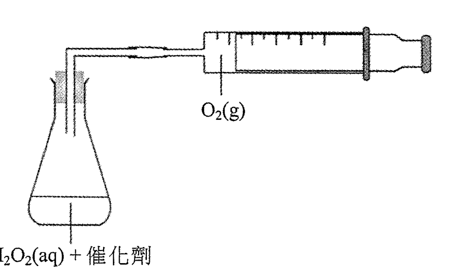

(a)　計算該 H₂O₂(aq) 的起始濃度（以 mol dm⁻³ 為單位）。（在室內條件，氣體的摩爾體積 = 24 dm³）（2 分）

(b)　在以下坐標圖，草繪在首 4 分鐘所收集到氣體的體積隨時間的變化：

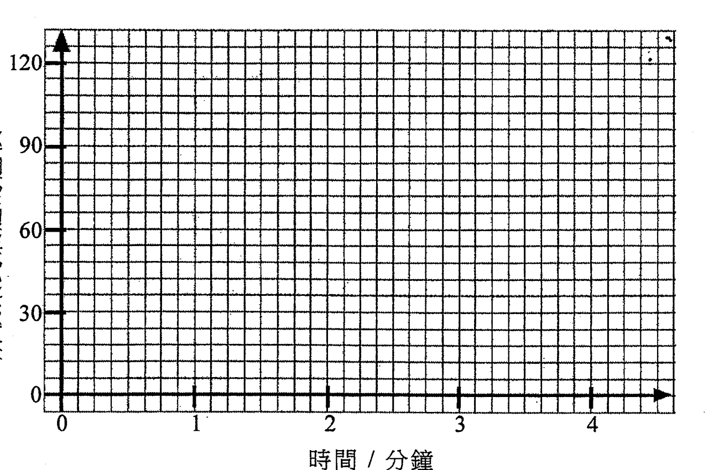

（2 分）

(c)　用在較高溫的 H₂O₂(aq) 重複這實驗，但其他條件保持不變。解釋所得氣體的總體積會否仍是 60 cm³。（氣體的體積乃於室內條件下量度。）（1 分）

(d)　建議另一個可用來跟隨這反應進度的方法。（1 分）

---

## 第 11 題

【建議標籤】

- 卷別/部分：卷一乙　第二部分
- 課題：#4-硝基酚 #酸鹼指示劑 #電離平衡

【題目內容】

以下方程式顯示 4-硝基酚在水中的電離：

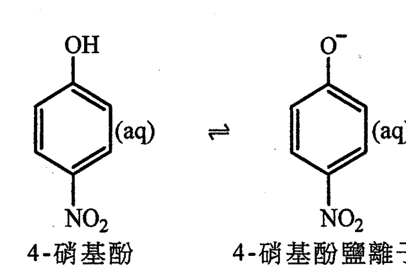

在 25°C，該電離的平衡常數 Ka 為 8.0 × 10⁻⁸ mol dm⁻³。

(a)　寫出 Ka 的表達式。（可用 HA 來代表 4-硝基酚，並用 A⁻ 來代表 4-硝基酚鹽離子。）（1 分）

(b)　[?] 4-硝基酚水溶液的 pH 為 2.4。計算在這溶液中 4-硝基酚與 4-硝基酚鹽離子的濃度比。（2 分）

(c)　提出當把 NaOH(aq) 徐徐加進 (b) 的溶液時會否有任何顏色改變，解釋你的答案。（2 分）

(d)　建議 4-硝基酚在酸-鹼滴定實驗中的一個可能用途。（1 分）

---

## 第 12 題

【建議標籤】

- 卷別/部分：卷一乙　第二部分
- 課題：#有機轉化 #旋光性 #手性中心

【題目內容】

考慮以下各轉化：

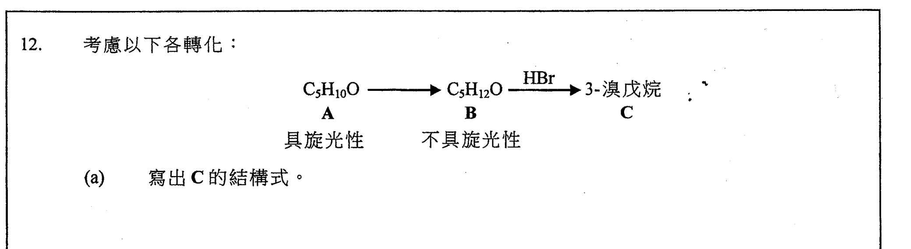

(a)　寫出 C 的結構式。（1 分）

(b)　(i)　推定 B 的結構式。

　　(ii)　寫出由 B 至 C 的轉化的反應類別名稱。（3 分）

(c)　(i)　推定 A 的結構式，在這結構式上用 * 標示所有手性中心（如有一個或多個）。

　　(ii)　寫出由 A 至 B 的轉化所需的試劑（一個或多個）。（3 分）

---

## 第 13 題

【建議標籤】

- 卷別/部分：卷一乙　第二部分
- 課題：#合成路線 #醇 #有機轉化

【題目內容】

*概述一條不多於三個步驟的合成路線來完成以下的轉化。寫出每一步驟的試劑（一個或多個）、反應條件（如適用）及有機生成物的結構：

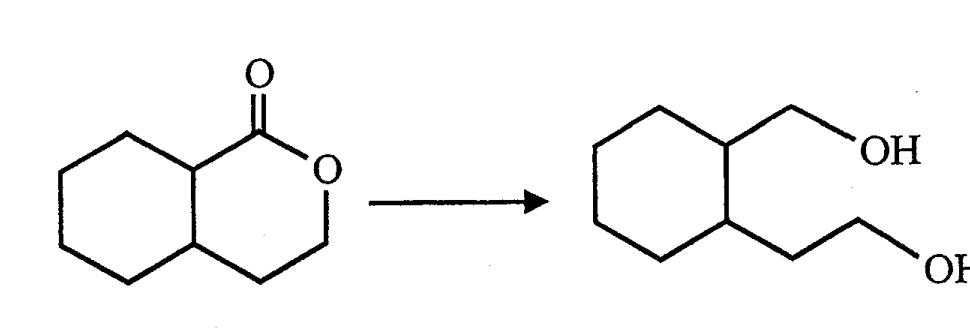

（3 分）

---

## 第 14 題

【建議標籤】

- 卷別/部分：卷一乙　第二部分
- 課題：#過渡金屬 #錳 #氧化還原 #反應速率

【題目內容】

*於 60°C，MnO₄⁻(aq) 在酸性介質中與 C₂O₄²⁻(aq) 反應得出 Mn²⁺(aq)、CO₂(g) 和 H₂O(l)。以下坐標圖顯示該反應混合物的顏色強度隨時間的變化：

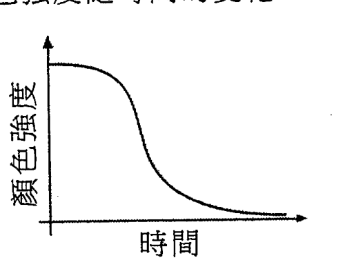

基於以上資料，寫出該反應的化學方程式，並說明錳所展示的三個過渡性金屬的特性。（6 分）

---

*試卷完 —*

## 待人工核對

本卷為第 2 層文字交貨，由 easyocr（ch_tra+en，GPU）掃描底稿清洗而成；現模型無影像輸入，未能對頁影像覆核。以下題號建議第 3 層精修時對頁覆核：

- 第 1 題：「鋇」（OCR 讀作「銳」）、「第 II 族」（OCR 讀「第I族」）及兩個氣體收集裝置圖待對頁核實。
- 第 2 題：鉛離子濃度「1.0 × 10⁻⁸ g cm⁻³」待對頁核實。
- 第 3 題：HO₂CCH₂CH₂CO₂H（OCR「HO C CHzACOoH」）及 H₂N(CH₂)₆NH₂（OCR「HlCHodl啞」）待對頁核實。
- 第 6 題：「圈出兩個」（OCR「圈出面個」）、滴定體積 22.20 cm³（OCR「722.20」）及警告標籤圖待對頁核實。
- 第 7 題：「乙炔」（OCR「二炊」）及 ΔH° 數值表待對頁核實。
- 第 8 題：辛烷 C₈H₁₈（OCR「C Hi」）待對頁核實。
- 第 9 題：四個液體結構式（HOCH₂CH₂CH₂OH／CH₃COCH₃／CH₃CH₂CO₂H／CH₂=CHCH₂OH）待對頁核實。
- 第 11 題：(b) 題幹 OCR 嚴重亂碼，已標 [?] 待對頁核實；電離結構圖為截圖。
- 第 12 題：轉化結構（A→B→C，具旋光性／不具旋光性）及分子式待對頁核實；結構為截圖。
- 第 1、4、6、10、11、12、13、14 題：圖為 300dpi 原卷截圖（程式定位＋墨跡覆蓋率校驗；位置／範圍待 spot-check）；第 3 層再換成向量重繪。

(End of file - total 325 lines)
