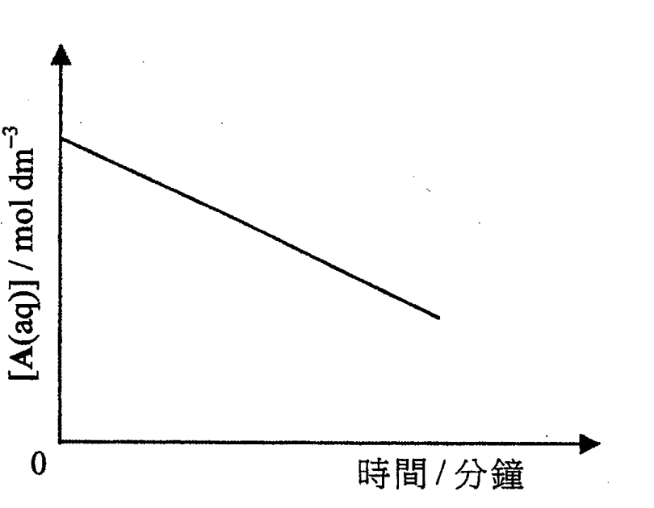
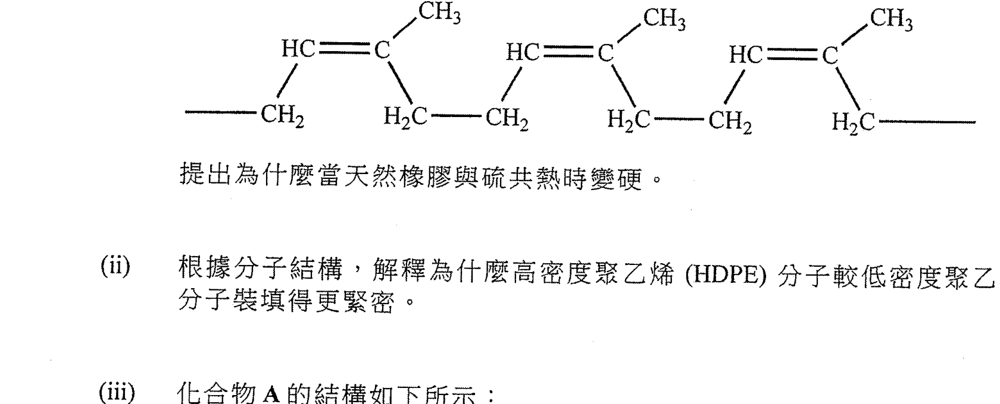
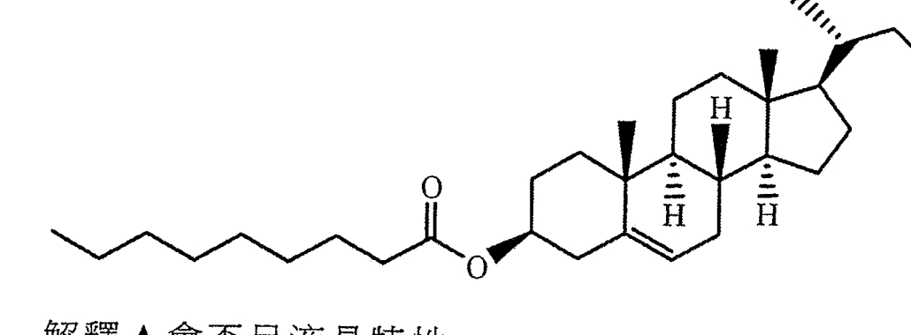
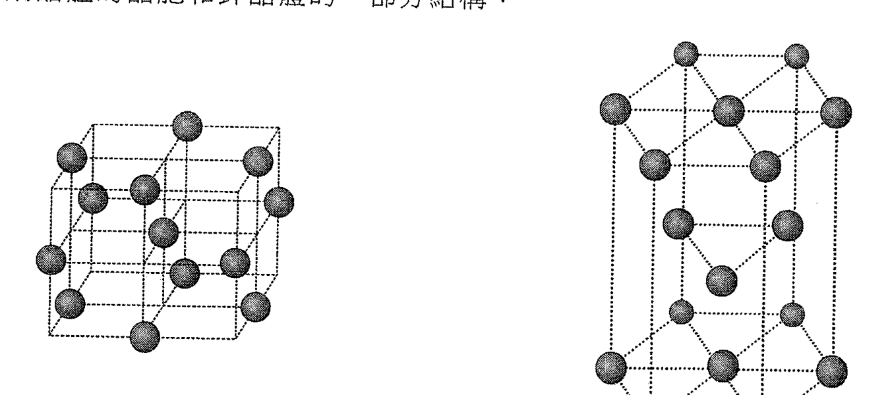
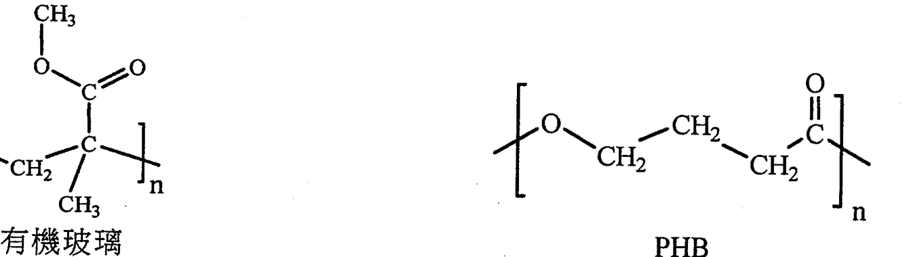
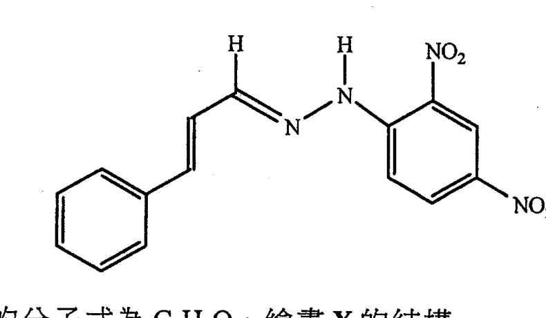
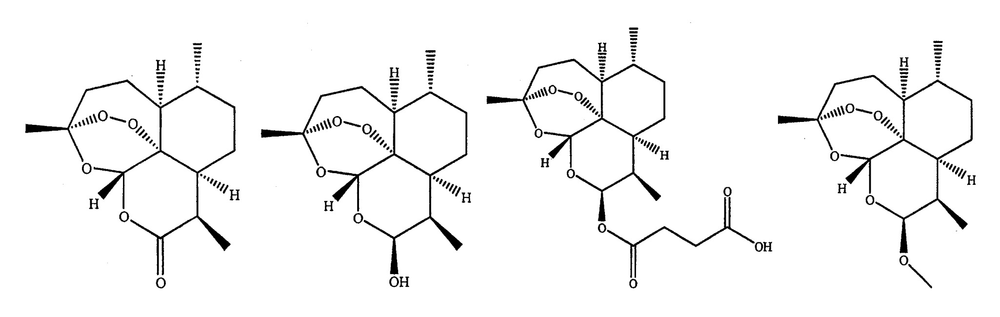

# 2017 DSE 化學 卷二（中文卷）— 題目庫

> 來源：文憑試 DSE 化學 Chemistry 2017 歷屆試題 Past Paper 卷二.pdf　｜　三部分：甲部 工業化學、乙部 物料化學、丙部 分析化學（每部分一題）
> 本試卷共有甲、乙和丙三部。考生須選答任何兩部中的全部試題。
> 說明：已移除頁碼、試卷標頭等雜訊；化學式以 Unicode 下標／上標表示，反應式以 → 或 ⇌ 表示。**本檔為題目庫（零答案）**，只含題目清洗 + 建議標籤。
> 本檔為第 2 層文字交貨（圖用原卷截圖；精修重繪另開第 3 層）。

---

## 甲部　工業化學（第 1 題）

## 第 1 題

【建議標籤】

- 卷別/部分：卷二　甲部
- 課題：#哈柏法 #硫酸工業 #催化劑 #光氣 #流汞電解池 #反應級數

【題目內容】

回答試題的所有部分。

(a)　回答以下短問題。

　　(i)　考慮哈柏法：

　　　(1)　寫出該反應的化學方程式。

　　　(2)　建議可怎樣從所得反應混合物把氨分離出來。（2 分）

　　(ii)　以下坐標圖顯示在一固定溫度下，某反應中的反應物 A(aq) 的濃度隨時間的變化：

提出對應 A(aq) 的反應級數，並加以解釋。（2 分）

　　(iii)　提出在化工廠中儲存甲醇的一項潛在危險。（1 分）

(b)　製造硫酸涉及以下從 SO₂(g) 到 SO₃(g) 的轉化：

2SO₂(g) + O₂(g) ⇌ 2SO₃(g)　ΔH = −197 kJ mol⁻¹

氮氧化物（NO 和 NO₂）曾一度被用作這轉化的催化劑，而該催化過程被視為包含以下兩個步驟：

SO₂(g) + NO₂(g) → SO₃(g) + NO(g)

2NO(g) + O₂(g) → 2NO₂(g)

　　(i)　在同一草圖上，為以上的轉化繪畫兩個附標示的能線圖（x-軸：反應坐標；y-軸：勢能）：一個以氮氧化物為催化劑（用虛線 −−），另一個沒有催化劑（用實線 ──）。（3 分）

　　(ii)　目前在工業上，是用一固體催化劑氧化釩(V)來進行從 SO₂(g) 到 SO₃(g) 的轉化。

　　　(1)　該些反應物須先經淨化方通入盛有該催化劑的反應室。為什麼？

　　　(2)　操作條件設定為 450°C 和 1 atm 以達致 96% 轉化。提出為什麼不宜藉以下各方法來進一步提升轉化百分率：

　　　(I)　降低反應系統的溫度

　　　(II)　增加反應系統的壓強

　　　(3)　為提升轉化百分率，其中一個所用的反應物為稍微過量。從原料的角度考慮，SO₂(g) 抑或 O₂(g) 會是稍微過量？解釋你的答案。（4 分）

(c)　光氣 COCl₂ 是一重要化學品。它可從 CO(g) 和 Cl₂(g) 的反應製得：

CO(g) + Cl₂(g) ⇌ COCl₂(g)

　　(i)　寫出一化學方程式以顯示怎樣可從天然氣獲取 CO(g)。（1 分）

　　(ii)　氯可藉流汞電解池過程製得。

　　　(1)　寫出在陽極所發生變化的半反應式。

　　　(2)　寫出在陰極所發生變化的半反應式。

　　　(3)　解釋為什麼流汞電解池過程已逐漸被淘汰。（3 分）

　　(iii)　在某溫度下，如果把 CO(g) 的濃度變成原來的兩倍，而 Cl₂(g) 的濃度維持不變，新的反應速率將會變成原本速率的 2.83 倍。推定對應 CO(g) 的反應級數。（注意：反應的級數不一定是整數。）（2 分）

　　(iv)　分別解釋為什麼以上製得 COCl₂(g) 的過程可被視為 (1)「綠色」，或 (2) 非綠色。（2 分）

---

## 乙部　物料化學（第 2 題）

## 第 2 題

【建議標籤】

- 卷別/部分：卷二　乙部
- 課題：#天然橡膠 #聚乙烯 #液晶 #晶體結構 #有機玻璃 #PHB #縮合

【題目內容】

回答試題的所有部分。

(a)　回答以下短問題。

　　(i)　天然橡膠的部分結構如下所示：

提出為什麼當天然橡膠與硫共熱時變硬。（2 分）

　　(ii)　根據分子結構，解釋為什麼高密度聚乙烯（HDPE）分子較低密度聚乙烯（LDPE）分子裝填得更緊密。（1 分）

　　(iii)　化合物 A 的結構如下所示：

解釋 A 會否呈液晶特性。（2 分）

(b)　下圖顯示銅晶體的晶胞和鋅晶體的一部分結構：

　　(i)　參考銅晶體的晶胞：

　　　(1)　寫出銅原子的配位數。

　　　(2)　推定在晶胞中銅原子的數目。（2 分）

　　(ii)　參考鋅晶體的該部分結構：

　　　(1)　寫出這類裝填的名稱。

　　　(2)　寫出銅晶體和鋅晶體的裝填的一項相似之處。

　　　(3)　討論銅晶體和鋅晶體的裝填的相異之處。（4 分）

　　(iii)　寫出能用來製造水龍頭的一種含有銅和鋅的合金的名稱。（1 分）

(c)　下圖顯示有機玻璃和聚羥基丁酸酯（PHB）的結構：

　　(i)　繪出有機玻璃的單體的結構，並寫出這單體的天然原料。（2 分）

　　(ii)　以下哪一項可由有機玻璃製成？雨衣、隱形眼鏡、釣魚絲、食物保鮮紙（1 分）

　　(iii)　PHB 是一種熱塑性生物聚合物料。

　　　(1)　「熱塑性」一詞是什麼意思？

　　　(2)　基於 PHB 是生物聚合物料的事實，分別解釋為什麼它的生產和棄置可被視為對環境友善。（3 分）

　　(iv)　PHB 可歸類為聚酯。

　　　(1)　聚酯的生成常涉及縮合作用。寫出縮合作用的一個特徵。

　　　(2)　基於 PHB 含有酯鍵合的事實，解釋為什麼它的棄置可被視為對環境友善。（2 分）

---

## 丙部　分析化學（第 3 題）

## 第 3 題

【建議標籤】

- 卷別/部分：卷二　丙部
- 課題：#離子辨識 #二氧化硫 #羥基胺 #滴定 #回流加熱 #蒸餾 #青蒿素 #紅外光譜

【題目內容】

回答試題的所有部分。

(a)　回答以下短問題：

　　(i)　建議一項測試以分辨鈉離子和鉀離子。（2 分）

　　(ii)　建議一項化學測試以檢測二氧化硫氣體。（2 分）

　　(iii)　某有機化合物 X 與 2,4-二硝基苯肼反應生成一黃色固體 Z。Z 的結構如下所示：

已知 X 的分子式為 C₇H₈O。繪畫 X 的結構。（1 分）

(b)　在酸性條件下，羥基胺 HONH₂ 與 Fe³⁺(aq) 離子反應的生成物包含 Fe²⁺(aq) 離子和一個氮的氧化物。進行了包括以下兩個步驟的實驗，以推定該氧化物中 N 的氧化數。

步驟 (1)：把一個含 0.875 g 的 HONH₂ 和過量 Fe₂(SO₄)₃ 的水溶液在酸性條件下加熱直至反應完成，繼而把所得溶液稀釋至 250.0 cm³。

步驟 (2)：以過量 H₂SO₄(aq) 把 25.00 cm³ 的該經稀釋溶液酸化，接著與 0.0282 mol dm⁻³ KMnO₄(aq) 進行滴定直至達到終點。所涉及反應的化學方程如下：

MnO₄⁻(aq) + 5Fe²⁺(aq) + 8H⁺(aq) → Mn²⁺(aq) + 5Fe³⁺(aq) + 4H₂O(l)

　　(i)　寫出在滴定終點的顏色變化。（1 分）

　　(ii)　進行了四次滴定，其結果如下所列：

| 次數 | 1 | 2 | 3 | 4 |
|---|---|---|---|---|
| 所用 KMnO₄(aq) 的體積 / cm³ | 38.34 | 37.62 | 31.58 | 37.60 |

　　　(1)　計算在滴定中所用 KMnO₄(aq) 的合理平均體積。

　　　(2)　基於該實驗結果，計算在步驟 (1) 中為使反應完成所需的 HONH₂(aq) 與 Fe³⁺(aq) 的摩爾比。

　　　(3)　已知在 HONH₂ 中 N 的氧化數是 −1，並且 H 和 O 的氧化數保持不變，推定該氧化物中 N 的氧化數。（6 分）

　　(iii)　根據 (ii)(3)，提出該氧化物的合理實驗式。（1 分）

(c)　很多植物均含有用的有機化合物，藉適當的溶劑可把這些化合物萃取。某植物的葉子含一有用的有機化合物 S，S 可緩緩地溶於某一暖和的有機溶劑，並可藉這溶劑從該葉子萃取出來。

　　(i)　「回流加熱」是進行這類萃取的一個常用的方法。寫出這方法的優點。（2 分）

　　(ii)　經萃取後，可藉簡單蒸餾把萃取液中的溶劑除掉。繪畫一標示圖以顯示這簡單蒸餾所需的裝置。（3 分）

　　(iii)　從萃取所得的 S 可能含其他有機雜質。建議一個把 S 從這些雜質分離出來的方法。（4 分）

(d)　青蒿素是一個從某種植物獲得的有機化合物。青蒿素不能與 NaHCO₃(aq) 起反應。它的紅外光譜約在 1700 cm⁻¹ 處顯示一強吸收峰。提出下面 W、X、Y 和 Z 中哪一個會是青蒿素的可能結構，解釋你的答案。

| 鍵合 | 化合物類別 | 波數域 / cm⁻¹ |
|---|---|---|
| C=C | 烯 | 1610 至 1680 |
| C=O | 醛、酮、羧酸及其衍生物 | 1680 至 1800 |
| C≡C | 炔 | 2070 至 2250 |
| C≡N | 腈 | 2200 至 2280 |
| O–H | 帶「氫鍵」的酸 | 2500 至 3300 |
| C–H | 烷、烯及芳烴 | 2840 至 3095 |
| O–H | 帶「氫鍵」的醇 | 3230 至 3670 |
| N–H | 胺 | 3350 至 3500 |

（3 分）

---

*試卷完 —*

## 待人工核對

本卷為第 2 層文字交貨，由 easyocr（ch_tra+en，GPU）掃描底稿清洗而成；現模型無影像輸入，未能對頁影像覆核。以下題號建議第 3 層精修時對頁覆核：

- 第 1(b) 題：反應步驟「SO₂(g) + NO₂(g) → SO₃(g) + NO(g)」及「2NO(g) + O₂(g) → 2NO₂(g)」待對頁核實。
- 第 1(b)(ii) 題：「氧化釩(V)」（OCR「氧化釦」）、操作條件 450°C 待對頁核實。
- 第 1(c) 題：「光氣 COCl₂」及流汞電解池步驟待對頁核實。
- 第 3(a)(iii) 題：X 分子式 C₇H₈O（OCR「CoH0」）待對頁核實。
- 第 3(b) 題：HONH₂ 分子式、0.875 g、滴定方程式及 KMnO₄ 體積表待對頁核實。
- 第 3(c)/(d) 題：小題編號（青蒿素一節 OCR 讀作「(ii)」，暫列為 (d)）待對頁核實；青蒿素結構 W/X/Y/Z 為截圖。
- 第 1(a)(ii)、2(a)(i)、2(a)(iii)、2(b)、2(c)、3(a)(iii)、3(d) 題：圖為 300dpi 原卷截圖（程式定位＋墨跡覆蓋率校驗；位置／範圍待 spot-check）；第 3 層再換成向量重繪。

(End of file - total 260 lines)
