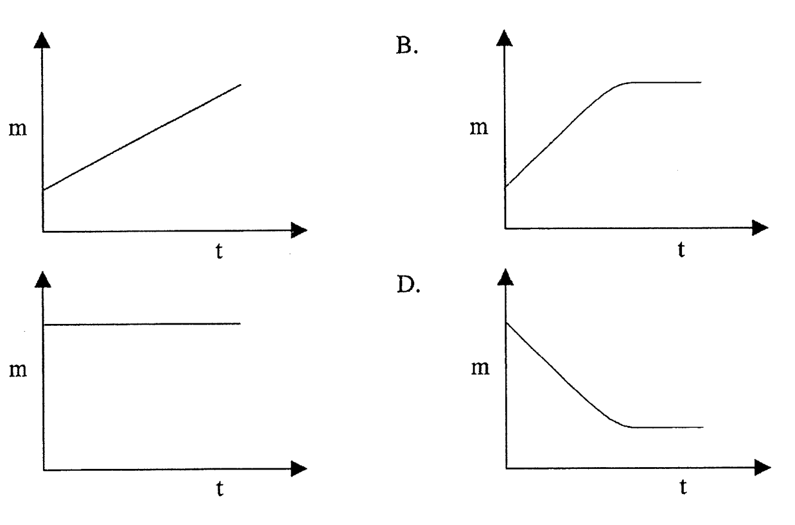
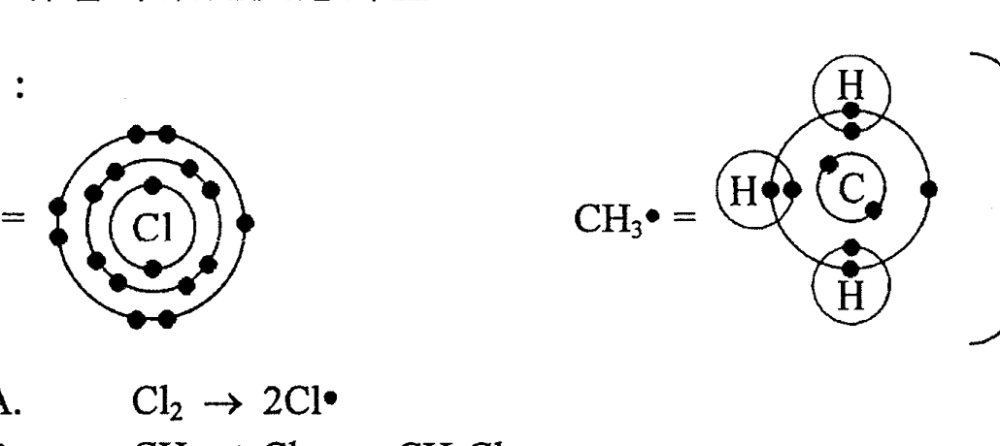
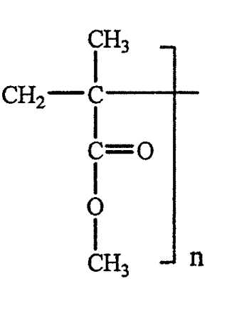
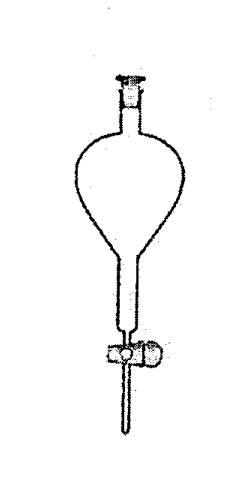
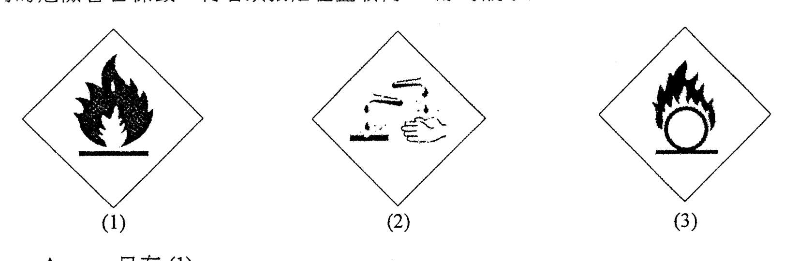
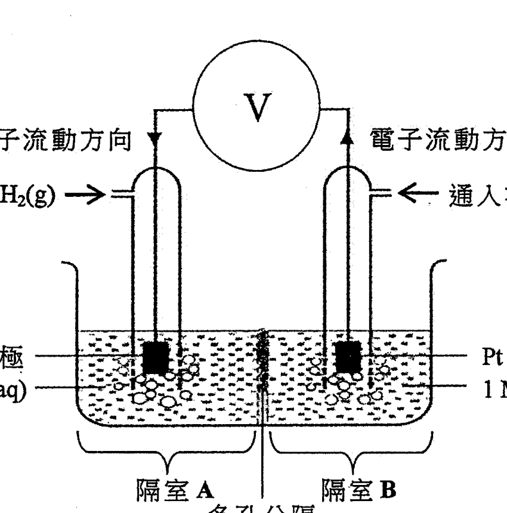
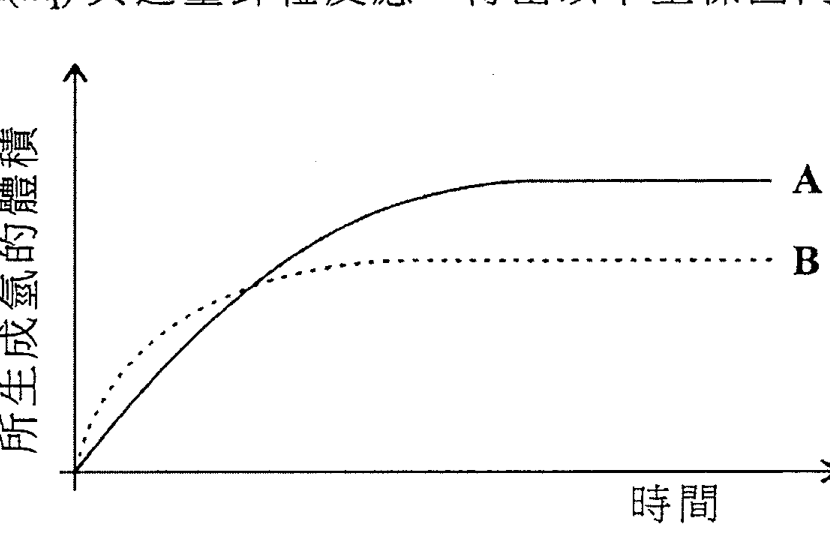
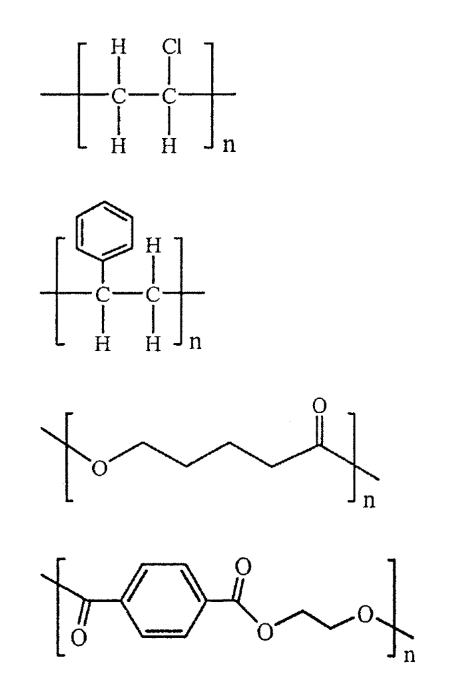
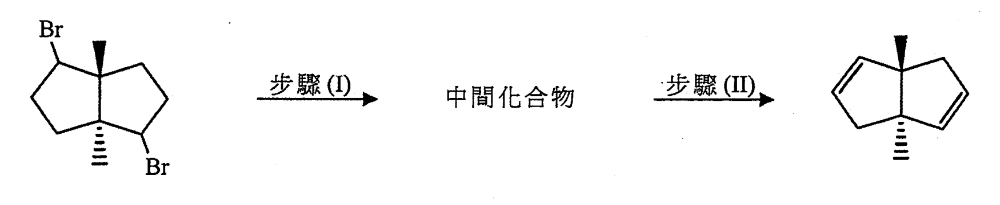
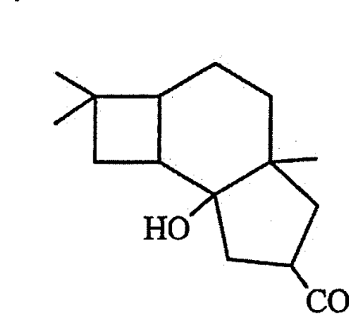

# 2018 DSE 化學 卷一甲（中文卷）— 題目庫

> 來源：文憑試 DSE 化學 Chemistry 2018 歷屆試題 Past Paper 卷一.pdf　｜　多項選擇題 36 題（第一部分 24 題、第二部分 12 題）
> 本部包括兩部分：第一部分設 24 題，第二部分設 12 題。選出每題最佳的答案。考生可參考印於試題答題簿 B 第 20 頁的周期表。
> 說明：已移除頁碼、試卷標頭等雜訊；化學式以 Unicode 下標／上標表示，反應式以 → 或 ⇌ 表示。**本檔為題目庫（零答案）**，只含題目清洗 + 建議標籤。
> 本檔為第 2 層文字交貨（圖用原卷截圖；精修重繪另開第 3 層）。

---

## 第一部分（第 1–24 題）

## 第 1 題

【建議標籤】

- 卷別/部分：卷一甲　第一部分
- 課題：#海水 #氯化鈉 #提取 #結晶

【題目內容】

下列哪過程最適用於從海水提取氯化鈉？

- A. 電解
- B. 結晶
- C. 簡單蒸餾
- D. 分餾

---

## 第 2 題

【建議標籤】

- 卷別/部分：卷一甲　第一部分
- 課題：#氣體狀態 #分子間引力 #八隅體

【題目內容】

於常溫常壓下氖以氣體存在是因為

- A. 氖是化學惰性的
- B. 氖分子是單原子的
- C. 氖原子間的引力弱
- D. 氖原子最外電子層具八隅體結構

---

## 第 3 題

【建議標籤】

- 卷別/部分：卷一甲　第一部分
- 課題：#氧化銀 #熱分解 #質量-時間圖

【題目內容】

把某質量的 Ag₂O(s) 樣本在試管內強熱。下列何者顯示從加熱開始，試管內含物的質量 (m) 與時間 (t) 的關係？

- A.
- B.
- C.
- D.

---

## 第 4 題

【建議標籤】

- 卷別/部分：卷一甲　第一部分
- 課題：#摩爾計算 #分子數目 #氣體

【題目內容】

若 8.0 g 的二氧化硫氣體含 n 個分子，那麼 2.0 g 的氧氣含多少個分子？

（相對原子質量：O = 16.0，S = 32.0）

- A. 2.0 n
- B. 4.0 n
- C. 0.25 n
- D. 0.50 n

---

## 第 5 題

【建議標籤】

- 卷別/部分：卷一甲　第一部分
- 課題：#石英 #乾冰 #巨型共價結構 #分子結構

【題目內容】

石英（SiO₂）較乾冰（CO₂）堅硬是因為

- A. 硅的原子半徑較碳的為大
- B. 硅原子較碳原子具更多電子
- C. 石英具巨型網絡結構，但乾冰含個別分子
- D. 在石英中的硅–氧鍵是強的；但在乾冰中的碳–氧鍵是弱的

---

## 第 6 題

【建議標籤】

- 卷別/部分：卷一甲　第一部分
- 課題：#氫氧化物沉澱 #硫酸鋅 #硝酸鉛 #硫酸鐵

【題目內容】

把稀氫氧化鈉溶液加入某 0.1 M 溶液中直至過量。下列哪組合正確？

| | A | B | C | D |
|---|---|---|---|---|
| 溶液 | 硫酸鋅 | 硝酸鈣 | 硝酸鉛(II) | 硫酸鐵(II) |
| 觀察 | 生成白色沉澱 | 生成白色沉澱 | 生成黃色沉澱 | 生成污綠色沉澱 |

---

## 第 7 題

【建議標籤】

- 卷別/部分：卷一甲　第一部分
- 課題：#鐵 #鎂 #金屬性質 #延性

【題目內容】

下列哪有關鐵和鎂的陳述正確？

- A. 鐵具延性，但鎂則否
- B. 鐵比鎂較不容易腐蝕
- C. 鎂在地殼的豐度較鐵的為高
- D. 鎂和鐵在牠們的氧化物中皆可具多於一個氧化數

---

## 第 8 題

【建議標籤】

- 卷別/部分：卷一甲　第一部分
- 課題：#烷酸 #羧酸 #分子式

【題目內容】

下列哪個分子式可代表烷酸？

- A. CH₂O
- B. C₂H₄O₂
- C. CH₄O₂
- D. C₄H₁₀O₂

---

## 第 9 題

【建議標籤】

- 卷別/部分：卷一甲　第一部分
- 課題：#金屬活性序 #氧化物熱分解 #氫氯酸

【題目內容】

X、Y 和 Z 是不同金屬。當把牠們分別放入 HCl(aq) 時，只有 Y 釋出無色氣泡。當把牠們的氧化物逐一強熱時，只有 X 的氧化物釋出無色氣體。下列何者顯示這三種金屬活性的遞減次序？

- A. Y > Z > X
- B. X > Y > Z
- C. Y > X > Z
- D. Z > Y > X

---

## 第 10 題

【建議標籤】

- 卷別/部分：卷一甲　第一部分
- 課題：#銅 #濃硫酸 #硝酸 #反應

【題目內容】

下列哪試劑不與銅起反應？

- A. 2 M H₂SO₄
- B. 2 M HNO₃
- C. 16 M H₂SO₄
- D. 16 M HNO₃

---

## 第 11 題

【建議標籤】

- 卷別/部分：卷一甲　第一部分
- 課題：#酸鹼 #pH #中和 #稀釋

【題目內容】

考慮下列 W、X、Y 和 Z 等溶液：

W：100 cm³ 的 0.20 M H₂SO₄(aq)

X：50 cm³ 的 0.20 M HCl(aq)

Y：100 cm³ 的 0.20 M CH₃COOH(aq)

Z：50 cm³ 的 0.10 M NaOH(aq)

下列哪陳述正確？

- A. Y 的 pH 等於 −log 0.2
- B. 把 W 和 Z 混合後得出一中性溶液
- C. W 和 X 的混合物的 pH 較 W 的為低
- D. W 和 X 的混合物的 pH 較 X 和 Y 的混合物的為低

---

## 第 12 題

【建議標籤】

- 卷別/部分：卷一甲　第一部分
- 課題：#氧化還原 #氧化數

【題目內容】

下列何者不是氧化還原反應？

- A. 2Mg + SO₂ → 2MgO + S
- B. CaCO₃ + SiO₂ → CaSiO₃ + CO₂
- C. Cu₂O + H₂SO₄ → CuSO₄ + Cu + H₂O
- D. 3CuS + 8HNO₃ → 3CuSO₄ + 8NO + 4H₂O

---

## 第 13 題

【建議標籤】

- 卷別/部分：卷一甲　第一部分
- 課題：#自由基取代 #鏈反應 #終止步驟

【題目內容】

以下反應涉及數個步驟：

CH₄(g) + Cl₂(g) →（日光）→ CH₃Cl(g) + HCl(g)

下列哪步驟會導致這反應終止？

- A. Cl₂ → 2Cl·
- B. CH₄ + Cl· → CH₃Cl + H·
- C. CH₃· + Cl· → CH₄ + HCl
- D. CH₃· + Cl₂ → CH₃Cl + Cl·

---

## 第 14 題

【建議標籤】

- 卷別/部分：卷一甲　第一部分
- 課題：#加成聚合 #聚合物 #單體

【題目內容】

某聚合物具以下結構：

下列哪有關這聚合物的陳述正確？

- A. 牠是聚酯
- B. 牠可從 CH₂=CHCO₂CH₃ 聚合出來
- C. 牠的單體可使酸化 KMnO₄(aq) 變成無色
- D. 牠可從其單體經縮合反應而製成

---

## 第 15 題

【建議標籤】

- 卷別/部分：卷一甲　第一部分
- 課題：#分離混合物 #分液漏斗

【題目內容】

下圖顯示一儀器：

這儀器可把以下哪個混合物分離？

- A. 岩鹽和砂粒
- B. 丙-2-醇和水
- C. 己烷（C₆H₁₄）和水
- D. 甲酸和二酸

---

## 第 16 題

【建議標籤】

- 卷別/部分：卷一甲　第一部分
- 課題：#分子極性 #VSEPR

【題目內容】

下列的分子，何者是非極性？

(1) BCl₃

(2) PCl₃

(3) CHCl₃

- A. 只有 (1)
- B. 只有 (2)
- C. 只有 (1) 和 (3)
- D. 只有 (2) 和 (3)

---

## 第 17 題

【建議標籤】

- 卷別/部分：卷一甲　第一部分
- 課題：#水 #冰 #密度 #氫鍵

【題目內容】

下列的陳述，何者正確？

(1) H₂O(l) 的密度較 H₂O(g) 的為低

(2) 當冰變成水時，冰的開放結構崩塌

(3) 當水的溫度由 10°C 上升至 30°C 時，H₂O 分子間的平均距離增加

- A. 只有 (1)
- B. 只有 (2)
- C. 只有 (1) 和 (3)
- D. 只有 (2) 和 (3)

---

## 第 18 題

【建議標籤】

- 卷別/部分：卷一甲　第一部分
- 課題：#標準生成焓變 #燃燒焓變 #水的分解

【題目內容】

考慮下面的資料：

2H₂O(l) → 2H₂(g) + O₂(g)　ΔH° = +X kJ mol⁻¹

下列的陳述，何者正確？

(1) H₂O(l) 的標準生成焓變是 −0.5X kJ mol⁻¹

(2) H₂O(l) 的標準生成焓變是 +0.5X kJ mol⁻¹

(3) H₂(g) 的標準燃燒焓變是 −X kJ mol⁻¹

- A. 只有 (1)
- B. 只有 (2)
- C. 只有 (1) 和 (3)
- D. 只有 (2) 和 (3)

---

## 第 19 題

【建議標籤】

- 卷別/部分：卷一甲　第一部分
- 課題：#大理石 #石灰水 #熱分解 #二氧化碳

【題目內容】

在一實驗中，把大理石放在大試管內加熱，並把所釋出的氣體通進有石灰水的試管內。以下有關這實驗的陳述，何者正確？

(1) 大理石在加熱時變磚紅色

(2) 石灰水初時變乳濁，但最終變為無色溶液

(3) 若把大理石換成白堊，可得到相似的觀察

- A. 只有 (1)
- B. 只有 (2)
- C. 只有 (1) 和 (3)
- D. 只有 (2) 和 (3)

---

## 第 20 題

【建議標籤】

- 卷別/部分：卷一甲　第一部分
- 課題：#危險警告標籤 #丙-2-醇 #易燃

【題目內容】

下列的危險警告標籤，何者須張貼在盛載丙-2-醇的瓶子上？

- A. 只有 (1)
- B. 只有 (2)
- C. 只有 (1) 和 (3)
- D. 只有 (2) 和 (3)

---

## 第 21 題

【建議標籤】

- 卷別/部分：卷一甲　第一部分
- 課題：#鋅碳電池 #電解質 #電極產物

【題目內容】

以下有關鋅-碳電池的陳述，何者不正確？

(1) 石墨棒是插在石墨粉和 MnO₂ 的混合物中

(2) 氫氧化鉀作為電解質

(3) 在陰極周圍生成氨

- A. 只有 (1)
- B. 只有 (2)
- C. 只有 (1) 和 (3)
- D. 只有 (2) 和 (3)

---

## 第 22 題

【建議標籤】

- 卷別/部分：卷一甲　第一部分
- 課題：#吸熱過程 #熔解 #裂解 #置換

【題目內容】

下列哪些過程是吸熱的？

(1) 蠟熔解

(2) 重油裂解

(3) 把鋅粉加進 CuSO₄(aq)

- A. 只有 (1) 和 (2)
- B. 只有 (1) 和 (3)
- C. 只有 (2) 和 (3)
- D. (1)、(2) 和 (3)

---

## 第 23 題

【建議標籤】

- 卷別/部分：卷一甲　第一部分
- 課題：#化學電池 #氫氧電池 #pH #還原劑

【題目內容】

考慮以下的化學電池：

下列哪些陳述正確？

(1) 在隔室 A 的溶液的 pH 逐漸下降

(2) 在隔室 B 的氫氣作為還原劑

(3) 總反應的方程式是 H⁺(aq) + OH⁻(aq) → H₂O(l)

- A. 只有 (1) 和 (2)
- B. 只有 (1) 和 (3)
- C. 只有 (2) 和 (3)
- D. (1)、(2) 和 (3)

---

## 第 24 題

【建議標籤】

- 卷別/部分：卷一甲　第一部分
- 課題：#酸鹼 #中和 #弱鹼 #摩爾數

【題目內容】

考慮下列各述句並選出最佳的答案：

第一述句：要完全中和 1 摩爾的 HCl(aq)，所需 NH₃(aq) 的摩爾數較所需 KOH(aq) 的摩爾數為多

第二述句：NH₃(aq) 是一個較 KOH(aq) 弱的鹼

- A. 兩述句均正確，而第二述句為第一述句的合理解釋
- B. 兩述句均正確，但第二述句並非第一述句的合理解釋
- C. 第一述句錯誤，但第二述句正確
- D. 兩述句均錯誤

---

## 第二部分（第 25–36 題）

## 第 25 題

【建議標籤】

- 卷別/部分：卷一甲　第二部分
- 課題：#反應速率 #鋅粒 #鋅粉 #坐標圖

【題目內容】

100 cm³ 的 1.0 M HCl(aq) 與過量鋅粒反應，得出以下坐標圖內的曲線 A。

下列哪改變可得出曲線 B？

- A. 把溫度升高 5°C
- B. 用相同質量的鋅粉代替鋅粒
- C. 用 200 cm³ 的 0.80 M HCl(aq) 代替 100 cm³ 的 1.0 M HCl(aq)
- D. 用 50 cm³ 的 1.50 M HCl(aq) 代替 100 cm³ 的 1.0 M HCl(aq)

---

## 第 26 題

【建議標籤】

- 卷別/部分：卷一甲　第二部分
- 課題：#平衡常數 #勒沙特列原理 #焓變

【題目內容】

考慮以下在某液體介質中於 25°C 時的平衡體系：

CH₃COCH₃ + HCN ⇌ (CH₃)₂C(OH)CN　ΔH > 0

下列哪陳述正確（假設這體系的總體積維持不變）？

- A. 加入 (CH₃)₂C(OH)CN 會令該平衡常數 Kc 增加
- B. 升高溫度會令 (CH₃)₂C(OH)CN 的濃度增加
- C. CH₃COCH₃ 的濃度必定等於 (CH₃)₂C(OH)CN 的濃度
- D. 加 HCN 後並當達致新的平衡時，HCN 的濃度會回復至加入 HCN 前的數值

---

## 第 27 題

【建議標籤】

- 卷別/部分：卷一甲　第二部分
- 課題：#聚合物 #排水管 #聚氯乙烯

【題目內容】

下列哪聚合物通常用來製造排水管？

- A.
- B.
- C.
- D.

---

## 第 28 題

【建議標籤】

- 卷別/部分：卷一甲　第二部分
- 課題：#沸點 #熔點 #周期趨勢

【題目內容】

下列哪陳述正確？

- A. 氬的沸點較氖的為低
- B. 氮的沸點較氧的為低
- C. 硅的熔點較鈉的為低
- D. 鋁的熔點較鎂的為低

---

## 第 29 題

【建議標籤】

- 卷別/部分：卷一甲　第二部分
- 課題：#平衡常數 #反應商數 #N₂O₄

【題目內容】

在 70°C 時，反應 N₂O₄(g) ⇌ 2NO₂(g) 的平衡常數 Kc 是 0.13 mol dm⁻³。在一個維持於 70°C 的 5.0 dm³ 密閉容器內，於某瞬間有一個 0.20 mol 的 N₂O₄(g) 和 0.30 mol 的 NO₂(g) 的混合物。在該瞬間，下列哪組合正確？

| | 反應商數 Qc / mol dm⁻³ | 反應速率 |
|---|---|---|
| A. | 0.09 | 逆向 > 正向 |
| B. | 0.09 | 正向 > 逆向 |
| C. | 0.45 | 逆向 > 正向 |
| D. | 0.45 | 正向 > 逆向 |

---

## 第 30 題

【建議標籤】

- 卷別/部分：卷一甲　第二部分
- 課題：#有機轉化 #鹵代烴 #消除反應

【題目內容】

考慮以下轉化：

下列哪組合可達致上述的轉化？

| | 步驟 I 中使用的試劑 | 步驟 II 中使用的試劑 |
|---|---|---|
| A. | 氨水 | 稀硫酸 |
| B. | 氫氧化鉀水溶液 | 稀硫酸 |
| C. | 氨水 | 濃硫酸 |
| D. | 氫氧化鉀水溶液 | 濃硫酸 |

---

## 第 31 題

【建議標籤】

- 卷別/部分：卷一甲　第二部分
- 課題：#縮合聚合物 #單體 #加成聚合

【題目內容】

下列的化合物，何者不能生成縮合聚合物？

(1) H₂N(CH₂)₅CO₂H

(2) CH₃CO₂CH=CH₂

(3) CH₃CH(OH)CO₂H

- A. 只有 (1)
- B. 只有 (2)
- C. 只有 (1) 和 (3)
- D. 只有 (2) 和 (3)

---

## 第 32 題

【建議標籤】

- 卷別/部分：卷一甲　第二部分
- 課題：#過渡金屬 #特徵 #催化 #變價

【題目內容】

下列的過程，何者可闡釋過渡金屬的特徵？

(1) 把 AgNO₃(aq) 和 NaCl(aq) 混合

(2) 把 FeSO₄(aq) 和 Br₂(aq) 混合

(3) 把 CuSO₄(aq) 和 H₂O(l) 混合

- A. 只有 (1)
- B. 只有 (2)
- C. 只有 (1) 和 (3)
- D. 只有 (2) 和 (3)

---

## 第 33 題

【建議標籤】

- 卷別/部分：卷一甲　第二部分
- 課題：#反應速率 #弱酸 #碳酸鈉 #熱效應

【題目內容】

考慮下列兩個反應：

| 反應 | 反應物 |
|---|---|
| (I) | 1.0 g 的 Na₂CO₃(s) + 100.0 cm³ 的 1.0 M HCl(aq) |
| (II) | 1.0 g 的 Na₂CO₃(s) + 100.0 cm³ 的 1.0 M CH₃COOH(aq) |

若該兩個反應均在相同的實驗條件下進行，下列哪些陳述正確？

（相對原子質量：C = 12.0，O = 16.0，Na = 23.0）

(1) 該兩個反應混合物的質量減少相同

(2) 反應 (I) 的初速較反應 (II) 的為高

(3) 該兩個反應所釋出的熱相同

- A. 只有 (1) 和 (2)
- B. 只有 (1) 和 (3)
- C. 只有 (2) 和 (3)
- D. (1)、(2) 和 (3)

---

## 第 34 題

【建議標籤】

- 卷別/部分：卷一甲　第二部分
- 課題：#肥皂 #表面活性劑 #酯

【題目內容】

下列哪些有關肥皂的陳述正確？

(1) 肥皂是酯

(2) 肥皂可減弱水的表面張力

(3) 肥皂粒子同時含有疏水和親水部分

- A. 只有 (1) 和 (2)
- B. 只有 (1) 和 (3)
- C. 只有 (2) 和 (3)
- D. (1)、(2) 和 (3)

---

## 第 35 題

【建議標籤】

- 卷別/部分：卷一甲　第二部分
- 課題：#有機化合物 #酯基團 #手性中心 #氧化

【題目內容】

某有機化合物具以下結構：

下列哪些有關該化合物的陳述正確？

(1) 牠有一個酯基團

(2) 牠最少含一個手性中心

(3) 牠與酸化重鉻酸鈉溶液反應生成酮

- A. 只有 (1) 和 (2)
- B. 只有 (1) 和 (3)
- C. 只有 (2) 和 (3)
- D. (1)、(2) 和 (3)

---

## 第 36 題

【建議標籤】

- 卷別/部分：卷一甲　第二部分
- 課題：#摩爾體積 #分子大小 #溴 #氟

【題目內容】

考慮下列各述句並選出最佳的答案：

第一述句：在常溫常壓下，溴的摩爾體積較氟的為小

第二述句：溴的分子大小較氟的為大

- A. 兩述句均正確，而第二述句為第一述句的合理解釋
- B. 兩述句均正確，但第二述句並非第一述句的合理解釋
- C. 第一述句錯誤，但第二述句正確
- D. 兩述句均錯誤

---

*試卷完 —*

## 待人工核對

本卷為第 2 層文字交貨，由 easyocr（ch_tra+en，GPU）掃描底稿清洗而成；現模型無影像輸入，未能對頁影像覆核。以下題號建議第 3 層精修時對頁覆核：

- 第 2 題：元素名（OCR 讀作「氛」，按選項「單原子／八隅體」應為惰性氣體，暫作「氖」，或為氬／氦）及選項 C「原子間／分子間引力」措辭待對頁核實。
- 第 8 題：選項 C、D 分子式（OCR「CH0_」「C Hio0_」）待對頁核實。
- 第 13 題：附註自由基結構（Cl·／CH₃·）及選項反應式待對頁核實；結構圖為 300dpi 原卷截圖。
- 第 14 題：聚合物結構及選項 B 單體（OCR「CHCHCO CH,」暫作 CH₂=CHCO₂CH₃）待對頁核實。
- 第 19 題：「白堊」（OCR 讀作「石堊」）待對頁核實。
- 第 28、5 題：「硅／矽」用字（OCR 讀「硅」，傳統中文或作「矽」）待對頁核實。
- 第 21 題：選項 (3)「生成氨」（OCR 讀「氨」）待對頁核實。
- 第 30 題：轉化結構（Br → 中間化合物 → Br）及試劑表待對頁核實；結構圖為截圖。
- 第 3、13、14、15、20、23、25、27、30、35 題：圖為 300dpi 原卷截圖（程式定位＋墨跡覆蓋率校驗；位置／範圍待 spot-check）；第 3 層再換成向量重繪。
