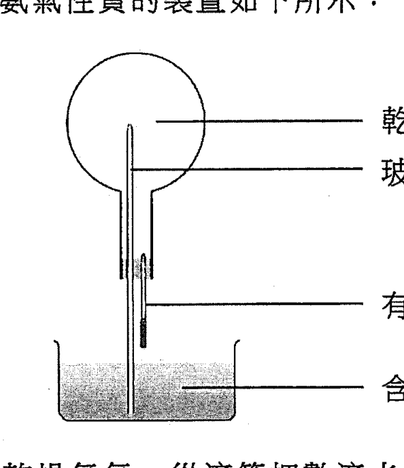
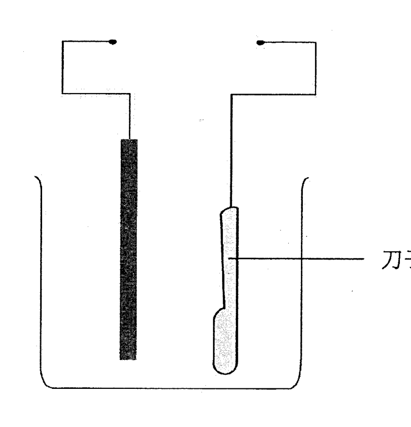
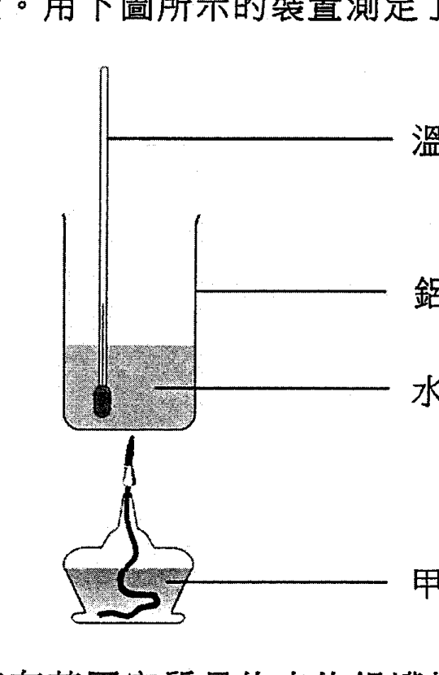
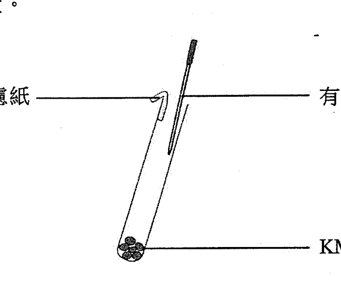
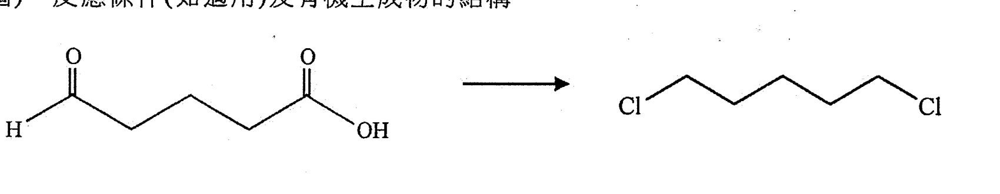
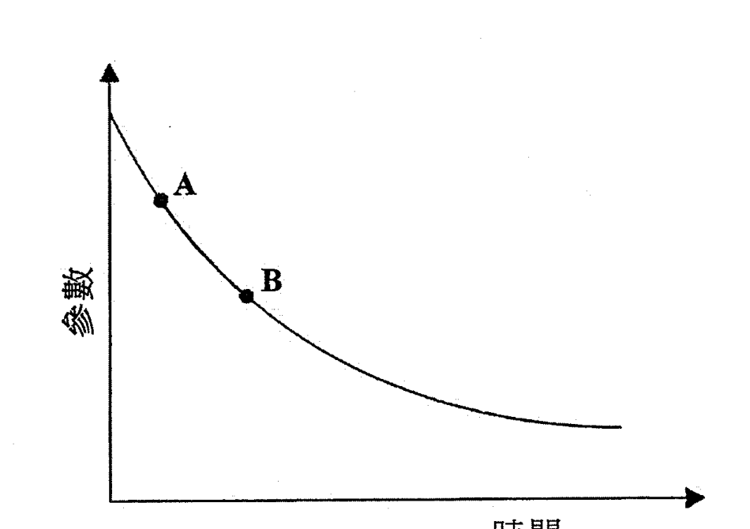
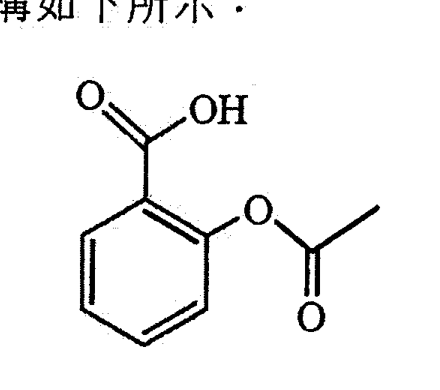
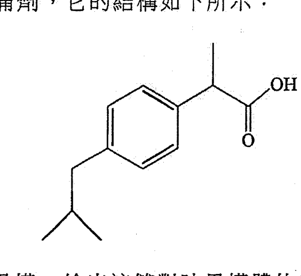
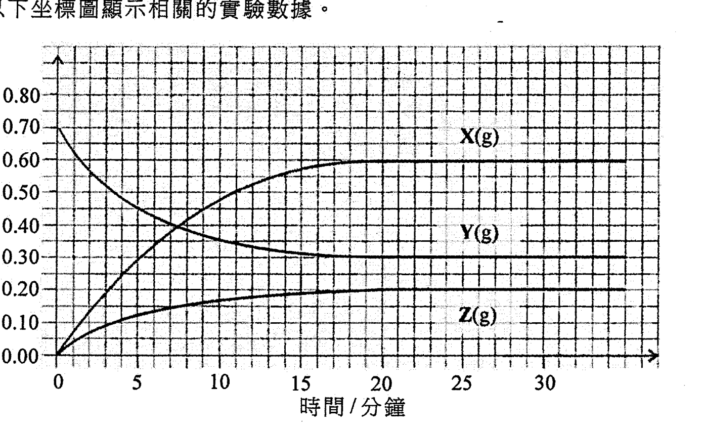

# 2018 DSE 化學 卷一乙（中文卷）— 題目庫

> 來源：文憑試 DSE 化學 Chemistry 2018 歷屆試題 Past Paper 卷一.pdf　｜　乙部 結構式問題 14 題（第一部分 9 題、第二部分 5 題）
> 本部包括兩部分：第一和第二部分各題均須作答。有 * 號標記的試題，將有一分給予達致有效傳意的答案。
> 說明：已移除頁碼、試卷標頭、答題簿橫線等雜訊；化學式以 Unicode 下標／上標表示，反應式以 → 或 ⇌ 表示。**本檔為題目庫（零答案）**，只含題目清洗 + 建議標籤。
> 本檔為第 2 層文字交貨（圖用原卷截圖；精修重繪另開第 3 層）。

---

## 第一部分（第 1–9 題）

## 第 1 題

【建議標籤】

- 卷別/部分：卷一乙　第一部分
- 課題：#同位素 #鋰 #氮化鋰 #電子圖

【題目內容】

鋰在自然界中存在 ⁶Li 和 ⁷Li 兩個同位素，當牠在空氣中燃燒時可生成氮化鋰 Li₃N。

(a)　(i)　計算 ⁶Li 在自然界的豐度百分率。（相對原子質量：Li = 6.9）

　　(ii)　繪出氮化鋰的電子圖（只須顯示最外層的電子）。（3 分）

(b)　在一實驗中，當一塊鋰在空氣中燃燒時生成了 1.25 g 的氮化鋰。

　　(i)　寫出所涉及反應的化學方程式。

　　(ii)　計算與氮反應了的鋰的質量。（相對原子質量：Li = 6.9，N = 14.0）（3 分）

(c)　寫出當鋰在空氣中燃燒時，亦會生成的另一個化合物的名稱。（1 分）

---

## 第 2 題

【建議標籤】

- 卷別/部分：卷一乙　第一部分
- 課題：#氨氣 #製備 #酚酞 #溶解度

【題目內容】

本題涉及在實驗室製備氨氣及探究氨氣的性質。

(a)　氫氧化鈣固體與氯化銨固體反應生成氨氣。繪畫一個顯示所涉及的裝置和怎樣把氨氣收集的標示圖。（2 分）

(b)　進行了一個實驗來探究氨氣性質的裝置如下所示：

該圓底燒瓶起初盛滿了乾燥氨氣。從滴管把數滴水注入燒瓶內，含酚酞的水便自動地經玻璃管被吸入燒瓶內。

　　(i)　簡略解釋為什麼含酚酞的水被吸入燒瓶內。

　　(ii)　寫出在燒瓶內與酚酞有關的一項觀察並加以解釋。（4 分）

---

## 第 3 題

【建議標籤】

- 卷別/部分：卷一乙　第一部分
- 課題：#離子化合物 #熔點 #沸點 #分子形狀

【題目內容】

(a)　解釋 BaCl₂ 抑或 CaCl₂ 會具有較高熔點。（2 分）

(b)　解釋以下三個物質的沸點遞減次序：

NH₃ > PH₃ > CH₄（3 分）

(c)　繪出代表 SF₆ 分子形狀的三維圖形。（1 分）

---

## 第 4 題

【建議標籤】

- 卷別/部分：卷一乙　第一部分
- 課題：#石油 #起源 #順反異構 #烯烴 #系統命名

【題目內容】

石油是碳氫化合物的重要來源。

(a)　描述石油的起源。（2 分）

(b)　D、E 和 F 是含四個碳原子的同分異構烯。D 和 E 是順-反異構體。

　　(i)　繪出 E（反式-異構體）的結構。

　　(ii)　寫出 F 的一個可能結構的系統名稱。（2 分）

(c)　乙烯和乙烷是碳氫化合物。

　　(i)　提出怎樣可把乙烯轉化為乙烷。

　　(ii)　舉出一項化學測試以分辨乙烷和乙烯。（3 分）

---

## 第 5 題

【建議標籤】

- 卷別/部分：卷一乙　第一部分
- 課題：#電鍍 #防鏽 #犧牲保護

【題目內容】

電鍍與防鏽都是電化學的常見應用。

(a)　下圖顯示一個不完整的裝置。在這圖中加上適當的繪圖和標示，讓銀電鍍在刀子表面。

（2 分）

(b)　除了塗漆或電鍍外，舉出一個可防止地下的鐵製管道生鏽的方法，解釋你的答案。（2 分）

---

## 第 6 題

【建議標籤】

- 卷別/部分：卷一乙　第一部分
- 課題：#葡萄糖 #標準焓變 #燃燒焓 #量熱法

【題目內容】

能量以不同形式存在。

(a)　葡萄糖 C₆H₁₂O₆ 是生物的一個重要能量來源。

　　(i)　寫出把二氧化碳氣體和液體水轉化為固體葡萄糖和氧氣的化學方程式。

　　(ii)　已知以下的標準生成焓變：

CO₂(g) = −394 kJ mol⁻¹

H₂O(l) = −286 kJ mol⁻¹

C₆H₁₂O₆(s) = −1274 kJ mol⁻¹

計算在上述 (i) 中轉化的標準焓變。

　　(iii)　綠色植物可把二氧化碳和水轉化為葡萄糖和氧。寫出在這轉化中的能量轉換。（4 分）

(b)　燃燒庚烷 C₇H₁₆ 釋出能量。用下圖所示的裝置測定了庚烷的燃燒焓變：

步驟一：藉燃燒甲醇把盛有某固定質量的水的鋁罐加熱，經燃燒了 1.58 g 的甲醇。

步驟二：藉燃燒庚烷把盛有相同質量的水的該鋁罐加熱，使水溫上升相同的度數，經燃燒了 [?] g 的庚烷。

已知在實驗條件下，甲醇的燃燒焓變是 −715 kJ mol⁻¹。計算在相同條件下，庚烷的燃燒焓變，以 kJ mol⁻¹ 表示。（相對分子質量：甲醇 = 32.0，庚烷 = 100.0）

　　(ii)　除了失熱以外，舉出在這實驗的另一項誤差來源。（4 分）

---

## 第 7 題

【建議標籤】

- 卷別/部分：卷一乙　第一部分
- 課題：#四硼酸鈉 #滴定 #結晶水 #標準溶液

【題目內容】

進行了一實驗，測定在一個水合四硼酸鈉（Na₂B₄O₇·nH₂O）樣本中結晶水的數目 (n)。於儀器 X 中以大約 50 cm³ 的去離子水把 0.452 g 的該樣本完全溶解，所得的溶液呈鹼性。隨即在 X 內以 0.125 M HCl(aq) 來滴定，並用甲基橙作指示劑，需用 18.98 cm³ 的該酸來達到終點。

(a)　寫出 X 的名稱。（1 分）

(b)　寫出在滴定終點的顏色變化。（1 分）

(c)　已知在滴定時的反應 B₄O₇²⁻(aq) 對 H⁺(aq) 的摩爾比為 1:2。計算結晶水的數目 n。（相對原子質量：H = 1.0，B = 10.8，O = 16.0，Na = 23.0）（3 分）

(d)　已知水合四硼酸鈉可用來配成標準溶液。

　　(i)　「標準溶液」一詞是什麼意思？

　　(ii)　提出標準溶液的一項用途。（2 分）

---

## 第 8 題

【建議標籤】

- 卷別/部分：卷一乙　第一部分
- 課題：#強酸 #高錳酸鉀 #氯氣 #氧化還原

【題目內容】

參照以下所示的實驗裝置：

(a)　HCl 是強酸，「強酸」一詞是什麼意思？（1 分）

(b)　當把濃 HCl(aq) 滴進 KMnO₄(s) 時，有黃綠色氣體生成。

　　(i)　該黃綠色氣體是什麼？

　　(ii)　解釋生成黃綠色氣體的反應是否為氧化還原反應。（2 分）

(c)　輔以一離子方程式，寫出當黃綠色氣體到達該濾紙時的預期觀察。（2 分）

(d)　從考慮實驗室安全，解釋這實驗應在何處進行。（1 分）

---

## 第 9 題

【建議標籤】

- 卷別/部分：卷一乙　第一部分
- 課題：#四氟乙烯 #加成聚合 #特氟綸

【題目內容】

*四氟乙烯進行聚合作用生成一名為「特氟綸」的聚合物。利用這例子，描述這類聚合作用。（5 分）

---

## 第二部分（第 10–14 題）

## 第 10 題

【建議標籤】

- 卷別/部分：卷一乙　第二部分
- 課題：#合成路線 #有機轉化 #試劑與條件

【題目內容】

概述一條不多於三個步驟的合成路線來完成以下的轉化。寫出每一步驟的試劑（一個或多個）、反應條件（如適用）及有機生成物的結構。

（3 分）

---

## 第 11 題

【建議標籤】

- 卷別/部分：卷一乙　第二部分
- 課題：#反應速率 #比色計 #初速 #反應進程

【題目內容】

考慮以下反應：

Br₂(aq) + HCOOH(aq) → 2HBr(aq) + CO₂(g)

在一個研習 Br₂(aq) 消耗速率的實驗中，把相同體積的 0.01 M Br₂(aq) 和 1.0 M HCOOH(aq) 混合。使用比色計來量度該反應體系的某參數以跟隨這反應的進程，以下坐標圖顯示從反應開始的結果。

(a)　假設該參數對時間變化的速率可代表反應的速率。

　　(i)　根據以上曲線的形狀，提出這參數應是什麼。

　　(ii)　在以上坐標圖作適當的草繪便可求得這反應的初速。在以上的坐標圖畫出這適當的草繪，並且描述怎樣從所得的草繪得出該反應的初速。

　　(iii)　根據以上的坐標圖，在 A 的反應速率較在 B 的為高。於分子層面加以解釋。（5 分）

(b)　提出另一個可跟隨這反應進程的方法。（1 分）

---

## 第 12 題

【建議標籤】

- 卷別/部分：卷一乙　第二部分
- 課題：#阿士匹靈 #水解 #布洛芬 #對映異構

【題目內容】

阿士匹靈是一鎮痛劑，牠的結構如下所示：

(a)　寫出阿士匹靈除了鎮痛外的一項醫療應用。（1 分）

(b)　解釋為什麼阿士匹靈和水的懸浮液，當加了碳酸氫鈉粉末後會變得清澈。（2 分）

(c)　把阿士匹靈與過量稀酸水溶液回流加熱會得到兩個有機產物。

　　(i)　繪出這兩個有機產物的結構。

　　(ii)　解釋為什麼即使把阿士匹靈與稀酸的混合物回流加熱一段長時間，由阿士匹靈變為該兩個有機產物的轉化仍難於達到 100%。（3 分）

(d)　布洛芬也是一鎮痛劑，牠的結構如下所示：

布洛芬存在對映異構。繪出這對對映異構體的三維結構。（2 分）

---

## 第 13 題

【建議標籤】

- 卷別/部分：卷一乙　第二部分
- 課題：#可逆反應 #平衡常數 #濃度-時間圖

【題目內容】

為一個於恆溫下在 2.0 dm³ 的密閉容器內涉及 Y₂(g)、Y(g) 和 Z(g) 的可逆反應進行了一實驗。以下坐標圖顯示相關的實驗數據。

(a)　根據這坐標圖，你如何得知這反應是可逆的？（1 分）

(b)　計算在實驗溫度下這反應的平衡常數 Kc。（3 分）

(c)　評論以下陳述：「在反應開始後的第 25 分鐘正向反應的速率是零。」

---

## 第 14 題

【建議標籤】

- 卷別/部分：卷一乙　第二部分
- 課題：#第三周期 #氧化物 #酸鹼性 #兩性

【題目內容】

*以 Na₂O、Al₂O₃ 和 SO₃ 為例，並輔以相關反應，說明第三周期元素的氧化物的酸鹼習性。（6 分）

---

*試卷完 —*

## 待人工核對

本卷為第 2 層文字交貨，由 easyocr（ch_tra+en，GPU）掃描底稿清洗而成；現模型無影像輸入，未能對頁影像覆核。以下題號建議第 3 層精修時對頁覆核：

- 第 3 題：「CaCl₂」（OCR 讀作「OCl.」）及 SF₆（OCR 讀「SF」）待對頁核實。
- 第 4 題：「乙烯／乙烷」（OCR 讀作「二烯／二烷」）待對頁核實。
- 第 6(b) 題：步驟二庚烷質量（OCR 亂碼不可讀）標 [?] 待對頁核實；量熱裝置圖為截圖。
- 第 8 題：「KI(aq)」濕潤濾紙（OCR 讀作「HI(aq)」）待對頁核實。
- 第 12(d) 題：「這對對映異構體」（OCR 讀作「該雙對映異構體」）待對頁核實。
- 第 10 題：轉化結構（H → OH）為截圖，起始物／生成物結構待第 3 層對頁核實。
- 第 2、5、6、8、10、11、12、13 題：圖為 300dpi 原卷截圖（程式定位＋墨跡覆蓋率校驗；位置／範圍待 spot-check）；第 3 層再換成向量重繪。
