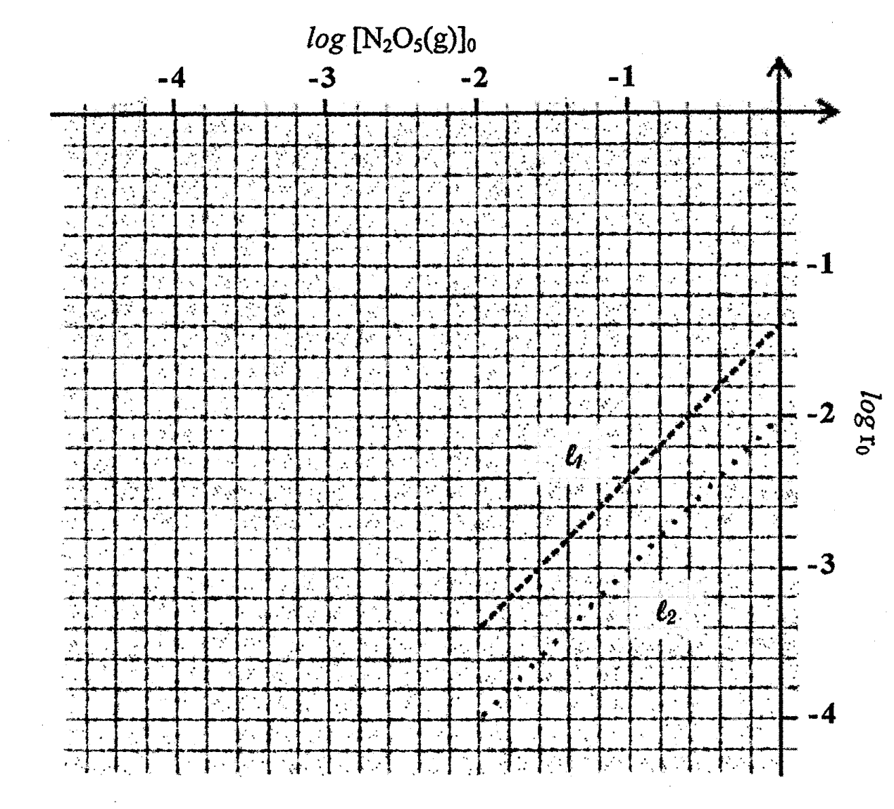
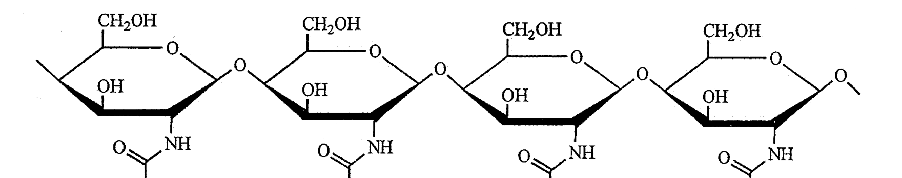
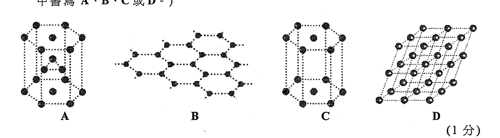
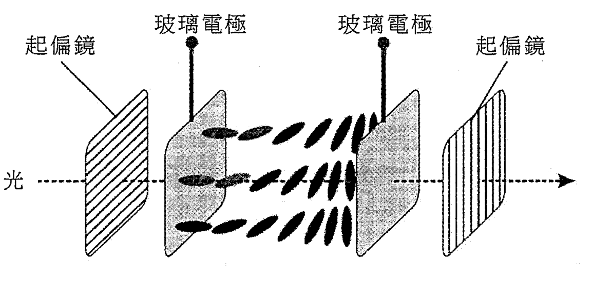
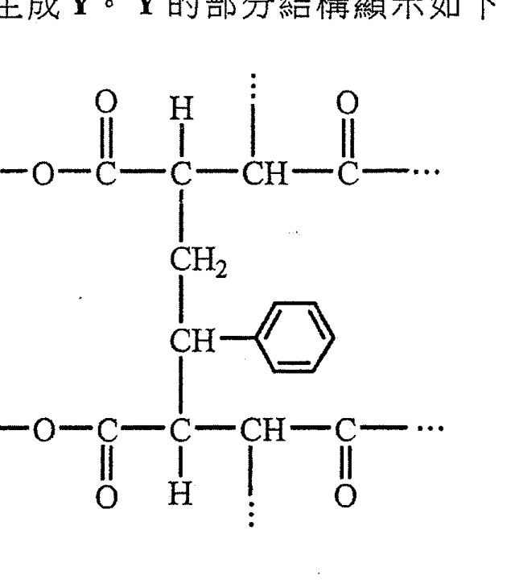
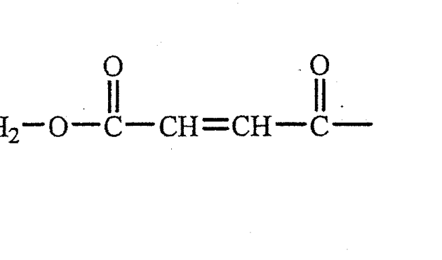
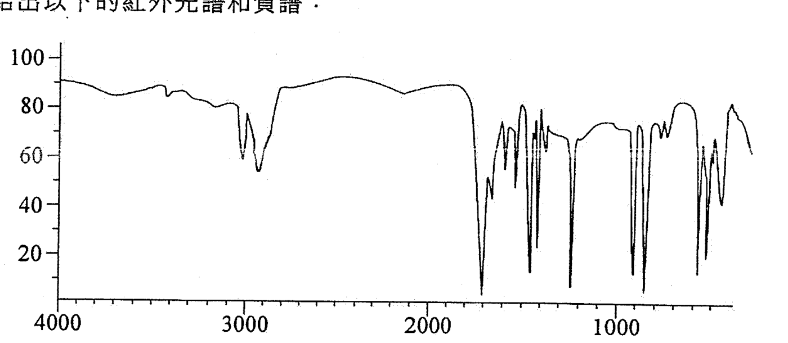
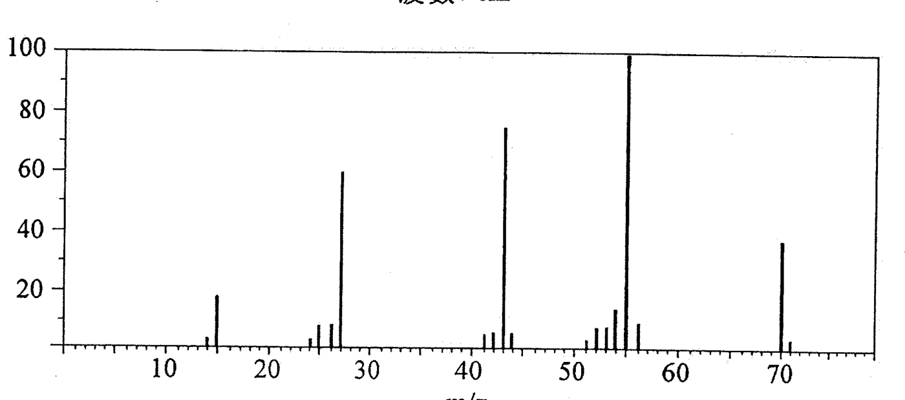

# 2018 DSE 化學 卷二（中文卷）— 題目庫

> 來源：文憑試 DSE 化學 Chemistry 2018 歷屆試題 Past Paper 卷二.pdf　｜　三部分：甲部 工業化學、乙部 物料化學、丙部 分析化學（每部分一題）
> 本試卷共有甲、乙和丙三部。考生須選答任何兩部中的全部試題。
> 說明：已移除頁碼、試卷標頭等雜訊；化學式以 Unicode 下標／上標表示，反應式以 → 或 ⇌ 表示。**本檔為題目庫（零答案）**，只含題目清洗 + 建議標籤。
> 本檔為第 2 層文字交貨（圖用原卷截圖；精修重繪另開第 3 層）。

---

## 甲部　工業化學（第 1 題）

## 第 1 題

【建議標籤】

- 卷別/部分：卷二　甲部
- 課題：#氯鹼工業 #膜電解池 #麥克斯韋玻爾茲曼 #甲醇 #N₂O₅ 動力學 #活化能

【題目內容】

回答試題的所有部分。

(a)　回答以下短問題。

　　(i)　寫出在氯鹼工業中使用膜電解池來電解鹽水的兩條半反應式。（2 分）

　　(ii)　草繪一條附有標示的麥克斯韋-玻爾茲曼分佈曲線圖。（2 分）

　　(iii)　以下哪一個物種可以是在工業上生產維生素 C 的原料？

醋酸　　丙酮　　蟻醛　　葡萄糖（1 分）

(b)　下面反應 (I) 顯示在工業上於 100 atm 和 250°C 下使用催化劑生產甲醇的一個過程：

反應 (I)：CO(g) + 2H₂(g) ⇌ CH₃OH(g)

　　(i)　(1)　建議該反應的一個合適的催化劑。

　　　(2)　提出為什麼該反應在沒有催化劑時會緩慢進行。

　　　(3)　解釋為什麼在工業上，該反應把操作壓強設定在 100 atm 而不是常壓。（4 分）

　　(ii)　甲醇亦可從一些工業過程的副產品二氧化碳，使用另一催化劑而製得，如下面反應 (II) 所示：

反應 (II)：CO₂(g) + 3H₂(g) ⇌ CH₃OH(g) + H₂O(g)

基於所給的資料：

　　　(1)　提出一個原因，說明為什麼反應 (II) 可被視為較反應 (I) 更綠色。

　　　(2)　提出反應 (II) 對環境的一個潛在好處。（2 分）

　　(iii)　甲醇的一項工業用途是生產乙酸。寫出所涉及反應的一條化學方程式。（1 分）

(c)　為研習 N₂O₅(g) 的分解的化學動力學進行了兩組實驗（一組於 360 K；另一組於 345 K）：

2N₂O₅(g) → 4NO₂(g) + O₂(g)

在每組實驗，繪畫了 log r₀ 隨 log [N₂O₅(g)] 的變化，兩者均得到一直線如下面的坐標圖所示：

| 代表 | 意義 | 單位 |
|---|---|---|
| [N₂O₅(g)] | N₂O₅(g) 的初始濃度 | mol dm⁻³ |
| r₀ | N₂O₅(g) 的分解的初速 | mol dm⁻³ s⁻¹ |
| L | 於 360 K 所得的直線 | |
| M | 於 345 K 所得的直線 | |

已知 log r₀ = log k + n log [N₂O₅(g)]，其中 k 是速率常數，而 n 是對應 N₂O₅(g) 的反應級數。

　　(i)　已知 L 與 M 有相同斜率，根據化學動力學可推斷出什麼？（1 分）

　　(ii)　從 L 推算對應 N₂O₅(g) 的反應級數。（2 分）

　　(iii)　從 M 推算該反應在 345 K 的速率常數。（2 分）

　　(iv)　按該坐標圖的相關資料，計算這反應的活化能。（氣體常數 R = 8.31 J K⁻¹ mol⁻¹）（3 分）

---

## 乙部　物料化學（第 2 題）

## 第 2 題

【建議標籤】

- 卷別/部分：卷二　乙部
- 課題：#乙烯基醋酸酯 #綠色化學 #甲殼素 #六方緊密裝填 #液晶 #聚合物

【題目內容】

回答試題的所有部分。

(a)　回答以下短問題。

　　(i)　以下化學方程式顯示怎樣可得到乙烯基醋酸酯：

2CH₃COOH + 2CH₂=CH₂ + O₂ →（Pd）→ 2CH₃COOCH=CH₂ + 2H₂O

乙烯基醋酸酯

寫出兩個原因，說明為什麼這反應可被視為綠色的。（2 分）

　　(ii)　物質 W 是螃蟹的外骨骼組分。W 的部分結構顯示如下：

　　　(1)　寫出 W 的名稱。

　　　(2)　參照以上結構，提出為什麼螃蟹的外骨骼非常堅硬。（2 分）

　　(iii)　以下圖形 A、B、C 和 D 中，哪一個展示六方緊密裝填結構？（只需在你的答案中書寫 A、B、C 或 D。）

（1 分）

(b)　下圖展示在液晶顯示屏內一像素的玻璃電極之間，某些液晶分子在沒有施加電壓時的排列。

　　(i)　寫出相關液晶相的名稱，解釋你的答案。（2 分）

　　(ii)　於液晶層施加電壓：

　　　(1)　繪畫一圖以顯示液晶分子的預期排列。

　　　(2)　該像素會是光亮抑或黑暗的？解釋你的答案。（4 分）

　　(iii)　解釋為什麼該液晶顯示屏在超越某高溫時便不能操作。（1 分）

(c)　某聚合物 X 的重複單位顯示如下：

　　(i)　繪畫 X 的各單體的結構。（2 分）

　　(ii)　化合物 A 把 X 的分子連接起來生成 Y，Y 的部分結構顯示如下：

　　　(1)　繪畫 A 的結構。

　　　(2)　評論 Y 的熱性質。

　　　(3)　提出一個控制 Y 的剛性的方法，解釋你的答案。（4 分）

　　(iii)　用 Y 製造了一隻船身：

　　　(1)　建議一個製造這船身的成型方法。

　　　(2)　提出用 Y 較用鐵來製造船身的一項優點。（2 分）

---

## 丙部　分析化學（第 3 題）

## 第 3 題

【建議標籤】

- 卷別/部分：卷二　丙部
- 課題：#焰色試驗 #硫酸鹽測試 #Rf 值 #NaClO₃ 滴定 #紅外光譜 #質譜 #2,4-二硝基苯肼

【題目內容】

回答試題的所有部分。

(a)　回答以下短問題。

　　(i)　一離子化合物在焰色試驗中給出磚紅色火焰。提出這化合物可能包含的一個陽離子。（1 分）

　　(ii)　建議一化學測試來辨別 FeSO₄(aq) 和 K₂SO₄(aq)。（2 分）

　　(iii)　一物質在紙色譜上的 Rf 值是什麼意思？（2 分）

(b)　進行了一個實驗以測定在一樣本中 NaClO₃(s) 的質量百分率。用去離子水溶解 1.63 g 的該樣本並繼而校準至 250.0 cm³。將 10.00 cm³ 的該溶液轉移至一錐形瓶，然後把 10 cm³ 的 1 M KI(aq) 及 20 cm³ 的 6 M HCl(aq) 加進該瓶中。用 0.112 M Na₂S₂O₃(aq) 滴定所得混合物，並適時加入澱粉溶液作指示劑。重複滴定數次，達至終點時，所用 Na₂S₂O₃(aq) 的平均體積是 27.88 cm³。

　　(i)　描述怎樣可把溶於去離子水的樣本校準至 250.0 cm³。（2 分）

　　(ii)　已知在有 H⁺(aq) 存在下，錐形瓶內 ClO₃⁻(aq) 與 I⁻(aq) 反應生成 I₂(aq) 和 Cl⁻(aq)，寫出該反應的離子方程式。（1 分）

　　(iii)　寫出於滴定終點的顏色變化。（1 分）

　　(iv)　這滴定反應的化學方程式如下：

I₂(aq) + 2S₂O₃²⁻(aq) → 2I⁻(aq) + S₄O₆²⁻(aq)

假設在該樣本中沒有其他物種會與 I⁻(aq) 反應，計算在該樣本中 NaClO₃(s) 的質量百分率。（相對原子質量：O = 16.0，Na = 23.0，Cl = 35.5）（3 分）

(c)　一液體混合物含兩個有機化合物 X 和 Y：

| 化合物 | X | Y |
|---|---|---|
| 分子式 | C₃H₆O | C₃H₆O |
| 沸點 / °C | 81.4 | 79.6 |

　　(i)　解釋為什麼分餾不是一個把 X 從這混合物分離出來的合適方法。（1 分）

　　(ii)　X 給出以下的紅外光譜和質譜：

　　　(1)　參考這紅外光譜和下表所提供的資料，推定可能存在 X 中的一個官能基。

| 鍵合 | 化合物類別 | 波數域 / cm⁻¹ |
|---|---|---|
| C=C | 烯 | 1610 至 1680 |
| C=O | 醛、酮、羧酸及其衍生物 | 1680 至 1800 |
| C≡C | 炔 | 2070 至 2250 |
| C≡N | 腈 | 2200 至 2280 |
| O–H | 帶「氫鍵」的酸 | 2500 至 3300 |
| C–H | 烷、烯及芳烴 | 2840 至 3095 |
| O–H | 帶「氫鍵」的醇 | 3230 至 3670 |
| N–H | 胺 | 3350 至 3500 |

　　　(2)　參考這質譜，為在 m/z = 43 和 55 的每個訊號，提出一個對應的化學物種。

　　　(3)　根據上面的 (1) 和 (2)，繪出 X 的一個可能結構。（4 分）

　　(iii)　化合物 Y 在 2,4-二硝基苯肼測試呈陽性結果，並在托倫斯試劑測試呈陰性結果。推定 Y 可能是什麼。（3 分）

---

*試卷完 —*

## 待人工核對

本卷為第 2 層文字交貨，由 easyocr（ch_tra+en，GPU）掃描底稿清洗而成；現模型無影像輸入，未能對頁影像覆核。以下題號建議第 3 層精修時對頁覆核：

- 第 1(a)(iii) 題：「維生素 C」（OCR 讀作「丙種維生素」）待對頁核實。
- 第 1(b) 題：反應 (I)／(II) 之羅馬數字編號（OCR 混淆 I／II）待對頁核實。
- 第 1(c) 題：坐標圖兩直線標記（L／M，OCR 讀作「L／8」）及「代表」表待對頁核實。
- 第 2(c) 題：聚合物 X 重複單位及 Y 部分結構（截圖）待對頁核實。
- 第 3(b) 題：滴定試劑「KI(aq)」（OCR 讀作「HI(aq)」）及樣本 NaClO₃ 待對頁核實。
- 第 3(c) 題：X／Y 分子式（OCR 讀作「CH,0」，暫作 C₃H₆O）及沸點待對頁核實。
- 第 1(c)、2(a)(ii)、2(a)(iii)、2(b)、2(c)、3(c)(ii) 題：圖為 300dpi 原卷截圖（程式定位＋墨跡覆蓋率校驗；位置／範圍待 spot-check）；第 3 層再換成向量重繪。
