# 2019 DSE 化學 卷一甲（中文卷）— 題目庫

> 來源：文憑試 DSE 化學 Chemistry 2019 歷屆試題 Past Paper 卷一.pdf　｜　多項選擇題 36 題（第一部分 24 題、第二部分 12 題）
> 本部包括兩部分：第一部分設 24 題，第二部分設 12 題。選出每題最佳的答案。考生可參考印於試題答題簿 B 第 20 頁的周期表。
> 說明：已移除頁碼、試卷標頭等雜訊；化學式以 Unicode 下標／上標表示（如 H₂SO₄），反應式以 → 或 ⇌ 表示。**本檔為題目庫（零答案）**，只含題目清洗 + 建議標籤。
> 本檔為第 2 層文字交貨（圖用原卷截圖；精修重繪另開第 3 層）。

---

## 第一部分（第 1–24 題）

## 第 1 題

【建議標籤】

- 卷別/部分：卷一甲　第一部分
- 課題：#周期表 #原子序 #同族元素

【題目內容】

下列哪對原子序對應的元素具相似化學性質？

- A. 4，14
- B. 8，18
- C. 9，35
- D. 19，38

---

## 第 2 題

【建議標籤】

- 卷別/部分：卷一甲　第一部分
- 課題：#電解 #離子遷移 #高錳酸鹽 #重鉻酸鹽

【題目內容】

一實驗的裝置如下所示：

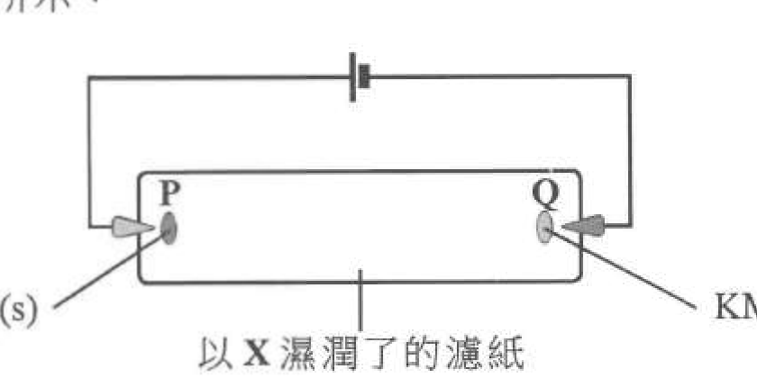

當電路閉合一段時間後可觀察到什麼？

- A. 如果 X 是稀 H₂SO₄，紫色斑移向 P
- B. 如果 X 是稀 H₂SO₄，橙色斑移向 Q
- C. 如果 X 是乙醇，紫色斑移向 P
- D. 如果 X 是乙醇，橙色斑移向 Q

---

## 第 3 題

【建議標籤】

- 卷別/部分：卷一甲　第一部分
- 課題：#氧化還原 #氧化數 #天然氣燃燒

【題目內容】

下列哪過程不涉及氧化和還原？

- A. 紅酒變酸
- B. 用白醋清除鐵鏽
- C. 在發電廠燃燒天然氣
- D. 在汽車的催化轉化器內清除氮氧化物

---

## 第 4 題

【建議標籤】

- 卷別/部分：卷一甲　第一部分
- 課題：#酸鹼 #中和 #鹽基度 #摩爾計算

【題目內容】

25.00 cm³ 的 0.051 M 草酸（H₂C₂O₄）水溶液可完全中和 22.18 cm³ 的 0.115 M KOH(aq)。這酸的鹽基度是多少？

- A. 1
- B. 2
- C. 3
- D. 4

---

## 第 5 題

【建議標籤】

- 卷別/部分：卷一甲　第一部分
- 課題：#摩爾計算 #沉澱 #氯化鉛 #限量反應物

【題目內容】

把 25.00 cm³ 的 0.50 M 硝酸鉛(II)溶液與 50.00 cm³ 的 1.00 M 氯化鈉溶液混合，混合時生成不溶的氯化鉛(II)。混合物中 Cl⁻(aq) 的濃度是多少？

- A. 0.33 mol dm⁻³
- B. 0.50 mol dm⁻³
- C. 0.75 mol dm⁻³
- D. 1.50 mol dm⁻³

---

## 第 6 題

【建議標籤】

- 卷別/部分：卷一甲　第一部分
- 課題：#碳酸氫鈉 #熱分解 #實驗式計算

【題目內容】

把 2.53 g 的 NaHCO₃(s) 加熱直至不再有任何變化，剩下 1.59 g 的固體。以下哪方程式與這實驗結果相符？

（相對原子質量：H = 1.0，C = 12.0，O = 16.0，Na = 23.0）

- A. NaHCO₃(s) → NaOH(s) + CO₂(g)
- B. 2NaHCO₃(s) → Na₂O(s) + 2CO₂(g) + H₂(g)
- C. 2NaHCO₃(s) → Na₂CO₃(s) + H₂O(g) + CO₂(g)
- D. 2NaHCO₃(s) → Na₂O(s) + H₂O(g) + 2CO₂(g)

---

## 第 7 題

【建議標籤】

- 卷別/部分：卷一甲　第一部分
- 課題：#裂解 #分餾 #石蠟油 #實驗安全

【題目內容】

一實驗的裝置如下所示：

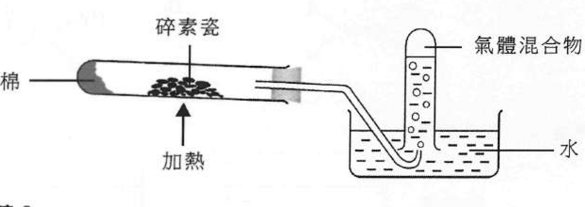

以下哪陳述不正確？

- A. 碎素瓷作為催化劑
- B. 在這裝置內進行了分餾
- C. 該氣體混合物令酸化高錳酸鉀溶液由紫色變為無色
- D. 當再沒有收集到氣體時，應先把導管從水移離才取走熱源

---

## 第 8 題

【建議標籤】

- 卷別/部分：卷一甲　第一部分
- 課題：#實驗式 #銣 #氧化物

【題目內容】

39.2 g 的銣（Rb）的氧化物含 28.5 g 的銣。這氧化物的實驗式是什麼？

（相對原子質量：O = 16.0，Rb = 85.5）

- A. RbO
- B. RbO₂
- C. Rb₂O
- D. Rb₂O₃

---

## 第 9 題

【建議標籤】

- 卷別/部分：卷一甲　第一部分
- 課題：#赫斯定律 #生成焓 #燃燒焓 #丙烷

【題目內容】

已知：

水的標準生成焓變 = −286 kJ mol⁻¹

丙烷的標準燃燒焓變 = −2222 kJ mol⁻¹

二氧化碳的標準生成焓變 = −394 kJ mol⁻¹

丙烷的標準生成焓變是多少？

- A. −52 kJ mol⁻¹
- B. +52 kJ mol⁻¹
- C. −104 kJ mol⁻¹
- D. +104 kJ mol⁻¹

---

## 第 10 題

【建議標籤】

- 卷別/部分：卷一甲　第一部分
- 課題：#加成聚合 #聚合物 #單體

【題目內容】

一聚合物的部分結構如下所示：

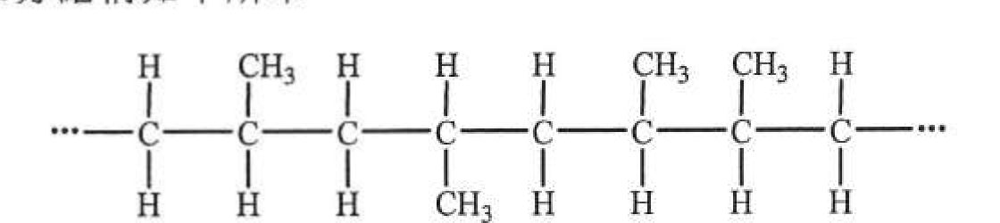

下列何者可以是這聚合物的單體？

- A.
- B.
- C.
- D.

---

## 第 11 題

【建議標籤】

- 卷別/部分：卷一甲　第一部分
- 課題：#電解 #電解池 #電極產物

【題目內容】

考慮以下各電解池：

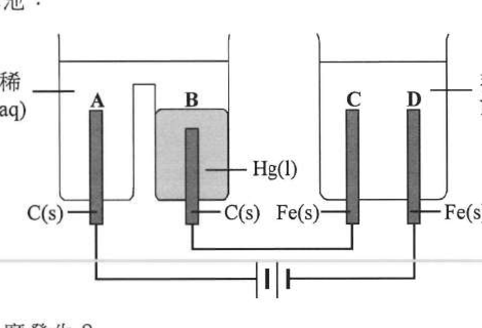

電解期間會有什麼發生？

- A. 在 A 附近生成氧
- B. 在 B 附近生成氯
- C. 在 C 附近生成氫
- D. 在 D 附近生成鐵(II)離子

---

## 第 12 題

【建議標籤】

- 卷別/部分：卷一甲　第一部分
- 課題：#燃料電池 #原電池 #氫 #氧

【題目內容】

下列哪項有關以下可生成水的燃料電池的陳述不正確？

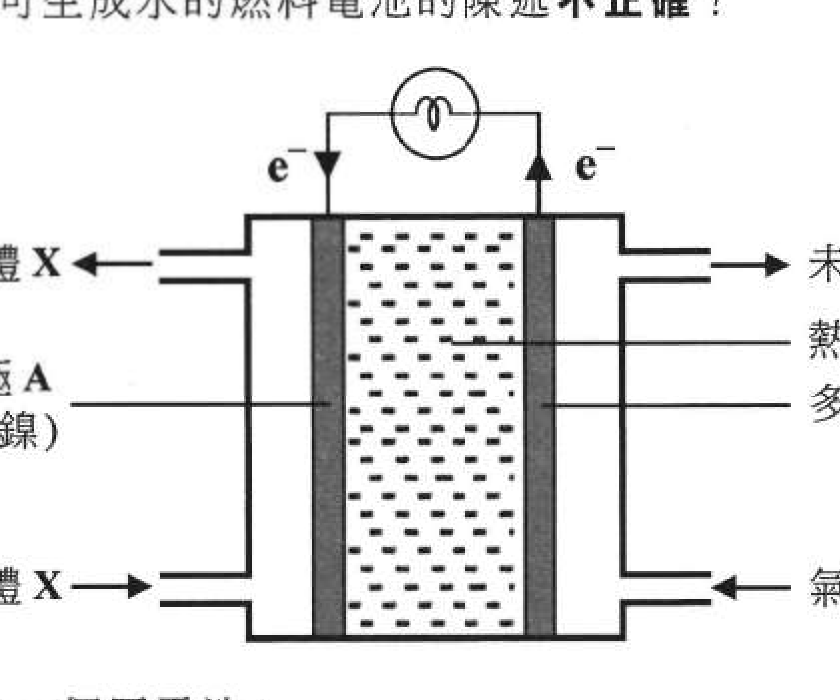

- A. 牠是一個原電池
- B. Ni 也作為催化劑
- C. 把液態空氣分餾可獲得 X
- D. 在電極 B 的變化的方程式是 4OH⁻ → 2H₂O + O₂ + 4e⁻

---

## 第 13 題

【建議標籤】

- 卷別/部分：卷一甲　第一部分
- 課題：#分子形狀 #VSEPR

【題目內容】

下列哪組合正確？

| | A | B | C | D |
|---|---|---|---|---|
| 分子 | OF₂ | CS₂ | NCl₃ | PF₅ |
| 分子形狀 | 直線 | V 形 | 平面三角形 | 三角錐體 |

---

## 第 14 題

【建議標籤】

- 卷別/部分：卷一甲　第一部分
- 課題：#重鉻酸銨 #熱分解 #氧化數 #鍵合

【題目內容】

考慮以下的反應：

(NH₄)₂Cr₂O₇(s) → Cr₂O₃(s) + N₂(g) + 4H₂O(g)

下列的陳述，何者正確？

(1) 鉻的氧化數減少。

(2) 只有共價鍵斷裂和生成。

(3) 綠色固體變為橙色固體。

- A. 只有 (1)
- B. 只有 (2)
- C. 只有 (1) 和 (3)
- D. 只有 (2) 和 (3)

---

## 第 15 題

【建議標籤】

- 卷別/部分：卷一甲　第一部分
- 課題：#鏽蝕 #防腐 #犧牲保護 #陰極保護

【題目內容】

下列的方法，何者可減慢鐵製物件的腐蝕？

(1) 把牠連接到一塊鉛

(2) 在牠表面完全鍍上銅塗層

(3) 把牠連接到化學電池的陰極

- A. 只有 (1)
- B. 只有 (2)
- C. 只有 (1) 和 (3)
- D. 只有 (2) 和 (3)

---

## 第 16 題

【建議標籤】

- 卷別/部分：卷一甲　第一部分
- 課題：#化學測試 #濃酸辨別 #氫氯酸 #硝酸

【題目內容】

下列的化學品，何者可用來辨別濃氫氯酸和濃硝酸？

(1) 碳酸鈉固體

(2) 硝酸銀溶液

(3) 銅金屬

- A. 只有 (1)
- B. 只有 (2)
- C. 只有 (1) 和 (3)
- D. 只有 (2) 和 (3)

---

## 第 17 題

【建議標籤】

- 卷別/部分：卷一甲　第一部分
- 課題：#金屬氧化物 #碳還原 #金屬活性序

【題目內容】

下列的金屬氧化物，何者與碳用本生燈加熱時可還原為金屬？

(1) 氧化鉛(II)

(2) 氧化鎂

(3) 氧化銅(II)

- A. 只有 (1)
- B. 只有 (2)
- C. 只有 (1) 和 (3)
- D. 只有 (2) 和 (3)

---

## 第 18 題

【建議標籤】

- 卷別/部分：卷一甲　第一部分
- 課題：#有機化合物 #同系列 #實驗式 #溶解度

【題目內容】

考慮以下兩個化合物：

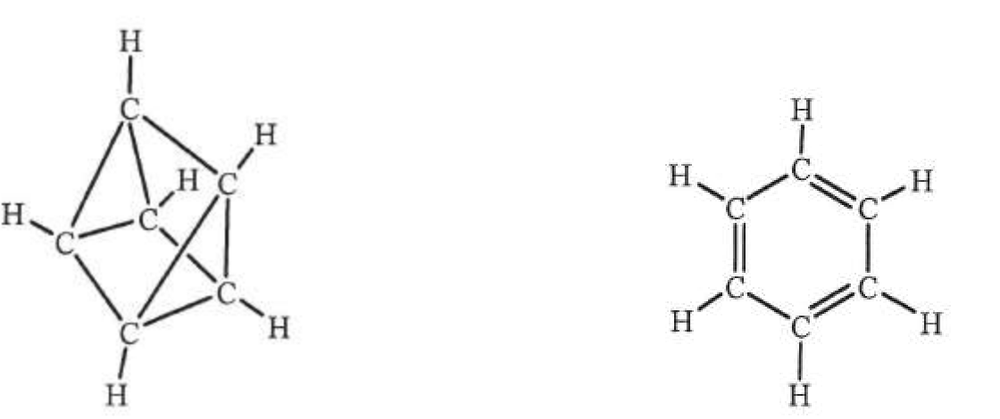

下列的陳述，何者正確？

(1) 牠們均溶於水。

(2) 牠們具相同的實驗式。

(3) 牠們在相同的同系列內。

- A. 只有 (1)
- B. 只有 (2)
- C. 只有 (1) 和 (3)
- D. 只有 (2) 和 (3)

---

## 第 19 題

【建議標籤】

- 卷別/部分：卷一甲　第一部分
- 課題：#氧化還原 #還原劑 #氧化數

【題目內容】

在下列各反應中，何者已劃線的化學品作為還原劑？

(1) 2C₄H₁₀ + 13O₂ → 8CO₂ + 10H₂O

(2) Ba(NO₃)₂ + Na₂SO₄ → BaSO₄ + 2NaNO₃

(3) Zn(OH)₂ + 2NaOH → Na₂Zn(OH)₄

- A. 只有 (1)
- B. 只有 (2)
- C. 只有 (1) 和 (3)
- D. 只有 (2) 和 (3)

---

## 第 20 題

【建議標籤】

- 卷別/部分：卷一甲　第一部分
- 課題：#氫氧化鈣 #石灰水 #用途

【題目內容】

氫氧化鈣水溶液可用來

(1) 中和在土壤的酸性物質

(2) 辨別二氧化碳與一氧化碳

(3) 清除一個受污染的空氣樣本中的二氧化硫

- A. 只有 (1) 和 (2)
- B. 只有 (1) 和 (3)
- C. 只有 (2) 和 (3)
- D. (1)、(2) 和 (3)

---

## 第 21 題

【建議標籤】

- 卷別/部分：卷一甲　第一部分
- 課題：#移液管 #實驗儀器 #操作安全

【題目內容】

下圖顯示一常見的玻璃儀器：

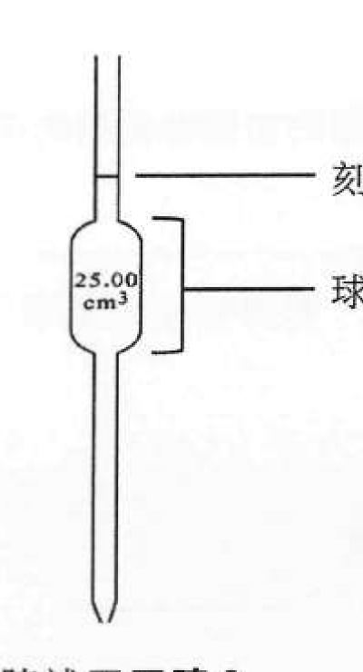

下列哪些有關使用這儀器轉移酸的陳述不正確？

(1) 當注入酸時，須用手握緊球管

(2) 使用這儀器可準確地轉移 20.00 cm³ 的酸

(3) 須先以蒸餾水清洗這儀器，繼而隨即把酸轉移

- A. 只有 (1) 和 (2)
- B. 只有 (1) 和 (3)
- C. 只有 (2) 和 (3)
- D. (1)、(2) 和 (3)

---

## 第 22 題

【建議標籤】

- 卷別/部分：卷一甲　第一部分
- 課題：#放熱反應 #熱分解 #稀釋

【題目內容】

下列何者是放熱的？

(1) 氧化汞(II)固體的熱分解

(2) 以水稀釋濃硫酸

(3) 鎂帶與稀氫氯酸的反應

- A. 只有 (1) 和 (2)
- B. 只有 (1) 和 (3)
- C. 只有 (2) 和 (3)
- D. (1)、(2) 和 (3)

---

## 第 23 題

【建議標籤】

- 卷別/部分：卷一甲　第一部分
- 課題：#乙醇 #物理性質 #揮發性

【題目內容】

下列哪些有關乙醇的陳述正確？

(1) 牠是易燃的

(2) 牠是可溶於水的

(3) 牠比水更具揮發性

- A. 只有 (1) 和 (2)
- B. 只有 (1) 和 (3)
- C. 只有 (2) 和 (3)
- D. (1)、(2) 和 (3)

---

## 第 24 題

【建議標籤】

- 卷別/部分：卷一甲　第一部分
- 課題：#汞 #導電性 #離域電子 #金屬鍵

【題目內容】

考慮下列各述句並選出最佳的答案：

第一述句：汞在室溫下具良好導電性

第二述句：汞具離域電子

- A. 兩述句均正確，而第二述句為第一述句的合理解釋
- B. 兩述句均正確，但第二述句並非第一述句的合理解釋
- C. 第一述句錯誤，但第二述句正確
- D. 兩述句均錯誤

---

## 第二部分（第 25–36 題）

## 第 25 題

【建議標籤】

- 卷別/部分：卷一甲　第二部分
- 課題：#化學平衡 #濃度變化 #勒沙特列原理

【題目內容】

考慮以下在一個固定體積的密閉容器內的平衡體系：

A(g) + B(g) ⇌ 2C(g)

在時間 t 加進小量 B(g)，最終在相同溫度下達致一個新的平衡。下列哪坐標圖可代表 [C(g)] 隨時間的變化？

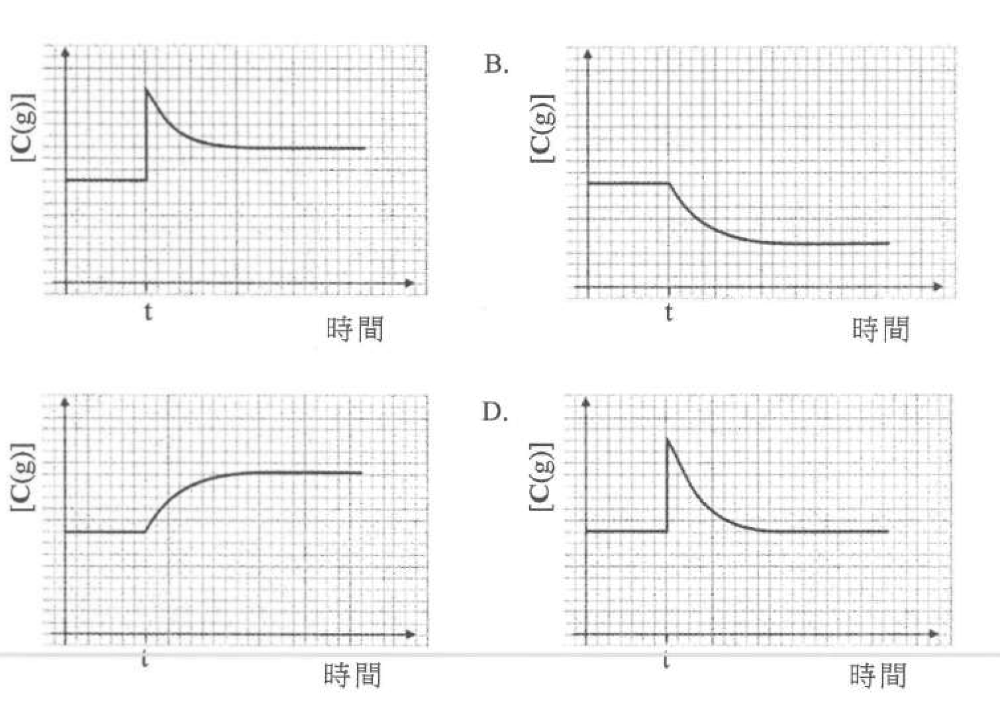

- A.
- B.
- C.
- D.

---

## 第 26 題

【建議標籤】

- 卷別/部分：卷一甲　第二部分
- 課題：#平衡常數 #逆反應 #Kc

【題目內容】

考慮在某溫度下以下兩個反應：

反應 (1)：CO(g) + H₂O(g) ⇌ CO₂(g) + H₂(g)，平衡常數 Kc = 0.8

反應 (2)：CO₂(g) + H₂(g) ⇌ CO(g) + H₂O(g)，平衡常數 Kc = X

X 是什麼？

- A. 0.8
- B. 1.25
- C. 0.5 mol⁻¹ dm³
- D. 1.25 mol dm⁻³

---

## 第 27 題

【建議標籤】

- 卷別/部分：卷一甲　第二部分
- 課題：#平衡常數 #碘化氫分解 #Kc 計算

【題目內容】

HI(g) 分解成 H₂(g) 和 I₂(g) 是可逆的。在一個維持於固定溫度下的 3.0 dm³ 的密閉容器內，一平衡混合物含 0.10 mol 的 HI(g)、0.60 mol 的 H₂(g) 和 0.60 mol 的 I₂(g)。在這溫度下這分解的平衡常數 Kc 是什麼？

- A. 0.4
- B. 3.6
- C. 9.0
- D. 36.0

---

## 第 28 題

【建議標籤】

- 卷別/部分：卷一甲　第二部分
- 課題：#四氧化二氮 #歧化反應 #摩爾體積 #酸鹼

【題目內容】

考慮以下的反應：

2NaOH(aq) + N₂O₄(g) → NaNO₃(aq) + NaNO₂(aq) + H₂O(l)

在室內條件下，要與 480 cm³ 的 N₂O₄(g) 完全反應所需的 0.5 M NaOH(aq) 的最小體積是多少？

（在室內條件下，氣體的摩爾體積 = 24 dm³）

- A. 8 cm³
- B. 12.5 cm³
- C. 40 cm³
- D. 80 cm³

---

## 第 29 題

【建議標籤】

- 卷別/部分：卷一甲　第二部分
- 課題：#檸檬烯 #加成反應 #氫氯酸 #主要生成物

【題目內容】

檸檬烯的結構顯示如下：

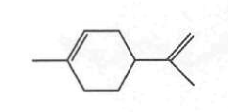

牠與過量 HCl(g) 反應得出 Z 作為主要生成物。下列何者是 Z？

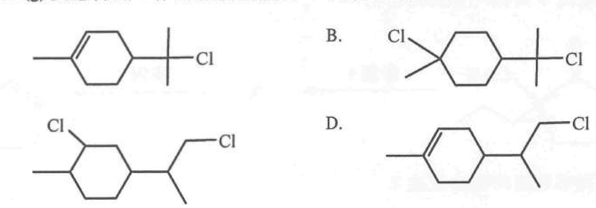

- A.
- B.
- C.
- D.

---

## 第 30 題

【建議標籤】

- 卷別/部分：卷一甲　第二部分
- 課題：#加成聚合物 #縮合聚合物 #單體

【題目內容】

從下面選出一個組合，其中 X 可製造一加成聚合物，而 Y 可製造一縮合聚合物：

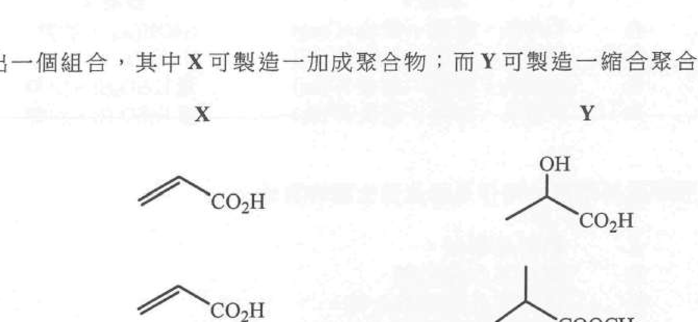

- A.
- B.
- C.
- D.

---

## 第 31 題

【建議標籤】

- 卷別/部分：卷一甲　第二部分
- 課題：#系統命名 #官能基 #IUPAC

【題目內容】

下列哪組合正確？

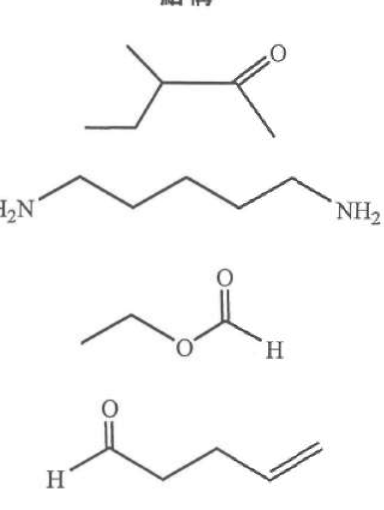

- A. 3-乙基丁酮
- B. 戊-1,5-二胺
- C. 甲酸乙酯
- D. 戊-1-烯醛

---

## 第 32 題

【建議標籤】

- 卷別/部分：卷一甲　第二部分
- 課題：#有機轉化 #還原 #LiAlH₄ #NaBH₄

【題目內容】

考慮以下有機化合物的轉化：

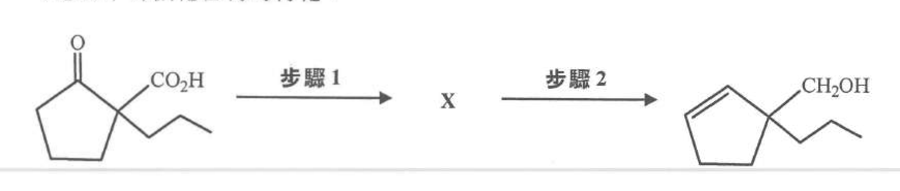

下列哪步驟的組合正確？

| | 步驟 1 | 步驟 2 |
|---|---|---|
| A. | LiAlH₄ 乾醚；然後 H⁺(aq) | NaOH(aq) 加熱 |
| B. | NaBH₄ 乙醇；然後 H⁺(aq) | NaOH(aq) 加熱 |
| C. | LiAlH₄ 乾醚；然後 H⁺(aq) | 濃 H₂SO₄(l) 加熱 |
| D. | NaBH₄ 乙醇；然後 H⁺(aq) | 濃 H₂SO₄(l) 加熱 |

---

## 第 33 題

【建議標籤】

- 卷別/部分：卷一甲　第二部分
- 課題：#過渡金屬 #鐵 #特性

【題目內容】

下列哪項並不展示鐵作為過渡性金屬的特性？

- A. 鐵容易腐蝕
- B. 鐵可用作催化劑
- C. 鐵可生成兩個氯化物
- D. 硫酸鐵(II)溶液是綠色的

---

## 第 34 題

【建議標籤】

- 卷別/部分：卷一甲　第二部分
- 課題：#催化劑 #過氧化氫 #反應速率

【題目內容】

考慮以下的反應：

MnO₂(s) + 2H₂O₂(aq) → 2H₂O(l) + O₂(g)

若 H₂O₂(aq) 的濃度由 2 M 變為 1 M，而其他條件保持不變，下列的陳述，何者正確？

(1) MnO₂(s) 的消耗會減少

(2) 生成 O₂(g) 的速率會減少

(3) 所生成 O₂(g) 的體積會減少

- A. 只有 (1)
- B. 只有 (2)
- C. 只有 (1) 和 (3)
- D. 只有 (2) 和 (3)

---

## 第 35 題

【建議標籤】

- 卷別/部分：卷一甲　第二部分
- 課題：#反應速率 #溴 #顏色 #pH

【題目內容】

考慮以下的反應：

5NaBr(aq) + NaBrO₃(aq) + 6HCl(aq) → 3Br₂(aq) + 6NaCl(aq) + 3H₂O(l)　（無色）

量度下列何者可跟隨這反應的進度？

(1) 這反應混合物的 pH

(2) 這反應系統的壓強

(3) 這反應混合物的顏色強度

- A. 只有 (1) 和 (2)
- B. 只有 (1) 和 (3)
- C. 只有 (2) 和 (3)
- D. (1)、(2) 和 (3)

---

## 第 36 題

【建議標籤】

- 卷別/部分：卷一甲　第二部分
- 課題：#旋光性 #手性中心 #異構體

【題目內容】

考慮下列各述句並選出最佳的答案：

第一述句：CH₂=CHCH(CH₃)CH₃ 可展示旋光性

第二述句：CH₃CH₂CH(CH₃)CH₃ 具有一個手性中心

- A. 兩述句均正確，而第二述句為第一述句的合理解釋
- B. 兩述句均正確，但第二述句並非第一述句的合理解釋
- C. 第一述句錯誤，但第二述句正確
- D. 兩述句均錯誤

---

*試卷完 —*

## 待人工核對

本卷為第 2 層文字交貨，由 easyocr（ch_tra+en，GPU）掃描底稿清洗而成；現模型無影像輸入，未能對頁影像覆核。以下題號建議第 3 層精修時對頁覆核：

- 第 2 題：裝置（Na₂Cr₂O₇／KMnO₄ 遷移實驗）與選項 P／Q 極向、橙色／紫色斑對應待對頁核實。
- 第 4 題：酸的分子式（OCR 讀作「CHi0+」，按鹽基度 2 補作草酸 H₂C₂O₄）待對頁核實。
- 第 13 題：分子 PF₅ 抑或 PF₃，及各分子形狀配對待對頁核實。
- 第 19 題：三反應式（尤其 (1) 2C₄H₁₀ + 13O₂ → 8CO₂ + 10H₂O）及「已劃線」位置待對頁核實。
- 第 27 題：選項數值（0.4／3.6／9.0／36.0）待對頁核實。
- 第 31 題：系統名稱（「戊-1,5-二胺」抑或「戊-1,5-二醚胺」；「戊-1-烯醛」抑或「戊-2-烯醛」）待對頁核實。
- 第 10、18、29、30、31、32 題：選項／題幹含結構式圖（300dpi 原卷截圖，程式定位；無視覺覆核），第 3 層再換成向量重繪。
- 第 2、7、11、12、21、25 題：圖為 300dpi 原卷截圖（程式定位＋墨跡覆蓋率校驗；位置／範圍待 spot-check）；第 3 層再換成向量重繪。
