# 2019 DSE 化學 卷一乙（中文卷）— 題目庫

> 來源：文憑試 DSE 化學 Chemistry 2019 歷屆試題 Past Paper 卷一.pdf　｜　乙部 結構式問題 15 題（第一部分 10 題、第二部分 5 題）
> 本部包括兩部分：第一和第二部分各題均須作答。有 * 號標記的試題，將有一分給予達致有效傳意的答案。
> 說明：已移除頁碼、試卷標頭、答題簿橫線等雜訊；化學式以 Unicode 下標／上標表示，反應式以 → 或 ⇌ 表示。**本檔為題目庫（零答案）**，只含題目清洗 + 建議標籤。
> 本檔為第 2 層文字交貨（圖用原卷截圖；精修重繪另開第 3 層）。

---

## 第一部分（第 1–10 題）

## 第 1 題

【建議標籤】

- 卷別/部分：卷一乙　第一部分
- 課題：#同位素 #氘 #電子圖 #氧化還原

【題目內容】

下表顯示三個原子的一些資料：

| | 氫 | 氘 | 氧 |
|---|---|---|---|
| 質子數目 | 1 | 1 | 8 |
| 電子數目 | 1 | 1 | 8 |
| 中子數目 | 0 | 1 | 8 |

(a)　解釋為什麼氫和氘是同位素。（1 分）

(b)　氘可以 D 表示。牠與氧反應如以下方程式所示：

2D₂ + O₂ → 2D₂O

繪畫一個 D₂O 分子的電子圖（只需顯示最外層的電子）。（1 分）

(c)　於室內條件下把一小塊鈉金屬放進液體 D₂O。

　　(i)　寫出兩項預期的觀察。（1 分）

　　(ii)　寫出所涉及反應的化學方程式。（3 分）

---

## 第 2 題

【建議標籤】

- 卷別/部分：卷一乙　第一部分
- 課題：#離子結構 #氯化鈉 #亞佛加德羅常數 #晶胞

【題目內容】

氯化鈉結晶具巨型離子結構。

(a)　下圖顯示氯化鈉結晶的部分結構，其中欠缺了一些離子：

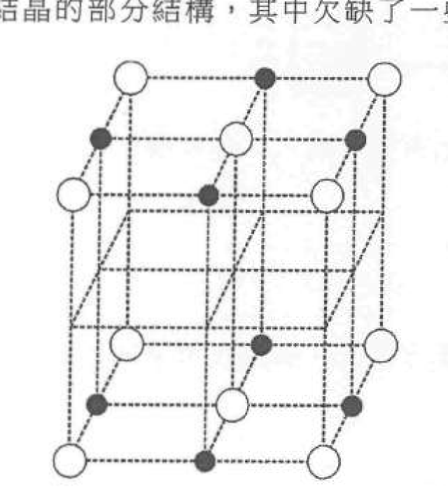

用 ⊕ 表示 Na⁺ 離子和用 ⊖ 表示 Cl⁻ 離子來完成這圖。

(b)　於某實驗，找出了在一個體積為 1.80 × 10⁻²² cm³ 的氯化鈉結晶的立方晶胞內，有 4 粒 Na⁺ 離子和 4 粒 Cl⁻ 離子。

　　(i)　用亞佛加德羅常數 L 來表示 4 粒 Na⁺ 離子和 4 粒 Cl⁻ 離子的總質量。（相對原子質量：Na = 23.0，Cl = 35.5）

　　(ii)　從而計算亞佛加德羅常數 L（已知 1.00 cm³ 的氯化鈉結晶重 2.17 g）。（3 分）

---

## 第 3 題

【建議標籤】

- 卷別/部分：卷一乙　第一部分
- 課題：#烯烴 #溴 #加成反應 #氣體測試

【題目內容】

進行了一個實驗如下所示：

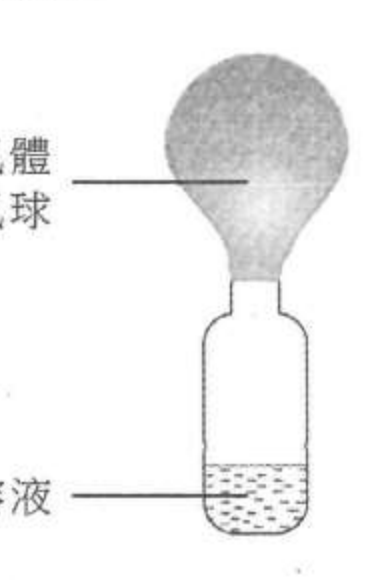

(a)　(i)　提出該橙色有機溶液可以是什麼。

　　(ii)　輔以一化學方程式，解釋在溶液中的顏色變化。（3 分）

(b)　進行了另一個實驗如下所示：

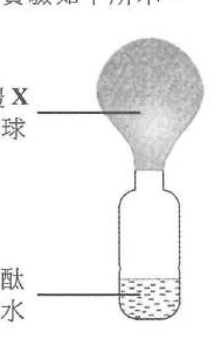

輔以一化學方程式，提出並解釋該氣體 X 可以是什麼。（3 分）

---

## 第 4 題

【建議標籤】

- 卷別/部分：卷一乙　第一部分
- 課題：#標準溶液 #摩爾濃度 #pH #電離

【題目內容】

固體鄰苯二甲酸氫鉀可用來製備標準溶液，其結構顯示如下：

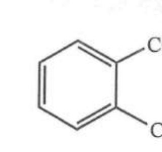

(a)　你獲提供 1.12 g 的固體鄰苯二甲酸氫鉀。

　　(i)　簡述在實驗室中如何製備一個含有 1.12 g 的鄰苯二甲酸氫鉀的 250.0 cm³ 的標準溶液。

　　(ii)　計算在 (i) 所得的標準溶液的摩爾濃度。（式量：鄰苯二甲酸氫鉀 = 204.1）（4 分）

(b)　在室內條件下，一個 0.060 M 的鄰苯二甲酸氫鉀溶液的 pH 是 3.30。根據這項資料及適當的計算，評論在鄰苯二甲酸氫鉀的 COOH 基團是否完全電離。（2 分）

---

## 第 5 題

【建議標籤】

- 卷別/部分：卷一乙　第一部分
- 課題：#鹵代反應 #游離基取代 #異構體

【題目內容】

一化合物的結構顯示如下：

【圖待補：原卷第 5 題／第 18 頁（化合物結構式）】

在某些條件下，牠與一試劑反應可得到相同分子式 C₇H₇Cl 但不同結構的兩個化合物。

(a)　建議這試劑是什麼。（1 分）

(b)　寫出令這反應於室內溫度下發生所需的條件。（1 分）

(c)　寫出所涉及反應類別的名稱。（1 分）

(d)　(i)　繪出這兩個化合物的其中一個的結構，並寫出它的系統名稱。

　　(ii)　繪出另一個化合物的結構。

　　(iii)　這兩個化合物是異構體。寫出牠們所展現的異構類別。（4 分）

---

## 第 6 題

【建議標籤】

- 卷別/部分：卷一乙　第一部分
- 課題：#分子極性 #沸點 #范德華力 #三維結構

【題目內容】

考慮 CHCl₃ 與 CCl₄ 分子：

(a)　繪出一個 CHCl₃ 分子的三維結構。（1 分）

(b)　(i)　解釋為什麼 CHCl₃ 是極性分子但 CCl₄ 不是。

　　(ii)　解釋為什麼 CCl₄ 比 CHCl₃ 具較高的沸點。（3 分）

---

## 第 7 題

【建議標籤】

- 卷別/部分：卷一乙　第一部分
- 課題：#化學電池 #電極電勢 #半反應 #陰極

【題目內容】

(a)　考慮以下所示的化學電池：

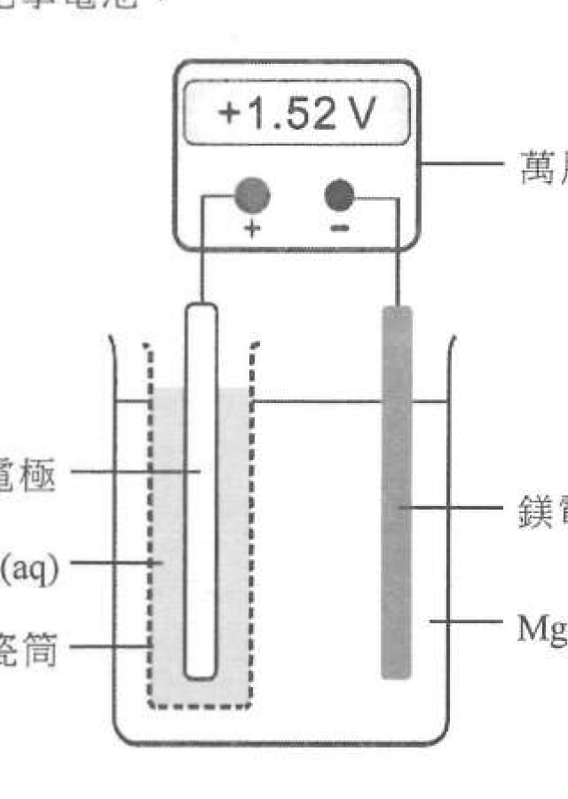

　　(i)　多孔瓷筒的功用是什麼？

　　(ii)　推定電子是否由該鎂電極經外電路流向該銅電極。

　　(iii)　寫出在陰極上所起變化的半反應式。（3 分）

(b)　考慮以下所示的另一化學電池：

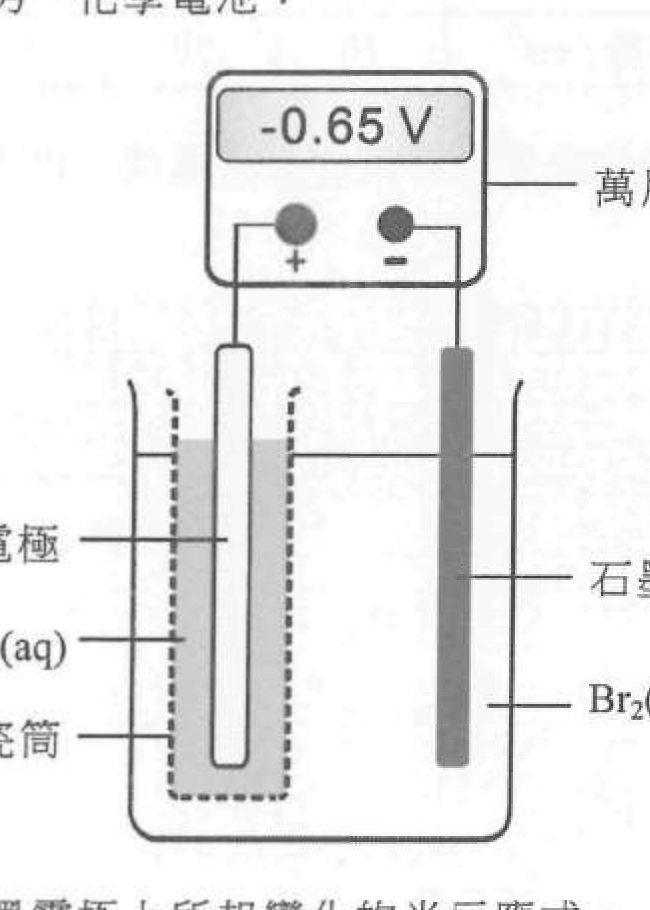

　　(i)　寫出在石墨電極上所起變化的半反應式。

　　(ii)　寫出在銅電極上的預期觀察。

　　(iii)　若把 Br₂(aq) 和 KBr(aq) 的溶液換成 I₂(aq) 和 KI(aq) 的溶液，而其牠條件保持不變，萬用電錶的讀數會變得更負、不那麼負或維持不變？解釋你的答案。（4 分）

---

## 第 8 題

【建議標籤】

- 卷別/部分：卷一乙　第一部分
- 課題：#中和焓 #量熱法 #摩爾計算 #標準中和焓變

【題目內容】

為測定一反應的中和焓變進行了數次實驗。於每一次，在一發泡聚苯乙烯杯子內，藉把如下所示指定體積的某 HCl(aq) 和 1.0 M NaOH(aq) 混合以得到一總體積為 100 cm³ 的溶液。混合前該 HCl(aq) 和 NaOH(aq) 保持於相同的起始溫度。

| 次數 | 所用 HCl(aq) 的體積 / cm³ | 所用 1.0 M NaOH(aq) 的體積 / cm³ |
|---|---|---|
| 1 | 90 | 10 |
| 2 | 70 | 30 |
| 3 | 50 | 50 |
| 4 | 30 | 70 |
| 5 | 10 | 90 |

於每一次，把混合物攪拌並記錄所達到的最高溫度。以下坐標圖顯示於每一次所達到的最高溫度：

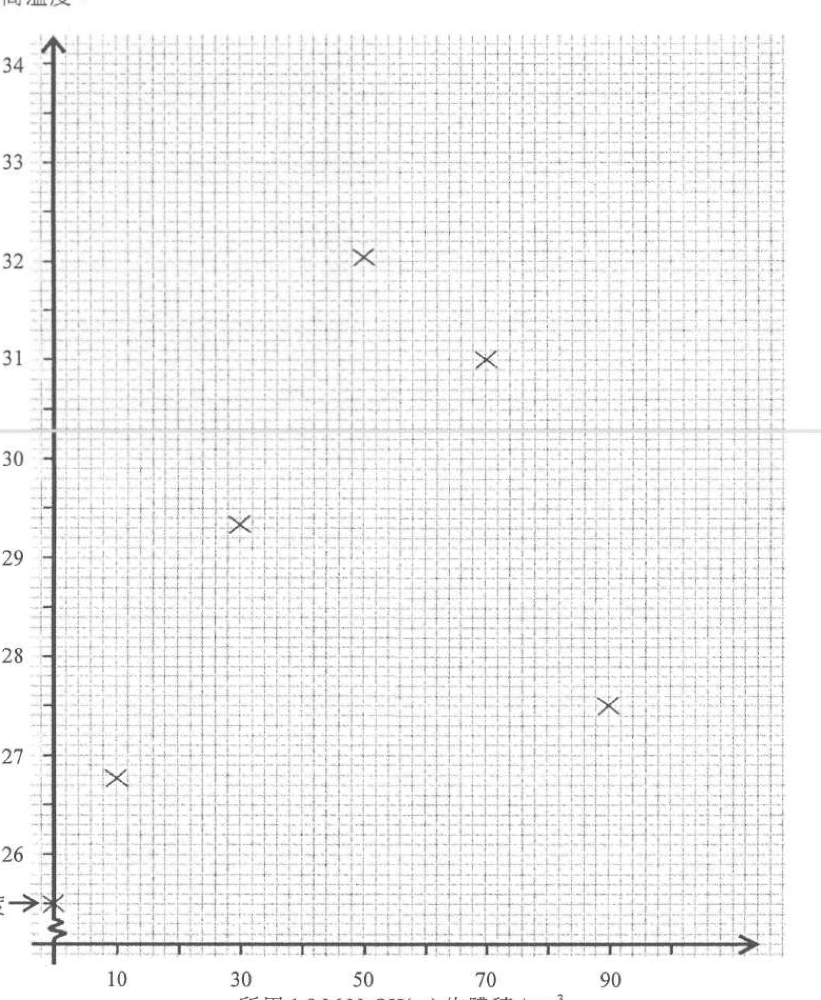

(a)　已從這坐標圖估計了需用 58.0 cm³ 的 NaOH(aq)（和 42.0 cm³ 的 HCl(aq)）來得到這實驗可能達到的最高溫度。在以上的坐標圖展示怎樣可作出這個估計。（1 分）

(b)　(i)　計算在 (a) 中與 HCl(aq) 反應了的 NaOH(aq) 的摩爾數，從而求出該 HCl(aq) 的濃度。

　　(ii)　已知於每一次該混合物的起始溫度是 25.5°C，計算該反應的中和焓變（以 kJ mol⁻¹ 為單位）。（混合物的密度 = 1.00 g cm⁻³，比熱容 = 4.18 J g⁻¹ K⁻¹；燒杯的熱容可忽略）（4 分）

(c)　上面所測定的並不是標準中和焓變。那麼「標準中和焓變」一詞是什麼意思？（1 分）

---

## 第 9 題

【建議標籤】

- 卷別/部分：卷一乙　第一部分
- 課題：#鏽蝕 #鍍錫 #鍍鋅 #鋁 #陽極氧化

【題目內容】

用來儲存食品的鐵罐通常會鍍上一薄層的錫。

(a)　(i)　這錫薄層防止鐵罐腐蝕。簡述這種防止腐蝕的原理。

　　(ii)　解釋一旦這些鐵罐表面被刮至破損時，牠們會否更容易腐蝕。

　　(iii)　提出為什麼鍍鋅不適合用於防止儲存食品的鐵罐腐蝕。（3 分）

(b)　製造商用全鋁製的罐子儲存食品的趨勢正在上升。

　　(i)　解釋為什麼雖然鋁在反應序的位置高於鐵，但牠比鐵更抗腐蝕。

　　(ii)　寫出提升鋁罐抗腐蝕性的過程的名稱。

　　(iii)　除了抗腐蝕性外，舉出使用鋁來製造罐子的一項好處。（3 分）

---

## 第 10 題

【建議標籤】

- 卷別/部分：卷一乙　第一部分
- 課題：#硫酸鋅 #結晶製備 #純化 #鐵粉

【題目內容】

你獲提供常用的實驗儀器和下列化學品：

鐵粉　鋅粉　氨水　蒸餾水

描述怎樣可從一個含有硫酸銅(II)雜質的硫酸鋅固體樣本中，取得硫酸鋅結晶。（不是必須使用所有化學品。）（5 分）

---

## 第二部分（第 11–15 題）

## 第 11 題

【建議標籤】

- 卷別/部分：卷一乙　第二部分
- 課題：#硝酸 #碳酸鈣 #反應速率 #濃度 #表面面積

【題目內容】

使用以下裝置進行了兩次實驗來研習硝酸與碳酸鈣的反應。反應中生成一氣體。

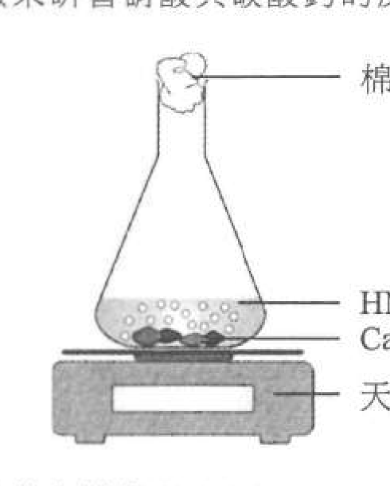

所用的化學品列於下表，而其他實驗條件相同。

| 次數 | 所加入 CaCO₃(s) 的質量 / g | 所加入 3.0 M HNO₃(aq) 的體積 / cm³ | 所加入 H₂O(l) 的體積 / cm³ |
|---|---|---|---|
| 1 | 3.0 | 10.0 | 20.0 |
| 2 | 3.0 | 20.0 | 10.0 |

(a)　寫出硝酸與碳酸鈣的反應的化學方程式。（1 分）

(b)　以下坐標圖顯示在這兩次所量得的質量隨時間的變化：

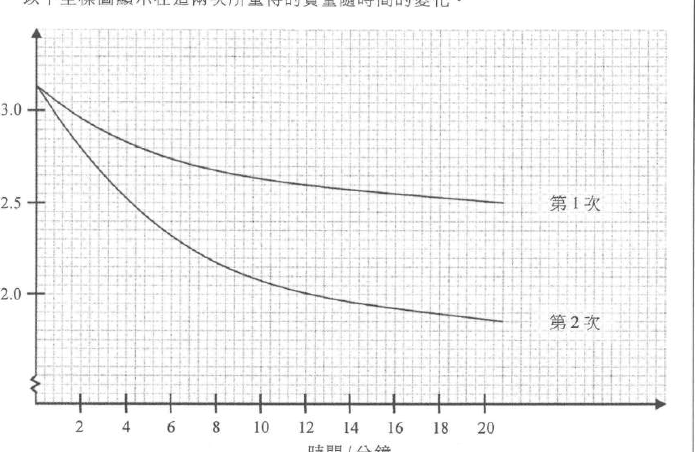

(c)　(i)　計算在第 2 次從第 2 分鐘到第 12 分鐘氣體生成的平均速率。

　　(ii)　解釋第 1 次和第 2 次的曲線形狀的一項差異。（4 分）

(d)　建議如何利用上述裝置來研習固體反應物的表面面積對反應速率的影響。（1 分）

---

## 第 12 題

【建議標籤】

- 卷別/部分：卷一乙　第二部分
- 課題：#平衡常數 #硫氰酸鐵 #勒沙特列原理 #焓變

【題目內容】

考慮以下化學反應的一個平衡混合物：

Fe³⁺(aq) + SCN⁻(aq) ⇌ Fe(SCN)²⁺(aq)

黃色　　無色　　深紅色

(a)　寫出這反應的平衡常數 Kc 的表示式。（1 分）

(b)　在某溫度下，這反應的平衡常數 Kc 是 1.08 × 10³ dm³ mol⁻¹。該平衡混合物是把 20.0 cm³ 的 0.030 M Fe(NO₃)₃(aq) 與 10.0 cm³ 的 0.030 M KSCN(aq) 在酸性介質中混合而製備。計算在該溫度下這平衡混合物中 Fe(SCN)²⁺(aq) 的濃度。（3 分）

(c)　已知當溫度上升時這平衡常數 Kc 增加。提出並解釋這反應的焓變會是正數、負數抑或零。（1 分）

(d)　當把小量的 Na₂SO₃(s) 加進這平衡混合物時，混合物的顏色變淡。解釋這觀察。（2 分）

---

## 第 13 題

【建議標籤】

- 卷別/部分：卷一乙　第二部分
- 課題：#乙醇氧化 #乙酸 #醯胺 #聚合

【題目內容】

打算用以下的裝置從乙醇製備乙酸。然而，所集得的餾液主要含另一個有機生成物 X 而不是乙酸。

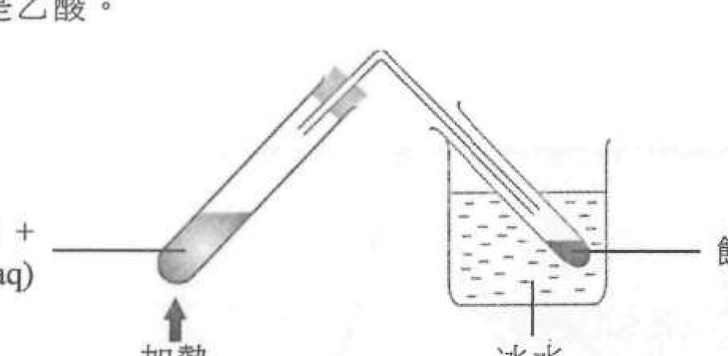

(a)　(i)　X 是什麼？

　　(ii)　解釋為什麼所集得的餾液主要含有 X 而不是乙酸。（2 分）

(b)　乙酸可轉化為一未經取代的醯胺：

　　(i)　寫出這醯胺的系統名稱。

　　(ii)　提出這項轉化需要什麼試劑及條件。（2 分）

(c)　以下顯示從一醯胺生成一聚合物：

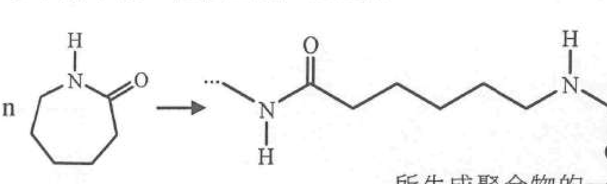

　　(i)　繪出所生成聚合物的重複單位。

　　(ii)　有觀點認為上述聚合反應並不涉及縮合。提出一個支持這觀點的理由。（2 分）

---

## 第 14 題

【建議標籤】

- 卷別/部分：卷一乙　第二部分
- 課題：#第三周期 #熔點 #金屬鍵 #巨型共價結構

【題目內容】

以下坐標圖顯示周期表內第三周期各元素熔點變化的未完成草繪：

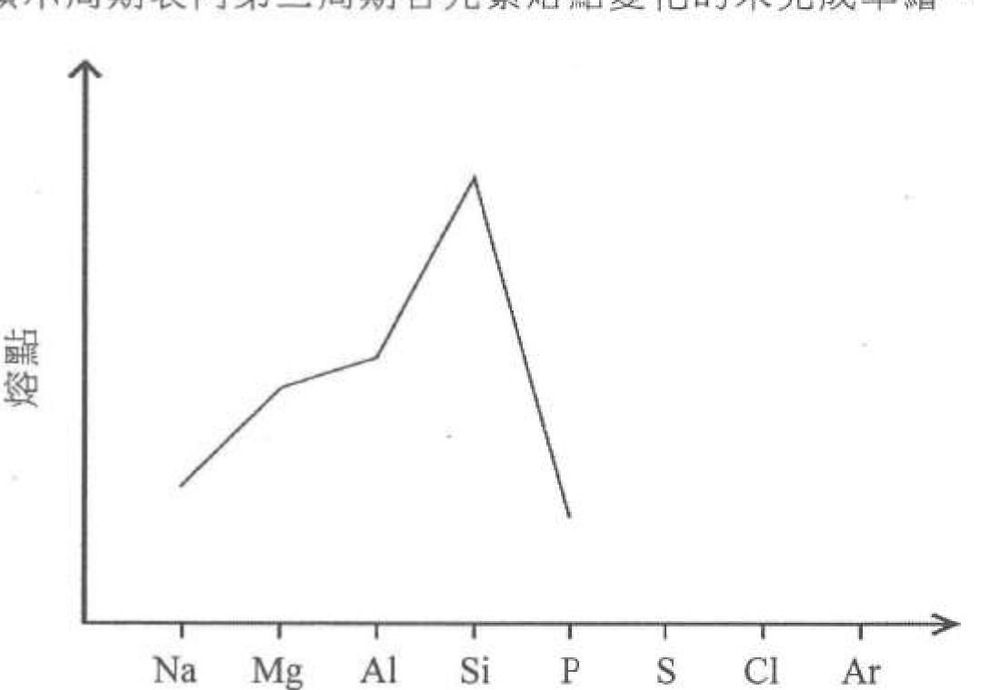

(a)　在上面的坐標圖完成這草繪。（1 分）

(b)　解釋為什麼 Mg 的熔點較 Na 的高。

(c)　解釋為什麼 Si 的熔點較 P 的高。（2 分）

---

## 第 15 題

【建議標籤】

- 卷別/部分：卷一乙　第二部分
- 課題：#月桂基硫酸鈉 #表面活性劑 #清潔

【題目內容】

*參照以下月桂基硫酸鈉（SLS）的結構，解釋為什麼牠具有清潔性質。

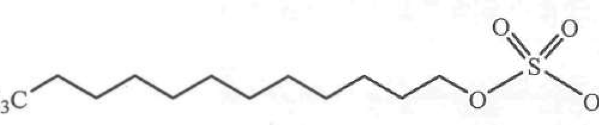

（5 分）

---

*試卷完 —*

## 待人工核對

本卷為第 2 層文字交貨，由 easyocr（ch_tra+en，GPU）掃描底稿清洗而成；現模型無影像輸入，未能對頁影像覆核。以下題號建議第 3 層精修時對頁覆核：

- 第 1 題：三原子資料表（質子／電子／中子數目，原子名稱「氫／氘／氧」）待對頁核實。
- 第 4 題：「鄰苯二甲酸氫鉀」譯名（OCR 讀作「猷酸氫鉀」）待對頁核實。
- 第 5 題：化合物結構式（OCR 僅辨出 CH₃ 基團）及生成物分子式（OCR 讀作「CHiCl」）待對頁核實；結構圖待補。
- 第 8 題：中和焓實驗表格（次數及 HCl／NaOH 體積）及坐標圖數據點待對頁核實。
- 第 11 題：表格（CaCO₃ 質量／HNO₃ 體積／H₂O 體積）及分題編號（b/c/d）待對頁核實。
- 第 13 題：「醯胺」譯名（OCR 讀作「醚胺／酴胺」）及 (c) 醯胺聚合物結構待對頁核實。
- 第 2、3、4、7、8、11、13、14、15 題：圖為 300dpi 原卷截圖（程式定位＋墨跡覆蓋率校驗；位置／範圍待 spot-check）；第 3 層再換成向量重繪。
- 第 5 題：結構式圖待補（OCR 未能可靠定位）。
