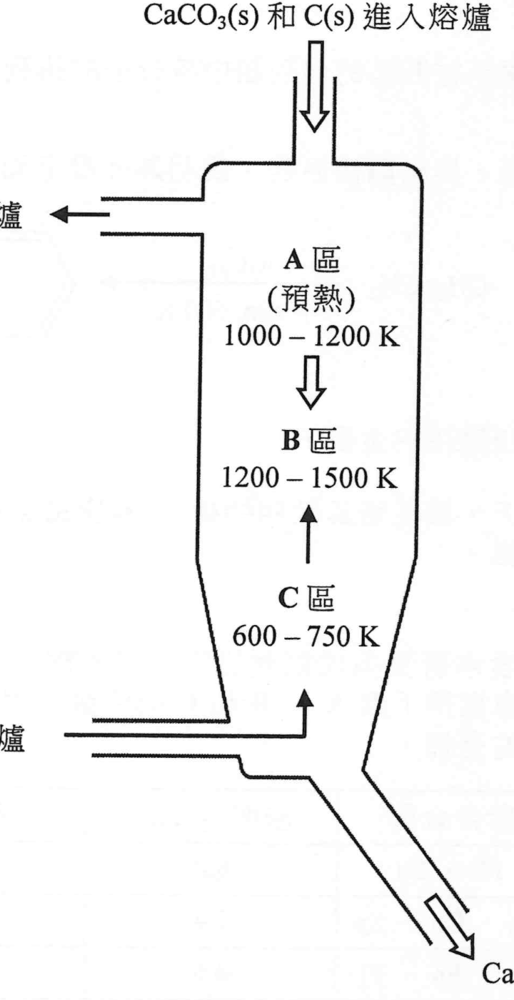
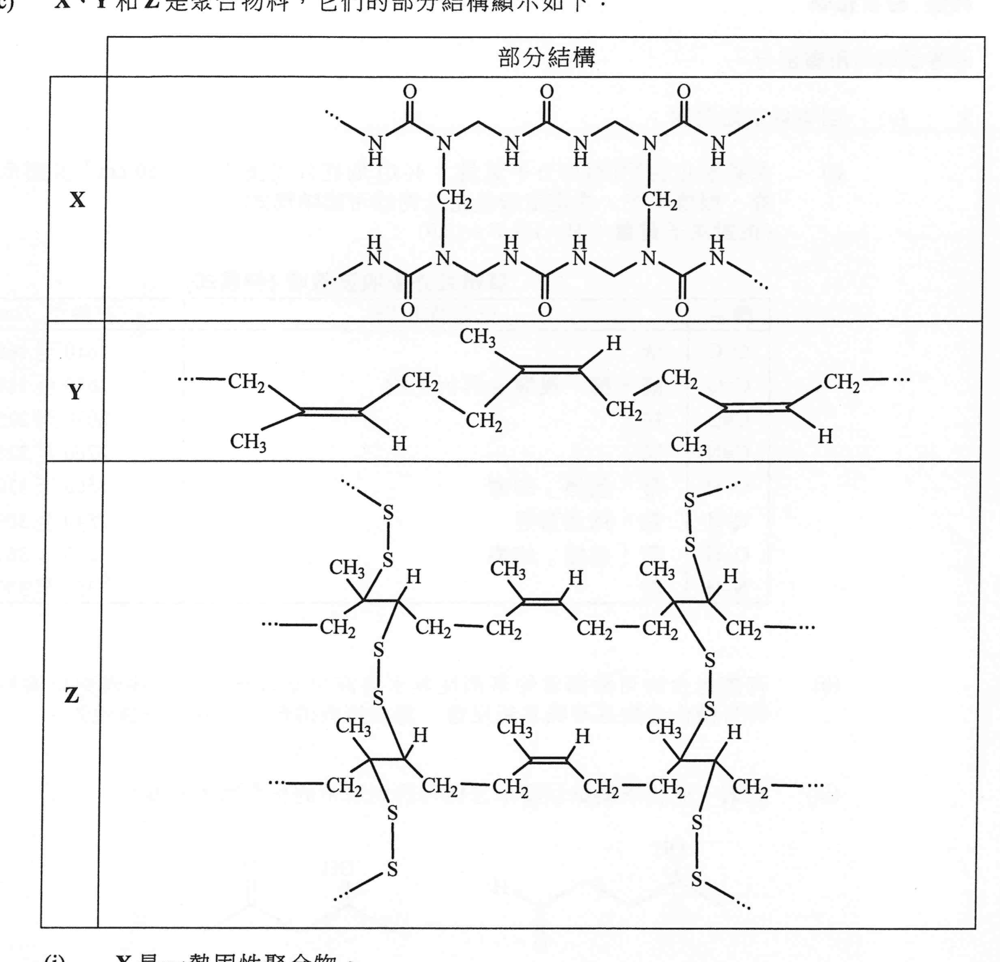
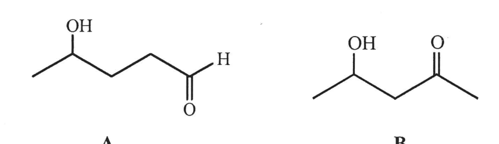
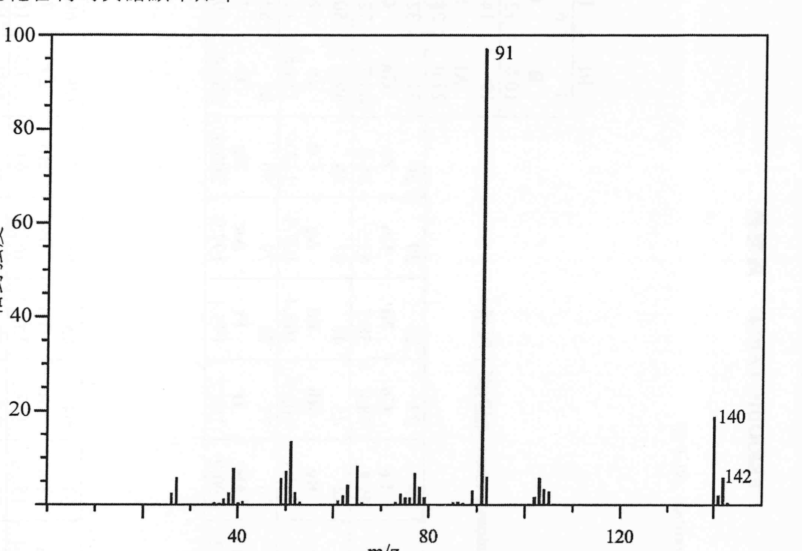

# 2019 DSE 化學 卷二（中文卷）— 題目庫

> 來源：文憑試 DSE 化學 Chemistry 2019 歷屆試題 Past Paper 卷二.pdf　｜　三部分：甲部 工業化學、乙部 物料化學、丙部 分析化學（每部分一題）
> 本試卷共有甲、乙和丙三部。考生須選答任何兩部中的全部試題。
> 說明：已移除頁碼、試卷標頭等雜訊；化學式以 Unicode 下標／上標表示，反應式以 → 或 ⇌ 表示。**本檔為題目庫（零答案）**，只含題目清洗 + 建議標籤。
> 本檔為第 2 層文字交貨（圖用原卷截圖；精修重繪另開第 3 層）。

---

## 甲部　工業化學（第 1 題）

## 第 1 題

【建議標籤】

- 卷別/部分：卷二　甲部
- 課題：#哈柏法 #合成氣 #反應級數 #氯鹼工業 #肼 #原子經濟 #石灰 #活化能

【題目內容】

回答試題的所有部分。

(a)　回答以下短問題。

　　(i)　解釋為什麼哈柏法對增加農作物產量有重要的貢獻。（1 分）

　　(ii)　(1)　寫出從甲烷生成合成氣的化學方程式。

　　　(2)　合成氣可從生物量的轉化而得。提出為什麼這可被視為甲醇生產科技的改進。（2 分）

　　(iii)　在相同實驗條件下，進行了三次實驗來研習以下反應的動力學：

2A(aq) + B(aq) → 2C(aq) + 2D(aq) + E(s)

下表顯示所得的數據：

| 次數 | A(aq) 的初始濃度 / mol dm⁻³ | B(aq) 的初始濃度 / mol dm⁻³ | D(aq) 的生成初速 / mol dm⁻³ s⁻¹ |
|---|---|---|---|
| 1 | 0.0836 | 0.202 | 0.26 × 10⁻⁴ |
| 2 | 0.0836 | 0.404 | 1.04 × 10⁻⁴ |
| 3 | 0.0418 | 0.404 | 0.52 × 10⁻⁴ |

推定對應 A(aq) 及對應 B(aq) 的反應級數。（2 分）

(b)　某氯鹼化工廠使用膜電解池來生產氫、氯和氫氧化鈉。

　　(i)　輔以各化學方程式，簡述在膜電解池怎樣生產氫、氯和氫氧化鈉。（4 分）

　　(ii)　從膜電解池所獲取的產物可製造次氯酸鈉（NaOCl）。寫出其生成的化學方程式。（1 分）

　　(iii)　這化工廠藉使用 NaOCl 可生產在太空船用作推進劑的肼（N₂H₄）：

NaOCl + 2NH₃ → N₂H₄ + NaCl + H₂O　反應(I)

然而，也可使用 H₂O₂ 而不使用 NaOCl 來生產肼：

H₂O₂ + 2NH₃ → N₂H₄ + 2H₂O　反應(II)

藉計算反應(I)和反應(II)的各原子經濟，比較牠們何者可被視為較綠色。（式量 NaOCl = 74.5，NH₃ = 17.0，H₂O₂ = 34.0，N₂H₄ = 32.0，NaCl = 58.5，H₂O = 18.0）（2 分）

(c)　在工業上，CaO(s) 是從 CaCO₃(s) 的分解而產得：

CaCO₃(s) ⇌ CaO(s) + CO₂(g)　ΔH = +180 kJ mol⁻¹

下圖顯示在某工廠內生產 CaO(s) 的一個操作中的熔爐。CaCO₃(s) 和 C(s) 從頂端進入熔爐，而空氣則在靠近底部進入熔爐。

　　(i)　寫出 CaCO₃(s) 的一種原料。（1 分）

　　(ii)　解釋為什麼注入 C(s) 和空氣可令到 B 區的平均溫度較 A 區高。（1 分）

　　(iii)　操作壓強是設定於約 1 atm 的。舉出兩個原因，說明為什麼較高的操作壓強並不可取。（2 分）

　　(iv)　上述 CaCO₃(s) 分解的活化能是 160 kJ mol⁻¹。計算 CaCO₃(s) 的分解在 1500 K 的速率常數與在 1200 K 的速率常數之比。（氣體常數 R = 8.31 J K⁻¹ mol⁻¹）（3 分）

　　(v)　根據化學平衡，提出為什麼 CaCO₃(s) 的分解主要在 B 區內發生。（1 分）

---

## 乙部　物料化學（第 2 題）

## 第 2 題

【建議標籤】

- 卷別/部分：卷二　乙部
- 課題：#纖維素 #液晶 #綠色化學 #鐵 #銅 #合金 #PVC #熱固性聚合物 #橡膠

【題目內容】

回答試題的所有部分。

(a)　回答以下短問題。

　　(i)　從分子層面，解釋為什麼棉花（主要含有纖維素）容易吸水。（2 分）

　　(ii)　繪畫一圖以顯示在液晶的向列相中各分子的排列。（1 分）

　　(iii)　根據所給資料，提出兩個原因，說明為什麼下面的反應可被視為綠色：

CH₂=CH₂ →（催化劑 AlCl₃；40 atm，600 K）→ CH₂CH₂

（2 分）

(b)　鐵和銅是生活中廣泛應用的金屬。

　　(i)　於室內條件下，鐵晶體具敞開結構。寫出這結構的名稱，並繪畫一圖以表示牠的一個晶胞。（2 分）

　　(ii)　如要把鐵製食水管更換成銅製的管，可能需把這些銅管用合適的焊料接合一起。寫出你會選擇下列 A、B 和 C 哪合金來用作合適的焊料，並給出兩個原因以支持你的選擇。

| 合金 | 所含金屬 | 密度 / g cm⁻³ | 熔點 / °C |
|---|---|---|---|
| A | Pb、Sn | 8.8 | 183 |
| B | Ag、Cu、Sn | 7.4 | 217 |
| C | Al、Sn、Ti | 4.5 | 1590 |

（2 分）

　　(iii)　提出為什麼水龍頭一般是用黃銅而非銅製造的。（1 分）

　　(iv)　鐵製排水管可更換成聚氯乙烯（PVC）製的管。

　　　(1)　繪出聚氯乙烯的結構式。

　　　(2)　建議一個製造 PVC 管的成型方法。（2 分）

(c)　X、T 和 Z 是聚合物料。牠們的部分結構顯示如下：

　　(i)　X 是一熱固性聚合物。

　　　(1)　繪出 X 各單體的結構。

　　　(2)　寫出在形成 X 的聚合作用的類別名稱。（3 分）

　　(ii)　在工業上，T 與物質 W 共熱得到 Z。

　　　(1)　W 是什麼？

　　　(2)　寫出所涉及過程的名稱。（2 分）

　　(iii)　在這三種物料中，製造汽車輪胎最佳為 Z。

　　　(1)　考慮牠們的物理性質，提出一個原因為什麼 Z 較 X 更適合製造汽車輪胎。

　　　(2)　從分子層面，解釋為什麼 Z 較 T 更適合製造汽車輪胎。（3 分）

---

## 丙部　分析化學（第 3 題）

## 第 3 題

【建議標籤】

- 卷別/部分：卷二　丙部
- 課題：#紅外光譜 #萃取 #氯化物測定 #滴定 #薄層色層法 #質譜 #二噁英

【題目內容】

回答試題的所有部分。

(a)　回答以下短問題。

　　(i)　某碳氫化合物（相對分子質量 = 40.0）的紅外光譜約在 2150 cm⁻¹ 處顯示一吸收峰。根據下表，推定這碳氫化合物的可能結構式。（相對原子質量：H = 1.0，C = 12.0）

| 鍵合 | 化合物類別 | 波數域 / cm⁻¹ |
|---|---|---|
| C=C | 烯 | 1610 至 1680 |
| C=O | 醛、酮、羧酸及其衍生物 | 1680 至 1800 |
| C≡C | 炔 | 2070 至 2250 |
| C≡N | 腈 | 2200 至 2280 |
| O-H | 帶「氫鍵」的酸 | 2500 至 3300 |
| C-H | 烷、烯及芳烴 | 2840 至 3095 |
| O-H | 帶「氫鍵」的醇 | 3230 至 3670 |
| N-H | 胺 | 3350 至 3500 |

（2 分）

　　(ii)　有機化合物可藉適當的溶劑從其水溶液中萃取出來。這些溶劑須溶解要萃取的有機化合物且不與其起反應。寫出這些溶劑應有的另一種性質。（1 分）

　　(iii)　建議一個化學測試以顯示怎樣可辨別以下的化合物 A 和 B：

（2 分）

(b)　為測定在一個煙肉樣本中的鈉含量（以 NaCl 存在），需先找出其 Cl⁻ 含量。把 2.0 g 的煙肉樣本加入 25.0 cm³ 的 1.0 M AgNO₃(aq)，之後將過量稀 HNO₃(aq) 加進所得混合物，然後用過濾法把所生成的 AgCl(s) 除掉，繼而在有適當的指示劑下，用 0.10 M KSCN(aq) 滴定濾液中所剩餘的過量 AgNO₃(aq) 以得出 AgSCN(s) 直至達到終點。把所有步驟重複幾次，達到終點所用 KSCN(aq) 的平均體積為 9.42 cm³。

　　(i)　為什麼要把過量稀 HNO₃(aq) 加進該混合物？（1 分）

　　(ii)　繪畫在滴定所用裝置的圖，標示所有儀器和試劑。（2 分）

　　(iii)　假設煙肉樣本中的所有 Cl⁻ 來自 NaCl，計算在這煙肉樣本中鈉的質量百分率。（相對原子質量：Na = 23.0，Cl = 35.5，Ag = 107.9）（4 分）

(c)　氯與乙苯（C₆H₅CH₂CH₃）在日光下反應得出不同氯化合物的混合物。

　　(i)　用了薄層色層法（TLC）把小量混合物分離。

　　　(1)　簡單解釋為什麼可用色層法把混合物分離。

　　　(2)　根據 TLC 的結果，建議一個把大量混合物分離的方法。（3 分）

　　(ii)　從這混合物把一個單氯化合物分離出來。已知氯有兩個同位素 ³⁵Cl 和 ³⁷Cl。這化合物的質譜顯示如下：

參照所標示的各峰，推定這化合物的一個可能結構。（3 分）

　　(iii)　在製造某些含氯產品的過程中，可生成如二噁英的污染物。

　　　(1)　解釋為什麼需要量度二噁英水平。

　　　(2)　提出為什麼通常使用現代儀器來量度二噁英水平。（2 分）

---

*試卷完 —*

## 待人工核對

本卷為第 2 層文字交貨，由 easyocr（ch_tra+en，GPU）掃描底稿清洗而成；現模型無影像輸入，未能對頁影像覆核。以下題號建議第 3 層精修時對頁覆核：

- 第 1(a)(iii) 題：動力學表（A／B 初始濃度、D 生成初速）待對頁核實。
- 第 1(b)(iii) 題：「肼」譯名（OCR 讀作「腓／胖」）及反應式待對頁核實。
- 第 1(c) 題：熔爐圖（A／B／C 區溫度範圍）待對頁核實。
- 第 2(a)(iii) 題：聚合反應式（催化劑／壓強／溫度）待對頁核實。
- 第 2(b)(ii) 題：合金表（所含金屬、密度、熔點）待對頁核實。
- 第 2(c) 題：X、T、Z 三聚合物的身份及結構待對頁核實。
- 第 3(a)(i) 題：紅外光譜表（鍵合／化合物類別／波數域）待對頁核實。
- 第 3(b) 題：煙肉樣本滴定步驟（試劑、濃度、體積）待對頁核實。
- 第 1(c)、2(c)、3(a)、3(c) 題：圖為 300dpi 原卷截圖（程式定位＋墨跡覆蓋率校驗；位置／範圍待 spot-check）；第 3 層再換成向量重繪。
