# 2020 DSE 化學 卷一甲（中文卷）— 題目庫

> 來源：文憑試 DSE 化學 Chemistry 2020 歷屆試題 Past Paper 卷一.pdf　｜　多項選擇題 36 題（第一部分 24 題、第二部分 12 題）
> 本部包括兩部分：第一部分設 24 題，第二部分設 12 題。選出每題最佳的答案。考生可參考印於試題答題簿 B 第 20 頁的周期表。
> 說明：已移除頁碼、試卷標頭等雜訊；化學式以 Unicode 下標／上標表示（如 H₂SO₄），反應式以 → 或 ⇌ 表示。**本檔為題目庫（零答案）**，只含題目清洗 + 建議標籤。
> 本檔為第 2 層文字交貨（圖用原卷截圖；精修重繪另開第 3 層）。

---

## 第一部分（第 1–24 題）

## 第 1 題

【建議標籤】

- 卷別/部分：卷一甲　第一部分
- 課題：#生石灰 #碳酸鈣 #熱分解

【題目內容】

下列哪項有關生石灰的陳述不正確？

- A. 把大理石強熱可生成生石灰
- B. 生石灰與二氧化硫反應可生成硫酸鈣
- C. 生石灰與二氧化碳反應可生成碳酸鈣
- D. 把生石灰放進水中時釋出大量的熱

---

## 第 2 題

【建議標籤】

- 卷別/部分：卷一甲　第一部分
- 課題：#石英 #巨型共價結構 #二氧化矽

【題目內容】

下列哪項有關石英的陳述正確？

- A. 石英溶於己烷
- B. 石英含有 SiO₂ 分子
- C. 石英藉離域電子導電
- D. 石英堅硬是因牠有巨型共價網絡結構

---

## 第 3 題

【建議標籤】

- 卷別/部分：卷一甲　第一部分
- 課題：#摩爾計算 #結晶水 #硫酸銅

【題目內容】

在 24.0 g 的 CuSO₄·5H₂O(s) 中，氧的質量是多少？

（相對原子質量：H = 1.0，O = 16.0，S = 32.1，Cu = 63.5）

- A. 6.2 g
- B. 9.6 g
- C. 13.8 g
- D. 21.7 g

---

## 第 4 題

【建議標籤】

- 卷別/部分：卷一甲　第一部分
- 課題：#氮氧化物 #棕色氣體 #氧化還原

【題目內容】

把 X 放進 Y 時，下列哪組合會得出一棕色氣體？

| | A | B | C | D |
|---|---|---|---|---|
| X | 鎂 | 氧化鎂 | 氧化鎂 | 鎂 |
| Y | 濃硝酸 | 濃硫酸 | 濃硝酸 | 濃硫酸 |

---

## 第 5 題

【建議標籤】

- 卷別/部分：卷一甲　第一部分
- 課題：#第1族 #鈁 #周期表趨勢

【題目內容】

下列哪項有關鈁（原子序 = 87）的陳述正確？

- A. 鈁比鉀有較高的熔點
- B. 鈁比鉀較易生成陽離子
- C. 鈁比鉀是較弱的氧化劑
- D. 鈁比鉀具較少已佔電子層的數目

---

## 第 6 題

【建議標籤】

- 卷別/部分：卷一甲　第一部分
- 課題：#加成反應 #氯乙烯 #溴

【題目內容】

氯乙烯與溶於一有機溶劑的溴反應的生成物是什麼？

- A. 2-氯-1,2-二溴乙烷
- B. 1,2-二溴-1-氯乙烷
- C. 2-氯-1,1-二溴乙烷
- D. 2,2-二溴-1-氯乙烷

---

## 第 7 題

【建議標籤】

- 卷別/部分：卷一甲　第一部分
- 課題：#合金 #物料選擇 #飛機機身

【題目內容】

參照下表的資料：

| 物料 | 密度 / g cm⁻³ | 硬度級別（1 = 最硬） | 價格級別（1 = 最便宜） |
|---|---|---|---|
| P | 8.9 | 1 | 4 |
| Q | 7.8 | 2 | 3 |
| R | 10.5 | 3 | 2 |
| S | 2.7 | [?] | [?] |

哪個是製造飛機機身的最佳物料？

- A. P
- B. Q
- C. R
- D. S

---

## 第 8 題

【建議標籤】

- 卷別/部分：卷一甲　第一部分
- 課題：#鏽蝕 #鐵 #生鏽條件

【題目內容】

考慮以下實驗裝置。開始時氣球已填充了氣體 X。

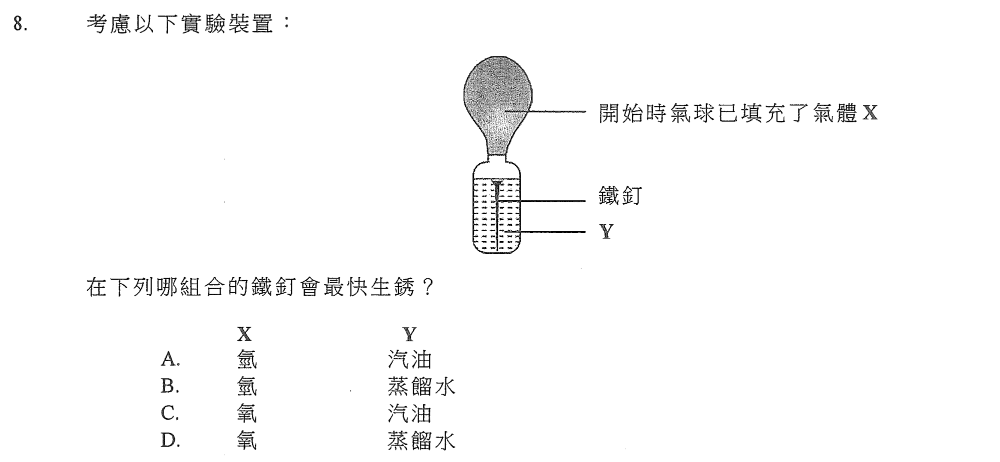

在下列哪組合的鐵釘會最快生鏽？

| | A | B | C | D |
|---|---|---|---|---|
| X | 氧 | 氧 | 空氣 | 空氣 |
| Y | 汽油 | 蒸餾水 | 汽油 | 蒸餾水 |

---

## 第 9 題

【建議標籤】

- 卷別/部分：卷一甲　第一部分
- 課題：#化學電池 #電化電池 #氧化還原

【題目內容】

參照以下的化學電池：

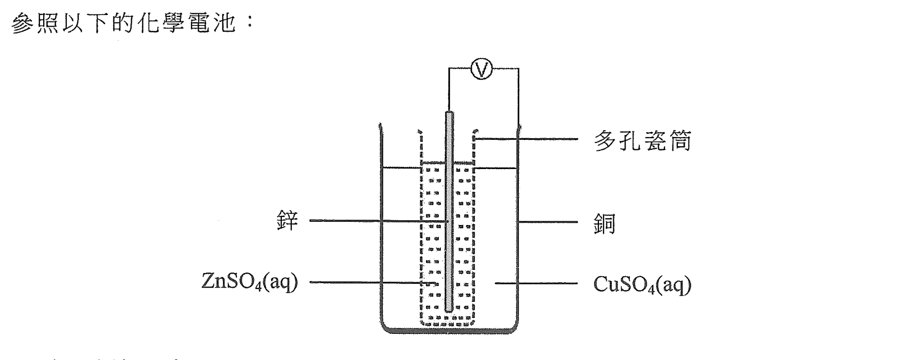

下列哪項陳述正確？

- A. 銅是這電池的陰極
- B. 鋅離子在這電池作為氧化劑
- C. 只有鋅離子可穿越多孔瓷筒
- D. 電子從銅經外電路流向鋅

---

## 第 10 題

【建議標籤】

- 卷別/部分：卷一甲　第一部分
- 課題：#赫斯定律 #燃燒焓 #焓變

【題目內容】

參照下面的各標準燃燒焓變：

- [?]：−3268 kJ mol⁻¹
- [?]：−3920 kJ mol⁻¹
- H₂(g)：−286 kJ mol⁻¹

以下反應的標準焓變是多少？

3H₂(g) + [?] → [?]

- A. −206 kJ mol⁻¹
- B. −652 kJ mol⁻¹
- C. +206 kJ mol⁻¹
- D. +652 kJ mol⁻¹

---

## 第 11 題

【建議標籤】

- 卷別/部分：卷一甲　第一部分
- 課題：#酸與碳酸鹽 #檸檬酸 #無色氣體

【題目內容】

當把水滴到以下裝置的混合物時發生一反應，有一無色氣體釋出。

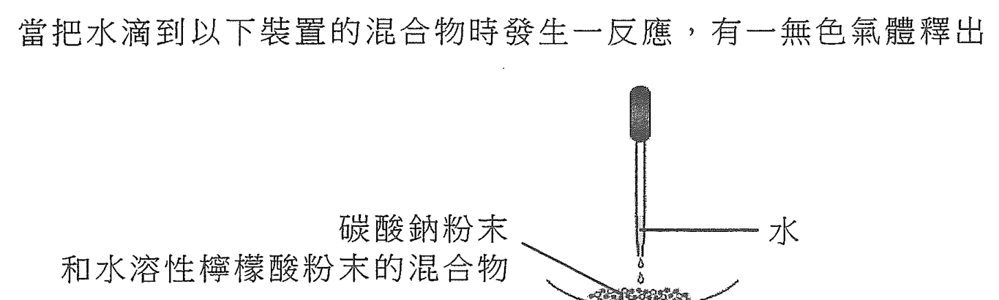

水在這反應的角色是什麼？

- A. 水與碳酸鈉反應得出該無色氣體
- B. 水與檸檬酸反應得出該無色氣體
- C. 水是一介質讓碳酸鈉生成碳酸根離子
- D. 水是一介質讓檸檬酸生成氫離子

---

## 第 12 題

【建議標籤】

- 卷別/部分：卷一甲　第一部分
- 課題：#氧化還原 #滴定 #摩爾計算

【題目內容】

參照下列的半反應式：

C₂O₄²⁻(aq) → 2CO₂(g) + 2e⁻

MnO₄⁻(aq) + 8H⁺(aq) + 5e⁻ → Mn²⁺(aq) + 4H₂O(l)

要完全氧化 15.00 cm³ 的 0.020 M 的 C₂O₄²⁻(aq)，最小需要多少體積的 0.010 M 酸化 KMnO₄(aq)？

- A. 6.00 cm³
- B. 12.00 cm³
- C. 15.00 cm³
- D. 75.00 cm³

---

## 第 13 題

【建議標籤】

- 卷別/部分：卷一甲　第一部分
- 課題：#焓變 #能量圖 #反應途徑

【題目內容】

一轉化的焓變如下所示：

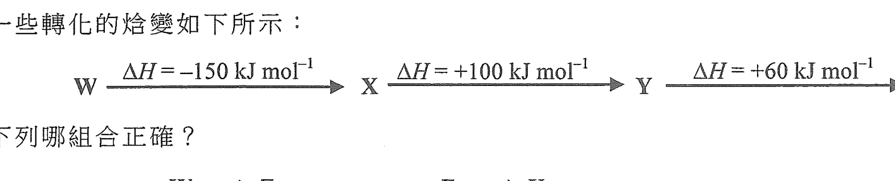

下列哪組合正確？

| | X | Y |
|---|---|---|
| A. | 放熱 | 吸熱 |
| B. | 放熱 | 放熱 |
| C. | 吸熱 | 放熱 |
| D. | 吸熱 | 吸熱 |

---

## 第 14 題

【建議標籤】

- 卷別/部分：卷一甲　第一部分
- 課題：#碳氫化合物 #己烷 #燃燒產物檢測

【題目內容】

下面的裝置是用來顯示己烷（C₆H₁₄）含碳和氫。

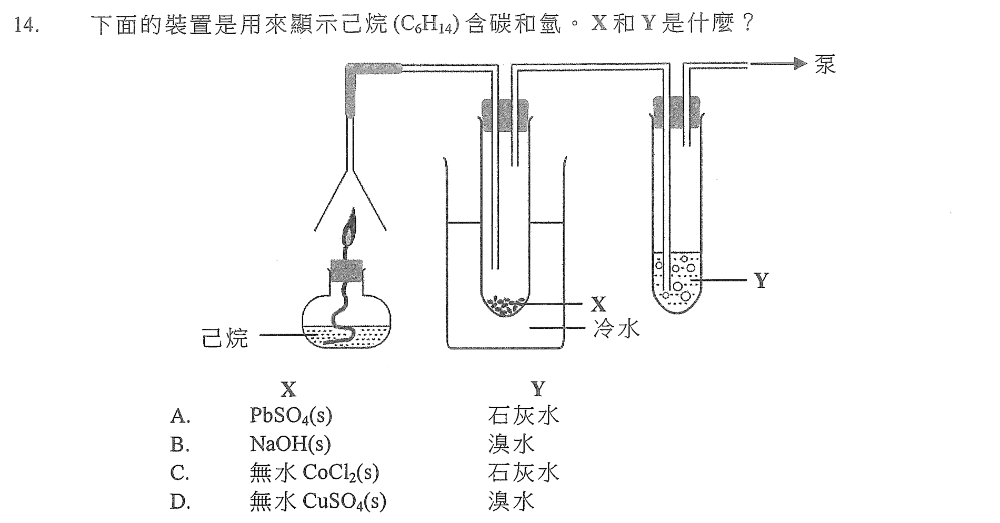

X 和 Y 是什麼？

| | A | B | C | D |
|---|---|---|---|---|
| X | PbSO₄(s) | NaOH(s) | 無水 CoCl₂(s) | 無水 CuSO₄(s) |
| Y | 石灰水 | 溴水 | 石灰水 | 溴水 |

---

## 第 15 題

【建議標籤】

- 卷別/部分：卷一甲　第一部分
- 課題：#金屬活性序 #金屬碳酸鹽 #熱分解

【題目內容】

把三種金屬碳酸鹽加熱的觀察如下所示：

| 金屬碳酸鹽 | 觀察 |
|---|---|
| [?]₂CO₃ | 有一氣體釋出和生成有光澤的銀色固體 |
| [?]CO₃ | 沒有可觀察的變化 |
| [?]CO₃ | 有一氣體釋出和生成黃色固體 |

下列何者顯示這些金屬活性的遞減次序？

- A. X > Y > Z
- B. Y > X > Z
- C. Z > X > Y
- D. Z > Y > X

---

## 第 16 題

【建議標籤】

- 卷別/部分：卷一甲　第一部分
- 課題：#滴定 #滴定管讀數

【題目內容】

在一滴定中的起始滴定管讀數是 4.80 cm³，而對應的最終滴定管讀數可從下圖找出。

在這滴定中所用試劑的體積是多少？

- A. 23.90 cm³
- B. 23.80 cm³
- C. 22.60 cm³
- D. 22.50 cm³

---

## 第 17 題

【建議標籤】

- 卷別/部分：卷一甲　第一部分
- 課題：#化學品儲存 #硝酸銀 #硫酸

【題目內容】

下列儲存該有關化學品的做法，何者是可接受的？

(1) 把濃 H₂SO₄(l) 儲存在銅容器內

(2) 把濃 AgNO₃(aq) 儲存在棕色玻璃容器內

(3) 把濃 Pb(NO₃)₂(aq) 儲存在鐵容器內

- A. 只有 (1)
- B. 只有 (2)
- C. 只有 (1) 和 (3)
- D. 只有 (2) 和 (3)

---

## 第 18 題

【建議標籤】

- 卷別/部分：卷一甲　第一部分
- 課題：#氯化銅 #晶體製備

【題目內容】

製備氯化銅(II)晶體可涉及下列哪步驟？

(1) 把 CuCO₃(s) 加進 HCl(aq)

(2) 把 Cu(NO₃)₂(s) 加進 NaCl(aq)

(3) 把 Cu(s) 加進 HCl(aq)

- A. 只有 (1)
- B. 只有 (2)
- C. 只有 (1) 和 (3)
- D. 只有 (2) 和 (3)

---

## 第 19 題

【建議標籤】

- 卷別/部分：卷一甲　第一部分
- 課題：#鹵素 #電解 #氧化還原

【題目內容】

下列的過程，何者可生成鹵素？

(1) 把濃 KCl(aq) 電解

(2) 把 Na₂SO₃(aq) 加進濃 HBr(aq)

(3) 把 KI(s) 加進酸化 KMnO₄(aq)

- A. 只有 (1)
- B. 只有 (2)
- C. 只有 (1) 和 (3)
- D. 只有 (2) 和 (3)

---

## 第 20 題

【建議標籤】

- 卷別/部分：卷一甲　第一部分
- 課題：#鹵化氫 #沸點 #氫鍵 #范德華力

【題目內容】

參照以下草繪：

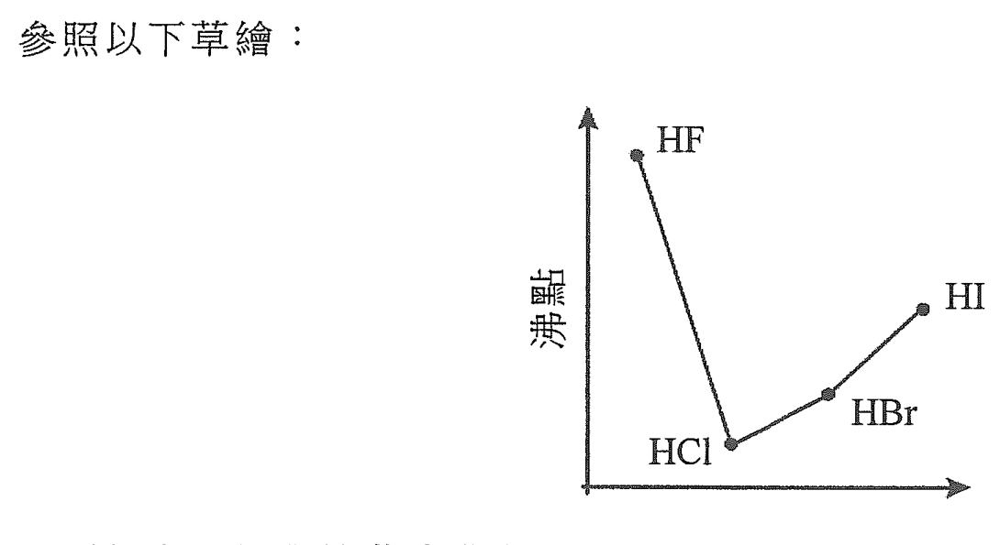

下列何者可解釋這些鹵化氫的沸點的變化？

(1) HF 的沸點較 HCl 的高是因為 HF 分子間的氫鍵較 HCl 分子間的范德華力強

(2) HI 的沸點較 HBr 的高是因為 HI 分子較 HBr 分子更具極性

(3) HCl 具最低的沸點是因為牠的分子大小最細

- A. 只有 (1)
- B. 只有 (2)
- C. 只有 (1) 和 (3)
- D. 只有 (2) 和 (3)

---

## 第 21 題

【建議標籤】

- 卷別/部分：卷一甲　第一部分
- 課題：#生成焓 #燃燒焓

【題目內容】

下列哪些陳述正確？

(1) NH₃(g) 的標準生成焓變可直接從實驗測定

(2) H₂(g) 的標準燃燒焓變是負的

(3) Mg(s) 的標準生成焓變是零

- A. 只有 (1) 和 (2)
- B. 只有 (1) 和 (3)
- C. 只有 (2) 和 (3)
- D. (1)、(2) 和 (3)

---

## 第 22 題

【建議標籤】

- 卷別/部分：卷一甲　第一部分
- 課題：#冰 #氫鍵 #密度

【題目內容】

下列哪些有關在 0°C 的冰和水的陳述正確？

(1) 冰的密度較水的低是因為冰有敞開結構但水沒有

(2) 在冰中，分子間的氫鍵較分子內的共價鍵弱

(3) 在冰中，每個分子只與兩個相鄰的分子以氫鍵連繫

- A. 只有 (1) 和 (2)
- B. 只有 (1) 和 (3)
- C. 只有 (2) 和 (3)
- D. (1)、(2) 和 (3)

---

## 第 23 題

【建議標籤】

- 卷別/部分：卷一甲　第一部分
- 課題：#危險警告標籤 #甲醇 #實驗室安全

【題目內容】

下列哪些危險警告標籤須張貼在盛載甲醇的瓶子上？

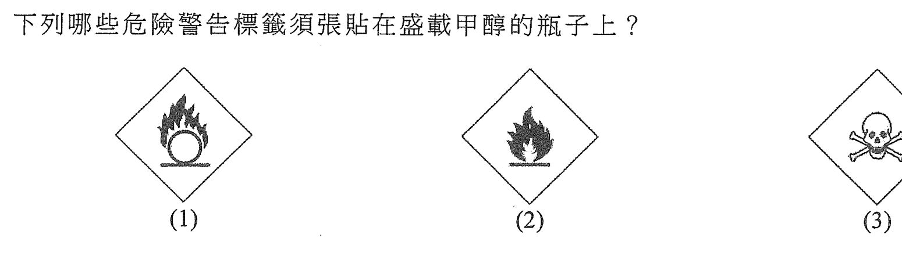

- A. 只有 (1) 和 (2)
- B. 只有 (1) 和 (3)
- C. 只有 (2) 和 (3)
- D. (1)、(2) 和 (3)

---

## 第 24 題

【建議標籤】

- 卷別/部分：卷一甲　第一部分
- 課題：#有機玻璃 #縮合聚合物

【題目內容】

考慮下列各述句並選出最佳的答案：

第一述句：有機玻璃可用來製造購物袋

第二述句：有機玻璃是縮合聚合物

- A. 兩述句均正確，而第二述句為第一述句的合理解釋
- B. 兩述句均正確，但第二述句並非第一述句的合理解釋
- C. 第一述句錯誤，但第二述句正確
- D. 兩述句均錯誤

---

## 第二部分（第 25–36 題）

## 第 25 題

【建議標籤】

- 卷別/部分：卷一甲　第二部分
- 課題：#摩爾計算 #氣體體積 #鐵

【題目內容】

考慮以下反應：

4H₂(g) + Fe₃O₄(s) → 3Fe(s) + 4H₂O(l)

在室內條件下最小需要多少體積的 H₂(g) 來生成 0.168 g 的 Fe(s)？

（在室內條件下，氣體的摩爾體積 = 24 dm³；相對原子質量：Fe = 55.8）

- A. 24 cm³
- B. 48 cm³
- C. 96 cm³
- D. 192 cm³

---

## 第 26 題

【建議標籤】

- 卷別/部分：卷一甲　第二部分
- 課題：#平衡常數 #酸解離 #多元酸

【題目內容】

考慮下面的資料：

| 反應 | 在 25°C 的平衡常數 |
|---|---|
| H₂A(aq) ⇌ H⁺(aq) + HA⁻(aq) | 1.3 × 10⁻³ mol dm⁻³ |
| HA⁻(aq) ⇌ H⁺(aq) + A²⁻(aq) | 3.1 × 10⁻⁵ mol dm⁻³ |
| 2HA⁻(aq) ⇌ H₂A(aq) + A²⁻(aq) | X |

X 的數值是多少？

- A. 4.2 × 10²
- B. 2.4 × 10⁻³
- C. 4.0 × 10⁻⁹
- D. 2.5 × 10⁻⁸

---

## 第 27 題

【建議標籤】

- 卷別/部分：卷一甲　第二部分
- 課題：#醇 #氧化 #酮 #酸化重鉻酸鈉

【題目內容】

以下哪烷醇藉與酸化重鉻酸鈉溶液微熱可生成一酮？

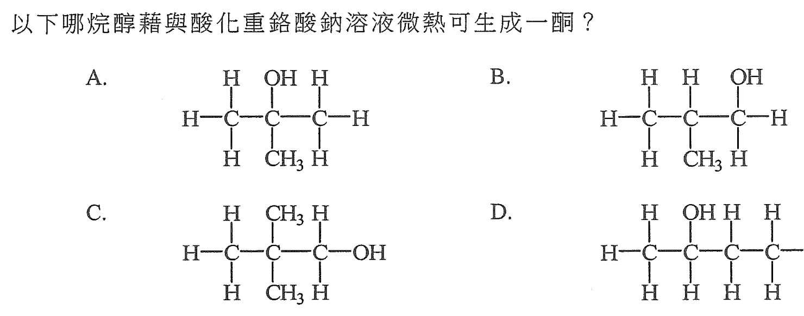

- A.
- B.
- C.
- D.

---

## 第 28 題

【建議標籤】

- 卷別/部分：卷一甲　第二部分
- 課題：#第三周期氧化物 #酸鹼性質

【題目內容】

下列哪項有關周期表第三周期各元素的氧化物的陳述正確？

- A. SiO₂(s) 溶於水生成一中性溶液
- B. P₄O₁₀(s) 溶於水生成一酸性溶液
- C. Al₂O₃(s) 溶於水生成一鹼性溶液
- D. Cl₂O₇(l) 溶於水只生成 Cl₂(aq) 及 O₂(g)

---

## 第 29 題

【建議標籤】

- 卷別/部分：卷一甲　第二部分
- 課題：#有機轉化 #醛酮 #還原

【題目內容】

參照以下各轉化：

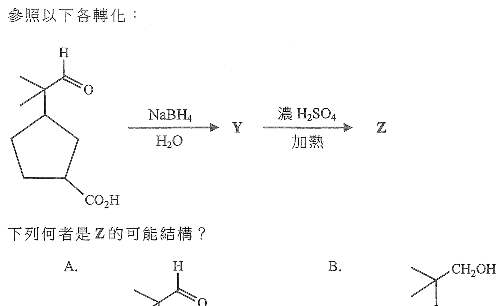

下列何者是 Y 的可能結構？

- A.
- B.
- C.
- D.

---

## 第 30 題

【建議標籤】

- 卷別/部分：卷一甲　第二部分
- 課題：#熔點 #周期表趨勢 #鈉

【題目內容】

以下草繪顯示在周期表第二及第三周期內的十個連續元素的熔點（依原子序遞增的次序排列）。

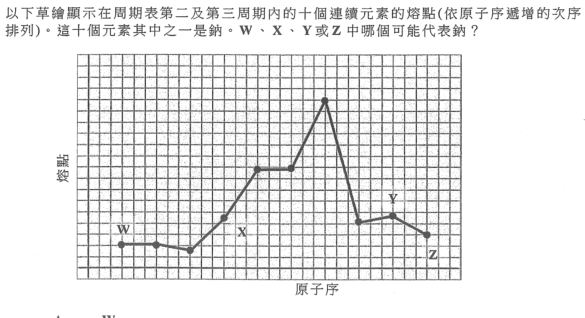

這十個元素其中之一是鈉。W、X、Y 或 Z 中哪個可能代表鈉？

- A. W
- B. X
- C. Y
- D. Z

---

## 第 31 題

【建議標籤】

- 卷別/部分：卷一甲　第二部分
- 課題：#有機反應 #試劑 #反應性

【題目內容】

以下哪對試劑不會互相起反應？

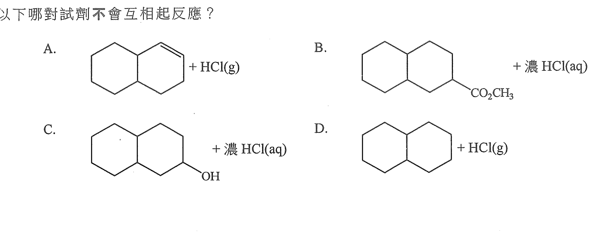

- A.
- B.
- C.
- D.

---

## 第 32 題

【建議標籤】

- 卷別/部分：卷一甲　第二部分
- 課題：#異構體 #結構異構

【題目內容】

下列各對化合物，何者是異構體？

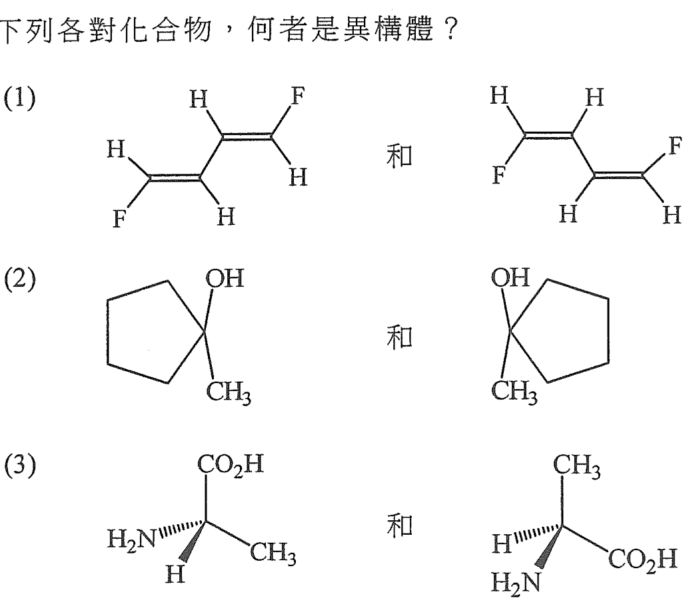

- A. 只有 (1)
- B. 只有 (2)
- C. 只有 (1) 和 (3)
- D. 只有 (2) 和 (3)

---

## 第 33 題

【建議標籤】

- 卷別/部分：卷一甲　第二部分
- 課題：#水的自電離 #pH #溫度

【題目內容】

參照以下化學反應：

H₂O(l) ⇌ H⁺(aq) + OH⁻(aq)　ΔH > 0

在 25°C 時某純水樣本的 pH 是 7.0。當把該樣本加熱至 50°C 時，下列的陳述，何者正確？

(1) 該樣本的 [OH⁻(aq)] 是 1.0 × 10⁻⁷ mol dm⁻³

(2) 該樣本的 pH 小於 7.0

(3) 該樣本保持中性

- A. 只有 (1)
- B. 只有 (2)
- C. 只有 (1) 和 (3)
- D. 只有 (2) 和 (3)

---

## 第 34 題

【建議標籤】

- 卷別/部分：卷一甲　第二部分
- 課題：#尼龍-6,6 #縮合聚合物 #聚醯胺

【題目內容】

下列哪些有關尼龍-6,6 的陳述正確？

(1) 魚網可由尼龍-6,6 製得

(2) H₂N(CH₂)₆NH₂ 是尼龍-6,6 其中的一個單體

(3) 在尼龍-6,6 分子間的引力是共價鍵

- A. 只有 (1) 和 (2)
- B. 只有 (1) 和 (3)
- C. 只有 (2) 和 (3)
- D. (1)、(2) 和 (3)

---

## 第 35 題

【建議標籤】

- 卷別/部分：卷一甲　第二部分
- 課題：#反應速率 #濃度 #裝置

【題目內容】

參照以下的裝置：

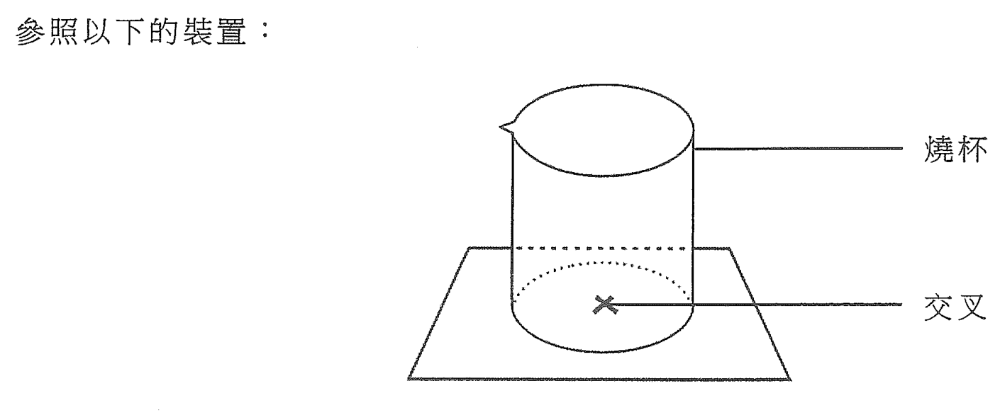

下列哪些反應可藉上面的裝置來研習濃度對速率的影響？

(1) MgO(s) + 2HCl(aq) → MgCl₂(aq) + H₂O(l)

(2) Na₂S₂O₃(aq) + 2HCl(aq) → S(s) + SO₂(g) + H₂O(l) + 2NaCl(aq)

(3) Mg(s) + ZnSO₄(aq) → MgSO₄(aq) + Zn(s)

- A. 只有 (1) 和 (2)
- B. 只有 (1) 和 (3)
- C. 只有 (2) 和 (3)
- D. (1)、(2) 和 (3)

---

## 第 36 題

【建議標籤】

- 卷別/部分：卷一甲　第二部分
- 課題：#發酵 #葡萄糖 #乙醇 #催化劑

【題目內容】

考慮下列各述句並選出最佳的答案：

第一述句：從葡萄糖至乙醇的轉化速率藉加入酵母得到提升

第二述句：從葡萄糖至乙醇的轉化藉酵母內的酶得到催化

- A. 兩述句均正確，而第二述句為第一述句的合理解釋
- B. 兩述句均正確，但第二述句並非第一述句的合理解釋
- C. 第一述句錯誤，但第二述句正確
- D. 兩述句均錯誤

---

*試卷完 —*

## 待人工核對

本卷為第 2 層文字交貨，由 easyocr（ch_tra+en，GPU）掃描底稿清洗而成；現模型無影像輸入，未能對頁影像覆核。以下題號建議第 3 層精修時對頁覆核：

- 第 7 題：物料 S 的硬度／價格級別（OCR 缺損）待對頁核實。
- 第 10 題：各標準燃燒焓變所對應的物質及反應式（OCR 嚴重缺損）待對頁核實。
- 第 13 題：X／Y 的能量圖標示與選項對應待對頁核實。
- 第 15 題：三種金屬碳酸鹽的化學式（OCR 缺損，僅辨出 X₂CO₃／YCO₃／ZCO₃ 形式）待對頁核實。
- 第 27、29、31、32 題：選項 A–D 為結構式圖（300dpi 原卷截圖），第 3 層再換成向量重繪。
- 第 8、9、11、13、14、16、20、23、30、35 題：圖為 300dpi 原卷截圖（程式定位＋墨跡覆蓋率校驗；無視覺覆核，位置／範圍待 spot-check）；第 3 層再換成向量重繪。
