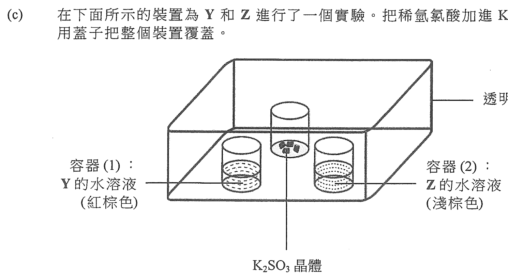
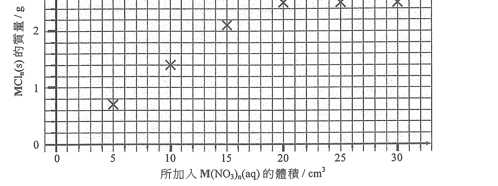
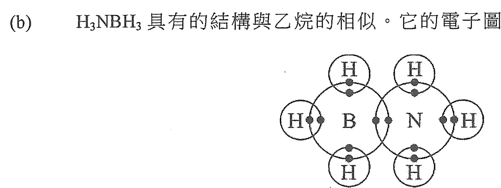
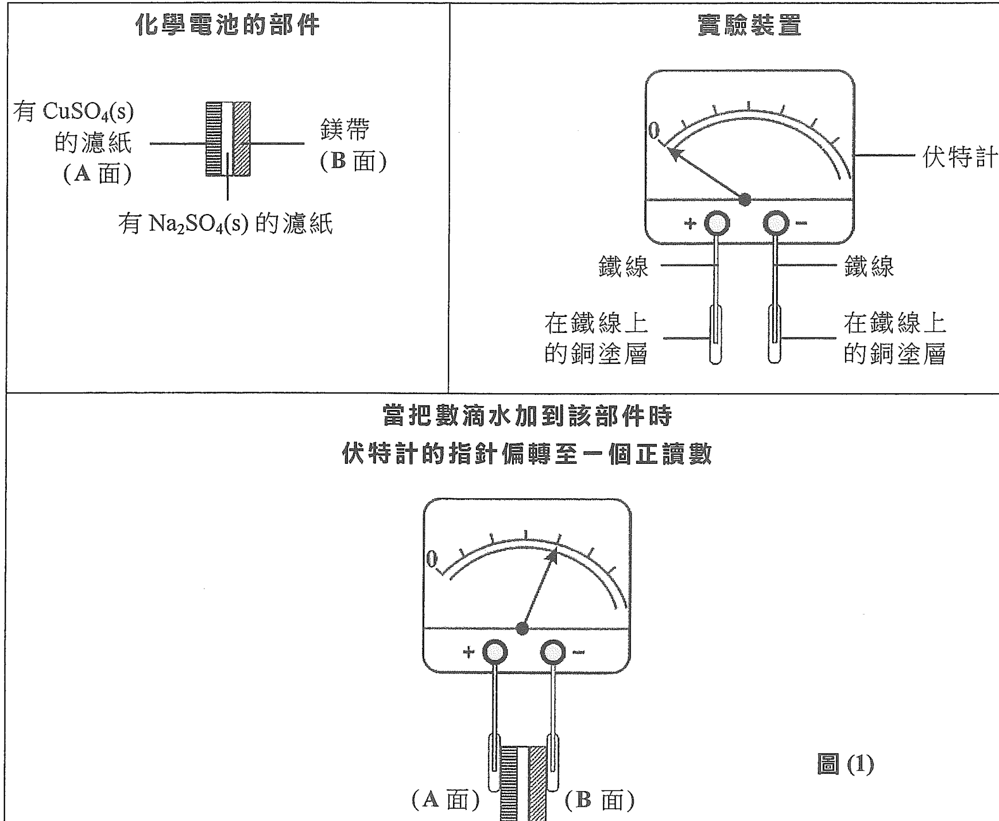
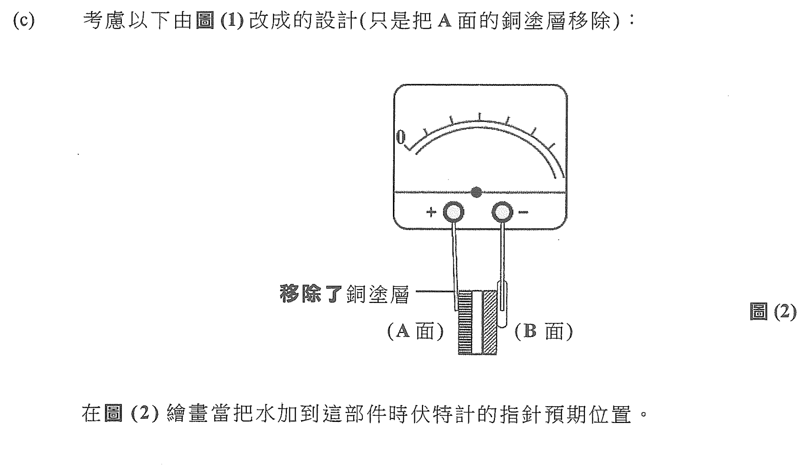
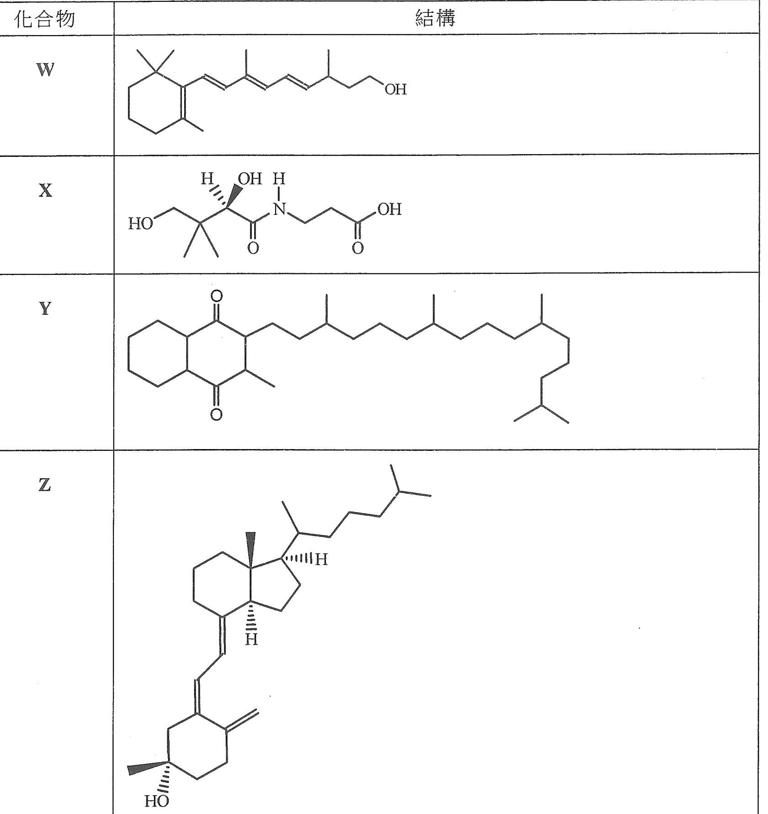
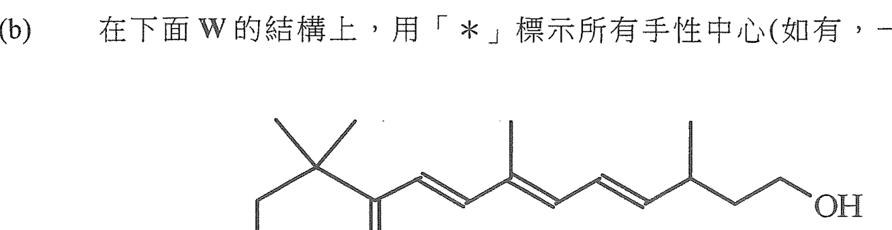
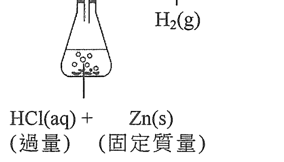
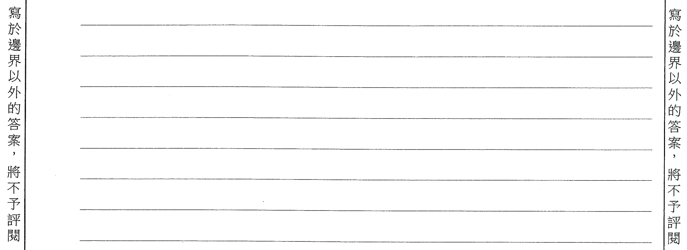

# 2020 DSE 化學 卷一乙（中文卷）— 題目庫

> 來源：文憑試 DSE 化學 Chemistry 2020 歷屆試題 Past Paper 卷一.pdf　｜　乙部 結構式問題 13 題（第一部分 8 題、第二部分 5 題）
> 本部包括兩部分：第一和第二部分各題均須作答。有 * 號標記的試題，將有一分給予達致有效傳意的答案。
> 說明：已移除頁碼、試卷標頭、答題簿橫線等雜訊；化學式以 Unicode 下標／上標表示，反應式以 → 或 ⇌ 表示。**本檔為題目庫（零答案）**，只含題目清洗 + 建議標籤。
> 本檔為第 2 層文字交貨（圖用原卷截圖；精修重繪另開第 3 層）。

---

## 第一部分（第 1–8 題）

## 第 1 題

【建議標籤】

- 卷別/部分：卷一乙　第一部分
- 課題：#電子排佈 #鹵素 #二氧化硫 #氧化還原

【題目內容】

下表顯示元素 T 和 Z 的一些資料：

| | T | Z |
|---|---|---|
| 原子序 | 35 | 53 |
| 原子中已佔電子層的數目 | 4 | 5 |
| 原子中最外層電子的數目 | 7 | 7 |

(a)　寫出 T 的一個原子的電子排佈。（1 分）

(b)　繪出 Z₂ 的一個分子的電子圖（只需顯示最外層的電子）。（1 分）

(c)　在下面所示的裝置為 T 和 Z 進行了一個實驗。把稀氫氯酸加進 K₂SO₃ 晶體，繼而用蓋子把整個裝置覆蓋。

　　(i)　K₂SO₃ 晶體與稀氫氯酸反應得出二氧化硫氣體。寫出這反應的化學方程式（顯示所有物態符號）。

　　(ii)　寫出在容器(1)的預期觀察和所涉及反應的離子方程式。

　　(iii)　根據電子排佈，提出為什麼容器(2)的觀察與在容器(1)的相似。（5 分）

---

## 第 2 題

【建議標籤】

- 卷別/部分：卷一乙　第一部分
- 課題：#實驗式 #氯化物 #摩爾計算 #銀 #鉛

【題目內容】

進行了一個實驗來推定金屬 M 的一個不溶於水的氯化物的實驗式。在室溫下，將不同體積的 0.50 mol dm⁻³ M(NO₃)ₙ(aq) 加進六個各盛有 50 cm³ 的 0.36 mol dm⁻³ HCl(aq) 的燒杯內，把在各燒杯中所得的 MClₙ(s) 過濾、沖洗、弄乾和稱重。將所得到 MClₙ(s) 的質量並對應所加入 M(NO₃)ₙ(aq) 的體積繪畫了下面的坐標圖。

(a)　提出為什麼坐標圖中最後三點的 MClₙ(s) 的質量是相同的。（1 分）

(b)　(i)　藉在上面的坐標圖草繪，推定可與 50 cm³ 的 0.36 mol dm⁻³ HCl(aq) 完全反應的 M(NO₃)ₙ(aq) 的體積。

　　　M(NO₃)ₙ(aq) 的體積 = [?] cm³

　　(ii)　從而計算可與該 HCl(aq) 完全反應的 M(NO₃)ₙ(aq) 的摩爾數。（3 分）

(c)　通過計算，測定這 M 的氯化物的實驗式，並從而推斷 M 會是銀抑或鉛。（3 分）

---

## 第 3 題

【建議標籤】

- 卷別/部分：卷一乙　第一部分
- 課題：#分子形狀 #配位共價鍵 #氮化硼

【題目內容】

(a)　繪出代表以下各分子形狀的三維圖形：

　　(i)　NH₃

　　(ii)　BH₃（2 分）

(b)　H₃NBH₃ 具有的結構與乙烷的相似。牠的電子圖如下所示（只顯示最外層的電子）：

　　(i)　在 H–B、B–N 和 N–H 各鍵中，何者會是配位共價鍵？解釋你的答案。

　　(ii)　解釋為什麼在室內條件下 H₃NBH₃ 是固體但乙烷是氣體。

　　(iii)　在適當條件下，H₃NBH₃ 可分解成氮化硼和氫。固體氮化硼的結構與石墨的相似。繪出固體氮化硼的一層結構（註：B 和 N 是在交替位置）。（6 分）

---

## 第 4 題

【建議標籤】

- 卷別/部分：卷一乙　第一部分
- 課題：#碳酸鈣 #滴定 #反滴定 #質量百分率

【題目內容】

蛋殼主要含有碳酸鈣及小量有機物質。透過下列步驟測定了一個蛋殼樣本中碳酸鈣的質量百分率：

步驟(1)：把樣本研磨成粉末。

步驟(2)：把 0.204 g 的粉末放在一錐形瓶內，然後加入 25.00 cm³ 的 0.200 M HCl(aq) 和 5 cm³ 的乙醇。

步驟(3)：把混合物加熱 15 分鐘。

步驟(4)：使用指示劑 X，用 0.102 M NaOH(aq) 來滴定經冷卻後的混合物。

(a)　解釋在步驟(1)為什麼要把該樣本研磨成粉末。（1 分）

(b)　提出在步驟(2)為什麼加入乙醇。（1 分）

(c)　提出在步驟(3)為什麼把混合物加熱 15 分鐘。（1 分）

(d)　寫出指示劑 X 的名稱。在步驟(4)的滴定終點，該混合物由無色變成淺粉紅色。（1 分）

(e)　在步驟(4)需用 16.85 cm³ 的 NaOH(aq) 來達到滴定終點。計算在這樣本中碳酸鈣的質量百分率。（相對原子質量：C = 12.0，O = 16.0，Ca = 40.1）（3 分）

---

## 第 5 題

【建議標籤】

- 卷別/部分：卷一乙　第一部分
- 課題：#有機化合物 #官能基 #中和焓 #二元酸

【題目內容】

有機化合物 W 的分子式是 C[?]H[?]O₄，它可溶於水。

(a)　當把一根鎂帶放進 W 的水溶液時，氫氣釋出。根據這項觀察，提出 W 可能含有的一個官能基。（1 分）

(b)　已知一摩爾的 W 可與二摩爾的 NaOH 完全反應。

　　(i)　繪出 W 的兩個可能結構。

　　(ii)　考慮以下中和反應在標準條件下的熱化學方程式：

[?]　ΔH = y kJ mol⁻¹

寫出「標準中和焓變」一詞的意思，並推算這反應的標準中和焓變（以 y 表其值）。

　　(iii)　HCl(aq) 與 NaOH(aq) 的標準中和焓變是 −57.3 kJ mol⁻¹。解釋上面(ii)所推算出來的焓變與 −57.3 kJ mol⁻¹ 相比時，應是更負、不那麼負抑或相等。（6 分）

---

## 第 6 題

【建議標籤】

- 卷別/部分：卷一乙　第一部分
- 課題：#化學電池 #電極 #氧化還原 #半反應

【題目內容】

下圖顯示一個化學電池的部件、一個實驗裝置，以及當把這個裝置接上該部件時，伏特計的指針如何偏轉。

當把數滴水加到該部件時，伏特計的指針偏轉至一個正讀數。

(a)　為什麼當把數滴水加到該部件時，伏特計的指針如所示地偏轉？（2 分）

(b)　(i)　寫出當伏特計的指針偏轉時，在以下各電極所起變化的半反應式：

陽極：

陰極：（2 分）

(c)　考慮以下由圖(1)改成的設計（只是把 A 面的銅塗層移除）：

在圖(2)繪畫當把水加到這部件時伏特計的指針預期位置。（1 分）

(d)　在上面(c)部的設計，當把水加到這部件時在 A 面發生一氧化還原反應。

　　(i)　寫出這反應的化學方程式。

　　(ii)　寫出這反應類別的名稱。（2 分）

---

## 第 7 題

【建議標籤】

- 卷別/部分：卷一乙　第一部分
- 課題：#鹼 #氨 #生成焓 #熱化學

【題目內容】

進行一實驗來研習以下反應：

Ba(OH)₂·8H₂O(s) + 2NH₄Cl(s) → BaCl₂(s) + 10H₂O(l) + 2NH₃(g)

反應會生成帶有獨特刺激性氣味的氨氣。

(a)　當把該兩個固體反應物在一錐形瓶混合並攪拌時，解釋如何能測試氨氣。（2 分）

(b)　Ba(OH)₂·8H₂O(s) 是鹼。「鹼」一詞是什麼意思？（1 分）

(c)　Ba(OH)₂·8H₂O(s) 的標準生成焓變為 −3345 kJ mol⁻¹。

　　(i)　寫出 Ba(OH)₂·8H₂O(s) 標準生成焓變的熱化學方程式。

　　(ii)　計算 Ba(OH)₂·8H₂O(s) 與 NH₄Cl(s) 反應的標準焓變。

　　　　〔標準生成焓變：H₂O(l) = −286 kJ mol⁻¹，NH₄Cl(s) = −314 kJ mol⁻¹，BaCl₂(s) = −859 kJ mol⁻¹〕

　　(iii)　從而解釋在這反應中，混合物的溫度會上升、下降抑或維持不變。（4 分）

---

## 第 8 題

【建議標籤】

- 卷別/部分：卷一乙　第一部分
- 課題：#有機合成 #烯 #鹵代烴 #原油

【題目內容】

*描述怎樣使用合適的化學品和過程，可從原油經某烯生產 1,2-二溴乙烷。寫出所涉及各反應的化學方程式。（6 分）

---

## 第二部分（第 9–13 題）

## 第 9 題

【建議標籤】

- 卷別/部分：卷一乙　第二部分
- 課題：#化學平衡 #平衡常數 #勒沙特列原理

【題目內容】

考慮以下於一個固定體積的密閉容器內在 25°C 的反應混合物：

2NO₂(g) ⇌ N₂O₄(g)

棕色　　　無色

(a)　參照下表算出 a，從而測定在 25°C 時這反應的平衡常數 K。

| | N₂O₄(g) | NO₂(g) |
|---|---|---|
| 起始時的濃度 / mol dm⁻³ | 0.0400 | 0.0010 |
| 平衡時的濃度 / mol dm⁻³ | 0.0323 | a |

（3 分）

(b)　把混合物的溫度提升至 55°C，牠的顏色最終變得更深。推定上面的反應是吸熱抑或放熱。（2 分）

---

## 第 10 題

【建議標籤】

- 卷別/部分：卷一乙　第二部分
- 課題：#有機化合物 #鹵代烴 #聚合

【題目內容】

一化合物 Y 的結構如下所示：

CH₂=CHCH₂OH

(a)　Y 可從 3-氯丙烯與一適當試劑反應而製得。

　　(i)　寫出這反應的化學方程式。

　　(ii)　寫出這反應類別的名稱。（2 分）

(b)　在回流加熱下，一化合物 L 與 KOH(aq) 反應得出 Y 及 CH₃COOK。

　　(i)　提出 L 的結構式。

　　(ii)　繪畫一標示圖以顯示這反應的裝置。（3 分）

(c)　在適當條件下，Y 可生成一聚合物。寫出這聚合物的重複單位。（1 分）

---

## 第 11 題

【建議標籤】

- 卷別/部分：卷一乙　第二部分
- 課題：#醇 #手性 #異構體 #化學測試

【題目內容】

一些化合物的結構如下所示：

(a)　W、X、Y 或 Z 哪一個是三級醇？（1 分）

(b)　在下面 W 的結構上，用 * 標示所有手性中心（如有一個或多個）。（1 分）

(c)　把 X 在 2 M NaOH(aq) 中回流加熱可生成一具有旋光性的有機化合物 U 和一不具旋光性的有機化合物 V。繪出 U 和 V 各自的結構。（2 分）

(d)　提出可用哪一試劑來進行化學測試，以將 X 從 W、Y 和 Z 分辨出來。

　　(i)　[?]

　　(ii)　寫出在(i)所涉及測試的觀察，解釋你的答案。（3 分）

---

## 第 12 題

【建議標籤】

- 卷別/部分：卷一乙　第二部分
- 課題：#過渡金屬 #鈷 #催化劑 #可變氧化態

【題目內容】

進行了一實驗來研習以下的反應：

KO₂CCH(OH)CH(OH)CO₂Na(aq) + 3H₂O₂(aq) → HCO₂K(aq) + HCO₂Na(aq) + 2CO₂(g) + 4H₂O(l)

（無色）

當把 10 cm³ 的 0.25 M KO₂CCH(OH)CH(OH)CO₂Na(aq) 與 3 cm³ 的 6% H₂O₂(aq) 在 60°C 混合，發現只有少許氣泡釋出。繼而將小量粉紅色的 CoCl₂(aq) 溶液加入該混合物，氣泡便猛烈地生成，並因生成了鈷(II)化合物而令混合物變為綠色。當再沒有氣體釋出時，該綠色混合物變回粉紅色。

有一觀點認為根據這實驗的觀察，鈷展示了三個過渡性金屬的特性。提出各項理由來支持這個觀點。（4 分）

---

## 第 13 題

【建議標籤】

- 卷別/部分：卷一乙　第二部分
- 課題：#反應速率 #濃度 #鋅 #鹽酸

【題目內容】

*參照如下所示的裝置：

描述可怎樣研習 HCl(aq) 的濃度對該反應的速率的影響。你的答案應包括在下面坐標圖上，草繪兩條附有標示的曲線，一條用實線而另一條用虛線，標示所有曲線和坐標軸。（6 分）

---

*試卷完 —*

## 待人工核對

本卷為第 2 層文字交貨，由 easyocr（ch_tra+en，GPU）掃描底稿清洗而成；現模型無影像輸入，未能對頁影像覆核。以下題號建議第 3 層精修時對頁覆核：

- 第 1 題：K₂SO₃ 晶體（OCR 讀作「KSO」）及容器(1)/(2) 的 T₂/Z₂ 標示待對頁核實。
- 第 1(c)(iii) 題：「相似／不相似」的方向（OCR 嚴重缺損）待對頁核實。
- 第 2 題：坐標圖數據點、M(NO₃)ₙ(aq) 體積空位待對頁核實。
- 第 5 題：W 的分子式（C[?]H[?]O₄）及(b)(ii) 中和反應方程式（OCR 嚴重缺損）待對頁核實。
- 第 11(d) 題：(i) 的試劑選擇內容（OCR 嚴重缺損）待對頁核實。
- 第 12 題：酒石酸鹽與 H₂O₂ 的反應方程式（產物）待對頁核實。
- 第 1(c)、2、3(b)、6、6(c)、11、13 題：圖為 300dpi 原卷截圖（程式定位＋墨跡覆蓋率校驗；無視覺覆核，位置／範圍待 spot-check）；第 3 層再換成向量重繪。
