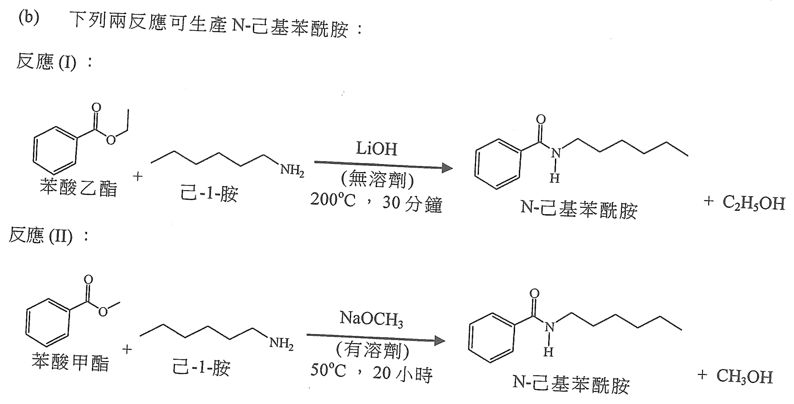
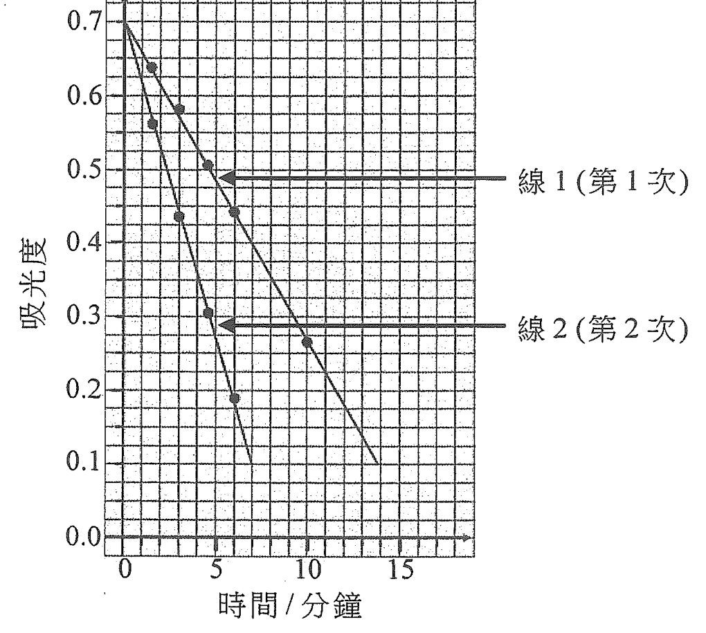
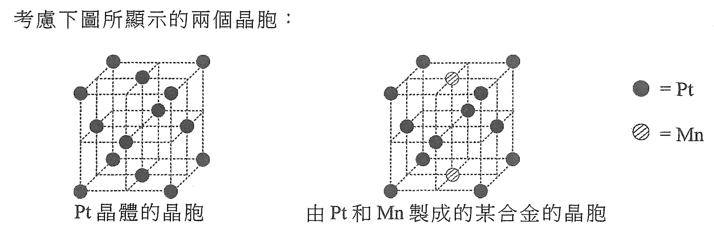
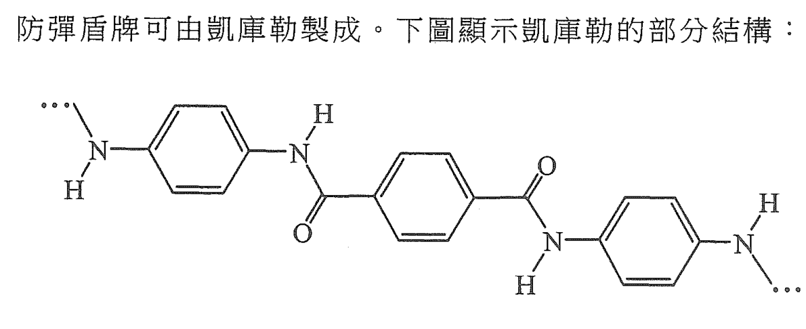
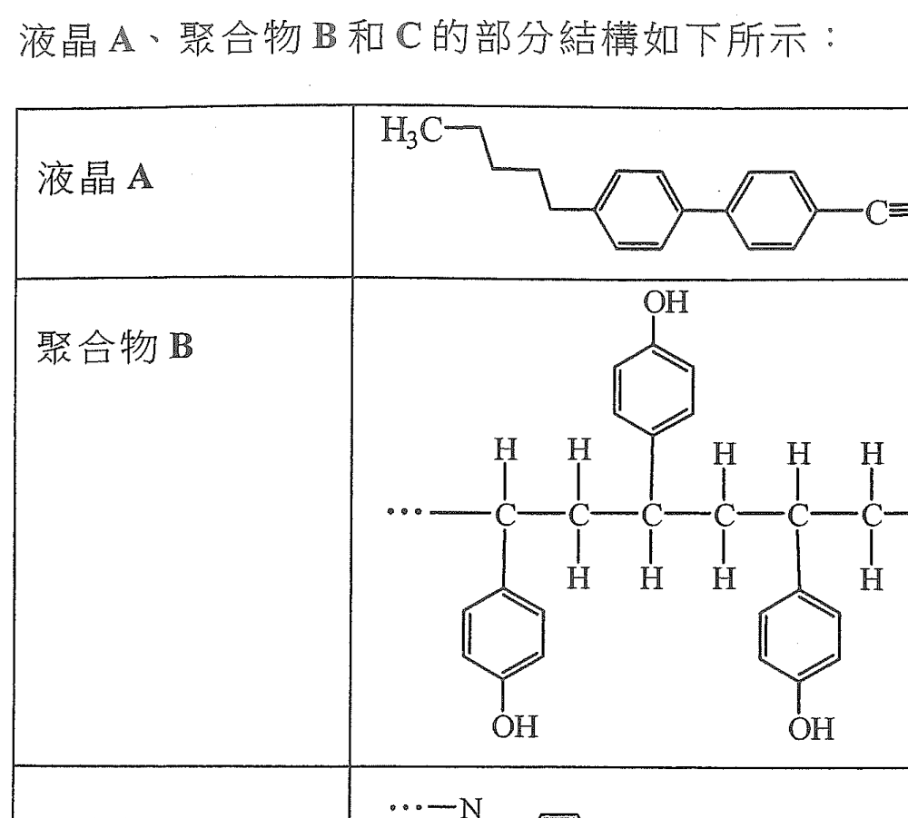
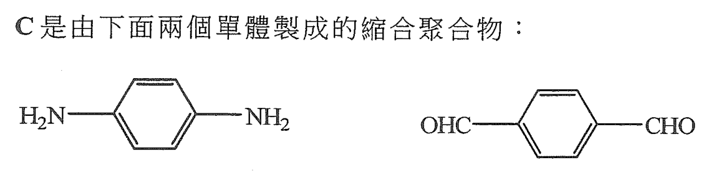
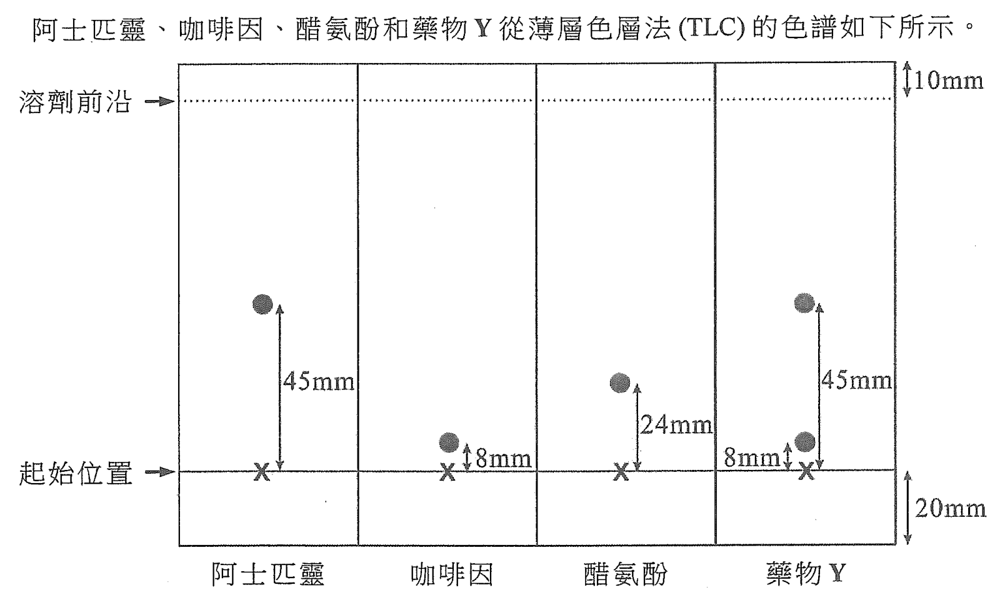
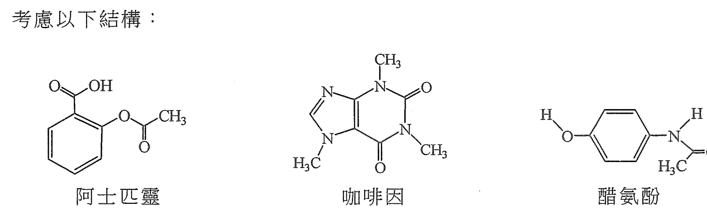
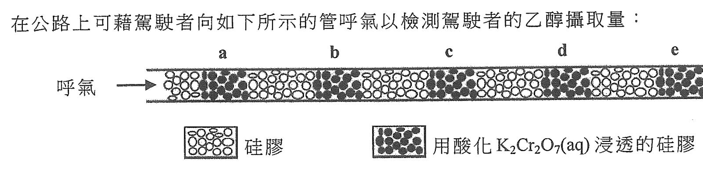

# 2020 DSE 化學 卷二（中文卷）— 題目庫

> 來源：文憑試 DSE 化學 Chemistry 2020 歷屆試題 Past Paper 卷二.pdf　｜　三部分：甲部 工業化學、乙部 物料化學、丙部 分析化學（每部分一題）
> 本試卷共有甲、乙和丙三部。考生須選答任何兩部中的全部試題。
> 說明：已移除頁碼、試卷標頭等雜訊；化學式以 Unicode 下標／上標表示，反應式以 → 或 ⇌ 表示。**本檔為題目庫（零答案）**，只含題目清洗 + 建議標籤。
> 本檔為第 2 層文字交貨（圖用原卷截圖；精修重繪另開第 3 層）。

---

## 甲部　工業化學（第 1 題）

## 第 1 題

【建議標籤】

- 卷別/部分：卷二　甲部
- 課題：#氯鹼工業 #哈柏法 #麥克斯韋-玻爾茲曼分佈 #綠色化學 #反應速率

【題目內容】

回答試題的所有部分。

(a)　回答以下短問題。

　　(i)　寫出氯鹼工業中膜電解池比較流汞電解池的兩個優勝之處。（2 分）

　　(ii)　寫出在哈柏法中所用的催化劑。（1 分）

　　(iii)　在同一坐標軸上繪兩條麥克斯韋-玻爾茲曼分佈曲線，一條在溫度 T 而另一條在較高溫度。（標示 X-軸：動能）（2 分）

(b)　下列兩反應可生產 N-己基苯醯胺。

　　(i)　基於上面的資料，為以下各項提出一個理由：

　　　(1)　反應(I)比反應(II)可被視為較綠色

　　　(2)　反應(II)比反應(I)可被視為較綠色（2 分）

　　(ii)　在反應(II)，3.00 g 的苯酸甲酯與 2.23 g 的己-1-胺反應得出 3.89 g 的 N-己基苯醯胺。計算這產物的產率。（相對分子質量：苯酸甲酯 = 136，己-1-胺 = 101，N-己基苯醯胺 = 205）（2 分）

　　(iii)　反應(II)所生產的甲醇，在工業上藉以下反應可用來製造乙酸：

CH₃OH(l) + CO(g) → CH₃COOH(l)　　ΔH < 0　（180°C，30 atm，催化劑）

　　　(1)　根據化學平衡，解釋為什麼這反應在工業上的操作壓強設定於 30 atm 而不是常壓。

　　　(2)　解釋為什麼最佳的操作條件設定於 180°C 和 30 atm。（3 分）

(c)　考慮以下反應（H₂SO₄(aq) 作為催化劑）及其速率方程：

CH₃COCH₃(aq) + I₂(aq) → CH₃COCH₂I(aq) + HI(aq)

（無色）

速率 = k[I₂(aq)]ˣ[CH₃COCH₃(aq)]ʸ[H⁺(aq)]ᶻ　（其中 x、y 和 z 是整數）

為研習它的化學動力學，在相同實驗條件下進行了兩次實驗。下表顯示在反應混合物中各所用試劑的初始濃度；而坐標圖則顯示反應混合物的吸光度隨時間的變化。

| 次數 | CH₃COCH₃(aq) 的初始濃度 / mol dm⁻³ | H₂SO₄(aq) 的初始濃度 / mol dm⁻³ | I₂(aq) 的初始濃度 / mol dm⁻³ |
|---|---|---|---|
| 1 | 1.0 | 0.10 | 0.0050 |
| 2 | 2.0 | 0.10 | 0.0050 [?] |

　　(i)　解釋為什麼吸光度變化的速率可代表反應的速率。（1 分）

　　(ii)　在這些實驗條件下，該速率方程可簡化為速率 = k′[I₂(aq)]ˣ。參照線 1 推定 x。（2 分）

　　(iii)　參照線 1 及線 2，推定該速率方程的 y。（2 分）

　　(iv)　已知 y = 1 以及該反應速率的單位是 mol dm⁻³ s⁻¹，那速率常數 k′ 的單位是什麼？（1 分）

　　(v)　有提出指這反應依兩個連續步驟進行並且是放熱的：

CH₃COCH₃(aq) → CH₃C(OH)=CH₂(aq)　（慢）

CH₃C(OH)=CH₂(aq) + I₂(aq) → CH₃COCH₂I(aq) + HI(aq)

為這反應繪畫一個能線圖，標示各坐標軸。（2 分）

---

## 乙部　物料化學（第 2 題）

## 第 2 題

【建議標籤】

- 卷別/部分：卷二　乙部
- 課題：#晶體結構 #納米物料 #鐵合金 #凱夫拉 #液晶 #聚合物

【題目內容】

回答試題的所有部分。

(a)　回答以下短問題。

　　(i)　考慮下圖所顯示的兩個晶胞：

　　　(1)　寫出 Pt 晶體結構類別的名稱。

　　　(2)　推定在這合金的晶胞中，Pt 原子和 Mn 原子各自的數目。（3 分）

　　(ii)　銀納米物料有不同的用途。

　　　(1)　「納米物料」一詞是什麼意思？

　　　(2)　提出銀納米物料在生活上的一種用途。（2 分）

(b)　盾牌可用鐵、合金和凱夫拉 [?] 等不同物料製成。

　　(i)　根據鍵合和結構，解釋為什麼鐵是可展及可延。（2 分）

　　(ii)　把碳加入鐵可製成合金。以這方法得出的合金所製成的盾牌，其性能比鐵盾牌的較佳。

　　　(1)　提出上述方法可改良盾牌的一項物理性質。

　　　(2)　從原子層面，解釋為什麼可把這物理性質改良。（2 分）

　　(iii)　防彈盾牌可由凱夫拉 [?] 製成。下圖顯示凱夫拉 [?] 的部分結構：

　　　(1)　參照這結構，提出兩個理由為什麼凱夫拉 [?] 是剛性。

　　　(2)　解釋當以酸處理凱夫拉 [?] 時是否有任何化學反應。（3 分）

(c)　液晶 A、聚合物 B 和 C 的部分結構如下所示：

　　(i)　寫出液晶 A 分子的兩個結構特徵。（2 分）

　　(ii)　B 是加成聚合物。

　　　(1)　繪出 B 的單體的結構。

　　　(2)　提出由 B 製造薄膜的成型方法。（2 分）

　　(iii)　C 是由下面兩個單體製成的縮合聚合物：

　　　(1)　繪出 C 的重複單位的結構。

　　　(2)　提出為什麼 C 被分類為縮合聚合物。

　　　(3)　提出兩個理由為什麼這聚合可被視為綠色。（4 分）

---

## 丙部　分析化學（第 3 題）

## 第 3 題

【建議標籤】

- 卷別/部分：卷二　丙部
- 課題：#碳酸鈉 #滴定 #薄層色層法 #紅外光譜 #質譜 #乙醇檢測

【題目內容】

回答試題的所有部分。

(a)　回答以下短問題。

　　(i)　提出怎樣辨別 Na₂CO₃(s) 和 Na₂CO₃·10H₂O(s)。（2 分）

　　(ii)　在酸化介質以 Na₂S₂O₃(aq) 滴定於錐形瓶內的 I₂(aq)，並用澱粉溶液作指示劑。寫出於滴定終點的顏色變化。（1 分）

　　(iii)　提出一化學測試以顯示怎樣辨別己-1-烯和己醛。（2 分）

(b)　阿士匹靈、咖啡因、醋氨酚和藥物 Y 從薄層色層法（TLC）的色譜如下所示：

　　(i)　繪畫進行 TLC 實驗的裝置的標示圖。（2 分）

　　(ii)　計算阿士匹靈的 Rf 值。（1 分）

　　(iii)　基於所提供的色譜，提出藥物 Y 會否含有阿士匹靈、咖啡因或醋氨酚。（1 分）

　　(iv)　考慮以下結構：

　　　(1)　根據下表，提出阿士匹靈和咖啡因可怎樣透過其紅外光譜分辨出來。

| 特徵紅外吸收波數域（伸展式） |
|---|

| 鍵合 | 化合物類別 | 波數域 / cm⁻¹ |
|---|---|---|
| C=C | 烯 | 1610 至 1680 |
| C=O | 醛、酮、羧酸及其衍生物 | 1680 至 1800 |
| C≡N | 腈 | 2070 至 2250 |
| C=N | [?] | 2200 至 2280 |
| O-H | 帶「氫鍵」的酸 | 2500 至 3300 |
| C-H | 烷、烯及芳烴 | 2840 至 3095 |
| O-H | 帶「氫鍵」的醇 | 3230 至 3670 |
| N-H | 胺 | 3350 至 3500 |

　　　(2)　某純樣本可能是阿士匹靈、咖啡因或醋氨酚。該樣本的質譜在 m/z = 43 有一主要峰。解釋這項資料可否確定該樣本是阿士匹靈、咖啡因或醋氨酚。（3 分）

(c)　在公路上可藉駕駛者向如下所示的管呼氣以檢測駕駛者的乙醇攝取量：

　　(i)　(1)　假若含有足夠乙醇的呼氣呼進到管內，提出用酸化 K₂Cr₂O₇(aq) 浸透的硅膠的顏色變化。

　　　(2)　寫出所涉及顏色變化的半反應式。

　　　(3)　駕駛者 A 的呼氣只令位置 a 及 b 變色；而駕駛者 B 的呼氣令位置 a、b 及 c 變色。假設這測試是公平地進行，解釋哪駕駛者具較高乙醇攝取量。

　　　(4)　提出這測試可怎樣公平地進行。（4 分）

　　(ii)　在某國家，若駕駛者血液的乙醇含量超出「每 100 cm³ 的血清含 55 mg 的乙醇」便屬違法。從一名駕駛者血液所得的 10.0 cm³ 經處理的血清樣本，需用在酸化介質中 4.38 cm³ 的 0.025 mol dm⁻³ K₂Cr₂O₇(aq) 完全反應。已知在該反應中，C₂H₅OH(aq) 對 K₂Cr₂O₇(aq) 的摩爾比是 3:1，計算在該血清樣本中 C₂H₅OH 的質量（以 mg 為單位）。確定該名駕駛者有否違法。（相對原子質量：H = 1.0，C = 12.0，O = 16.0）（4 分）

---

*試卷完 —*

## 待人工核對

本卷為第 2 層文字交貨，由 easyocr（ch_tra+en，GPU）掃描底稿清洗而成；現模型無影像輸入，未能對頁影像覆核。以下題號建議第 3 層精修時對頁覆核：

- 第 1(b) 題：「N-己基苯醯胺」及反應(I)/(II) 的條件（溫度、時間、溶劑）待對頁核實。
- 第 1(c) 題：速率方程指數（x、y、z）、動力學表（尤其第 2 次 I₂ 初始濃度）待對頁核實。
- 第 2(b) 題：「凱夫拉」譯名（OCR 讀作「凱庫勒」）待對頁核實。
- 第 3(b)(iv) 題：紅外吸收表（C=N 行的化合物類別）待對頁核實。
- 第 1(b)、1(c)、2(a)(i)、2(b)(iii)、2(c)、2(c)(iii)、3(b)、3(b)(iv)、3(c) 題：圖為 300dpi 原卷截圖（程式定位＋墨跡覆蓋率校驗；無視覺覆核，位置／範圍待 spot-check）；第 3 層再換成向量重繪。
