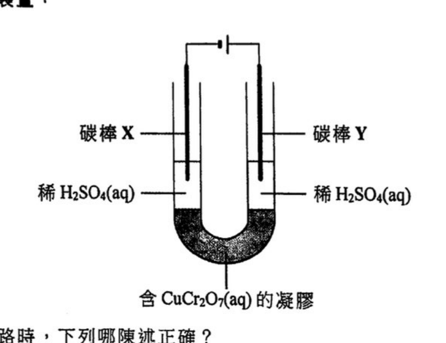
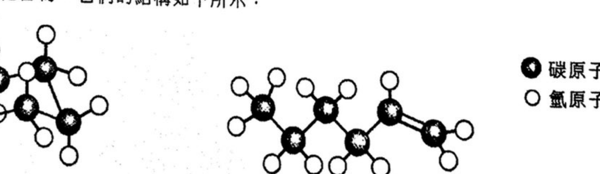
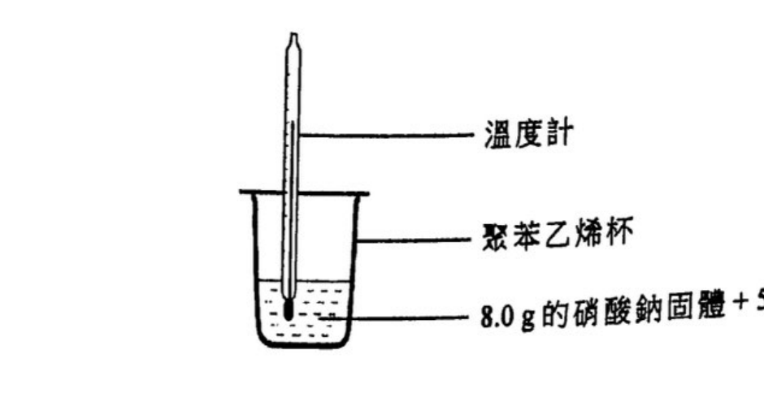
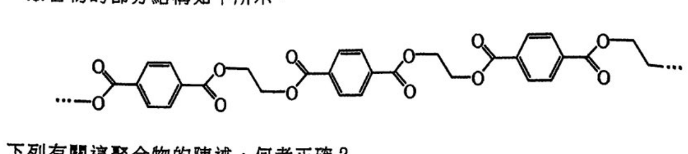
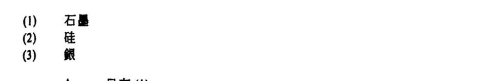
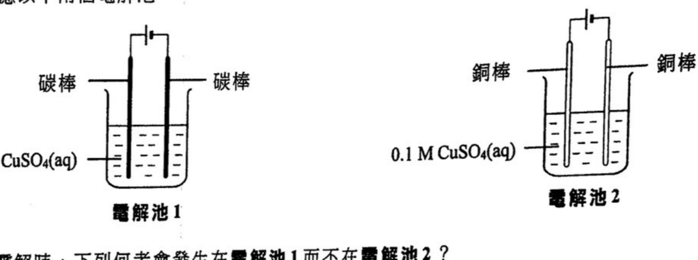
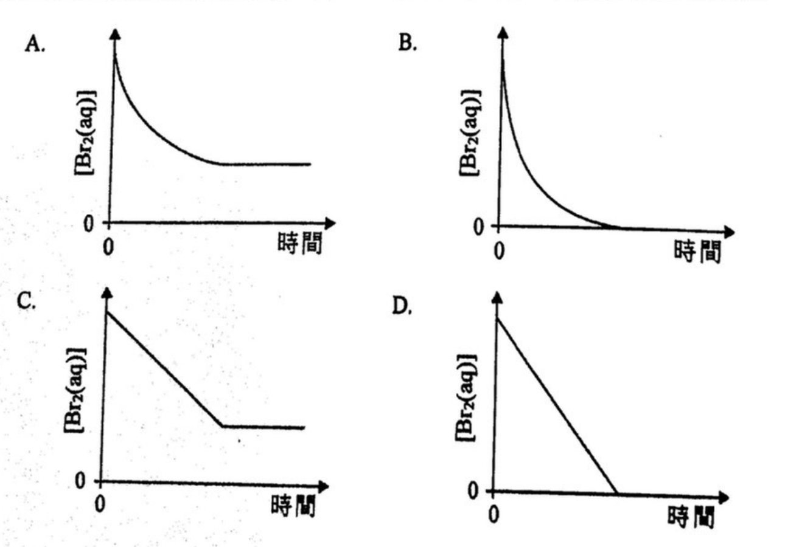
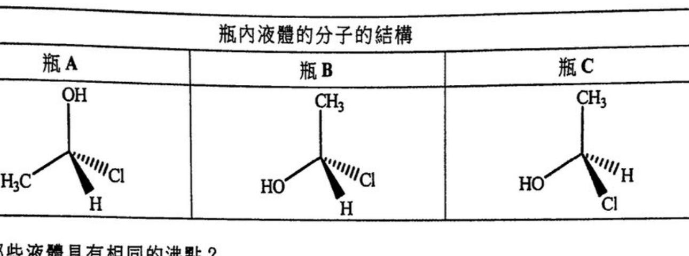
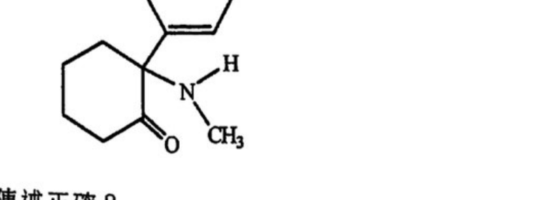

# 2021 DSE 化學 卷一甲（中文卷）— 題目庫

> 來源：文憑試 DSE 化學 Chemistry 2021 歷屆試題 Past Paper 卷一.pdf（甲部）　｜　多項選擇題 36 題（第一部分 24 題、第二部分 12 題）
> 本部包括兩部分：第一部分設 24 題，第二部分設 12 題。選出每題最佳的答案。考生可參考印於試題答題簿 B 第 20 頁的周期表。
> 說明：已移除頁碼、試卷標頭等雜訊；化學式以 Unicode 下標／上標表示，反應式以 → 或 ⇌ 表示。**本檔為題目庫（零答案）**，只含題目清洗 + 建議標籤。
> 本檔為第 2 層文字交貨（圖用原卷截圖；精修重繪另開第 3 層）。
> 註：本卷源 PDF 為純掃描（無文字層），以 easyocr 辨識後清洗；部分化學式／結構經化學常識重建，不確定處標 [?]，詳見檔尾「待人工核對」。

---

## 第一部分（第 1–24 題）

## 第 1 題

【建議標籤】

- 卷別/部分：卷一甲　第一部分
- 課題：#物質結構 #熔點 #導電性

【題目內容】

某化學物種的熔點為 146°C。牠溶於水而所生成的溶液並不導電。該化學物種具有下列哪種結構？

- A. 巨型離子結構
- B. 巨型金屬結構
- C. 巨型共價結構
- D. 簡單分子結構

---

## 第 2 題

【建議標籤】

- 卷別/部分：卷一甲　第一部分
- 課題：#電解 #離子遷移

【題目內容】

考慮以下實驗裝置：

當電流通過電路時，下列哪陳述正確？

- A. 在X周圍的稀 H₂SO₄(aq) 觀察到藍色。
- B. 在Y周圍的稀 H₂SO₄(aq) 觀察到氣泡。
- C. 在X周圍的稀 H₂SO₄(aq) 觀察到橙色。
- D. 電子由X經外電路流向Y。

---

## 第 3 題

【建議標籤】

- 卷別/部分：卷一甲　第一部分
- 課題：#分餾 #電解 #石灰石

【題目內容】

下列哪陳述不正確？

- A. 裂解重油可得出乙烯。
- B. 電解海水可得出 [?]。
- C. 強熱石灰石可得出氧。
- D. 分餾液態空氣可得出 [?]。

---

## 第 4 題

【建議標籤】

- 卷別/部分：卷一甲　第一部分
- 課題：#金屬活性序

【題目內容】

M、Q和R是三個不同金屬。當分別把它們的氧化物加熱時，只有M的氧化物給出金屬光澤。當用本生燈分別把它們的碳酸鹽加熱時，只有R的碳酸鹽沒有給出可觀察變化。下列何者顯示這些金屬活性的遞增次序？

- A. R < Q < M
- B. R < M < Q
- C. M < R < Q
- D. M < Q < R

---

## 第 5 題

【建議標籤】

- 卷別/部分：卷一甲　第一部分
- 課題：#沉澱反應 #離子濃度

【題目內容】

把 15.0 cm³ 的 0.20 M Ba(NO₃)₂(aq) 加到 25.0 cm³ 的 0.10 M Na₂SO₄(aq) 中。反應完成後，在該混合物中，下列哪離子具有最高的濃度？

- A. SO₄²⁻(aq)
- B. NO₃⁻(aq)
- C. Ba²⁺(aq)
- D. Na⁺(aq)

---

## 第 6 題

【建議標籤】

- 卷別/部分：卷一甲　第一部分
- 課題：#酸鹼 #pH

【題目內容】

參照下表的資料：

| 溶液 | 內含物 | pH |
|---|---|---|
| X | 50 cm³ 的 0.001 M HCl(aq) | 3.0 |
| Y | 25 cm³ 的 0.001 M H₂SO₄(aq) | 2.7 |
| Z | 50 cm³ 的 0.1 M CH₃COOH(aq) | 2.9 |

下列哪陳述正確？

- A. X比Z具較高 pH 是因為 HCl 是較 CH₃COOH 強的酸。
- B. Y比X具較低 pH 是因為 H₂SO₄(aq) 的體積較 HCl(aq) 的小。
- C. Y比X具較低 pH 是因為 H₂SO₄ 是強二元酸但 HCl 是強一元酸。
- D. Y比Z具較低 pH 是因為 H₂SO₄(aq) 的濃度較 CH₃COOH(aq) 的低。

---

## 第 7 題

【建議標籤】

- 卷別/部分：卷一甲　第一部分
- 課題：#氧化數

【題目內容】

在 Pb₃(VO₄)₂ 中，Pb 的氧化數是 +2。V 的氧化數是什麼？

- A. [?]
- B. [?]
- C. [?]
- D. [?]

---

## 第 8 題

【建議標籤】

- 卷別/部分：卷一甲　第一部分
- 課題：#有機化合物 #結構

【題目內容】

考慮兩個化合物，牠們的結構如下所示：

下列哪陳述正確？

- A. 它們均是易燃的。
- B. 它們具有不同的實驗式。
- C. 它們屬於相同的同系列。
- D. 它們均可在黑暗中令溴溶液變成無色。

---

## 第 9 題

【建議標籤】

- 卷別/部分：卷一甲　第一部分
- 課題：#空氣污染 #二氧化硫

【題目內容】

燃煤發電廠所排放的氣體含有 SO₂。SO₂ 也被視為空氣污染物。在把這些氣體排放到大氣之前，清除 SO₂ 的最適當方法是什麼？

- A. 把這些氣體通過氧化鈣。
- B. 把這些氣體通過濃硫酸。
- C. 冷卻這些氣體以把 SO₂ 液化，繼而把牠移除。
- D. 把這些氣體通過例如己烷的有機溶劑。

---

## 第 10 題

【建議標籤】

- 卷別/部分：卷一甲　第一部分
- 課題：#氫鍵 #物態變化

【題目內容】

下列哪過程涉及氫鍵的斷裂？

- A. H₂(l) → H₂(g)
- B. HBr(l) → HBr(g)
- C. CH₃OH(l) → CH₃OH(g)
- D. CH₃CHO(l) → CH₃CHO(g)

---

## 第 11 題

【建議標籤】

- 卷別/部分：卷一甲　第一部分
- 課題：#自由基 #取代反應

【題目內容】

甲烷與氯在漫射的陽光下的單取代反應涉及數個步驟。下列哪步驟引發該反應？

- A. Cl₂ → 2Cl•
- B. CH₄ → CH₃• + H•
- C. CH₄ + Cl• → [?] + HCl
- D. CH₄ + Cl₂ → CH₃Cl + [?]

---

## 第 12 題

【建議標籤】

- 卷別/部分：卷一甲　第一部分
- 課題：#赫斯定律 #焓變

【題目內容】

已知：

2Mg(s) + O₂(g) → 2MgO(s)　ΔH₁

Mg(s) + ½O₂(g) + CO₂(g) → MgCO₃(s)　ΔH₂

MgCO₃(s) → MgO(s) + CO₂(g)　ΔH₃

ΔH₃ 是什麼？

- A. [?]
- B. [?]
- C. [?]
- D. [?]

---

## 第 13 題

【建議標籤】

- 卷別/部分：卷一甲　第一部分
- 課題：#沉澱反應 #離子鑑別

【題目內容】

W、X、Y與Z，各自代表以下其中的一個溶液：HCl(aq)、NaOH(aq)、MgCl₂(aq)、Na₂CO₃(aq)。已知：

把W與X混合得出一白色沉澱。

把W與Y混合得出一白色沉澱。

把W與Z混合得出一澄清無色溶液。

Z是什麼？

- A. HCl(aq)
- B. NaOH(aq)
- C. MgCl₂(aq)
- D. Na₂CO₃(aq)

---

## 第 14 題

【建議標籤】

- 卷別/部分：卷一甲　第一部分
- 課題：#溶解 #吸熱 #量熱

【題目內容】

基於以下的實驗裝置，在 8.0 g 的硝酸鈉固體完全溶於 50 cm³ 的水後，溫度下降了 6°C。

在相同的實驗條件下，下列何者的溫度會下降 3°C？

- A. 在 2.0 g 的硝酸鈉固體完全溶於 25 cm³ 的水後。
- B. 在 4.0 g 的硝酸鈉固體完全溶於 100 cm³ 的水後。
- C. 在 16.0 g 的硝酸鈉固體完全溶於 100 cm³ 的水後。
- D. 在 24.0 g 的硝酸鈉固體完全溶於 75 cm³ 的水後。

---

## 第 15 題

【建議標籤】

- 卷別/部分：卷一甲　第一部分
- 課題：#生成焓變 #燃燒

【題目內容】

當 7.89 g 的一氧化碳氣體完全燃燒，釋出 80 kJ 的熱。在該些實驗條件下，二氧化碳氣體的生成焓變是 −394 kJ mol⁻¹。在相同的實驗條件下，一氧化碳氣體的生成焓變是多少？

（相對原子質量：C = 12.0, O = 16.0）

- A. −678 kJ mol⁻¹
- B. −474 kJ mol⁻¹
- C. −314 kJ mol⁻¹
- D. −110 kJ mol⁻¹

---

## 第 16 題

【建議標籤】

- 卷別/部分：卷一甲　第一部分
- 課題：#中和 #摩爾 #濃度

【題目內容】

用 25.0 cm³ 的 0.200 M 氫氧化鉀溶液完全中和了一個硫酸樣本，繼而把所得的鹽溶液以去離子水校準至 100.0 cm³。最終鹽溶液的濃度是多少？

- A. 0.0125 M
- B. 0.0250 M
- C. 0.0375 M
- D. 0.0500 M

---

## 第 17 題

【建議標籤】

- 卷別/部分：卷一甲　第一部分
- 課題：#有機化合物 #系統命名

【題目內容】

CH₂BrCHBrCH₂CH₂I 的系統名稱是什麼？

- A. 1-碘-3,4-二溴丁烷
- B. 4-碘-1,2-二溴丁烷
- C. 1,2-二溴-4-碘丁烷
- D. 3,4-二溴-1-碘丁烷

---

## 第 18 題

【建議標籤】

- 卷別/部分：卷一甲　第一部分
- 課題：#腐蝕 #鋁 #氧化物

【題目內容】

鋁暴露在空氣中，其表面所生成的氧化物可防止鋁進一步腐蝕，這是什麼原因？鐵的氧化物卻未能防止鐵進一步腐蝕。

(1) 鋁的氧化物 [?] 黏附在鋁的表面，但鐵的氧化物卻鬆散地黏附在鐵的表面。

(2) 鋁的氧化物 [?]，但鐵的氧化物則否。

(3) [?]

- A. 只有(1)
- B. 只有(2)
- C. 只有(1)和(3)
- D. 只有(2)和(3)

---

## 第 19 題

【建議標籤】

- 卷別/部分：卷一甲　第一部分
- 課題：#元素 #質量組成

【題目內容】

元素 X 在化合物 K₂XO₄ 中的質量組成是 26.8%。下列有關 X 的陳述，何者正確？

（相對原子質量：O = 16.0, K = 39.1）

(1) X是過渡性金屬。

(2) X是周期表中第VI族的元素。

(3) X是周期表中第四周期的元素。

- A. 只有(1)
- B. 只有(2)
- C. 只有(1)和(3)
- D. 只有(2)和(3)

---

## 第 20 題

【建議標籤】

- 卷別/部分：卷一甲　第一部分
- 課題：#聚合物 #縮合聚合

【題目內容】

一聚合物的部分結構如下所示：

下列有關這聚合物的陳述，何者正確？

(1) [圖] 是牠的重複單位。

(2) [圖] OH 是它的一個單體。

(3) HOCH₂COOH 是它的一個單體。

- A. 只有(1)
- B. 只有(2)
- C. 只有(1)和(3)
- D. 只有(2)和(3)

---

## 第 21 題

【建議標籤】

- 卷別/部分：卷一甲　第一部分
- 課題：#固體結構 #離域電子

【題目內容】

下列各固體，何者在牠的結構中具有離域電子？

- A. 只有(1)
- B. 只有(2)
- C. 只有(1)和(3)
- D. 只有(2)和(3)

---

## 第 22 題

【建議標籤】

- 卷別/部分：卷一甲　第一部分
- 課題：#燃料電池

【題目內容】

下列哪些有關氫-氧燃料電池的陳述正確？

(1) 當用來驅動汽車時，它們比使用汽油引擎更加環境友善。

(2) 當在太空站使用時，它們除提供能量外也可產生飲用水。

(3) 當用作醫院後備電源時，它們沒有製造噪音污染。

- A. 只有(1)和(2)
- B. 只有(1)和(3)
- C. 只有(2)和(3)
- D. (1)、(2)和(3)

---

## 第 23 題

【建議標籤】

- 卷別/部分：卷一甲　第一部分
- 課題：#電解 #銅

【題目內容】

考慮以下兩個電解池：

在電解時，下列何者會發生在電解池 1 而不在電解池 2？

(1) 釋出氣泡

(2) 藍色溶液變淺

(3) 澱積出紅棕色固體

- A. 只有(1)和(2)
- B. 只有(1)和(3)
- C. 只有(2)和(3)
- D. (1)、(2)和(3)

---

## 第 24 題

【建議標籤】

- 卷別/部分：卷一甲　第一部分
- 課題：#鹽基 #溶解度

【題目內容】

考慮下列各述句並選出最佳的答案：

| 第一述句 | 第二述句 |
|---|---|
| 氫氧化鈣(s) 是一個鹽基。 | 氫氧化鈣(s) 不溶於水。 |

- A. 兩述句均正確，而第二述句為第一述句的合理解釋。
- B. 兩述句均正確，但第二述句並非第一述句的合理解釋。
- C. 第一述句錯誤，但第二述句正確。
- D. 兩述句均錯誤。

---

## 第二部分（第 25–36 題）

## 第 25 題

【建議標籤】

- 卷別/部分：卷一甲　第二部分
- 課題：#反應速率 #初速

【題目內容】

已知 HCO₂H(aq) 與 Br₂(aq) 的反應速率均取決於 HCO₂H(aq) 和 Br₂(aq)：

HCO₂H(aq) + Br₂(aq) → 2HBr(aq) + CO₂(g)

如下表所示的四個錐形瓶，各盛有把不同體積的 0.05 M Br₂(aq) 和水混合而得的 Br₂(aq)。對它們分別加入 5.0 cm³ 的 0.05 M HCO₂H(aq)。

| 錐形瓶 | 0.05 M Br₂(aq) 的體積 / cm³ | 水的體積 / cm³ |
|---|---|---|
| A | 1.0 | 4.0 |
| B | 2.0 | 3.0 |
| C | 3.0 | 2.0 |
| D | 4.0 | 1.0 |

在上列哪錐形瓶內的反應的初速最快？

- A. 錐形瓶 A
- B. 錐形瓶 B
- C. 錐形瓶 C
- D. 錐形瓶 D

---

## 第 26 題

【建議標籤】

- 卷別/部分：卷一甲　第二部分
- 課題：#反應速率 #濃度變化

【題目內容】

下列哪坐標圖最能代表在錐形瓶 B 內，反應混合物中 [Br₂(aq)] 隨時間的變化？

- A. （圖 A）
- B. （圖 B）
- C. （圖 C）
- D. （圖 D）

---

## 第 27 題

【建議標籤】

- 卷別/部分：卷一甲　第二部分
- 課題：#催化 #過氧化氫 #氧化錳

【題目內容】

氧化錳(IV) 可催化過氧化氫的分解生成氧和水。在某實驗中，把過氧化氫溶液與氧化錳(IV) 在一試管中 [?]。當反應完成後，試管內會觀察到什麼？

- A. 一淺藍色液體
- B. 一藍色固體和一 [?] 色液體
- C. 一黑色固體和一無色液體
- D. 一紅棕色固體和一無色液體

---

## 第 28 題

【建議標籤】

- 卷別/部分：卷一甲　第二部分
- 課題：#兩性氧化物

【題目內容】

下列哪陳述正確描述兩性氧化物的性質？

- A. 它可作為酸或作為鹽基起反應。
- B. 它可與水反應生成一個酸和一個鹼。
- C. 它在反應中可同時被氧化和被還原。
- D. 它可與水反應生成一個氧化劑和一個還原劑。

---

## 第 29 題

【建議標籤】

- 卷別/部分：卷一甲　第二部分
- 課題：#還原 #有機化合物

【題目內容】

考慮以下反應：

HOOCCH₂COCH₂CH₃　──NaBH₄(aq)──→　Y

Y 是什麼？

- A. HOOCCH₂COCH₂CH₂OH
- B. HOOCCH₂CHOHCH₂CH₃
- C. HOOCCH₂CH(OH)CH₂CH₂OH
- D. HOCH₂CH₂CH(OH)CH₂CH₂OH

---

## 第 30 題

【建議標籤】

- 卷別/部分：卷一甲　第二部分
- 課題：#分子結構 #沸點 #異構

【題目內容】

考慮下表所示的資料：

| 瓶 | 瓶內液體的分子結構 |
|---|---|
| A | （見下圖） |
| B | （見下圖） |
| C | （見下圖） |

下列哪些液體具有相同的沸點？

- A. 只有瓶 A 和瓶 B 內的液體
- B. 只有瓶 A 和瓶 C 內的液體
- C. 只有瓶 B 和瓶 C 內的液體
- D. 瓶 A、瓶 B 和瓶 C 內的液體

---

## 第 31 題

【建議標籤】

- 卷別/部分：卷一甲　第二部分
- 課題：#化學平衡 #反應商

【題目內容】

考慮在某些條件下以下的反應：

2X(g) ⇌ 3Y(g)　K = 4.0 mol dm⁻³

在某一時刻的反應商是 2.0 mol dm⁻³。下列的陳述，何者正確？

(1) 在一段時間後，反應商大於 2.0 mol dm⁻³。

(2) 在該時刻逆向反應較正向反應快。

(3) 在該時刻 X(g) 的濃度必定等於 Y(g) 的濃度。

- A. 只有(1)
- B. 只有(2)
- C. 只有(1)和(3)
- D. 只有(2)和(3)

---

## 第 32 題

【建議標籤】

- 卷別/部分：卷一甲　第二部分
- 課題：#化學平衡 #指示劑

【題目內容】

考慮以下的平衡體系：

HA(aq) ⇌ H⁺(aq) + A⁻(aq)　ΔH > 0

無色　　　粉紅色

下列的陳述，何者正確？

(1) 加入 Na₂CO₃(s) 會使它的顏色變得較淺。

(2) [?] 會使它的 [?] 濃度增加。

(3) [?]

- A. 只有(1)
- B. 只有(2)
- C. 只有(1)和(3)
- D. 只有(2)和(3)

---

## 第 33 題

【建議標籤】

- 卷別/部分：卷一甲　第二部分
- 課題：#周期表 #第三周期

【題目內容】

下列有關在周期表中第三周期由 Na 至 Cl 各元素的陳述，何者正確？

(1) 這些元素的鍵合類別由金屬鍵變為共價鍵。

(2) 這些元素的氧化物由酸性變為鹼性。

(3) 這些元素的電導性持續減少。

- A. 只有(1)
- B. 只有(2)
- C. 只有(1)和(3)
- D. 只有(2)和(3)

---

## 第 34 題

【建議標籤】

- 卷別/部分：卷一甲　第二部分
- 課題：#有機化合物 #回流 #溶解度

【題目內容】

下列哪些混合物經回流加熱一段時間後不會分離成兩液層？

(1) HCOOCH₂CH₃ 與過量的 NaOH(aq)

(2) CH₃CH₂CH₂Cl 與過量的濃 NaOH(aq)

(3) CH₃CH₂CH₂OH 與過量的酸化 K₂Cr₂O₇(aq)

- A. 只有(1)和(2)
- B. 只有(1)和(3)
- C. 只有(2)和(3)
- D. (1)、(2)和(3)

---

## 第 35 題

【建議標籤】

- 卷別/部分：卷一甲　第二部分
- 課題：#有機化合物 #結構 #手性

【題目內容】

下圖顯示一化合物的結構。

下列哪些有關這化合物的陳述正確？

(1) 它具有一個醯胺基團。

(2) 它的結構只有一個手性碳。

(3) 藉使用一適當的還原劑，可把牠轉化為醇。

- A. 只有(1)和(2)
- B. 只有(1)和(3)
- C. 只有(2)和(3)
- D. (1)、(2)和(3)

---

## 第 36 題

【建議標籤】

- 卷別/部分：卷一甲　第二部分
- 課題：#酯 #異構

【題目內容】

考慮下列各述句並選出最佳的答案：

| 第一述句 | 第二述句 |
|---|---|
| 乙酸甲酯與甲酸乙酯具有相似的化學性質。 | 乙酸甲酯與甲酸乙酯是異構體。 |

- A. 兩述句均正確，而第二述句為第一述句的合理解釋。
- B. 兩述句均正確，但第二述句並非第一述句的合理解釋。
- C. 第一述句錯誤，但第二述句正確。
- D. 兩述句均錯誤。

---

## 待人工核對

以下題目的 OCR 原文殘缺或模糊，需以原卷覆核：

| 題號 | 頁（原卷） | 問題 |
|---|---|---|
| 第 2 題 | 甲部 p.1 | 裝置圖 crop 已截但未肉眼對頁；「在X／在Y」由 OCR「在1」重建 |
| 第 3 題 | 甲部 p.1 | B、D 選項末字 OCR 讀作「l」（疑為產物名），以 [?] 標示 |
| 第 7 題 | 甲部 p.2 | 氧化數選項 OCR 不全（僅見 C=3），需核對 |
| 第 8 題 | 甲部 p.2 | 兩化合物結構 crop 已截但未肉眼對頁 |
| 第 11 題 | 甲部 p.3 | C、D 選項自由基步驟方程式 OCR 凌亂，以 [?] 標示 |
| 第 12 題 | 甲部 p.3 | ΔH 選項（ΔH₁/ΔH₂/ΔH₃ 組合式）OCR 全亂，以 [?] 標示 |
| 第 18 題 | 甲部 p.5 | 陳述(1)(2)(3) 高度亂碼，僅「鬆散黏附」可辨，需對頁核對 |
| 第 19 題 | 甲部 p.5 | 化合物下標及選項由 OCR 重建，需核對 |
| 第 20 題 | 甲部 p.5 | 聚合物結構及(1)(2)子結構 crop 已截但未對頁 |
| 第 21 題 | 甲部 p.6 | 三固體結構 crop 已截但未肉眼對頁 |
| 第 23 題 | 甲部 p.6 | 兩電解池圖 crop 已截但未肉眼對頁 |
| 第 26 題 | 甲部 p.7 | 四坐標圖 crop 已截但未肉眼對頁 |
| 第 27 題 | 甲部 p.7 | 題幹「氧化錳(IV)」由亂碼「缸上錒()」重建；B 選項末字以 [?] 標示 |
| 第 29 題 | 甲部 p.8 | 反應物／選項結構式 OCR 亂，經化學常識重建，需核對 |
| 第 30 題 | 甲部 p.8 | 瓶 A/B/C 結構 crop 已截但未肉眼對頁 |
| 第 31 題 | 甲部 p.8 | 反應「2X(g) ⇌ 3Y(g)」由亂碼「2N;(8) - 3X18)」重建，需核對 |
| 第 32 題 | 甲部 p.9 | 陳述(2)(3) 高度亂碼，以 [?] 標示，需核對 |
| 第 35 題 | 甲部 p.10 | 化合物結構 crop 已截但未肉眼對頁；(1)(2)(3) 由 OCR 重建 |
