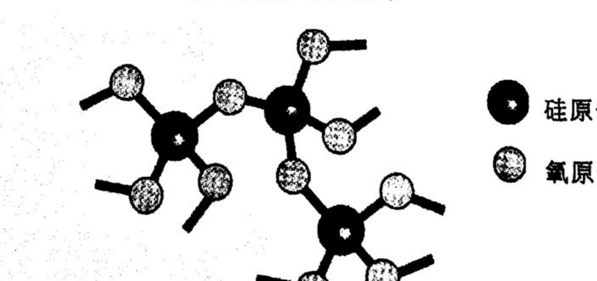
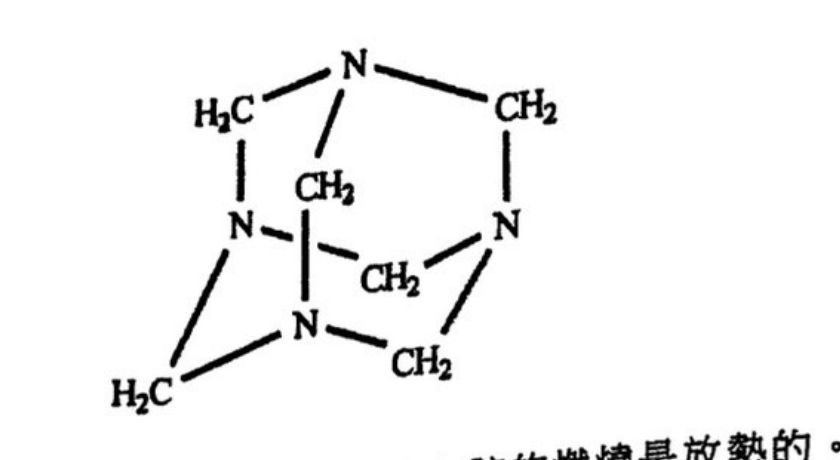
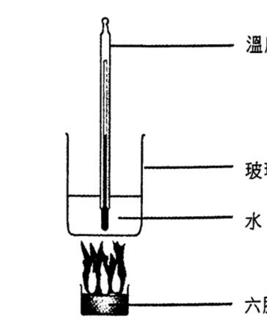
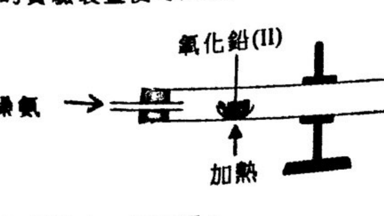
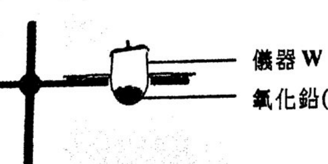
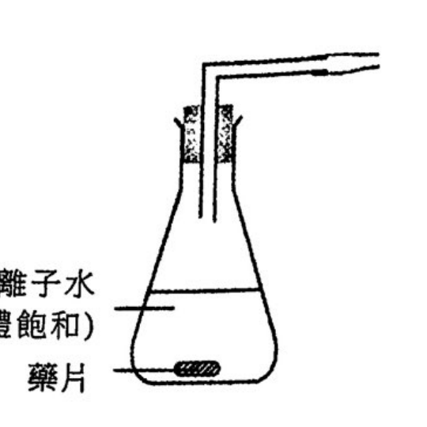
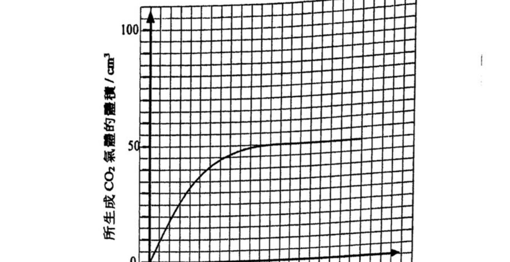
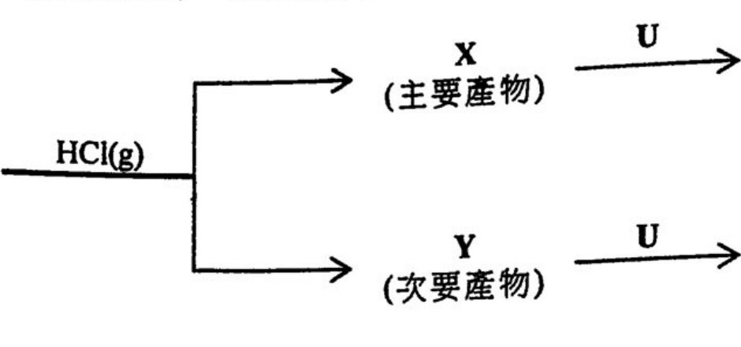

# 2021 DSE 化學 卷一乙（中文卷）— 題目庫

> 來源：文憑試 DSE 化學 Chemistry 2021 歷屆試題 Past Paper 卷一.pdf（乙部）　｜　乙部：第一部分 8 題、第二部分 5 題，共 13 題
> 各題均須作答。把答案寫在預留的空位內。
> 說明：已移除頁碼、試卷標頭、答題簿橫線等雜訊；化學式以 Unicode 下標／上標表示，反應式以 → 或 ⇌ 表示。**本檔為題目庫（零答案）**，只含題目清洗 + 建議標籤。
> 本檔為第 2 層文字交貨（圖用原卷截圖；精修重繪另開第 3 層）。
> 註：本卷源 PDF 為純掃描（無文字層），以 easyocr 辨識後清洗；部分分題標號／化學式經重建，不確定處標 [?]，詳見檔尾「待人工核對」。

---

## 第一部分（第 1–8 題）

## 第 1 題

【建議標籤】

- 卷別/部分：卷一乙　第一部分
- 課題：#乙炔 #碳化鈣 #自由基 #燃燒

【題目內容】

乙炔(C₂H₂)是一種燃料，它可由碳化鈣(CaC₂)經如下所示方程式所代表的兩個不同反應而獲得：

反應(I)：CaC₂ + A → C₂H₂ + CaH₂

反應(II)：CaC₂ + 2H₂O → C₂H₂ + Ca(OH)₂

(a)　繪一個 C₂H₂ 分子的電子圖（只顯示最外層的電子）。（1 分）

(b)　寫出乙炔完全燃燒的化學方程式。（[?] 分）

(c)　參照反應(I)：

　(i)　在室內條件下，A 是氣體。提出 A 是什麼。

　(ii)　據此，解釋為什麼這反應是危險的。（2 分）

(d)　在反應(II)中，生成了 Ca(OH)₂。寫出 Ca(OH)₂ 在日常生活中的一項用途。（1 分）

---

## 第 2 題

【建議標籤】

- 卷別/部分：卷一乙　第一部分
- 課題：#電解 #半反應式 #產物

【題目內容】

在下表的方格內，填寫與每一電解質在電解時的相關資料：

<table>
<tr><th>電極</th><th>電解質</th><th>在電極的產物／觀察</th><th>半反應式或理據</th></tr>
<tr><td>石墨（陽極）</td><td rowspan="2">熔融 PbBr₂</td><td>(a) 觀察：</td><td>(b) 半反應式：</td></tr>
<tr><td>石墨（陰極）</td><td></td><td></td></tr>
<tr><td>鉑（陽極）</td><td rowspan="2">ZnBr₂ 稀溶液</td><td>(d) 產物：</td><td>(c) 半反應式：</td></tr>
<tr><td>鉑（陰極）</td><td>(e) 產物：</td><td></td></tr>
<tr><td>銅（陽極）</td><td rowspan="2">CuSO₄ 溶液</td><td>(f) 觀察：</td><td>(g) 理據：</td></tr>
<tr><td>銅（陰極）</td><td></td><td></td></tr>
</table>

（7 分）

---

## 第 3 題

【建議標籤】

- 卷別/部分：卷一乙　第一部分
- 課題：#同位素 #二氧化硅 #矽

【題目內容】

硅在自然界中以三個同位素存在，每個同位素的豐度如下表所示：

| 同位素 | 豐度 / % |
|---|---|
| ²⁸Si | 92.20 |
| ²⁹Si | x |
| ³⁰Si | [?] |

(a)　「同位素」一詞是什麼意思？（1 分）

(b)　計算 x%。（相對原子質量：Si = 28.1）（2 分）

(c)　二氧化硅是硅的一個氧化物。

　(i)　解釋為什麼二氧化硅具高熔點。（1 分）

　(ii)　在某些條件下，把 1.0 g 的 SiO₂ 與 1.0 g 的 Mg 一起反應，反應的方程式如下：

SiO₂ + 2Mg → 2MgO + Si

計算所生成 Si 的理論質量。（相對原子質量：O = 16.0, Mg = 24.3, Si = 28.1）（4 分）

(d)　只含硅和氧的一種礦物的部分結構如下圖所示：

這礦物是什麼？（1 分）

---

## 第 4 題

【建議標籤】

- 卷別/部分：卷一乙　第一部分
- 課題：#裂解 #烯烴 #聚合物 #沸點

【題目內容】

癸烷(C₁₀H₂₂)的一個可能裂解反應的化學方程式如下所示：

C₁₀H₂₂ → C₈H₁₈ + 2X

(a)　寫出 X 的系統名稱。

(b)　建議一個化學測試以顯示怎樣可辨別 X 和丁烷。（2 分）

(c)　X 可生成一聚合物 Z。

　(i)　提出為什麼 X 可生成一聚合物。

　(ii)　繪出 Z 的重複單位。（2 分）

(d)　化合物 Y 是丁烷的結構異構體。

　(i)　繪出 Y 的一個可能結構。

　(ii)　癸烷、丁烷和 Y，何者具最高沸點？解釋你的答案。（1 分）

---

## 第 5 題

【建議標籤】

- 卷別/部分：卷一乙　第一部分
- 課題：#六胺 #焓變 #量熱

【題目內容】

六胺(CH₂)₆N₄ 是一種可攜式固體燃料的主要成分。在室內條件下它是固體，其結構如下所示：

(a)　根據共價鍵的斷裂和形成，提出為什麼六胺的燃燒是放熱的。（2 分）

(b)　已知：

| 化合物 | 標準生成焓變 / kJ mol⁻¹ |
|---|---|
| C₆H₁₂N₄(s) | +123 |
| CO₂(g) | −394 |
| H₂O(l) | −286 |
| NO₂(g) | +33 |

　(i)　寫出六胺的標準生成焓變的熱化學方程式。

　(ii)　六胺燃燒如下方程式所示：

C₆H₁₂N₄(s) + 13O₂(g) → 6CO₂(g) + 6H₂O(l) + 4NO₂(g)

計算六胺的標準燃燒焓變。（4 分）

(c)　下圖顯示在某些實驗條件下，一個測定六胺的燃燒焓變的實驗裝置：

所得數據如下所示：

燃燒了的六胺的質量：[?] g

水的初始溫度：23.5 °C

水的最終溫度：47.5 °C

六胺的摩爾質量：140.0 g

水的比熱容：4.20 J g⁻¹ K⁻¹

假設玻璃燒杯的熱容可忽略，計算在這些實驗條件下六胺的燃燒焓變。（[?] 分）

---

## 第 6 題

【建議標籤】

- 卷別/部分：卷一乙　第一部分
- 課題：#氧化鉛 #還原 #裝置

【題目內容】

利用如下所示的實驗裝置可由氧化鉛(II)得到鉛。除了鉛外，也生成氨氣和蒸汽。

(a)　以下各項提出一個原因：

　(i)　把反應管以向下傾斜的方式擺放。

　(ii)　這實驗是在煙櫥中進行的。（2 分）

(b)　寫出這反應的化學方程式。（1 分）

(c)　解釋在這反應中哪個試劑是還原劑。（1 分）

(d)　使用碳也可從氧化鉛(II)獲取鉛。

　(i)　寫出這反應的化學方程式。（1 分）

　(ii)　下圖顯示進行這反應的一個不完整裝置：

　(1)　在圖中加上適當的儀器（附標示）以完成這裝置。

　(2)　寫出儀器 W 的名稱。（3 分）

---

## 第 7 題

【建議標籤】

- 卷別/部分：卷一乙　第一部分
- 課題：#滴定 #標準溶液 #濃度

【題目內容】

以下列出測定一個氫氯酸樣本的濃度的步驟：

步驟(1)：把 2.750 g 的無水碳酸鈉固體溶於去離子水，並調校至 250.0 cm³，製備成一個 0.1038 M 標準碳酸鈉溶液。

步驟(2)：將步驟(1)所得的 25.0 cm³ 的標準溶液轉移至一個潔淨的錐形瓶，然後加入數滴甲基橙。

步驟(3)：把氫氯酸樣本置於滴定管，用這氫氯酸滴定錐形瓶中的標準溶液。

重複步驟(2)和步驟(3)幾次，下表列出各次滴定的結果：

| 實驗 | 1 | 2 | 3 | 4 | 5 |
|---|---|---|---|---|---|
| 滴定管最終讀數 / cm³ | 30.85 | 28.75 | 28.30 | 31.35 | 21.25 |
| 滴定管初始讀數 / cm³ | 2.00 | 1.50 | 1.00 | 3.00 | 0.00 |

(a)　描述在步驟(1)中，製備該標準碳酸鈉溶液的步驟。（2 分）

(b)　寫出在滴定終點的顏色變化。（1 分）

(c)　計算在滴定中所用氫氯酸的體積的合理平均值。（1 分）

(d)　計算在該樣本中氫氯酸的濃度（以 g dm⁻³ 表示）。（相對原子質量：H = 1.0, Cl = 35.5）（[?] 分）

---

## 第 8 題

【建議標籤】

- 卷別/部分：卷一乙　第一部分
- 課題：#還原能力 #原電池 #金屬活性

【題目內容】

你獲提供下列各項：燒杯、通用電錶、數條連接線、Zn 片、Cu 片、Ag 片。

輔以一個標示圖，提出你怎樣可進行一個實驗以確定（附以解釋）金屬的還原能力的次序為 Zn > Cu > Ag。（6 分）

---

## 第二部分（第 9–13 題）

## 第 9 題

【建議標籤】

- 卷別/部分：卷一乙　第二部分
- 課題：#平衡常數 #可逆反應

【題目內容】

於恆溫下，在一個體積固定為 2.0 dm³ 的密閉容器內進行涉及 CS₂(g) 的可逆反應的實驗。該反應的方程式如下所示：

CH₄(g) + 2H₂S(g) ⇌ 4H₂(g) + CS₂(g)

(a)　寫出這反應的平衡常數 Kc 的表示式。（1 分）

(b)　於該溫度下，在不同時間各物種的摩爾數如下表所示：

| | CH₄(g) | H₂S(g) | H₂(g) | CS₂(g) |
|---|---|---|---|---|
| 初始摩爾數 | 0.04 | 0.08 | 0.08 | 0.04 |
| 在平衡時的摩爾數 | [?] | 0.11 | 0.02 | 0.025 |

　(i)　把 CH₄(g) 在平衡時的摩爾數填入上表內。

　(ii)　計算在該溫度下這反應的平衡常數 Kc。

　(iii)　如果密閉容器的體積變為 3.0 dm³ 而所有其他實驗條件維持不變，解釋 Kc 會否增加、減少，抑或維持不變。（[?] 分）

---

## 第 10 題

【建議標籤】

- 卷別/部分：卷一乙　第二部分
- 課題：#反應速率 #氣體體積 #催化

【題目內容】

一藥片含有碳酸氫鈉固體及檸檬酸固體（可溶於水）。在室內條件下進行實驗，研習當把這藥片放進於去離子水時生成 CO₂ 氣體的速率。

(a)　下圖顯示該實驗的一個不完整裝置：

　(i)　解釋為什麼在實驗開始前，所用的去離子水應先被 CO₂ 氣體飽和。

　(ii)　在上圖中加上適當的儀器（附標示），以顯示怎樣量度所生成的 CO₂ 氣體。（2 分）

(b)　以下坐標圖顯示在該實驗中所生成 CO₂ 氣體的體積隨時間的變化：

　(i)　假設檸檬酸是過量，且沒有其他物質與碳酸氫鈉反應，計算在這藥片中碳酸氫鈉的 [?]。

　(ii)　若把這藥片研成粉末而所有其他實驗條件維持不變，在上面的坐標圖草繪另一曲線（用虛線）來顯示預期的實驗結果。（[?] 分）

---

## 第 11 題

【建議標籤】

- 卷別/部分：卷一乙　第二部分
- 課題：#馬科尼科夫規則 #親電加成 #旋光性

【題目內容】

甲基丁-2-烯與 HCl(g) 反應，得到按馬科尼科夫規則預測的主要產物 X。當反應時，亦可生成另一個產物 Y（次要產物）。參照以下各有機轉化：

(a)　寫出馬科尼科夫規則。（1 分）

(b)　繪出 X 的結構。（1 分）

(c)　X 與 U 反應生成 2-甲基丁-2-醇。U 是什麼？（1 分）

(d)　(i)　Y 具有一個手性中心。繪出 Y 的一個對映異構體的三維結構圖。

　(ii)　Y 具旋光性。「具旋光性」一詞是什麼意思？（2 分）

(e)　Y 與 U 反應得到醇乙。建議一化學測試以顯示怎樣可辨別醇乙和 2-甲基丁-2-醇。（2 分）

---

## 第 12 題

【建議標籤】

- 卷別/部分：卷一乙　第二部分
- 課題：#氧化物 #酸鹼性質 #過渡金屬

【題目內容】

二氧化硅是一酸性氧化物。然而，二氧化硅和蒸餾水的混合物的 pH 是 7。

(a)　(i)　提出為什麼二氧化硅被分類為酸性氧化物。

　(ii)　解釋為什麼該混合物的 pH 是 7。（2 分）

(b)　氧化磷(V)是一酸性氧化物。輔以一化學方程式，解釋為什麼氧化磷(V)和蒸餾水的混合物的 pH 小於 7。（2 分）

(c)　參照以下反應：

Cu₂O(s) + H₂SO₄(aq) → Cu(s) + CuSO₄(aq) + H₂O(l)

寫出這反應可怎樣表明銅展示兩個過渡性金屬的特性。（2 分）

---

## 第 13 題

【建議標籤】

- 卷別/部分：卷一乙　第二部分
- 課題：#縮合聚合 #尼龍

【題目內容】

以尼龍66為例，闡述縮合聚合的意思。你的答案也必須包括各單體的結構特徵。（5 分）

---

## 待人工核對

以下題目的 OCR 原文殘缺或模糊，需以原卷覆核：

| 題號 | 頁（原卷） | 問題 |
|---|---|---|
| 第 1 題 | 乙部 p.11–12 | 反應(I)產物「CaH₂」及溫度條件由亂碼重建；(a)「C₂H₂分子」由「Cl.」重建；(b) 題分以 [?] 標示 |
| 第 2 題 | 乙部 p.13 | 電解質表格結構（跨欄 rowspan、觀察／產物／半反應式欄位）由 OCR 重建，需對頁核對 |
| 第 3 題 | 乙部 p.14–15 | ³⁰Si 豐度 OCR 讀作「}」，以 [?] 標示；礦物結構 crop 已截但未肉眼對頁 |
| 第 4 題 | 乙部 p.15–16 | 裂解方程式「C₁₀H₂₂ → C₈H₁₈ + 2X」由亂碼重建，需核對 |
| 第 5 題 | 乙部 p.17–18 | 六胺結構 crop 已截但未肉眼對頁；(c) 六胺質量及題分 OCR 亂，以 [?] 標示 |
| 第 6 題 | 乙部 p.19 | 兩裝置圖 crop 已截但未肉眼對頁 |
| 第 7 題 | 乙部 p.20 | 滴定結果表及(d)題分由 OCR 重建，需核對 |
| 第 9 題 | 乙部 p.22 | 平衡摩爾數表數值由 OCR 重建，需核對 |
| 第 10 題 | 乙部 p.23–24 | (b)(i) 碳酸氫鈉後文字 OCR 亂，以 [?] 標示；坐標圖 crop 已截但未肉眼對頁 |
| 第 11 題 | 乙部 p.25–26 | 有機轉化 scheme crop 已截但未肉眼對頁 |
