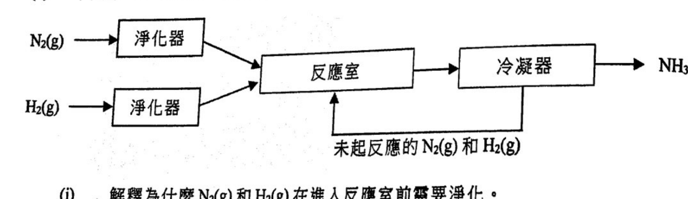
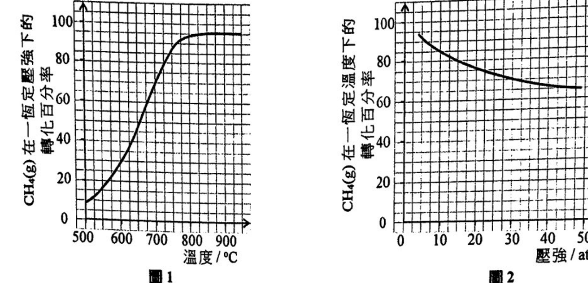
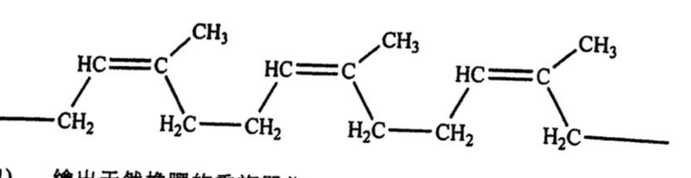
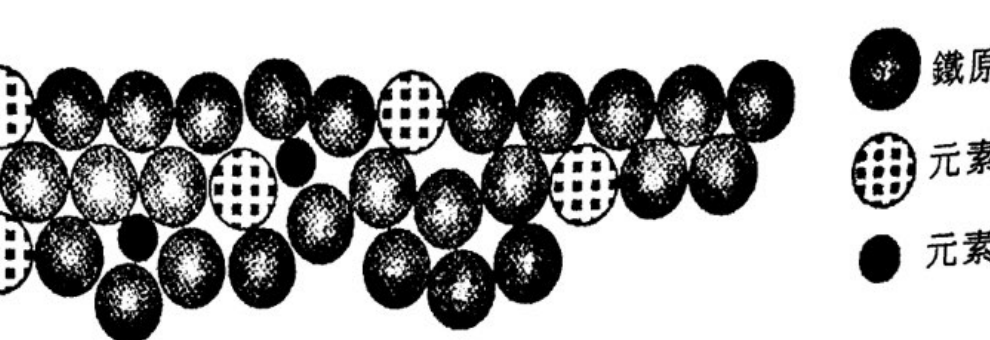
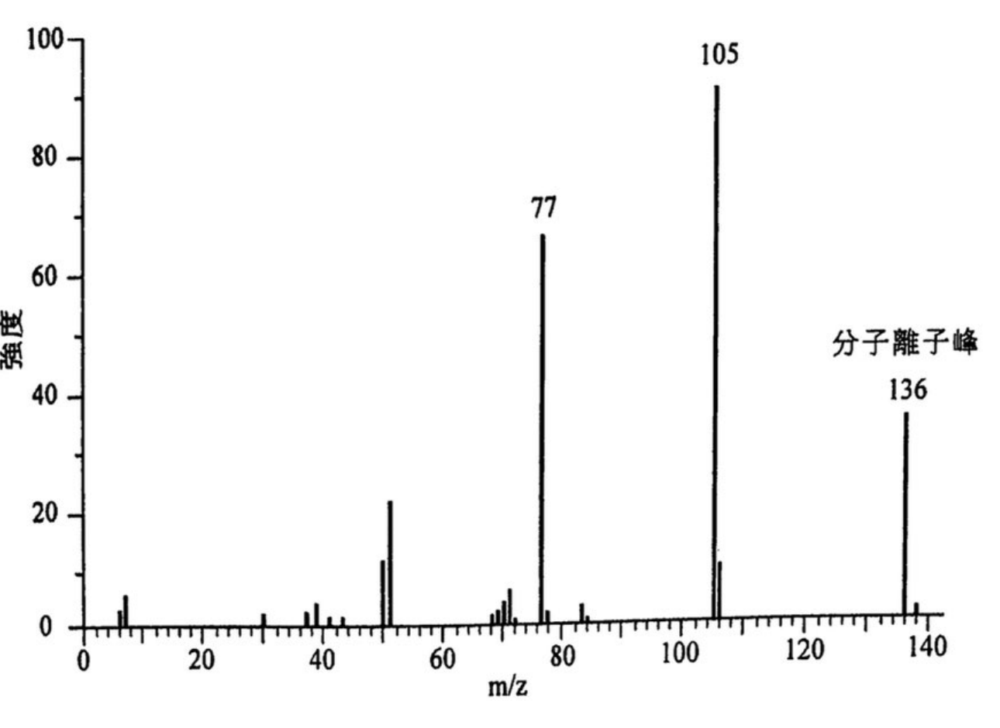

# 2021 DSE 化學 卷二（中文卷）— 題目庫

> 來源：文憑試 DSE 化學 Chemistry 2021 歷屆試題 Past Paper 卷二.pdf　｜　三部分：甲部 工業化學、乙部 物料化學、丙部 分析化學（每部分一題）
> 考生須選答任何兩部中的全部試題。
> 說明：已移除頁碼、試卷標頭等雜訊；化學式以 Unicode 下標／上標表示，反應式以 → 或 ⇌ 表示。**本檔為題目庫（零答案）**，只含題目清洗 + 建議標籤。
> 本檔為第 2 層文字交貨（圖用原卷截圖；精修重繪另開第 3 層）。
> 註：本卷源 PDF 為純掃描（無文字層），以 easyocr 辨識後清洗；部分分題標號／化學式經重建，不確定處標 [?]，詳見檔尾「待人工核對」。

---

## 甲部　工業化學（第 1 題）

## 第 1 題

【建議標籤】

- 卷別/部分：卷二　甲部
- 課題：#工業化學 #活化能 #哈柏法 #甲醇 #反應動力學

【題目內容】

回答試題的所有部分。

(a)　回答以下短問題：

HCOOH(l) 在某些條件下可分解成 CO(g) 和 H₂O(l)。

　(i)　在相同條件下，由 CO(g) 和 H₂O(l) 生成 HCOOH(l) 的活化能是多少（以 kJ mol⁻¹ 為單位）？

（HCOOH(l) → CO(g) + H₂O(l)　ΔH = +28.5 kJ mol⁻¹；正向反應的活化能 = +71.1 kJ mol⁻¹）

　(ii)　某反應的活化能是 +65.0 kJ mol⁻¹。該反應在 40 °C 時的速率常數為 k₀，計算反應在 37 °C 時的速率常數（以 k₀ 表示）。

（阿列紐斯方程：log k = 常數 − Ea/(2.3RT)；氣體常數 R = 8.31 J K⁻¹ mol⁻¹）（2 分）

　(iii)　以下給出在某些條件下，反應 A(g) + B(g) → C(g) 的速率方程，其中 k₃ 是速率常數：

速率 = k₃ [A(g)] [B(g)][?]

　　(1)　對應 B(g) 的反應級數是多少？

　　(2)　這速率的單位是 mol dm⁻³ s⁻¹。寫出 k₃ 的單位。（2 分）

(b)　下圖顯示怎樣利用哈柏法生產液態氨：

　(i)　解釋為什麼 N₂(g) 和 H₂(g) 在進入反應室前需要淨化。（1 分）

　(ii)　解釋為什麼把未起反應的 N₂(g) 和 H₂(g) 再次通回反應室。

　(iii)　為什麼在冷凝器內的氨變為液體，但其他氣體則否？

　(iv)　在哈柏法的反應中使用了催化劑。

　　(1)　提出一個可使用的催化劑。

　　(2)　輔以麥克斯韋-玻爾茲曼分佈曲線，解釋為什麼當使用了催化劑後該反應應變得較快。（5 分）

(c)　甲醇是工業中一個重要化學品，可由甲烷生產。這生產可被視為分成兩個階段。

　(i)　寫出甲醇的一項潛在危害。（1 分）

　(ii)　除了天然氣之外，提出甲烷的一項來源。

　(iii)　在第一個階段中，CH₄(g) 與 H₂O(g) 反應生成 CO(g) 和 H₂(g)，並會達致平衡。下面各圖顯示在不同條件下，CH₄(g) 在平衡時的轉化百分率：

　　(1)　參照圖1，解釋該正向反應是吸熱的還是放熱的。

　　(2)　參照圖2，輔以一化學方程式，解釋壓強對 CH₄(g) 的轉化百分率的影響。（4 分）

　(iv)　在第二個階段中，CO(g) 與 H₂(g) 反應生成甲醇。寫出這反應的化學方程式。（1 分）

---

## 乙部　物料化學（第 2 題）

## 第 2 題

【建議標籤】

- 卷別/部分：卷二　乙部
- 課題：#物料化學 #纖維素 #液晶 #橡膠 #PMMA #PLA #不鏽鋼

【題目內容】

回答試題的所有部分。

(a)　回答以下短問題：

　(i)　解釋為什麼纖維素能吸水但甲殼素卻不能。（2 分）

　(ii)　提出液晶在日常生活中的一項用途。

　(iii)　天然橡膠的部分結構顯示如下：

　　(1)　繪出天然橡膠的重複單位。

　　(2)　提出在橡膠工業上，透過「硫化」會改善天然橡膠的一項物理性質。（2 分）

(b)　CH₂=C(CH₃)COOCH₃ 是聚甲基丙烯酸甲酯(PMMA)的單體。下列各步驟顯示可怎樣合成這單體：

步驟 I：CH₃COCH₃ + HCN → CH₃C(CN)(OH)CH₃

步驟 II：CH₃C(CN)(OH)CH₃ + H₂SO₄ + CH₃OH → CH₂=C(CH₃)COOCH₃ + NH₄HSO₄

　(i)　這合成可用如下所示的總反應式表示：

CH₃COCH₃ + HCN + H₂SO₄ + CH₃OH → CH₂=C(CH₃)COOCH₃ + NH₄HSO₄

根據這總反應式，計算該合成的原子經濟。

（式量：HCN = 27.0, CH₃OH = 32.0, CH₃COCH₃ = 58.0, H₂SO₄ = 98.1, CH₂=C(CH₃)COOCH₃ = 100.0, NH₄HSO₄ = 115.1）（1 分）

　(ii)　根據所給資料，提出該合成能否被視為綠色，並加以解釋。

　(iii)　寫出由 CH₂=C(CH₃)COOCH₃ 生成 PMMA 的化學方程式。（1 分）

　(iv)　(1)　「熱固性塑膠」一詞是什麼意思？

　　(2)　從分子層面，解釋 PMMA 是否熱固性塑膠。（1 分）

　　(3)　除了其熱性質之外，寫出 PMMA 的一項性質，並提出 PMMA 基於該性質的一項用途。（2 分）

(c)　聚乳酸(PLA)和不鏽鋼均可用來製造餐盒。PLA 是可生物降解的，並可由原材料玉米澱粉製成。

　(i)　(1)　根據原材料，提出使用 PLA 來製造即棄餐盒的一項優點及一項缺點。

　　(2)　根據分子結構，解釋為什麼 PLA 是可生物降解的。（4 分）

　(ii)　不鏽鋼能用來製造可重用餐盒。下圖顯示在不鏽鋼某一原子層的其中一部分：

　　(1)　在不鏽鋼中 X 的存在令不鏽鋼較純鐵更抗腐蝕。提出 X 會是什麼。

　　(2)　在不鏽鋼中 Y 的存在令不鏽鋼較純鐵更堅硬。提出 Y 會是什麼，並解釋牠怎樣可使硬度增加。

　　(3)　鐵是不鏽鋼的主要成分，並在某些條件下具立方緊密裝填晶體結構。在這晶體結構中，鐵原子的配位數是多少？（4 分）

---

## 丙部　分析化學（第 3 題）

## 第 3 題

【建議標籤】

- 卷別/部分：卷二　丙部
- 課題：#分析化學 #離子鑑別 #分餾 #紅外光譜 #質譜 #酯

【題目內容】

回答試題的所有部分。

(a)　回答以下短問題：

　(i)　提出一化學測試以顯示可怎樣辨別 Al₂(SO₄)₃(aq) 和 ZnSO₄(aq)。（2 分）

　(ii)　提出一化學測試，以顯示可怎樣辨別 (CH₃)₂COH(l) 和 CH₃COOH(l)。（2 分）

　(iii)　寫出把 2,4-二硝基苯肼加進丙酮的預期觀察。

(b)　在一個使用濃磷酸作為脫水劑，從環己醇製備環己烯的實驗中，得到一個環己烯。磷酸和環己醇的液體混合物（沸點：環己烯 = 83 °C，環己醇 = 162 °C）。

　(i)　描述怎樣可使用一個水溶液，藉液-液萃取把該混合物中的磷酸除掉的各步驟。（3 分）

　(ii)　把磷酸除掉後，所餘混合物經分餾得到沸點為 83 °C 的一個餾液。

　　(1)　繪出該分餾裝置的標示圖。

　　(2)　利用沸點及紅外光譜，提出你可怎樣支持以下的述句：

「該餾液是環己烯，並且沒有任何環己醇的存在。」

特定紅外吸收波數域（伸展式）：

| 鍵合 | 化合物類別 | 波數域 / cm⁻¹ |
|---|---|---|
| C=C | 烯 | 1610 至 1680 |
| C=O | 羰基化合物 | 1680 至 1800 |
| C≡N | 腈 | 2200 至 2280 |
| O–H | 氫鍵的酸 | 2500 至 3300 |
| C–H | 烷、烯及芳烴 | 2840 至 3095 |
| O–H | 帶氫鍵的醇 | 3230 至 3670 |
| N–H | 胺 | 3350 至 3500 |

（4 分）

(c)　酯 A 的質譜如下所示：

　(i)　推定 A 的分子式。

（質量組成：C = 70.6%, H = 5.9%, O = 23.5%；相對原子質量：H = 1.0, C = 12.0, O = 16.0）（2 分）

　(ii)　已知在 m/z = 77 的訊號對應為 C₆H₅⁺，推定酯 A 的結構式。（2 分）

　(iii)　把 2.75 g 的 A 的粗樣本與 50.0 cm³ 的 0.060 M NaOH(aq) 共熱直至沒有進一步反應。在所得混合物內過剩的 NaOH(aq) 需用 20.40 cm³ 的 0.050 M HCl(aq) 完全中和。

　　(1)　寫出 A 與 NaOH(aq) 反應的化學方程式。

　　(2)　假設在該樣本中，只有 A 可與 NaOH(aq) 反應，計算在該樣本中 A 的質量百分率。（4 分）

---

## 待人工核對

以下題目的 OCR 原文殘缺或模糊，需以原卷覆核：

| 題號 | 頁（原卷） | 問題 |
|---|---|---|
| 第 1 題 (a)(iii) | 卷二 p.36–37 | 速率方程中 B 的指數 OCR 讀作「-」，以 [?] 標示，需核對 |
| 第 1 題 (b) | 卷二 p.37 | 哈柏法流程圖 crop 已截但未肉眼對頁 |
| 第 1 題 (c)(iii) | 卷二 p.38 | 兩坐標圖 crop 已截但未肉眼對頁 |
| 第 2 題 (a)(iii) | 卷二 p.39 | 天然橡膠結構 crop 已截但未肉眼對頁 |
| 第 2 題 (b) | 卷二 p.39 | PMMA 合成步驟及式量由 OCR 重建，需核對 |
| 第 2 題 (c)(ii) | 卷二 p.40 | 不鏽鋼原子層圖 crop 已截但未肉眼對頁 |
| 第 3 題 (a)(ii) | 卷二 p.41 | 醇的結構式 OCR 亂，以「(CH₃)₂COH」重建，需核對 |
| 第 3 題 (b)(ii) | 卷二 p.41–42 | 紅外吸收波數域表由 OCR 重建（數值經校正），需核對 |
| 第 3 題 (c) | 卷二 p.42 | 質譜圖 crop 已截但未肉眼對頁 |
