# 2022 DSE 化學 卷一甲（中文卷）— 題目庫

> 來源：文憑試 DSE 化學 Chemistry 2022 歷屆試題 Past Paper 卷一.pdf（甲部）　｜　多項選擇題 36 題（第一部分 24 題、第二部分 12 題）
> 本部包括兩部分：第一部分設 24 題，第二部分設 12 題。選出每題最佳的答案。考生可參考印於試題答題簿 B 第 20 頁的周期表。
> 說明：已移除頁碼、試卷標頭等雜訊；化學式以 Unicode 下標／上標表示（如 H₂SO₄），反應式以 → 或 ⇌ 表示。**本檔為題目庫（零答案）**，只含題目清洗 + 建議標籤。
> 本檔為第 2 層文字交貨（圖用原卷截圖；精修重繪另開第 3 層）。
> 註：本卷源 PDF 為純掃描（無文字層），以 easyocr 辨識後清洗；部分化學式／結構經化學常識重建，不確定處標 [?]，詳見檔尾「待人工核對」。

---

## 第一部分（第 1–24 題）

## 第 1 題

【建議標籤】

- 卷別/部分：卷一甲　第一部分
- 課題：#二氧化碳 #石灰水

【題目內容】

下列哪項有關 CO₂(g) 的陳述不正確？

- A. 它可令石灰水變乳濁
- B. 它可用來製造乾冰
- C. 它可藉把大理石加進水中而製得
- D. 它在市區的空氣中的百分率一般較在郊區的為高

---

## 第 2 題

【建議標籤】

- 卷別/部分：卷一甲　第一部分
- 課題：#原子結構 #中子 #電子

【題目內容】

在一個 ⁵¹V³⁺ 離子中有多少個中子和電子？

| | 中子數目 | 電子數目 |
|---|---|---|
| A. | 23 | 20 |
| B. | 28 | 23 |
| C. | 28 | 20 |
| D. | 51 | 23 |

---

## 第 3 題

【建議標籤】

- 卷別/部分：卷一甲　第一部分
- 課題：#電解質

【題目內容】

下列哪物質是電解質？

- A. 氯化鈉
- B. 二氧化硅
- C. 甲醇
- D. 汞

---

## 第 4 題

【建議標籤】

- 卷別/部分：卷一甲　第一部分
- 課題：#滴定 #酸鹼

【題目內容】

下列何者在滴定中是不正確的步驟？

- A. 在滴定前，用將要移送的溶液沖洗移液管
- B. 在滴定前，用將要盛載的溶液沖洗錐形瓶
- C. 讀取滴定管的數據時，眼睛與彎液面成同一水平
- D. 確保沒有氣泡在注了滴定劑的滴定管內

---

## 第 5 題

【建議標籤】

- 卷別/部分：卷一甲　第一部分
- 課題：#週期表 #離子

【題目內容】

元素 X 是周期表內首二十個元素之一。X 生成穩定的 [?] 離子。X 最有可能屬於周期表的哪一族？

- A. 第 I 族
- B. 第 II 族
- C. 第 V 族
- D. 第 VI 族

---

## 第 6 題

【建議標籤】

- 卷別/部分：卷一甲　第一部分
- 課題：#摩爾 #沉澱反應

【題目內容】

磷酸銅(II) 是不溶於水。當把 0.04 mol 的 CuCl₂(aq) 與 0.02 mol 的 H₃PO₄(aq) 混合時，在所
得混合物的溶液中剩餘的 Cu²⁺(aq) 離子的摩爾數是多少？

- A. 0.00
- B. 0.01
- C. 0.02
- D. 0.03

---

## 第 7 題

【建議標籤】

- 卷別/部分：卷一甲　第一部分
- 課題：#溶解度 #金屬氫氧化物

【題目內容】

一白色固體均不溶於水及過量氨水。下列何者可能是這固體？

- A. Pb(NO₃)₂
- B. Zn(OH)₂
- C. MgSO₄
- D. CaCO₃

---

## 第 8 題

【建議標籤】

- 卷別/部分：卷一甲　第一部分
- 課題：#聚合物 #加成聚合

【題目內容】

一聚合物的部分結構如下所示：

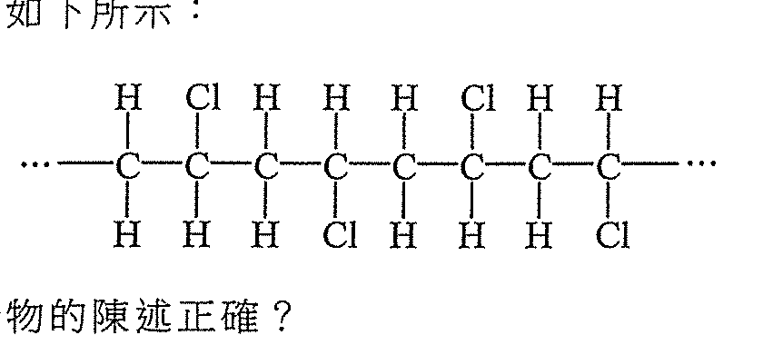

下列哪項有關該聚合物的陳述正確？

- A. 它可用作玻璃的代替品。
- B. 它的重複單位是 ─CH₂─CHCl─
- C. 它可從其單體經加成聚合而製成
- D. 它可令溶於一有機溶劑的溴快速地變成無色

---

## 第 9 題

【建議標籤】

- 卷別/部分：卷一甲　第一部分
- 課題：#有機化合物 #溶解度

【題目內容】

考慮以下三個化合物：

X：CH₃CH₂CH₂CH₂OH　Y：HOCH₂CH₂OH　Z：CH₃COOCH₃

下列何者顯示它們在水中溶解度的遞減次序？

- A. X > Y > Z
- B. Z > Y > X
- C. Y > Z > X
- D. Y > X > Z

---

## 第 10 題

【建議標籤】

- 卷別/部分：卷一甲　第一部分
- 課題：#摩爾 #氧化還原 #金屬

【題目內容】

把 6.54 g 的鋅顆粒加入 100.0 cm³ 的 1.0 M AgNO₃(aq)。反應完成後，下列哪項陳述正確？
（相對原子質量：Zn = 65.4, Ag = 107.9）

- A. 有些鋅顆粒已反應，並且在溶液中沒有銀離子剩餘
- B. 所有鋅顆粒已反應，並且在溶液中沒有銀離子剩餘
- C. 所有鋅顆粒已反應，並且在溶液中有些銀離子剩餘
- D. 已反應的鋅顆粒質量等於所生成的固體產物質量

---

## 第 11 題

【建議標籤】

- 卷別/部分：卷一甲　第一部分
- 課題：#電解 #銅

【題目內容】

使用銅陰極及碳陽極，把 1.0 M CuSO₄(aq) 電解。下列哪個組合正確？

| | 陰極 | 陽極 |
|---|---|---|
| A. | 銅溶解 | 生成氧 |
| B. | 銅溶解 | 生成二氧化硫 |
| C. | 銅澱積 | 生成氧 |
| D. | 銅澱積 | 生成二氧化硫 |

---

## 第 12 題

【建議標籤】

- 卷別/部分：卷一甲　第一部分
- 課題：#化學方程式 #燃燒

【題目內容】

考慮以下化學方程式：

$C_xH_y(g) + zO_2(g) \rightarrow xCO_2(g) + \frac{y}{2}H_2O(g)$

下列哪個組合正確？

| | x | y | z |
|---|---|---|---|
| A. | 2 | 3 | 7 |
| B. | 2 | 3 | 6 |
| C. | 4 | 5 | 4 |
| D. | 4 | 5 | [?] |

---

## 第 13 題

【建議標籤】

- 卷別/部分：卷一甲　第一部分
- 課題：#化學電池 #氧化還原

【題目內容】

考慮以下化學電池：

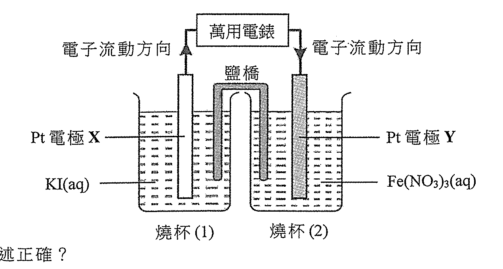

下列哪項陳述正確？

- A. 電極 X 是陰極。
- B. 燒杯(1)中的溶液逐漸變為棕色
- C. 燒杯(2)中的溶液逐漸由淺綠色變為黃色
- D. Fe₂(SO₄)₃(aq) 作為還原劑

---

## 第 14 題

【建議標籤】

- 卷別/部分：卷一甲　第一部分
- 課題：#生成焓變 #赫斯定律

【題目內容】

在某些條件下，一些物質的生成焓變如下所示：

| 物質 | 生成焓變 (kJ mol⁻¹) |
|---|---|
| H₂O(l) | −286 |
| NaOH(s) | −414 |
| Na₂O(s) | −425 |

在相同條件下，以下反應的焓變是多少？

Na₂O(s) + H₂O(l) → 2NaOH(s)

- A. +275 kJ mol⁻¹
- B. −150 kJ mol⁻¹
- C. −722 kJ mol⁻¹
- D. −1125 kJ mol⁻¹

---

## 第 15 題

【建議標籤】

- 卷別/部分：卷一甲　第一部分
- 課題：#金屬活性序 #還原能力

【題目內容】

無色氣體 P、Q 和 R 是三個不同的金屬。當把鋅分別加入它們的氯化物的水溶液時，只有 R 的氯化物沒有顯示可觀察變化。當把稀 HCl(aq) 分別加入這些金屬時，只有 Q 和 R 給出可觀察變化。下列何者顯示這些金屬還原能力的遞增次序？

- A. R < Q < P
- B. Q < P < R
- C. P < Q < R
- D. P < R < Q

---

## 第 16 題

【建議標籤】

- 卷別/部分：卷一甲　第一部分
- 課題：#有機化合物 #加成反應 #鹵代

【題目內容】

化合物 X 的分子式是 C₄H₇Br。它有一個碳-碳雙鍵。它可與 Br₂（溶於一有機溶劑）反應，得出以下有機生成物：

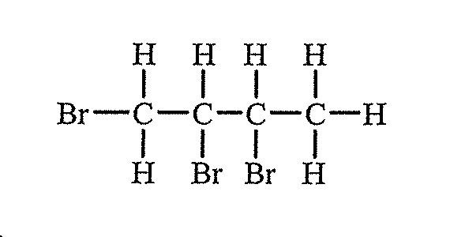

下列何者是 X 的可能結構？

1. CH₂BrCH₂CH=CH₂
2. H₂C=CHCHBrCH₃
3. CH₃CH=CHCH₂Br

- A. 只有(1)
- B. 只有(2)
- C. 只有(1)和(3)
- D. 只有(2)和(3)

---

## 第 17 題

【建議標籤】

- 卷別/部分：卷一甲　第一部分
- 課題：#蒸餾 #分離方法

【題目內容】

考慮以下的裝置：

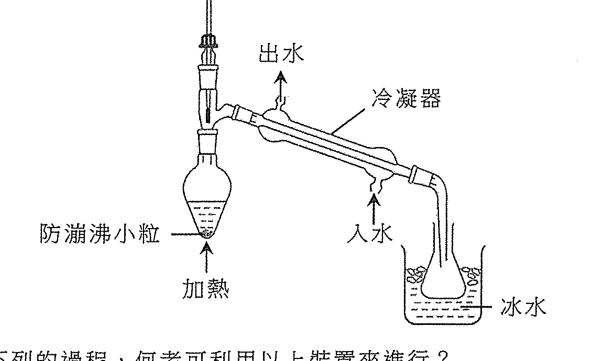

下列的過程，何者可利用以上裝置來進行？

1. 從海水獲取純水
2. 從柴油獲取丙烷
3. 從液態空氣獲取氧

- A. 只有(1)
- B. 只有(2)
- C. 只有(1)和(3)
- D. 只有(2)和(3)

---

## 第 18 題

【建議標籤】

- 卷別/部分：卷一甲　第一部分
- 課題：#金屬 #氫氣

【題目內容】

下列各對物質，何者於混合時會釋出氫氣？

1. 銅和濃 HCl(aq)
2. [?] 和 H₂SO₄(aq)
3. 鈣和 NaOH(aq)

- A. 只有(1)
- B. 只有(2)
- C. 只有(1)和(3)
- D. 只有(2)和(3)

---

## 第 19 題

【建議標籤】

- 卷別/部分：卷一甲　第一部分
- 課題：#有機化合物 #結構

【題目內容】

考慮以下兩個化合物：

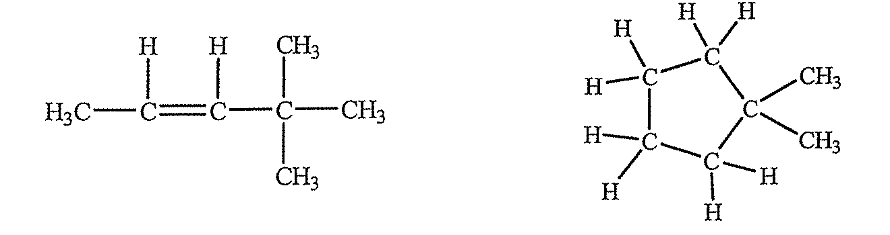

下列的陳述，何者正確？

1. 它們屬於相同的同系列
2. 它們具有相同的分子式
3. 它們不溶於水

- A. 只有(1)
- B. 只有(2)
- C. 只有(1)和(3)
- D. 只有(2)和(3)

---

## 第 20 題

【建議標籤】

- 卷別/部分：卷一甲　第一部分
- 課題：#鹼金屬 #鈉與水

【題目內容】

把一小塊鈉放入含有數滴通用指示劑的水中。下列的陳述，何者正確？

1. 鈉在水面迅速移動
2. 最終溶液呈現紅色
3. 這反應是放熱的

- A. 只有(1)
- B. 只有(2)
- C. 只有(1)和(3)
- D. 只有(2)和(3)

---

## 第 21 題

【建議標籤】

- 卷別/部分：卷一甲　第一部分
- 課題：#焓變 #碳

【題目內容】

下列哪些陳述正確？

1. 石墨的標準生成焓變是零
2. 一氧化碳的標準燃燒焓變是負值
3. 一氧化碳的標準生成焓變等於石墨的標準燃燒焓變

- A. 只有(1)和(2)
- B. 只有(1)和(3)
- C. 只有(2)和(3)
- D. (1)、(2)和(3)

---

## 第 22 題

【建議標籤】

- 卷別/部分：卷一甲　第一部分
- 課題：#酸 #pH

【題目內容】

A 和 B 均是一元酸。0.10 M A(aq) 的 pH 是 1.0 及 0.10 M B(aq) 的 pH 是 3.0。下列哪些陳述正確？

1. A 是比 B 較強的酸
2. 有些 B 分子存在於 B(aq) 中
3. 完全中和 25.0 cm³ 的 0.10 M A(aq) 及完全中和 25.0 cm³ 的 0.10 M B(aq) 需用相同摩爾數的 NaOH(aq)

- A. 只有(1)和(2)
- B. 只有(1)和(3)
- C. 只有(2)和(3)
- D. (1)、(2)和(3)

---

## 第 23 題

【建議標籤】

- 卷別/部分：卷一甲　第一部分
- 課題：#石油 #分餾

【題目內容】

以下簡圖顯示如何在分餾塔中得到不同的石油餾分：

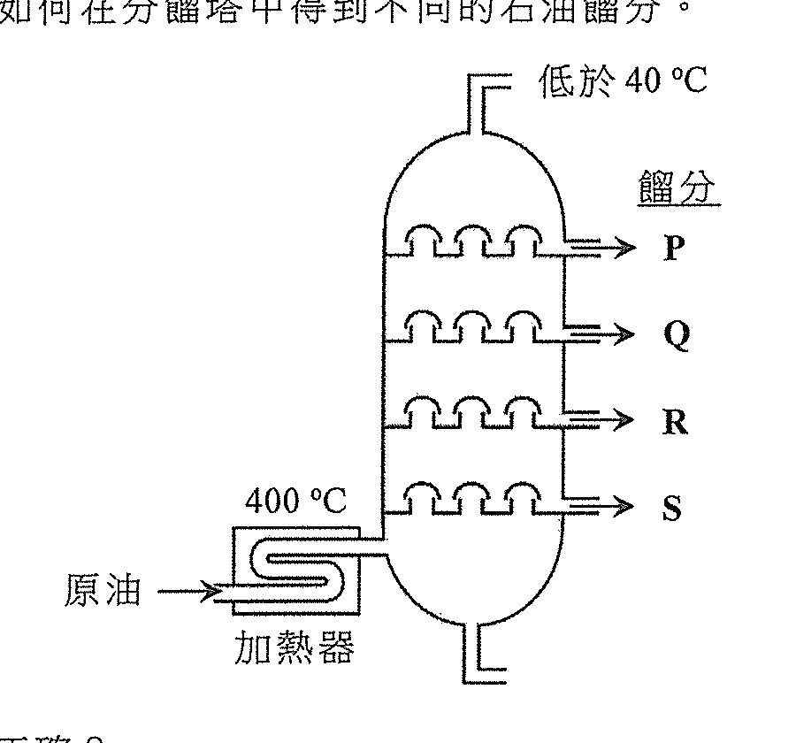

下列哪些陳述正確？

1. 餾分 R 比餾分 P 具較高的黏度
2. 餾分 S 比餾分 Q 具較深的顏色
3. 餾分 Q 比餾分 P 較易燃

- A. 只有(1)和(2)
- B. 只有(1)和(3)
- C. 只有(2)和(3)
- D. (1)、(2)和(3)

---

## 第 24 題

【建議標籤】

- 卷別/部分：卷一甲　第一部分
- 課題：#有機化合物 #實驗式

【題目內容】

考慮下列各述句並選出最佳的答案：

| 第一述句 | 第二述句 |
|---|---|
| 乙烯和丁-1-烯具有相同的標準燃燒焓變 | 二烯和丁-1-烯具有相同的實驗式 |

- A. 兩述句均正確，而第二述句為第一述句的合理解釋
- B. 兩述句均正確，但第二述句並非第一述句的合理解釋
- C. 第一述句錯誤，但第二述句正確
- D. 兩述句均錯誤

---

## 第二部分（第 25–36 題）

## 第 25 題

【建議標籤】

- 卷別/部分：卷一甲　第二部分
- 課題：#摩爾體積 #燃燒

【題目內容】

一個混合物含甲烷和乙烷。在室內條件下，50 cm³ 的這混合物在氧中完全燃燒，生成 80 cm³ 的二氧化碳。在室內條件下，這混合物中甲烷的體積是多少？
（在室內條件下，氣體的摩爾體積 = 24 dm³）

- A. 10 cm³
- B. 20 cm³
- C. 30 cm³
- D. 40 cm³

---

## 第 26 題

【建議標籤】

- 卷別/部分：卷一甲　第二部分
- 課題：#反應速率 #碳酸鈣

【題目內容】

在一個無蓋的錐形瓶中，50 cm³ 的 0.10 M HCl(aq) 與過量碳酸鈣粉末反應，得出以下坐標圖中的曲線 X：

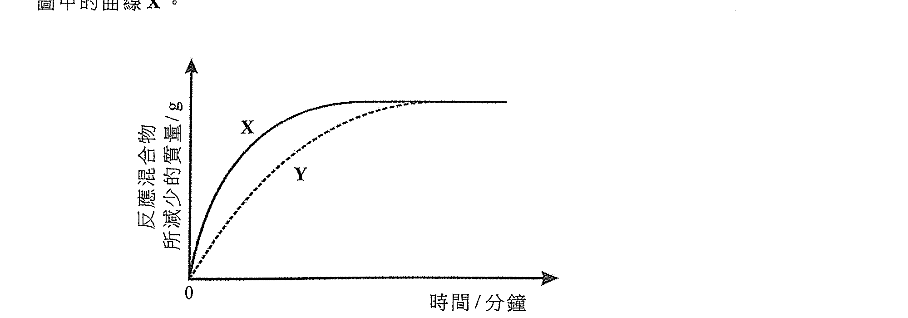

下列哪個改變會得出曲線 Y？

- A. 把溫度提升 10 °C。
- B. 用 25 cm³ 的 0.10 M HCl(aq) 代替 50 cm³ 的 0.10 M HCl(aq)
- C. 用 50 cm³ 的 0.05 M HCl(aq) 代替 50 cm³ 的 0.10 M HCl(aq)
- D. 用相同質量的碳酸鈣顆粒代替碳酸鈣粉末

---

## 第 27 題

【建議標籤】

- 卷別/部分：卷一甲　第二部分
- 課題：#有機化合物 #異構

【題目內容】

某有機化合物的結構如下所示：

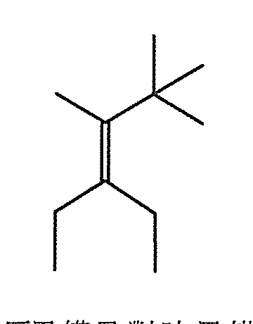

下列有關該化合物會否存在順-反異構及對映異構的組合，何者正確？

| | 順-反異構 | 對映異構 |
|---|---|---|
| A. | 沒有 | 沒有 |
| B. | 有 | 有 |
| C. | 有 | 沒有 |
| D. | 沒有 | 有 |

---

## 第 28 題

【建議標籤】

- 卷別/部分：卷一甲　第二部分
- 課題：#化學平衡 #濃度

【題目內容】

當某可逆反應達致化學平衡時，只有 X(g) 和 Y(g) 存在於一固定體積的密閉容器內。以下坐標圖顯示 X(g) 和 Y(g) 隨時間的濃度變化：

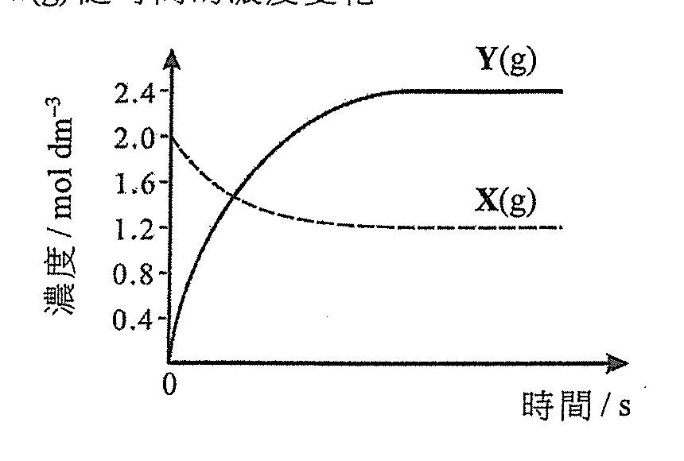

下列哪方程式可代表該可逆反應？

- A. Y(g) ⇌ 2X(g)
- B. X(g) ⇌ 3Y(g)
- C. 2X(g) ⇌ Y(g)
- D. 2X(g) ⇌ 3Y(g)

---

## 第 29 題

【建議標籤】

- 卷別/部分：卷一甲　第二部分
- 課題：#有機化合物 #水解

【題目內容】

一個有機化合物的結構顯示如下：

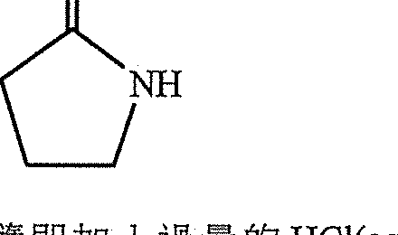

把牠與過量的 NaOH(aq) 共熱後，隨即加入過量的 HCl(aq)，生成主要有機產物 Z。下列何者是 Z？

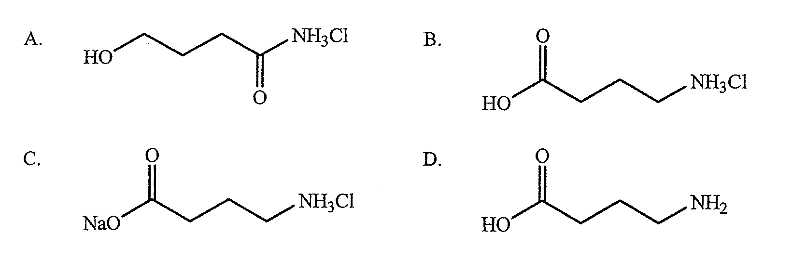

- A.
- B.
- C.
- D.

---

## 第 30 題

【建議標籤】

- 卷別/部分：卷一甲　第二部分
- 課題：#平衡常數

【題目內容】

當把 0.40 mol 的 SO₂(g) 和 0.60 mol 的 O₂(g) 置於一個 1.0 dm³ 的真空瓶中，發生以下反應：

2SO₂(g) + O₂(g) ⇌ 2SO₃(g)

在某溫度下達致化學平衡時，發現瓶中含有 0.30 mol 的 SO₃(g)。在這溫度下該反應的平衡常數 $K_c$ 是多少？

- A. 20 mol⁻¹ dm³
- B. 6.7 mol⁻¹ dm³
- C. 2.0 mol⁻¹ dm³
- D. 0.050 mol⁻¹ dm³

---

## 第 31 題

【建議標籤】

- 卷別/部分：卷一甲　第二部分
- 課題：#反應速率 #氣體

【題目內容】

考慮如下所示的實驗裝置：

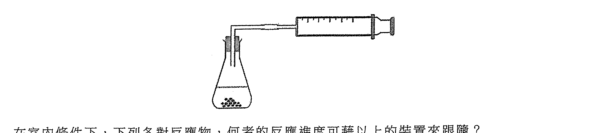

在室內條件下，下列各對反應物，何者的反應進度可藉以上的裝置來跟隨？

1. Zn(OH)₂(s) 與 HNO₃(aq)
2. Mg(s) 與 HCl(aq)
3. KBr(s) 與 Cl₂(aq)

- A. 只有(1)
- B. 只有(2)
- C. 只有(1)和(3)
- D. 只有(2)和(3)

---

## 第 32 題

【建議標籤】

- 卷別/部分：卷一甲　第二部分
- 課題：#過渡金屬 #平衡

【題目內容】

考慮以下的平衡體系：

2CrO₄²⁻(aq) + 2H⁺(aq) ⇌ Cr₂O₇²⁻(aq) + H₂O(l)

下列的陳述，何者可表明鉻展示過渡性金屬的特性？

1. Cr₂O₇²⁻(aq) 離子是橙色的
2. 加入 HCl(aq) 會將平衡位置向右移
3. 鉻在 CrO₄²⁻ 和 Cr₂O₇²⁻ 中的氧化態是相同的

- A. 只有(1)
- B. 只有(2)
- C. 只有(1)和(3)
- D. 只有(2)和(3)

---

## 第 33 題

【建議標籤】

- 卷別/部分：卷一甲　第二部分
- 課題：#有機化合物 #酯

【題目內容】

阿士匹靈的結構如下所示：

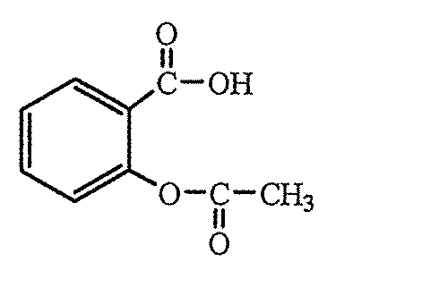

下列有關阿士匹靈的陳述，何者正確？

1. 它具有酯基團
2. 它可消炎
3. 它在 NaHCO₃(aq) 中的溶解度較在純水中的為高

- A. 只有(1)和(2)
- B. 只有(1)和(3)
- C. 只有(2)和(3)
- D. (1)、(2)和(3)

---

## 第 34 題

【建議標籤】

- 卷別/部分：卷一甲　第二部分
- 課題：#聚合物 #縮合聚合

【題目內容】

下列哪些化合物可用作縮合聚合的單體？

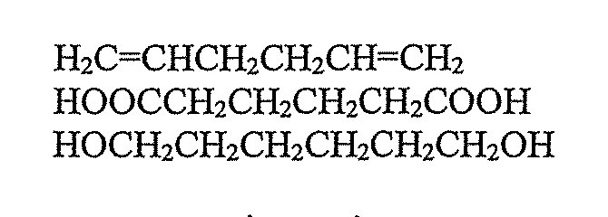

1. H₂C=CHCH₂CH₂CH=CH₂
2. HOOCCH₂CH₂CH₂CH₂COOH
3. HOCH₂CH₂CH₂CH₂CH₂CH₂OH

- A. 只有(1)和(2)
- B. 只有(1)和(3)
- C. 只有(2)和(3)
- D. (1)、(2)和(3)

---

## 第 35 題

【建議標籤】

- 卷別/部分：卷一甲　第二部分
- 課題：#清潔劑

【題目內容】

清潔劑的結構如下所示：

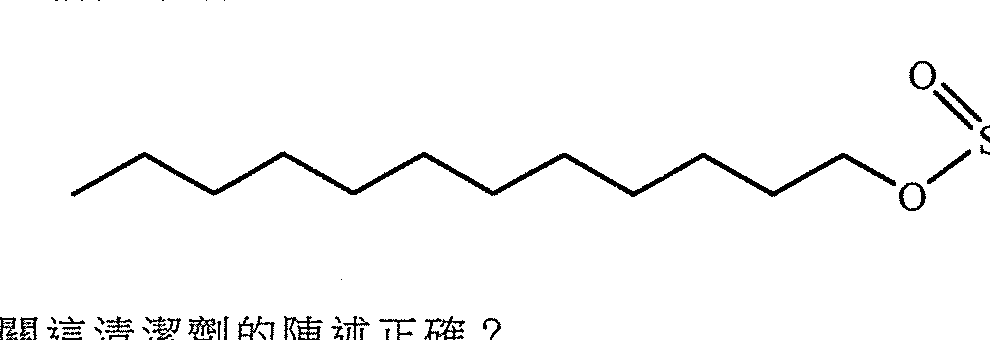

下列哪些有關這清潔劑的陳述正確？

1. 牠是非皂性清潔劑
2. 它可作為乳化劑
3. 它可增加水的表面張力

- A. 只有(1)和(2)
- B. 只有(1)和(3)
- C. 只有(2)和(3)
- D. (1)、(2)和(3)

---

## 第 36 題

【建議標籤】

- 卷別/部分：卷一甲　第二部分
- 課題：#化學平衡

【題目內容】

考慮下列各述句並選出最佳的答案：

| 第一述句 | 第二述句 |
|---|---|
| 在化學平衡時，各反應物的濃度必定等於各生成物的濃度 | 在化學平衡時，正向反應的速率與逆向反應的速率均為零 |

- A. 兩述句均正確，而第二述句為第一述句的合理解釋
- B. 兩述句均正確，但第二述句並非第一述句的合理解釋
- C. 第一述句錯誤，但第二述句正確
- D. 兩述句均錯誤

---

## 待人工核對

以下題目的 OCR 原文殘缺或模糊，需以原卷覆核：

| 題號 | 頁（原卷） | 問題 |
|---|---|---|
| 第 2 題 | 甲部 p.3 | 離子符號「⁵¹V³⁺」由亂碼「岩'+」重建，需核對 |
| 第 5 題 | 甲部 p.5 | 離子符號 OCR 不清（「HHfaq」），以 [?] 標示 |
| 第 8 題 | 甲部 p.3 | 聚合物結構及 B 選項重複單位由 OCR 重建，需對圖 |
| 第 11 題 | 甲部 p.4 | 「生成二氧化硫」由 OCR 讀得，或原卷為「生成硫」，需核對 |
| 第 12 題 | 甲部 p.4 | 方程式係數表 OCR 凌亂，x/y/z 值及 D 行第三值需核對 |
| 第 15 題 | 甲部 p.4 | 題幹「無色氣體 P、Q 和 R」文句有疑（P/Q/R 為金屬），需核對 |
| 第 18 題 | 甲部 p.6 | (2) 的金屬名稱 OCR 缺失，以 [?] 標示 |
| 第 27 題 | 甲部 p.8 | 結構式 crop 已截但未肉眼對頁，需核對 |
| 第 29 題 | 甲部 p.8 | 選項 A–D 為結構式（圖），以 crop 嵌入，需對圖核對 |
