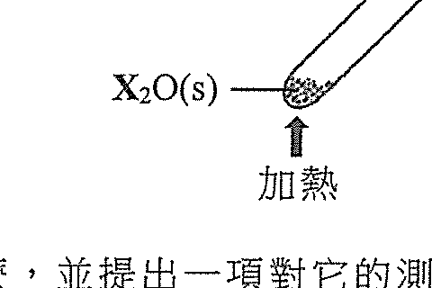
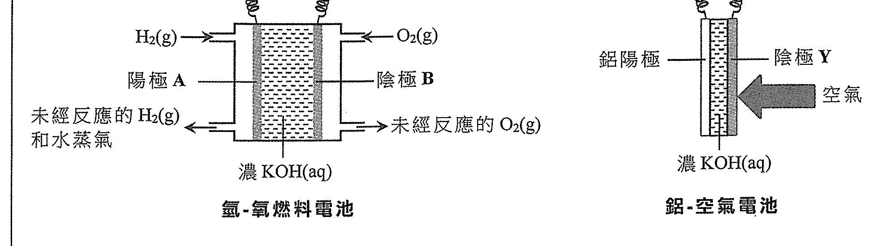
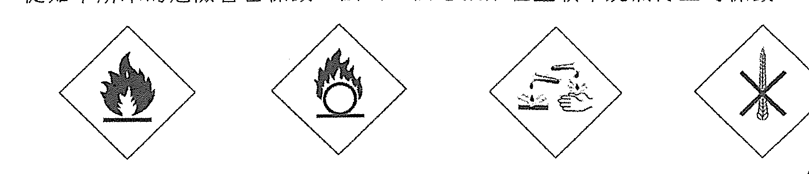
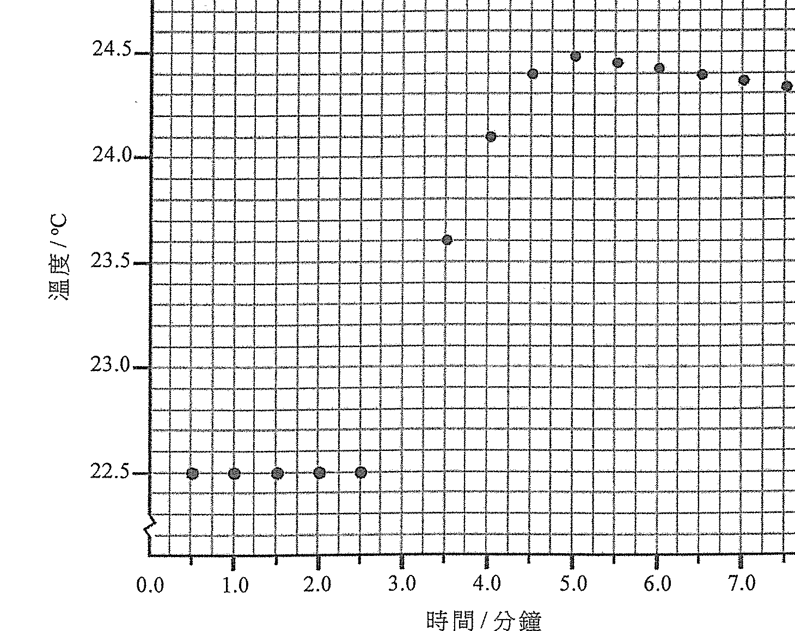
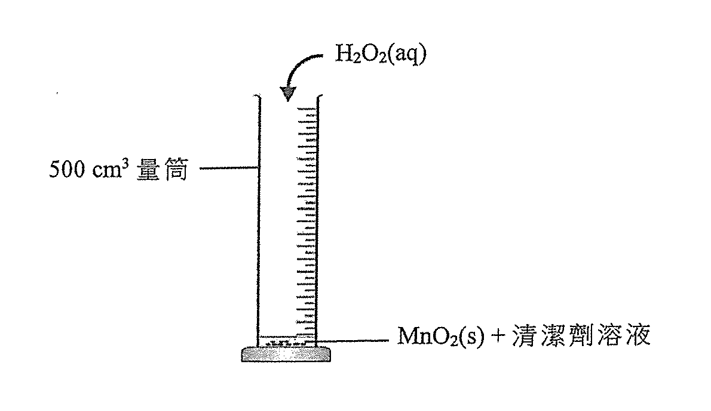
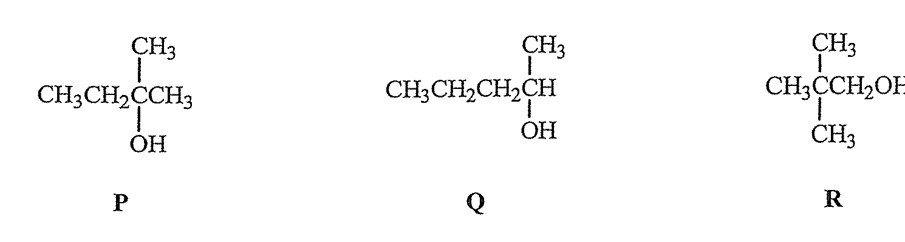
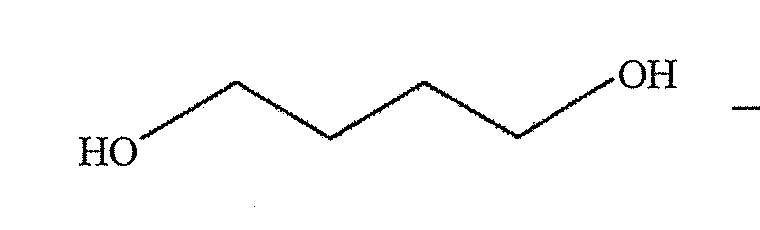

# 2022 DSE 化學 卷一乙（中文卷）— 題目庫

> 來源：文憑試 DSE 化學 Chemistry 2022 歷屆試題 Past Paper 卷一.pdf（乙部）　｜　乙部：第一部分 8 題、第二部分 5 題，共 13 題
> 各題均須作答。把答案寫在預留的空位內。
> 說明：已移除頁碼、試卷標頭、答題簿橫線等雜訊；化學式以 Unicode 下標／上標表示，反應式以 → 或 ⇌ 表示。**本檔為題目庫（零答案）**，只含題目清洗 + 建議標籤。
> 本檔為第 2 層文字交貨（圖用原卷截圖；精修重繪另開第 3 層）。
> 註：本卷源 PDF 為純掃描（無文字層），以 easyocr 辨識後清洗；部分分題標號／化學式經重建，不確定處標 [?]，詳見檔尾「待人工核對」。

---

## 第一部分（第 1–8 題）

## 第 1 題

【建議標籤】

- 卷別/部分：卷一乙　第一部分
- 課題：#鹵素 #電子排佈 #鍵合

【題目內容】

碘是鹵素。它可生成碘化鉀及碘化氫。

(a)　寫出 [?] 和 [?] 之間的關係名稱。（1 分）

(b)　一個碘原子的電子排佈是 2, 8, 18, 18, 7。X 是什麼？（1 分）

(c)　繪畫碘化鉀的電子圖（只需顯示最外層的電子）。（2 分）

(d)　提出為什麼碘化氫的水溶液可導電。（1 分）

(e)　根據鍵合和結構，解釋碘化鉀或碘化氫會具有較高熔點。（3 分）

---

## 第 2 題

【建議標籤】

- 卷別/部分：卷一乙　第一部分
- 課題：#金屬氧化物 #熱分解 #氧化還原

【題目內容】

下圖顯示一個實驗裝置，其中金屬氧化物 MO(s) 受強熱分解，生成了一銀色金屬 X 和一無色氣體 Z。

(a)　寫出 Z 是什麼，並提出一項對牠的測試。（1 分）

(b)　[?] 樣本加熱後，可得到 2.819 g 的金屬 X。（相對原子質量：O = 16.0）（1 分）

(c)　提出 M 是什麼。（1 分）

(d)　解釋 MO(s) 的分解是否為氧化還原反應。（2 分）

---

## 第 3 題

【建議標籤】

- 卷別/部分：卷一乙　第一部分
- 課題：#酸鹼滴定 #制酸劑

【題目內容】

制酸劑是一種用來中和胃酸的藥物。某制酸劑樣本含 NaHCO₃(s) 和其他可溶惰性物質。把 1.52 g 的該制酸劑樣本完全溶於去離子水中，得出一弱鹼性溶液，然後利用一適當指示劑，以 0.644 M HCl(aq) 滴定該溶液，需用 25.20 cm³ 的該 HCl(aq) 來達到終點。

(a)　寫出 NaHCO₃(s) 與 HCl(aq) 反應的化學方程式。（1 分）

(b)　在滴定終點的溶液的 pH 是介乎 3 與 4 之間。提出一個適合這滴定的指示劑，並寫出在終點的顏色變化。（1 分）

(c)　計算在該制酸劑樣本中 NaHCO₃(s) 的質量百分率。（相對原子質量：H = 1.0, C = 12.0, O = 16.0, Na = 23.0）（3 分）

(d)　提出一個準確地量度該溶液的 pH 的儀器。（1 分）

(e)　寫出服用含有 Mg(OH)₂(s) 的制酸劑較含有 NaHCO₃(s) 的制酸劑的一項優點。（2 分）

---

## 第 4 題

【建議標籤】

- 卷別/部分：卷一乙　第一部分
- 課題：#分子結構 #配位鍵 #極性

【題目內容】

考慮 H₂O、BF₃ 和 SF₆ 各分子。

(a)　H₂O 分子可生成 H₃O⁺ 離子。以 H₃O⁺ 為例，描述配位共價鍵的形成。（2 分）

(b)　在以下每一方格內，繪出一個適當化學物種的電子圖（只需顯示最外層的電子）來顯示 H₃O⁺ 離子的生成。（3 分）

(c)　解釋在一個 BF₃ 分子中的硼原子是否具八隅體結構。（1 分）

(d)　解釋 SF₆ 是否為極性分子。（1 分）

(e)　繪出一個 SF₆ 分子的三維結構。（3 分）

(f)　解釋以下這三個化合物的沸點遞增次序：BF₃ < SF₆ < H₂O。（3 分）

---

## 第 5 題

【建議標籤】

- 卷別/部分：卷一乙　第一部分
- 課題：#燃料電池 #原電池

【題目內容】

以下氫-氧燃料電池和鋁-空氣電池都是原電池。它們的簡化結構如下所示：

(a)　「原電池」一詞是什麼意思？（1 分）

(b)　參照以上氫-氧燃料電池：

　　(i)　寫出在陽極 A 上所起變化的半反應式。（1 分）

　　(ii)　提出使用這氫-氧燃料電池的一項缺點。（1 分）

(c)　在以上鋁-空氣電池，空氣中的氧與水在陰極 Y 上反應生成氫氧離子。

　　(i)　寫出在陰極 Y 上所起變化的半反應式。（1 分）

　　(ii)　在鋁陽極上所起變化的半反應式如下：

Al(s) + 3OH⁻(aq) → Al(OH)₃(s) + 3e⁻

寫出在該鋁-空氣電池的總反應的化學方程式。（1 分）

(d)　提出怎樣從氧化鋁獲得鋁。（3 分）

---

## 第 6 題

【建議標籤】

- 卷別/部分：卷一乙　第一部分
- 課題：#自由基 #取代反應

【題目內容】

考慮以下從甲烷與氯生成 CH₃Cl 的化學方程式：

CH₄(g) + Cl₂(g) → CH₃Cl(g) + HCl(g)

(a)　寫出所涉及反應類別的名稱。（1 分）

(b)　寫出令這反應在室溫下發生所需要的條件。（1 分）

(c)　該反應涉及三個階段：引發、傳播和終止。在引發階段中，氯自由基 (Cl•) 是由氯分子所生成。參照電子結構，解釋為什麼氯自由基 (Cl•) 是一個活潑的化學物種。（2 分）

(d)　在以下每一方格內，填寫一個適當的化學物種來完成下列各化學傳播階段的其中一個步驟：

Cl• + CH₄ → [?] → [?] + CH₃Cl（3 分）

(e)　解釋為什麼在甲烷與氯的反應中 CH₃Cl 不是唯一生成的有機產物。（1 分）

(f)　從如下所示的危險警告標籤，圈出一個應張貼在盛載甲烷氣樽上的標籤。

（1 分）

---

## 第 7 題

【建議標籤】

- 卷別/部分：卷一乙　第一部分
- 課題：#中和焓變 #量熱

【題目內容】

進行了一實驗來測定 Ca(OH)₂(s) 與 HCl(aq) 的中和焓變。把 100.0 cm³ 的 1.0 M HCl(aq) 置於一個發泡聚苯乙烯杯子中。每隔半分鐘，量度杯中內含物的溫度。於剛好第三分鐘時，把 0.502 g 的 Ca(OH)₂(s) 加進杯子中，並加以徹底攪拌。以下坐標圖顯示溫度的記錄：

（反應混合物的體積 = 100.0 cm³；反應混合物的密度 = 1.00 g cm⁻³；反應混合物的比熱容 = 4.2 J g⁻¹ K⁻¹；發泡聚苯乙烯杯子的熱容可忽略）
（相對原子質量：H = 1.0, O = 16.0, Cl = 35.5, Ca = 40.1）

(a)　寫出 Ca(OH)₂(s) 與 HCl(aq) 反應的化學方程式。（1 分）

(b)　藉在面的坐標圖草繪，估算杯中內含物的最大溫度升幅。最大溫度升幅 = [?]（3 分）

(c)　已知中和焓變是酸溶液和鹼溶液反應生成一摩爾的水時的焓變。在該實驗中 HCl(aq) 是過量的。計算在實驗條件下，Ca(OH)₂(s) 與 HCl(aq) 的中和焓變（以 kJ mol⁻¹ 為單位）。（5 分）

(d)　兩個反應的標準中和焓變 ΔH° 如下：

| 反應 | ΔH° (kJ mol⁻¹) |
|---|---|
| Ca(OH)₂(s) 與 HCl(aq) 的反應 | −58.6 |
| CaO(s) 與 HCl(aq) 的反應 | −186.0 |

計算以下反應的標準焓變：

CaO(s) + H₂O(l) → Ca(OH)₂(s)（2 分）

---

## 第 8 題

【建議標籤】

- 卷別/部分：卷一乙　第一部分
- 課題：#鏽蝕 #防鏽 #金屬

【題目內容】

描述並解釋鍍錫和鍍鋅在預防鐵製物件鏽蝕所涉及化學原理的相似和相異之處。（6 分）

---

## 第二部分（第 9–13 題）

## 第 9 題

【建議標籤】

- 卷別/部分：卷一乙　第二部分
- 課題：#化學平衡 #平衡常數

【題目內容】

在某溫度下，以下反應的平衡常數 $K_c$ 是 2.25 × 10⁻⁴ mol dm⁻³：

PCl₅(g) ⇌ PCl₃(g) + Cl₂(g)　ΔH > 0

在一實驗中，起始時把 0.84 mol 的 PCl₅(g)、0.16 mol 的 PCl₃(g) 和 0.16 mol 的 Cl₂(g) 加入一個體積固定為 4.0 dm³ 的密閉容器內，並讓這體系在該溫度下達致平衡。

(a)　計算在起始條件下這體系的反應商數 Q。（4 分）

(b)　解釋剛剛在反應開始後 PCl₅(g) 的濃度會增加還是減少。（2 分）

(c)　若把該平衡混合物的溫度提升，解釋 $K_c$ 會增加、減少還是維持不變。（2 分）

---

## 第 10 題

【建議標籤】

- 卷別/部分：卷一乙　第二部分
- 課題：#過氧化氫 #催化 #氣體體積

【題目內容】

在室內條件下，H₂O₂(aq) 在沒有 MnO₂(s) 時會非常緩慢地分解成 O₂(g) 和 H₂O(l)。在如下所示的裝置進行了一個實驗：

在室內條件下，當把 10.0 cm³ 的 3.00 M H₂O₂(aq) 與小量 MnO₂(s) 和清潔劑溶液混合後，O₂(g) 開始迅速釋出，並產生泡沫。於反應終止時，該 MnO₂(s) 的化學性質維持不變。

(a)　寫出 H₂O₂(aq) 分解的化學方程式。（2 分）

(b)　根據這實驗的結果，解釋錳怎樣展示一個過渡性金屬的特性。（2 分）

(c)　[?] 刻度的量筒…需時 18 秒…（1 分）

(d)　當反應完成時，所有 H₂O₂(aq) 耗盡。計算在室內條件下，所釋出 O₂(g) 的理論體積。（在室內條件下，氣體的摩爾體積 = 24 dm³）（2 分）

---

## 第 11 題

【建議標籤】

- 卷別/部分：卷一乙　第二部分
- 課題：#有機化合物 #結構異構

【題目內容】

化合物 P、Q 和 R 是分子式為 C₅H₁₂O 的結構異構體。它們的結構顯示如下：

(a)　寫出 P 的系統名稱。（1 分）

(b)　把 Q 與酸化 K₂Cr₂O₇(aq) 回流加熱會得到一個有機生成物。

　　(i)　繪畫一標示圖以顯示這反應的裝置。（2 分）

　　(ii)　寫出這反應的預期觀察。（1 分）

　　(iii)　寫出該有機生成物的結構式。（1 分）

(c)　W 是一個具有五個碳原子的有機化合物。在適當條件下，R 可從 W 的還原而製得。提出 W 的結構式。（1 分）

(d)　化合物 S 是一個旋光的二級醇。牠也是化合物 P、Q 和 R 的結構異構體。寫出 S 的結構式。（3 分）

---

## 第 12 題

【建議標籤】

- 卷別/部分：卷一乙　第二部分
- 課題：#合成路線 #有機合成

【題目內容】

概述一條不多於三個步驟的合成路線來完成以下的轉化。寫出每一步驟的試劑（一個或多個）、反應條件（如適用）及有機生成物的結構：

（5 分）

---

## 第 13 題

【建議標籤】

- 卷別/部分：卷一乙　第二部分
- 課題：#氧化物 #酸鹼性質

【題目內容】

當把下列各氧化物分別加進水時，描述所生成產物（如有）的酸鹼性質。不用寫出化學方程式：

Na₂O　MgO　Al₂O₃　Cl₂O（3 分）

---

## 待人工核對

以下題目的 OCR 原文殘缺或模糊，需以原卷覆核：

| 題號 | 頁（原卷） | 問題 |
|---|---|---|
| 第 1 題 | 乙部 p.17–18 | (a) 兩個物質名稱及 (b)「X 是什麼」由亂碼重建，需核對 |
| 第 2 題 | 乙部 p.17–18 | (b) 樣本描述 OCR 亂碼（「g算x0)篤宁饌%!」），以 [?] 標示 |
| 第 3 題 | 乙部 p.19–20 | 分題標號 (a)–(e) 順序由 OCR 重建，需核對 |
| 第 4 題 | 乙部 p.21–22 | 分題標號及題分由 OCR 重建，需核對 |
| 第 5 題 | 乙部 p.23–24 | 陰極標號（「陰極1」→「陰極 Y」）需核對；部分題分需核對 |
| 第 6 題 | 乙部 p.23–24 | (d) 傳播步驟方程式方格內容 OCR 不全，以 [?] 標示 |
| 第 7 題 | 乙部 p.25–26 | 坐標圖 crop 已截但未肉眼對頁；(b) 最大溫度升幅空格以 [?] 標示 |
| 第 10 題 | 乙部 p.29–30 | (c) 量筒刻度描述 OCR 亂碼，以 [?] 標示 |
| 第 11 題 | 乙部 p.31–32 | P/Q/R 結構及題分由 OCR 重建，需對圖 |
