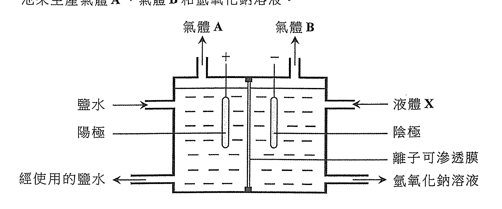
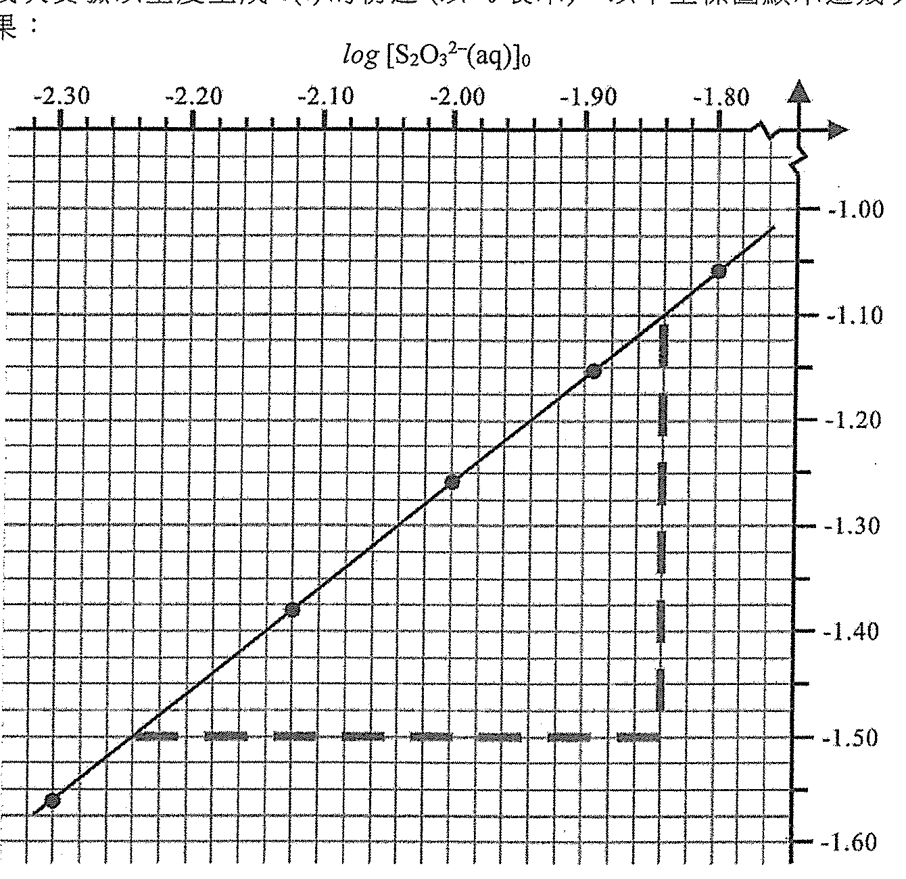
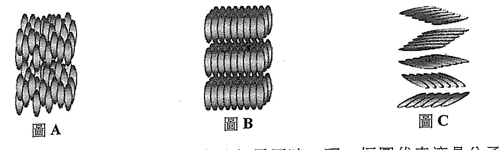
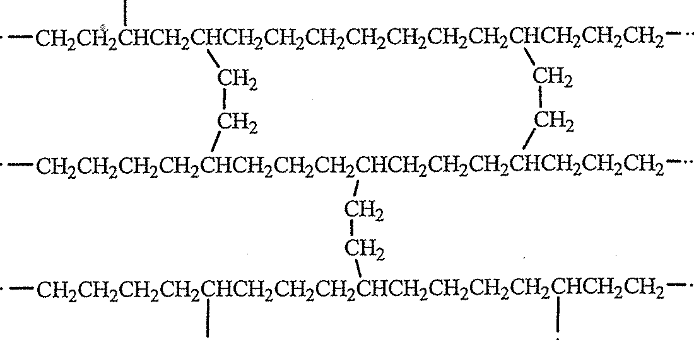
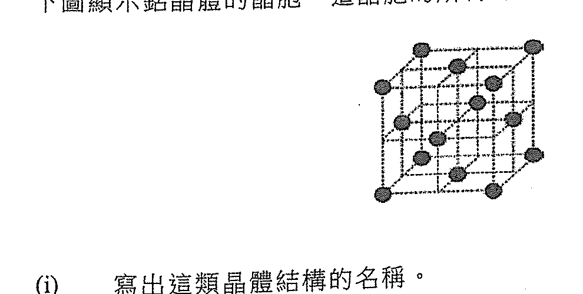

# 2022 DSE 化學 卷二（中文卷）— 題目庫

> 來源：文憑試 DSE 化學 Chemistry 2022 歷屆試題 Past Paper 卷二.pdf　｜　三部分：甲部 工業化學、乙部 物料化學、丙部 分析化學（每部分一題）
> 考生須選答任何兩部中的全部試題。
> 說明：已移除頁碼、試卷標頭等雜訊；化學式以 Unicode 下標／上標表示，反應式以 → 或 ⇌ 表示。**本檔為題目庫（零答案）**，只含題目清洗 + 建議標籤。
> 本檔為第 2 層文字交貨（圖用原卷截圖；精修重繪另開第 3 層）。
> 註：本卷源 PDF 為純掃描（無文字層），以 easyocr 辨識後清洗；部分分題標號／化學式經重建，不確定處標 [?]，詳見檔尾「待人工核對」。

---

## 甲部　工業化學（第 1 題）

## 第 1 題

【建議標籤】

- 卷別/部分：卷二　甲部
- 課題：#工業化學 #乙酸 #催化轉化器 #氯鹼工業 #反應動力學 #活化能

【題目內容】

回答試題的所有部分。

(a)　回答以下短問題：

　(i)　在某些條件下，藉以下反應可製造乙酸：

CH₃OH(l) + CO(g)　──Rh, HI──→　CH₃COOH(l)

　　(1)　提出一個原因為什麼這反應被視為綠色。

　　(2)　提出一個原因為什麼這反應不被視為綠色。（2 分）

　(ii)　某工廠製造催化轉化器，其多孔式結構具催化劑塗層。

　　(1)　提出在催化轉化器內使用多孔式結構的一項優點。

　　(2)　解釋為什麼該催化劑的效能在長期使用後可能下降。（2 分）

　(iii)　下列哪一項不是由石油化學產品製造出來？

尼龍繩　玻璃樽　非皂性清潔劑（1 分）

(b)　下圖顯示在氯鹼工業中使用的一個膜電解池，把鹽水和液體 X 不斷地加進該膜電解池來生產氣體 A、氣體 B 和氫氧化鈉溶液：

　(i)　X 是什麼？（1 分）

　(ii)　氣體 A 在膜電解池的陽極上生成。

　　(1)　A 是什麼？（2 分）

　　(2)　解釋為什麼生成了 A。（2 分）

　(iii)　氣體 B 和氫氧化鈉溶液在膜電解池的陰極上生成。

　　(1)　寫出生成 B 的半反應式。

　　(2)　解釋為什麼生成了氫氧化鈉溶液，以及為什麼牠不含氯化鈉。（3 分）

　(iv)　提出一個可從 A 與氫氧化鈉溶液反應而製造的化學品。（1 分）

(c)　在某溫度下研習以下反應的化學動力學：

S₂O₈²⁻(aq) + 2I⁻(aq) → 2SO₄²⁻(aq) + I₂(s)

在只改變 S₂O₈²⁻(aq) 的初始濃度（以 [S₂O₈²⁻(aq)]₀ 表示）而其他實驗條件相同下，進行了幾次實驗以量度生成 I₂ 的初速（以 r 表示）。以下坐標圖顯示這幾次實驗所得到的結果：

　(i)　「初速」一詞是什麼意思？（1 分）

　(ii)　該反應的速率方程顯示如下：

速率 = k [S₂O₈²⁻(aq)]ᵃ [I⁻(aq)]ᵇ，其中 k 是速率常數，a 是對應 S₂O₈²⁻(aq) 的反應級數，b 是對應 I⁻(aq) 的反應級數。

已知在每次實驗中，所用 I⁻(aq) 的濃度遠高於 S₂O₈²⁻(aq) 的。解釋為什麼以上速率方程可修改為如下所示：

速率 = k' [S₂O₈²⁻(aq)]ᵃ，其中 k' 可視為一個常數。（2 分）

　(iii)　利用以上坐標圖中的虛線，推定對應 S₂O₈²⁻(aq) 的反應級數。（3 分）

　(iv)　在其他實驗條件相同的情況下，分別在 25 °C 及 35 °C 重複這實驗。k₁ 是在 25 °C 時反應的速率常數，而 k₂ 是在 35 °C 時反應的速率常數。k₂ 對 k₁ 的比例是 1.9 : 1.0。計算這反應的活化能（以 kJ mol⁻¹ 為單位）。
（氣體常數 R = 8.31 J K⁻¹ mol⁻¹；阿列紐斯方程 log k = 常數 − Ea/(2.3RT)）（2 分）

---

## 乙部　物料化學（第 2 題）

## 第 2 題

【建議標籤】

- 卷別/部分：卷二　乙部
- 課題：#物料化學 #納米粒子 #液晶 #聚乙烯 #鋁晶體 #合金

【題目內容】

回答試題的所有部分。

(a)　回答以下短問題：

　(i)　不同大小的金納米粒子呈不同顏色。

　　(1)　寫出「納米粒子」一詞的意思。

　　(2)　提出金納米粒子在建築物上的一項用途。（2 分）

　(ii)　下列各圖顯示液晶分子的三種不同相：

　　(1)　寫出圖 A 所示液晶分子的相。（1 分）

　　(2)　液晶顯示屏內的液晶層在沒有施加電壓時，哪一幅圖代表液晶分子預期的相？（2 分）

　(iii)　考慮以下反應：

2NaOH + Cl₂ + 2NH₃ → N₂H₄ + 2NaCl + 2H₂O

計算這個生產 N₂H₄ 的反應的原子經濟。
（式量：NaOH = 40.0, Cl₂ = 71.0, NH₃ = 17.0, N₂H₄ = 32.0, NaCl = 58.5, H₂O = 18.0）（1 分）

(b)　低密度聚乙烯 (LDPE) 和高密度聚乙烯 (HDPE) 均由乙烯的聚合作用而製成。

　(i)　寫出乙烯的聚合作用的化學方程式。（1 分）

　(ii)　寫出生產聚乙烯的聚合作用的類別名稱。（1 分）

　(iii)　HDPE 可用來製造剛硬塑膠瓶。

　　(1)　從分子層面，解釋為什麼 HDPE 較 LDPE 更適合製造剛硬塑膠瓶。（2 分）

　　(2)　提出一個製造 HDPE 剛硬塑膠瓶的成型方法。（3 分）

(c)　聚合物 Y 是另一類聚乙烯，它可用來製造熱水管。下圖顯示聚合物 X 的部分結構：

　(1)　評論 X 的熱性質。（1 分）

　(2)　根據鍵合和結構，解釋 Y 的熱性質。（3 分）

　(3)　除了熱性質外，提出 X 的另一項性質使牠適合製造熱水管。（1 分）

(d)　下圖顯示鋁晶體的晶胞，這晶胞的所有邊長均是 4.05 × 10⁻⁸ cm：

　(i)　寫出這類晶體結構的名稱。（1 分）

　(ii)　推定在這晶胞的鋁原子數目。（1 分）

　(iii)　計算鋁的密度（以 g cm⁻³ 為單位）。
（相對原子質量：Al = 27.0；亞佛加德羅常數 = 6.02 × 10²³ mol⁻¹）（2 分）

(e)　一個硬鋁樣本是混合了小量銅、鎂和錳的鋁合金。考慮下列資料：

- 該硬鋁樣本的熔點較純鋁的為低。
- 該硬鋁樣本的拉伸強度較純鋁的為高。
- 該硬鋁樣本的密度是 2.78 g cm⁻³。

　(i)　根據鍵合和結構，解釋為什麼該硬鋁樣本比純鋁具較低的熔點。（2 分）

　(ii)　評論以下陳述：

「這款硬鋁較純鋁更適合製造飛機機身。」（3 分）

---

## 丙部　分析化學（第 3 題）

## 第 3 題

【建議標籤】

- 卷別/部分：卷二　丙部
- 課題：#分析化學 #滴定 #比色法 #純化 #色層法

【題目內容】

回答試題的所有部分。

(a)　回答以下短問題：

　(i)　提出一化學測試以顯示可怎樣辨別 SO₂(g) 和 CO₂(g)。（2 分）

　(ii)　說明怎樣可從各自的質譜來辨別 CH₃CH₂CHO(l) 和 CH₃COCH₃(l)。（2 分）

　(iii)　下列哪一化學品最適宜用來乾燥丁酸二酯？

濃硫酸　固體氫氧化鈉　無水硫酸鈉（1 分）

(b)　某品牌補鐵藥片的主要成分是 FeSO₄。把數片這些補鐵藥片溶於去離子水中以得到水溶液 S。利用下列兩個方法來測定在溶液 S 中 Fe²⁺(aq) 離子的濃度：

方法 I　使用容量分析

這滴定所涉及反應的化學方程式如下：

MnO₄⁻(aq) + 5Fe²⁺(aq) + 8H⁺(aq) → Mn²⁺(aq) + 5Fe³⁺(aq) + 4H₂O(l)

把 25.00 cm³ 的溶液 S 酸化，然後用 0.0041 M KMnO₄(aq) 滴定。達到終點所需用的該 KMnO₄(aq) 的平均體積是 32.35 cm³。

　(1)　在滴定終點該反應混合物的顏色由淡黃變成淡粉紅。解釋該顏色變化。（1 分）

　(2)　計算在溶液 S 中 Fe²⁺(aq) 離子的濃度。（4 分）

方法 II　使用比色法

Fe²⁺(aq) 可與一個無色有機試劑完全反應，生成一橙紅色物種 W(aq)。
（已知：反應了的 Fe²⁺(aq) 摩爾數 : 所生成的 W(aq) 摩爾數 = 1 : 1）

步驟(1)：把數個濃度不同的標準 FeSO₄(aq) 溶液分別經該無色有機試劑處理，生成對應的橙紅色 W(aq) 溶液。

步驟(2)：用比色計量度這些 W(aq) 溶液的吸光度，並繪出一條校準曲線。

步驟(3)：將溶液 S 稀釋 100 倍，把這稀釋溶液的樣本經步驟(1)所描述的相同方法處理，得出一含有 W(aq) 的溶液 T。

步驟(4)：量度溶液 T 的吸光度。

　(1)　草繪在步驟(2)的校準曲線及標示各坐標軸。在這草繪上，顯示怎樣可找出在溶液 T 中 W(aq) 的濃度。（4 分）

　(2)　從而提出怎樣可測定在溶液 S 中 Fe²⁺(aq) 離子的濃度。（2 分）

(c)　固體樣本含有化合物 Y 和小量雜質 Z。在一實驗中進行了下列各步驟，從這固體樣本獲得純 Y(s)。

已知：Y 在 80 °C 時比在 25 °C 時較溶於去離子水。

步驟(1)：把 1.40 g 的這固體樣本加入 50 cm³ 的去離子水中，並加熱至 80 °C。

步驟(2)：然後加入不溶於水的活性炭來除去 Z，趁熱把所得混合物過濾。

步驟(3)：把所得的熱濾液緩慢冷卻至 25 °C，有 Y(s) 生成。

步驟(4)：把冷卻後的混合物過濾以收集 Y(s)。在清洗及乾燥後，收集得 0.75 g 的 Y(s)。

已知在 80 °C 時，不多於 3.04 g 的 Y(s) 可溶於 100 cm³ 的去離子水。

　(i)　通過計算，顯示在步驟(1)這固體樣本中的所有 Y 應已溶解。（1 分）

　(ii)　解釋為什麼在步驟(2)要把混合物過濾。（1 分）

　(iii)　寫出在步驟(3)生成 Y(s) 的過程名稱。（1 分）

　(iv)　提出一個原因為什麼在步驟(4)所收集得 Y(s) 的質量較在這固體樣本中 Y 的質量為小。（1 分）

(d)　Y 和 Z 可藉色層法分開。以相同的固定相及流動相，把這固體樣本分別進行了薄層色層法 (TLC) 和柱色層法。

（已知：Y 的 Rf 值較 Z 的為大。）

　(i)　草繪一幅附有標示的 TLC 色譜來顯示預期的結果。（1 分）

　(ii)　解釋在柱色層法中首先收集得的部分是 Y 還是 Z。（3 分）

---

## 待人工核對

以下題目的 OCR 原文殘缺或模糊，需以原卷覆核：

| 題號 | 頁（原卷） | 問題 |
|---|---|---|
| 第 1 題 (c) | 卷二 p.37–38 | 反應式末段（「H₂O(l)」）OCR 有疑；速率方程指數 a、b 由 OCR 重建 |
| 第 2 題 | 卷二 p.39–40 | 分題標號 (a)–(e) 順序由 OCR 重建，需核對 |
| 第 2 題 (a)(ii) | 卷二 p.39–40 | 液晶三相 crop 已截但未肉眼對頁 |
| 第 2 題 (c) | 卷二 p.39–40 | 聚合物 X 結構 crop 已截，需對圖 |
| 第 3 題 (c) | 卷二 p.41–42 | 化合物／雜質標號（Y/Z）由 OCR「I/2」重建，需核對 |
