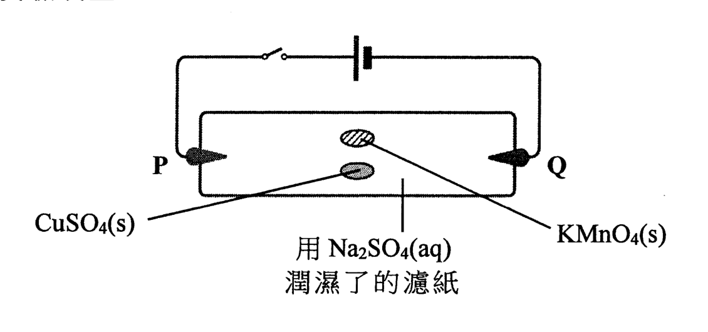
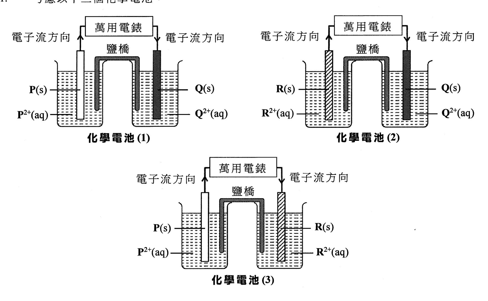
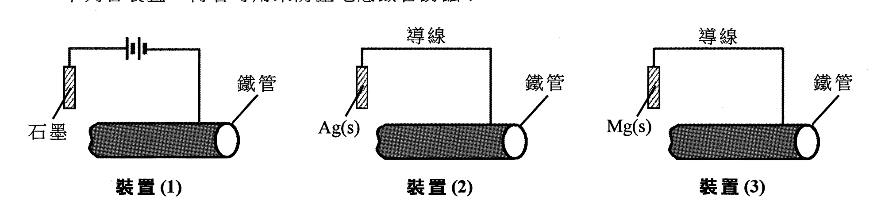
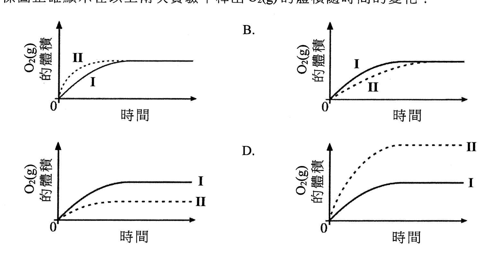
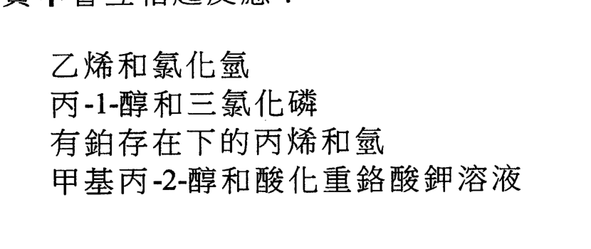
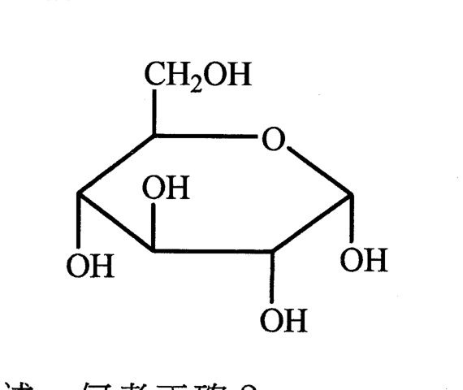

# 2023 DSE 化學 卷一甲（中文卷）— 題目庫

> 來源：文憑試 DSE 化學 Chemistry 2023 歷屆試題 Past Paper 卷一.pdf（甲部）　｜　多項選擇題 36 題（第一部分 24 題、第二部分 12 題）
> 本部包括兩部分：第一部分設 24 題，第二部分設 12 題。選出每題最佳的答案。考生可參考印於試題答題簿 B 第 20 頁的周期表。
> 說明：已移除頁碼、試卷標頭等雜訊；化學式以 Unicode 下標／上標表示（如 H₂SO₄），反應式以 → 或 ⇌ 表示。**本檔為題目庫（零答案）**，只含題目清洗 + 建議標籤。
> 本檔為第 2 層文字交貨（圖用原卷截圖；精修重繪另開第 3 層）。

---

## 第一部分（第 1–24 題）

## 第 1 題

【建議標籤】

- 卷別/部分：卷一甲　第一部分
- 課題：#混合物分離 #過濾

【題目內容】

利用過濾法可把以下哪個混合物分離？

- A. 油和水的混合物
- B. 乙二醇和水的混合物
- C. 氯化銀和水的混合物
- D. 氯化鈉和水的混合物

---

## 第 2 題

【建議標籤】

- 卷別/部分：卷一甲　第一部分
- 課題：#酸雨 #空氣污染

【題目內容】

下列哪種氣體可引致酸雨？

- A. CH₄(g)
- B. CO(g)
- C. NO₂(g)
- D. SO₂(g)

---

## 第 3 題

【建議標籤】

- 卷別/部分：卷一甲　第一部分
- 課題：#氧化物 #酸鹼

【題目內容】

固體 W 溶於水生成一個鹼性溶液。W 是什麼？

- A. 氧化鈣
- B. 氯化鈣
- C. 氧化銅(II)
- D. 氯化銅(II)

---

## 第 4 題

【建議標籤】

- 卷別/部分：卷一甲　第一部分
- 課題：#肥料 #質量百分率

【題目內容】

下表顯示四個肥料的各摩爾質量。下列哪個肥料具最高氮的質量百分率？

| 肥料 | (NH₂)₂CO | NH₄NO₃ | NaNO₃ | (NH₄)₂SO₄ |
|---|---|---|---|---|
| 摩爾質量/g | 60.0 | 80.0 | 85.0 | 132.1 |

（相對原子質量：N = 14.0）

- A. (NH₂)₂CO
- B. NH₄NO₃
- C. NaNO₃
- D. (NH₄)₂SO₄

---

## 第 5 題

【建議標籤】

- 卷別/部分：卷一甲　第一部分
- 課題：#電解 #離子遷移

【題目內容】

考慮以下的實驗裝置：

把電路閉合一段時間後，可觀察到什麼？

- A. 一個紫色斑和一個藍色斑移向 P。
- B. 一個紫色斑和一個藍色斑移向 Q。
- C. 一個紫色斑移向 P，而一個藍色斑移向 Q。
- D. 一個紫色斑移向 Q，而一個藍色斑移向 P。

---

## 第 6 題

【建議標籤】

- 卷別/部分：卷一甲　第一部分
- 課題：#金屬氧化物 #熱分解 #摩爾計算

【題目內容】

金屬 X 的活性較銀低。把 2.21 g X 的氧化物強熱直至沒有進一步反應。剩餘固體的質量是 1.97 g。這氧化物的化學式是什麼？

（相對原子質量：O = 16.0，X = 197.0）

- A. XO
- B. XO₂
- C. X₂O
- D. X₂O₃

---

## 第 7 題

【建議標籤】

- 卷別/部分：卷一甲　第一部分
- 課題：#氨水 #離子鑑別

【題目內容】

下列哪項有關氨水的陳述不正確？

- A. 氨水是一種弱鹼
- B. 濃氨水具腐蝕性
- C. 利用氨水可以辨別 Pb(NO₃)₂(aq) 和 Al(NO₃)₃(aq)
- D. 當把氨水加進 CuSO₄(aq) 直至過量時，有深藍色的溶液生成

---

## 第 8 題

【建議標籤】

- 卷別/部分：卷一甲　第一部分
- 課題：#吸熱反應 #焓變

【題目內容】

下列何者是吸熱的？

- A. 以水稀釋濃硫酸
- B. 石灰石的熱分解
- C. 生石灰與水的反應
- D. 燃燒乙二醇

---

## 第 9 題

【建議標籤】

- 卷別/部分：卷一甲　第一部分
- 課題：#裂解 #烯烴

【題目內容】

下列哪條化學方程式可表示 C₈H₁₈ 裂解生成丙烯和其他有機產物的一個可能反應？

- A. C₈H₁₈ → CH₄ + C₂H₆ + C₃H₆ [?]
- B. C₈H₁₈ → CH₄ + C₂H₆ + C₃H₄ [?]
- C. C₈H₁₈ → CH₄ + C₂H₆ + C₃H₄ [?]
- D. C₈H₁₈ → CH₄ + C₃H₆ + C₃H₆ [?]

---

## 第 10 題

【建議標籤】

- 卷別/部分：卷一甲　第一部分
- 課題：#石油 #分餾 #沸點

【題目內容】

利用分餾塔可以把石油分餾出不同餾分。在分餾塔的較上部分取得餾分 U，在分餾塔的較下部分取得餾分 L。下列的陳述，何者正確？

- A. 與餾分 L 相比，餾分 U 具較高的沸點範圍和較高的黏度
- B. 與餾分 L 相比，餾分 U 具較高的沸點範圍和較低的黏度
- C. 與餾分 L 相比，餾分 U 具較低的沸點範圍和較高的黏度
- D. 與餾分 L 相比，餾分 U 具較低的沸點範圍和較低的黏度

---

## 第 11 題

【建議標籤】

- 卷別/部分：卷一甲　第一部分
- 課題：#化學電池 #金屬活性序

【題目內容】

考慮以下三個化學電池：

下列何者正確顯示 P、Q 和 R 這三種金屬活性的遞減次序？

- A. P > Q > R
- B. P > R > Q
- C. R > P > Q
- D. Q > R > P

---

## 第 12 題

【建議標籤】

- 卷別/部分：卷一甲　第一部分
- 課題：#中和 #溫度變化

【題目內容】

把 40 cm³ 的 0.5 M 氫氯酸與 40 cm³ 的 0.5 M 氫氧化鈉溶液混合時，溫度上升了 ΔT。如果把 60 cm³ 的 1.0 M 氫氯酸與 60 cm³ 的 0.5 M 氫氧化鈉溶液混合，溫度會上升多少？

- A. 0.75 ΔT
- B. 1 ΔT
- C. 1.5 ΔT
- D. 2 ΔT

---

## 第 13 題

【建議標籤】

- 卷別/部分：卷一甲　第一部分
- 課題：#電解 #硫酸銅

【題目內容】

下列哪個有關電解硫酸銅(II)溶液的組合正確？

| | A | B | C | D |
|---|---|---|---|---|
| 陽極 | 鉑 | 銅 | 石墨 [?] | 銅 [?] |
| 陰極 | 石墨 | 銅 | 石墨 [?] | 銅 [?] |
| 觀察現象 | 在陽極澱積出紅棕色固體 | 陰極的質量減少 | 藍色的溶液褪色 | 陽極的質量減少 |

- A. 組合 A
- B. 組合 B
- C. 組合 C
- D. 組合 D

---

## 第 14 題

【建議標籤】

- 卷別/部分：卷一甲　第一部分
- 課題：#摩爾計算 #鎂 #酸

【題目內容】

把 0.729 g 的鎂帶與 50.0 cm³ 的 0.50 M 硫酸進行反應，反應完成後，餘下鎂帶的質量是多少？

（相對原子質量：Mg = 24.3）

- A. 0.122 g
- B. 0.243 g
- C. 0.425 g
- D. 0.608 g

---

## 第 15 題

【建議標籤】

- 卷別/部分：卷一甲　第一部分
- 課題：#貴氣體 #分子間引力

【題目內容】

於常溫常壓下氬是氣體，因為

- A. 氬原子的最外電子層具八隅體結構
- B. 氬原子間的引力弱
- C. 氬分子是單原子的
- D. 氬是化學惰性的

---

## 第 16 題

【建議標籤】

- 卷別/部分：卷一甲　第一部分
- 課題：#氧化還原 #氧化劑

【題目內容】

考慮以下反應：

Cl₂ + 2Br⁻ → Br₂ + 2Cl⁻

下列哪項有關這反應中氧化劑的陳述正確？

- A. 它失去電子並且被還原
- B. 它獲得電子並且被還原
- C. 它失去電子並且被氧化
- D. 它獲得電子並且被氧化

---

## 第 17 題

【建議標籤】

- 卷別/部分：卷一甲　第一部分
- 課題：#冰 #氫鍵 #分子結構

【題目內容】

下列有關冰和水的陳述，何者正確？

(1) 冰具有敞開結構，但水沒有
(2) 在冰中 H₂O 分子間形成氫鍵的數量是在水中的兩倍
(3) 在冰中 H₂O 分子的形狀是四面體，而在水中 H₂O 分子的形狀是 V 形

- A. 只有 (1)
- B. 只有 (2)
- C. 只有 (1) 和 (3)
- D. 只有 (2) 和 (3)

---

## 第 18 題

【建議標籤】

- 卷別/部分：卷一甲　第一部分
- 課題：#溴化物 #結構與性質

【題目內容】

X 和 Z 是兩種元素。下表顯示 XBr 和 ZBr 兩個溴化物的一些物理性質。

| | XBr | ZBr |
|---|---|---|
| 熔點/°C | 459 | 32 |
| 沸點/°C | 1325 | 105 |
| 在水中的溶解度 | 可溶 | 不溶 |

下列的陳述，何者正確？

(1) 在室溫下 XBr 是堅硬但易碎的固體
(2) ZBr 具有巨型共價結構
(3) X 是一種金屬，Z 是一種非金屬

- A. 只有 (1)
- B. 只有 (2)
- C. 只有 (1) 和 (3)
- D. 只有 (2) 和 (3)

---

## 第 19 題

【建議標籤】

- 卷別/部分：卷一甲　第一部分
- 課題：#烯烴 #同系物

【題目內容】

烯烴的同系物各成員具有相同的

(1) 結構式
(2) 實驗式
(3) 通式

- A. 只有 (1)
- B. 只有 (2)
- C. 只有 (1) 和 (3)
- D. 只有 (2) 和 (3)

---

## 第 20 題

【建議標籤】

- 卷別/部分：卷一甲　第一部分
- 課題：#生成焓 #標準狀態

【題目內容】

下列的陳述，何者正確？

(1) 液態氮的標準生成焓變不等於零
(2) 化合物的標準生成焓變必定是負值
(3) CO(g) 的標準生成焓變可直接從實驗中測定

- A. 只有 (1)
- B. 只有 (2)
- C. 只有 (1) 和 (3)
- D. 只有 (2) 和 (3)

---

## 第 21 題

【建議標籤】

- 卷別/部分：卷一甲　第一部分
- 課題：#鏽蝕 #犧牲保護

【題目內容】

下列各裝置，何者可用來防止地底鐵管鏽蝕？

- A. 只有 (1) 和 (2)
- B. 只有 (1) 和 (3)
- C. 只有 (2) 和 (3)
- D. (1)、(2) 和 (3)

---

## 第 22 題

【建議標籤】

- 卷別/部分：卷一甲　第一部分
- 課題：#酸 #中和 #摩爾計算

【題目內容】

考慮以下兩個溶液：

溶液 A：100 cm³ 的 1.0 M 硝酸
溶液 B：100 cm³ 的 0.5 M 硫酸

下列哪些陳述正確？

(1) 溶液 A 和溶液 B 均能與鐵反應
(2) 完全中和溶液 A 及完全中和溶液 B，需用相同體積的 1.0 M 氫氧化鉀溶液
(3) 當把 0.05 mol 的 CaCO₃(s) 分別加進溶液 A 和溶液 B 時，都有相同摩爾數的氣體釋出

- A. 只有 (1) 和 (2)
- B. 只有 (1) 和 (3)
- C. 只有 (2) 和 (3)
- D. (1)、(2) 和 (3)

---

## 第 23 題

【建議標籤】

- 卷別/部分：卷一甲　第一部分
- 課題：#乙酸 #烷酸

【題目內容】

下列有關乙酸的陳述，何者正確？

(1) 乙酸存在於醋中。
(2) 乙酸把酚酞指示劑由無色變為粉紅。
(3) 乙酸是一種烷酸。

- A. 只有 (1) 和 (2)
- B. 只有 (1) 和 (3)
- C. 只有 (2) 和 (3)
- D. (1)、(2) 和 (3)

---

## 第 24 題

【建議標籤】

- 卷別/部分：卷一甲　第一部分
- 課題：#異構體 #陳述題

【題目內容】

考慮下列各陳述句並選出最佳的答案：

第一陳述句：丁烷和甲基丙烷具有相同的物理性質
第二陳述句：丁烷和甲基丙烷具有相同的分子式

- A. 兩陳述句均正確，而第二陳述句為第一陳述句的合理解釋
- B. 兩陳述句均正確，但第二陳述句並非第一陳述句的合理解釋
- C. 第一陳述句錯誤，但第二陳述句正確
- D. 兩陳述句均錯誤

---

## 第二部分（第 25–36 題）

## 第 25 題

【建議標籤】

- 卷別/部分：卷一甲　第二部分
- 課題：#反應速率 #過氧化氫分解

【題目內容】

為探究 H₂O₂(aq) 分解生成 O₂(g)，在室內條件和相同分量的適當催化劑下，以 H₂O₂(aq) 進行了兩次實驗。所用的 H₂O₂(aq) 的濃度和體積如下所示：

| 實驗 | I | II |
|---|---|---|
| H₂O₂(aq) 的濃度/M | 1.0 | 0.5 |
| H₂O₂(aq) 的體積/cm³ | 25 | 50 |

下列哪幅坐標圖正確顯示在以上兩次實驗中釋出 O₂(g) 的體積隨時間的變化？

- A.
- B.
- C.
- D.

---

## 第 26 題

【建議標籤】

- 卷別/部分：卷一甲　第二部分
- 課題：#燃燒 #氣體體積計算

【題目內容】

考慮以下反應：

C₃H₈(g) + 5O₂(g) → 3CO₂(g) + 4H₂O(l)

若 100 cm³ 的 C₃H₈(g) 在 600 cm³ 的 O₂(g) 中燃燒，在室內條件下所得氣體混合物的體積會是多少？

（在室內條件下，氣體的摩爾體積 = 24 dm³）

- A. 800 cm³
- B. 700 cm³
- C. 400 cm³
- D. 300 cm³

---

## 第 27 題

【建議標籤】

- 卷別/部分：卷一甲　第二部分
- 課題：#化學平衡 #勒沙特列原理

【題目內容】

考慮以下在室內條件下的平衡體系：

Fe³⁺(aq) + SCN⁻(aq) ⇌ Fe(SCN)²⁺(aq)

把小量 Fe(NO₃)₃(s) 加進該平衡混合物，最終在相同條件下達致一個新的平衡。與原本的平衡比較，下列哪個有關這新的平衡的組合正確？

| | A | B | C | D |
|---|---|---|---|---|
| 逆向反應的速率 | 減少 | 減少 | 增加 | 增加 |
| Fe(SCN)²⁺(aq) 的濃度 | 不變 | 增加 | 不變 | 增加 |

- A. 組合 A
- B. 組合 B
- C. 組合 C
- D. 組合 D

---

## 第 28 題

【建議標籤】

- 卷別/部分：卷一甲　第二部分
- 課題：#反應速率

【題目內容】

在室內條件下，下列哪個化學反應是最快的？

- A. AgNO₃(aq) + NaCl(aq) → AgCl(s) + NaNO₃(aq)
- B. Zn(s) + 2HCl(aq) → ZnCl₂(aq) + H₂(g)
- C. 4Fe(s) + 3O₂(g) → 2Fe₂O₃(s)
- D. CH₄(g) + Br₂(在有機溶劑中) → CH₃Br(g) + HBr(g)

---

## 第 29 題

【建議標籤】

- 卷別/部分：卷一甲　第二部分
- 課題：#平衡常數

【題目內容】

考慮以下的資料：

| 化學反應 | 在 500 °C 時的平衡常數 |
|---|---|
| H₂(g) + I₂(g) ⇌ 2HI(g) | K₁ |
| 2HI(g) ⇌ H₂(g) + I₂(g) | K₂ |

下列哪個有關 K₁ 和 K₂ 的數學關係正確？

- A. K₁ = 1/K₂ [?]
- B. [?]
- C. [?]
- D. [?]

---

## 第 30 題

【建議標籤】

- 卷別/部分：卷一甲　第二部分
- 課題：#有機反應

【題目內容】

下列哪對物質不會互相起反應？

- A. 乙烯和氯化氫
- B. 丙-1-醇和三氯化磷
- C. 有鉑存在下的丙烯和氫
- D. 甲基丙-2-醇和酸化重鉻酸鉀溶液

---

## 第 31 題

【建議標籤】

- 卷別/部分：卷一甲　第二部分
- 課題：#有機轉化 #醇

【題目內容】

在以下轉化中，W 是什麼？

- A. LiAlH₄ 乾燥的醚 然後 H⁺(aq)
- B. 濃 H₂SO₄
- C. NaBH₄(aq)
- D. KOH(aq)

---

## 第 32 題

【建議標籤】

- 卷別/部分：卷一甲　第二部分
- 課題：#化學平衡 #反應商數

【題目內容】

考慮以下可逆反應：

X(aq) ⇌ Y(aq)

在固定的溫度下，該體系起始時只含有小量 X(aq)。當體系達致化學平衡時，在混合物中 X 對 Y 的摩爾比是 1:3。下列的陳述，何者正確？

(1) 該體系在平衡前任何時刻的反應商數 Q 較該反應的平衡常數 K 為大
(2) 若在相同的溫度下重複進行該實驗，該體系起始時只含有小量 Y(aq)，在平衡混合物中 X 對 Y 的摩爾比是 1:3。
(3) 在平衡時，逆向反應的速率是正向反應的 3 倍

- A. 只有 (1)
- B. 只有 (2)
- C. 只有 (1) 和 (3)
- D. 只有 (2) 和 (3)

---

## 第 33 題

【建議標籤】

- 卷別/部分：卷一甲　第二部分
- 課題：#周期表 #週期趨勢

【題目內容】

下列有關周期表第二周期由左至右各元素的陳述，何者正確？

(1) 在這些元素中，碳的熔點是最高的
(2) 在這些元素中，鋰的導電性是最高的
(3) 這些元素的鍵合類別由離子鍵變為共價鍵

- A. 只有 (1)
- B. 只有 (2)
- C. 只有 (1) 和 (3)
- D. 只有 (2) 和 (3)

---

## 第 34 題

【建議標籤】

- 卷別/部分：卷一甲　第二部分
- 課題：#有機化合物 #官能基

【題目內容】

一個有機化合物具以下結構：

下列有關這化合物的陳述，何者正確？

(1) 它是溶於水的
(2) 它具有一個酯基團
(3) 它的實驗式是 CH₂O

- A. 只有 (1)
- B. 只有 (2)
- C. 只有 (1) 和 (3)
- D. 只有 (2) 和 (3)

---

## 第 35 題

【建議標籤】

- 卷別/部分：卷一甲　第二部分
- 課題：#聚酯 #聚合物

【題目內容】

P 和 Q 是由相同的單體製成的聚酯。P 的重複單位平均數目是 5000，而 Q 的是 80000。下列哪些陳述正確？

(1) 與 P 相比，Q 在較高溫時熔化
(2) 與 P 相比，Q 的平均分子質量較大
(3) 與 P 相比，Q 的一個重複單位中的碳原子數目較大。

- A. 只有 (1) 和 (2)
- B. 只有 (1) 和 (3)
- C. 只有 (2) 和 (3)
- D. (1)、(2) 和 (3)

---

## 第 36 題

【建議標籤】

- 卷別/部分：卷一甲　第二部分
- 課題：#肥皂 #親水性

【題目內容】

考慮下列各陳述句並選出最佳的答案：

第一陳述句：CH₃CH₂CH₂CH₂COO⁻Na⁺ 是一種肥皂
第二陳述句：CH₃CH₂CH₂CH₂COO⁻Na⁺ 具有親水性的 −COO⁻ 基團

- A. 兩陳述句均正確，而第二陳述句為第一陳述句的合理解釋
- B. 兩陳述句均正確，但第二陳述句並非第一陳述句的合理解釋
- C. 第一陳述句錯誤，但第二陳述句正確
- D. 兩陳述句均錯誤

---

*甲部完 —*

## 待人工核對

本卷為第 2 層文字交貨，由 easyocr（ch_tra+en，GPU）掃描底稿清洗而成；現模型無影像輸入，未能對頁影像覆核。以下題號建議第 3 層精修時對頁覆核：

- 第 9 題：C₈H₁₈ 裂解的四條方程式（選項 A–D 的裂解產物）OCR 嚴重亂碼，已按原子守恆作最佳重建但仍待對頁核實。
- 第 13 題：電解硫酸銅(II)組合表的陽極／陰極材料（鉑／銅／石墨）排列 OCR 不完整，部分格以 [?] 標示。
- 第 29 題：K₁ 與 K₂ 數學關係的四個選項 OCR 無法辨識，僅重建 A（K₁ = 1/K₂），B–D 待對頁核實。
- 第 3 題：選項 C、D 的「氧化銅(II)／氯化銅(II)」價態標註待對頁核實。
- 第 5、11、21、25、31、34 題：圖為 300dpi 原卷截圖（程式定位＋墨跡覆蓋率校驗；無視覺覆核，位置／範圍待 spot-check）；第 3 層再換成向量重繪。
