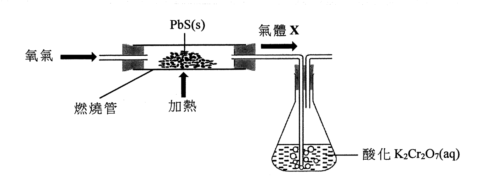
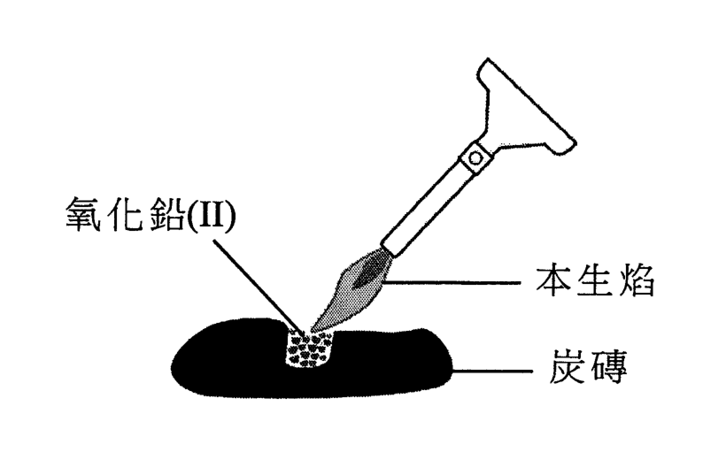
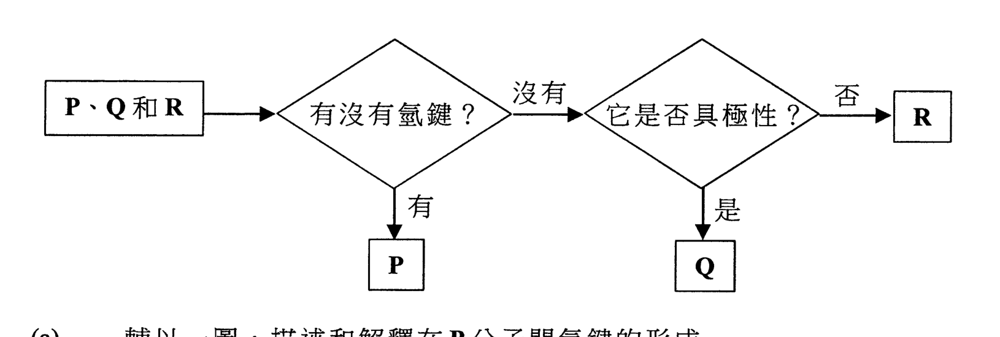
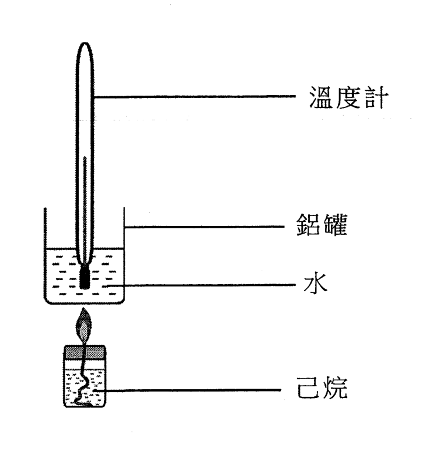
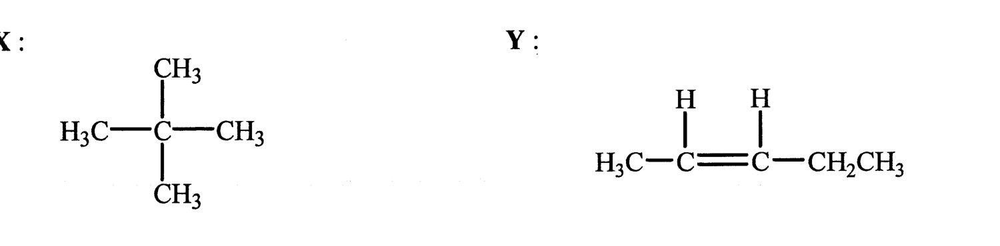
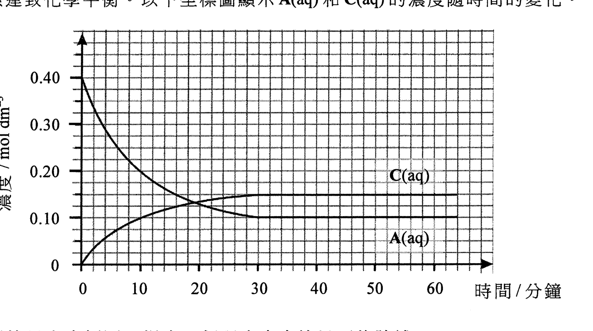

# 2023 DSE 化學 卷一乙（中文卷）— 題目庫

> 來源：文憑試 DSE 化學 Chemistry 2023 歷屆試題 Past Paper 卷一.pdf（乙部）　｜　乙部：第一部分 9 題、第二部分 5 題，共 14 題
> 各題均須作答。把答案寫在預留的空位內。
> 說明：已移除頁碼、試卷標頭、答題簿橫線等雜訊；化學式以 Unicode 下標／上標表示，反應式以 → 或 ⇌ 表示。**本檔為題目庫（零答案）**，只含題目清洗 + 建議標籤。
> 本檔為第 2 層文字交貨（圖用原卷截圖；精修重繪另開第 3 層）。

---

## 第一部分（第 1–9 題）

## 第 1 題

【建議標籤】

- 卷別/部分：卷一乙　第一部分
- 課題：#第II族 #石灰水 #同位素 #氯化鍶

【題目內容】

鈣 (Ca) 和鍶 (Sr) 都是周期表中的第 II 族元素。

(a)　第 II 族的名稱是什麼？（1 分）

(b)　石灰水是飽和氫氧化鈣溶液。

　　(i)　把二氧化碳氣體通入石灰水直至溶液變成乳濁。寫出所涉及反應的化學方程式。（1 分）

　　(ii)　當把過量的二氧化碳氣體通入在 (b)(i) 的乳濁液時，生成了一個無色溶液。這反應的生成物是什麼？（1 分）

(c)　下表顯示在一個鍶的樣本中每個同位素的豐度：

| 同位素 | ⁸⁴Sr | ⁸⁶Sr | ⁸⁷Sr | ⁸⁸Sr |
|---|---|---|---|---|
| 豐度 (%) | 0.56 | 9.86 | 7.02 | 82.56 |

計算這樣本中鍶的相對原子質量。（2 分）

(d)　鍶與氯反應生成氯化鍶。

　　(i)　繪出氯化鍶的電子圖（只需顯示最外層的電子）。（1 分）

　　(ii)　完成以下各句子：

　　(1)　固體鍶的結構類別是 [?] 結構，而
　　(2)　固體氯化鍶的結構類別是 [?] 結構。（2 分）

　　(iii)　寫出及解釋固體鍶和固體氯化鍶在導電性方面的差異。（2 分）

---

## 第 2 題

【建議標籤】

- 卷別/部分：卷一乙　第一部分
- 課題：#提取金屬 #鉛 #氧化還原

【題目內容】

從硫化鉛(II) (PbS) 提取鉛金屬涉及兩個階段。

階段 I：利用如下所示的實驗裝置把 PbS(s) 和氧氣一起強熱，在燃燒管內生成氧化鉛(II) 和氣體 X，氣體 X 通入酸化 K₂Cr₂O₇(aq) 中。

(a)　建議一個從空氣中獲取氧的方法。（1 分）

(b)　氣體 X 使酸化 K₂Cr₂O₇(aq) 由橙色變為綠色。

　　(i)　氣體 X 是什麼？（1 分）

　　(ii)　寫出氣體 X 與酸化 K₂Cr₂O₇(aq) 反應的離子方程式。（1 分）

(c)　寫出在燃燒管內所發生反應的化學方程式。（1 分）

(d)　從實驗室安全方面而言，解釋應在何處進行這個實驗。（1 分）

階段 II：把在燃燒管內生成的氧化鉛(II) 分離出來及放在炭磚上，然後把該氧化物強熱如下所示。

(e)　(i)　在階段 II 中的反應生成一個固體產物。描述該固體產物的外觀。（1 分）

　　(ii)　根據氧化數，解釋在階段 II 中的反應是否為氧化還原反應。（1 分）

---

## 第 3 題

【建議標籤】

- 卷別/部分：卷一乙　第一部分
- 課題：#金屬活性序 #反應性

【題目內容】

下表顯示以三種金屬 A、B 和 C 進行了數個實驗的結果。

| 金屬 | A | B | C |
|---|---|---|---|
| 與水反應 | 沒有可觀察變化 | 沒有可觀察變化 | 劇烈地反應 |
| 與稀氫氯酸反應 | 緩緩地釋出無色氣體 I | 沒有可觀察變化 | （這實驗是危險的，不應進行） |
| 在空氣中強熱 | 冷卻後得到白色固體 | 沒有可觀察變化 | 以淡紫色火焰燃燒 |

(a)　根據以上實驗結果，把這三種金屬按活性的遞減次序排列。（1 分）

(b)　建議一個對氣體 I 的測試。（1 分）

(c)　(i)　寫出金屬 C 與水劇烈地反應時的一項預期觀察。（1 分）

　　(ii)　解釋為什麼進行金屬 C 與稀氫氯酸的反應是危險的。（1 分）

(d)　只利用下列各項，概述實驗步驟並寫出一項預期的觀察：以確定金屬 A 和金屬 B 的相對活性。

[一條金屬 A、一條金屬 B、A(NO₃)₃(aq)[?]、B(NO₃)₃(aq)[?]、數支試管]（2 分）

---

## 第 4 題

【建議標籤】

- 卷別/部分：卷一乙　第一部分
- 課題：#有機酸 #鹽基度 #酸鹼

【題目內容】

亞酒石酸 (C₃H₄O₅[?]) 是一種在青瓜中找到的有機酸。

(a)　(i)　24.62 cm³ 的 0.207 M NaOH(aq) 可以完全中和 25.00 cm³ 的 0.102 M 亞酒石酸。計算亞酒石酸的鹽基度。（2 分）

　　(ii)　亞酒石酸分子含有一個羥基。寫出亞酒石酸的結構式。（1 分）

(b)　在某些條件下，0.102 M 亞酒石酸的 pH 是 1.87。通過計算，顯示亞酒石酸在水中不是完全電離。（2 分）

---

## 第 5 題

【建議標籤】

- 卷別/部分：卷一乙　第一部分
- 課題：#分子間引力 #氫鍵 #極性

【題目內容】

P、Q 和 R 各自代表以下其中的一個化合物：

CHF₃
CF₄
HF

以下流程圖可用來辨識 P、Q 和 R。

(a)　輔以一圖，描述和解釋在 P 分子間氫鍵的形成。（3 分）

(b)　(i)　Q 是什麼？（1 分）

　　(ii)　從分子層面，解釋為什麼 Q 具極性。（1 分）

---

## 第 6 題

【建議標籤】

- 卷別/部分：卷一乙　第一部分
- 課題：#燃燒焓 #量熱法

【題目內容】

己烷 (C₆H₁₄) 是一種液體燃料。在某些實驗條件下，用以下裝置測定了己烷的燃燒焓變。燃燒 0.120 g 的己烷使 100.0 g 的水的溫度上升 13.4 °C。

(a)　在這些實驗條件下，計算己烷的燃燒焓變（以 kJ mol⁻¹ 為單位）。（假設該鋁罐的熱容可被略去，以及水的比熱容為 4.20 J g⁻¹ K⁻¹。）（相對原子質量：H = 1.0，C = 12.0）（2 分）

(b)　(i)　寫出己烷完全燃燒的化學方程式（顯示所有物態符號）。（1 分）

　　(ii)　已知以下的標準生成焓變：

C₆H₁₄(l) = −167.2 kJ mol⁻¹，H₂O(l) = −285.9 kJ mol⁻¹，CO₂(g) = −393.5 kJ mol⁻¹

計算己烷的標準燃燒焓變。（2 分）

(c)　除了失熱，舉出一個原因解釋為什麼 (a) 和 (b)(ii) 所得的答案有所不同。（1 分）

---

## 第 7 題

【建議標籤】

- 卷別/部分：卷一乙　第一部分
- 課題：#碳氫化合物 #烯烴 #聚合物

【題目內容】

X 和 Y 是碳氫化合物。它們的結構式如下所示：

(a)　寫出 X 的系統名稱。（1 分）

(b)　舉出 X 和 Y 的燃燒特徵的一項不同之處。（1 分）

(c)　除燃燒外，建議一個化學測試來分辨 X 和 Y。（2 分）

(d)　Y 可生成一種聚合物。繪出這聚合物的重複單位。（1 分）

---

## 第 8 題

【建議標籤】

- 卷別/部分：卷一乙　第一部分
- 課題：#電鍍 #電解

【題目內容】

只利用下列各項，設計一個把鎳(II) 電鍍在鐵棒上的實驗。

[直流電源、一條鎳條、一根鐵棒、硫酸鎳(II) 溶液、數條連接線、一個燒杯]

(a)　繪畫一個標示圖以顯示該實驗裝置。（2 分）

(b)　寫出硫酸鎳(II) 溶液在這實驗中的一項功用。（1 分）

(c)　寫出在鐵棒上生成鎳的半反應式。（1 分）

(d)　與 OH⁻(aq) 離子和 SO₄²⁻(aq) 離子相比，Ni(s) 是較強的還原劑。硫酸鎳(II) 溶液是綠色的。預期在這實驗中該溶液有沒有可觀察的變化？解釋你的答案。（2 分）

(e)　寫出把鎳電鍍在鐵器上的一個目的。（1 分）

---

## 第 9 題

【建議標籤】

- 卷別/部分：卷一乙　第一部分
- 課題：#鹽製備 #硫酸鎂

【題目內容】

概述利用固體碳酸鎂和稀硫酸來製備硫酸鎂晶體的各步驟。你不需提及所涉及的儀器。（5 分）

---

## 第二部分（第 10–14 題）

## 第 10 題

【建議標籤】

- 卷別/部分：卷一乙　第二部分
- 課題：#化學平衡 #平衡常數

【題目內容】

參照以下方程式所代表的反應：

2A(aq) ⇌ 2B(aq) + C(aq)　ΔH > 0

在一個實驗中，起始時把某體積的 0.40 mol dm⁻³ A(aq) 放入一個容器內，在固定溫度 T 下讓這體系達致化學平衡。以下坐標圖顯示 A(aq) 和 C(aq) 的濃度隨時間的變化。

(a)　根據以上坐標圖，提出一個理由來支持以下的陳述：「該體系在第 30 分鐘時剛好達致化學平衡。」（1 分）

(b)　在坐標圖上，繪畫一條曲線來表示 B(aq) 的濃度隨時間的變化。（1 分）

(c)　計算這反應在溫度 T 下的平衡常數 Kc。（2 分）

(d)　當平衡混合物的溫度由 T 變為 T₂ 時，會達致新的化學平衡。在新的化學平衡下 A(aq) 的濃度是 0.14 mol dm⁻³。推定 T 或 T₂ 何者是較高的溫度。（2 分）

---

## 第 11 題

【建議標籤】

- 卷別/部分：卷一乙　第二部分
- 課題：#順反異構 #對映異構 #醇

【題目內容】

化合物 X 和 Y 是順-反異構體。它們具有相同分子式 C₄H₈。

(a)　(i)　X 是極性的，Y 卻是非極性的。寫出 X 的系統名稱。（1 分）

　　(ii)　寫出 Y 的結構式。（1 分）

(b)　一個具旋光性的醇 Z 經脫水後，可生成 X 和 Y 的混合物。

　　(i)　舉出這反應需要的一個試劑及一個反應條件。（1 分）

　　(ii)　寫出 Z 的結構式。（1 分）

　　(iii)　繪出 Z 的一雙對映異構體的三維結構圖。（2 分）

　　(iv)　描述 Z 的一雙對映異構體的旋光性的不同之處。（1 分）

---

## 第 12 題

【建議標籤】

- 卷別/部分：卷一乙　第二部分
- 課題：#合成路線 #醯胺

【題目內容】

概述一條不多於三個步驟的合成路線來完成以下的轉化。寫出每一步驟的試劑（一個或多個）、反應條件（如適用）及有機生成物的結構。

CH₃CH₂CH₂CH₂OH → CH₃CH₂CH₂CONH₂

（3 分）

---

## 第 13 題

【建議標籤】

- 卷別/部分：卷一乙　第二部分
- 課題：#氧化物 #熔點 #過渡金屬

【題目內容】

(a)　根據鍵合和結構，解釋以下各氧化物熔點的差異。

| 氧化物 | SiO₂ | P₄O₁₀ | SO₂ |
|---|---|---|---|
| 熔點(°C) | 1710 | 340 | −72 |

（3 分）

(b)　(i)　Fe²⁺(aq) 和 H₂O₂(aq) 在酸性介質中反應生成 Fe³⁺(aq) 和 H₂O(l)。寫出這反應的化學方程式。（1 分）

　　(ii)　寫出這反應可怎樣表明鐵展示兩個過渡性金屬的特性。（2 分）

---

## 第 14 題

【建議標籤】

- 卷別/部分：卷一乙　第二部分
- 課題：#反應速率 #顏色深度

【題目內容】

考慮以下反應：

Br₂(aq) + HCOOH(aq) → 2HBr(aq) + CO₂(g)

描述並解釋如何透過量度反應混合物的顏色深度，來跟隨以上反應的進度。不需描述實驗細節。草繪一幅附有標示的坐標圖以表示預期的結果，並解釋該坐標圖的形狀。（6 分）

---

*乙部完 —*

## 待人工核對

本卷為第 2 層文字交貨，由 easyocr（ch_tra+en，GPU）掃描底稿清洗而成；現模型無影像輸入，未能對頁影像覆核。以下題號建議第 3 層精修時對頁覆核：

- 第 1(d)(ii) 題：完成句子的第一句（固體鍶的結構類別）OCR 無法辨識，以 [?] 標示。
- 第 3(d) 題：所提供試劑的硝酸鹽化學式（A(NO₃)₃／B(NO₃)₃ 或 A(NO₃)₂／B(NO₃)₂）OCR 不清晰，以 [?] 標示。
- 第 4 題：亞酒石酸的分子式 OCR 為「CHAOs」，按內容（二元酸、含一個羥基）重建為 C₃H₄O₅，仍待對頁核實。
- 第 2、5、6、7、10 題：圖為 300dpi 原卷截圖（程式定位＋墨跡覆蓋率校驗；無視覺覆核，位置／範圍待 spot-check）；第 3 層再換成向量重繪。
- 第 7 題：X、Y 的結構式僅能以截圖保留，X 的系統名稱無法由 OCR 確定，待對頁核實。
