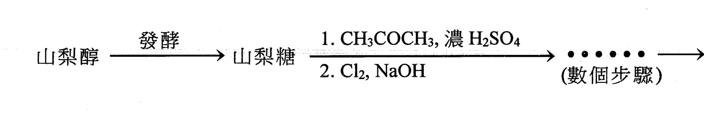
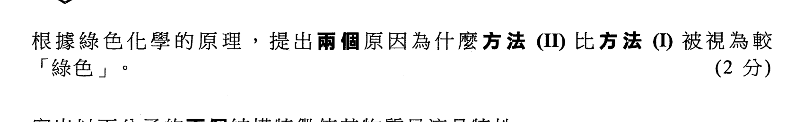
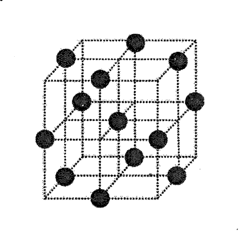
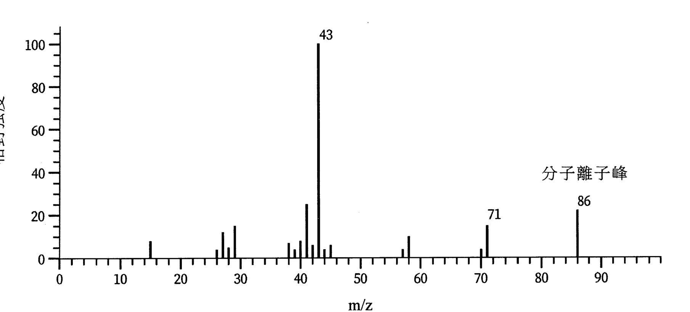

# 2023 DSE 化學 卷二（中文卷）— 題目庫

> 來源：文憑試 DSE 化學 Chemistry 2023 歷屆試題 Past Paper 卷二.pdf　｜　三部分：甲部 工業化學、乙部 物料化學、丙部 分析化學（每部分一題）
> 考生須選答任何兩部中的全部試題。
> 說明：已移除頁碼、試卷標頭等雜訊；化學式以 Unicode 下標／上標表示，反應式以 → 或 ⇌ 表示。**本檔為題目庫（零答案）**，只含題目清洗 + 建議標籤。
> 本檔為第 2 層文字交貨（圖用原卷截圖；精修重繪另開第 3 層）。
> 註：本卷 OCR 底稿品質較差，多處以 [?] 標示，詳見檔尾「待人工核對」。

---

## 甲部　工業化學（第 1 題）

## 第 1 題

【建議標籤】

- 卷別/部分：卷二　甲部
- 課題：#工業化學 #維生素C #合成氣 #氯鹼工業 #哈柏法 #過氧化氫 #反應速率

【題目內容】

回答試題的所有部分。

(a)　(i)　在工業上，藉以下步驟可用山梨醇來合成丙種維生素：

　　(1)　解釋為什麼需要在工業上合成丙種維生素。（1 分）

　　(2)　根據綠色化學的原理，解釋為什麼這個合成丙種維生素的過程不被視為「綠色」。（1 分）

　(ii)　甲烷可用來生成合成氣。

　　(1)　提出甲烷的一個來源。（1 分）

　　(2)　寫出從甲烷生成合成氣的化學方程式。（1 分）

　(iii)　寫出由氯鹼工業製造的兩個化學品。（1 分）

(b)　哈柏法是一個生產氨的重要工業過程。所涉及反應的化學方程式如下所示：

N₂(g) + 3H₂(g) ⇌ 2NH₃(g)　ΔH = −92 kJ mol⁻¹

在最佳的操作條件及有鐵催化劑的存在下，在平衡時 NH₃(g) 的產率約為 20%。哈柏法正向反應的活化能是 20 kJ mol⁻¹。

　(i)　「活化能」一詞是什麼意思？（1 分）

　(ii)　繪出哈柏法反應的能線圖，標示各坐標軸及該正向反應的活化能 (Ea)。（2 分）

　(iii)　在相同的操作條件下，找出哈柏法逆向反應的活化能（以 kJ mol⁻¹ 為單位）。（1 分）

　(iv)　寫出在哈柏法中使用的最佳操作溫度與壓強。解釋為何使用這樣的條件。（3 分）

　(v)　評論以下陳述：

「在哈柏法中使用更多鐵催化劑，可以增加氨的產率。」（1 分）

(c)　(i)　工業合成過氧化氫 H₂O₂ 的原料是氫氣和氧氣，合成過程涉及以下兩個步驟：

在步驟(1)中的反應：H₂ + Y → H₂Y

Y 是一個有機化合物。把氫氣通入溶於有機溶劑的 Y，使用金屬鈀 (Pd) 作為催化劑。在步驟(1)結束時，移除鈀催化劑。

在步驟(2)中的反應：H₂Y + O₂ → H₂O₂ + Y

把空氣吹入溶於有機溶劑的 H₂Y。在步驟(2)結束時，收集得 H₂O₂ 並且把 Y 回收。

　　(1)　建議一個方法以提升鈀催化劑的效能。（1 分）

　　(2)　解釋為什麼在步驟(2)結束時要把 Y 回收。（1 分）

　　(3)　除了爆炸的潛在危險，解釋為何不把氫氣和氧氣經單一步驟合成為過氧化氫。（1 分）

　(ii)　在相同的實驗條件下，進行了三次實驗來測定以下反應的速率方程：

H₂O₂(aq) + 2I⁻(aq) + 2H⁺(aq) → I₂(aq) + 2H₂O(l)

所得的數據表列如下：

| | 第 1 次 | 第 2 次 | 第 3 次 |
|---|---|---|---|
| H₂O₂(aq) 的初始濃度/mol dm⁻³ | 0.0010 | 0.0020 | 0.0010 [?] |
| I⁻(aq) 的初始濃度/mol dm⁻³ | 0.10 | 0.10 | 0.50 |
| H⁺(aq) 的初始濃度/mol dm⁻³ | 0.10 | 0.10 | 0.10 |
| 生成 I₂(aq) 的初速/mol dm⁻³ s⁻¹ | 2.8 × 10⁻⁶ | 5.6 × 10⁻⁶ | 2.8 × 10⁻⁵ |

　　(1)　已知對應 H₂O₂(aq) 的反應級數是 1，推定對應 I⁻(aq) 及對應 H⁺(aq) 的反應級數。（2 分）

　　(2)　根據第 1 次實驗的數據，計算在相同實驗條件下這反應的速率常數。（2 分）

*甲部完 —*

---

## 乙部　物料化學（第 2 題）

## 第 2 題

【建議標籤】

- 卷別/部分：卷二　乙部
- 課題：#物料化學 #己二酸 #液晶 #脲甲醛 #銀晶體 #合金 #PET

【題目內容】

回答試題的所有部分。

(a)　(i)　己二酸 (HOOC(CH₂)₄COOH) 是製造尼龍-6,6 的其中一個單體。以下兩種方法都可以製備己二酸：

方法 I：

濃 HNO₃
[?] + O₂ → HOOC(CH₂)₄COOH [?]

方法 II：

H₂O₂，催化劑
[?] + H₂O₂ → HOOC(CH₂)₄COOH + H₂O [?]

根據綠色化學的原理，提出兩個原因為什麼方法 II 比方法 I 被視為較「綠色」。（2 分）

　(ii)　寫出以下分子的兩個結構特徵使其物質呈液晶特性。

（2 分）

　(iii)　脲甲醛是製造電插座常用的聚合物。繪出脲甲醛的重複單位。（1 分）

(b)　下圖顯示銀晶體的晶胞：

　(i)　寫出這類晶體結構的名稱。（1 分）

　(ii)　推定在以上晶胞的銀原子數目。（2 分）

　(iii)　紋銀[?] 是一種合金。某紋銀樣本由 92.5% 銀和 7.5% 銅組成。

　　(1)　根據鍵合和結構，解釋為何紋銀的熔點比純銀的較低。（2 分）

　　(2)　除價錢外，舉出使用紋銀較使用純銀來製作首飾的一項優點。（1 分）

　(iv)　一個球形簇是由眾多銀原子組成的。這個球形簇的直徑是銀原子直徑的 80 倍。這個球形簇是一顆納米粒子嗎？解釋你的答案。（已知：銀原子直徑 = 0.288 nm）（2 分）

(c)　「冰巾[?]」是由一種屬於縮合聚合物的聚對苯二甲酸乙二酯 (PET) 製造出來的。與大小相同的濕棉巾比較，水分較容易從濕「冰巾[?]」蒸發出來。

　(i)　「縮合聚合物」一詞是什麼意思？（1 分）

　(ii)　PET 可由以下兩個單體製成：

HOCH₂CH₂OH　和　HOOC−C₆H₄−COOH[?]（對苯二甲酸）

寫出生成 PET 的化學方程式。（1 分）

　(iii)　根據分子結構，解釋 PET 是一種熱塑性塑膠還是熱固性塑膠。（1 分）

　(iv)　棉的主要成分是纖維素。根據鍵合和結構，解釋為什麼與大小相同的濕棉巾比較，水分較容易從濕「冰巾[?]」蒸發出來。（2 分）

　(v)　「冰巾[?]」是由 PET 纖維編織而成。提出製造 PET 纖維的一個成型方法。（1 分）

　(vi)　舉出再循環「冰巾[?]」所碰到的一個困難。（1 分）

*乙部完 —*

---

## 丙部　分析化學（第 3 題）

## 第 3 題

【建議標籤】

- 卷別/部分：卷二　丙部
- 課題：#分析化學 #離子鑑別 #液液萃取 #滴定 #質譜 #紅外光譜

【題目內容】

回答試題的所有部分。

(a)　(i)　提出一個測試以辨別 Ca(NO₃)₂(s) 和 Mg(NO₃)₂(s)。（2 分）

　(ii)　寫出固體氫氧化鈉的一項性質，使它不適合藉稱重來配製標準溶液。（1 分）

　(iii)　概述藉液-液萃取法從己酸和己-1-醇的混合物中取得己-1-醇的各步驟。（已知：己酸和己-1-醇都與水不互溶。）（2 分）

(b)　某款家用漂白水的生產商指稱該漂白水中次氯酸鈉 (NaOCl) 的濃度是 15.5 g dm⁻³。為確定該漂白水中 NaOCl 的實際濃度，進行了以下實驗：

步驟(1)：把 25.00 cm³ 的該漂白水稀釋至 250.0 cm³ 以得出溶液 X。

步驟(2)：把過量稀硫酸和過量碘化鉀溶液加進盛有 25.00 cm³ 的溶液 X 的錐形瓶內。

步驟(3)：用 0.0512 M Na₂S₂O₃(aq) 來滴定所得的反應混合物。當錐形瓶內的溶液顏色變為淺黃色，便加入澱粉溶液作指示劑，繼續進行滴定直至達到終點。

步驟(4)：多次重複進行滴定，達到終點所需用 Na₂S₂O₃(aq) 的平均體積是 21.02 cm³。

　(i)　寫出一個在步驟(1)應該使用的儀器名稱。（1 分）

　(ii)　這實驗所涉及反應的各化學方程式如下：

OCl⁻(aq) + 2H⁺(aq) + 2I⁻(aq) → I₂(aq) + Cl⁻(aq) + H₂O(l)（在步驟(2)）
I₂(aq) + 2S₂O₃²⁻(aq) → 2I⁻(aq) + S₄O₆²⁻(aq)（在步驟(3)）

　　(1)　寫出在滴定終點的顏色變化。（1 分）

　　(2)　計算該漂白水中 NaOCl 的實際濃度（以 g dm⁻³ 為單位）。（相對原子質量：O = 16.0，Na = 23.0，Cl = 35.5）（3 分）

　　(3)　根據品質控制標準，該漂白水中 NaOCl 的實際濃度必須在生產商指稱的濃度（15.5 g dm⁻³）的 ±5% 以內。通過計算，確定該漂白水是否合乎品質控制標準。（1 分）

　(iii)　為什麼在步驟(4)中多次重複進行滴定？（1 分）

(c)　A、B 和 C 是不同的直鏈羰基化合物。它們具有相同的通式 CₙH₂ₙO。A 和 B 均有相同的官能基，但 C 沒有。D 是一級醇，它是由 C 的還原反應生成的。

A 的質譜如下所示：

參照 A 的質譜：

　(i)　(1)　推定 A 的分子式。（相對原子質量：H = 1.0，C = 12.0，O = 16.0）（1 分）

　　　(2)　推定 A 的結構式。（2 分）

　(ii)　繪出一個 B 的可能結構。（1 分）

　(iii)　建議一個化學測試以辨別 B 和 C。（2 分）

　(iv)　參考下表所提供的資料，提出在 C 及 D 的紅外光譜中兩項預期的差異。（2 分）

| 鍵合 | 化合物類別 | 波數域/cm⁻¹ |
|---|---|---|
| C=O | 醛、酮、羧酸及其衍生物 | 1680 至 1800 |
| C=C | 烯 | 1610 至 1680 |
| C≡C | 炔 | 2070 至 2250 |
| C≡N | 腈 | 2200 至 2280 |
| O−H（帶氫鍵） | 酸 | 2500 至 3300 |
| C−H | 烷、烯及芳烴 | 2840 至 3095 |
| O−H（帶氫鍵） | 醇 | 3230 至 3670 |
| N−H | 胺 | 3350 至 3500 |

*丙部完　試卷完 —*

## 待人工核對

本卷為第 2 層文字交貨，由 easyocr（ch_tra+en，GPU）掃描底稿清洗而成；現模型無影像輸入，未能對頁影像覆核。以下題號建議第 3 層精修時對頁覆核：

- 第 1(c)(ii) 題：三次實驗的速率數據表（尤其第 3 次的 H₂O₂ 初始濃度及 I⁻ 濃度）OCR 不完整，數值組合待對頁核實。
- 第 2(a)(i) 題：方法 I／II 製備己二酸的反應物（起始原料）OCR 無法辨識，以 [?] 標示。
- 第 2(b)(iii) 題：「紋銀」一詞（92.5% 銀合金）待對頁核實。
- 第 2(c) 題：「冰巾」一詞（PET 纖維毛巾製品）待對頁核實；PET 第二單體（對苯二甲酸）的結構式 OCR 不完整。
- 第 3(c) 題：質譜圖數據（分子離子峰 m/z = 86、碎片峰 43、71）已按質譜重建，仍待對頁核實。
- 第 1 題分題字母：OCR 將哈柏法分題的「(b)」讀成「d)」，已改為 (b)；山梨醇／甲烷／氯鹼依 OCR 歸於 (a)(i)(ii)(iii)。全題分題字母（a–c）待對頁核實。
- 第 1(a)、2(a)(ii)、2(b)(i)、3(c) 題：圖為 300dpi 原卷截圖（程式定位＋墨跡覆蓋率校驗；無視覺覆核，位置／範圍待 spot-check）；第 3 層再換成向量重繪。
