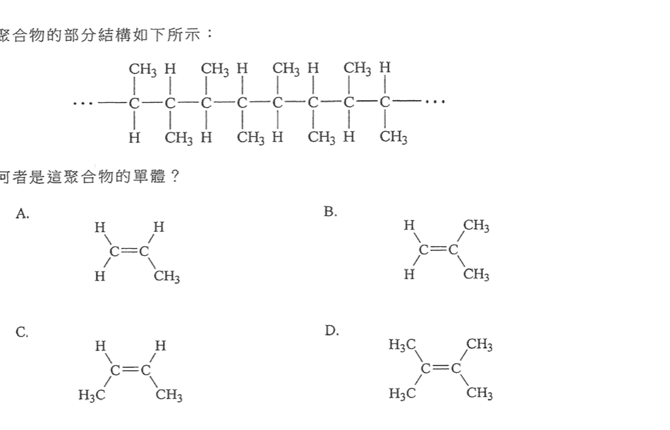
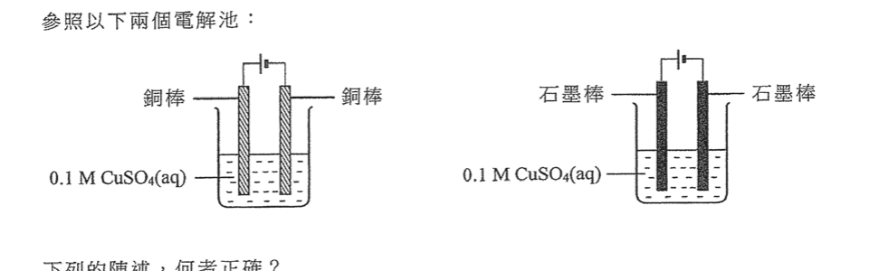
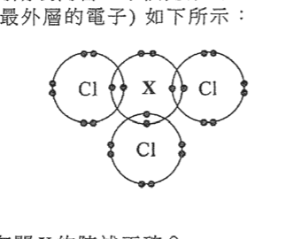
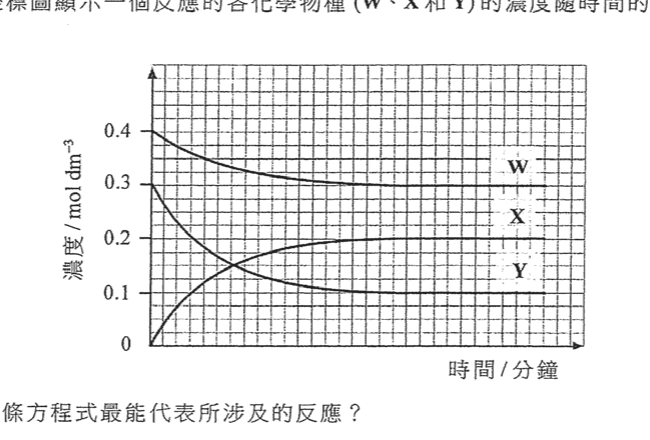
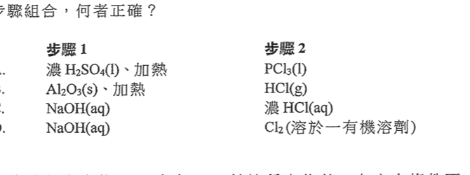
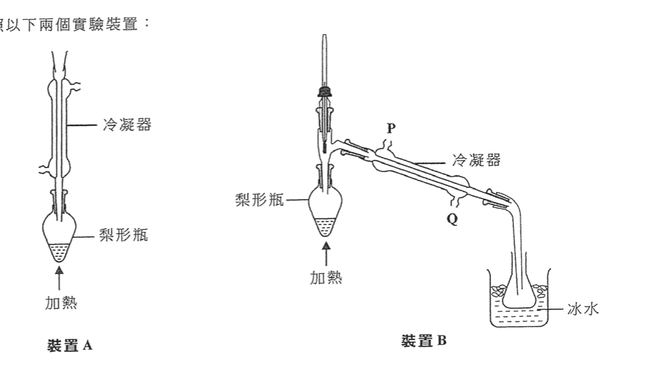
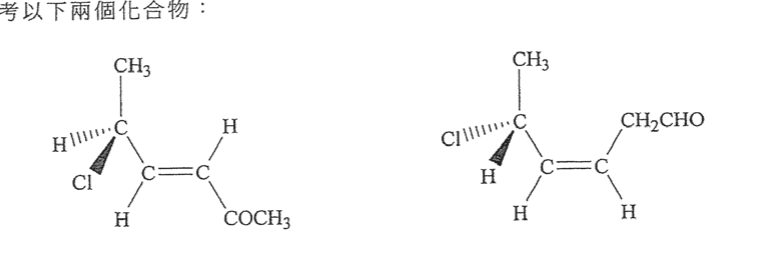
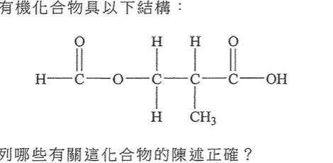

# 2024 DSE 化學 卷一甲（中文卷）— 題目庫

> 來源：文憑試 DSE 化學 Chemistry 2024 歷屆試題 Past Paper 卷一甲.pdf　｜　多項選擇題 36 題（第一部分 24 題、第二部分 12 題）
> 本部包括兩部分：第一部分設 24 題，第二部分設 12 題。選出每題最佳的答案。考生可參考印於試題答題簿 B 第 20 頁的周期表。
> 說明：已移除頁碼、試卷標頭等雜訊；化學式以 Unicode 下標／上標表示（如 H₂SO₄），反應式以 → 或 ⇌ 表示。**本檔為題目庫（零答案）**，只含題目清洗 + 建議標籤。
> 本檔為第 2 層文字交貨（圖用原卷截圖；精修重繪另開第 3 層）。

---

## 第一部分（第 1–24 題）

## 第 1 題

【建議標籤】

- 卷別/部分：卷一甲　第一部分
- 課題：#金屬鍵 #離域電子

【題目內容】

下列哪個物質具有離域電子？

- A. NaCl(s)
- B. Br₂(l)
- C. Hg(l)
- D. I₂(s)

---

## 第 2 題

【建議標籤】

- 卷別/部分：卷一甲　第一部分
- 課題：#食鹽 #結晶 #海水

【題目內容】

使用下列哪個方法可以從海水直接獲取食鹽？

- A. 過濾
- B. 溶解
- C. 電解
- D. 結晶

---

## 第 3 題

【建議標籤】

- 卷別/部分：卷一甲　第一部分
- 課題：#摩爾計算 #鋁 #氫氣

【題目內容】

當 13.50 g 的鋁與過量的稀氫氯酸反應，生成氫氣的理論質量是多少？

（相對原子質量：H = 1.0，Al = 27.0）

- A. 0.67 g
- B. 0.75 g
- C. 1.00 g
- D. 1.50 g

---

## 第 4 題

【建議標籤】

- 卷別/部分：卷一甲　第一部分
- 課題：#酸鹼 #pH #強弱酸

【題目內容】

Y 是一元酸。0.1 M Y(aq) 的 pH 是 2.91。下列哪項關於該 0.1 M Y(aq) 的陳述正確？

- A. 它是濃的弱酸溶液
- B. 它是濃的強酸溶液
- C. 它是稀的弱酸溶液
- D. 它是稀的強酸溶液

---

## 第 5 題

【建議標籤】

- 卷別/部分：卷一甲　第一部分
- 課題：#硫酸鉛 #沉澱 #製備

【題目內容】

下列用來製備硫酸鉛(II)的過程，何者最佳？

- A. 把鉛顆粒加入稀硫酸中
- B. 把碳酸鉛(II)粉末加入稀硫酸中
- C. 把氯化鉛(II)固體加入硫酸鈉溶液中
- D. 把硝酸鉛(II)溶液加入硫酸鈉溶液中

---

## 第 6 題

【建議標籤】

- 卷別/部分：卷一甲　第一部分
- 課題：#硝酸鹽 #熱分解 #摩爾計算

【題目內容】

金屬 M 的硝酸鹽的熱分解如下所示：

2M(NO₃)₂(s) → 2MO(s) + 4NO₂(g) + O₂(g)

當 0.164 g 的 M(NO₃)₂(s) 進行分解，所釋出各氣體的摩爾數總和是 2.50 × 10⁻³ mol。金屬 M 是什麼？

（相對原子質量：N = 14.0，O = 16.0）

- A. Mg
- B. Ca
- C. Sr
- D. Ba

---

## 第 7 題

【建議標籤】

- 卷別/部分：卷一甲　第一部分
- 課題：#空氣污染 #靜電沉積器

【題目內容】

安裝在燃煤發電廠的靜電沉積器，可以用來清除下列哪種空氣污染物？

- A. 懸浮粒子
- B. 一氧化碳
- C. 氮氧化物
- D. 二氧化硫

---

## 第 8 題

【建議標籤】

- 卷別/部分：卷一甲　第一部分
- 課題：#燃料電池 #氧化還原

【題目內容】

在氫氧燃料電池中，氫是在

- A. 陽極被氧化
- B. 陰極被氧化
- C. 陽極被還原
- D. 陰極被還原

---

## 第 9 題

【建議標籤】

- 卷別/部分：卷一甲　第一部分
- 課題：#聚合物 #加成聚合 #單體

【題目內容】

一個聚合物的部分結構如下所示。

下列何者是這聚合物的單體？

- A.
- B.
- C.
- D.

---

## 第 10 題

【建議標籤】

- 卷別/部分：卷一甲　第一部分
- 課題：#酸鹼滴定 #濃度計算

【題目內容】

把 12.80 cm³ 的 H₂SO₄(aq) 樣本被 25.0 cm³ 的 0.10 M KOH(aq) 完全中和。該 H₂SO₄(aq) 樣本的濃度是多少？

- A. 2.56 × 10⁻² M
- B. 9.77 × 10⁻² M
- C. 1.95 × 10⁻¹ M
- D. 3.91 × 10⁻¹ M

---

## 第 11 題

【建議標籤】

- 卷別/部分：卷一甲　第一部分
- 課題：#分子間引力 #氫鍵 #范德華力

【題目內容】

下列有關分子間引力的陳述，何者不正確？

- A. 氫鍵是一種靜電引力
- B. 范德華力存在於極性分子間，亦存在於非極性分子間
- C. 溴的分子間引力較氯的強
- D. 氯化氫的分子間引力較氟化氫的強

---

## 第 12 題

【建議標籤】

- 卷別/部分：卷一甲　第一部分
- 課題：#氧化數 #釩

【題目內容】

在下列哪個化學物種中，V（釩）具最低的氧化數？

（已知：在下列每個物種中，氧的氧化數是 −2。）

- A. V₂O₅ [?]
- B. VO₂ [?]
- C. VO [?]
- D. VO₃⁻ [?]

---

## 第 13 題

【建議標籤】

- 卷別/部分：卷一甲　第一部分
- 課題：#氧化還原反應

【題目內容】

下列何者不是氧化還原反應？

- A. BaCO₃(s) → BaO(s) + CO₂(g)
- B. 4KClO₃(s) → 3KClO₄(s) + KCl(s)
- C. Cl₂(g) + H₂O(l) → HCl(aq) + HOCl(aq)
- D. Zn(s) + CuSO₄(aq) → ZnSO₄(aq) + Cu(s)

---

## 第 14 題

【建議標籤】

- 卷別/部分：卷一甲　第一部分
- 課題：#焓變 #生成焓 #赫斯定律

【題目內容】

參照以下在某些條件下的反應及所給資料：

2FeO(s) + ½O₂(g) → Fe₂O₃(s)

FeO(s) 的生成焓變 = −270 kJ mol⁻¹
Fe₂O₃(s) 的生成焓變 = −820 kJ mol⁻¹

在這些條件下，以下哪個表示式得出以上反應的焓變？

- A. [(−820) − (−270)] kJ mol⁻¹
- B. [−270 − (−820)] kJ mol⁻¹
- C. [−820 − (−270 × 2)] kJ mol⁻¹
- D. [(−270 × 2) − (−820)] kJ mol⁻¹

---

## 第 15 題

【建議標籤】

- 卷別/部分：卷一甲　第一部分
- 課題：#燃燒 #乙醇 #焓變

【題目內容】

下列哪項有關燃燒乙醇的陳述正確？

- A. 燃燒乙醇是吸熱的
- B. 生成物的總焓較反應物的少
- C. 在室內條件下，當乙醇暴露於空氣，就立刻燃燒
- D. 斷裂化學鍵過程所涉及的總能量較形成化學鍵過程的多

---

## 第 16 題

【建議標籤】

- 卷別/部分：卷一甲　第一部分
- 課題：#同位素 #中子 #質子

【題目內容】

考慮這些原子：⁷²Ge、⁷³As 和 ⁷⁴Se。

下列的陳述，何者正確？

(1) 它們具有不同的質子數目
(2) 它們具有不同的中子數目
(3) 它們具有不同的最外層電子數目

- A. 只有 (1)
- B. 只有 (2)
- C. 只有 (1) 和 (3)
- D. 只有 (2) 和 (3)

---

## 第 17 題

【建議標籤】

- 卷別/部分：卷一甲　第一部分
- 課題：#自由基取代 #終止步驟

【題目內容】

CH₄(g) 與 Cl₂(g) 在漫射的陽光下的單取代反應涉及三個步驟：引發、傳播和終止。下列的步驟，何者可導致這反應終止？

(1) Cl• + Cl• → Cl₂ [?]
(2) •CH₃ + Cl• → CH₃Cl [?]
(3) •CH₃ + •CH₃ → C₂H₆ [?]

- A. 只有 (1)
- B. 只有 (2)
- C. 只有 (1) 和 (3)
- D. 只有 (2) 和 (3)

---

## 第 18 題

【建議標籤】

- 卷別/部分：卷一甲　第一部分
- 課題：#電解 #陰極 #生成物

【題目內容】

在電解池 X 中，使用了稀 H₂SO₄(aq) 作為電解質和鉑作為各電極。在開始電解時，下列的電解池，何者可在陰極得出與在電解池 X 的陰極得出相同的生成物？

| 電解池 | (1) | (2) | (3) |
|---|---|---|---|
| 電解質 | 稀 AgNO₃(aq) | 稀 CH₃COOH(aq) | 稀 NaOH(aq) |
| 陽極 | 石墨 | 石墨 | 鉑 |
| 陰極 | 石墨 | 石墨 | 鉑 |

- A. 只有 (1)
- B. 只有 (2)
- C. 只有 (1) 和 (3)
- D. 只有 (2) 和 (3)

---

## 第 19 題

【建議標籤】

- 卷別/部分：卷一甲　第一部分
- 課題：#電解 #電解池 #銅

【題目內容】

參照以下兩個電解池：

下列的陳述，何者正確？

(1) 在電解時，兩個電解池的陰極上都有紅棕色固體沉積。
(2) 在電解時，兩個電解池的陽極上都有氣泡釋出。
(3) 在電解時，兩個電解池的溶液的 pH 都下降。

- A. 只有 (1)
- B. 只有 (2)
- C. 只有 (1) 和 (3)
- D. 只有 (2) 和 (3)

---

## 第 20 題

【建議標籤】

- 卷別/部分：卷一甲　第一部分
- 課題：#離子鑑別 #焰色試驗

【題目內容】

下列哪些過程可用來辨別 K₂CO₃(aq) 和 CaCl₂(aq)？

(1) 進行焰色試驗
(2) 加入稀氫氯酸
(3) 加入酸化硝酸銀溶液

- A. 只有 (1) 和 (2)
- B. 只有 (1) 和 (3)
- C. 只有 (2) 和 (3)
- D. (1)、(2) 和 (3)

---

## 第 21 題

【建議標籤】

- 卷別/部分：卷一甲　第一部分
- 課題：#金屬活性序

【題目內容】

下列的陳述，何者可顯示金屬 Y 比金較活潑？

(1) Y 能夠與稀氫氯酸反應，但金不能。
(2) Y 能夠從硝酸銅(II)溶液中把銅置換出來，但金不能。
(3) 金能夠以物理方法從其礦石提取出來，但 Y 不能。

- A. 只有 (1) 和 (2)
- B. 只有 (1) 和 (3)
- C. 只有 (2) 和 (3)
- D. (1)、(2) 和 (3)

---

## 第 22 題

【建議標籤】

- 卷別/部分：卷一甲　第一部分
- 課題：#周期表 #氯化物 #八隅體

【題目內容】

元素 X 是周期表內首二十個元素之一。X 可生成 XCl₃ 和 XCl₅ 兩種氯化物。XCl₃ 的電子圖（只顯示了最外層的電子）如下所示：

下列哪些有關 X 的陳述正確？

(1) X 屬於周期表的第 V 族。
(2) X 是在周期表的第三周期。
(3) 在 XCl₅ 的 X 原子具八隅體電子排佈。

- A. 只有 (1) 和 (2)
- B. 只有 (1) 和 (3)
- C. 只有 (2) 和 (3)
- D. (1)、(2) 和 (3)

---

## 第 23 題

【建議標籤】

- 卷別/部分：卷一甲　第一部分
- 課題：#生成焓 #燃燒焓

【題目內容】

參考以下熱化學方程式：

2Na(s) + O₂(g) → Na₂O₂(s)　ΔH° = −515 kJ mol⁻¹

下列哪些陳述正確？

(1) Na₂O₂(s) 的標準生成焓變是 −515 kJ mol⁻¹。
(2) Na(s) 的標準燃燒焓變是 −515 kJ mol⁻¹。
(3) 在標準條件下，當 2 mol 的 Na(s) 與 1 mol 的 O₂(g) 反應生成 1 mol 的 Na₂O₂(s)，釋出 515 kJ 的熱。

- A. 只有 (1) 和 (2)
- B. 只有 (1) 和 (3)
- C. 只有 (2) 和 (3)
- D. (1)、(2) 和 (3)

---

## 第 24 題

【建議標籤】

- 卷別/部分：卷一甲　第一部分
- 課題：#硝酸 #乙酸 #強弱酸

【題目內容】

考慮下列各陳述句並選出最佳的答案：

第一陳述句：銅與稀硝酸可發生反應，與稀乙酸卻不可。
第二陳述句：硝酸是強酸，而乙酸是弱酸。

- A. 兩陳述句均正確，而第二陳述句是第一陳述句的合理解釋
- B. 兩陳述句均正確，而第二陳述句並非第一陳述句的合理解釋
- C. 第一陳述句錯誤，但第二陳述句正確
- D. 兩陳述句均錯誤

---

## 第二部分（第 25–36 題）

## 第 25 題

【建議標籤】

- 卷別/部分：卷一甲　第二部分
- 課題：#反應速率 #平均速率

【題目內容】

為研習以下反應的速率，進行了一個實驗：

X₂(g) → 2X(g)

於某溫度下，在一個固定體積的密閉容器中，X₂(g) 的濃度在首 4 分鐘從 0.10 mol dm⁻³ 減少至 0.04 mol dm⁻³。在首 4 分鐘，X(g) 的平均生成速率是多少？

- A. 0.010 mol dm⁻³ min⁻¹
- B. 0.015 mol dm⁻³ min⁻¹
- C. 0.020 mol dm⁻³ min⁻¹
- D. 0.030 mol dm⁻³ min⁻¹

---

## 第 26 題

【建議標籤】

- 卷別/部分：卷一甲　第二部分
- 課題：#反應速率 #濃度變化

【題目內容】

以下坐標圖顯示一個反應的各化學物種（W、X 和 Y）的濃度隨時間的變化。

以下哪條方程式最能代表所涉及的反應？

- A. 2W → 2X
- B. 2X → 2W + Y
- C. W + 2Y → 2X
- D. 2X → 3W + Y

---

## 第 27 題

【建議標籤】

- 卷別/部分：卷一甲　第二部分
- 課題：#反應速率 #碰撞理論

【題目內容】

考慮以下反應的速率和粒子間的碰撞情況：

2SO₂(g) + O₂(g) ⇌ 2SO₃(g)

在固定溫度下增加 SO₂(g) 的濃度，下列哪個組合正確？

| | A | B | C | D |
|---|---|---|---|---|
| 反應速率 | 增加 | 增加 | 不變 | 不變 |
| 粒子間的碰撞 | 平均有較多的能量 | 有較高的頻率 | 平均有較多的能量 | 有較高的頻率 |

- A. 組合 A
- B. 組合 B
- C. 組合 C
- D. 組合 D

---

## 第 28 題

【建議標籤】

- 卷別/部分：卷一甲　第二部分
- 課題：#有機轉化 #醇 #鹵代

【題目內容】

參考下列的轉化：

下列的步驟組合，何者正確？

| | A | B | C | D |
|---|---|---|---|---|
| 步驟 1 | 濃 H₂SO₄(l)，加熱 | Al₂O₃(s)，加熱 | NaOH(aq) | NaOH(aq) |
| 步驟 2 | PCl₅(l) | HCl(g) | 濃 HCl(aq) | Cl₂(溶於一有機溶劑) |

- A. 組合 A
- B. 組合 B
- C. 組合 C
- D. 組合 D

---

## 第 29 題

【建議標籤】

- 卷別/部分：卷一甲　第二部分
- 課題：#不飽和 #氫化

【題目內容】

一個無環的碳氫化合物 R 只含有 C=C 鍵這種官能基。在室內條件下，0.4 mol 的 R 與 19.2 dm³ 的氫氣完全反應。R 可能含有多少個 C=C 鍵？

（在室內條件下，氣體的摩爾體積 = 24 dm³）

- A. 1
- B. 2
- C. 3
- D. 4

---

## 第 30 題

【建議標籤】

- 卷別/部分：卷一甲　第二部分
- 課題：#平衡常數 #酯化

【題目內容】

參照下列在某溫度下經催化的反應：

CH₃COOH(l) + CH₃OH(l) ⇌ CH₃COOCH₃(l) + H₂O(l)

把一個 2.50 mol 的 CH₃COOH(l) 和 2.50 mol 的 CH₃OH(l) 的混合物放進一個維持在這溫度的密閉容器內。當達致平衡時，在反應混合物中剩下 0.85 mol 的 CH₃COOH(l)。在這溫度下，以上反應的平衡常數 Kc 的數值是什麼？

- A. 0.27
- B. 2.28
- C. 3.77
- D. Kc 不能被測定，因為不知道混合物的總體積

---

## 第 31 題

【建議標籤】

- 卷別/部分：卷一甲　第二部分
- 課題：#周期表 #週期趨勢

【題目內容】

下列有關在周期表中各元素的陳述，何者正確？

- A. 第三周期的金屬導電性由左至右下降
- B. 第 1 族元素的熔點隨族向下增加
- C. 貴氣體的原子大小隨族向下減少
- D. 鹵素的沸點隨族向下增加

---

## 第 32 題

【建議標籤】

- 卷別/部分：卷一甲　第二部分
- 課題：#蒸餾 #回流 #裝置

【題目內容】

參照以下兩個實驗裝置：

下列有關這兩個裝置的陳述，何者正確？

(1) 應該把防暴沸小粒放進兩個裝置的梨形瓶中。
(2) 在裝置 B 中，水應該在位置 P 流入冷凝器及從位置 Q 流出。
(3) 裝置 A 是適合在長時間加熱下，把乙醇與過量的酸化 K₂Cr₂O₇(aq) 反應來製備乙醛。

- A. 只有 (1)
- B. 只有 (2)
- C. 只有 (1) 和 (3)
- D. 只有 (2) 和 (3)

---

## 第 33 題

【建議標籤】

- 卷別/部分：卷一甲　第二部分
- 課題：#立體異構 #對映異構

【題目內容】

參考以下兩個化合物：

下列的陳述，何者正確？

(1) 它們是對映異構體。
(2) 它們是結構異構體。
(3) 它們是順-反異構體。

- A. 只有 (1)
- B. 只有 (2)
- C. 只有 (1) 和 (3)
- D. 只有 (2) 和 (3)

---

## 第 34 題

【建議標籤】

- 卷別/部分：卷一甲　第二部分
- 課題：#化學平衡 #勒沙特列原理

【題目內容】

參照以下於溫度 T 時在一個體積 V 的密閉容器內的平衡體系：

PCl₅(g) ⇌ PCl₃(g) + Cl₂(g)

下列哪些變化會增加在體系中 PCl₃(g) 的摩爾數？

(1) 把催化劑加進體系中。
(2) 從體系中除去小量的 Cl₂(g)。
(3) 於溫度 T 時增加體系的體積。

- A. 只有 (1) 和 (2)
- B. 只有 (1) 和 (3)
- C. 只有 (2) 和 (3)
- D. (1)、(2) 和 (3)

---

## 第 35 題

【建議標籤】

- 卷別/部分：卷一甲　第二部分
- 課題：#有機化合物 #官能基

【題目內容】

某有機化合物具以下結構：

下列哪些有關這化合物的陳述正確？

(1) 它具有旋光性。
(2) 它可溶於 NaOH(aq)。
(3) 它具有一個醛官能基。

- A. 只有 (1) 和 (2)
- B. 只有 (1) 和 (3)
- C. 只有 (2) 和 (3)
- D. (1)、(2) 和 (3)

---

## 第 36 題

【建議標籤】

- 卷別/部分：卷一甲　第二部分
- 課題：#過渡金屬 #鐵 #氧化態

【題目內容】

考慮下列各陳述句並選出最佳的答案：

第一陳述句：鐵在其化合物中展現可變的氧化態。
第二陳述句：鐵生成有色的化合物。

- A. 兩陳述句均正確，而第二陳述句是第一陳述句的合理解釋
- B. 兩陳述句均正確，而第二陳述句並非第一陳述句的合理解釋
- C. 第一陳述句錯誤，但第二陳述句正確
- D. 兩陳述句均錯誤

---

*試卷完 —*

## 待人工核對

本卷為第 2 層文字交貨，由 easyocr（ch_tra+en，GPU）掃描底稿清洗而成；現模型無影像輸入，未能對頁影像覆核。以下題號建議第 3 層精修時對頁覆核：

- 第 12 題：選項 V 的化學物種（V₂O₅／VO₂／VO／VO₃⁻）下標／離子形式待對頁核實。
- 第 16 題：三原子的質量數（⁷²Ge、⁷³As、⁷⁴Se）待對頁核實。
- 第 17 題：三個自由基步驟的化學式待對頁核實。
- 第 9、19、22、26、28、32、33、35 題：圖為 300dpi 原卷截圖（程式定位＋墨跡覆蓋率校驗；無視覺覆核，位置／範圍待 spot-check）；第 3 層再換成向量重繪。
