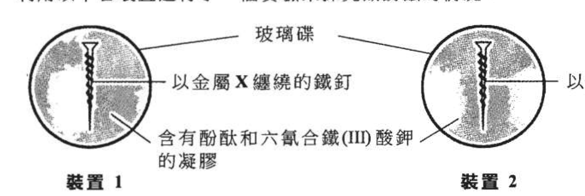
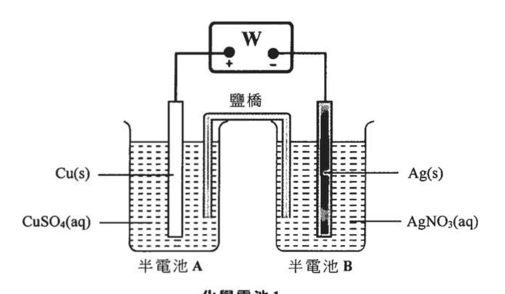
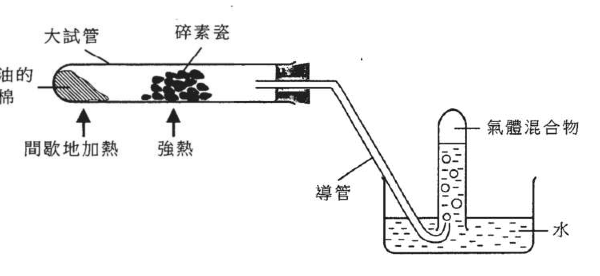
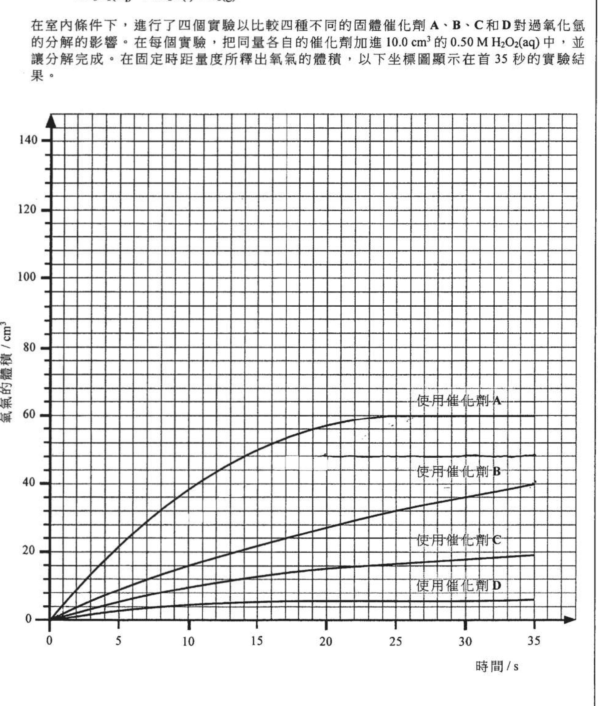
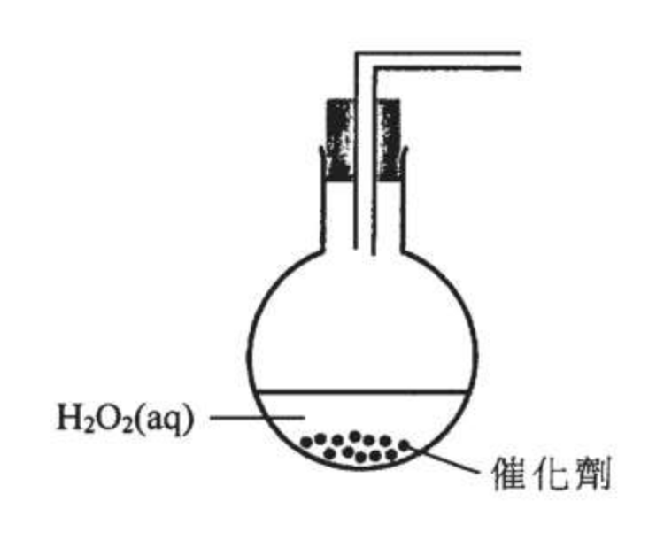
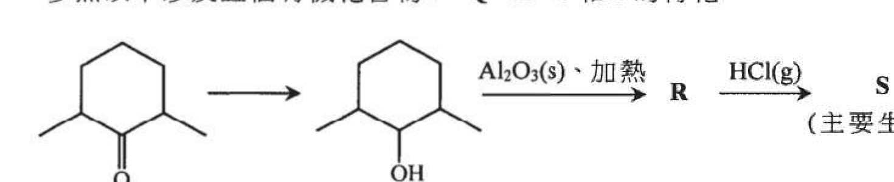
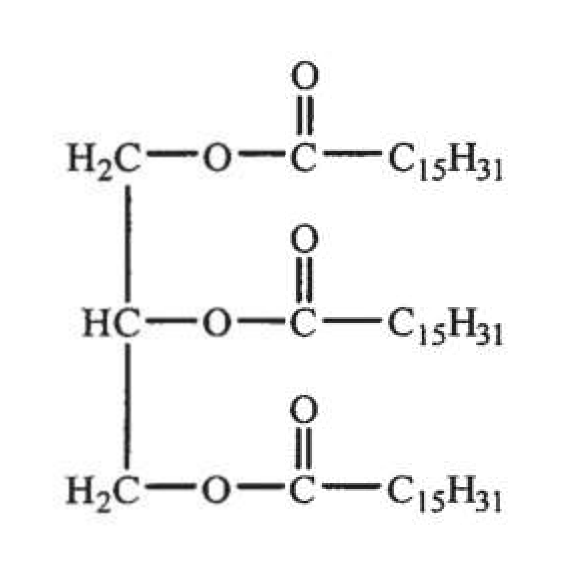

# 2024 DSE 化學 卷一乙（中文卷）— 題目庫

> 來源：文憑試 DSE 化學 Chemistry 2024 歷屆試題 Past Paper 卷一乙.pdf　｜　乙部：第一部分 9 題、第二部分 5 題，共 14 題
> 各題均須作答。把答案寫在預留的空位內。
> 說明：已移除頁碼、試卷標頭、答題簿橫線等雜訊；化學式以 Unicode 下標／上標表示，反應式以 → 或 ⇌ 表示。**本檔為題目庫（零答案）**，只含題目清洗 + 建議標籤。
> 本檔為第 2 層文字交貨（圖用原卷截圖；精修重繪另開第 3 層）。

---

## 第一部分（第 1–9 題）

## 第 1 題

【建議標籤】

- 卷別/部分：卷一乙　第一部分
- 課題：#同位素 #豐度 #同素異形體

【題目內容】

(a)　碳在自然界存在著兩個穩定的同位素：¹²C 和 ¹³C。

　　(i)　寫出 ¹²C 原子和 ¹³C 原子的一項不同之處。（1 分）

　　(ii)　碳的相對原子質量是 12.011。假設碳只有兩個同位素 ¹²C 和 ¹³C，計算 ¹³C 的豐度百分率。（2 分）

(b)　【題目內容待補：OCR 無法辨識，需對頁影像核實——原卷第 1 頁，疑為比較碳的同素異形體（石墨／鑽石）的結構與硬度差異】（3 分）

(c)　C₂N₂ 是碳和氮的化合物，它含有一個碳-碳單鍵。繪出一個 C₂N₂ 分子的電子圖（只需顯示最外層的電子）。（1 分）

---

## 第 2 題

【建議標籤】

- 卷別/部分：卷一乙　第一部分
- 課題：#鐵鏽蝕 #犧牲保護 #金屬活性序

【題目內容】

利用以下各裝置進行了一個實驗來探究鐵鏽蝕的情況。

X、Y 和鐵是三種不同的金屬。一段時間後，在裝置 1 和裝置 2 都呈現粉紅色。然而，只有裝置 1 的鐵釘周圍呈現藍色。

(a)　寫出導致鐵鏽蝕的各主要條件。

(b)　提出在裝置 1 和裝置 2 中哪物種轉為粉紅色。（1 分）

(c)　解釋為什麼裝置 1 的鐵釘周圍呈現藍色。（2 分）

(d)　根據以上觀察，把該三種金屬（X、Y 和鐵）按其活性的遞減次序排列出來。解釋你的答案。（2 分）

---

## 第 3 題

【建議標籤】

- 卷別/部分：卷一乙　第一部分
- 課題：#化學電池 #鹽橋 #電極電位

【題目內容】

下圖顯示一個化學電池的實驗裝置。電池中所使用的溶液都是 1.0 M，儀器 W 是用來量度該電池的電壓。

(a)　提出儀器 W 是什麼。（1 分）

(b)　提出鹽橋的一個功用。（1 分）

(c)　在製備化學電池 1 的鹽橋時：

　　(i)　解釋為什麼不可使用 KCl(aq)。（1 分）

　　(ii)　提出一個可使用的適當溶液。（1 分）

(d)　使用類似化學電池 1 的裝置來進行另外三個實驗。半電池則使用不同組合的電極和 1.0 M 溶液（CuSO₄(aq)、AgNO₃(aq)、ZnSO₄(aq) 和 MnSO₄(aq)）。下表顯示各化學電池的資料。

| 化學電池 | 1 | 2 | 3 | 4 |
|---|---|---|---|---|
| 半電池 A | Cu(s)/Cu²⁺(aq) | Cu(s)/Cu²⁺(aq) | Cu(s)/Cu²⁺(aq) | Ag(s)/Ag⁺(aq) |
| 半電池 B | Ag(s)/Ag⁺(aq) | Zn(s)/Zn²⁺(aq) | Mn(s)/Mn²⁺(aq) | Mn(s)/Mn²⁺(aq) |
| 電壓 / V | −0.46 | +1.10 | +1.15 | y |

　　(i)　參照化學電池 1、2 和 3，指出並解釋以上化學電池中使用的四種金屬，何者是最強的還原劑。（2 分）

　　(ii)　計算 y 的預期值。（1 分）

　　(iii)　寫出在化學電池 4 的陰極上所起變化的半反應式。（1 分）

---

## 第 4 題

【建議標籤】

- 卷別/部分：卷一乙　第一部分
- 課題：#實驗式 #分子式 #酸鹼滴定

【題目內容】

氨基磺酸（相對分子質量 = 97.1）可以用來清除水煲的水垢。水垢主要由 CaCO₃ 組成。

(a)　(i)　按質量計，氨基磺酸只含 3.09% 的氫、14.42% 的氮、49.43% 的氧和 33.06% 的硫。通過計算，測定氨基磺酸的實驗式。（相對原子質量：H = 1.0，N = 14.0，O = 16.0，S = 32.1）（2 分）

　　(ii)　推定氨基磺酸的分子式。（1 分）

(b)　在一個實驗中，0.486 g 的氨基磺酸與 100.0 cm³ 的 0.150 M NaOH(aq)（其為過量的）反應。餘下的 NaOH(aq) 需用 24.80 cm³ 的 0.202 M H₂SO₄(aq) 完全中和。

　　(i)　計算與該 H₂SO₄(aq) 反應了的 NaOH(aq) 的摩爾數。（1 分）

　　(ii)　計算與該氨基磺酸反應了的 NaOH(aq) 的摩爾數。（1 分）

　　(iii)　推定氨基磺酸的鹽基度。（1 分）

(c)　寫出在水垢中的 CaCO₃(s) 與 H⁺(aq) 反應的離子方程式。（1 分）

---

## 第 5 題

【建議標籤】

- 卷別/部分：卷一乙　第一部分
- 課題：#石油 #裂解 #烷烴

【題目內容】

煤油可從石油中獲取。

(a)　寫出一個從石油獲取煤油的物理方法。解釋這方法的原理。（2 分）

(b)　下圖顯示把煤油進行一個化學過程的實驗裝置。

　　(i)　寫出在大試管裏發生的化學過程名稱。（1 分）

　　(ii)　為什麼應該先把導管從水中移離才取走熱源？（1 分）

　　(iii)　解釋為什麼收集到的氣體混合物可令溴水快速地變成無色。（1 分）

　　(iv)　如果只強熱有煤油的礦物棉，而不加熱碎素瓷，在 (b)(i) 的化學過程便不會顯著地發生。提出兩個理由來解釋為什麼。（2 分）

---

## 第 6 題

【建議標籤】

- 卷別/部分：卷一乙　第一部分
- 課題：#沉澱 #離子方程式 #氣體

【題目內容】

把六種 0.1 M 的溶液分成兩組如下：

| A 組 | B 組 |
|---|---|
| NH₃(aq) | Na₂CO₃(aq) |
| Mg(NO₃)₂(aq) | FeSO₄(aq) |
| H₂SO₄(aq) | FeCl₃(aq) |

把 A 組的一種溶液與 B 組的一種溶液混合。

(a)　(i)　哪兩種溶液混合時可得出綠色沉澱物？（1 分）

　　(ii)　寫出在 (a)(i) 提及的綠色沉澱物的名稱。（1 分）

(b)　(i)　哪兩種溶液混合時可得出白色沉澱物？（1 分）

　　(ii)　寫出生成在 (b)(i) 提及的白色沉澱物的離子方程式。（1 分）

(c)　哪兩種溶液混合時可釋出氣泡？（1 分）

---

## 第 7 題

【建議標籤】

- 卷別/部分：卷一乙　第一部分
- 課題：#分子極性 #分子間引力 #沸點

【題目內容】

(a)　(i)　繪出一個二氯甲烷分子的三維結構。（1 分）

　　(ii)　解釋二氯甲烷分子內的各鍵是否具極性。（2 分）

　　(iii)　解釋二氯甲烷分子是否具極性。（1 分）

(b)　解釋為什麼二氯甲烷的沸點較乙醇的低。（2 分）

---

## 第 8 題

【建議標籤】

- 卷別/部分：卷一乙　第一部分
- 課題：#中和焓變 #強弱酸

【題目內容】

進行了五個實驗來測定以下不同的酸與鹼的中和焓變。所有實驗都是在室內條件下，把 50.0 cm³ 的 1.0 M 酸與 50.0 cm³ 的 1.0 M 鹼混合。

| 實驗 | 1 | 2 | 3 | 4 | 5 |
|---|---|---|---|---|---|
| 酸 | HCl(aq) | HCl(aq) | HNO₃(aq) | HNO₃(aq) | CH₃COOH(aq) |
| 鹼 | NaOH(aq) | KOH(aq) | NaOH(aq) | KOH(aq) | NaOH(aq) |

(a)　在實驗 1 中，反應混合物的溫度上升了 6.8 °C。計算 HCl(aq) 與 NaOH(aq) 的中和焓變（以 kJ mol⁻¹ 為單位）。（反應混合物的密度 = 1.0 g cm⁻³，反應混合物的比熱容 = 4.20 J g⁻¹ K⁻¹）（2 分）

(b)　解釋為什麼實驗 1 至 4 得出的中和焓變都大致相同。（1 分）

(c)　實驗 5 的結果顯示 CH₃COOH(aq) 與 NaOH(aq) 的中和焓變是 −50.10 kJ mol⁻¹。利用你在 (a) 的答案，計算以下反應的焓變：（2 分）

CH₃COOH(aq) → CH₃COO⁻(aq) + H⁺(aq)

---

## 第 9 題

【建議標籤】

- 卷別/部分：卷一乙　第一部分
- 課題：#金屬提取 #金屬活性序

【題目內容】

以氧化銀、氧化鉛(II)和氧化鋁為例，寫出三種不同的方法從各氧化物提取其金屬，並描述金屬的提取方法與其在金屬活性序位置的關係。（5 分）

---

## 第二部分（第 10–14 題）

## 第 10 題

【建議標籤】

- 卷別/部分：卷一乙　第二部分
- 課題：#催化劑 #過氧化氫 #反應速率

【題目內容】

過氧化氫的分解如下所示：

2H₂O₂(aq) → 2H₂O(l) + O₂(g)

在室內條件下，進行了四個實驗以比較四種不同的固體催化劑 A、B、C 和 D 對過氧化氫的分解的影響。在每個實驗，把同量各自的催化劑加進 10.0 cm³ 的 0.50 M H₂O₂(aq) 中，並讓分解完成。在固定時距量度所釋出氧氣的體積。以下坐標圖顯示在首 35 秒的實驗結果。

(a)　完成以下裝置圖（附標示），以顯示在上述各實驗中如何量度所生成氧氣的體積。

（1 分）

(b)　在這四種催化劑中，何者最為有效？解釋你的答案。（1 分）

(c)　在使用催化劑 B 的實驗中，理論上所產生氧氣的最終體積是多少？（1 分）

(d)　使用同量的催化劑 A 進行了第五個實驗，但使用了 10.0 cm³ 的 1.00 M H₂O₂(aq)。該反應在第 20 秒時完成。在第 14 頁的坐標圖上畫一條曲線草圖，以顯示在首 35 秒的預期結果。（在室內條件下，氣體的摩爾體積 = 24 dm³）（2 分）

---

## 第 11 題

【建議標籤】

- 卷別/部分：卷一乙　第二部分
- 課題：#有機轉化 #醇 #烯 #鹵代烴

【題目內容】

參照以下涉及五個有機化合物 P、Q、R、S 和 T 的轉化。

(a)　提出由 P 轉化為 Q 所需用的（各）試劑和（各）反應條件。（1 分）

(b)　寫出由 Q 轉化為 R 所涉及的反應類別。（1 分）

(c)　繪出 R 的結構。（1 分）

(d)　繪出 S 的結構。（1 分）

(e)　在 Q、R、S 和 T 四個有機化合物中，寫出哪兩個能夠在適當條件下與 KMnO₄(aq) 發生反應，並繪出各自生成的有機產物的結構。（3 分）

---

## 第 12 題

【建議標籤】

- 卷別/部分：卷一乙　第二部分
- 課題：#酯 #水解 #肥皂

【題目內容】

一個有機化合物 Z 能夠被濃 NaOH(aq) 水解生成產物 A 和產物 B。產物 B 具有清潔性質。Z 的結構如下所示：

(a)　寫出產物 A 的系統名稱。（1 分）

(b)　繪出產物 B 的結構。（1 分）

(c)　(i)　把產物 B 加入油-水混合物中搖動。除了產生泡沫，提出另一項預期的觀察。（1 分）

　　(ii)　根據產物 B 的結構，解釋你在 (c)(i) 提出的觀察。（2 分）

---

## 第 13 題

【建議標籤】

- 卷別/部分：卷一乙　第二部分
- 課題：#氧化物 #酸鹼習性 #分子間引力

【題目內容】

鋁、硫和氯是在周期表第三周期的元素。

(a)　根據當氧化鋁分別與稀 HCl(aq) 及與稀 NaOH(aq) 的反應所得的生成物（如有），描述氧化鋁的酸鹼習性。（3 分）

(b)　從分子層面，解釋為什麼在室內條件下硫是固體但氯是氣體。（2 分）

---

## 第 14 題

【建議標籤】

- 卷別/部分：卷一乙　第二部分
- 課題：#化學平衡 #平衡常數 #勒沙特列原理

【題目內容】

在以下化學平衡體系中，當加入 NaCl(s) 或提升溫度，平衡混合物在這兩種情況都有可觀察的變化：

Co²⁺(aq) + 4Cl⁻(aq) ⇌ CoCl₄²⁻(aq)　粉紅色　藍色　ΔH > 0

考慮上述兩種情況對體系的平衡位置和平衡常數的影響，寫出並解釋在這兩種情況下的預期可觀察的變化。（6 分）

---

*試卷完 —*

## 待人工核對

本卷為第 2 層文字交貨，由 easyocr（ch_tra+en，GPU）掃描底稿清洗而成；現模型無影像輸入，未能對頁影像覆核。以下題號建議第 3 層精修時對頁覆核：

- 第 1(b) 題：OCR 完全無法辨識，題幹內容待對頁補回（原卷第 1 頁）。
- 第 1、2 題：部分小題之分數（分）標記待對頁核實。
- 第 3(d)、8 題：表格欄位（電極組合／實驗編號）已按結構重整，待對頁核實列序。
- 第 2、3、5、10、11、12 題：圖為 300dpi 原卷截圖（程式定位＋墨跡覆蓋率校驗；無視覺覆核，位置／範圍待 spot-check）；第 3 層再換成向量重繪。
