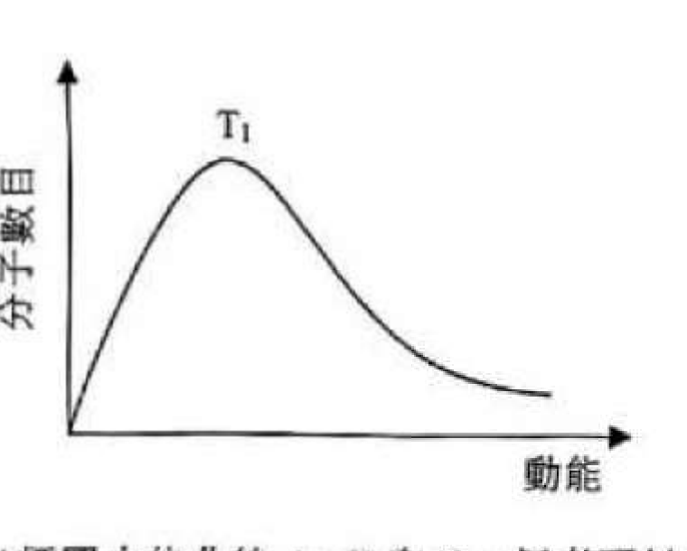
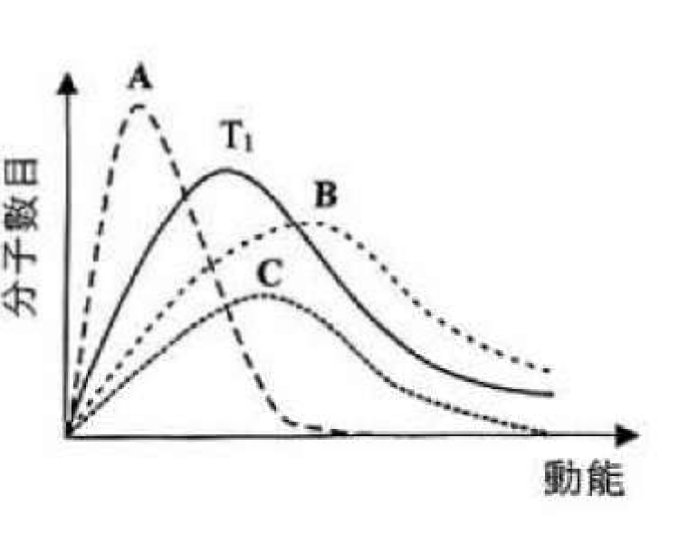
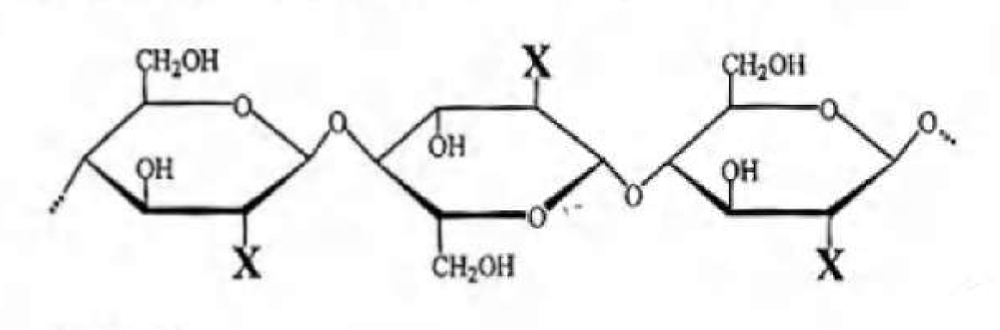
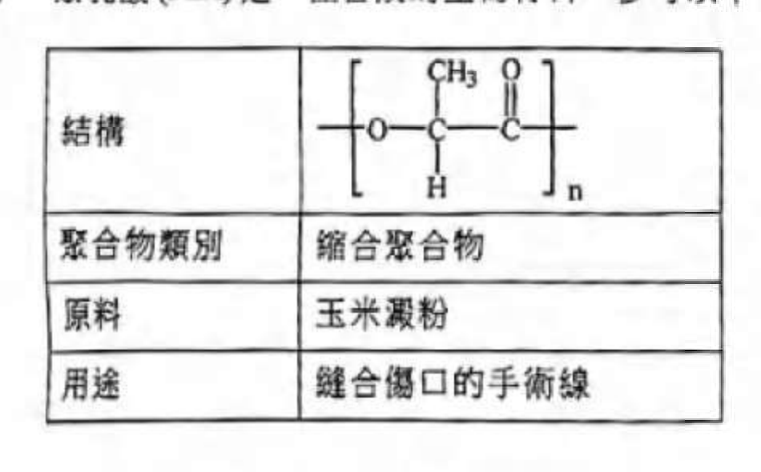
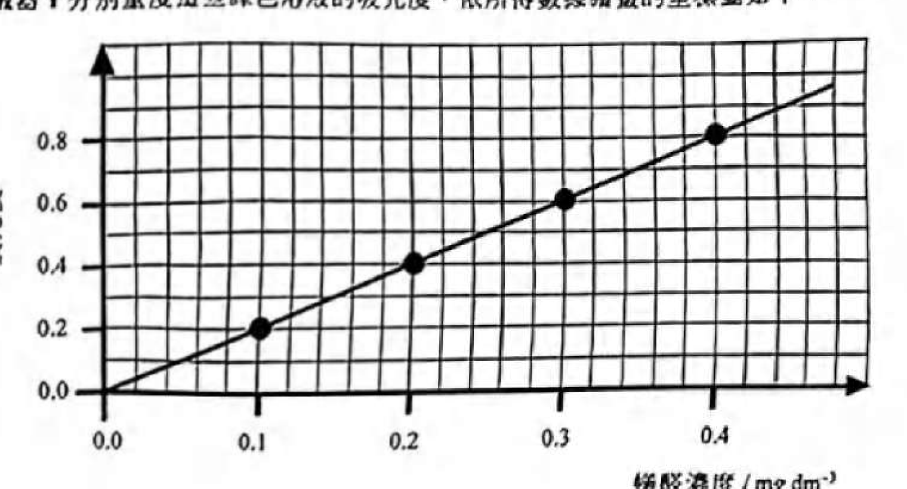

# 2024 DSE 化學 卷二（中文卷）— 題目庫

> 來源：文憑試 DSE 化學 Chemistry 2024 歷屆試題 Past Paper 卷二.pdf　｜　三部分：甲部 工業化學、乙部 物料化學、丙部 分析化學（每部分一題）
> 說明：已移除頁碼、試卷標頭等雜訊；化學式以 Unicode 下標／上標表示，反應式以 → 或 ⇌ 表示。**本檔為題目庫（零答案）**，只含題目清洗 + 建議標籤。
> 本檔為第 2 層文字交貨（圖用原卷截圖；精修重繪另開第 3 層）。
> 註：本卷（尤其丙部分析化學）OCR 底稿品質較差，多處以 [?] 標示，詳見檔尾「待人工核對」。

---

## 甲部　工業化學（第 1 題）

## 第 1 題

【建議標籤】

- 卷別/部分：卷二　甲部
- 課題：#工業化學 #氨 #氯鹼工業 #發酵 #乙酸製造 #反應速率

【題目內容】

回答試題的所有部分。

(a)　硫酸銨是由氨衍生出來的化合物。

　　(i)　寫出生產氨的工業過程名稱。（1 分）

　　(ii)　解釋硫酸銨如何能紓緩世界糧食不足的問題。（1 分）

(b)　在氯鹼工業使用膜電解池和流汞電解池來生產氯。

　　(i)　流汞電解池使用的原理是什麼？（1 分）

　　(ii)　寫出在氯鹼工業使用膜電解池較流汞電解池的一個優點。（1 分）

(c)　在有酵母的情況下，把糖發酵可以生產含酒精飲料。寫出酵母在糖發酵中的功用。（1 分）

(d)　以下兩個方法都可以製造乙酸：

方法 1：

2CH₃(CH₂)₂CH₃ + 5O₂ → 4CH₃COOH + 2H₂O

方法 2（涉及三個步驟的反應）：

步驟 (i)：CH₃OH + HI → CH₃I + H₂O（這反應是放熱的）
步驟 (ii)：CH₃I + CO → CH₃COI
步驟 (iii)：CH₃COI + H₂O → CH₃COOH + HI

| 反應條件 | 方法 1 | 方法 2 |
|---|---|---|
| 溫度／壓強 | 110–120 °C 和 60 atm | 150–200 °C 和 30–60 atm |
| 催化劑 | 乙酸鈷(II) | 銠化合物 [?] |

　　(i)　繪出方法 1 所涉反應的經催化反應的能量曲線圖，標示各坐標軸。（2 分）

　　(ii)　根據所示的方程式，計算方法 1 的原子經濟。（相對分子質量：CH₃(CH₂)₂CH₃ = 58.0，O₂ = 32.0，CH₃COOH = 60.0，H₂O = 18.0）（1 分）

　　(iii)　寫出方法 2 所涉及的總反應的化學方程式。（1 分）

　　(iv)　根據所提供的資料，提出一個原因為什麼 HI 在方法 2 中亦可被視為催化劑。（1 分）

　　(v)　根據所提供的資料及綠色化學的原理，提出一個原因為什麼有些人認為方法 1 比方法 2 可被視為較「綠色」。（1 分）

　　(vi)　[?]方法 2 比方法 1 可被視為較「綠色」。（1 分）

(e)　(i)　以下是 N₂O₅(g) 的分解的方程式：

2N₂O₅(g) → 4NO₂(g) + O₂(g)

提出如何能跟蹤這分解的進度。（1 分）

　　(ii)　這分解的速率方程如下所示：

速率 = k[N₂O₅(g)]ᵃ

其中 k 是速率常數，a 是對應 N₂O₅(g) 的反應級數。已知在 318 K 這分解的速率常數是 4.29 × 10⁻⁵ s⁻¹。

(1)　a 的數值是什麼？（1 分）

(2)　這分解的活化能是 108.5 kJ mol⁻¹。計算這分解在 338 K 的速率常數。（氣體常數 R = 8.31 J K⁻¹ mol⁻¹；阿列紐斯方程：log k = 常數 − Ea/(2.303RT)）（2 分）

　　(iii)　以下坐標圖顯示一個 N₂O₅(g) 樣本在溫度 T 時的麥克斯韋-玻爾茲曼分佈曲線。

(1)　以下坐標圖中的曲線 A、B 和 C，何者可以表示同一的 N₂O₅(g) 樣本在溫度高於 T 時的麥克斯韋-玻爾茲曼分佈曲線？（1 分）

(2)　利用麥克斯韋-玻爾茲曼分佈曲線，解釋為什麼提升溫度會使氣相反應的反應速率增加。（2 分）

---

## 乙部　物料化學（第 2 題）

## 第 2 題

【建議標籤】

- 卷別/部分：卷二　乙部
- 課題：#物料化學 #橡膠 #甲殼素 #聚乳酸 #晶體結構

【題目內容】

回答試題的所有部分。

(a)　橡皮筋是以硫化橡膠製成。當把橡皮筋扯伸，然後鬆開，它便能夠回復原狀。根據分子結構，解釋橡皮筋的彈性。（2 分）

(b)　甲殼素是龍蝦的外骨骼組分。甲殼素的部分結構顯示如下：

　　(i)　X 是什麼？（1 分）

　　(ii)　根據甲殼素的結構，解釋為什麼甲殼素與龍蝦外骨骼的硬度有關。（1 分）

　　(iii)　寫出一種液晶相的名稱，其中各分子向著同一方向排列，並且互相對齊成一直線。（1 分）

(c)　聚乳酸 (PLA) 是一種合成的生物材料。參考以下有關 PLA 的資料：

| 結構 | 聚合物類別 | 原料 | 用途 |
|---|---|---|---|
|  | 縮合聚合物 | 玉米澱粉 | 縫合傷口的手術線 |

　　(i)　寫出 PLA 的官能基。（1 分）

　　(ii)　繪出 PLA 的單體的結構。（1 分）

　　(iii)　提出為什麼 PLA 被分類為縮合聚合物。（1 分）

　　(iv)　根據綠色化學原理，解釋為什麼使用玉米澱粉作為原料來生產 PLA 是對環境友善。（1 分）

　　(v)　寫出一項 PLA 適合作為手術線的一個性質。（1 分）

　　(vi)　PLA 亦可用來製造即棄杯子。解釋是否適合使用壓塑注射來製造 PLA 即棄杯子。（1 分）

　　(vii)　提出一個原因為什麼 PLA 溶於乙酸乙酯，卻不溶於己烷。（1 分）

(d)　在恆壓而溫度不相同時，鐵的各晶體結構如下所示：

| 溫度 | 晶體結構 |
|---|---|
| 低於 912 °C | 體心立方 |
| 912 °C – 1394 °C | 立方緊密堆填 |
| 1394 °C – 1538 °C | 體心立方 |

　　(i)　在 25 °C 時，晶體結構中鐵原子的配位數是多少？（1 分）

　　(ii)　在 1000 °C 時，鐵具有立方緊密堆填晶體結構。

(1)　繪出在 1000 °C 時鐵晶體的一個晶胞。（1 分）

(2)　在這晶體結構中，鐵原子是怎樣排列的？（1 分）

　　(iii)　鑑於鐵在 25 °C 和 1450 °C 的晶體結構是相同的，一名學生推定在這兩個溫度下鐵的密度是相同的。解釋這個推定是否正確。（1 分）

　　(iv)　凱夫拉 [?]（Kevlar）和尼龍-6,6 在室溫下的一些資料列表如下：

| | 凱夫拉 [?] | 尼龍-6,6 |
|---|---|---|
| 相對拉伸強度 | 5.1 | 1.17 [?] |
| 密度 / g cm⁻³ | 1.44 | 1.14 |
| 導熱性能 | 良好 | 不良 |

(1)　用以上哪一物料來製造避彈衣是較佳之選？根據所提供的資料，提出兩個原因來解釋你的答案。（2 分）

(2)　凱夫拉 [?] 和尼龍-6,6 都是聚醯胺。提出兩個原因為什麼凱夫拉 [?] 較尼龍-6,6 具有更高的剛性。（2 分）

---

## 丙部　分析化學（第 3 題）

## 第 3 題

【建議標籤】

- 卷別/部分：卷二　丙部
- 課題：#分析化學 #色譜法 #萃取 #甲醛 #紅外光譜

【題目內容】

回答試題的所有部分。

(a)　描述一種化學測試來區別下列所示的化合物 A 和 B：

CH₃CH₂CH₂COCH₃　和　CH₃CH₂CH₂COOH

　　(i)　描述一種化學測試來區別化合物 A 和 B。（2 分）

　　(ii)　紙色譜法 [?] 可用來分離 [?]。[?]（2 分）

　　(iii)　一些有機溶劑可用來從有機化合物的水溶液中把該化合物萃取出來。提出這些溶劑的一個性質 [?]，使其可用於液-液萃取法。（1 分）

(b)　一個固體樣本 [?] 含有 PbCO₃ 和足量的 CuCO₃。進行了以下步驟以估計在該樣本中 PbCO₃ 的質量百分率：

步驟 (1)：把過量的稀 HCl(aq) 加入 2.0 g 的樣本，[?]出混合物 X。
步驟 (2)：把過量的 NH₃(aq) 加入混合物 X，生成一[?]沉澱物。
步驟 (3)：利用[?]法收集該沉澱物，把該沉澱物清洗和弄乾。[?]質量是 1.47 g。

　　(i)　解釋為什麼在步驟 (1) 加入過量的稀 HCl(aq)。（1 分）

　　(ii)　在步驟 (2) 把過量的 NH₃(aq) 加入混合物 X 後，除了生成沉澱物，寫出另一項預期的觀察。（1 分）

　　(iii)　(1)　在步驟 (3) 中該沉澱物在乾燥前為什麼要清洗和弄乾[?]？（2 分）

(2)　該沉澱物是什麼？（1 分）

(3)　通過計算，估計在該固體樣本中 PbCO₃ 的質量百分率。（相對原子質量：H = 1.0，C = 12.0，O = 16.0，Pb = 207.2）（2 分）

(c)　甲醛（系統名：甲[?]）是一類室內空氣污染物。[?]使用儀器分析方法來分析在室內空氣的甲醛。

　　[?]下表所提供的資料，提出如何利用紅外光譜法來[?]一個室內空氣樣本[?]的[?]。

（紅外吸收[?]範圍[?]式：化合物判別）

| 化合物判別 | 吸收範圍 / cm⁻¹ |
|---|---|
| C=O | 1680 至 1730 [?] |
| C≡N | 2070 至 2250 [?] |
| C-H | 2260 至 2380 [?] |
| O-H | 2510 至 3095 [?] |
| N-H | 3120 至 3670 [?] |
| H-H [?] | 3350 至 3500 [?] |

　　(i)　甲醛的[?]在 λ_max = 2900 cm⁻¹ [?] 時呈現一[?]。提出[?]所[?]的一個化合物[?]。（1 分）

　　(ii)　進行了以下步驟來測定一個室內空氣樣本中甲醛的濃度 [?]：

步驟 (1)：把[?]的[?]與[?]反應，生成一個[?]色的溶液。使用相同的步驟，但用[?]濃度的甲醛（已知），[?]出[?]色溶液的[?]。用儀器 Y（分光光度計 [?]）量度各溶液的吸光度，[?]數[?]坐標[?]如下（校正曲線 [?]）：

步驟 (2)：在一個小時內收集了一個體積 30 dm³ 的室內空氣樣本，[?]樣本中的甲醛[?]溶於 10 cm³ 的[?]色溶液 S。用儀器 Y 所[?]色溶液 S 的吸光度是 0.5。

(1)　寫出儀器 Y 的名稱。（1 分）

(2)　寫出在以上坐標圖中吸光度[?]的[?]。（1 分）

(3)　利用以上資料，計算該溶液 S 中甲醛的濃度（以 mg dm⁻³ 表示）。（2 分）

(4)　[?]室內空氣中甲醛濃度低於 0.1 mg m⁻³ 時，室內空氣的質素是良好的 [?]。根據所提供的[?]，[?]室內空氣的[?]是否[?]。（1 分）

(5)　提出[?]一[?]使用[?]分析方法來測定[?]室內空氣[?]的水平。（1 分）

---

*試卷完 —*

## 待人工核對

本卷為第 2 層文字交貨，由 easyocr（ch_tra+en，GPU）掃描底稿清洗而成；現模型無影像輸入，未能對頁影像覆核。本卷（尤其丙部分析化學）OCR 底稿品質差，以下內容強烈建議第 3 層精修時對頁覆核：

- 第 1(d) 題：方法 1／方法 2 的方程式、反應條件表及「（vi）」小題文字待對頁核實。
- 第 1(e) 題：速率方程、阿列紐斯方程之確切寫法待對頁核實。
- 第 1(e)、2(b)、2(c)、3(c)(ii) 題：圖為 300dpi 原卷截圖（程式定位＋墨跡覆蓋率校驗；無視覺覆核，位置／範圍待 spot-check）；第 3 層再換成向量重繪。
- 第 2(c) 題：PLA 資料表（結構、類別、原料、用途）待對頁核實。
- 第 2(d)(iv) 題：「凱夫拉」譯名（OCR 讀作「凱庫勒」）及表格數值（拉伸強度、密度）待對頁核實。
- 第 3 題：整題（色譜、萃取、PbCO₃ 分析、甲醛紅外光譜／校正曲線）OCR 底稿嚴重缺損，多處 [?] 待對頁逐字核實補回；紅外吸收表數值僅為參考。
