# 2025 DSE 化學 卷一甲（中文卷）— 題目庫

> 來源：文憑試 DSE 化學 Chemistry 2025 歷屆試題 Past Paper 卷一甲.pdf　｜　多項選擇題 36 題（第一部分 24 題、第二部分 12 題）
> 本部包括兩部分：第一部分設 24 題，第二部分設 12 題。選出每題最佳的答案。考生可參考印於試題答題簿 B 第 20 頁的周期表。
> 說明：已移除頁碼、試卷標頭等雜訊；化學式以 Unicode 下標／上標表示，反應式以 → 或 ⇌ 表示。**本檔為題目庫（零答案）**，只含題目清洗 + 建議標籤。
> 本檔為第 2 層文字交貨（圖用原卷截圖；精修重繪另開第 3 層）。
> 註：本卷為純掃描（無文字層），底稿由 easyocr（ch_tra+en，GPU）產出；數值／圖表多處以 [?] 標示，詳見檔尾「待人工核對」。

---

## 第一部分（第 1–24 題）

## 第 1 題

【建議標籤】

- 卷別/部分：卷一甲　第一部分
- 課題：#原子結構 #陰離子 #次原子粒子

【題目內容】

下列哪項組合代表一個陰離子的次原子粒子的數目？

| 選項 | 質子數目 | 中子數目 | 電子數目 |
|---|---|---|---|
| A | 7 | [?] | 10 |
| B | 10 | 10 | 10 |
| C | 19 | 20 | 18 |
| D | 26 | 30 | 23 |

---

## 第 2 題

【建議標籤】

- 卷別/部分：卷一甲　第一部分
- 課題：#焰色試驗 #碳酸鹽 #氣體釋出

【題目內容】

在焰色試驗中，一個白色固體 X 得出磚紅色火焰。當把 X(s) 加進稀氫氯酸時，有一無色氣體釋出。下列哪個化合物可能是 X？

- A. 硫酸鈣
- B. 硫酸鉀
- C. 碳酸鈣
- D. 碳酸鉀

---

## 第 3 題

【建議標籤】

- 卷別/部分：卷一甲　第一部分
- 課題：#碳酸鈣 #氫氧化鈣 #電解 #分餾

【題目內容】

下列的陳述，何者不正確？

- A. 碳酸鈣固體可從把二氧化碳氣體通入石灰水而獲得
- B. 氫氧化鈣固體可從強熱大理石而直接獲得
- C. 氫氣可從電解海水而直接獲得
- D. 氮氣可從分餾液態空氣而獲得

---

## 第 4 題

【建議標籤】

- 卷別/部分：卷一甲　第一部分
- 課題：#金屬與酸反應 #氣體 #溶液顏色

【題目內容】

下列哪個過程會得出一無色氣體和一有色溶液？

- A. 把鉛顆粒加進熱水
- B. 把鋅箔加進濃硝酸
- C. 把銅粉末加進濃硫酸
- D. 把鎂帶加進稀氫氯酸

---

## 第 5 題

【建議標籤】

- 卷別/部分：卷一甲　第一部分
- 課題：#硫化銀 #產率 #摩爾計算

【題目內容】

銀可從硫化銀提取出來。若在一個實驗中這提取的產率是 85%，會需要多少質量的硫化銀才獲得 15.0 g 的銀？

（相對原子質量：S = 32.1，Ag = 107.9）

- A. 14.6 g
- B. 17.2 g
- C. 20.3 g
- D. 34.5 g

---

## 第 6 題

【建議標籤】

- 卷別/部分：卷一甲　第一部分
- 課題：#硫酸鋅 #結晶製備 #過量法

【題目內容】

下列哪種方法不適合於學校實驗室內製備硫酸鋅結晶？

- A. 把過量的鋅固體加入硫酸銅(II)溶液
- B. 把過量的氯化鋅固體加入硫酸銅(II)溶液
- C. 把過量的氧化鋅固體加入稀硫酸
- D. 把過量的碳酸鋅固體加入稀硫酸

---

## 第 7 題

【建議標籤】

- 卷別/部分：卷一甲　第一部分
- 課題：#白磷 #分子結構 #共價鍵

【題目內容】

一個白磷分子的結構如下所示：

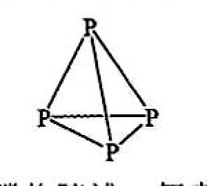

下列有關白磷的陳述，何者正確？

- A. 白磷不導電
- B. 白磷的相對分子質量是 31.0
- C. 白磷分子間的引力是共價鍵
- D. 在白磷分子中的每個磷原子均沒有孤電子對

---

## 第 8 題

【建議標籤】

- 卷別/部分：卷一甲　第一部分
- 課題：#電化學電池 #鹽橋 #氧化還原

【題目內容】

下圖顯示一個實驗的裝置：

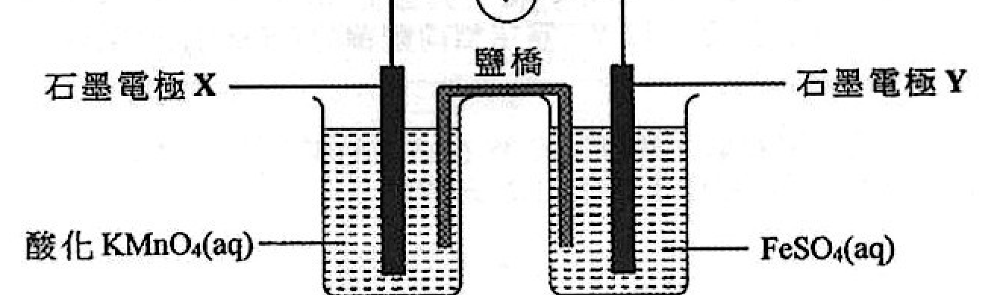

（圖中：鹽橋、石墨電極 X、石墨電極 Y、酸化 KMnO₄(aq)、FeSO₄(aq)）

下列哪項有關上述實驗的陳述正確？

- A. 電極 X 是陰極
- B. 飽和 Ca(NO₃)₂(aq) 是適合用來製備以上鹽橋
- C. 電子由電極 X 經外電路流向電極 Y
- D. 在電極 Y 上所起變化的半反應式是 Fe²⁺(aq) + 2e⁻ → Fe(s)

---

## 第 9 題

【建議標籤】

- 卷別/部分：卷一甲　第一部分
- 課題：#氧化還原方程式 #配平 #KMnO₄

【題目內容】

參考以下化學方程式：

xH₂S + 2KMnO₄ + 3H₂SO₄ → xS + yH₂O + zMnSO₄ + K₂SO₄

下列哪項組合正確？

| 選項 | x | y | z |
|---|---|---|---|
| A | [?] | [?] | [?] |
| B | [?] | [?] | [?] |
| C | [?] | [?] | [?] |
| D | [?] | [?] | [?] |

---

## 第 10 題

【建議標籤】

- 卷別/部分：卷一甲　第一部分
- 課題：#混合物 #純物質 #氣體

【題目內容】

下列哪種氣體不是一個混合物？

- A. 煤氣
- B. 天然氣
- C. 丁烷氣
- D. 煉油氣

---

## 第 11 題

【建議標籤】

- 卷別/部分：卷一甲　第一部分
- 課題：#有機命名 #烯 #醇 #系統名稱

【題目內容】

(CH₃)₂CHCH₂C(OH)(CH₃)CH₂CH=CHCH₃ 的系統名稱是什麼？

- A. 5,7-二甲基辛-2-烯-5-醇
- B. 2,4-二甲基辛-6-烯-4-醇
- C. 7,7-二甲基庚-2-烯-5-醇
- D. 1,1-二甲基庚-5-烯-3-醇

---

## 第 12 題

【建議標籤】

- 卷別/部分：卷一甲　第一部分
- 課題：#強酸弱酸 #導電性 #中和

【題目內容】

參考以下兩個溶液：

X：25.0 cm³ 的 0.5 M HCl(aq)
Y：25.0 cm³ 的 0.5 M CH₃COOH(aq)

下列哪項陳述正確？

- A. X 比 Y 具較高 pH
- B. X 與 Y 均具相同的導電性
- C. X 與過量 Mg(s) 反應釋出的熱和 Y 與過量 Mg(s) 反應釋出的熱是相同的
- D. 完全中和 X 及完全中和 Y，需用相同體積的 0.5 M NaOH(aq)

---

## 第 13 題

【建議標籤】

- 卷別/部分：卷一甲　第一部分
- 課題：#燃燒分析 #實驗式 #有機化合物

【題目內容】

有機化合物 W 只含有氫、碳和氧。3.00 g 的 W 在過量的氧中完全燃燒，得出 33.75 g 的水和 41.25 g 的二氧化碳。

下列哪個化合物可能是 W？

（相對原子質量：H = 1.0，C = 12.0，O = 16.0）

- A. HCOOH
- B. CH₂=CHCOOH
- C. CH₃OH
- D. CH₂(OH)CH₂OH

---

## 第 14 題

【建議標籤】

- 卷別/部分：卷一甲　第一部分
- 課題：#八隅體 #中央原子 #電子排佈

【題目內容】

在下列各物種中，劃有底線的原子是中央原子。在它們之中，哪個中央原子具非八隅體電子排佈？

- A. OF₂
- B. SCl₄
- C. ICl₃
- D. HCHO

---

## 第 15 題

【建議標籤】

- 卷別/部分：卷一甲　第一部分
- 課題：#防腐蝕 #犧牲保護 #金屬防護

【題目內容】

下列哪項不能預防鐵製物件的腐蝕？

- A. 把它浸在醋中
- B. 把它浸在油中
- C. 把它連接到一塊鋅金屬
- D. 把它連接到化學電池的負極

---

## 第 16 題

【建議標籤】

- 卷別/部分：卷一甲　第一部分
- 課題：#燃燒焓變 #量熱法 #醇

【題目內容】

指示：參考以下實驗裝置，回答第 16 和 17 題。以下實驗裝置是用來測定在某些條件下不同的醇的燃燒焓變。

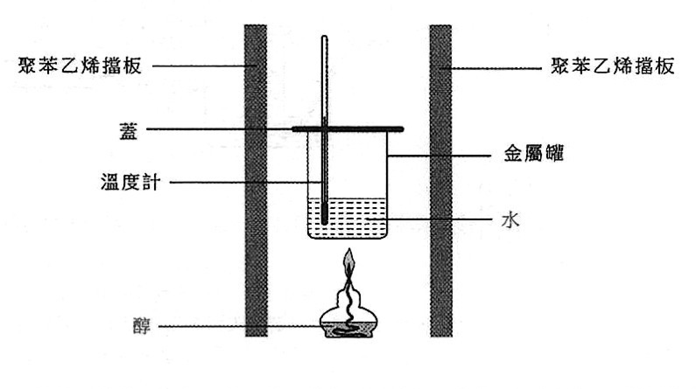

在一個實驗中，藉分別燃燒甲醇和乙醇，把盛載於金屬罐內固定質量的水加熱。所得實驗數據如下：

| 醇 | 用去醇的質量 / g | 最大溫度升幅 / °C |
|---|---|---|
| 甲醇 | 1.930 | 22.6 |
| 乙醇 | 1.740 | 27.1 |

得出甲醇的燃燒焓變為 −715 kJ mol⁻¹。

在相同實驗條件下，下列何者是測定到的乙醇的燃燒焓變？

（相對分子質量：甲醇 = 32.0，乙醇 = 46.0）

- A. −1367 kJ mol⁻¹
- B. −1157 kJ mol⁻¹
- C. −1028 kJ mol⁻¹
- D. −857 kJ mol⁻¹

---

## 第 17 題

【建議標籤】

- 卷別/部分：卷一甲　第一部分
- 課題：#燃燒焓變 #熱損失 #實驗誤差

【題目內容】

重複以上實驗，並在實驗裝置上作出一些改變，得出甲醇的燃燒焓變是 −691 kJ mol⁻¹ 而非 −715 kJ mol⁻¹。下列的改變，何者可能導致這結果？

- (1) 金屬罐內有較多的水
- (2) 移走所有聚苯乙烯擋板
- (3) 金屬罐與火焰之間有較遠的距離

- A. 只有(1)和(2)
- B. 只有(1)和(3)
- C. 只有(2)和(3)
- D. (1)、(2) 和 (3)

---

## 第 18 題

【建議標籤】

- 卷別/部分：卷一甲　第一部分
- 課題：#氣體收集 #氫氣 #排水集氣法

【題目內容】

下列的裝置，何者能用來收集 H₂(g)？

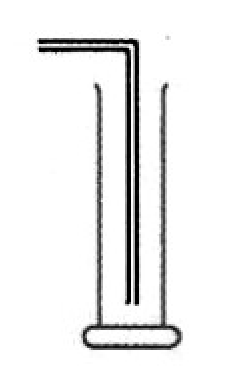
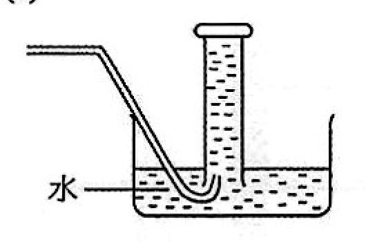
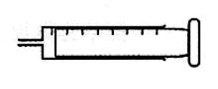

- (1)（見上圖 1）
- (2)（見上圖 2）
- (3)（見上圖 3）

- A. 只有(1)
- B. 只有(2)
- C. 只有(1)和(3)
- D. 只有(2)和(3)

---

## 第 19 題

【建議標籤】

- 卷別/部分：卷一甲　第一部分
- 課題：#金屬活性序 #置換反應 #氫氧化物沉澱

【題目內容】

當把金屬 X 加進硝酸銅(II)溶液時，其中一個生成物是藍色固體。下列的金屬何者可能是 X？

- (1) [?]
- (2) [?]
- (3) [?]

- A. 只有(1)
- B. 只有(2)
- C. 只有(1)和(3)
- D. 只有(2)和(3)

---

## 第 20 題

【建議標籤】

- 卷別/部分：卷一甲　第一部分
- 課題：#銨鹽 #加熱分解 #氣體檢驗 #氯化鈷試紙

【題目內容】

參考下圖：

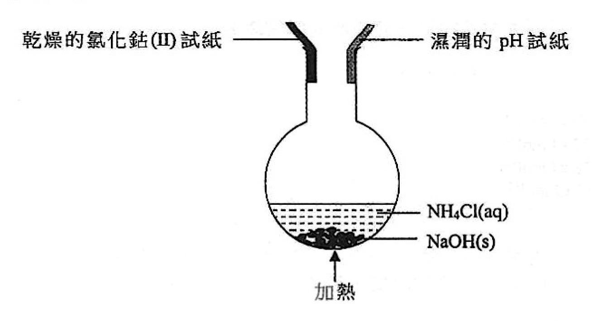

（圖中：乾燥的氯化鈷(II)試紙、濕潤的 pH 試紙、NH₄Cl(aq) 與 NaOH(s)、加熱）

下列的陳述，何者正確？

- (1) 釋出一無色並帶有獨特刺激性氣味的氣體
- (2) 該乾燥的氯化鈷(II)試紙變成藍色
- (3) 該濕潤的 pH 試紙變成藍色

- A. 只有(1)
- B. 只有(2)
- C. 只有(1)和(3)
- D. 只有(2)和(3)

---

## 第 21 題

【建議標籤】

- 卷別/部分：卷一甲　第一部分
- 課題：#氧化還原 #氧化數 #歧化反應

【題目內容】

下列哪些反應涉及氧化？

- (1) CH₃CH=CHCH₃ + H₂ → CH₃CH₂CH₂CH₃
- (2) 3Br₂ + 6NaOH → 5NaBr + NaBrO₃ + 3H₂O
- (3) 2Al + 2NaOH + 6H₂O → 2NaAl(OH)₄ + 3H₂

- A. 只有(1)和(2)
- B. 只有(1)和(3)
- C. 只有(2)和(3)
- D. (1)、(2) 和 (3)

---

## 第 22 題

【建議標籤】

- 卷別/部分：卷一甲　第一部分
- 課題：#空氣污染 #化石燃料 #減排措施

【題目內容】

下列哪些措施能減少從燃燒化石燃料所排放的空氣污染物？

- (1) 在燃煤發電廠安裝滌氣器
- (2) 在汽油驅動車輛安裝催化轉化器
- (3) 在燃煤發電廠安裝靜電沉積器

- A. 只有(1)和(2)
- B. 只有(1)和(3)
- C. 只有(2)和(3)
- D. (1)、(2) 和 (3)

---

## 第 23 題

【建議標籤】

- 卷別/部分：卷一甲　第一部分
- 課題：#氣體辨別 #SO₂ #CO₂ #化學測試

【題目內容】

有兩個氣瓶：一個盛載 CO₂(g)，而另一個盛載 SO₂(g)。下列何者可用來辨別這兩種氣體？

- (1) 加入溴水
- (2) 加入氫氧化鈉溶液
- (3) 加入濃硝酸

- A. 只有(1)和(2)
- B. 只有(1)和(3)
- C. 只有(2)和(3)
- D. (1)、(2) 和 (3)

---

## 第 24 題

【建議標籤】

- 卷別/部分：卷一甲　第一部分
- 課題：#沸點 #范德華力 #分子間引力

【題目內容】

考慮下列各陳述句並選出最佳的答案：

| | 第一陳述句 | 第二陳述句 |
|---|---|---|
| | 碘化氫比溴化氫有較高的沸點。 | 碘化氫分子間的范德華力較溴化氫分子間的為強。 |

- A. 兩陳述句均正確，而第二陳述句是第一陳述句的合理解釋
- B. 兩陳述句均正確，而第二陳述句並非第一陳述句的合理解釋
- C. 第一陳述句錯誤，但第二陳述句正確
- D. 兩陳述句均錯誤

---

## 第二部分（第 25–36 題）

## 第 25 題

【建議標籤】

- 卷別/部分：卷一甲　第二部分
- 課題：#反應速率 #初速 #濃度

【題目內容】

在室內條件下，量度得過量鋅顆粒與 100 cm³ 的 1.0 M HCl(aq) 反應的初速為 r。在室內條件下使用同量的鋅顆粒，下列何者會與該些鋅顆粒反應得出相同的初速 r？

- A. 50 cm³ 的 2.0 M HCl(aq)
- B. 200 cm³ 的 1.0 M HCl(aq)
- C. 100 cm³ 的 1.0 M H₂SO₄(aq)
- D. 100 cm³ 的 1.0 M CH₃COOH(aq)

---

## 第 26 題

【建議標籤】

- 卷別/部分：卷一甲　第二部分
- 課題：#化學平衡 #勒沙特列原理 #焓變

【題目內容】

參考以下在溫度 T 時及某體積的密閉容器內的平衡體系：

SO₂(g) + NO₂(g) ⇌ SO₃(g) + NO(g)　ΔH = +42 kJ mol⁻¹

下列哪項改變會增加該體系中 NO(g) 在平衡時的摩爾數？

- A. 降低該體系的溫度
- B. 在溫度 T 時減少該容器的體積
- C. 把小量的 SO₂(g) 加入該平衡混合物
- D. 從該平衡混合物中移去小量的 SO₃(g)

---

## 第 27 題

【建議標籤】

- 卷別/部分：卷一甲　第二部分
- 課題：#化學平衡 #反應商數 #平衡常數

【題目內容】

參考以下在某些條件下的可逆反應：

2Y(g) ⇌ Y₂(g)　Kc = 6.2 mol⁻¹ dm³

在時間 t，反應商數是 4.5 mol⁻¹ dm³。下列有關這可逆反應在時間 t 時的陳述，何者正確？

- A. 這反應已達致平衡
- B. 正向反應的速率大於逆向反應的速率
- C. Y₂(g) 的濃度是 Y(g) 濃度的 4.5 倍
- D. Y(g) 的濃度開始增加

---

## 第 28 題

【建議標籤】

- 卷別/部分：卷一甲　第二部分
- 課題：#有機化合物 #結構式 #旋光性 #官能基

【題目內容】

沙丁胺醇是一類哮喘藥物。它的結構如下所示：

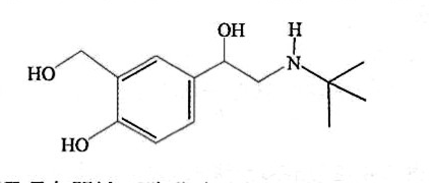

下列哪項有關沙丁胺醇的陳述不正確？

- A. 它是一個極性分子
- B. 它與 PCl₅ 反應
- C. 它具旋光性
- D. 它的分子式是 C₁₃H₂₁NO₃

---

## 第 29 題

【建議標籤】

- 卷別/部分：卷一甲　第二部分
- 課題：#溶解度平衡 #配位化合物 #平衡濃度

【題目內容】

參考以下的平衡體系：

AgCl(s) + 2NH₃(aq) ⇌ Ag(NH₃)₂⁺(aq) + Cl⁻(aq)

已知在 25 °C 時，K = [Ag(NH₃)₂⁺]eqm[Cl⁻]eqm / [NH₃]eqm² = 3.60 × 10⁻³

起始時，把某分量的 NH₃(aq) 與 AgCl(s) 混合。當體系在 25 °C 達致化學平衡時，混合物中 NH₃(aq) 的濃度是 8.93 × 10⁻² mol dm⁻³。在該平衡混合物中，Cl⁻(aq) 離子的濃度是多少？

- A. 2.87 × 10⁻⁴ mol dm⁻³
- B. 3.21 × 10⁻⁴ mol dm⁻³
- C. 5.36 × 10⁻³ mol dm⁻³
- D. 1.79 × 10⁻² mol dm⁻³

---

## 第 30 題

【建議標籤】

- 卷別/部分：卷一甲　第二部分
- 課題：#聚合物 #單體 #縮合聚合

【題目內容】

一個聚合物的部分結構如下所示：

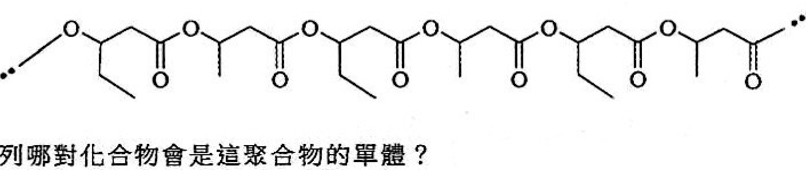

下列哪對化合物會是這聚合物的單體？

- A. 【圖待補：單體結構選項 A】
- B. 【圖待補：單體結構選項 B】
- C. 【圖待補：單體結構選項 C】
- D. 【圖待補：單體結構選項 D】

---

## 第 31 題

【建議標籤】

- 卷別/部分：卷一甲　第二部分
- 課題：#周期表 #熔點 #元素性質

【題目內容】

指示：參考以下坐標圖，回答第 31 和 32 題。以下坐標圖顯示在周期表第二和第三周期內的十三個連續元素的熔點變化。（這些元素依原子序遞增的次序排列，英文字母不是化學符號。）

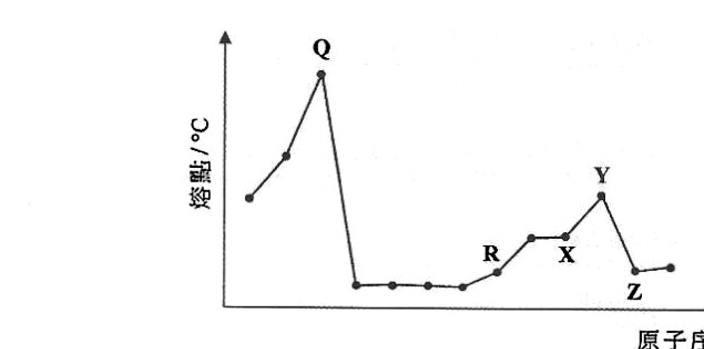

下列哪個元素可能代表碳？

- A. [?]
- B. [?]
- C. [?]
- D. [?]

---

## 第 32 題

【建議標籤】

- 卷別/部分：卷一甲　第二部分
- 課題：#氧化物 #酸鹼性 #巨型結構

【題目內容】

（續第 31 題坐標圖）

下列有關上述各元素的氧化物的陳述，何者正確？

- (1) X 的氧化物和 Z 的氧化物能分別與稀 NaOH(aq) 反應
- (2) Q 的氧化物和 Y 的氧化物具有巨型結構
- (3) R 的氧化物在熔融狀態下能導電

- A. 只有(1)
- B. 只有(2)
- C. 只有(1)和(3)
- D. 只有(2)和(3)

---

## 第 33 題

【建議標籤】

- 卷別/部分：卷一甲　第二部分
- 課題：#有機化合物 #水解 #NaOH

【題目內容】

以下有機化合物與過量的 NaOH(aq) 共熱：

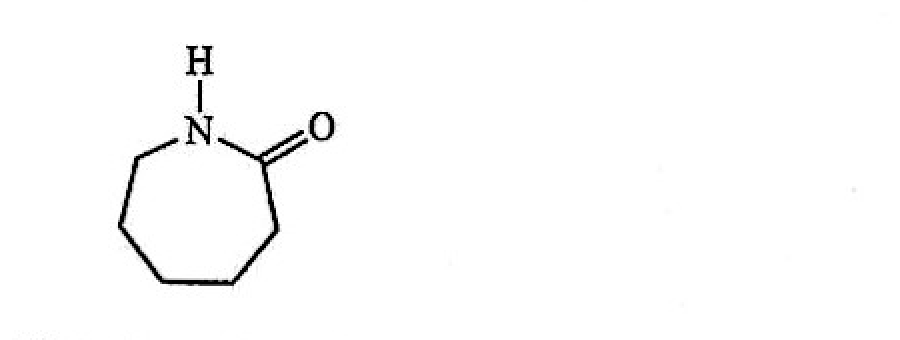

下列有關這反應的陳述，何者正確？

- (1) 生成 NH₃
- (2) 生成氫
- (3) 它是一個縮合反應

- A. 只有(1)
- B. 只有(2)
- C. 只有(1)和(3)
- D. 只有(2)和(3)

---

## 第 34 題

【建議標籤】

- 卷別/部分：卷一甲　第二部分
- 課題：#反應進度 #氧化還原 #滴定

【題目內容】

參考以下反應：

2MnO₄⁻(aq) + 5C₂O₄²⁻(aq) + 16H⁺(aq) → 2Mn²⁺(aq) + 10CO₂(g) + 8H₂O(l)

下列何者可跟隨這反應的進度？

- (1) 所生成 CO₂(g) 的質量
- (2) 反應體系的壓強
- (3) 反應體系的顏色強度

- A. 只有(1)和(2)
- B. 只有(1)和(3)
- C. 只有(2)和(3)
- D. (1)、(2) 和 (3)

---

## 第 35 題

【建議標籤】

- 卷別/部分：卷一甲　第二部分
- 課題：#乳化 #界面活性劑 #結構

【題目內容】

下列哪些物種可乳化一個油-水混合物？

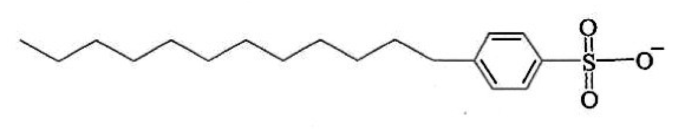
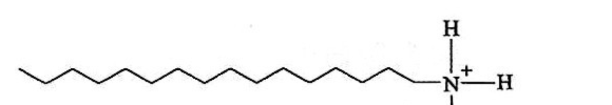
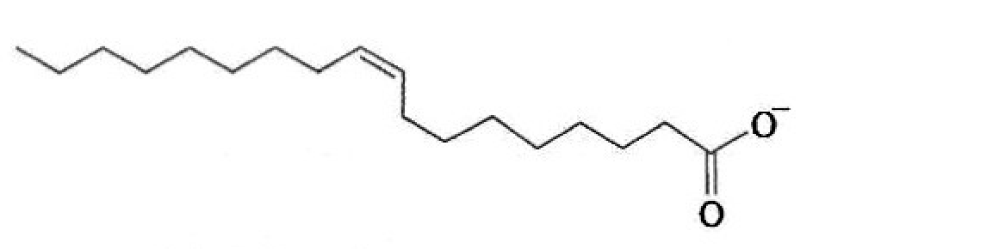

- (1)（見上圖 1）
- (2)（見上圖 2）
- (3)（見上圖 3）

- A. 只有(1)和(2)
- B. 只有(1)和(3)
- C. 只有(2)和(3)
- D. (1)、(2) 和 (3)

---

## 第 36 題

【建議標籤】

- 卷別/部分：卷一甲　第二部分
- 課題：#反應速率 #平衡常數 #濃度

【題目內容】

考慮下列各陳述句並選出最佳的答案：

| | 第一陳述句 | 第二陳述句 |
|---|---|---|
| | 在固定溫度下，增加一個可逆反應中某反應物的濃度，會增加正向反應的速率，但逆向反應的速率則減少。 | 增加一個可逆反應中某反應物的濃度，會改變該反應的平衡常數。 |

- A. 兩陳述句均正確，而第二陳述句是第一陳述句的合理解釋
- B. 兩陳述句均正確，而第二陳述句並非第一陳述句的合理解釋
- C. 第一陳述句錯誤，但第二陳述句正確
- D. 兩陳述句均錯誤

---

## 待人工核對

| 題號 | 頁碼 | 原因 |
|---|---|---|
| Q1 | 卷一甲 p02 | A 選項中子數目 OCR 不清（「二」，疑為 7 或 8） |
| Q9 | 卷一甲 p03 | 選項表 x/y/z 三欄數值 OCR 不完整，需對頁核實 |
| Q19 | 卷一甲 p06 | (1)(2)(3) 金屬名稱 OCR 不清，需對頁核實 |
| Q26 | 卷一甲 p08 | ΔH 符號（+42 或 −42 kJ mol⁻¹）需對頁核實 |
| Q30 | 卷一甲 p09 | 單體選項 A–D 為結構式，截圖未能獨立裁出，已標圖待補 |
| Q31 | 卷一甲 p10 | 選項 A–D 為坐標圖中元素字母，OCR 無法辨識 |
| 全卷圖 | 卷一甲 多頁 | 所有 crop 截圖由程式化座標裁切，未經肉眼對頁核實 |
