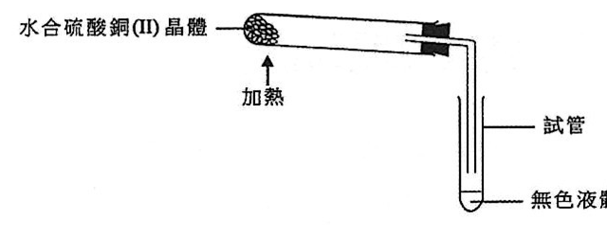
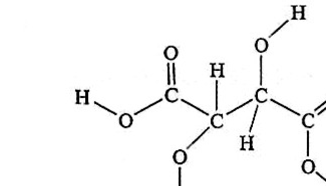
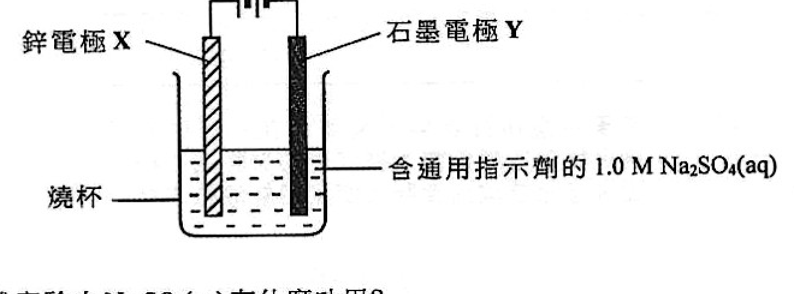
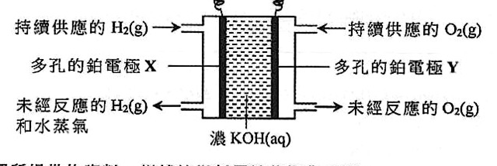
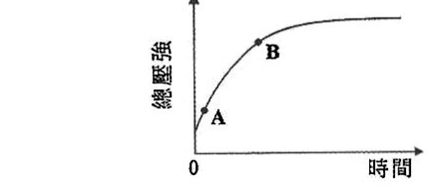
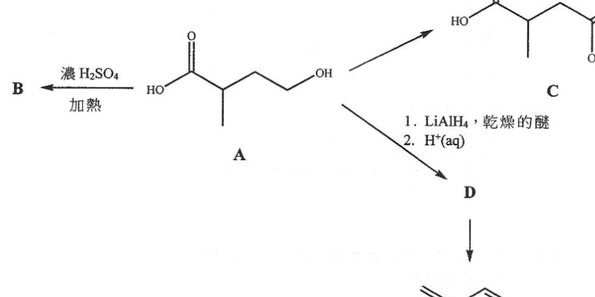

# 2025 DSE 化學 卷一乙（中文卷）— 題目庫

> 來源：文憑試 DSE 化學 Chemistry 2025 歷屆試題 Past Paper 卷一乙.pdf　｜　乙部：第一部分 9 題、第二部分 5 題，共 14 題
> 各題均須作答。把答案寫在預留的空位內。
> 說明：已移除頁碼、試卷標頭、答題簿橫線等雜訊；化學式以 Unicode 下標／上標表示，反應式以 → 或 ⇌ 表示。**本檔為題目庫（零答案）**，只含題目清洗 + 建議標籤。
> 本檔為第 2 層文字交貨（圖用原卷截圖；精修重繪另開第 3 層）。
> 註：本卷為純掃描（無文字層），底稿由 easyocr（ch_tra+en，GPU）產出；多處以 [?] 標示，詳見檔尾「待人工核對」。

---

## 第一部分（第 1–9 題）

## 第 1 題

【建議標籤】

- 卷別/部分：卷一乙　第一部分
- 課題：#金屬鍵 #鋁 #氧化鋁 #抗腐蝕

【題目內容】

在鋁窗框表面的氧化鋁層能增強鋁的抗腐蝕性。

(a)　根據鍵合和結構，解釋為什麼鋁是可展的。（2 分）

(b)　繪出氧化鋁的電子圖（只顯示最外層的電子）。（1 分）

(c)　為什麼氧化鋁層能增強鋁的抗腐蝕性？（1 分）

(d)　寫出能增加鋁窗框上氧化鋁層厚度的過程名稱。（1 分）

---

## 第 2 題

【建議標籤】

- 卷別/部分：卷一乙　第一部分
- 課題：#水合硫酸銅 #加熱分解 #焰色試驗

【題目內容】

下圖顯示一個實驗裝置，其中把水合硫酸銅(II)晶體加熱，在試管內收集到一無色液體。

(a)　所收集到的無色液體是什麼？（1 分）

(b)　寫出在這些水合硫酸銅(II)晶體上的預期顏色變化。（1 分）

(c)　當以水合硫酸銅(II)晶體來進行焰色試驗時，可觀察到藍綠色火焰。簡述如何在學校實驗室進行該焰色試驗。（2 分）

---

## 第 3 題

【建議標籤】

- 卷別/部分：卷一乙　第一部分
- 課題：#氮化鎂 #摩爾計算 #鍵合

【題目內容】

在一個實驗中，2.10 g 的乾燥氮氣與 1.85 g 的鎂帶在高溫下反應，氮化鎂 Mg₃N₂ 固體是這反應的唯一產物。

(a)　(i)　寫出這反應所涉及的化學方程式。（1 分）

　　(ii)　計算可生成氮化鎂的理論質量。（相對原子質量：N = 14.0，Mg = 24.3）（3 分）

(b)　在另一個實驗中，把一條鎂帶在空氣中燃燒，生成白色的氧化鎂固體和小量氮化鎂。

　　(i)　寫出這實驗的另一項預期觀察。（1 分）

　　(ii)　雖然氮是在空氣中含量最多的氣體，但氮化鎂不是在(b)(i)的反應中所生成的主要產物。為解釋這結果，有一個觀點：氮的活性較氧的為低。根據鍵合，提出一個理由來支持這個觀點。（1 分）

---

## 第 4 題

【建議標籤】

- 卷別/部分：卷一乙　第一部分
- 課題：#烴 #同系列 #聚合 #全球暖化

【題目內容】

乙烷、丙烯和辛烷都是烴。乙烷和辛烷屬於相同的同系列。

(a)　寫出這同系列的通式。（1 分）

(b)　在下列各表中，填上有關如下所示各反應的所需資料：

　　(i)　溴（溶於一有機溶劑）與大量過剩的乙烷在漫射陽光下的反應：

　　　該主要有機生成物的結構式　　該反應的預期觀察（2 分）

　　(ii)　丙烯的聚合：

　　　所生成該聚合物的重複單位　　所涉及的聚合類別名稱（2 分）

(c)　辛烷是汽油的一種成分，燃燒辛烷能產生引致全球暖化的溫室氣體。寫出一項由全球暖化引致的環境問題。（1 分）

---

## 第 5 題

【建議標籤】

- 卷別/部分：卷一乙　第一部分
- 課題：#酒石酸 #二元酸 #滴定 #結構

【題目內容】

酒石酸 (C₄H₆O₆) 存在於葡萄中，它在葡萄酒中能作為抗氧化劑。

(a)　從滴定得知酒石酸是一種二元酸。在以下所示酒石酸的結構中，圈出所有可電離的氫原子（一個或多個）。（1 分）

(b)　為測定在一個白酒樣本中酒石酸的濃度，進行了一個實驗。首先，用蒸餾水把 25.0 cm³ 的該樣本稀釋至 100.0 cm³。然後，用酚酞作指示劑，把幾個 25.0 cm³ 等分的該稀釋樣本與 0.0105 M NaOH(aq) 進行滴定。最後，平均用了 16.80 cm³ 的 NaOH(aq) 來達到終點。

　　(i)　寫出在這滴定終點的顏色變化。（1 分）

　　(ii)　假設在白酒中酒石酸是唯一與 NaOH(aq) 反應的物種，計算該白酒樣本中酒石酸的濃度（以 g dm⁻³ 為單位）。（酒石酸的相對分子質量 = 150.0）（3 分）

　　(iii)　某學生重複這實驗，來測定在一個紅酒樣本中酒石酸的濃度。可是，滴定終點的顏色變化被紅酒的深紅色所掩蓋。建議怎樣修改這實驗及測定對紅酒樣本進行滴定的終點。（2 分）

---

## 第 6 題

【建議標籤】

- 卷別/部分：卷一乙　第一部分
- 課題：#電解 #電極 #半反應式 #離子方程式

【題目內容】

下圖顯示一個實驗的裝置：

（圖中：石墨電極 Y、鋅電極 X、含通用指示劑的 1.0 M Na₂SO₄(aq)、燒杯）

(a)　在上述實驗中 Na₂SO₄(aq) 有什麼功用？（1 分）

(b)　寫出在電極 Y 附近的溶液經過一段時間後的顏色變化。解釋你的答案。（3 分）

(c)　在電極 X 上會有什麼變化？寫出這變化的半反應式。（2 分）

(d)　經過一段時間後，在燒杯中生成白色沉澱。寫出生成這白色沉澱的離子方程式。（1 分）

---

## 第 7 題

【建議標籤】

- 卷別/部分：卷一乙　第一部分
- 課題：#分子形狀 #極性 #黏度 #分子間引力

【題目內容】

(a)　參考以下每一個分子，繪出它的三維結構：

　　(i)　BF₃（1 分）

　　(ii)　NF₃（1 分）

　　(iii)　解釋 BF₃ 和 NF₃ 各分子是否具極性。（2 分）

(b)　把以下三種液體按黏度的遞減次序排列，並根據分子間的引力解釋你的答案。A：HOCH₂CH(OH)CH₂OH；B：CH₃CH₂CH₂OH；C：CH₃CH(OH)CH₂OH（2 分）

---

## 第 8 題

【建議標籤】

- 卷別/部分：卷一乙　第一部分
- 課題：#焓變循環 #標準焓變 #蓋斯定律

【題目內容】

某類昆蟲可放出一種有毒物質 C₆H₄O₂。這物質可從對苯二酚水溶液 C₆H₄(OH)₂(aq) 與過氧化氫水溶液 H₂O₂(aq) 反應所生成，如反應(I)所示。

反應(I)：C₆H₄(OH)₂(aq) + H₂O₂(aq) → C₆H₄O₂(aq) + 2H₂O(l)

已知：

C₆H₄(OH)₂(aq) → C₆H₄O₂(aq) + H₂(g)　ΔH₁ = +177.4 kJ mol⁻¹

H₂O₂(l) → H₂(g) + O₂(g)　ΔH₂ = +187.8 kJ mol⁻¹

H₂O₂(l) + aq → H₂O₂(aq)　ΔH₃ = −3.4 kJ mol⁻¹

H₂(g) + ½O₂(g) → H₂O(l)　ΔH₄ = −285.6 kJ mol⁻¹

(a)　利用上述所給各焓變來建構一個焓變循環，可求得反應(I)的標準焓變。

　　(i)　繪出這焓變循環（附各標示）。（2 分）

　　(ii)　計算反應(I)的標準焓變。（2 分）

---

## 第 9 題

【建議標籤】

- 卷別/部分：卷一乙　第一部分
- 課題：#燃料電池 #氫氧燃料電池 #電化學

【題目內容】

下圖顯示一個氫-氧燃料電池的結構：

（圖中：持續供應的 H₂(g)、持續供應的 O₂(g)、多孔的鉑電極 X、多孔的鉑電極 Y、未經反應的 H₂(g) 和未經反應的 O₂(g) 和水蒸氣、濃 KOH(aq)）

參考上圖所提供的資料，描述這燃料電池的運作原理。（6 分）

---

## 第二部分（第 10–14 題）

## 第 10 題

【建議標籤】

- 卷別/部分：卷一乙　第二部分
- 課題：#超氧化鉀 #摩爾計算 #反應速率 #瞬間速率

【題目內容】

超氧化鉀 (KO₂) 固體可用來清除太空船內的二氧化碳氣體，如下：

4KO₂(s) + 2CO₂(g) → 2K₂CO₃(s) + 3O₂(g)

(a)　在室內條件下，計算要吸收 140.0 dm³ 的二氧化碳所需超氧化鉀的最小質量（以 kg 為單位）。（在室內條件下，氣體的摩爾體積 = 24.0 dm³；相對原子質量：C = 12.0，O = 16.0，K = 39.1）（2 分）

(b)　舉出利用這方法來清除太空船內二氧化碳氣體的一項優點。（1 分）

(c)　在一個實驗中，讓上述反應在一個密閉系統中進行。在固定時距，藉量度該反應系統的總壓強來跟隨該反應的進度。以下坐標圖顯示這實驗的結果：

根據以上坐標圖，推定該反應的瞬間速率在 A 還是在 B 較高。（1 分）

---

## 第 11 題

【建議標籤】

- 卷別/部分：卷一乙　第二部分
- 課題：#化學平衡 #平衡常數 #勒沙特列原理

【題目內容】

參考在溫度 T 下以下化學反應的一個平衡混合物：

Fe(SCN)²⁺(aq) ⇌ Fe³⁺(aq) + SCN⁻(aq)　深紅色　黃色　無色

(a)　在溫度 T 下，把 10.0 cm³ 的 0.0165 M Fe₂(SO₄)₃(aq) 和 15.0 cm³ 的 0.0255 M KSCN(aq) 混合來製備該平衡混合物。在該溫度下該平衡混合物中 Fe(SCN)²⁺(aq) 的濃度是 0.00912 M。

　　(i)　計算該平衡混合物中 Fe³⁺(aq) 的濃度。（1 分）

　　(ii)　計算以上反應的平衡常數 Kc。（2 分）

(b)　於時間 t，在(a)的平衡混合物中加入小量的 Fe₂(SO₄)₃(s)。在以下坐標圖，草繪 Fe(SCN)²⁺(aq) 的濃度隨時間的變化，直至該反應在溫度 T 下達致新的化學平衡。（1 分）

（提供坐標圖供草繪，橫軸為時間 / s）

(c)　當在(a)的平衡混合物的溫度下降時，溶液顏色變得更深紅。推定這正向反應是吸熱的還是放熱的。（2 分）

---

## 第 12 題

【建議標籤】

- 卷別/部分：卷一乙　第二部分
- 課題：#有機轉化 #結構式 #試劑與條件 #系統命名

【題目內容】

參考以下各有機轉化：

（圖中顯示由 A 至 B、A 至 C、B 至 D、D 至 E、E 至 F 的轉化及各自試劑／條件）

B 是一個環狀化合物，它的分子式是 C₅H₈O。

(a)　(i)　參照由 A 至 B 的轉化，寫出 B 的一個可能結構式。（1 分）

　　(ii)　解釋由 A 至 B 的轉化是否涉及縮合。（1 分）

(b)　舉出由 A 至 C 的轉化所需的試劑（一個或多個）及反應條件（如適用）。（1 分）

(c)　參照由 A 至 D 的轉化，寫出 D 的一個可能結構式。（1 分）

(d)　(i)　參照由 D 至 E 的轉化，舉出這轉化所需的試劑（一個或多個）及反應條件（如適用）。（1 分）

　　(ii)　寫出 E 的系統名稱。（1 分）

(e)　(i)　在有催化劑的存在下，E 與過量 H₂(g) 反應生成產物 F。寫出 F 的結構式。（1 分）

　　(ii)　舉出這反應的一個適當的催化劑。（1 分）

---

## 第 13 題

【建議標籤】

- 卷別/部分：卷一乙　第二部分
- 課題：#氧化物酸鹼性 #過渡金屬 #鉻 #可逆反應

【題目內容】

(a)　參考以下各氧化物：Na₂O、MgO、Al₂O₃、SiO₂、Cl₂O。在室內條件下，當把以上哪一個氧化物加進水時，能生成一個 pH 低於 7 的溶液？解釋你的答案。（2 分）

(b)　鉻是一種過渡金屬，常用來預防鐵鏽蝕。

　　(i)　舉出一種可用鉻來預防鐵鏽蝕的方法。（1 分）

　　(ii)　參照以下的可逆反應：

　　2CrO₄²⁻(aq) + 2H⁺(aq) ⇌ Cr₂O₇²⁻(aq) + H₂O(l)

　　寫出這反應能如何表明鉻展示出過渡金屬的一個特性。（1 分）

---

## 第 14 題

【建議標籤】

- 卷別/部分：卷一乙　第二部分
- 課題：#官能基異構體 #沸點 #化學反應

【題目內容】

兩個無環的有機化合物具有相同分子式 C₄H₁₀O，但官能基不同。它們各自只有一個官能基，並且沒有任何碳-碳雙鍵。

參考該兩個化合物的結構，解釋它們沸點的差異，並描述它們與 NaOH(aq) 的化學反應。（6 分）

---

## 待人工核對

| 題號 | 頁碼 | 原因 |
|---|---|---|
| Q5 | 卷一乙 p06 | 酒石酸結構式 crop 較小，標籤（H）OCR 不完整 |
| Q7 | 卷一乙 p09 | (a) 子題編號（(i)/(ii) 或 (1)/(2)）OCR 混淆，已按常規重排 |
| Q12 | 卷一乙 p16 | B 分子式 C₅H₈O 及轉化流程試劑標籤 OCR 不清，需對頁核實 |
| 全卷圖 | 卷一乙 多頁 | 所有 crop 截圖由程式化座標裁切，未經肉眼對頁核實 |
