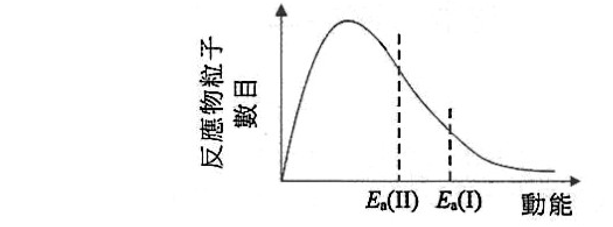
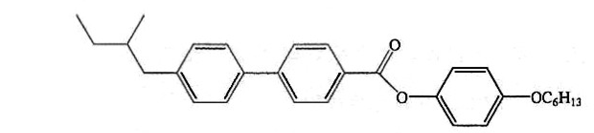
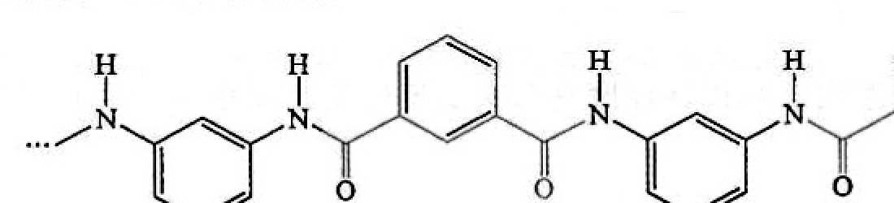
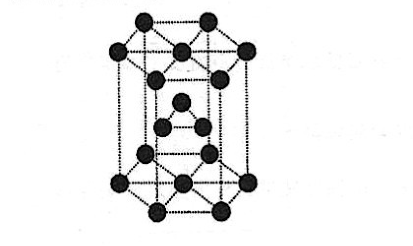
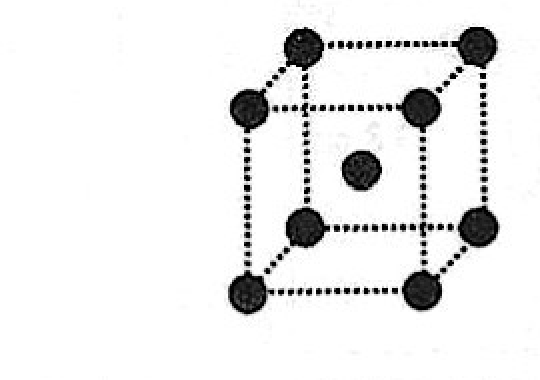
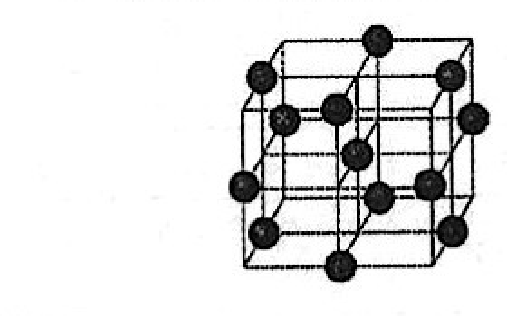
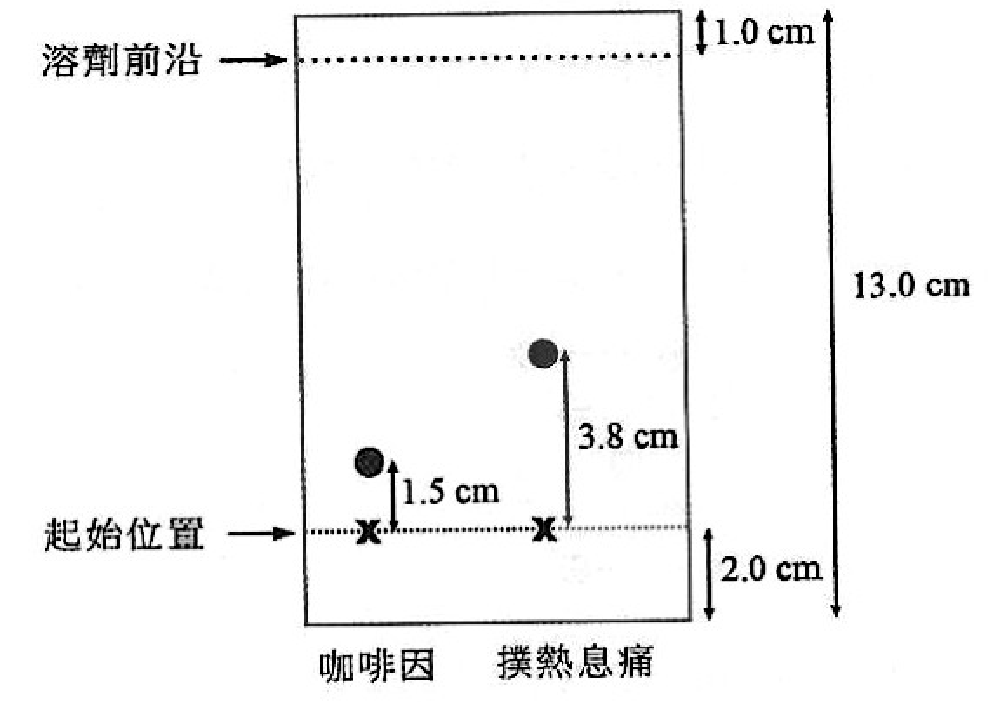
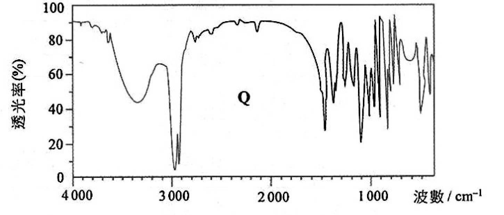
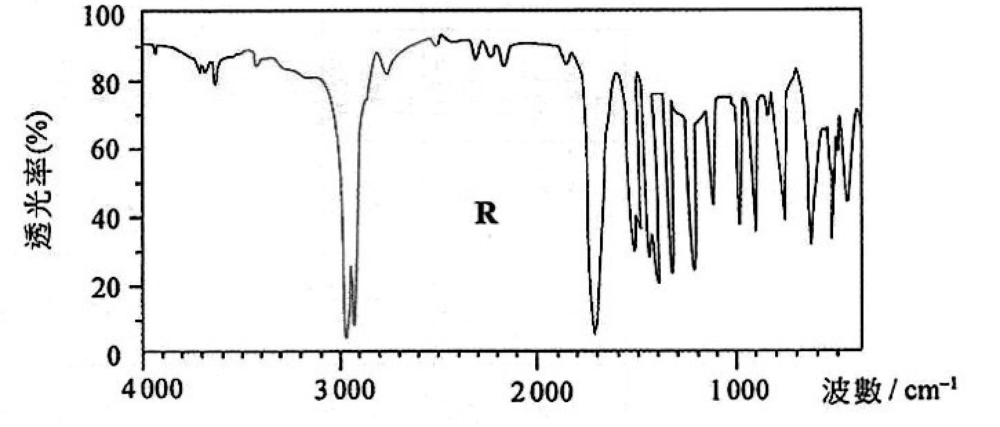

# 2025 DSE 化學 卷二（中文卷）— 題目庫

> 來源：文憑試 DSE 化學 Chemistry 2025 歷屆試題 Past Paper 卷二.pdf　｜　三部分：甲部 工業化學、乙部 物料化學、丙部 分析化學（每部分一題）
> 說明：已移除頁碼、試卷標頭等雜訊；化學式以 Unicode 下標／上標表示，反應式以 → 或 ⇌ 表示。**本檔為題目庫（零答案）**，只含題目清洗 + 建議標籤。
> 本檔為第 2 層文字交貨（圖用原卷截圖；精修重繪另開第 3 層）。
> 註：本卷為純掃描（無文字層），底稿由 easyocr（ch_tra+en，GPU）產出；數值／圖表多處以 [?] 標示，詳見檔尾「待人工核對」。

---

## 甲部　工業化學（第 1 題）

## 第 1 題

【建議標籤】

- 卷別/部分：卷二　甲部
- 課題：#工業化學 #氯鹼工業 #麥克斯韋-波爾茲分佈 #硫酸 #反應速率

【題目內容】

回答試題的所有部分。

(a)　(i)　寫出在氯鹼工業中使用膜電解池來電解鹽水的總化學方程式。（1 分）

　　(ii)　以下坐標圖顯示在一個氣態反應中的反應物粒子，於某溫度下的麥克斯韋-波爾茲分佈曲線，其中 Ea(I) 是該反應的活化能。

可作出什麼改變以致同一反應的活化能會成為 Ea(II)？解釋你的答案。（2 分）

　　(iii)　下面顯示兩個生產 CH₃COOCH₂CH₂CH₂CH₃ 的方法：

方法 1：

CH₃CH₂CH₂CH₂OH + CH₃COOH ⇌ CH₃COOCH₂CH₂CH₂CH₃ + H₂O（濃 H₂SO₄，回流加熱）

方法 2：

CH₃COOH + SOCl₂ → CH₃COCl + SO₂ + HCl（室溫）

CH₃CH₂CH₂CH₂OH + CH₃COCl → CH₃COOCH₂CH₂CH₂CH₃ + HCl（室溫）

根據綠色化學的原理，提出兩個原因以解釋為什麼方法 1 比方法 2 可被視為較綠色。（2 分）

(b)　閱讀以下短文，並回答隨後的問題。

在一所化工廠中，硫酸可藉一個工業過程生產而得。在反應室中，經淨化的二氧化硫與過量經淨化的空氣中的 O₂(g)，在催化劑存在下反應生成三氧化硫，如下所示：

2SO₂(g) + O₂(g) ⇌ 2SO₃(g)　ΔH = −196 kJ mol⁻¹

在這過程中，使用了氧化釩(V)作為催化劑。設定反應室的操作條件於約 450 °C 和 1 atm，而在平衡時三氧化硫的產率約為 98%。最後，三氧化硫轉化為硫酸。

　　(i)　解釋為什麼二氧化硫和空氣在通入反應室前需要淨化。（1 分）

　　(ii)　解釋為什麼在上述工業過程中，不使用純 O₂(g) 來生成三氧化硫。（1 分）

　　(iii)　解釋為什麼在工業過程中所用的固體催化劑通常是多孔狀而非塊狀。（1 分）

　　(iv)　(1)　解釋為什麼操作溫度並不選定於約 1000 °C。（1 分）

　　　(2)　提出兩個原因以解釋為什麼操作壓強並不選定於約 200 atm。（2 分）

　　(v)　從硫酸與哈柏法的產物反應可生產一種肥料。寫出這反應的化學方程式。（1 分）

(c)　以下方程式顯示一個粉紅色物質 Y(aq) 與 OH⁻(aq) 的反應：

Y(aq) + OH⁻(aq) → 無色生成物

在某些條件下，這反應的速率方程如下：

速率 = k[Y(aq)]ᵐ[OH⁻(aq)]ⁿ

k 是速率常數，m 是對應 Y(aq) 的反應級數，n 是對應 OH⁻(aq) 的反應級數。

在相同條件下，進行了一個實驗來測定對應 OH⁻(aq) 的反應級數。在實驗的每次試驗中，不同體積的 2.0 M NaOH(aq) 和 H₂O(l) 與固定體積的 0.012 M Y(aq) 混合，並且量度 Y(aq) 的消失初速。

下表顯示所得的數據：

| 試驗 | 2.0 M NaOH(aq) 的體積 / cm³ | H₂O(l) 的體積 / cm³ | 0.012 M Y(aq) 的體積 / cm³ | Y(aq) 的消失初速 / mol dm⁻³ s⁻¹ |
|---|---|---|---|---|
| 1 | 8.0 | 0.0 | 2.0 | 8.72 × 10⁻³ |
| 2 | 4.0 | 4.0 | 2.0 | 4.36 × 10⁻³ |
| 3 | 3.0 | 5.0 | 2.0 | r |

　　(i)　提出兩個原因以解釋為什麼在每次試驗中要使反應混合物的總體積相同。（2 分）

　　(ii)　推定對應 OH⁻(aq) 的反應級數 (n)。（1 分）

　　(iii)　推定在試驗 3 中 Y(aq) 的消失初速 (r)。（1 分）

　　(iv)　(1)　已知對應 Y(aq) 的反應級數 (m) 是 1。描述你可怎樣進行一個實驗及使用一個適當的坐標圖，以證實對應 Y(aq) 是一級反應。（3 分）

　　　(2)　寫出 k 的單位。（1 分）

---

## 乙部　物料化學（第 2 題）

## 第 2 題

【建議標籤】

- 卷別/部分：卷二　乙部
- 課題：#物料化學 #納米粒子 #液晶 #聚醯胺 #晶體結構

【題目內容】

回答試題的所有部分。

(a)　(i)　一個樽裝水樣本被發現含有一些塑膠粒子，其大小在 5 × 10⁻⁹ m 至 9 × 10⁻⁹ m 的範圍內。解釋這些塑膠粒子是否納米粒子。（1 分）

　　(ii)　化合物 Z 的結構顯示如下：

Z 在 103 °C 至 160 °C 之間能夠呈現液晶特性。

　　(1)　解釋 Z 能否呈現液晶的螺旋相。（1 分）

　　(2)　下列何者最能準確描述 Z 在 110 °C 時的外觀？

- A. 透明的固體
- B. 不透明的固體
- C. 清澈的流體
- D. 乳濁的流體（1 分）

　　(iii)　從分子層面，解釋為什麼棉花（主要含有纖維素）容易吸水但不溶於水。（2 分）

(b)　聚合物 X 是一種合成聚醯胺，並具高拉伸強度。它能用來製造消防員的保護外套。下圖顯示 X 的部分結構：

　　(i)　繪出製造 X 的兩個單體的結構。（2 分）

　　(ii)　解釋往單體生成 X 的原子經濟是否 100%。（1 分）

　　(iii)　X 的結構和各性質與凱夫拉（Kevlar）的相似。提出兩個原因以解釋為什麼 X 具高拉伸強度。（2 分）

　　(iv)　舉出 X 的另一項性質，使它適合製造消防員的保護外套。（1 分）

　　(v)　解釋為什麼應避免把 X 長期暴露於強酸中。（1 分）

　　(vi)　羊毛是一種天然聚醯胺。與 X 相比，提出一個原因以解釋為什麼羊毛作為紡織物料，被視為對環境較友善。（1 分）

(c)　在室溫下，銥具有晶體結構 A。下圖顯示 A 的部分結構，重複這部分結構能得出整個銥晶體。

　　(i)　(1)　寫出晶體結構 A 的名稱。（1 分）

　　　(2)　在 A 中每個銥原子的配位數是多少？（1 分）

　　(ii)　在某些條件下，銥具有晶體結構 B。下圖顯示 B 的晶胞。

推定在這晶胞的銥原子數目。（1 分）

　　(iii)　一種含小量金屬 Y 的銥合金較純銥硬，它可用來製造人工人體關節。（已知金屬 Y 原子的大小和銥原子的大小並不相同。）

　　(1)　解釋為什麼這合金較純銥硬。（1 分）

　　(2)　除硬度外，舉出這合金應有的另一項性質，以致它適合製造人工人體關節。（1 分）

　　(iv)　一些金屬具有晶體結構 C。下圖顯示 C 的晶胞：

哪一個晶體結構（A、B 或 C）在其結構中空置的空間的百分率是最高？解釋你的答案。（2 分）

---

## 丙部　分析化學（第 3 題）

## 第 3 題

【建議標籤】

- 卷別/部分：卷二　丙部
- 課題：#分析化學 #蒸餾 #薄層色層法 #滴定 #紅外光譜

【題目內容】

回答試題的所有部分。

(a)　(i)　一個物理方法可把一個乙醇水溶液的濃度從 12% 提升至大約 50%。寫出這方法的名稱。（1 分）

　　(ii)　建議一項化學測試以檢測氯氣。（2 分）

　　(iii)　以下顯示從薄層色層法所獲得咖啡因和撲熱息痛的色譜。

計算撲熱息痛的 Rf 值。（1 分）

　　(iv)　在以上色譜所示，撲熱息痛比咖啡因移動得較遠。基於色層法的原理，提出有這結果的一個原因。（1 分）

(b)　某學生為測定一個不純的水樣本中 Cl⁻(aq) 離子的濃度，進行了一個探究。把 25.0 cm³ 的該樣本用蒸餾水稀釋至 250.0 cm³，然後使用一個適當的指示劑，以 0.0802 M AgNO₃(aq) 滴定 10.0 cm³ 的該已稀釋樣本。當所有 Cl⁻(aq) 離子被沉澱出來，便達到終點。

重複該滴定數次，滴定的結果如下所列：

| 試驗 | 1 | 2 | 3 | 4 | 5 |
|---|---|---|---|---|---|
| 所用 AgNO₃(aq) 的體積 / cm³ | 7.85 | 8.30 | 7.80 | 7.10 | 7.75 |

　　(i)　繪畫一個標示圖以顯示該滴定的裝置。（2 分）

　　(ii)　計算在該滴定中所用 AgNO₃(aq) 的合理平均體積。（1 分）

　　(iii)　計算在該不純的水樣本中 Cl⁻(aq) 離子的濃度（以 g cm⁻³ 為單位）。（相對原子質量：Cl = 35.5）（3 分）

　　(iv)　其後發現該不純的水樣本中也含有 Br⁻(aq) 離子。解釋在(b)(iii)所計算得到在該樣本中 Cl⁻(aq) 離子的濃度會高於還是低於真實值。（1 分）

(c)　按質量計，一個環狀有機化合物 Q（含 C、H、O）含 72.0% 碳和 12.0% 氫。它的相對分子質量是 100，並且它是非旋光性的。當把 Q 與過量酸化重鉻酸鉀溶液回流加熱時，便生成化合物 R。Q 和 R 的紅外光譜顯示如下：

特徵紅外吸收波數域（伸展式）：

| 鍵 | 化合物類別 | 波數域 / cm⁻¹ |
|---|---|---|
| C=C | [?] | 1610 至 1680 |
| C=O | 羧酸及其衍生物 | 1680 至 1800 |
| C≡C | [?] | 2070 至 2250 |
| C≡N | [?] | 2200 至 2280 |
| O-H | 氫鍵的酸 | 2500 至 3300 |
| C-H | 烯及芳烴 | 2840 至 3095 |
| O-H | 氫鍵的醇 | 3230 至 3670 |
| N-H | 胺 | 3350 至 3500 |

　　(i)　推定 Q 的分子式。（相對原子質量：H = 1.0，C = 12.0，O = 16.0）（2 分）

　　(ii)　寫出在紅外光譜中產生各吸收峰的原理。（1 分）

　　(iii)　根據 Q 和 R 的紅外光譜和上表所提供的資料，推定可能存在於 Q 和 R 各自一個的官能基。（2 分）

　　(iv)　參考所提供的資料，推定並繪出 Q 的一個可能結構。（3 分）

---

## 待人工核對

| 題號 | 頁碼 | 原因 |
|---|---|---|
| Q1(c) | 卷二 p03 | 試驗 1/2 初速冪次（×10⁻³）OCR 不清，需對頁核實 |
| Q2(a)(i) | 卷二 p04 | 塑膠粒子尺寸冪次（10⁻⁹ 或 10⁻⁶ m）需對頁核實 |
| Q2(a)(ii) | 卷二 p04 | 化合物 Z 結構式末端基團（−OC₄H₉ 等）標籤 OCR 不清 |
| Q2(b)(iii) | 卷二 p04 | 「凱夫拉（Kevlar）」譯名 OCR 作「凱庫勒」，需對頁核實 |
| Q3(c) | 卷二 p07 | Q 分子式（含 C、H、O）原卷寫法 OCR 不清；IR 參考表 C=C/C≡C/C≡N 化合物類別未讀出 |
| 全卷圖 | 卷二 多頁 | 所有 crop 截圖由程式化座標裁切，未經肉眼對頁核實 |
