# 2024 DSE 物理 試卷一（中文卷）— 題目庫

> 來源：dsepaper_hk\物理\2024\physics-2024-paper-paper-1-3e67ed27.pdf
> 說明：已移除頁碼、試卷標頭、答題簿橫線、數據公式參考頁等雜訊；公式重排為 LaTeX。**本檔為題目庫（零答案）**，只含題目清洗 + 建議標籤。
> 本檔為第 2 層文字交貨（圖用原卷截圖；精修重繪另開第 3 層）。
> 註：本卷為純掃描（無文字層），由 easyocr（ch_tra+en，GPU）掃描底稿清洗而成；圖為 300dpi 原卷截圖（程式定位＋墨跡覆蓋率校驗；無視覺覆核）。

---

## 甲部（多項選擇題，第 1–33 題）

## 第 1 題

【建議標籤】

- 卷別/部分：卷一　甲部
- 課題：#比熱容 #熔解 #物態變化

【題目內容】

質量相同的物質 P 和 Q 於溫度 $T_1$ 時均為固體。下面的線圖顯示物質的溫度與能量傳遞的變化。

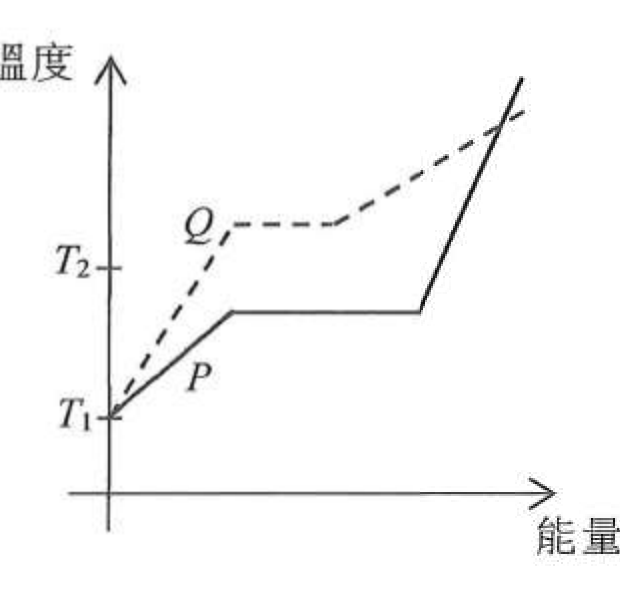

以下哪項敘述正確？

- A. P 比 Q 有較高的熔點。
- B. P 的熔解比潛熱較 Q 小。
- C. 固體 P 的比熱容較固體 Q 大。
- D. 於溫度 $T_2$，P 是氣體而 Q 為固體。

---

## 第 2 題

【建議標籤】

- 卷別/部分：卷一　甲部
- 課題：#熱平衡 #熔解 #比熱容

【題目內容】

如果把 0.5 kg 於 50 °C 的水與 2.0 kg 於 0 °C 的冰混合，混合物的最終溫度是多少？

已知：水的比熱容 = 4200 J kg⁻¹ °C⁻¹　冰的熔解比潛熱 = $3.34 \times 10^{5}$ J kg⁻¹

- A. −5 °C [?]
- B. 0 °C
- C. 10 °C
- D. 25 °C

---

## 第 3 題

【建議標籤】

- 卷別/部分：卷一　甲部
- 課題：#理想氣體 #分子數目

【題目內容】

在實驗室可達到的最佳真空的壓強約為 $10^{-8}$ Pa。於室溫下，估算在 1 cm³ 此真空內空氣分子數目的數量級。

- A. $10^{4}$
- B. $10^{6}$
- C. $10^{8}$
- D. $10^{12}$

---

## 第 4 題

【建議標籤】

- 卷別/部分：卷一　甲部
- 課題：#速度時間圖 #位移

【題目內容】

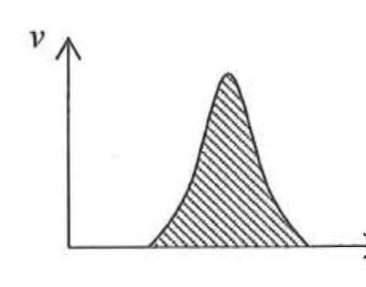

以上速度-時間 (v-t) 線圖的陰影部分代表什麼物理量？

- A. 加速度
- B. 速度的改變
- C. 動量
- D. 位移

---

## 第 5 題

【建議標籤】

- 卷別/部分：卷一　甲部
- 課題：#斜面 #作用力 #法向反作用力

【題目內容】

質量為 $m$ 的方塊以恆定速度沿固定的粗糙斜面滑下，如圖所示。斜面與水平的夾角為 $\theta$。

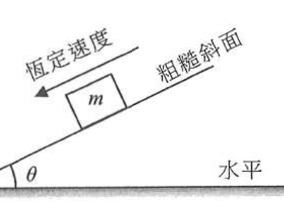

方塊作用於斜面的力的量值是多少？

- A. $mg$
- B. $mg\sin\theta$
- C. $mg\cos\theta$
- D. [?]

---

## 第 6 題

【建議標籤】

- 卷別/部分：卷一　甲部
- 課題：#牛頓第三定律 #作用與反作用力

【題目內容】

一重量為 $w$ 的物體置於重量為 $W$ 的升降機內。一力 $T$ 將升降機向上拉。一承托力 $X$ 作用於物體，而因有物體存在，升降機地板受到力 $Y$ 作用。

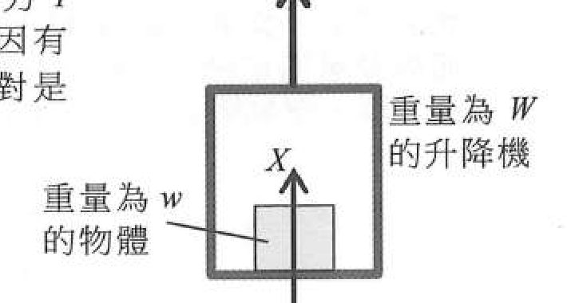

以下哪對是作用與反作用力？

- A. $T$ 和 $(W+w)$
- B. $W$ 和 $X$
- C. $X$ 和 $Y$
- D. 不能確定，因升降機加速度的方向為未知。

---

## 第 7 題

【建議標籤】

- 卷別/部分：卷一　甲部
- 課題：#功 #動能 #摩擦力

【題目內容】

在一個實驗中，一水平力 $F$ 作用於放在粗糙水平面上的方塊，如圖 (a) 所示。圖 (b) 顯示方塊的動能 $E_k$ 隨它所行距離 $s$ 的變化。空氣阻力可忽略不計，並假設摩擦力不變。

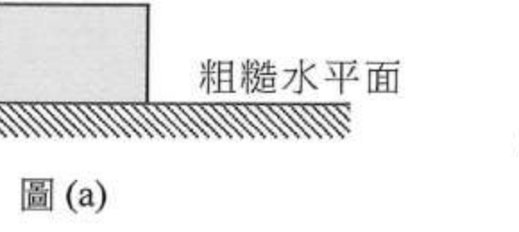

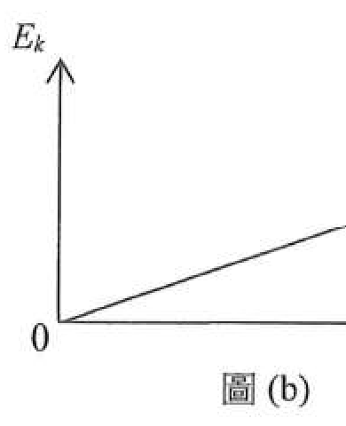

如果將力 $F$ 增至兩倍並重複實驗，以下哪一線圖代表預期的結果（以虛線繪出）？

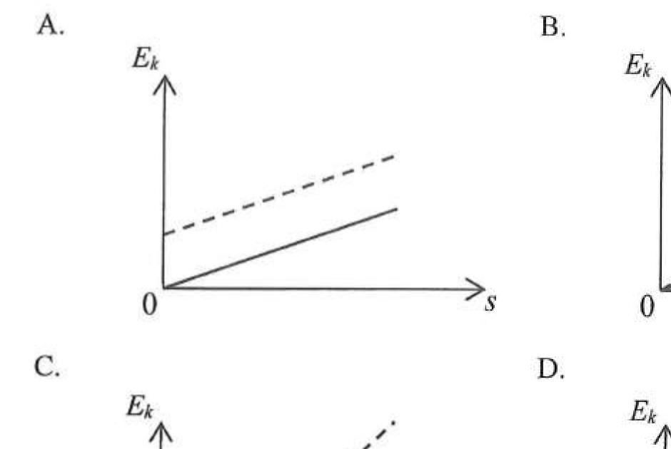

- A.
- B.
- C.
- D.

---

## 第 8 題

【建議標籤】

- 卷別/部分：卷一　甲部
- 課題：#牛頓第二定律 #滑輪 #運動學

【題目內容】

如圖所示，質量分別為 3.0 kg 和 1.0 kg 的方塊 X 和 Y，以一條不能伸長的輕繩連接着，而繩穿過固定於天花板的光滑輕滑輪。從靜止釋放該兩方塊。

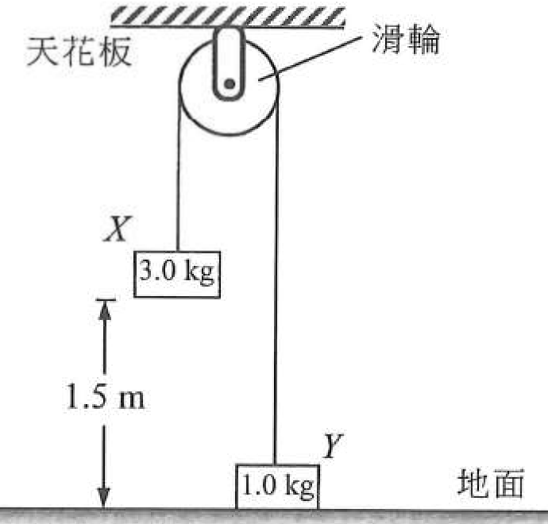

求方塊 X 到達地面所需的時間。空氣阻力可忽略不計。

- A. 0.55 s
- B. 0.64 s [?]
- C. 0.65 s [?]
- D. 0.78 s [?]

---

## 第 9 題

【建議標籤】

- 卷別/部分：卷一　甲部
- 課題：#牛頓定律 #內力外力

【題目內容】

某人以為當他用足夠大的力拉自己的頭髮，最終可把自己拉起至離開地面。這說法為謬誤的理由是

- A. 拉力是這人內在的作用力，但不是作用於這人的外力。
- B. 不可能產生大於一個人重量的拉力。
- C. 拉力會被這人的重量抵消。
- D. 拉力不可能克服大氣壓強的力。

---

## 第 10 題

【建議標籤】

- 卷別/部分：卷一　甲部
- 課題：#力矩 #平衡 #重心

【題目內容】

在一遊戲中，一小孩嘗試推動 150 kg 的相撲手令其向後翻倒。簡化圖顯示相撲手的重量 $W$ 和小孩施於相撲手的水平推力 $F$。相撲手於地面上的接觸點為 $P$。

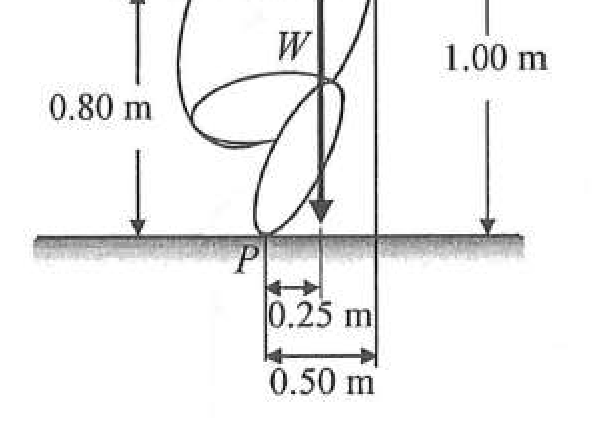

求所需 $F$ 的最小值。

- A. 368 N
- B. 736 N
- C. 1177 N
- D. 2354 N

---

## 第 11 題

【建議標籤】

- 卷別/部分：卷一　甲部
- 課題：#動量 #衝量 #彈性碰撞

【題目內容】

在一桌球枱上，一質量 0.16 kg 的桌球以勻速率 1.20 m s⁻¹ 與邊墊作彈性碰撞，並以相同的速率從邊墊法向回彈，如圖所示。若碰撞時間為 0.003 s，求碰撞期間邊墊作用於桌球的平均力。

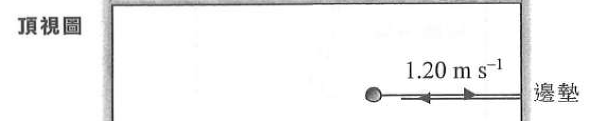

- A. 0 N
- B. 64 N
- C. 128 N
- D. 256 N

---

## 第 12 題

【建議標籤】

- 卷別/部分：卷一　甲部
- 課題：#圓周運動 #速度加速度方向

【題目內容】

圖示一粒子正進行勻速圓周運動。以下哪項正確顯示粒子於圖示一刻的速度和加速度方向？

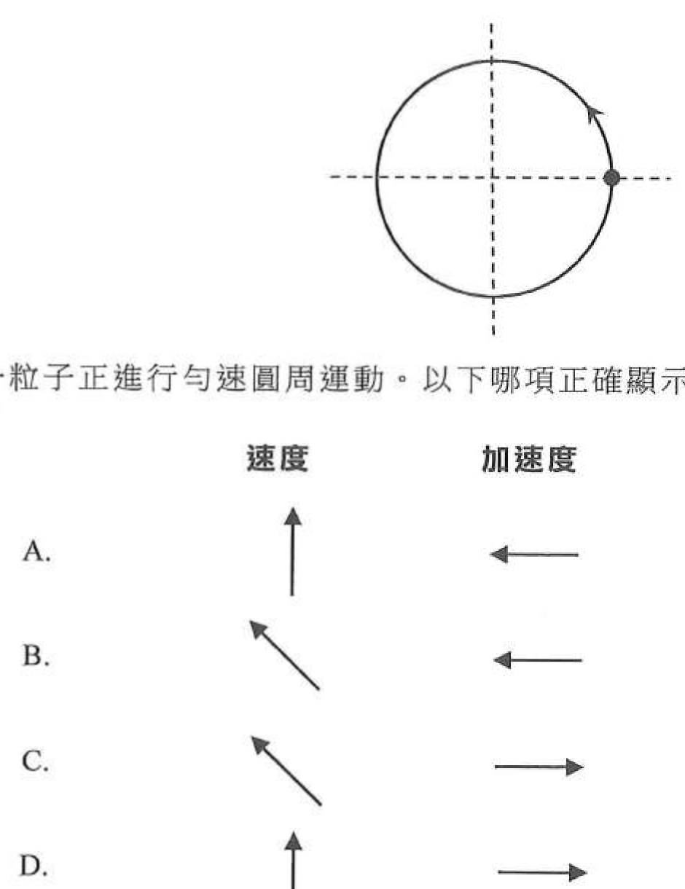

- A.
- B.
- C.
- D.

---

## 第 13 題

【建議標籤】

- 卷別/部分：卷一　甲部
- 課題：#衛星 #軌道週期 #開普勒定律

【題目內容】

於半徑為 $r$ 的圓形軌道上，一衛星以週期 24 小時環繞地球運行。於半徑為 $2r$ 的圓形軌道上，另一繞地球運行的衛星其週期

- A. 小於 24 小時
- B. 為 24 小時
- C. 介乎 24 小時至 48 小時
- D. 大於 48 小時

---

## 第 14 題

【建議標籤】

- 卷別/部分：卷一　甲部
- 課題：#折射 #色散 #臨界角

【題目內容】

以單色光束 X 和 Y 組成的光束入射一玻璃方塊，並如圖所示分開成兩束。

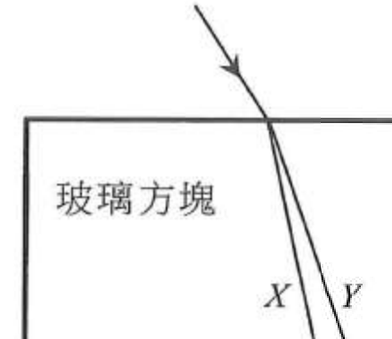

以下有關光束 X 和 Y 的比較，哪項正確？

(1)　X 有較高頻率。

(2)　在玻璃中，X 有較高速率。

(3)　在玻璃方塊中，X 的臨界角較大。

- A. 只有 (1)
- B. 只有 (3)
- C. 只有 (1) 和 (2)
- D. 只有 (2) 和 (3)

---

## 第 15 題

【建議標籤】

- 卷別/部分：卷一　甲部
- 課題：#波動 #反射

【題目內容】

在一水波槽內，一列平面水波移向一 L 形障礙物，如上圖所示。

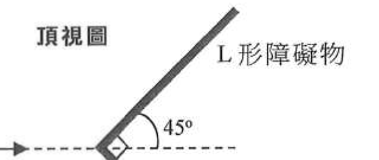

以下哪圖最能顯示從障礙物反射的波動圖樣？

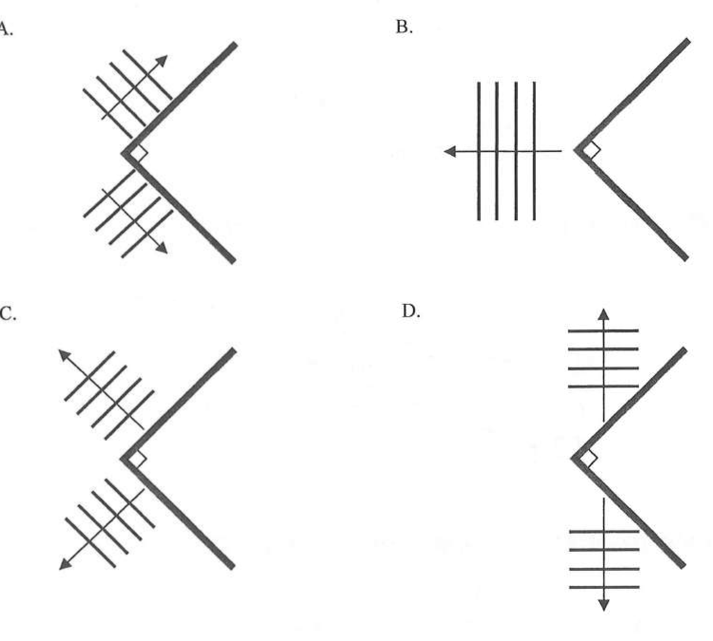

- A.
- B.
- C.
- D.

---

## 第 16 題

【建議標籤】

- 卷別/部分：卷一　甲部
- 課題：#行波 #波長 #粒子運動

【題目內容】

初始時，一列粒子均勻分布在一軟彈簧上。當一頻率為 10 Hz 的行波沿彈簧從左向右傳播，圖 (a) 和 (b) 顯示粒子於兩個時刻的位置。

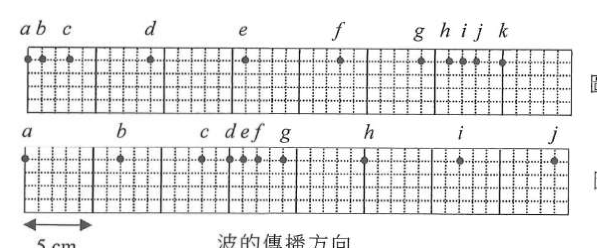

以下哪項敘述正確？

- A. 粒子 a 恆為靜止。
- B. 粒子 b 和 c 以不同的振幅振動。
- C. 這波的波長為 16 cm。
- D. 要獲得這兩幅圖的最小時距為 0.05 s。

---

## 第 17 題

【建議標籤】

- 卷別/部分：卷一　甲部
- 課題：#干涉 #反相波源

【題目內容】

接駁至一訊號產生器的兩個相同揚聲器 $S_1$ 和 $S_2$ 產生反相的聲波，波長為 0.10 m。

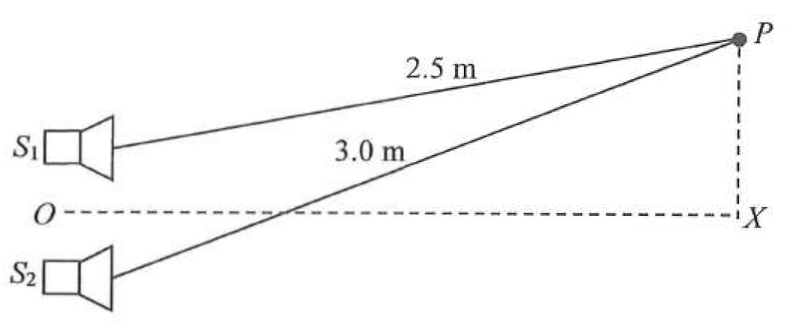

OX 為 $S_1$ 和 $S_2$ 連線的垂直平分線。分別在 X 和 P 發生哪種干涉？

| X | P |
|---|---|
| A. 相消 | 相長 [?] |
| B. 相消 | 相消 [?] |
| C. 相長 | 相消 [?] |
| D. 相長 | 相長 [?] |

---

## 第 18 題

【建議標籤】

- 卷別/部分：卷一　甲部
- 課題：#駐波 #頻率

【題目內容】

一繩子有一端縛着振動器，另一端則固定於牆上。圖示振動器於某頻率時所形成的駐波。

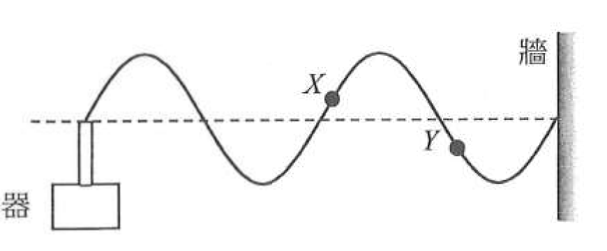

當頻率增至兩倍，以下哪項敘述正確？

- A. 波的振幅會增至兩倍。
- B. 波長會增至兩倍。
- C. 波的速率會增至兩倍。
- D. 粒子 X 和 Y 會變為同相。

---

## 第 19 題

【建議標籤】

- 卷別/部分：卷一　甲部
- 課題：#凸透鏡 #光線圖

【題目內容】

一置於凸透鏡主軸上的物體 O 發出光線 X，如圖所示。F 和 F' 為透鏡的焦點。哪一光線最能代表出射線？

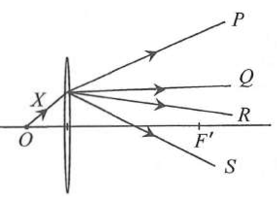

- A.
- B.
- C.
- D.

---

## 第 20 題

【建議標籤】

- 卷別/部分：卷一　甲部
- 課題：#凹透鏡 #焦距 #放大率

【題目內容】

高度為 10 cm 的物體置於凹透鏡前 20 cm 處，它所成的像高度為 8 cm。求凹透鏡的焦距。

- A. 4.4 cm
- B. 8.9 cm
- C. 40 cm
- D. 80 cm

---

## 第 21 題

【建議標籤】

- 卷別/部分：卷一　甲部
- 課題：#微波 #電磁波

【題目內容】

以下哪項描述不正確？

- A. 微波是電磁波的一種。
- B. 微波可用肉眼看到。
- C. 微波在真空中以光速傳播。
- D. 微波應用於雷達以偵測飛機的位置。

---

## 第 22 題

【建議標籤】

- 卷別/部分：卷一　甲部
- 課題：#示波器 #音調 #響度

【題目內容】

樂音 X 和 Y 顯示於示波器上如圖 (a) 和 (b) 所示。所採用的時間軸和強度軸皆相同。

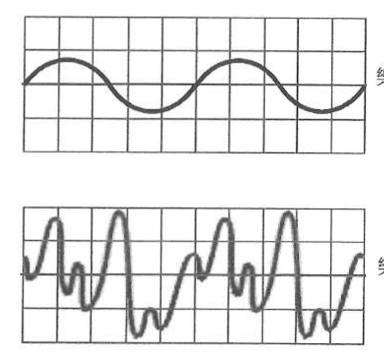

哪項有關這兩樂音的比較必定正確？

| 音調 | 響度 |
|---|---|
| A. 相同 | [?] |
| B. 相同 | [?] |
| C. Y 較高 | [?] |
| D. Y 較高 | [?] |

---

## 第 23 題

【建議標籤】

- 卷別/部分：卷一　甲部
- 課題：#電場 #點電荷 #疊加

【題目內容】

電荷 $+Q$ 和 $-2Q$ 如圖示固定在 X 和 Y。

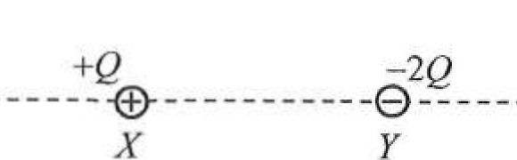

以下有關沿虛線上電場的描述，何者正確？

(1)　在 X 和 Y 之間，這兩電荷各自所產生的電場方向相同。

(2)　在 Y 的右方，合電場的方向總是向左。

(3)　在虛線上存在着兩點，其合電場為零。

- A. 只有 (2)
- B. 只有 (3)
- C. 只有 (1) 和 (2)
- D. 只有 (1) 和 (3)

---

## 第 24 題

【建議標籤】

- 卷別/部分：卷一　甲部
- 課題：#電阻 #等效電阻

【題目內容】

如圖所示，四個電阻器接於電路板的端鈕 PQRS。

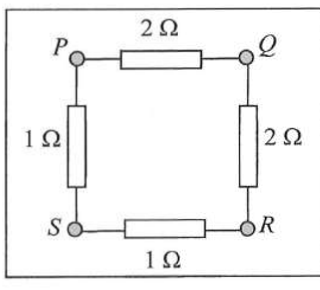

以下哪對端鈕之間的等效電阻最小？

- A. PQ
- B. PR
- C. PS
- D. QS

---

## 第 25 題

【建議標籤】

- 卷別/部分：卷一　甲部
- 課題：#電路 #安培計 #伏特計

【題目內容】

下面電路中的兩電阻器相同。當 S 閉合，安培計和伏特計的讀數會怎樣改變？

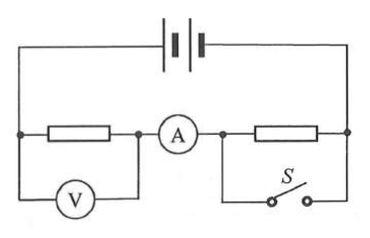

| 安培計讀數 | 伏特計讀數 |
|---|---|
| A. 增加 | 增加 |
| B. 增加 | 減少 |
| C. 減少 | 增加 |
| D. 減少 | 減少 |

---

## 第 26 題

【建議標籤】

- 卷別/部分：卷一　甲部
- 課題：#磁力 #長直導線 #電流

【題目內容】

圖中的 PQ 是一段固定的長直導線，所載電流為 $I_1$。MN 是另一段載電流為 $I_2$ 的長直導線。MN 與 PQ 垂直，而兩導線處於同一平面。

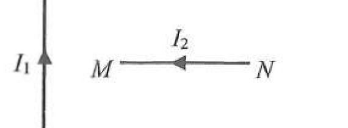

MN 因 PQ 所受磁力的方向為何？地球磁場的影響可忽略。

- A. 指出紙面
- B. [?]
- C. 指入紙面 [?]
- D. [?]

---

## 第 27 題

【建議標籤】

- 卷別/部分：卷一　甲部
- 課題：#電磁感應 #感生電動勢

【題目內容】

半徑為 2 cm 的線圈置於一指出紙面的正方形勻強磁場區域，如圖所示。

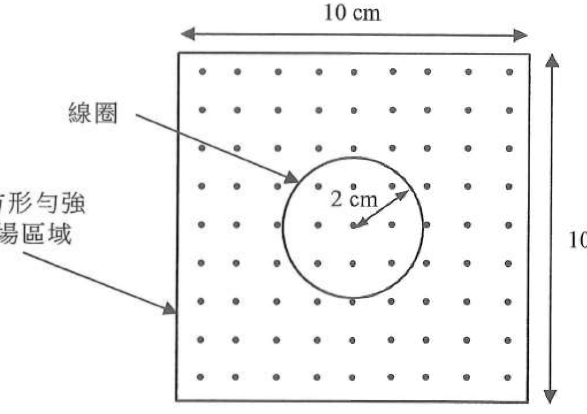

在 0.8 s 內，磁場均勻地從強度 5.0 T 減少至 3.0 T。線圈的感生電動勢的量值為多少？

- A. $2.5 \times 10^{-2}$ V
- B. $3.1 \times 10^{-2}$ V
- C. $3.1 \times 10^{-3}$ V
- D. $6.2 \times 10^{-1}$ V

---

## 第 28 題

【建議標籤】

- 卷別/部分：卷一　甲部
- 課題：#交流電 #電流時間圖

【題目內容】

以下哪些電流對時間 (I-t) 線圖代表交流電？

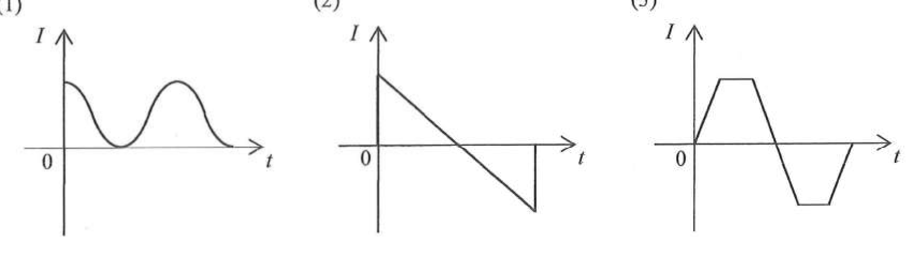

- A. 只有 (1) 和 (2)
- B. 只有 (1) 和 (3)
- C. 只有 (2) 和 (3)
- D. (1)、(2) 和 (3)

---

## 第 29 題

【建議標籤】

- 卷別/部分：卷一　甲部
- 課題：#磁場 #磁力 #電荷

【題目內容】

帶電粒子沿圖示路徑進出一勻強磁場，磁場的通量密度為 0.97 T。粒子於磁場內所受磁力為 $5.9 \times 10^{-12}$ N。已知粒子的速率為 $1.9 \times 10^{7}$ m s⁻¹。

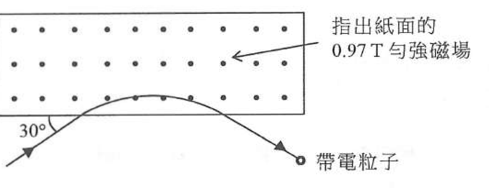

求它的電荷。

- A. $-3.2 \times 10^{-19}$ C
- B. $+3.2 \times 10^{-19}$ C
- C. $-6.4 \times 10^{-19}$ C
- D. $+6.4 \times 10^{-19}$ C

---

## 第 30 題

【建議標籤】

- 卷別/部分：卷一　甲部
- 課題：#功率傳輸 #電纜損耗

【題目內容】

一發電廠產生 217 MW 的功率，並以 132 kV 的電壓通過傳輸電纜傳送至市中心，而電纜的有效電阻為 0.02 Ω km⁻¹。總長度為 40 km 的電纜所耗功率約為

- A. 2.16 MW
- B. 6.49 MW
- C. 13.0 MW
- D. 21.6 MW

---

## 第 31 題

【建議標籤】

- 卷別/部分：卷一　甲部
- 課題：#家居用電 #保險絲 #地線

【題目內容】

以下有關家居用電的敘述，哪些正確？

(1)　所有保險絲都應裝於活線。

(2)　縱使沒有地線，電器也可運作。

(3)　電器裝有保險絲可保障人們免受電震。

- A. 只有 (1) 和 (2)
- B. 只有 (1) 和 (3)
- C. 只有 (2) 和 (3)
- D. (1)、(2) 和 (3)

---

## 第 32 題

【建議標籤】

- 卷別/部分：卷一　甲部
- 課題：#放射性 #半衰期 #放射強度

【題目內容】

含有一放射性核素的某樣品，其放射強度經 2.0 年從 800 Bq 降至 600 Bq。這樣品的放射強度經多久才會從 600 Bq 降至 300 Bq？

- A. 2.0 年
- B. 2.5 年
- C. 3.0 年
- D. 4.8 年

---

## 第 33 題

【建議標籤】

- 卷別/部分：卷一　甲部
- 課題：#放射性同位素 #追蹤 #半衰期

【題目內容】

為確定地下水管裂縫的位置，把微量放射性同位素注入管中的水。放射物會從裂縫滲出至附近的泥土，地面上因而會測到輻射。以下哪一放射性同位素（P、Q、R 或 S）最適合作此用途？

| 同位素 | 半衰期 | 放出的輻射 |
|---|---|---|
| P | 66 小時 | [?] |
| Q | 36 小時 | [?] |
| R | 7.2 小時 | [?] |
| S | 45 分鐘 | [?] |

- A. P
- B. Q
- C. R
- D. S

---

## 乙部（結構式題目，第 1–13 題）

## 第 1 題

【建議標籤】

- 卷別/部分：卷一　乙部
- 課題：#傳熱 #凝結 #潛熱

【題目內容】

從電冰箱取出一瓶溫度為 4 °C 的水並置於桌上。室溫為 30 °C。

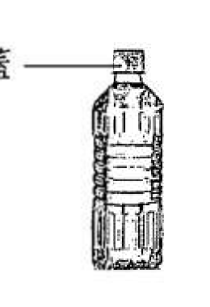

(a)　指出熱從周圍環境傳遞至該瓶水的一個方式。（1 分）

(b)　解釋以鋁箔包裹瓶子會否加快其溫度的上升率。（2 分）

(c)　經一段時間後，有水滴在瓶子表面形成。

　　(i)　指出水滴的來源。（1 分）

　　(ii)　假設在瓶子表面收集到 0.40 g 的水滴，估算這些水滴所釋放的潛熱。已知：水的汽化比潛熱 = $2.26 \times 10^{6}$ J kg⁻¹。（2 分）

---

## 第 2 題

【建議標籤】

- 卷別/部分：卷一　乙部
- 課題：#理想氣體 #方均根速率 #動能

【題目內容】

圖 2.1 顯示一固定體積的密閉容器，載有氬（一單原子氣體）並維持於溫度 $T$。容器內氬原子的方均根速率 ($c_{r.m.s.}$) 為 500 m s⁻¹。

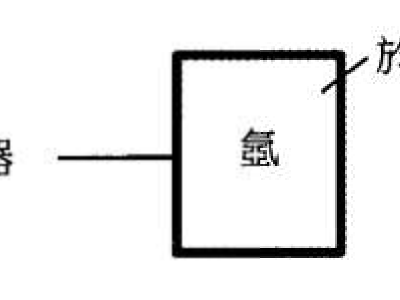

(a)　(i)　計算氬原子的平均動能 $E_k$。已知一氬原子的質量為 $6.63 \times 10^{-26}$ kg。（2 分）

　　(ii)　據此或以其他方法，求 $T$（以 K 表達）。（2 分）

(b)　如果容器洩漏了一些氬而溫度則維持在 $T$，指出容器內氬原子的方均根速率或有的改變，並作解釋。（2 分）

---

## 第 3 題

【建議標籤】

- 卷別/部分：卷一　乙部
- 課題：#牛頓第二定律 #功 #拋體

【題目內容】

一質量為 0.20 kg 的小方塊 P 靜置於水平桌子的 A 邊，如圖所示。桌面從 A 到 B 為光滑，而從 B 到 C 則是粗糙的。空氣阻力可忽略不計。

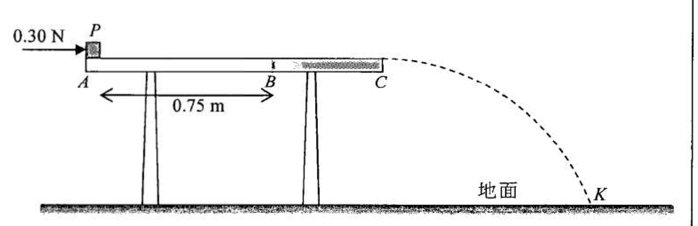

一 0.30 N 的水平力作用於方塊。

(a)　當方塊行進了 0.75 m 至 B 點，求它的速率。（2 分）

(b)　在方塊 P 剛到達 B 時將該水平力移除。當方塊從 B 續往 C 前行，在下面的隔離體圖上標示方塊所受的力（一個或多個）並寫出其名稱。（2 分）

(c)　方塊離開桌子的 C 邊，於 0.35 s 後到達地面上的 K 點。估算桌子的高度。（2 分）

---

## 第 4 題

【建議標籤】

- 卷別/部分：卷一　乙部
- 課題：#圓周運動 #向心力 #角速率

【題目內容】

一半徑為 0.50 m 的球體以恆定角速率 6 rad s⁻¹ 繞豎直軸 ACB 旋轉，而 C 為球心。一塊質量為 0.020 kg 的小膠泥 P 黏在球面，並隨着球體於包含 C 的水平面上旋轉，如圖 4.1(a) 所示。

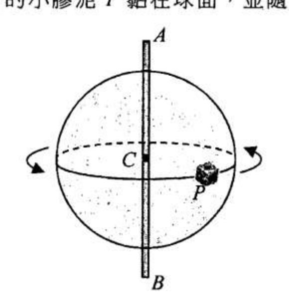

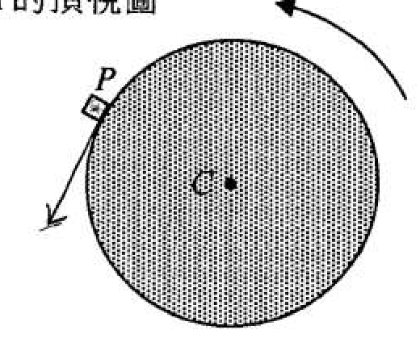

(a)　(i)　求 P 所受向心力的量值。（2 分）

　　(ii)　球體的角速率不斷增加。如果 P 最終在圖 4.1(b)（從 A 的頂視圖）所示位置離開球體，在圖 4.1(b) 標示 P 剛離開球體時的運動方向。（1 分）

(b)　另一塊膠泥 Q 黏在球面上，如圖 4.2 所示。

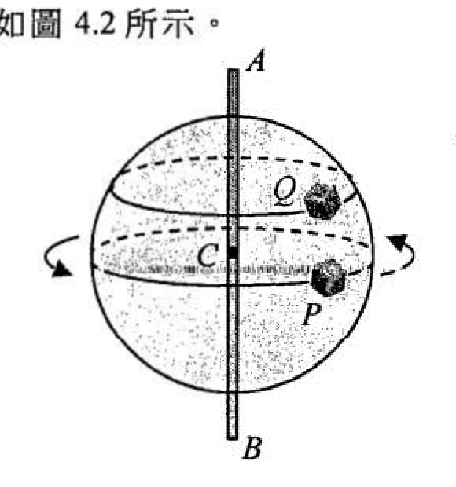

　　(i)　指出 P 和 Q 的角速率是否相同。（1 分）

　　(ii)　解釋 P 和 Q 是否有相同的向心加速度量值。（2 分）

---

## 第 5 題

【建議標籤】

- 卷別/部分：卷一　乙部
- 課題：#聲波 #縱波 #位移距離圖

【題目內容】

圖 5.1 代表揚聲器所產生的聲波中，空氣粒子於某一瞬間的分布。

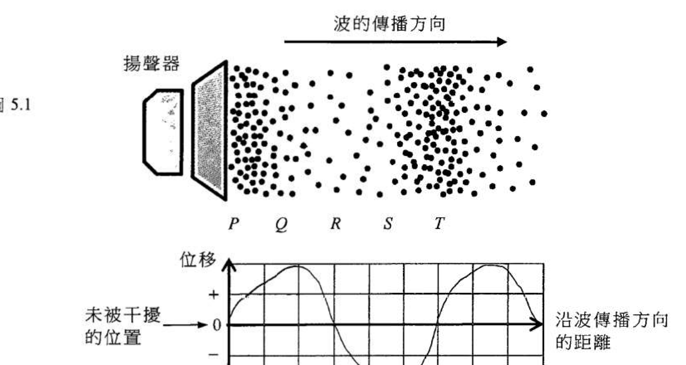

(a)　在所提供的網格，草繪該瞬間空氣粒子的位移-距離線圖，取向右的位移為正 (+)。（2 分）

(b)　在圖示的瞬間，指出一個區域（P、Q、R、S 或 T）其中的

　　(i)　空氣粒子運動速率最大；（1 分）

　　(ii)　空氣壓強最低。（1 分）

---

## 第 6 題

【建議標籤】

- 卷別/部分：卷一　乙部
- 課題：#衍射光柵 #狹縫間距

【題目內容】

把一光碟 (CD) 的保護膜和反射層除去後，這 CD 便成一塊有均勻平行狹縫的衍射光柵。

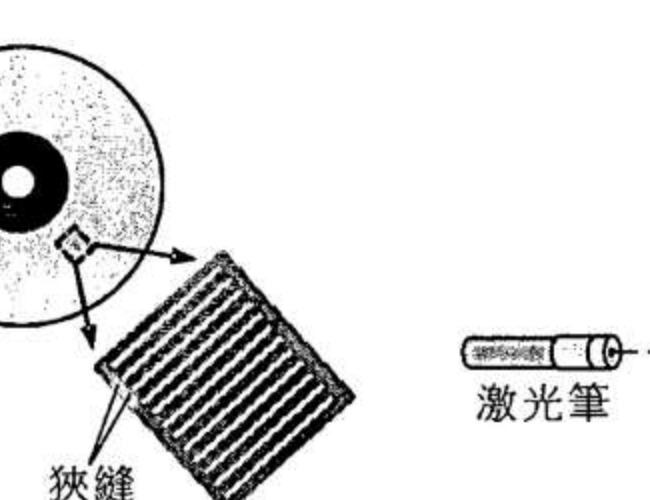

圖 6.1(b) 所示的裝置藉着激光束來測量狹縫間距 $d$。

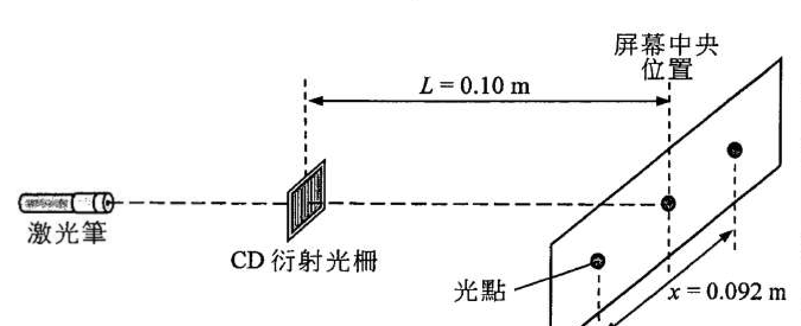

(a)　激光束與衍射光柵屏間的距離 $L$ 為 0.10 m，而第一級極大之間的間距 $x$ 為 0.092 m，所用紅色激光[?]。估算 $d$。（3 分）

(b)　若採用綠色激光，指出 $x$ 的改變，並作解釋。（2 分）

---

## 第 7 題

【建議標籤】

- 卷別/部分：卷一　乙部
- 課題：#聲速 #折射 #雷暴

【題目內容】

以下線圖顯示於不同空氣溫度下聲音的速率。

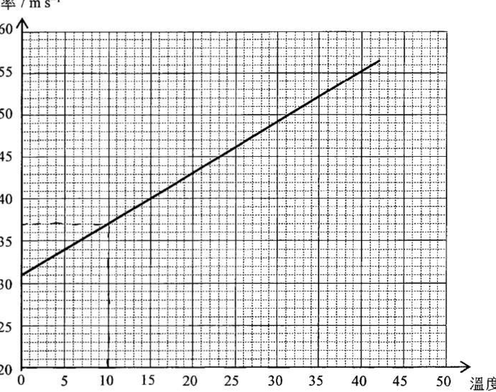

(a)　根據線圖，指出聲音的速率和空氣溫度的關係。（1 分）

(b)　圖 7.2 顯示於晚間地面轉涼，來自鐘樓的聲音從遠處到達觀察者。

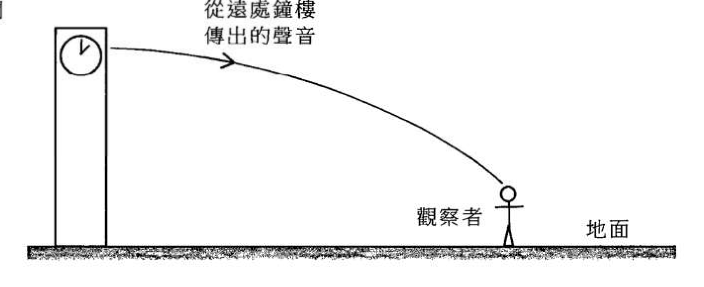

可怎樣以地面上空氣層之間的溫差來解釋圖 7.2 的情況？（2 分）

(c)　已知空氣溫度為 10 °C。根據圖 7.1 的線圖：

　　(i)　估算光速與聲速之比。（1 分）

　　(ii)　如果在雷暴中，一觀察者 O 於看見閃電 3.0 s 後才聽到雷響，估算雷暴距離 O 有多遠。（2 分）

---

## 第 8 題

【建議標籤】

- 卷別/部分：卷一　乙部
- 課題：#折射 #像 #水深

【題目內容】

圖 8.1 顯示一鉛筆置於一杯水中，觀察者沿豎直向下望。已知水的折射率為 1.33。

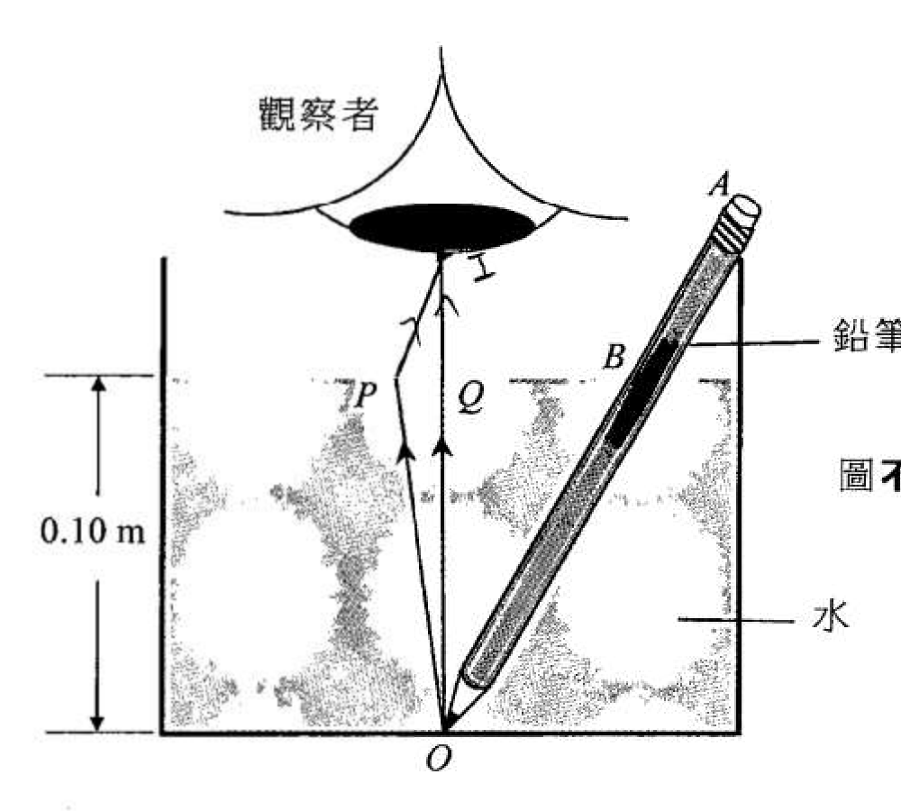

光線 P 和 Q 來自鉛筆的尖端 O，其中 Q 沿豎直方向。

(a)　在圖 8.1 完成這些光線的路徑，並標示觀察者所看到 O 的像（將其標註為 I）。（2 分）

(b)　光線 P 和光線 Q 的夾角為 1.5°。求光線 P 的折射角。（2 分）

(c)　據此或以其他方法，如果水深為 0.10 m，求像 I 與水面的距離。（2 分）

---

## 第 9 題

【建議標籤】

- 卷別/部分：卷一　乙部
- 課題：#靜電 #感應起電 #電荷分布

【題目內容】

圖 9.1 顯示兩個相同的導電輕球體 P 和 Q，彼此靠近而沒有接觸。

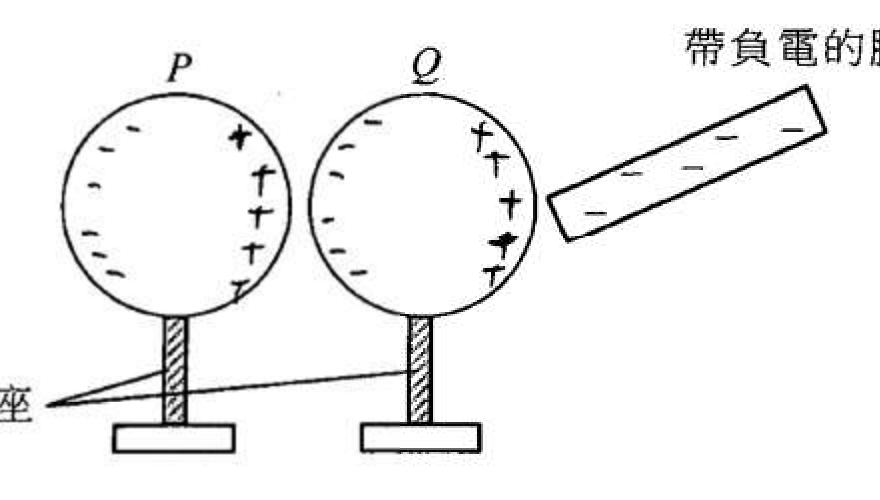

兩球體初始時不帶電，將一根帶負電的膠棒放近 Q 但沒有觸及球體。

(a)　在圖 9.1 草繪 P 和 Q 上的電荷分布。（2 分）

(b)　一學生於膠棒在圖示位置時以手指接觸球 P 一下，膠棒隨後被移走。解釋膠棒上的電荷量會否減少。（2 分）

(c)　現把該兩個輕球體以尼龍線從固定支撐懸吊着。解釋你會怎樣利用其中一球以測試另一根帶電棒的未知極性，使兩球彼此遠離。（2 分）

---

## 第 10 題

【建議標籤】

- 卷別/部分：卷一　乙部
- 課題：#能量守恆 #牛頓擺 #動量守恆 #彈性碰撞

【題目內容】

(a)　如圖 10.1 所示，一條不能伸長的繩子一端連着一小金屬球，而上端 O 則固定於鐵架上。有一量角器被固定於繩子後的鐵架上。

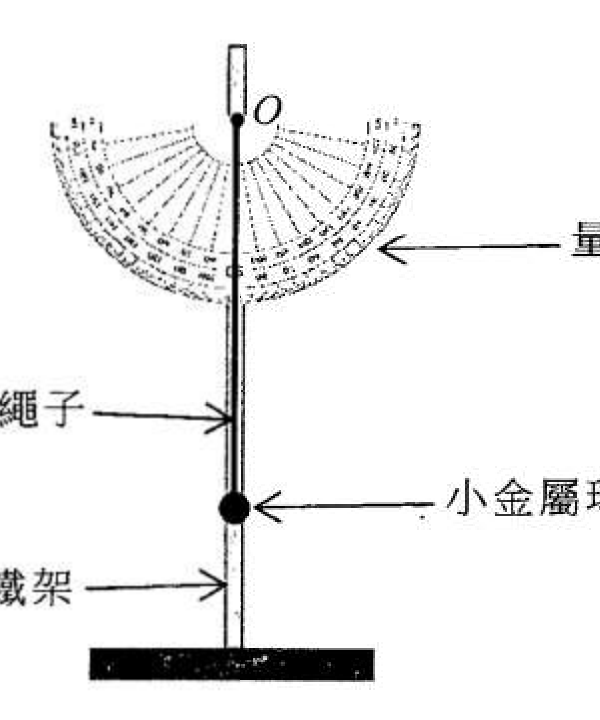

以所提供的裝置，寫出你會進行的步驟以演示能量守恆。（4 分）

(b)　圖 10.2 所示的牛頓擺，以一列五個相同的金屬球組成。各金屬球均以不能伸長的等長輕繩從固定的水平支架懸吊着。

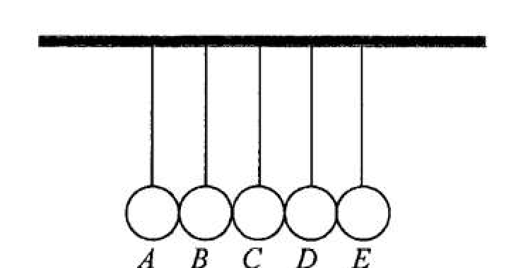

將球 A 和 B 一起向左稍移，然後從靜止釋放。剛碰撞後，A 和 B 皆為靜止，而球 D 和 E 則一起稍向右擺動。空氣阻力可忽略不計。

(i)　縱使繩上的張力均為作用於各個球的外力，解釋為何動量守恆定律仍可應用於該碰撞。（1 分）

(ii)　假設剛碰撞後只有一個球 (E) 以速率 $v_E$ 擺動向右，藉着求 $v_E$ 並由此解釋為何不可能只有一個球擺動向右。已知於剛碰撞前，球 A 和 B 的速率為 0.50 m s⁻¹，每個球的質量為 0.020 kg。（3 分）

(iii)　碰撞交替地從左右兩邊重複一段時間，直至該系統最終回復靜止。討論這些碰撞是否為完全彈性。（2 分）

---

## 第 11 題

【建議標籤】

- 卷別/部分：卷一　乙部
- 課題：#形變感應器 #電阻 #電橋

【題目內容】

細閱以下有關「形變感應器」的文章，並回答隨後的問題。

一片平薄長方形金屬箔貼於塑膠底板上，構成圖 11.1(a) 所示的簡單感應裝置。當長度 $l$ 和闊度 $w$ 的金屬箔如圖 11.1(b) 所示被拉伸至變形，其電阻會改變。

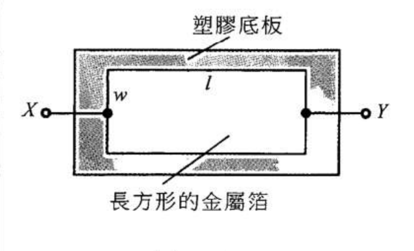

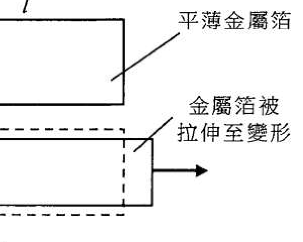

把這裝置接至合適的電路，它可作為感應器以監測形變，並將其呈現為電路的參數（例如電壓）改變。

(a)　根據圖 11.1(a) 和 (b)，指出並解釋當金屬箔被拉伸，金屬箔跨 XY 的電阻如何改變。設金屬箔的厚度和電阻率保持不變。（2 分）

(b)　圖 11.2 所示電路有四個電阻為 $R_1$、$R_2$、$R_3$ 和 $R_4$ 的電阻器，接駁輸入電壓 $V_{in}$，而 $V_{out}$ 為[?]之間的電壓。

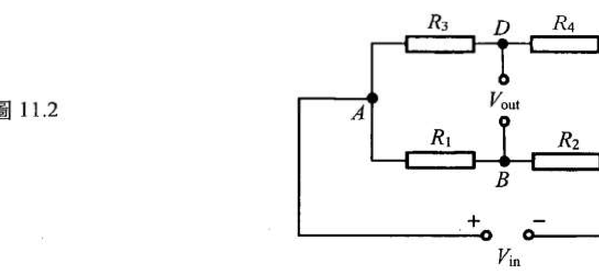

(i)　通過支路 ABC 的電流為 $I_1$。寫出一方程以顯示 $V_{in}$、$I_1$、$R_1$ 和 $R_2$ 的關係。（1 分）

(ii)　電路中的 $R_1$ 是上文所述的感應裝置，其未被拉伸時的電阻為 500 Ω。當 $R_1$ 增加 0.2%（即變為 501 Ω），求 $V_{out}/V_{in}$ 相應改變的百分數。

已知：$\dfrac{V_{out}}{V_{in}} = \dfrac{R_4}{R_3+R_4} - \dfrac{R_2}{R_1+R_2}$ [?]；$R_4 = R_2$；$R_3 = R_2 = 470\ \Omega$ [?]。（2 分）

(iii)　如圖 11.3 所示，接至合適電路的感應裝置 $S_1$、$S_2$、$S_3$ 和 $S_4$ 貼於天花板 ABCD 上，以監測裂紋。於數星期後，偵測得形變的程度依次為 $S_1 > S_2 > S_3 > S_4$。

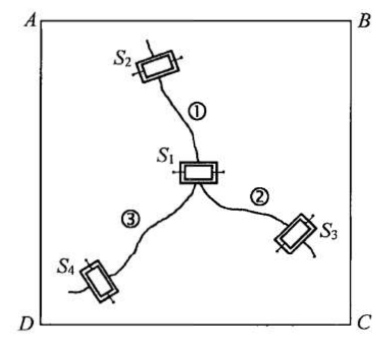

(I)　推斷哪一裂紋（X、Y 或 Z）擴展得最多。（1 分）

(II)　推斷天花板最有可能沿哪一方向（AB、BC 或 AC）被拉伸。（1 分）

---

## 第 12 題

【建議標籤】

- 卷別/部分：卷一　乙部
- 課題：#磁場 #電磁感應 #無線充電

【題目內容】

圖 12.1 顯示一個有數匝的線圈。

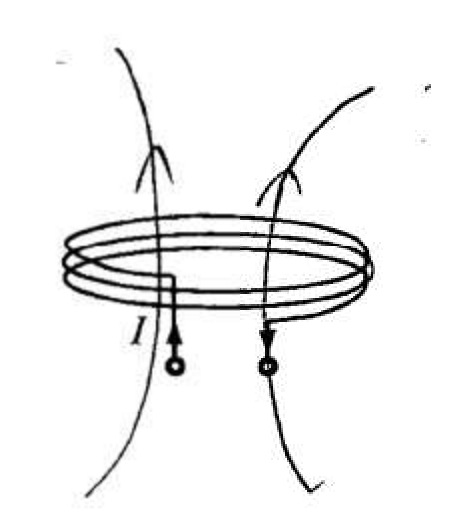

(a)　當線圈如圖示載電流 $I$，草繪所產生的磁場圖樣。（2 分）

(b)　如圖 12.2(a) 所示，現把該線圈接駁交流電源使成為一發送線圈 (T)。接至示波器的接收線圈 (R) 置於 T 的正上方。示波器顯示線圈 R 的電壓跟時間的變化（圖 12.2(b)）。

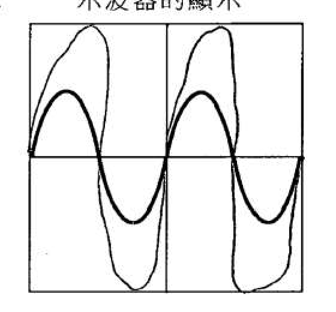

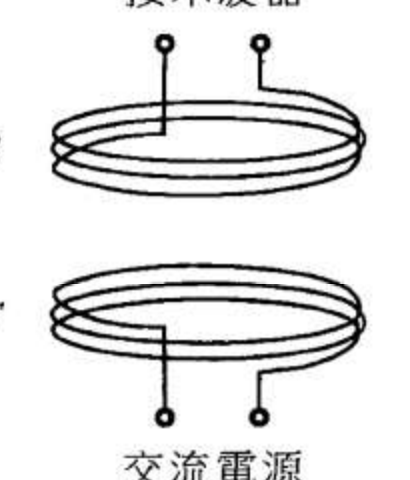

(i)　解釋接收線圈 R 的電壓如何產生。（2 分）

(ii)　當交流電源的頻率增至兩倍，在圖 12.2(b) 草繪示波器的顯示。（2 分）

(c)　把電源接至配備了內置發送線圈的充電板，並將裝有接收線圈的手機放在板上便可作無線充電。

解釋為什麼以無線充電的手機，其機殼背板須為非金屬物料。（2 分）

---

## 第 13 題

【建議標籤】

- 卷別/部分：卷一　乙部
- 課題：#放射性衰變 #衰變系 #α衰變 #β衰變

【題目內容】

氡 (Rn-222) 是一種無色、無臭、無味的放射性氣體。它從地下的基岩物料或含花崗岩的混凝土中釋出。Rn-222 的衰變會放出 α 粒子，而其半衰期為 3.82 日。

(a)　(i)　求 Rn-222 的衰變常數（以 s⁻¹ 為單位）。（2 分）

　　(ii)　於建築物內 1 m³ 的空氣中，氡所造成的平均放射強度約為 48 Bq。估算建築物內 1 m³ 空氣中氡原子數目的平均值。（2 分）

　　(iii)　雖然 α 粒子的貫穿能力有限，但是為什麼室內的氡被視為對人體有害？（2 分）

(b)　Rn-222 屬於從鈾-238 (U-238) 開始的衰變系。已知 U-238 依次進行 α-β-β-α 衰變，而成釷-230 (Th-230)。

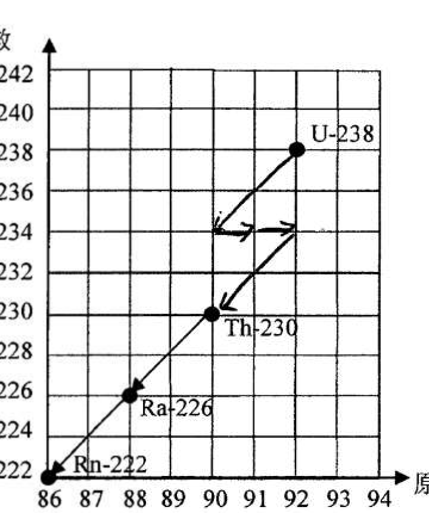

以箭矢完成以下從 U-238 到 Th-230 的衰變系。（2 分）

---

*試卷完 —*

## 待人工核對

本卷為第 2 層文字交貨，由 easyocr（ch_tra+en，GPU）掃描底稿清洗而成；現模型無影像輸入，未能對頁影像覆核。以下內容建議第 3 層精修時對頁核實：

- 第 2 題：選項 A（OCR 讀作「−54°C」，疑為 −5 °C 或 5 °C）待對頁核實。
- 第 5 題：選項 D（OCR 遺漏）待對頁補回；本稿以 [?] 標示。
- 第 8 題：選項 B／C／D 之數值（0.55／0.64／0.65／0.78 s）OCR 底稿亂碼，待對頁核實。
- 第 17 題：干涉結果表（X／P 相長或相消）OCR 底稿不全，待對頁核實。
- 第 22 題：音調／響度比較表之「響度」一欄（OCR 讀作「黜」）待對頁核實。
- 第 26 題：選項 B／C／D（磁力方向）OCR 底稿不全，僅錄得「指出紙面」「指入紙面」，待對頁補回。
- 第 33 題：同位素表「放出的輻射」一欄（α／β／γ）OCR 底稿亂碼，待對頁核實。
- 第 6 題（乙部）：紅色激光之波長（題幹缺）待對頁補回。
- 第 11 題（乙部）：電橋公式及 $R_3$、$R_4$ 之已知值待對頁核實；$V_{out}$ 所跨端點待對頁補回。
- 各圖：為 300dpi 原卷截圖（程式定位＋墨跡覆蓋率校驗；無視覺覆核，位置／範圍待 spot-check）；第 3 層再換成向量重繪。
- 各小題分數以 OCR 辨識為準，待對頁核對。
