# 2024 DSE 物理 試卷二（中文卷）— 題目庫

> 來源：dsepaper_hk\物理\2024\physics-2024-paper-paper-2-dbf9a5a5.pdf　｜　選答卷：甲、乙、丙、丁四部，每部 8 條多項選擇題＋1 條結構式題目（10 分），考生選答任何兩部
> 說明：已移除頁碼、試卷標頭、答題簿橫線等雜訊；公式重排為 LaTeX。**本檔為題目庫（零答案）**，只含題目清洗 + 建議標籤。
> 本檔為第 2 層文字交貨（圖用原卷截圖；精修重繪另開第 3 層）。
> 註：本卷文字層可用（12219 字元），圖為 300dpi 原卷截圖（程式定位＋墨跡覆蓋率校驗；無視覺覆核）；α、β、γ、θ、λ 等希臘字母及公式由文字層重排。

---

## 甲部：天文學和航天科學

## 第 1.1 題

【建議標籤】

- 卷別/部分：卷二　甲部
- 課題：#天文學 #星系 #宇宙尺度

【題目內容】

一典型星系的大小

(1)　較一典型星團大。

(2)　較一典型星系團小。

(3)　較一典型星雲小。

- A. 只有 (1) 和 (2)
- B. 只有 (1) 和 (3)
- C. 只有 (2) 和 (3)
- D. (1)、(2) 和 (3)

---

## 第 1.2 題

【建議標籤】

- 卷別/部分：卷二　甲部
- 課題：#引力 #軌道運動 #開普勒定律

【題目內容】

如果地球的質量增至兩倍，並繼續於現有環繞太陽的軌道上運行，其軌道週期

- A. 會增加。
- B. 會保持不變。
- C. 會減少。
- D. 以所給的資料未能確定。

---

## 第 1.3 題

【建議標籤】

- 卷別/部分：卷二　甲部
- 課題：#逃逸速度 #能量守恆

【題目內容】

地球表面的逃逸速度為 $v$。如果一物體以初速 $2v$ 從地球表面發射（假設除發射外，物體飛行期間並無動力給予），當物體離地球極遠，它的速率為多少？地球大氣以及其他天體的影響可忽略。

- A. $\sqrt{2}\,v$ [?]
- B. $v$
- C. $2\,v$ [?]
- D. $\sqrt{3}\,v$ [?]

---

## 第 1.4 題

【建議標籤】

- 卷別/部分：卷二　甲部
- 課題：#太陽系模型 #哥白尼 #托勒密

【題目內容】

下列哪項有關太陽系的哥白尼模型和托勒密模型的描述正確？

(1)　哥白尼模型對預測行星運動較準確。

(2)　哥白尼模型較簡易地解釋行星的逆行運動。

(3)　兩模型皆可以解釋金星的相圖。

- A. 只有 (2)
- B. 只有 (3)
- C. 只有 (1) 和 (2)
- D. 只有 (1) 和 (3)

---

## 第 1.5 題

【建議標籤】

- 卷別/部分：卷二　甲部
- 課題：#雙星 #多普勒效應 #質心

【題目內容】

圖 (1) 顯示一雙星系統，系統中兩恆星繞其質心 C 作勻速圓周運動。O 是處於兩恆星軌道同一平面的遙遠觀察者。

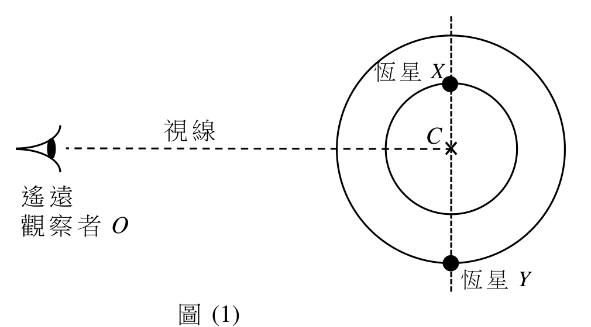

圖 (2) 顯示 O 量度來自兩恆星的某一譜線所得多普勒頻移 Δλ 跟時間的變化。線圖上時間 T 的瞬間對應圖 (1)。

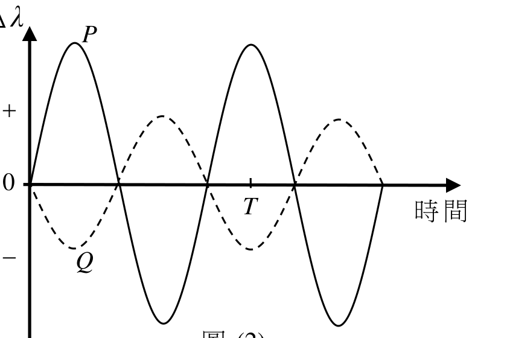

恆星 Y 於時間 T 向哪方運動？而哪一曲線，P 還是 Q，是屬於質量較大的恆星？

| 恆星 Y 於時間 T 的運動方向 | 屬於質量較大恆星的曲線 |
|---|---|
| A. 趨向 O | Q |
| B. 趨向 O | P |
| C. 離開 O | Q |
| D. 離開 O | P |

---

## 第 1.6 題

【建議標籤】

- 卷別/部分：卷二　甲部
- 課題：#視差 #角位移

【題目內容】

如果恆星 X 距離地球 20 pc，相隔 6 個月從地球觀察所得，相對於遙遠的恆星該恆星最大的角位移為多少？

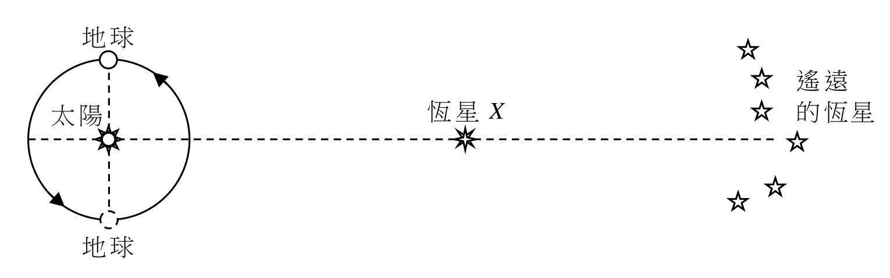

- A. 0.025 弧秒
- B. 0.05 弧秒
- C. 0.1 弧秒
- D. 0.5 弧秒

---

## 第 1.7 題

【建議標籤】

- 卷別/部分：卷二　甲部
- 課題：#視星等 #絕對星等

【題目內容】

一學生測得恆星 X 的視星等為 $m$。至恆星 X 的距離測定為 $D$ 後，X 的絕對星等推斷為 $M$。然而，審視數據後發覺 $D$ 事實上被低估（即 $D$ 應較大）。對於 X 實際的視星等和絕對星等可有什麼說法？

| 視星等 | 絕對星等 |
|---|---|
| A. 大於 $m$ | 大於 $M$ |
| B. 同樣為 $m$ | 小於 $M$ |
| C. 小於 $m$ | 小於 $M$ |
| D. 同樣為 $m$ | 大於 $M$ |

---

## 第 1.8 題

【建議標籤】

- 卷別/部分：卷二　甲部
- 課題：#恆星 #光譜類型 #赫羅圖

【題目內容】

恆星 X 為主序星。它的半徑是太陽（光譜類型 G）的 8 倍，其光度為太陽的 250000 倍。恆星 X 屬哪一光譜類型？

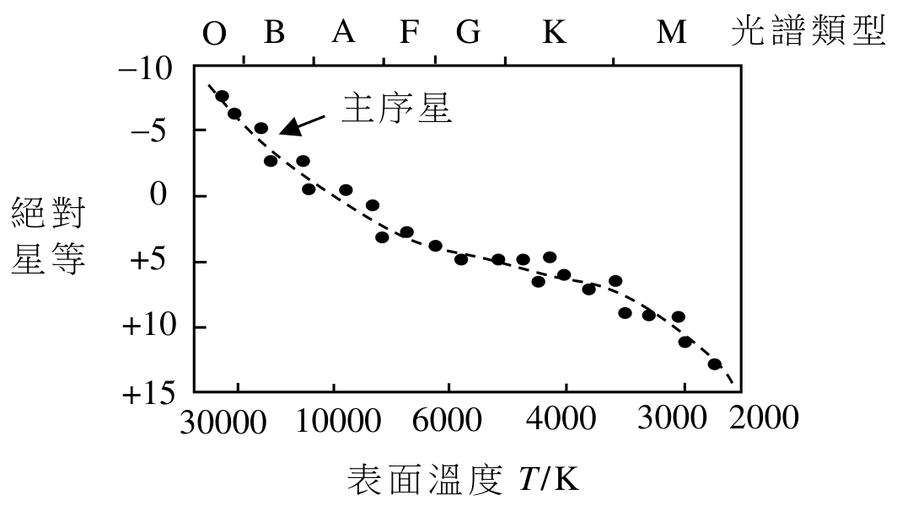

- A. 類型 M
- B. 類型 K
- C. 類型 G
- D. 類型 O

---

## 第 1 題（結構式）

【建議標籤】

- 卷別/部分：卷二　甲部
- 課題：#月球 #引力 #黑體輻射

【題目內容】

月球是地球唯一的天然衞星，假設它以半徑 $r = 384400\ \mathrm{km}$ 的圓形軌道繞地球運動。

已知：地球的質量 $M_E = 5.97 \times 10^{24}\ \mathrm{kg}$

　月球的半徑 $R_M = 0.273 \times$ 地球的半徑 $= 0.273\,R_E$

(a)　(i)　證明月球繞地球的週期約為 27 至 28 日。（3 分）

　　(ii)　已知物體於地球表面的重力加速度約為在月球表面的 6 倍。估算月球的質量 $M_M$。（3 分）

(b)　隨着月球相對太陽的位置改變，從太陽到達月球的能量變化極大，導致月球赤道的平均表面溫度最高為 390 K 而最低則為 95 K。假設從太陽到達月球表面的最高和最低輻射強度分別為 $I_H$ 和 $I_L$，而太陽可視為月球能量的唯一來源。

　　(i)　假設月球為黑體，估算 $\dfrac{I_H}{I_L}$。（2 分）

　　(ii)　除了假設月球為黑體，指出另一項在以上估算中所作的假設。（1 分）

(c)　假設在月球建造一台望遠鏡，指出其相比在地球上所建造的一個優點。（1 分）

---

## 乙部：原子世界

## 第 2.1 題

【建議標籤】

- 卷別/部分：卷二　乙部
- 課題：#原子 #散射 #庫侖力

【題目內容】

初始時，動能為 $E$ 的 α 粒子與原子序數為 $Z$ 的靜止原子核距離極遠。該 α 粒子循一條與原來運動方向成偏向角 $\theta$ 的彎曲路徑而行，如圖所示。

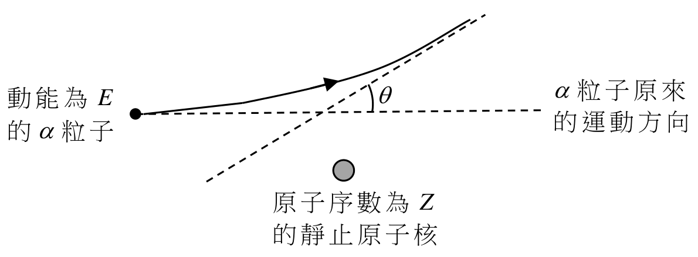

就以下哪項 $E$ 和 $Z$ 的改變會得到最大的 $\theta$？

| $E$ | $Z$ |
|---|---|
| A. 增加 | 增加 |
| B. 增加 | 減少 |
| C. 減少 | 增加 |
| D. 減少 | 減少 |

---

## 第 2.2 題

【建議標籤】

- 卷別/部分：卷二　乙部
- 課題：#電子碰撞 #彈性碰撞 #電離

【題目內容】

當一電子與一氣體原子碰撞，而

(1)　若碰撞為彈性，從電子轉移至原子的動能為可忽略。

(2)　若原子受激發，電子所有的動能必轉移至原子。

(3)　若原子被電離，原子必把碰撞它的電子吸收。

- A. 只有 (1)
- B. 只有 (3)
- C. 只有 (1) 和 (2)
- D. 只有 (2) 和 (3)

---

## 第 2.3 題

【建議標籤】

- 卷別/部分：卷二　乙部
- 課題：#能級 #光子 #電子躍遷

【題目內容】

圖示一原子的能級。能級間的電子躍遷會發射光子。

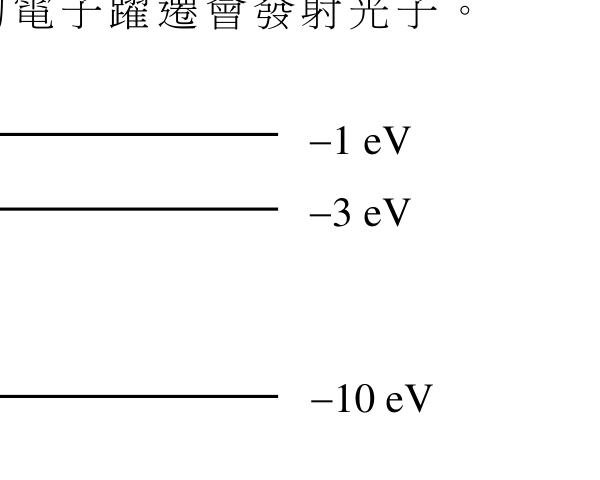

下列哪項敍述正確？已知：在可見光譜中，光子的能量介乎 1.78 eV 和 3.10 eV

(1)　這些光子有部分是在可見光譜內。

(2)　所發射出的光子其頻率最多有兩種。

(3)　波長最長的光子源自 −1 eV 和 −10 eV 之間的電子躍遷。

- A. 只有 (1)
- B. 只有 (2)
- C. 只有 (1) 和 (3)
- D. 只有 (2) 和 (3)

---

## 第 2.4 題

【建議標籤】

- 卷別/部分：卷二　乙部
- 課題：#光電效應 #遏止電勢

【題目內容】

在一光電發射實驗中，就某一金屬的遏止電勢 $V_s$ 跟所用單色光強度 $I$ 的變化進行探究。哪一線圖代表實驗結果？

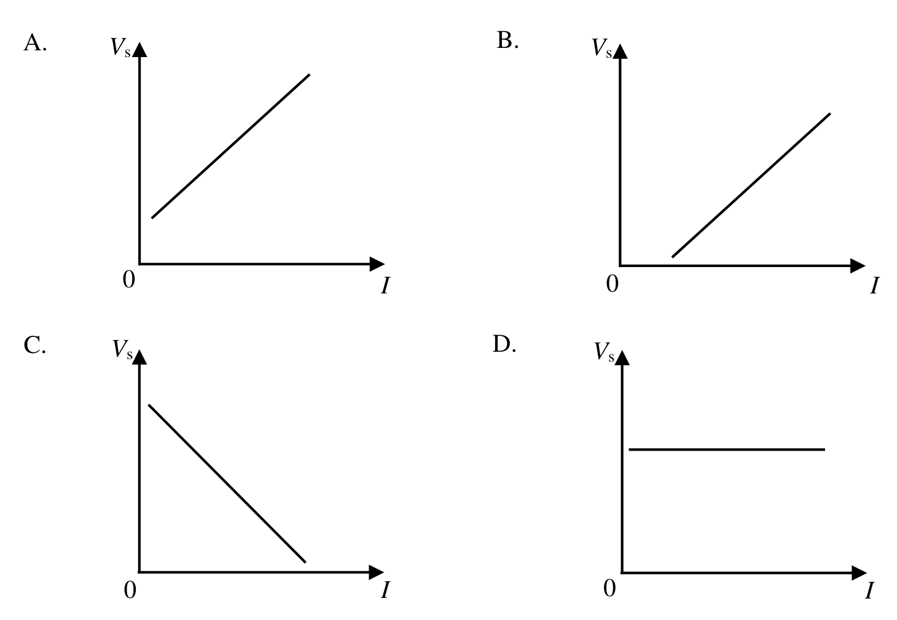

- A.
- B.
- C.
- D.

---

## 第 2.5 題

【建議標籤】

- 卷別/部分：卷二　乙部
- 課題：#光電效應 #臨閾頻率

【題目內容】

分別以波長 $\lambda_1$ 和 $\lambda_2$ 的單色光逐一照射金屬 X 和 Y，$\lambda_1$ 可令兩金屬皆產生光電發射，而 $\lambda_2$ 只能令金屬 Y 產生光電發射。以下哪項推斷正確？

- A. $\lambda_1 > \lambda_2$　而 X 的臨閾頻率較高。
- B. $\lambda_1 > \lambda_2$　而 Y 的臨閾頻率較高。
- C. $\lambda_1 < \lambda_2$　而 X 的臨閾頻率較高。
- D. $\lambda_1 < \lambda_2$　而 Y 的臨閾頻率較高。

---

## 第 2.6 題

【建議標籤】

- 卷別/部分：卷二　乙部
- 課題：#光子 #德布羅意波長 #動量

【題目內容】

能量為 $E$ 的光子，其波長跟質量為 $m$ 的電子的德布羅意波長相等。以下哪一表達式跟電子的動量相等？（$c$ = 真空中的光速）

(1)　$\sqrt{2mE}$

(2)　$mc$

(3)　$\dfrac{E}{c}$

- A. 只有 (1)
- B. 只有 (3)
- C. 只有 (1) 和 (2)
- D. 只有 (2) 和 (3)

---

## 第 2.7 題

【建議標籤】

- 卷別/部分：卷二　乙部
- 課題：#透射電子顯微鏡

【題目內容】

在一透射電子顯微鏡 (TEM) 中，所發射出的電子以電子槍加速，然後通過下面方框圖中的元件 (1)–(3)，繼而經透鏡投影成像於屏上。

下列哪一組合正確？

| (1) | (2) | (3) |
|---|---|---|
| A. 會聚透鏡 | 物鏡 | 樣本 |
| B. 會聚透鏡 | 樣本 | 物鏡 |
| C. 物鏡 | 樣本 | 會聚透鏡 |
| D. 樣本 | 會聚透鏡 | 物鏡 |

---

## 第 2.8 題

【建議標籤】

- 卷別/部分：卷二　乙部
- 課題：#納米科技 #氧化鋅

【題目內容】

氧化鋅是防曬用品常用的原料。這些用品普遍採用納米科技是因為

- A. 大塊形式的氧化鋅未能阻隔紫外線。
- B. 大塊形式的氧化鋅對皮膚有害。
- C. 以納米大小氧化鋅粒子製造的防曬用品具斥水性。
- D. 以納米大小氧化鋅粒子製造的防曬用品塗在皮膚上看起來透明。

---

## 第 2 題（結構式）

【建議標籤】

- 卷別/部分：卷二　乙部
- 課題：#盧瑟福模型 #玻爾模型 #能級 #光譜

【題目內容】

盧瑟福原子模型和玻爾原子模型皆描繪一電子繞一原子核運動。

(a)　解釋為什麼盧瑟福原子模型並不穩定。（2 分）

(b)　(i)　寫出一束白光穿過碘蒸氣所產生光譜類型的名稱。（1 分）

　　(ii)　根據玻爾原子模型解釋 (i) 部這一類光譜的形成。（2 分）

(c)　根據氫原子能級方程回答以下各部。

　　(i)　求電子從氫原子第 6 個能級（量子數 $n = 6$）躍遷至最低能級所發射光子的動量。（3 分）

　　(ii)　氫原子第 $n$ 個能級的能量 $E_n$ 亦可表為

$$E_n = -\dfrac{K}{r_n}$$

其中 $r_n$ 為第 $n$ 個能級的軌道半徑，$K$ 為一正常數，而 $E_\infty$ 取作零。

以電子於最低能級的軌道半徑 $r_1$ 表電子於第 6 個能級的軌道半徑 $r_6$。（2 分）

---

## 丙部：能量及能源的使用

## 第 3.1 題

【建議標籤】

- 卷別/部分：卷二　丙部
- 課題：#傳熱 #電磁爐 #電熱平板爐

【題目內容】

以電熱平板爐和電磁爐分別煮同一款菜餚後，結果發現電熱平板爐表面的溫度高很多。

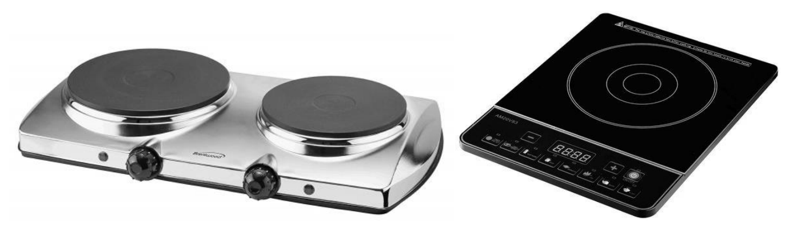

最有可能的原因是

- A. 電熱平板爐的功率高很多。
- B. 電熱平板爐透過加熱其面板，並主要以傳導方式將熱能轉移至煮食器具。
- C. 電磁感應的過程中沒有熱能產生。
- D. 電磁爐的表面以熱傳導欠佳的玻璃製成。

---

## 第 3.2 題

【建議標籤】

- 卷別/部分：卷二　丙部
- 課題：#能源標籤 #能源效益

【題目內容】

以下為空調機 P 和 Q 的能源標籤，其每年耗電量 (kW h) 均以使用 1200 小時計算。

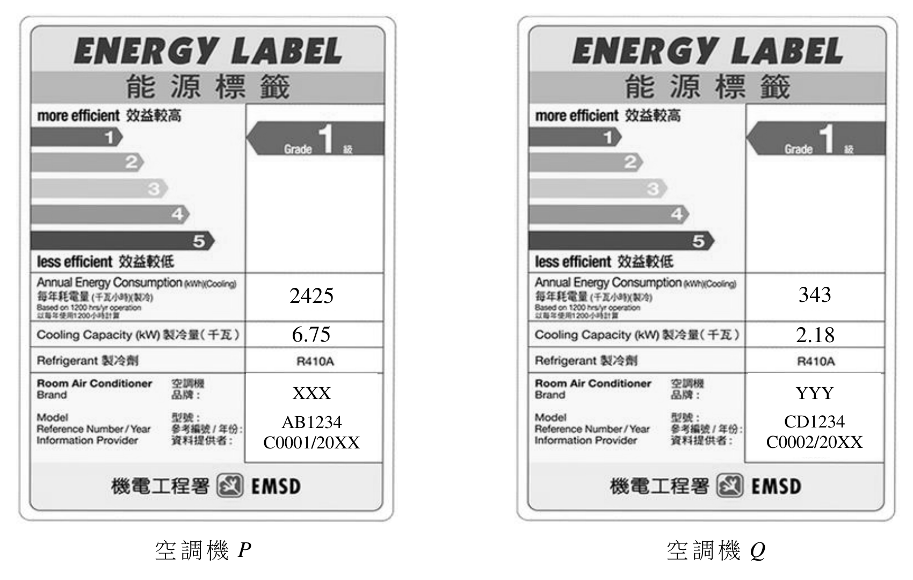

哪一部 (a) 能源效益較高，(b) 較適宜用於一細小房間？

| 能源效益較高 | 較適宜用於一細小房間 |
|---|---|
| A. Q | P |
| B. P | P |
| C. Q | Q |
| D. P | Q |

---

## 第 3.3 題

【建議標籤】

- 卷別/部分：卷二　丙部
- 課題：#分體式空調機 #製冷循環

【題目內容】

蒸發器、壓縮機、冷凝器和膨脹閥這些元件之中，何者是位於分體式空調機的室內單元內？

- A. 膨脹閥、蒸發器和冷凝器
- B. 膨脹閥和壓縮機
- C. 蒸發器
- D. 壓縮機

---

## 第 3.4 題

【建議標籤】

- 卷別/部分：卷二　丙部
- 課題：#熱傳送係數 #U-值

【題目內容】

一牆的熱傳送係數 (U-值) 取決於以下哪些因素？

(1)　牆的厚度

(2)　牆的總面積

(3)　牆所用建築物料的導熱率

- A. 只有 (1) 和 (2)
- B. 只有 (1) 和 (3)
- C. 只有 (2) 和 (3)
- D. (1)、(2) 和 (3)

---

## 第 3.5 題

【建議標籤】

- 卷別/部分：卷二　丙部
- 課題：#雙層玻璃窗 #隔熱

【題目內容】

與一般玻璃窗相比，以下哪項有關雙層玻璃窗的敍述正確？

(1)　穿過雙層玻璃窗的輻射會大幅減少。

(2)　雙層玻璃窗中所困的氣體其熱傳送係數遠較玻璃為低。

(3)　雙層玻璃窗不適用於寒冷的地方，因會有較多熱能通過窗散失。

- A. 只有 (2)
- B. 只有 (3)
- C. 只有 (1) 和 (2)
- D. 只有 (1) 和 (3)

---

## 第 3.6 題

【建議標籤】

- 卷別/部分：卷二　丙部
- 課題：#降溫 #熱容量 #功率

【題目內容】

以總冷卻能力為 8.80 kW 的空調機，將一內部體積為 37.5 m³ 的貨櫃辦公室從 33 ºC 降溫至 25 ºC。如果該貨櫃辦公室外露的表面面積為 57.5 m²，而其總熱傳送值 (OTTV) 為 110 W m⁻²，估算所需的時間。

已知：空氣密度 = 1.20 kg m⁻³

　空氣的比熱容 = 1000 J kg⁻¹ ºC⁻¹

- A. 24 s
- B. 41 s
- C. 118 s
- D. 145 s

---

## 第 3.7 題

【建議標籤】

- 卷別/部分：卷二　丙部
- 課題：#風力渦輪機 #能量

【題目內容】

某一天，一風力渦輪機穩定地受到速率為 8.0 m s⁻¹ 的風正面吹着，為時 12 小時，而當天其餘時間渦輪機因風速太低而未能運作。當天所產生的最大能量等同於一整天的風速

- A. 恆為 6.3 m s⁻¹。
- B. 恆為 5.0 m s⁻¹。
- C. 恆為 4.0 m s⁻¹。
- D. 恆為 3.2 m s⁻¹。

---

## 第 3.8 題

【建議標籤】

- 卷別/部分：卷二　丙部
- 課題：#核裂變 #結合能

【題目內容】

以下方程代表在一核電廠發生的典型裂變反應。

$${}^{235}_{92}\mathrm{U} + {}^{1}_{0}\mathrm{n} \rightarrow {}^{144}_{56}\mathrm{Ba} + {}^{90}_{36}\mathrm{Kr} + 2\,{}^{1}_{0}\mathrm{n}$$

當有 1.00 kg U-235 進行該裂變反應，估算所釋放出的能量。已知 U-235、Kr-90 和 Ba-144 的每個核子結合能分別為 7.59 MeV、8.59 MeV 和 8.26 MeV。一摩爾 U-235 的質量為 235 g。

- A. $2.38 \times 10^{25}$ MeV
- B. $1.08 \times 10^{26}$ MeV
- C. $4.56 \times 10^{26}$ MeV
- D. $4.58 \times 10^{26}$ MeV

---

## 第 3 題（結構式）

【建議標籤】

- 卷別/部分：卷二　丙部
- 課題：#太陽能 #光電轉換 #照明

【題目內容】

圖 3.1 所示為一典型的太陽能街燈，以太陽能板、蓄電池組和 LED 燈組成。

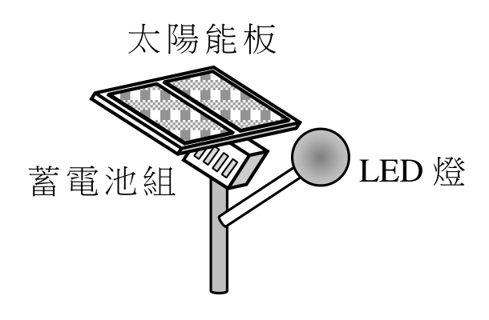

(a)　當蓄電池組被充電時，描述太陽能所涉各階段的轉換。（1 分）

(b)　太陽能板的面積為 0.111 m²，而電池組最多可儲 405 W h 的能量。充電系統的整體效率為 25%。已知：地球表面每單位面積接收到的太陽輻射功率最大為 980 W m⁻²。

　　(i)　電池組最初是完全放了電的。估算太陽能板將電池組完全充電的最少充電時間，以小時為單位。（2 分）

　　(ii)　LED 燈的額定功率為 30 W。設電池組所儲能量其中 80% 可用作照明，估算最長可照明的時段，以小時為單位。（2 分）

(c)　如圖 3.2 所示，這些太陽能街燈（額定功率每一為 30 W）沿一道路裝設於離地面 4.5 m 的高度。

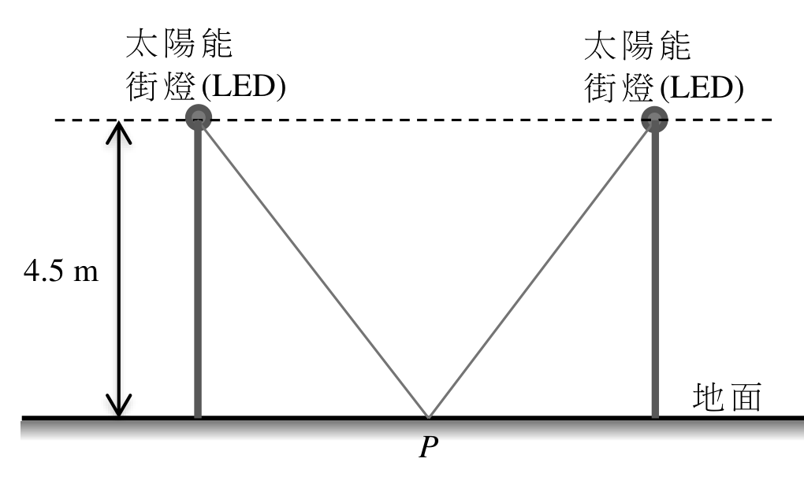

每一街燈所放出的光通量為 5160 lm。

　　(i)　求這款街燈的發光效率，以 lm W⁻¹ 表達。（1 分）

　　(ii)　兩相鄰街燈之間於地面中央 (P) 的照明度最少須有 10 lx。估算相鄰街燈之間的最大間距。（3 分）

(d)　雖然緊湊型螢光燈的發光效率跟 LED 燈相若，但藉太陽能板運作的系統多優先採用 LED 燈。試解釋。（1 分）

---

## 丁部：醫學物理學

## 第 4.1 題

【建議標籤】

- 卷別/部分：卷二　丁部
- 課題：#近點 #透鏡焦強

【題目內容】

美玉的近點位於 68 cm。當她所戴矯視透鏡以鏡框固定在眼睛前 1.5 cm 處，則可清楚看到眼睛前 25 cm 的文字。她所戴矯視透鏡的焦強為多少？

- A. +2.25 D
- B. +2.75 D
- C. +5.25 D
- D. +5.75 D

---

## 第 4.2 題

【建議標籤】

- 卷別/部分：卷二　丁部
- 課題：#聽覺 #耳

【題目內容】

以下哪項有關聽覺的敍述不正確？

- A. 外耳的耳道只讓可聽頻率的聲音通過。
- B. 中耳負責將聲音放大。
- C. 內耳負責把聲音轉換成電訊號傳至腦部。
- D. 聽覺牽涉內耳中的毛細胞機械地受到刺激。

---

## 第 4.3 題

【建議標籤】

- 卷別/部分：卷二　丁部
- 課題：#光纖 #內窺鏡

【題目內容】

以下哪項有關光纖內窺鏡的敍述不正確？

- A. 內窺鏡中每一光纖是以折射率較其稍低的物料包覆。
- B. 光纖的直徑極幼細以確保其有可彎曲的彈性。
- C. 照明和成像所用的是同一束光纖。
- D. 成像的解像度受光纖的幼細度所限。

---

## 第 4.4 題

【建議標籤】

- 卷別/部分：卷二　丁部
- 課題：#聲強級 #分貝

【題目內容】

當一屋增設了窗戶，屋內測量到的聲強度由 $I_1$ 變為 $I_2$。已知 $I_0$ 為臨閾聲強度。聲強級的改變為

- A. $10\log_{10}\dfrac{I_2}{I_0}-10\log_{10}\dfrac{I_1}{I_0}$ [?]
- B. $10\log_{10}\dfrac{I_1}{I_0}-10\log_{10}\dfrac{I_2}{I_0}$ [?]
- C. $10\log_{10}\dfrac{I_2}{I_1}$ [?]
- D. $10\log_{10}\dfrac{I_1}{I_2}$ [?]

---

## 第 4.5 題

【建議標籤】

- 卷別/部分：卷二　丁部
- 課題：#聲阻抗 #反射聲強係數

【題目內容】

| 組織 | 密度 / kg m⁻³ | 聲速 / m s⁻¹ |
|---|---|---|
| 骨 | 1700 | 3780 |
| 脂肪 | 950 | 1450 |
| 肌肉 | 1070 | 1590 |

表列一些組織的密度和於其中的聲速。以下哪些有關這些組織的敍述正確？

(1)　脂肪的聲阻抗最低。

(2)　表列組織所組成分界面之中，脂肪-肌肉分界面的反射聲強係數最小。

(3)　骨-肌肉分界面與肌肉-骨分界面的反射聲強係數相同。

- A. 只有 (1) 和 (2)
- B. 只有 (1) 和 (3)
- C. 只有 (2) 和 (3)
- D. (1)、(2) 和 (3)

---

## 第 4.6 題

【建議標籤】

- 卷別/部分：卷二　丁部
- 課題：#X射線 #線衰減係數

【題目內容】

X 射線於不同組織的線衰減係數（單位：cm⁻¹）表列如下。

| 組織 | 20 keV X 射線 | 50 keV X 射線 | 100 keV X 射線 |
|---|---|---|---|
| 骨 | 5.41 | 0.573 | 0.251 |
| 脂肪 | 0.517 | 0.193 | 0.154 |
| 肌肉 | 0.872 | 0.240 | 0.178 |
| 肺 | 0.874 | 0.238 | 0.178 |

根據所給資料，判斷哪一敍述不正確。

- A. 線衰減係數隨 X 射線的能量增加而減小。
- B. 從低能量至高能量 X 射線，骨對 X 射線的吸收減幅最大。
- C. 100 keV X 射線最適合用作涉及骨裂的 X 射線放射攝影。
- D. 當穿過 10 cm 厚的肌肉後，20 keV X 射線的強度約減至其初始值的 13%。

---

## 第 4.7 題

【建議標籤】

- 卷別/部分：卷二　丁部
- 課題：#電腦斷層造影 #CT

【題目內容】

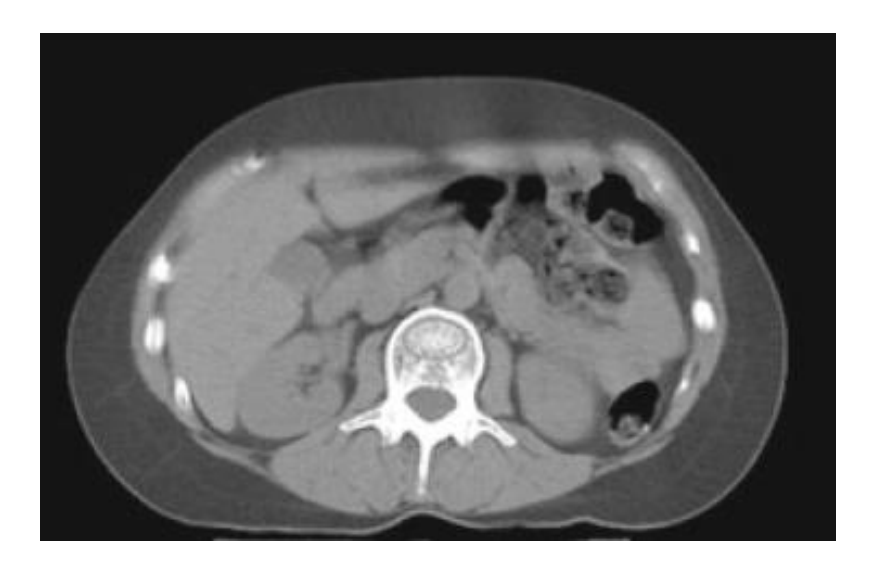

以下哪項有關上面電腦斷層造影 (CT) 成像的敍述正確？

(1)　成像顯示出 X 射線被組織所吸收的程度。

(2)　成像白色的區域顯示 X 射線最大程度的反射。

(3)　X 射線被吸收的程度代表組織的不同功能。

- A. 只有 (1)
- B. 只有 (2)
- C. 只有 (1) 和 (3)
- D. 只有 (2) 和 (3)

---

## 第 4.8 題

【建議標籤】

- 卷別/部分：卷二　丁部
- 課題：#放射性核素成像 #RNI

【題目內容】

以下哪項有關放射性核素成像 (RNI) 的敍述正確？

(1)　RNI 的空間解像度比超聲掃描為佳。

(2)　RNI 是採用發射 X 射線的放射性同位素。

(3)　大部分 RNI 所用的放射性同位素為人工造成，而非天然存在的。

- A. 只有 (1)
- B. 只有 (3)
- C. 只有 (1) 和 (2)
- D. 只有 (2) 和 (3)

---

## 第 4 題（結構式）

【建議標籤】

- 卷別/部分：卷二　丁部
- 課題：#放射性 #半衰期 #99mTc

【題目內容】

(a)　α、β 和 γ 射線對人體有輻射危害性。根據輻射的貫穿能力和致電離能力，解釋為什麼 γ 射線會選作放射性核素成像 (RNI) 之用。（2 分）

(b)　下面的衰變曲線代表 99mTc 的相對放射強度隨時間的變化（已作本底輻射修正）。

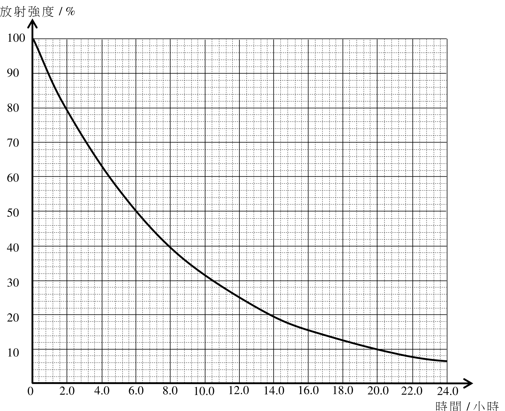

(i)　求 99mTc 的「物理半衰期」（以小時為單位）。（1 分）

(ii)　在一項 RNI 探究中，製備一含有 99mTc 化合物的溶液，供有關病人注射。於 9:00 am 對該溶液進行校準時錄得溶液每 mL 含 550 MBq 放射性。如果病人安排於 11:00 am（即兩小時後）注射 600 MBq 的配方劑量，求需用溶液的體積，單位為 mL。（3 分）

已知 99mTc 在人體內的「有效半衰期」為 4.8 小時。

(iii)　求注射後經過 24 小時體內所剩劑量的百分數。（2 分）

(iv)　根據 99mTc 的衰變曲線，99mTc 的相對放射強度經過 24 小時會下降至大約 6%。解釋 (iii) 所得結果與該數值（即約 6%）的差異。（2 分）

---

*試卷完 —*

## 待人工核對

本卷為第 2 層文字交貨（文字層可讀＋300dpi 原卷截圖）。現模型無影像輸入，未能對頁影像覆核，以下內容建議第 3 層精修時對頁核實：

- 第 1.3 題：選項含根號（文字層失去根號符號），A／C／D 之確切寫法待對頁核實（本稿按物理重建為 √2v、2v、√3v）。
- 第 1.5、1.6、1.8、2.1、2.3、2.4、2.7、3.1、3.2、3(a)、3(c)、4.7、4(b) 題：圖為 300dpi 原卷截圖（程式定位＋墨跡覆蓋率校驗；無視覺覆核，位置／範圍待 spot-check）；第 3 層再換成向量重繪。
- 第 3.1 題：題幹未明示「如圖」，所附電熱平板爐／電磁爐圖（墨跡 34.7%）是否屬本題待對頁確認。
- 第 4.4 題：聲強級改變之選項為分式公式，文字層分式結構亂碼，A–D 四選項以物理常式重建、待對頁逐字核實。
- 各小題分數（1–3 分）以文字層辨識為準，待對頁核對。
