# 2023 DSE 生物 試卷一（中文卷）— 題目庫

> 來源：dsepaper_hk\生物\2023\文憑試 DSE 生物 Biology 2023 歷屆試題 Past Paper 卷一.pdf
> 說明：已移除頁碼、試卷標頭、答題簿橫線等雜訊。**本檔為題目庫（零答案）**，只含題目清洗 + 建議標籤。
> 本檔為第 2 層文字交貨（圖用原卷截圖；精修重繪另開第 3 層）。

---

## 甲部（第 1–36 題）

## 第 1 題

【建議標籤】

- 卷別/部分：Paper 1　甲部
- 課題：#細胞結構 #原核細胞 #真核細胞

【題目內容】

參考以下示意圖，解答第 1 至 3 題。下圖顯示胰臟細胞的一部分：

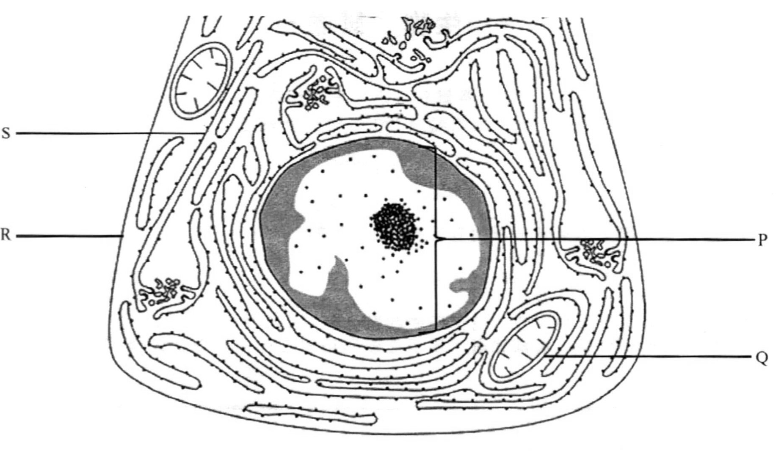

以下哪個細胞組成部分也可見於原核細胞？

- A. P
- B. Q
- C. R
- D. S

---

## 第 2 題

【建議標籤】

- 卷別/部分：Paper 1　甲部
- 課題：#蛋白質合成 #細胞結構

【題目內容】

（參考第 1 題的示意圖。）

若把有放射性標記的氨基酸供給這胰臟細胞，以下哪個細胞組成部分的放射性會首先增加？

- A. P
- B. Q
- C. R
- D. S

---

## 第 3 題

【建議標籤】

- 卷別/部分：Paper 1　甲部
- 課題：#蛋白質合成 #分泌 #胰臟

【題目內容】

（參考第 1 題的示意圖。）

稍後，小腸的內含物檢測得放射性。這放射性是來自以下哪個物質？

(1) 蛋白酶
(2) [?]
(3) 胰高血糖素

- A. 只有 (1)
- B. 只有 (2)
- C. 只有 (1) 和 (3)
- D. 只有 (2) 和 (3)

---

## 第 4 題

【建議標籤】

- 卷別/部分：Paper 1　甲部
- 課題：#細胞膜 #轉運 #膜蛋白

【題目內容】

以下哪個過程不涉及膜蛋白？

- A. 將 DNA 轉錄為 mRNA
- B. 根毛細胞吸收礦物質
- C. 碳水化合物在小腸內消化
- D. 神經脈衝在兩個神經元之間傳送

---

## 第 5 題

【建議標籤】

- 卷別/部分：Paper 1　甲部
- 課題：#細胞週期 #有絲分裂

【題目內容】

參考下圖，解答第 5 和 6 題。下圖顯示細胞週期的三個階段：

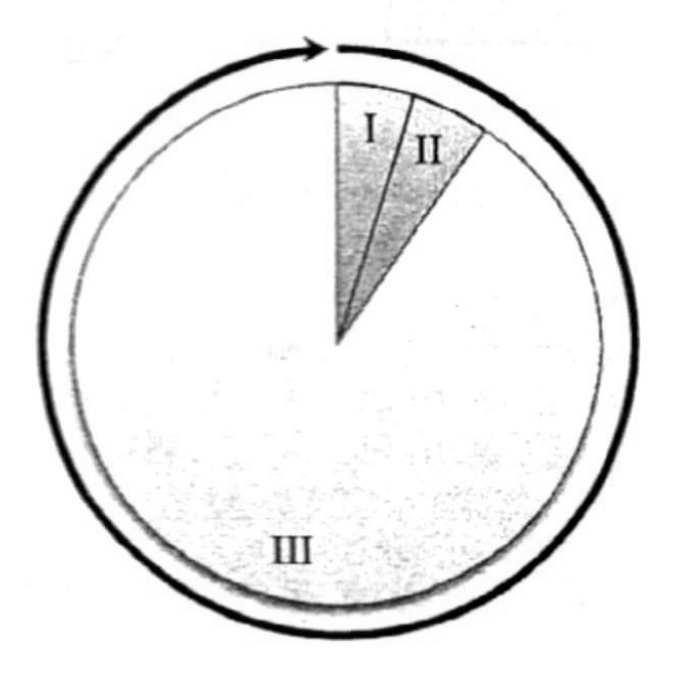

以下哪項正確描述細胞週期內的事件？

- A. 在階段 I，細胞質分成兩半
- B. 在階段 I，姊妹染色單體分離
- C. 在階段 II，細胞合成更多細胞器
- D. 在階段 III，染色質凝聚成染色體

---

## 第 6 題

【建議標籤】

- 卷別/部分：Paper 1　甲部
- 課題：#細胞週期 #DNA

【題目內容】

（參考第 5 題的示意圖。）

以下哪圖正確配對這個細胞的 DNA 含量在細胞週期的三個階段的變化？

- A.

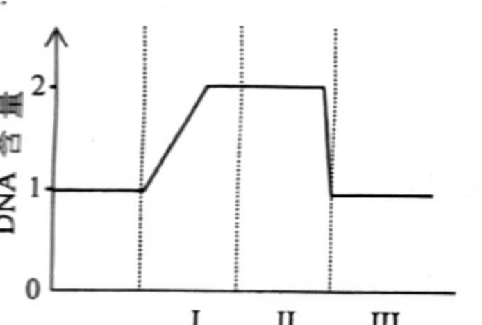

- B.

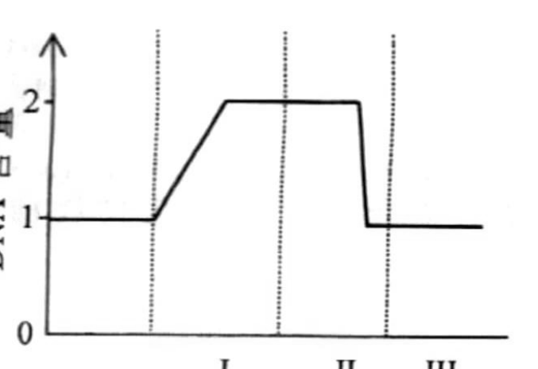

- C.

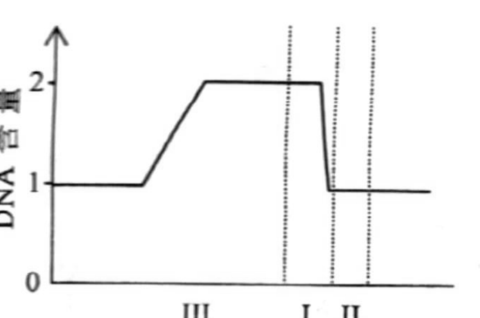

- D.

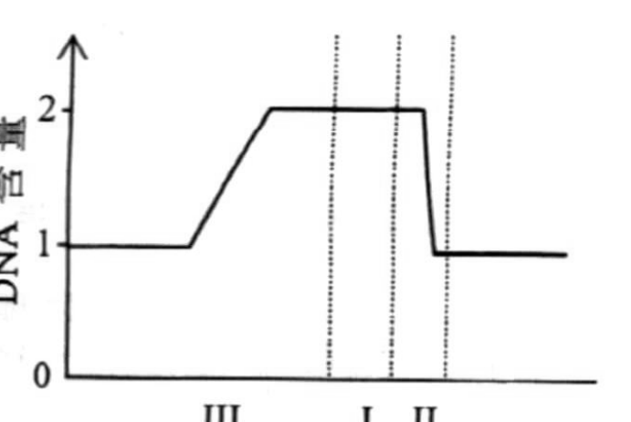

---

## 第 7 題

【建議標籤】

- 卷別/部分：Paper 1　甲部
- 課題：#呼吸作用 #酵母

【題目內容】

參考下圖，解答第 7 和 8 題。下圖顯示用以探究酵母呼吸速率的裝置：

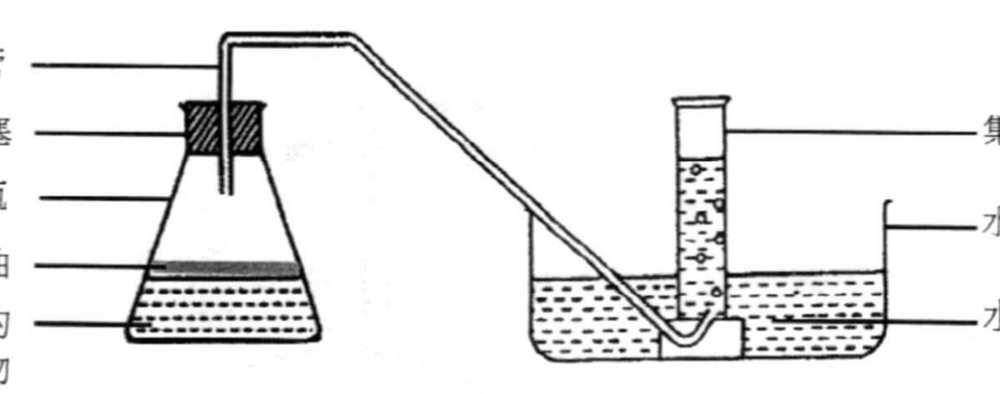

以下哪文字方程式正確顯示所探究的反應？

- A. 葡萄糖 → 二氧化碳 + 水
- B. 葡萄糖 → 二氧化碳 + 乙醇
- C. 葡萄糖 + 氧 → 二氧化碳 + 水
- D. 葡萄糖 + 氧 → 二氧化碳 + 乙醇

---

## 第 8 題

【建議標籤】

- 卷別/部分：Paper 1　甲部
- 課題：#呼吸作用 #實驗設計

【題目內容】

（參考第 7 題的裝置。）

這裝置作以下哪項改動，可以改善實驗的準確度？

- A. 使用量筒取代集氣瓶
- B. 使用較大的錐形瓶盛載混合物
- C. 使用內部直徑較細的玻璃管
- D. 使用 30 mL 取代 20 mL 已煮沸的 5% 葡萄糖溶液

---

## 第 9 題

【建議標籤】

- 卷別/部分：Paper 1　甲部
- 課題：#呼吸系統 #氣體交換

【題目內容】

當呼氣時，部分空氣會殘留在肺臟的氣囊內。以下哪項正確顯示氣囊內殘留空氣的氣體成分？

- A. 氧 16%；二氧化碳 0.04%
- B. 氧 16%；二氧化碳 4%
- C. 氧 21%；二氧化碳 0.04%
- D. 氧 21%；二氧化碳 4%

---

## 第 10 題

【建議標籤】

- 卷別/部分：Paper 1　甲部
- 課題：#光合作用 #光強度 #競爭

【題目內容】

下圖顯示三個植物物種（X、Y 和 Z）在光強度改變時，其光合作用速率隨光強度的變化。該三個植物物種均在同一生境內。

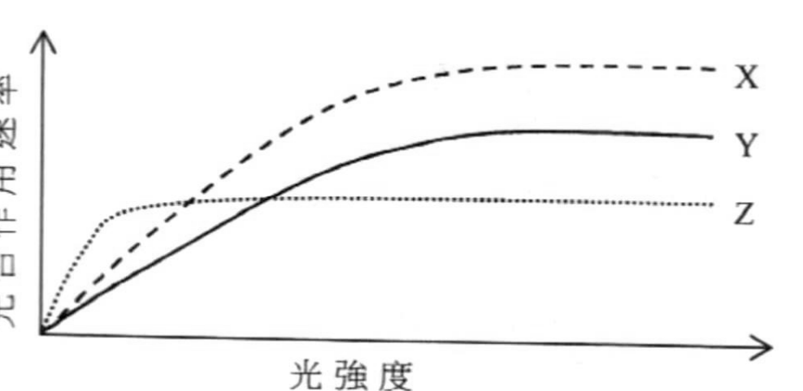

由上圖可以得出以下哪項推斷？

- A. 三個物種中，物種 Y 生長得最高
- B. 在陰暗情況下，物種 Z 最具競爭力
- C. 在所有光照情況下，物種 Y 較物種 X 優勝
- D. 移除物種 Z 會增加物種 X 的光合作用速率

---

## 第 11 題

【建議標籤】

- 卷別/部分：Paper 1　甲部
- 課題：#光合作用 #呼吸作用 #ATP

【題目內容】

以下哪些過程產生 ATP？

(1) 糖酵解
(2) 卡爾文循環
(3) 光化學反應

- A. 只有 (1) 和 (2)
- B. 只有 (1) 和 (3)
- C. 只有 (2) 和 (3)
- D. (1)、(2) 和 (3)

---

## 第 12 題

【建議標籤】

- 卷別/部分：Paper 1　甲部
- 課題：#植物結構 #組織 #顯微鏡

【題目內容】

參考以下顯微照相，解答第 12 至 14 題。照片顯示某個植物部位的橫切面在不同放大倍數下的影像：

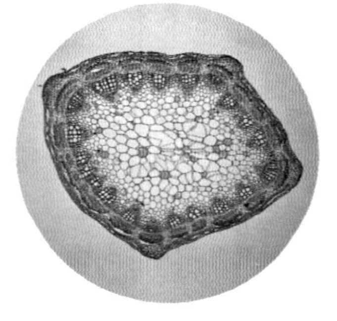

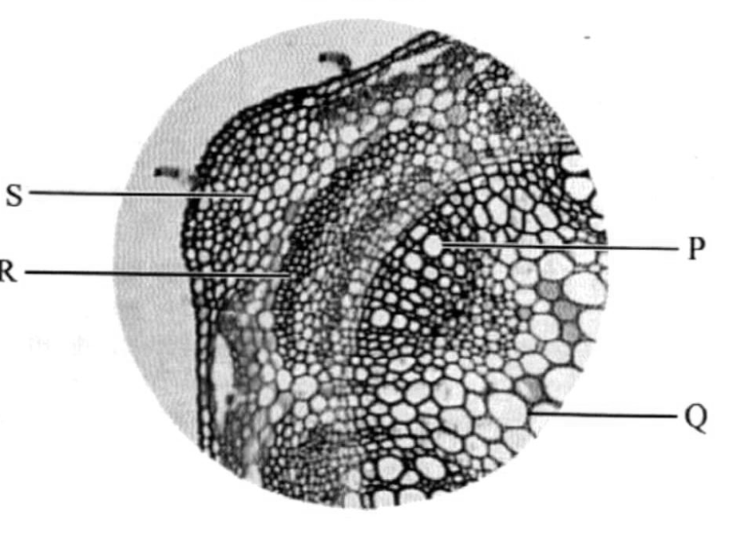

哪個組合正確配對該切片是取自植物的哪個部位和顯微照片呈現的支持證據？

- A. 根部：表皮上有毛
- B. 根部：中央具有薄壁細胞
- C. 莖部：表皮上有角質層
- D. 莖部：周邊具有維管束

---

## 第 13 題

【建議標籤】

- 卷別/部分：Paper 1　甲部
- 課題：#顯微鏡 #放大倍數

【題目內容】

（參考第 12 題的顯微照相。）

哪個組合正確配對兩個放大倍數所使用的接目鏡和接物鏡？

- A. 低倍數 10X × 4X；高倍數 10X × 10X
- B. 低倍數 10X × 4X；高倍數 10X × 25X
- C. 低倍數 10X × 4X；高倍數 10X × 40X
- D. 低倍數 10X × 10X；高倍數 10X × 40X

---

## 第 14 題

【建議標籤】

- 卷別/部分：Paper 1　甲部
- 課題：#維管束 #運輸 #植物結構

【題目內容】

（參考第 12 題的顯微照相。）

哪個標示的組織負責運輸水分？

- A. P
- B. Q
- C. R
- D. S

---

## 第 15 題

【建議標籤】

- 卷別/部分：Paper 1　甲部
- 課題：#酶 #實驗設計 #變量

【題目內容】

參考以下有關水果酶的探究，解答第 15 至 17 題。小美得知某些水果含有可以當作鬆肉劑的蛋白酶。她想找出合適的果汁用來慢煮牛扒，即是把浸了果汁的牛扒放入密封的袋內，然後置於大約 50℃ 至 70℃ 的水浴內烹煮。

以下是她進行探究時所採用的步驟：

1. 從菠蘿提取果汁。
2. 標記 3 支大試管為 50℃、60℃ 和 70℃，每支試管加入 15 mL 菠蘿汁。
3. 把試管置於相應溫度的水浴內，為時 1 小時。
4. 讓試管溫度降至室溫。
5. 每支試管加入 3 塊 1 cm³ 的蛋白立方體。
6. （量度因變量的步驟）
7. 以木瓜、奇異果和檸檬代替菠蘿，重複以上步驟。

按所提供的步驟，這個探究有多少個自變量？

- A. 1
- B. 2
- C. 3
- D. 4

---

## 第 16 題

【建議標籤】

- 卷別/部分：Paper 1　甲部
- 課題：#酶 #實驗設計 #因變量

【題目內容】

（參考第 15 題的探究。）

步驟 6 量度因變量。以下哪項可以用來量度這探究的因變量？

(1) 蛋白立方體消失所需的時間
(2) 在固定時間內，蛋白立方體形狀的改變
(3) 在固定時間內，蛋白立方體重量的改變

- A. 只有 (1) 和 (2)
- B. 只有 (1) 和 (3)
- C. 只有 (2) 和 (3)
- D. (1)、(2) 和 (3)

---

## 第 17 題

【建議標籤】

- 卷別/部分：Paper 1　甲部
- 課題：#酶 #假說

【題目內容】

（參考第 15 題的探究。）

以下哪項是這探究的假設？

- A. 所測試的水果均含有蛋白酶
- B. 在高溫下，這些蛋白酶仍保持活性
- C. 在提取後，這些蛋白酶仍能運作
- D. 蛋白酶對蛋白立方體的作用跟對牛扒的作用相似

---

## 第 18 題

【建議標籤】

- 卷別/部分：Paper 1　甲部
- 課題：#消化系統 #吸收 #小腸

【題目內容】

以下哪項小腸的特徵讓它成為吸收食物的主要部位？

(1) 它很長
(2) 它的內壁有很多皺摺
(3) 它分泌不同種類的酶

- A. 只有 (1) 和 (2)
- B. 只有 (1) 和 (3)
- C. 只有 (2) 和 (3)
- D. (1)、(2) 和 (3)

---

## 第 19 題

【建議標籤】

- 卷別/部分：Paper 1　甲部
- 課題：#耳 #聽覺

【題目內容】

耳咽管閉塞會直接影響以下哪個構造的運作？

- A. 耳蝸
- B. 鼓膜
- C. 聽小骨
- D. 卵圓窗

---

## 第 20 題

【建議標籤】

- 卷別/部分：Paper 1　甲部
- 課題：#神經系統 #反射動作

【題目內容】

以下哪項正確解釋為什麼反射動作通常較隨意動作快？

(1) 反射動作不涉及作出決定
(2) 反射動作的神經脈衝傳遞較快
(3) 反射動作是天生的

- A. 只有 (1)
- B. 只有 (2)
- C. 只有 (1) 和 (3)
- D. 只有 (2) 和 (3)

---

## 第 21 題

【建議標籤】

- 卷別/部分：Paper 1　甲部
- 課題：#氮循環 #分解作用

【題目內容】

尿素可以轉化成肥料。這個轉化需要以下哪些過程？

- A. 硝化作用和分解作用
- B. 硝化作用和固氮作用
- C. 反硝化作用和分解作用
- D. 反硝化作用和固氮作用

---

## 第 22 題

【建議標籤】

- 卷別/部分：Paper 1　甲部
- 課題：#食物鏈 #攝食角色

【題目內容】

參考以下有關黃蜂 P、毛蟲 Q 和病毒 R 之間的關係，解答第 22 和 23 題：

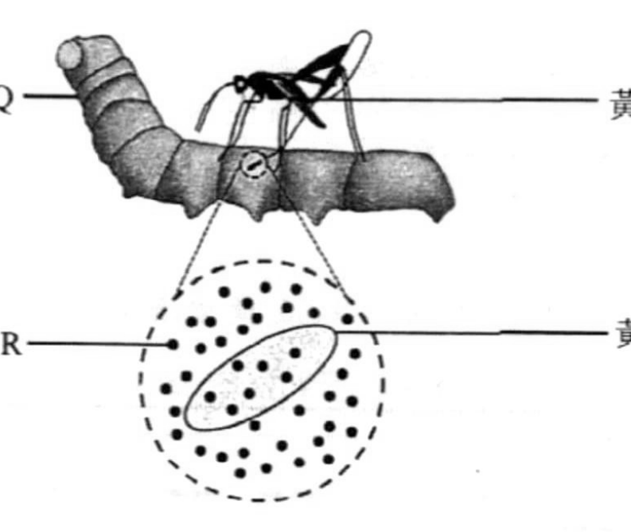

黃蜂 P 會在毛蟲 Q 體內產卵；當卵孵化後，黃蜂幼蟲會進食毛蟲的身體組織，最後把牠們殺死。

近期研究顯示，這些黃蜂是病毒 R 的宿主，病毒 DNA 會成為黃蜂基因組的一部分，並傳給黃蜂的後代。黃蜂注射卵入毛蟲體內時，會同時釋放病毒 R，病毒 R 會抑制毛蟲的身體防禦機制，保護黃蜂的卵。

以下哪項正確描述牠們的攝食角色？

- A. 病毒是最高消費者
- B. 毛蟲是生產者
- C. 黃蜂成蟲是初級消費者
- D. 黃蜂幼蟲是次級消費者

---

## 第 23 題

【建議標籤】

- 卷別/部分：Paper 1　甲部
- 課題：#生態關係 #共生

【題目內容】

（參考第 22 題的資料。）

以下哪項正確顯示黃蜂和病毒之間的關係？

- A. 寄生
- B. 互惠共生
- C. 競爭
- D. 偏利共生

---

## 第 24 題

【建議標籤】

- 卷別/部分：Paper 1　甲部
- 課題：#遺傳 #變異 #連續變異

【題目內容】

參考以下有關在本地植物公園引入某外來植物物種的資料，解答第 24 和 25 題。數年間，園丁留意到牠的花朵大小有所改變。下圖顯示這植物物種在第 1 代和 10 代後，其花瓣長度的變異：

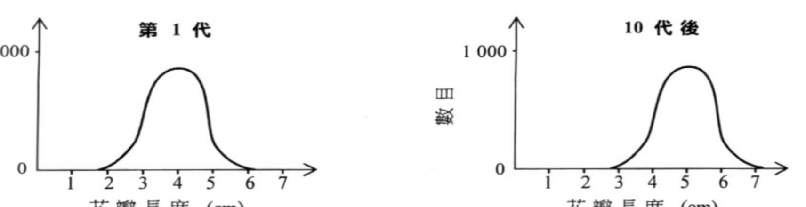

以下哪項正確描述這植物物種花瓣長度的遺傳？

(1) 花瓣長度受環境因素影響
(2) 花瓣長度的遺傳是由數個基因控制
(3) 花瓣長度的變異是因獨立分配所引致

- A. 只有 (1) 和 (2)
- B. 只有 (1) 和 (3)
- C. 只有 (2) 和 (3)
- D. (1)、(2) 和 (3)

---

## 第 25 題

【建議標籤】

- 卷別/部分：Paper 1　甲部
- 課題：#天擇 #演化

【題目內容】

（參考第 24 題的資料。）

以下哪項最能解釋這植物物種花瓣長度的改變？

- A. 較大的花朵生產較多花蜜
- B. 本地氣候有利這植物物種生長
- C. 本地昆蟲被花瓣較長的花朵吸引
- D. 突變出現並在 10 代之間一直累積

---

## 第 26 題

【建議標籤】

- 卷別/部分：Paper 1　甲部
- 課題：#遺傳病 #DNA 指紋 #譜系

【題目內容】

以下 DNA 指紋顯示某家族的六名成員就某罕見遺傳病的篩查結果：

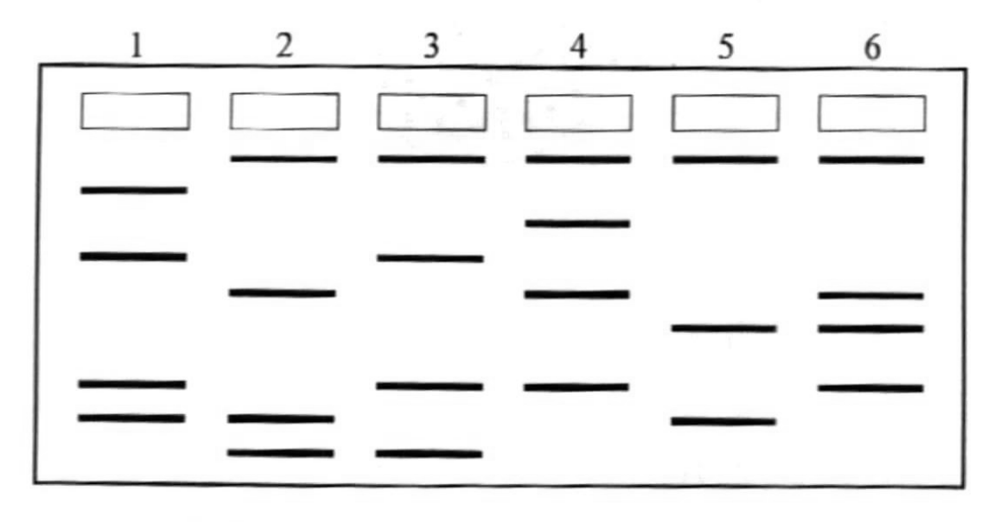

這遺傳病在成年後才病發，成員 2 和成員 6 已出現該病的症狀。以下哪個成員也可能遺傳了這個病？

- A. 成員 1
- B. 成員 3
- C. 成員 4
- D. 成員 5

---

## 第 27 題

【建議標籤】

- 卷別/部分：Paper 1　甲部
- 課題：#轉譯 #密碼子

【題目內容】

參考以下在某 mRNA 分子上的核苷酸序列，解答第 27 和 28 題：

AUGGCUAACUAUAACGCI（轉譯開始）

在這核苷酸序列上，可以找到多少個不同的密碼子？

- A. 3
- B. 4
- C. 5
- D. 6

---

## 第 28 題

【建議標籤】

- 卷別/部分：Paper 1　甲部
- 課題：#轉錄 #轉譯 #DNA

【題目內容】

（參考第 27 題的序列。）

以下哪項有關這 mRNA 分子的陳述是正確的？

(1) 它可見於細胞核
(2) 在 DNA 編碼股上，對應它的序列是 TACCGATTGATATTGCGA
(3) [?]

- A. 只有 (1) 和 (2)
- B. 只有 (1) 和 (3)
- C. 只有 (2) 和 (3)
- D. (1)、(2) 和 (3)

---

## 第 29 題

【建議標籤】

- 卷別/部分：Paper 1　甲部
- 課題：#親緣關係 #演化 #核苷酸

【題目內容】

參考以下有關五個細菌物種的親緣關係，解答第 29 和 30 題。酶 X 見於大部分細菌。下表顯示五個細菌物種（J、K、L、M 和 N）編碼着酶 X 的基因，其核苷酸差異的數目：

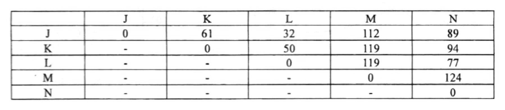

按物種的親緣關係排序，由最接近 L 至最遠離 L 的正確次序是：

- A. L、J、K、N、M
- B. L、J、M、N、K
- C. L、M、N、K、J
- D. L、N、M、K、J

---

## 第 30 題

【建議標籤】

- 卷別/部分：Paper 1　甲部
- 課題：#蛋白質 #演化 #突變

【題目內容】

（參考第 29 題的表。）

五個物種的編碼酶 X 基因的核苷酸有所不同，但五個物種的酶 X 仍具相同功能。以下哪項是這個現象的可能解釋？

(1) 所形成的多肽長度相同
(2) [?]
(3) [?]

- A. 只有 (1) 和 (2)
- B. 只有 (1) 和 (3)
- C. 只有 (2) 和 (3)
- D. (1)、(2) 和 (3)

---

## 第 31 題

【建議標籤】

- 卷別/部分：Paper 1　甲部
- 課題：#細胞膜 #轉運 #擴散 #主動轉運

【題目內容】

下圖顯示某單細胞生物內及其週圍海水的離子濃度：

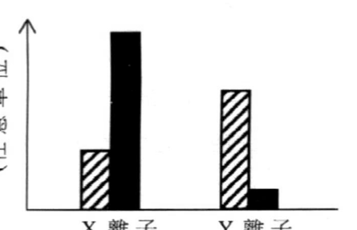

圖例：X 離子、Y 離子。

為了維持上圖所示的狀況，以下哪項最有可能發生？

- A. 離子 X 以擴散離開這生物
- B. 離子 X 以主動轉運進入這生物
- C. 離子 Y 以主動轉運進入這生物
- D. 離子 Y 以主動轉運離開這生物

---

## 第 32 題

【建議標籤】

- 卷別/部分：Paper 1　甲部
- 課題：#內分泌 #糖尿病 #血糖

【題目內容】

參考下圖，解答第 32 和 33 題。下圖顯示一名健康人士和一名糖尿病患者在飲用含糖飲品後，他們血液葡萄糖水平及血液胰島素水平的變化：

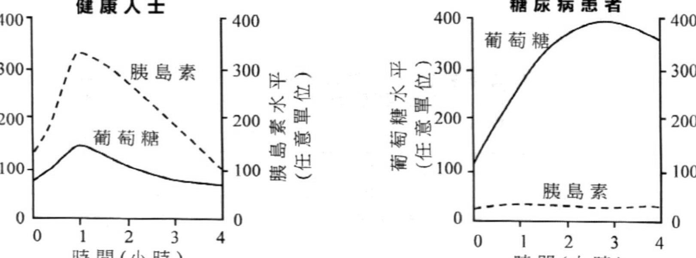

根據上圖，以下哪個組合正確配對患者的糖尿病類型及其解釋？

- A. [?]
- B. [?]
- C. [?]
- D. [?]

---

## 第 33 題

【建議標籤】

- 卷別/部分：Paper 1　甲部
- 課題：#血糖調節 #胰島素

【題目內容】

（參考第 32 題的圖。）

患者的血液葡萄糖水平最終會下降，這是因為：

(1) 胰高血糖素的作用
(2) 體細胞的呼吸作用
(3) 葡萄糖會經尿液流失

- A. 只有 (3)
- B. 只有 (1) 和 (2)
- C. 只有 (2) 和 (3)
- D. (1)、(2) 和 (3)

---

## 第 34 題

【建議標籤】

- 卷別/部分：Paper 1　甲部
- 課題：#生殖 #胎兒 #羊水

【題目內容】

參考下圖，解答第 34 和 35 題。下圖顯示子宮內的胎兒及其相關構造：

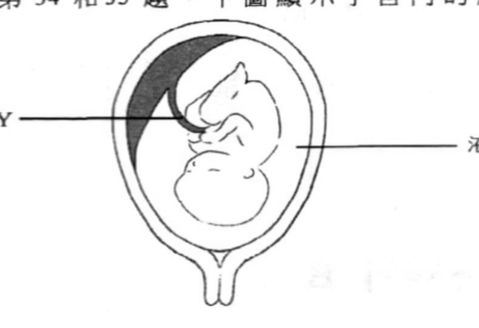

以下哪項有關液體 X 的陳述是正確的？

- A. 它是由子宮分泌出來
- B. 它為胎兒提供抗體
- C. 它是物質交換的媒介
- D. 它為胎兒提供穩定的環境

---

## 第 35 題

【建議標籤】

- 卷別/部分：Paper 1　甲部
- 課題：#胎兒循環 #血管

【題目內容】

（參考第 34 題的圖。）

以下哪個組合正確比較構造 Y 內的血管？

- A. Y 內的靜脈：有較小的管腔；Y 內的動脈：有較大的管腔
- B. Y 內的靜脈：運帶含氧血；Y 內的動脈：運帶缺氧血
- C. Y 內的靜脈：其血液含較多葡萄糖；Y 內的動脈：其血液含較少葡萄糖
- D. Y 內的靜脈：血液流往胎盤；Y 內的動脈：血液流往胎兒心臟

---

## 第 36 題

【建議標籤】

- 卷別/部分：Paper 1　甲部
- 課題：#免疫 #疫苗 #抗體

【題目內容】

某人成功接種對抗傳染病 P 的疫苗。以下哪圖正確顯示當這人受傳染病 P 的病原體入侵時，其抗體水平的變化？

- A.

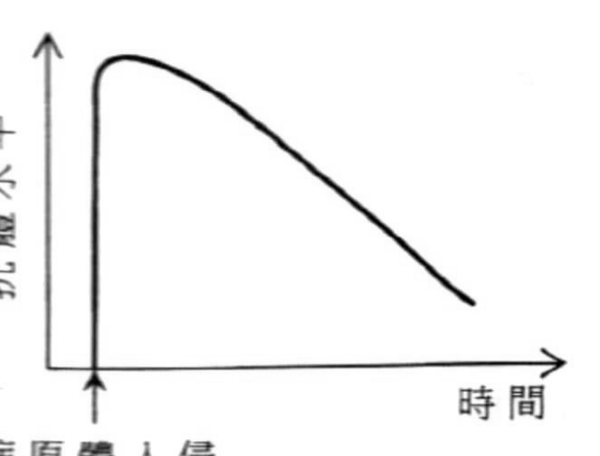

- B.

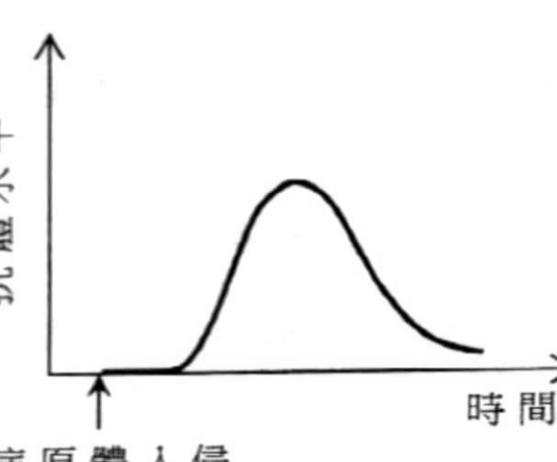

- C.

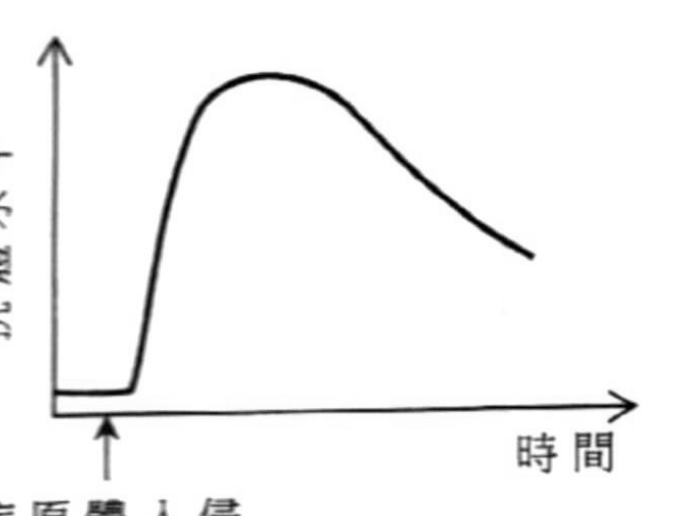

- D.

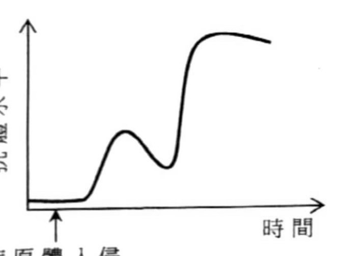

---

## 乙部

## 第 1 題

【建議標籤】

- 卷別/部分：Paper 1　乙部
- 課題：#呼吸系統 #表面面積 #氣體交換

【題目內容】

下圖所示的球體代表肺囊內大小不同的氣囊：八個半徑 1 mm 的小球體的總體積，相等於一個半徑 2 mm 的大球體的體積。

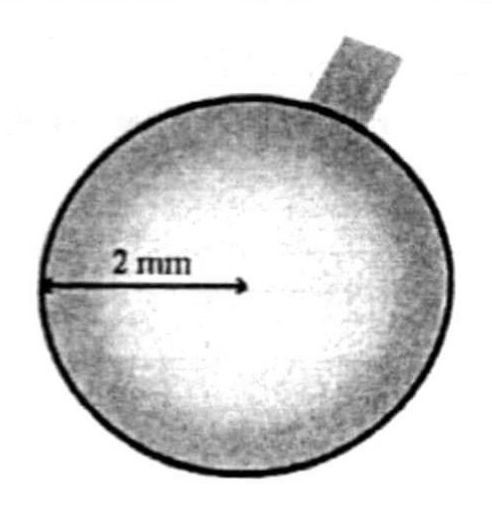

| 球體 | 一個球體的表面面積（mm²） |
|---|---|
| 半徑 2 mm | 50.3 |
| 半徑 1 mm | 12.6 |

(a) 計算八個小球體的總表面面積。（1 分）

(b) 參考 (a) 的答案，解釋為什麼肺囊內有較細的氣囊比有較大的氣囊，在進行氣體交換時更有效率。（2 分）

(c) 除 (b) 之外，解釋氣囊如何在組織層面上特化以進行氣體交換。（1 分）

---

## 第 2 題

【建議標籤】

- 卷別/部分：Paper 1　乙部
- 課題：#細胞分化 #幹細胞 #細胞器

【題目內容】

所有細胞均源於幹細胞。在進行分化時，其形態會改變，以履行特定的功能。

(a) 組成眼睛晶體的細胞是沒有細胞器的。若這些細胞在分化時，其細胞器沒有降解，會怎樣影響晶體的運作？試加以描述。（2 分）

(b) 提出一種植物細胞，在其分化時也會經歷細胞構件降解。解釋這降解對該種細胞的功能有什麼重要性。（2 分）

---

## 第 3 題

【建議標籤】

- 卷別/部分：Paper 1　乙部
- 課題：#肌肉 #關節 #骨骼

【題目內容】

下圖（I 至 V）顯示跑步時的一系列動作，右腿以灰色標示。

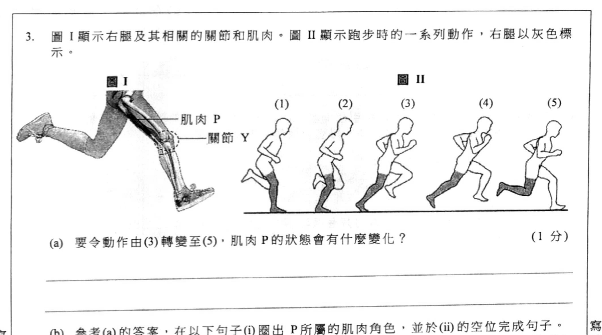

(a) 要令動作由 (III) 轉變至 (V)，肌肉 P 的狀態會有什麼變化？（1 分）

(b) 參考 (a) 的答案，在以下句子 (i) 圈出 P 所屬的肌肉角色，並於 (ii) 的空位完成句子：

(i) 肌肉 P 是（屈肌／伸肌）。（1 分）

(ii) 因為＿＿＿。（1 分）

(c) 某人在跑步時傷及膝部。下圖顯示在受傷後關節 Y 的情況：

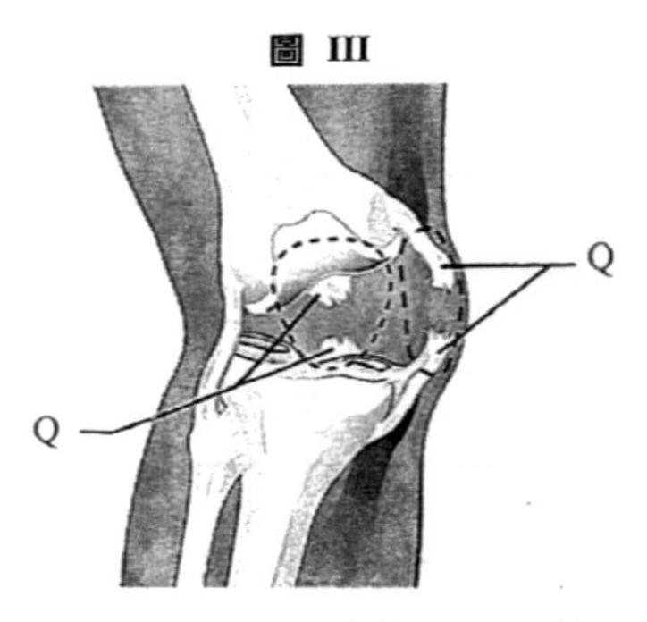

若這構造撕裂，會如何影響關節 Y 及其運作？（2 分）

---

## 第 4 題

【建議標籤】

- 卷別/部分：Paper 1　乙部
- 課題：#免疫 #病毒 #傳染病

【題目內容】

登革熱是由登革病毒（DENV）所引起的感染。在很多熱帶和亞熱帶國家，這是一種風土病。DENV 包括四種不同的亞型，每種亞型都能導致登革熱。

(a) 登革熱的傳播途徑是什麼？（1 分）

(b) 提出在熱帶和亞熱帶地區的兩個環境因素，會令這些地區內居民感染登革熱的風險較高，並加以解釋。（3 分）

(c) (i) 參考患者在沒有接受任何治療下，於受某種亞型的 DENV 感染後康復的過程，寫出令患者康復的三種白血細胞，並分別描述它們各自的作用。（3 分）

(ii) 解釋為什麼曾受某種亞型的 DENV 感染的康復者，日後仍可受其他亞型的 DENV 感染。（2 分）

(d) 提出對抗登革熱傳播的一項預防措施。（1 分）

---

## 第 5 題

【建議標籤】

- 卷別/部分：Paper 1　乙部
- 課題：#光合作用 #葉綠體 #新陳代謝

【題目內容】

下圖顯示一幅葉綠體的電子顯微照片：

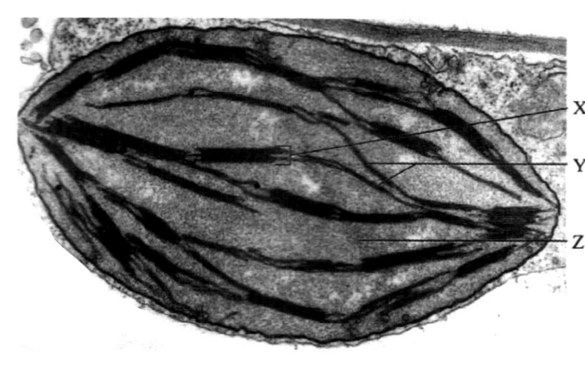

(a) 標記構造 Y。（1 分）

(b) 指出在 X 進行的能量轉化及其在光合作用中的重要性。（2 分）

(c) 在 Z 進行的總體反應屬哪種新陳代謝？解釋你的答案。（2 分）

(d) 描述馬鈴薯葉子的光合作用產物如何貯藏於牠的地下塊莖。（3 分）

---

## 第 6 題

【建議標籤】

- 卷別/部分：Paper 1　乙部
- 課題：#遺傳 #色盲 #伴性遺傳

【題目內容】

色盲是一種遺傳缺陷，因視網膜上的視錐細胞出現功能缺失所致。色盲有很多類型，例如紅綠色盲的人士不能區分紅色與綠色，而全色盲的人士則完全失去色覺。

(a) 根據視錐細胞的功能，提出為什麼紅綠色盲的情況有別於全色盲。（1 分）

(b) 紅綠色盲是由 X 染色體上一個隱性等位基因引起，全色盲則由位於某條常染色體上的一個隱性等位基因所導致。下表展示紅綠色盲和全色盲在男性和女性的發生率：

| 色盲類型 | 男性 | 女性 |
|---|---|---|
| 紅綠色盲 | 8% | 0.5% |
| 全色盲 | 0.00001% | 0.00001% |

參考兩種色盲的遺傳，提出為什麼紅綠色盲在男性和女性發生的比率有別於全色盲。（4 分）

(c) (i) 以下譜系顯示紅綠色盲在某家庭內的遺傳：

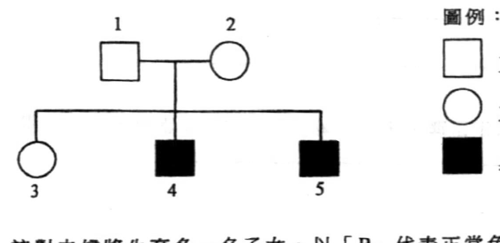

該對夫婦將生育多一名子女。以 B 代表正常色覺的等位基因，b 代表紅綠色盲的等位基因，繪畫一遺傳圖，並計算該名新生嬰兒是紅綠色盲的女孩的機會率。（4 分）

（註：不接受龐氏表作為答案。）

(ii) 個體 4 和 5 是雙生兒。你能否判斷他們是單卵雙生，還是二卵雙生？解釋你的答案。（2 分）

---

## 第 7 題

【建議標籤】

- 卷別/部分：Paper 1　乙部
- 課題：#生態 #生態位 #物種

【題目內容】

一項近期的調查顯示，在本港多處發現溫室蟾這外來物種。有人認為溫室蟾可能對盧氏小樹蛙這本地瀕危物種構成威脅，因而引起關注。

(a) 下表提供有關兩個青蛙物種的一些資料：

| 項目 | 盧氏小樹蛙 | 溫室蟾 |
|---|---|---|
| 大小 | 1.5–2.5 cm | 1.2–3.0 cm |
| 繁殖地點和生境 | 森林地、灌木叢、農地、市區公園 | 濕地、小型和暫時性水體、森林地、灌木叢、園圃 |
| 食物 | 小型昆蟲 | 小型昆蟲和蝸牛 |

比較兩個青蛙物種的生態位，提供兩項證據以支持溫室蟾可能對盧氏小樹蛙構成威脅，解釋你的答案。（3 分）

(b) 以下地圖顯示兩個青蛙物種在香港的分布情況：

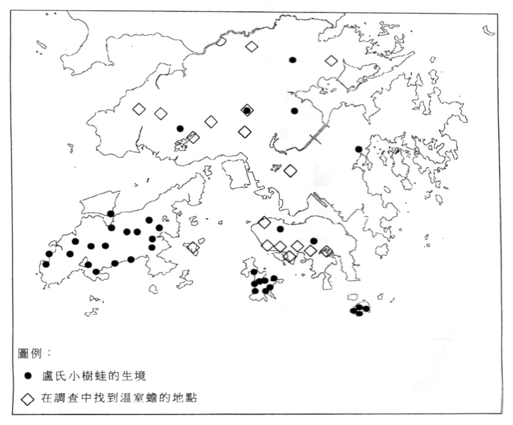

提出為什麼以上資料不能證實盧氏小樹蛙真正受到溫室蟾威脅。（1 分）

(c) 提出你可如何搜集數據，以顯示盧氏小樹蛙是否真正受溫室蟾影響。（2 分）

---

## 第 8 題

【建議標籤】

- 卷別/部分：Paper 1　乙部
- 課題：#生態 #能量流 #物質循環 #生態演替

【題目內容】

鯨死亡後，屍體會下沉至海底。屍體會支持一個稱為鯨落群落的獨特群落。

(a) (i) 下圖顯示海洋的不同區域和鯨屍的位置：

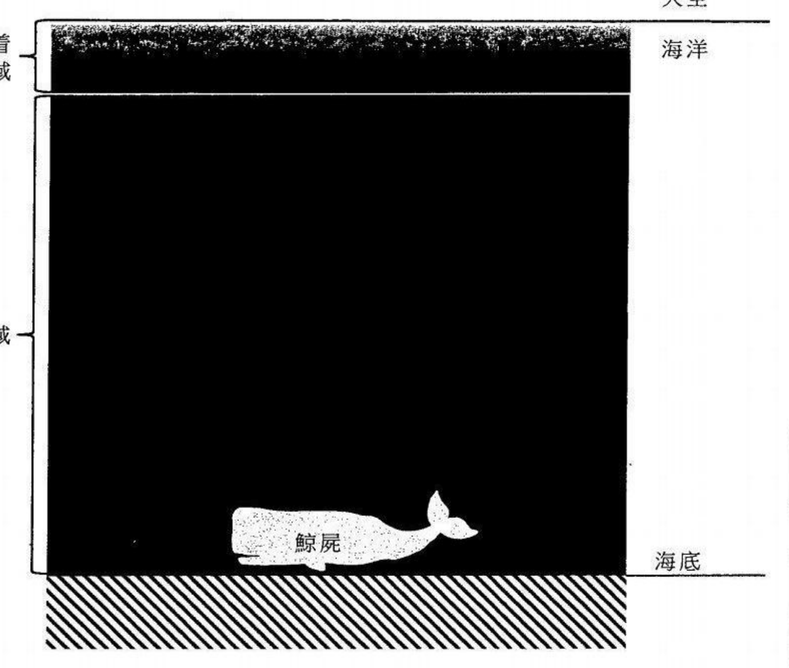

參考生態系中的能量流，貯藏在鯨屍的能量的最終來源是什麼？（1 分）

(ii) 參考上圖，解釋鯨屍對於在海洋底部的鯨落群落的重要性。（2 分）

(b) 以鯨屍的軟組織作為食物的生物，在物質循環中的角色是什麼？（1 分）

(c) 鯨屍的軟組織被移除後，另一組生物開始攝取骨骼內剩餘的營養素。一條中等體型的鯨，在骨骼內可能貯藏 2000–3000 kg 的脂質。以下棒形圖顯示在不同時段，在鯨骨骼上攝食的不同物種的豐度：

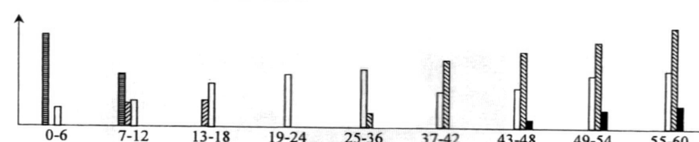

引用棒形圖中可支持上述個案屬生態演替例子的證據，完成下表。（4 分）

| 生態演替的特徵 | 引自棒形圖中的證據 |
|---|---|
| 物種組成的改變 | ＿＿＿ |
| 物種多樣性的改變 | ＿＿＿ |

---

## 第 9 題

【建議標籤】

- 卷別/部分：Paper 1　乙部
- 課題：#植物激素 #生長素 #實驗設計

【題目內容】

下圖顯示草莓的外觀及其垂直切面。草莓表面的瘦果是其果實：

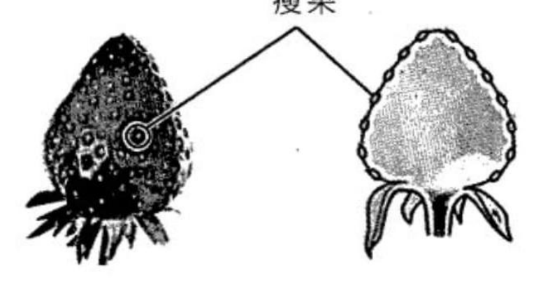

(a) 以下是一項關於瘦果在草莓發育時的角色的探究：

| 處理方法 | 草莓的相對大小和外型 |
| --- | --- |
| | 第 1 天 | 第 20 天 |
| 1. 瘦果完整無缺 | （圖） | （圖） |
| 2. 在第 1 天去除所有瘦果 | （圖） | （圖） |
| 3. 在第 1 天去除所有瘦果，然後定期噴灑生長素 | （圖） | （圖） |

(b) (i) 寫出比較以下處理方法的結果而得到的推論，以完成下表：（3 分）

| 處理方法 | 推論 |
|---|---|
| 比較 1 和 2 | ＿＿＿ |
| 比較 2 和 3 | ＿＿＿ |
| 比較 1 和 3 | ＿＿＿ |

(ii) 根據結果，提出導致草莓增大的一項假說。（1 分）

(iii) 細閱以下另一個處理方法：

| 處理方法 | 草莓的相對大小和外型 |
| --- | --- |
| 4. 在第 1 天去除位於草莓下半部的瘦果，保留上半部的瘦果 | （圖） |

就實驗設計而言，與處理方法 1 和 2 比較，處理方法 4 有什麼優點？（1 分）

(c) 舉出一個由生長素誘發的生長反應的例子，並指出牠對植物的重要性。（2 分）

---

## 第 10 題

【建議標籤】

- 卷別/部分：Paper 1　乙部
- 課題：#消化 #營養 #氰化物 #呼吸作用

【題目內容】

木薯這種農作物能在雨量少和土壤貧瘠的地方生長，牠形成的塊根含大量澱粉，是非洲地區的一個主要食物來源。

(a) 寫出人類消化道內將澱粉質進行化學消化的部位。（1 分）

(b) 表 I 展示木薯的一些營養資料，表 II 列出一名 16 歲男孩的每天能量和蛋白質建議需求：

| 表 I（每 100 g 乾重） | 表 II（每天需求） |
|---|---|
| 能量 2 675 kJ | 能量 11 100 kJ |
| 蛋白質 3.5 g | 蛋白質 52 g |

(i) 在非洲，一些低收入家庭可能長期只依賴木薯作為食物。一名 16 歲男孩只依賴木薯作為食物。計算他應進食多少鮮重的木薯，才能滿足他每天的能量需求。（1 分）

(ii) (1) 從進食 (i) 所計算得的木薯量，他能獲取多少蛋白質？（1 分）

(2) 根據表 I，推斷這男孩與同齡健康男孩在血液蛋白水平上會有什麼差異。解釋你的答案。（2 分）

(3) 根據你在 (2) 的答案，解釋為什麼這情況會導致組織液積聚在腳部。（2 分）

(c) 木薯含天然毒素，進食未有徹底煮熟的木薯，可能引致氰化物中毒。氰化物能抑制線粒體內氧化磷酸化作用所需的一種重要酶，令該作用停頓。

(i) 這酶位於線粒體的哪個構造？寫出這構造的名稱。（1 分）

(ii) 某男子不慎進食了生木薯。他的血液乳酸水平將會出現什麼變化？解釋你的答案。（3 分）

---

## 第 11 題

【建議標籤】

- 卷別/部分：Paper 1　乙部
- 課題：#無性繁殖 #全球暖化 #短文

【題目內容】

考生須以短文形式回答以下題目。評分準則包括內容切題、舖排合乎邏輯以及表達清晰。

在農業操作上，某些農作物會以無性繁殖來提升生產效率。近年，因為全球平均溫度穩步上升，這些農作物的產量亦有所增加。同時，有些科學家擔心，若全球暖化持續，以無性繁殖生產的農作物會因為環境變化和疾病而面臨滅絕的嚴重危機。

解釋全球暖化下這些農作物產量的增加，以及科學家擔憂背後的理據。（11 分）

---

## 待人工核對

- 第 3 題：選項 (2) 之物質名稱 OCR 未能辨識（原卷 p.1）。
- 第 28 題：陳述 (3) 文字 OCR 亂碼未能還原（原卷 p.8）。
- 第 30 題：陳述 (2)、(3) 文字 OCR 亂碼未能還原（原卷 p.8）。
- 第 32 題：選項 A–D 為配對表格（糖尿病類型＋解釋），OCR 未能完整還原選項文字，待對頁核對（原卷 p.9）。
- 第 1、2、14 題：選項為圖中標籤（P/Q/R/S），其中部分標籤由 OCR 推斷，待對頁核對（原卷 p.1、p.4）。
- 乙部第 6 題 (b) 表：紅綠色盲／全色盲發生率數值待對頁核對（原卷 p.17）。
