# 2023 DSE 生物 試卷二（中文卷）— 題目庫

> 來源：dsepaper_hk\生物\2023\文憑試 DSE 生物 Biology 2023 歷屆試題 Past Paper 卷二.pdf
> 說明：已移除頁碼、試卷標頭、答題簿橫線等雜訊。**本檔為題目庫（零答案）**，只含題目清洗 + 建議標籤。
> 本檔為第 2 層文字交貨（圖用原卷截圖；精修重繪另開第 3 層）。

---

## 甲部　人體生理學：調節與控制

## 第 1 題

【建議標籤】

- 卷別/部分：Paper 2　甲部
- 課題：#生殖 #月經週期 #內分泌 #體溫調節

【題目內容】

**(a)** 小玲是一名健康的年青女士，她在數月前的一宗交通意外中腹部受傷。其後，她月經持續的時間較平常長了很多。醫生為她安排血液測試，以檢查她在月經週期的激素水平變化。其結果如下所示：

姓名：小玲；性別：女；年歲：27；月經週期：28 日。

<table>
<thead>
<tr><th rowspan="2">激素</th><th colspan="2">第 1–11 日</th><th colspan="2">第 12–16 日</th><th colspan="2">第 17–28 日</th></tr>
<tr><th>水平</th><th>正常範圍</th><th>水平</th><th>正常範圍</th><th>水平</th><th>正常範圍</th></tr>
</thead>
<tbody>
<tr><td>雌激素</td><td>34.3</td><td>125.9–661.2</td><td>138.1</td><td>320.6–914.8</td><td>92.3</td><td>151.2–552.8</td></tr>
<tr><td>促卵泡激素（FSH）</td><td>31.7</td><td>4.3–7.1</td><td>38.5</td><td>5.3–11.5</td><td>22.3</td><td>2.4–6.2</td></tr>
<tr><td>孕酮</td><td>0.6</td><td>0.6–1.0</td><td>1.5</td><td>2.6–5.1</td><td>6.8</td><td>9.5–40.3</td></tr>
</tbody>
</table>

所有數據以任意單位表達。

(i) 參考雌激素的分泌，小玲在腹部受傷後，其生殖系統的哪個部分可能受到影響？解釋這如何引致血液測試結果所顯示的那些雌激素水平。（3 分）

(ii) 參考雌激素與 FSH 之間的相互作用，解釋小玲血液測試中 FSH 水平的整體結果。（3 分）

(iii) 在意外前，小玲的月經只持續 4 至 5 天，在意外後她月經持續的時間長了很多。參考以上結果，解釋這個現象。（2 分）

(iv) 若要檢查小玲在月經週期是否有排卵，應該量度哪種激素的水平？若確實有排卵，這種激素的水平會有什麼預期的變化？（2 分）

---

**(b)** 在一項關於高溫環境下進行運動對體溫調節效應的研究中，將健康的自願參加者分為兩組，並一同處於室溫及相對濕度分別為 38℃ 及 50% 的房間內。其中一組保持靜止狀態，另一組則在固定速度為 5 km/h 的跑步機上走動，為時 45 分鐘。實驗期間持續監測參加者的腿部皮膚血流量和體溫。這兩個參數之間的關係如下圖所示：

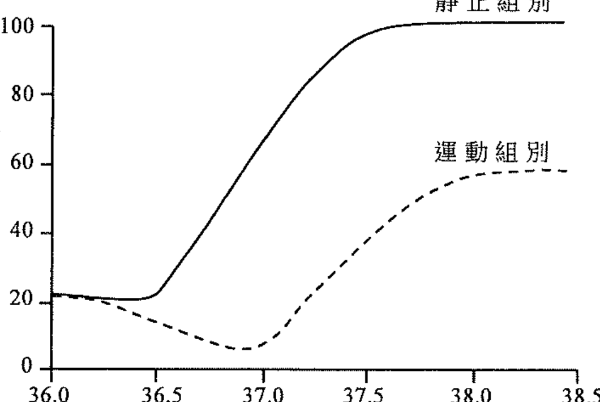

(i) 解釋為什麼靜止組別的皮膚血流量有所增加。（4 分）

(ii) (1) 參考運動組別的曲線圖，當體溫從 36℃ 升至 37℃ 時，推斷通往皮膚表面的小動脈的狀態。（2 分）

(2) 這改變對運動組別有什麼重要性？（2 分）

(iii) 除了在 (ii) 的改變外，試就皮膚血流量所出現的體溫調節反應，寫出兩組之間的另外兩個不同之處。（2 分）

---

## 乙部　應用生態學

## 第 2 題

【建議標籤】

- 卷別/部分：Paper 2　乙部
- 課題：#生物積聚 #污染 #生物多樣性

【題目內容】

**(a)** 在 2000 年，香港進行了一項調查，評估污染物 X 於人體內的生物積聚情況。該項調查收集了人類母乳樣本作分析，並以問卷收集參與者的年齡、膳食和健康狀況等各項資料。以下兩圖顯示母乳內污染物 X 濃度與年齡組別（圖 I）和每週進食海鮮次數（圖 II）的關係：

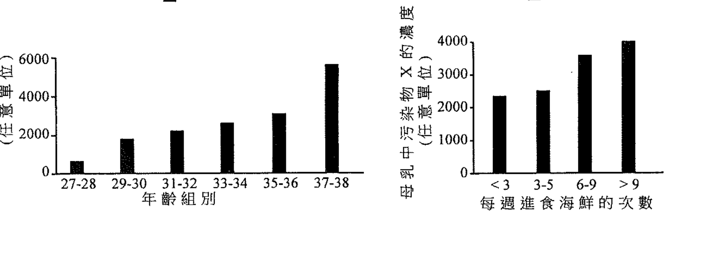

(i) 參考以上兩圖，指出兩項證據以支持污染物 X 是可於人體內積聚。解釋你的答案。（4 分）

(ii) (1) 列出引致生物積聚的污染物的三種常見特徵。（3 分）

(2) 提出為什麼母乳可作生物積聚的其中一個指標。（2 分）

(iii) 參考上述個案，提出會引致釋放可生物積聚的污染物到環境的兩項人類活動。（2 分）

---

**(b)** 為了增加海岸線的生物多樣性，故在本地海堤裝置人工生態磚塊組件。以下照片顯示海堤上裝置了人工生態磚塊組件的區域：

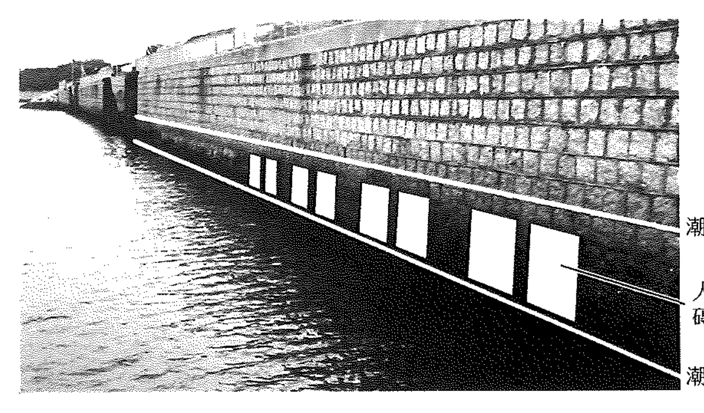

在本港某海堤裝置不同的人工生態磚塊組件，以進行一項實驗。下表顯示四個不同的處理方法，以及 12 個月之後在各表面上生長的無脊椎動物物種數目：

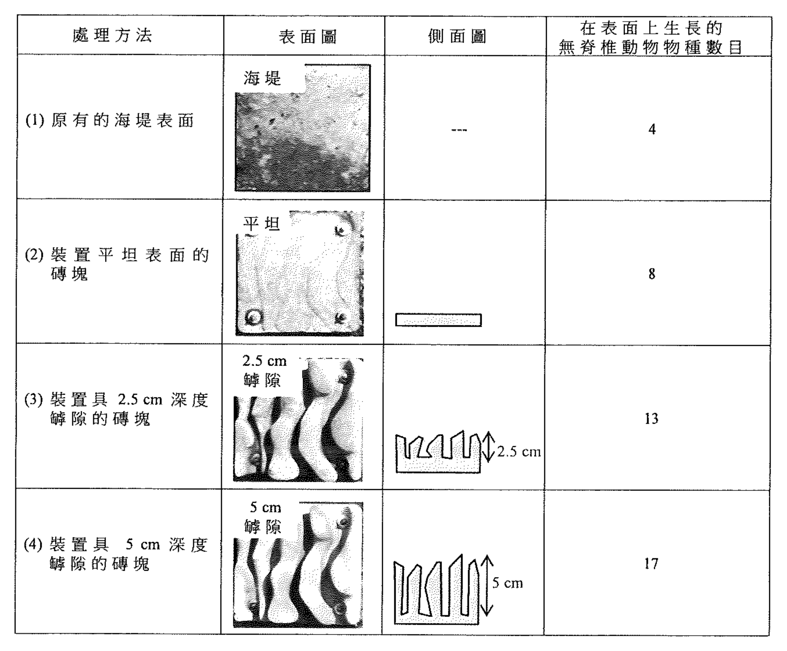

| 處理方法 | 無脊椎動物物種數目 |
|---|---|
| (1) 原有的海堤表面 | [?] |
| (2) 裝置平坦表面的磚塊 | 8 |
| (3) 裝置具 2.5 cm 深度罅隙的磚塊 | 13 |
| (4) 裝置具 5 cm 深度罅隙的磚塊 | 17 |

（處理方法的側面圖及表面圖見上圖。）

(i) 比較相關的處理方法，推論裝置人工生態磚塊組件的兩種效應。按照以下格式在答題簿內以表列形式回答。（4 分）

| 比較哪些處理方法的結果 | 推論 |
|---|---|
| ＿＿＿ | ＿＿＿ |
| ＿＿＿ | ＿＿＿ |

(ii) 提出人工生態磚塊組件的罅隙如何幫助區域 A 內的生物應付以下環境情況所帶來的威脅：

(1) 潮退時暴露的海堤表面（1 分）

(2) 海浪的作用（1 分）

(iii) (1) 提出在評估裝置人工生態磚塊組件對區域 A 內生物多樣性的效應時，應要收集的另一組數據。（1 分）

(2) 要確認裝置人工生態磚塊組件能否增加區域 A 的生物多樣性，收集到的數據需要符合某些特定條件。列出這些條件。（2 分）

---

## 丙部　微生物與人類

## 第 3 題

【建議標籤】

- 卷別/部分：Paper 2　丙部
- 課題：#微生物 #食品加工 #細菌生長 #抗生素

【題目內容】

**(a)** 食品加工的過程中，若食物處理不當，就會受微生物污染。以下照片顯示兩種肉類產品：碎牛肉和牛扒：

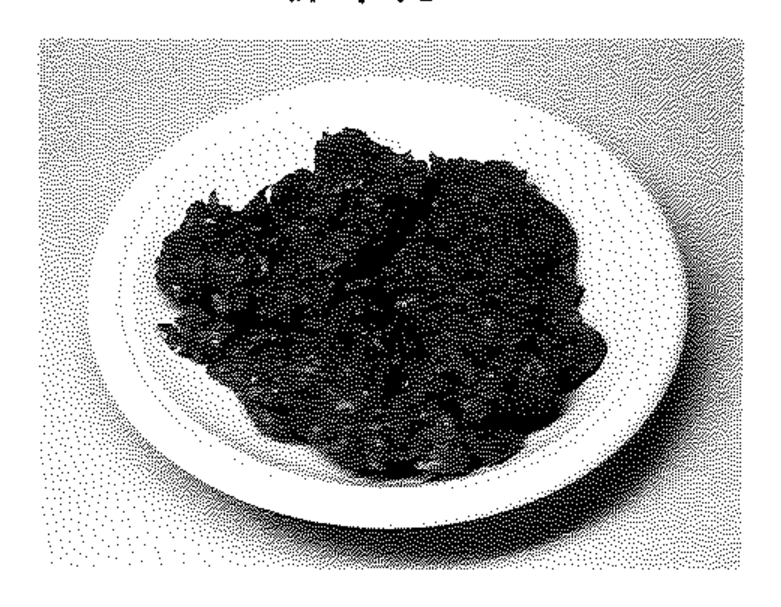

(i) 提出為什麼碎牛肉較牛扒容易受微生物污染。（2 分）

(ii) 為評估碎牛肉的安全和質素，將四個碎牛肉樣本進行微生物分析。將樣本分別用兩個不同溫度（5℃ 和 20℃）進行培養，每隔一段時間，就用平板培養法分別數算樣本的細菌 X 和細菌 Y 的菌落數目。記錄菌落數目增加 10 倍所需的時間。結果如下表所示：

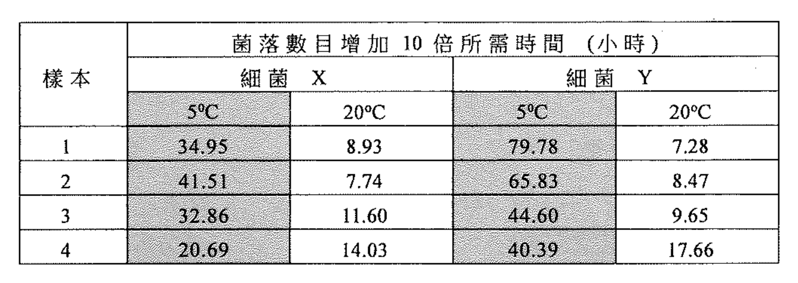

（表：菌落數目增加 10 倍所需的時間，單位為小時，按樣本、細菌 X／Y 及 5℃／20℃ 分類。）

(1) 計算在 5℃ 和 20℃ 時，細菌 X 和細菌 Y 的菌落數目增加 10 倍所需的平均時間。按照以下格式在答題簿內以表列形式回答：（2 分）

| | 細菌 X（5℃） | 細菌 X（20℃） | 細菌 Y（5℃） | 細菌 Y（20℃） |
|---|---|---|---|---|
| 平均時間（小時） | ＿＿＿ | ＿＿＿ | ＿＿＿ | ＿＿＿ |

(2) 比較細菌 X 和細菌 Y 在不同溫度的生長速率。（2 分）

(3) 根據 (2) 的答案，哪種細菌較有可能引致貯藏在雪櫃的食物樣本腐壞？試加以解釋。（3 分）

(4) 細菌 Y 常見於動物的腸道。解釋為什麼細菌 Y 通常會用作肉類在食品加工過程中受微生物污染的指標。（2 分）

---

**(b)** (i) 透過用光學密度量度細菌培養物的混濁度，對細菌的生長進行監測。結果如下圖 I 所示：

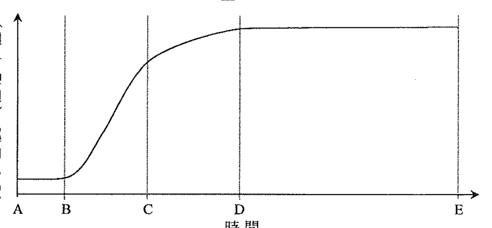

(1) 細菌生長的靜止期有什麼特徵？（2 分）

(2) 參考量度光學密度的原理，由圖中找出證據以解釋為什麼靜止期是 CD 而不是 DE。（3 分）

(3) 參考量度光學密度的原理，解釋為什麼在量度光學密度之前，需要將細菌培養物搖勻。（2 分）

(ii) Pseudomonas aeruginosa 是對多種抗生素具抗性的細菌物種，牠導致免疫系統薄弱的住院病人出現嚴重感染。為評估不同抗生素對治療受 P. aeruginosa 感染的病人的效用，從病人取得 P. aeruginosa 以製備細菌培養物。將定量的細菌培養物加入盛有相同體積但不同濃度抗生素的小孔，如圖 II 所示。然後進行培養，培養後的結果如圖 III 所示：

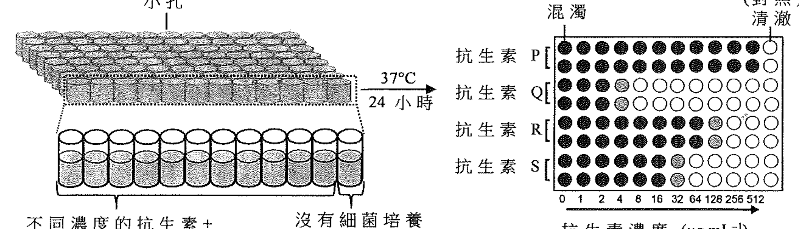

(1) 將抗生素對 P. aeruginosa 感染患者的療效按升序排列。（1 分）

(2) 要有效治療患者，抗生素 S 的最低濃度是什麼？（1 分）

---

## 丁部　生物工程

## 第 4 題

【建議標籤】

- 卷別/部分：Paper 2　丁部
- 課題：#生物工程 #基因轉移 #轉基因 #PCR

【題目內容】

**(a)** GFP 基因編碼一種蛋白，名為綠色螢光蛋白（GFP），可於一些水母中找到。下圖顯示將 GFP 基因插入質粒 A，並把細菌細胞轉化的過程：

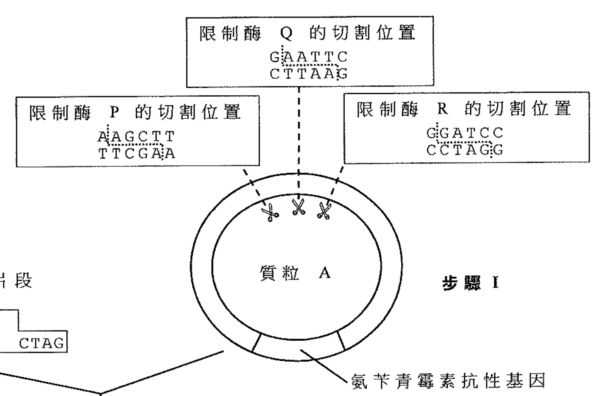

（圖中顯示限制酶 R 和限制酶 P 的切割位置、氨苄青霉素抗性基因、GFP 基因，以及步驟 I 至 IV。）

(i) 寫出將 GFP 基因插入質粒 A 所使用的限制酶。解釋你的答案。（3 分）

(ii) 步驟 IV 的目的是什麼？這步驟如何達至其目的？（2 分）

(iii) 下圖顯示在普通光和 UV 光下，瓊脂平板上的細菌菌落的外觀：

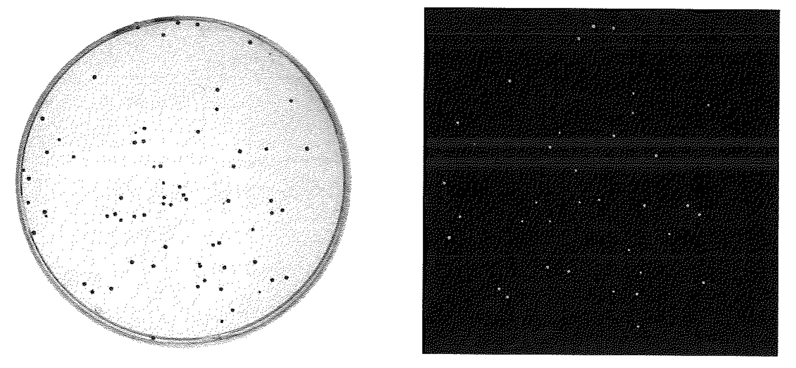

(1) 解釋為什麼只有部分細菌菌落在 UV 光下發光。（3 分）

(2) 提出 GFP 基因的一種應用。（1 分）

---

**(b)** 某公司研發具除草劑抗性基因（HR）的轉基因（GM）稻米植物，其採用的方法如下所示：

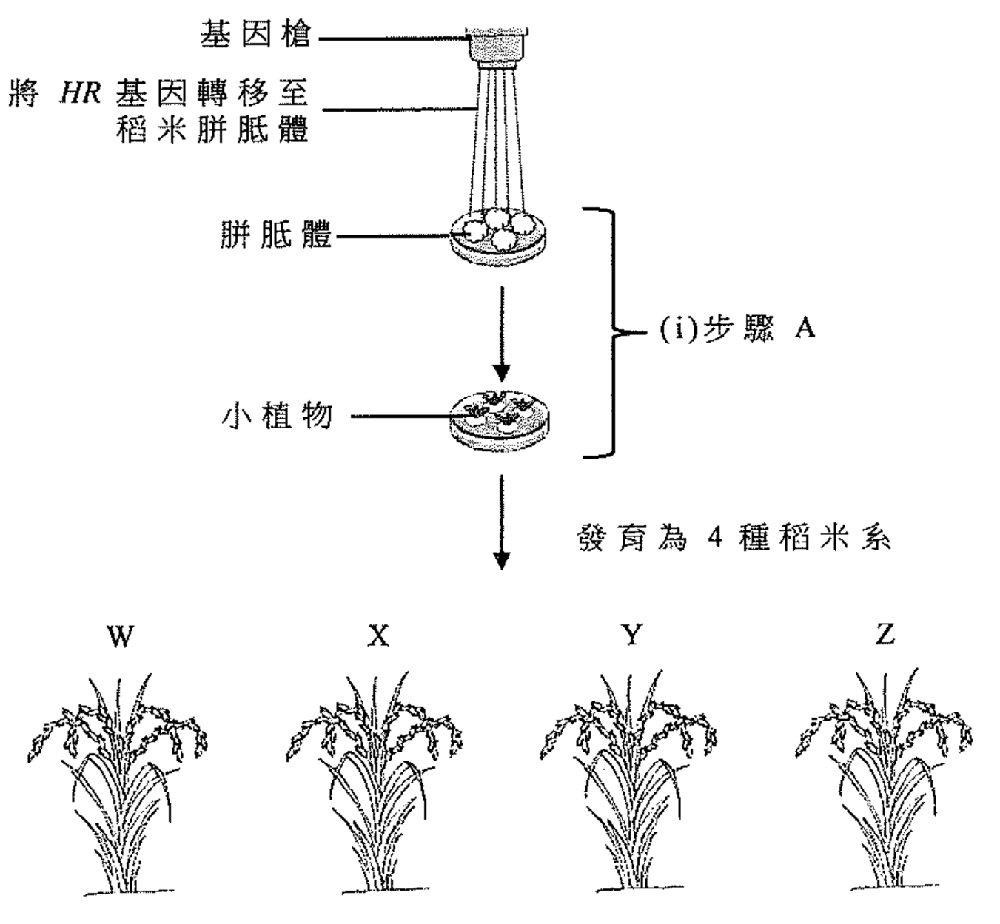

（圖中顯示基因槍、將 HR 基因轉移至稻米胼胝體（步驟 A）、發育為 4 種稻米系、提取 DNA 樣本進行 PCR 檢測，以及用除草劑噴灑檢測葉子有否受損。）

(i) 指出步驟 A 所使用的技術。（1 分）

(ii) 將稻米系 W、X、Y 和 Z 的 DNA 樣本進行 PCR，檢測是否含有 ACTI 基因（該基因可見於所有稻米植物）和加插的 HR 基因。完成後，將 PCR 產物進行凝膠電泳。用相等體積的水代替 PCR 產物作為對照。凝膠電泳的結果如下所示：

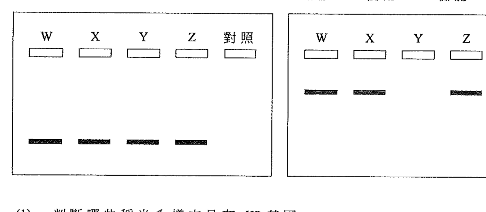

（凝膠 I：使用 PCR 檢測 ACTI 基因；凝膠 II：使用 PCR 檢測 HR 基因。）

(1) 判斷哪些稻米系樣本具有 HR 基因。（1 分）

(2) 如果凝膠 I 內樣本 Y 的 DNA 帶不存在，你曾如何演繹凝膠 II 內樣本 Y 的結果？（2 分）

(iii) 使用大量除草劑噴灑 4 組（組 1 至組 4）稻米植物，然後在固定的環境條件下種植植物。兩週後，記錄每組在 100 片葉子中，具可見不同程度損傷的葉子數目。GM 稻米系中因除草劑誘發的損害，總結如下：

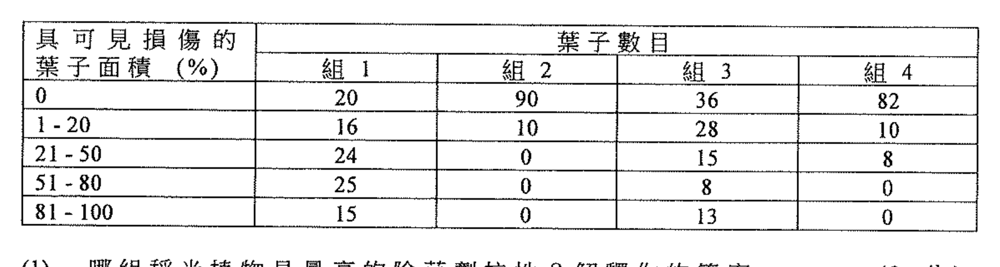

(1) 哪組稻米植物具最高的除草劑抗性？解釋你的答案。（2 分）

(2) 組 1 所代表的，最可能是哪個稻米系樣本（W、X、Y 或 Z）？解釋你的答案。（3 分）

(3) 雖然有多於一種稻米系成功插入 HR 基因，但是除草劑所誘發的損傷結果，差異甚大。提出為什麼會這樣。（2 分）

---

## 待人工核對

- 第 2 題 (a)：污染物字母（X／Y）在引言與小題間不一致，待對頁核對（原卷 p.3）。
- 第 2 題 (b)：處理方法 (1) 原有海堤表面的無脊椎動物物種數目 OCR 未能辨識（原卷 p.4）。
- 第 3 題 (a)(ii)：細菌 X／Y 於不同溫度下「菌落數目增加 10 倍所需時間」之數據表數值 OCR 亂碼，以原卷截圖嵌入，待對頁核對（原卷 p.5）。
- 第 3 題 (b)(ii)：抗生素 P/Q/R/S 的濃度及藥敏測試圖（圖 II／III）細節以截圖嵌入，待對頁核對（原卷 p.6）。
- 第 4 題 (b)(iii)：除草劑誘發葉損傷之數據表數值 OCR 亂碼，以原卷截圖嵌入，待對頁核對（原卷 p.10）。
- 各小題分數以 OCR 辨識為準，部分標示待對頁核對。
