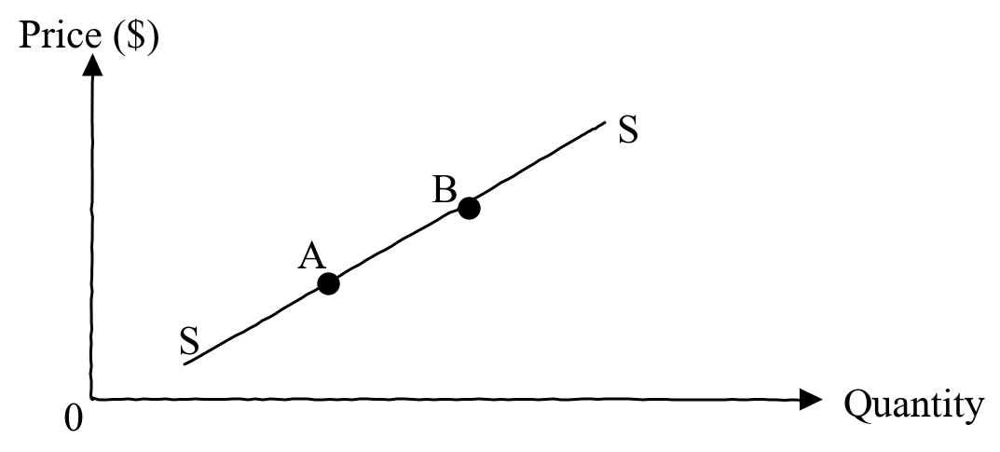
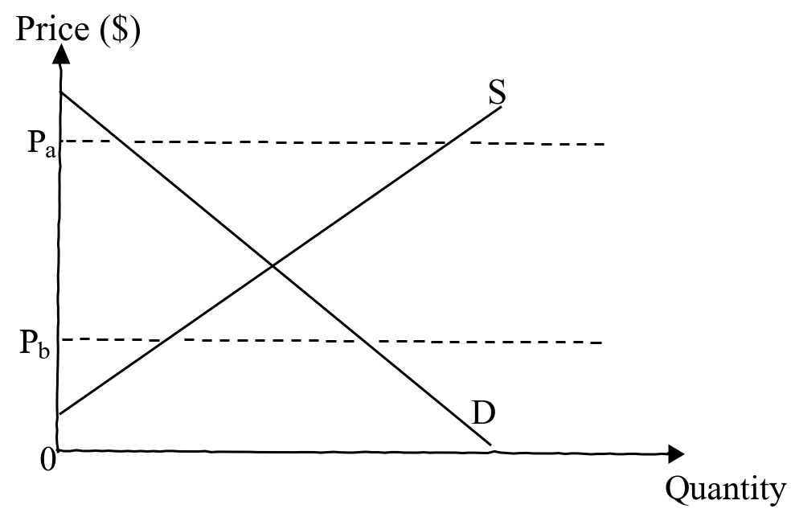
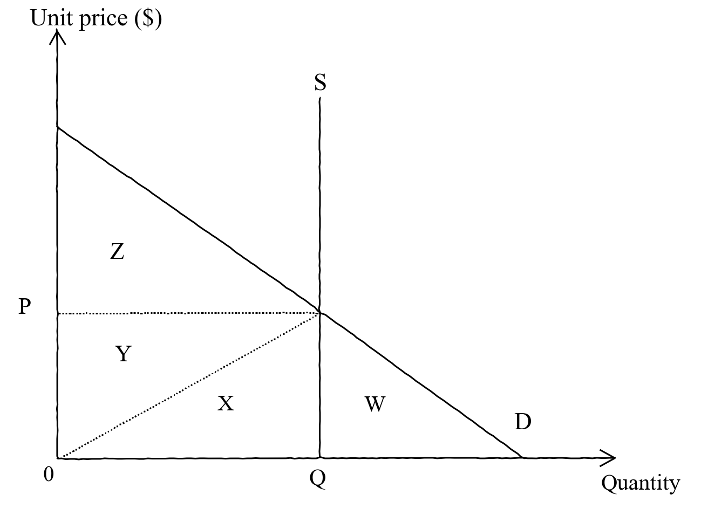
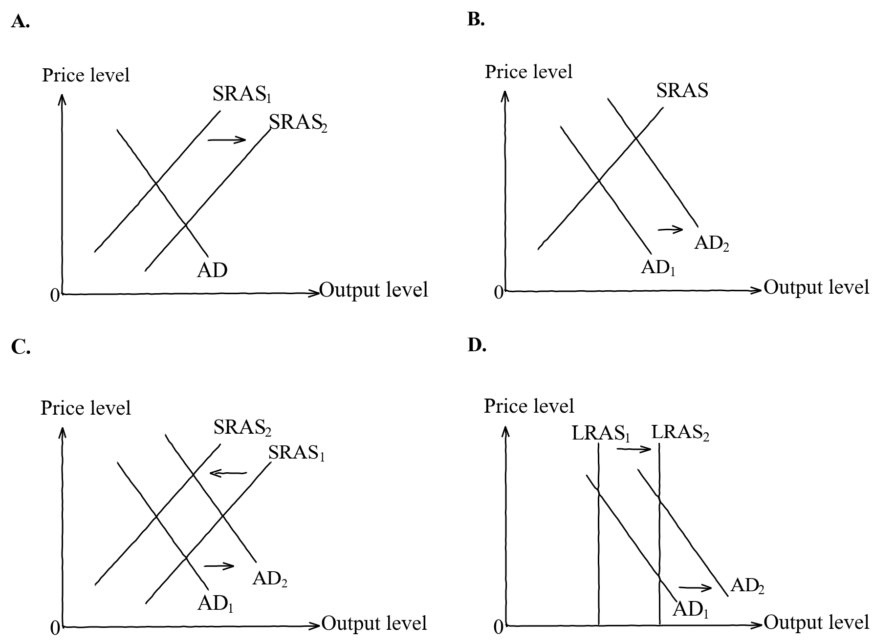
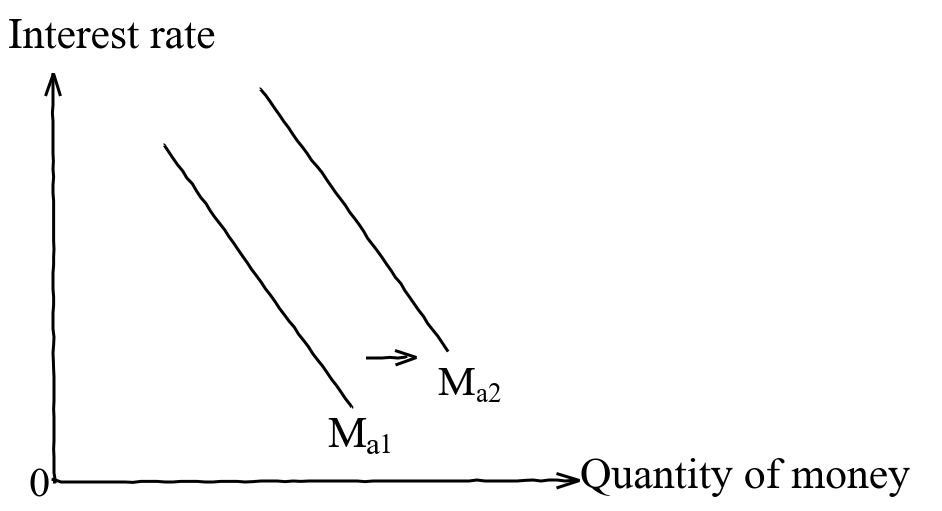
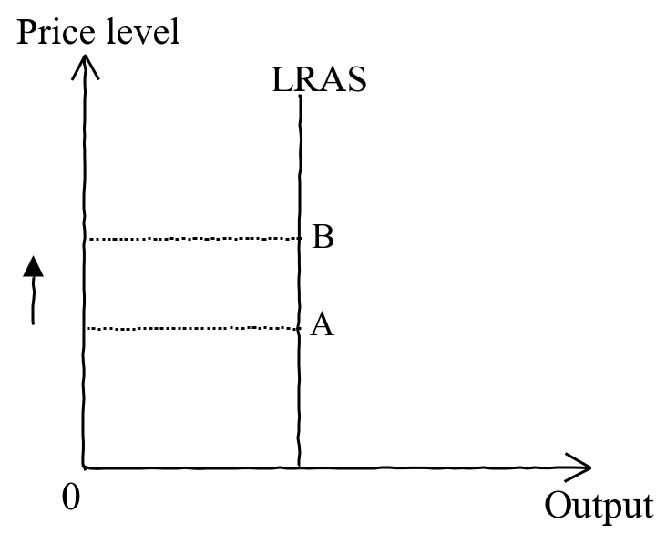

# 2015 DSE 經濟 試卷一（英文卷）— 題目庫

> 來源：2015-DSE-ECON PAPER 1（dsepaper_hk\經濟\2015\…Past Paper Paper 1.pdf；英文卷，唔用卷一.pdf）　｜　多項選擇題 45 題，每題等分　｜　一小時完卷（8:30 am – 9:30 am）
> 說明：已移除頁碼、試卷標頭、網站水印等雜訊；公式重排為 LaTeX。**本檔為題目庫（零答案）**，只含題目清洗 + 建議標籤。
> 含圖題目已嵌入**電子重繪向量圖**（存於 `2015_P1_images/`，由重繪腳本生成，可改參數重出）。原卷頁面影像在 `_work_econ_ocr\2015_P1_ENG_pages_300\`（對照用，不上網）。
> **圖進度（誠實）**：6 張之中 **6/6 已過 §9.4＋抗鋸齒容差並嵌圖**（Q15／Q19／Q22／Q27／Q28／Q37）。Q45 原卷無圖。明細見 `2015_P1_fig_audit.md`。

---

## 甲部（第 1–30 題）

## 第 1 題

【建議標籤】

- 卷別/部分：Paper 1
- 課題：#實證陳述 #規範陳述

【題目內容】

Which of the following are positive statements?

(1) Importation of labour from the mainland would result in a rise in job vacancies in Hong Kong.

(2) It would be better to import labour from the Guangdong province because they can speak Cantonese.

(3) Productivity of labour from China is higher than that from other Southeast Asian countries.

(4) Unemployment rate in Hong Kong would rise by 1% as a result of labour importation of 30 000 from the mainland.

- A. (1) and (2) only
- B. (3) and (4) only
- C. (1), (3) and (4) only
- D. (2), (3) and (4) only

---

## 第 2 題

【建議標籤】

- 卷別/部分：Paper 1
- 課題：#機會成本

【題目內容】

David can choose to take the MTR or a bus to Yuen Long. Suppose the required travel time and the fares of both options are the same in a normal situation. Which of the following will result in an increase in the opportunity cost of travelling to Yuen Long by MTR?

- A. The air-conditioner on the bus is out of order.
- B. The traffic jam makes the bus trip 15 minutes longer.
- C. A signalling problem causes the travel time of the MTR to increase by 15 minutes.
- D. David feels annoyed about the news broadcast in the MTR train.

---

## 第 3 題

【建議標籤】

- 卷別/部分：Paper 1
- 課題：#經濟制度 #市場經濟

【題目內容】

Which of the following is a characteristic of a market economy?

- A. Income distribution is uneven in the economy.
- B. The government has no role in regulating business activities in the economy.
- C. Most factors of production in the economy are privately owned.
- D. There is only price competition in the economy.

---

## 第 4 題

【建議標籤】

- 卷別/部分：Paper 1
- 課題：#勞工流動性

【題目內容】

The __________ mobility of labour will decrease if __________.

- A. geographical ...... the government introduces "city-bike rental scheme" in all train stations
- B. geographical ...... several big companies set up child care centres in their offices
- C. occupational ...... the travelling subsidy provided by the government is reduced due to a budget deficit
- D. occupational ...... licences are required by the government for more professions

---

## 第 5 題

【建議標籤】

- 卷別/部分：Paper 1
- 課題：#邊際成本 #利潤極大化 #完全競爭

【題目內容】

The schedule below shows the marginal cost of a firm in a perfectly competitive market.

| Output (units) | 3 | 4 | 5 | 6 | 7 | 8 | 9 |
|---|---|---|---|---|---|---|---|
| Marginal cost ($) | 5 | 5.5 | 6 | 6.5 | 7 | 8 | 9.5 |

Suppose the rental of the machine hired, a fixed cost, increases by \$2 while the marginal cost for each unit of the output is reduced by \$0.5. As a result, the profit-maximising output of the firm __________ while the profit of the firm __________.

- A. increases ...... decreases
- B. increases ...... may increase or decrease
- C. decreases ...... decreases
- D. decreases ...... may increase or decrease

---

## 第 6 題

【建議標籤】

- 卷別/部分：Paper 1
- 課題：#勞動生產力

【題目內容】

Refer to the following table.

| | Factory A | Factory B |
|---|---|---|
| Number of full-time workers | 25 | 0 |
| Number of part-time workers | 0 | 50 |
| Average working hours of full-time workers | 8 | 0 |
| Average working hours of part-time workers | 0 | 6 |
| Total output (units) | 12 000 | 15 000 |

Which of the following is a possible reason for the difference between the labour productivity of Factory A and Factory B?

- A. Factory A uses time rate while Factory B uses piece rate to pay its workers.
- B. Factory A provides more training for its workers.
- C. The part-time workers employed by Factory B are more skilled.
- D. Factory B uses more capital goods.

---

## 第 7 題

【建議標籤】

- 卷別/部分：Paper 1
- 課題：#公司種類 #私人有限公司

【題目內容】

A firm has an independent legal entity but the owners cannot transfer their ownership without the consent of the other owners. When the owners want to expand the firm's business, they can __________.

(1) use the retained profit of the firm

(2) issue shares to the public to raise capital

(3) borrow from friends to raise capital

- A. (1) and (2) only
- B. (1) and (3) only
- C. (2) and (3) only
- D. (1), (2) and (3)

---

## 第 8 題

【建議標籤】

- 卷別/部分：Paper 1
- 課題：#規模經濟 #業務擴展 #分散風險

【題目內容】

759Store, a local retailer of imported snacks, expands its business to sell cosmetics and skincare products. Which of the following is the **LEAST** likely motive behind the expansion?

- A. to reduce competition
- B. to enjoy economies of scale
- C. to extend its brand name to other products
- D. to spread risk by business diversification

---

## 第 9 題

【建議標籤】

- 卷別/部分：Paper 1
- 課題：#邊際回報遞減 #總產量

【題目內容】

The table below shows the total product of Firm A, which employs only capital and labour in production.

| Labour (units) | Capital (units) | Total Product (units) |
|---|---|---|
| 12 | 2 | 110 |
| 12 | 3 | 130 |
| 12 | 4 | 160 |
| 12 | 5 | X |

Which of the following statements about Firm A is correct?

- A. If the above data illustrate the law of diminishing marginal returns, the value of X can be equal to 180.
- B. If the above data illustrate the law of diminishing marginal returns, the value of X can be equal to 190.
- C. If the above data illustrate the law of diminishing marginal returns, the value of X can be larger than 200.
- D. The law of diminishing marginal returns does not apply to Firm A because capital is not a fixed factor.

---

## 第 10 題

【建議標籤】

- 卷別/部分：Paper 1
- 課題：#總收入 #限額 #補貼

【題目內容】

Which of the following will result in a rise in the total revenue of chicken farms?

- A. The price of chicken feed falls.
- B. The government reduces the profits tax rate on chicken farms.
- C. The effective quota on the sale of chickens is increased.
- D. The government reduces the subsidy for the producers of pork.

---

## 第 11 題

【建議標籤】

- 卷別/部分：Paper 1
- 課題：#需求彈性 #總開支

【題目內容】

The table below shows the relationship between the price of and the total expenditure on ice-cream.

| Unit price (\$) | 5 | 6 | 7 | 8 |
|---|---|---|---|---|
| Total expenditure (\$) | 25 | 30 | 35 | 40 |

From the above table, we can conclude that the elasticity of demand for ice-cream is __________ (without regard to its negative sign).

- A. between zero and one
- B. equal to zero
- C. larger than one
- D. equal to one

---

## 第 12 題

【建議標籤】

- 卷別/部分：Paper 1
- 課題：#單位補貼 #彈性 #補貼得益

【題目內容】

The government provides a per-unit subsidy of \$10 on producing green products. The market price drops by \$6 as a result. Which of the following statements about the green product market is/are correct?

(1) The supply of green products is more elastic than their demand.

(2) Consumers enjoy more subsidy benefit than producers.

(3) The demand for green products increases.

- A. (2) only
- B. (1) and (2) only
- C. (1) and (3) only
- D. (1), (2) and (3)

---

## 第 13 題

【建議標籤】

- 卷別/部分：Paper 1
- 課題：#短缺 #價格上限 #黑市

【題目內容】

Many people queued up for days for the tickets to watch the show of Tsz-Wah, a famous artist performing stand-up comedy. Some people complained that they were unable to buy tickets even though they were willing to pay the ticket price set by the organiser. The above situation implies that

- A. price was the only criterion for allocating the tickets.
- B. the producer was not maximising its profit.
- C. a black market for the tickets might emerge.
- D. there was an effective price ceiling in the ticket market.

---

## 第 14 題

【建議標籤】

- 卷別/部分：Paper 1
- 課題：#互補品 #替代品 #聯合供給 #競爭供給

【題目內容】

Holding other factors constant, a rise in the price of Good X will lead to a fall in the total revenue of Good Y if

- A. Good X and Good Y are complements.
- B. Good X and Good Y are substitutes.
- C. Good X and Good Y are in joint supply.
- D. Good X and Good Y are in competitive supply.

---

## 第 15 題

【建議標籤】

- 卷別/部分：Paper 1
- 課題：#供求均衡 #沿曲線移動

【題目內容】

SS is the supply curve for smartphones. Which of the following reasons can best explain the change of the equilibrium position in the smartphone market from A to B?

- A. The retailers offer more free gifts for buying smartphones.
- B. The size of a tablet computer with a phone function is reduced.
- C. There are more smartphone producers in the market.
- D. The major network service providers increase the service charge at the same time.

---

## 第 16 題

【建議標籤】

- 卷別/部分：Paper 1
- 課題：#從量稅 #稅負 #稅收

【題目內容】

Refer to the following table for the supply and demand schedules for a good.

| Unit Price (\$) | 4 | 5 | 6 | 7 | 8 |
|---|---|---|---|---|---|
| Quantity demanded (units) | 16 | 14 | 12 | 10 | 8 |
| Quantity supplied (units) | 14 | 14 | 14 | 14 | 14 |

The government imposes a \$2 per unit tax on the good. Which of the following statements about the good is correct?

- A. Sellers' revenue net of tax is \$70.
- B. The new market price is \$6.
- C. The total tax revenue is \$28.
- D. The above information is insufficient to determine the tax burden on sellers.

---

## 第 17 題

【建議標籤】

- 卷別/部分：Paper 1
- 課題：#私人利益 #社會利益 #外部性

【題目內容】

Which of the following is an example of the divergence between private and social benefits?

- A. A security guard watches live concerts when he is working in a concert hall.
- B. A tourist enjoys the music performed by a singer on the street and he does not pay for that.
- C. A resident living next to a karaoke lounge cannot fall asleep because of the noise.
- D. After the removal of the airport, the market value of the residential flats in that region increases.

---

## 第 18 題

【建議標籤】

- 卷別/部分：Paper 1
- 課題：#需求定律

【題目內容】

Which of the following is INCONSISTENT with the law of demand?

- A. More high-quality Japanese grapes are imported to Hong Kong during Mid-Autumn Festival.
- B. An increase of the per unit tax on beer results in a fall in the quantity of small-bottle beer sold in the market.
- C. After the introduction of the airport departure tax which is a fixed amount for any traveller, the average length of airplane journeys decreases.
- D. The birth rate increases when the income tax allowance for children increases.

---

## 第 19 題

【建議標籤】

- 卷別/部分：Paper 1
- 課題：#價格上限 #剩餘 #無謂損失

【題目內容】

Refer to the following diagram.

If the government lowers the price ceiling from $P_a$ to $P_b$,

- A. the quantity transacted will increase.
- B. the deadweight loss will decrease.
- C. the producer surplus will decrease.
- D. the consumer surplus will increase.

---

## 第 20 題

【建議標籤】

- 卷別/部分：Paper 1
- 課題：#市場結構 #寡頭壟斷 #相互依存

【題目內容】

Which of the following statements about the theme park industry in Hong Kong is correct?

- A. Hong Kong Disneyland is a monopolist because its average cost of production drops when there are more tourists.
- B. Hong Kong Disneyland guarantees a profit because it is protected by the government.
- C. Hong Kong Disneyland and Ocean Park Hong Kong have no competition with each other as tourists may go to both theme parks.
- D. Hong Kong Disneyland and Ocean Park Hong Kong are interdependent in their marketing strategies.

---

## 第 21 題

【建議標籤】

- 卷別/部分：Paper 1
- 課題：#堅尼系數 #稅制 #收入不均

【題目內容】

Suppose the post-tax Gini coefficient of an economy is larger than its pre-tax Gini coefficient. This implies that

- A. the government has increased the amount of transfer payment to the poor.
- B. the tax system of the economy is likely to be regressive.
- C. the problem of income inequality is worse than that in the previous year.
- D. the government should reform the tax system.

---

## 第 22 題

【建議標籤】

- 卷別/部分：Paper 1
- 課題：#社會剩餘 #完全無彈性供給

【題目內容】

Refer to the following diagram.

The maximum total social surplus is equal to __________.

- A. area Z
- B. area $(Y+Z)$
- C. area $(W+X+Y)$
- D. area $(X+Y+Z)$

---

## 第 23 題

【建議標籤】

- 卷別/部分：Paper 1
- 課題：#就業結構 #產業結構

【題目內容】

The following table shows the employment distribution in an economy.

| Sector \ Year | 2010 | 2014 |
|---|---|---|
| Primary | 0.4% | 0.4% |
| Secondary | 23.6% | 18.5% |
| Tertiary | 76.0% | 81.1% |
| Total | 100% | 100% |

From the above table, we can conclude that from 2010 to 2014,

- A. the number of workers engaged in the primary sector remained constant.
- B. the overall employment rate was the same.
- C. the contribution of the tertiary sector to gross domestic product (GDP) increased.
- D. the relative importance of the secondary sector in terms of employment decreased.

---

## 第 24 題

【建議標籤】

- 卷別/部分：Paper 1
- 課題：#本地生產總值 GDP

【題目內容】

Which of the following would be included in the calculation of Hong Kong's GDP for 2014?

- A. the old age allowance paid by the government in 2014
- B. the market value of a flat built in 2013 but sold in 2014
- C. the salary of a salesperson working in a shop selling second-hand handbags in 2014
- D. the rental income from a property in Canada owned by a Hong Kong resident producing unit in 2014

---

## 第 25 題

【建議標籤】

- 卷別/部分：Paper 1
- 課題：#名義GDP #實質產出 #人均GDP

【題目內容】

Refer to the following table about an economy.

| | Growth rate (relative to previous year) (%) | |
|---|---|---|
| | Year 1 | Year 2 |
| Nominal GDP | 4 | 0 |
| General price level | 3 | 1 |
| Population | −1 | 2 |

Which of the following statements about the economy is correct?

- A. The per capita nominal GDP in year 2 is the same as that in year 1.
- B. The real output increased in year 2.
- C. The general price level decreased in year 2.
- D. The per capita real GDP decreased in year 2.

---

## 第 26 題

【建議標籤】

- 卷別/部分：Paper 1
- 課題：#總需求 #AD曲線移動

【題目內容】

Which of the following will result in a rightward shift of the aggregate demand curve of a country?

- A. The central bank reduces the discount rate.
- B. The minimum wage rate is increased.
- C. The general price level decreases.
- D. Its trading partners suffer from an economic recession.

---

## 第 27 題

【建議標籤】

- 卷別/部分：Paper 1
- 課題：#總供需 #長期總供給 #人力資本

【題目內容】

The government provides cash subsidies for new-born children from their birth to age 10. Which of the following diagrams best illustrates the effect of the subsidies on the economy after twenty years?

- A.
- B.
- C.
- D.

---

## 第 28 題

【建議標籤】

- 卷別/部分：Paper 1
- 課題：#貨幣資產需求

【題目內容】

Refer to the following diagram.

The curve of asset demand for money will shift from $M_{a1}$ to $M_{a2}$ when

- A. the risk of investing in the stock market increases.
- B. the interest rate decreases.
- C. the general price level rises.
- D. the government reduces the income tax rate.

---

## 第 29 題

【建議標籤】

- 卷別/部分：Paper 1
- 課題：#銀行體系 #超額儲備 #貨幣供應

【題目內容】

Study the following balance sheet of a banking system. The required reserve ratio is 20%.

| Assets (\$million) | | Liabilities (\$million) | |
|---|---|---|---|
| Reserves | 300 | Deposits | 1 000 |
| Loans | 700 | | |

If the central bank issues newly printed banknotes worth \$200 million, the cash held by the non-bank public will increase by \$100 million and the money supply will increase by \$500 million. The total amount of excess reserves in the banking system will then be __________.

- A. \$100 million
- B. \$120 million
- C. \$280 million
- D. \$400 million

---

## 第 30 題

【建議標籤】

- 卷別/部分：Paper 1
- 課題：#貨幣供應 M2

【題目內容】

Which of the following transactions would increase the money supply (M2) of Hong Kong?

- A. Ms Chan transfers \$500 000 from her time deposit account in a restricted licence bank to her time deposit account in a licensed bank.
- B. Mr Lee transfers \$200 000 from his current account to his savings account in a licensed bank.
- C. Mr Man deposits \$100 000 cash into his savings account in a licensed bank.
- D. Ms Chung deposits \$600 000 cash into her time deposit account in a deposit-taking company.

---

## 乙部（第 31–45 題）

## 第 31 題

【建議標籤】

- 卷別/部分：Paper 1
- 課題：#名義利率 #實質利率 #持有貨幣成本

【題目內容】

If the nominal interest rate is 5% and the expected inflation rate is 3%, the cost of holding money is __________, the nominal return of holding money is __________ and the expected real interest rate is __________.

- A. 5% ...... −3% ...... 2%
- B. 5% ...... 0% ...... 2%
- C. 8% ...... −3% ...... 3%
- D. 8% ...... 0% ...... 3%

---

## 第 32 題

【建議標籤】

- 卷別/部分：Paper 1
- 課題：#貨幣基礎

【題目內容】

The monetary base increases when

- A. the commercial banks hold less excess reserves.
- B. the commercial banks buy government bonds from the public.
- C. the central bank buys government bonds from the public.
- D. the central bank increases the discount rate.

---

## 第 33 題

【建議標籤】

- 卷別/部分：Paper 1
- 課題：#貨幣數量理論

【題目內容】

The quantity theory of money implies that

- A. an increase in money supply will lead to a rise in price level when real output is falling.
- B. the economy is always at the full employment output level.
- C. an increase in money supply will lead to a decrease in the velocity of circulation of money when real output is kept constant.
- D. an increase in money supply will lead to a same-proportional increase in real output.

---

## 第 34 題

【建議標籤】

- 卷別/部分：Paper 1
- 課題：#間接稅 #香港稅制

【題目內容】

Which of the following are indirect taxes in Hong Kong?

(1) property tax

(2) rates on property

(3) stamp duty on transfer of stock

(4) general sales tax

- A. (1) and (2) only
- B. (2) and (3) only
- C. (1), (3) and (4) only
- D. (2), (3) and (4) only

---

## 第 35 題

【建議標籤】

- 卷別/部分：Paper 1
- 課題：#貨幣功能 #價值儲藏

【題目內容】

Refer to the following news extract.

> Yu'e Bao（餘額寶）is a new online investment fund introduced by Alibaba. Much of the popularity of Yu'e Bao has come from its ability to give customers the convenience of a demand deposit—meaning they can withdraw their funds whenever they like—but with returns well above what a bank could offer. It recently advertised an annualised return of 5.25%, but that level has on occasion risen to above 7% since the fund was set up. By contrast, banks offer 3.3% as interest for a one-year fixed deposit and close to nothing on savings deposits.

Yu'e Bao is a better __________ as compared with bank deposits because __________.

- A. unit of account ...... it provides a homogeneous means of payment
- B. unit of account ...... it can facilitate people's buying and selling of goods and services
- C. store of value ...... it allows customers to have higher purchasing power in the future
- D. store of value ...... the customers can keep their unused funds in Yu'e Bao

---

## 第 36 題

【建議標籤】

- 卷別/部分：Paper 1
- 課題：#未預期通縮 #財富再分配

【題目內容】

When unanticipated deflation occurs, which of the following people will lose?

- A. people paying a fixed amount of rental payment
- B. people receiving interest from their savings deposits
- C. people repaying a mortgage loan at a floating interest rate
- D. people working under a fixed nominal wage contract

---

## 第 37 題

【建議標籤】

- 卷別/部分：Paper 1
- 課題：#長期總供給 #潛在產出

【題目內容】

Refer to the following aggregate supply diagram.

When the economy moves from point A to point B, which of the following will NOT change?

(1) real output

(2) nominal output

(3) potential output

- A. (1) only
- B. (2) only
- C. (1) and (3) only
- D. (1), (2) and (3)

---

## 第 38 題

【建議標籤】

- 卷別/部分：Paper 1
- 課題：#通縮缺口 #產出缺口 #財政政策

【題目內容】

Initially an economy operates at the long-run equilibrium. Which of the following will lead to a deflationary (output) gap in the economy?

- A. The government increases the salaries tax rate.
- B. The government reduces the profits tax rate.
- C. The government invests in the construction of a cross-border express rail link.
- D. The central bank reduces the required reserve ratio.

---

## 第 39 題

【建議標籤】

- 卷別/部分：Paper 1
- 課題：#通脹 #收入不均 #累進稅

【題目內容】

In an economy with severe inflation and income inequality, the government can lower the price level and reduce the income gap by

- A. increasing the environmental tax on handling household sewage.
- B. increasing the salaries tax and its progressivity.
- C. reducing its spending on social welfare.
- D. reducing the personal allowance of the salaries tax.

---

## 第 40 題

【建議標籤】

- 卷別/部分：Paper 1
- 課題：#比較優勢 #貿易條件

【題目內容】

Assume the labour input requirements for the production of computers and toys in Japan and Hong Kong are as follows:

| | 1 unit of computers | 1 unit of toys |
|---|---|---|
| Japan | 2 man-hours | 6 man-hours |
| Hong Kong | 4 man-hours | 8 man-hours |

Suppose there is no transportation cost. Which of the following can be the terms of trade so that trade is mutually beneficial to Japan and Hong Kong?

- A. 1 unit of computers exchanges for 0.4 units of toys
- B. 1 unit of computers exchanges for 0.5 units of toys
- C. 1 unit of computers exchanges for 1 unit of toys
- D. 1 unit of computers exchanges for 2.5 units of toys

---

## 第 41 題

【建議標籤】

- 卷別/部分：Paper 1
- 課題：#絕對優勢 #比較優勢

【題目內容】

A country has an absolute advantage in producing good X. Which of the following statements about the country is correct?

- A. The country can produce a greater amount of good X than another good with the same amount of resources.
- B. The country has a comparative advantage in producing good X.
- C. The country has an absolute disadvantage in producing another good.
- D. The country may import good X from the international market.

---

## 第 42 題

【建議標籤】

- 卷別/部分：Paper 1
- 課題：#聯繫匯率 #香港貨幣制度

【題目內容】

Under the linked exchange rate system of Hong Kong, which of the following statements is correct?

- A. The money supply (M1) of Hong Kong has to be fully backed up by the US dollar.
- B. The market exchange rate of the HK dollar to the US dollar is fixed at 1 USD to 7.8 HKD by the Hong Kong Monetary Authority.
- C. Hong Kong's import volume will increase when the US dollar appreciates against other currencies.
- D. A current account deficit in the US will lead to a current account deficit in Hong Kong.

---

## 第 43 題

【建議標籤】

- 卷別/部分：Paper 1
- 課題：#經常帳 #國際收支

【題目內容】

A lecturer from the US has been working in Hong Kong for 10 years. Which of the following would be included in the calculation of Hong Kong's current account balance?

(1) the money he gives to his wife in Hong Kong

(2) the money he uses to buy shares listed in the US stock market

(3) the money he donates to a charity organization in Africa

(4) the money he spends on visiting his parents in the US

- A. (1) and (2) only
- B. (1) and (4) only
- C. (2) and (3) only
- D. (3) and (4) only

---

## 第 44 題

【建議標籤】

- 卷別/部分：Paper 1
- 課題：#國際收支平衡 #經常帳 #GDP與GNP

【題目內容】

The following table shows some information about the balance of payments of Country A.

| Items | \$ million |
|---|---|
| Balance on goods | −1 200 |
| Balance on services | 700 |
| Net factor income from abroad | 200 |
| Net current transfer | −100 |
| Increase in reserve assets | 180 |

According to the above data, which of the following statements are correct?

(1) The current account deficit is \$400 million.

(2) Country A's GDP is smaller than its gross national product.

(3) The balance of payments surplus is \$180 million.

- A. (1) and (2) only
- B. (1) and (3) only
- C. (2) and (3) only
- D. (1), (2) and (3)

---

## 第 45 題

【建議標籤】

- 卷別/部分：Paper 1
- 課題：#進口配額 #關稅 #小國開放經濟

【題目內容】

The supply curve of a certain good is upward-sloping in a small open economy. What is the main difference between imposing an effective import quota and a tariff on the good?

- A. Imposing an effective import quota will lower the volume of import while imposing a tariff will not.
- B. Imposing an effective import quota will result in a rise in consumer surplus of the good while imposing a tariff may not.
- C. Imposing a tariff will raise the world price of the good while imposing an effective import quota will not.
- D. Imposing a tariff will result in an increase in the government revenue while imposing an effective import quota may not.
